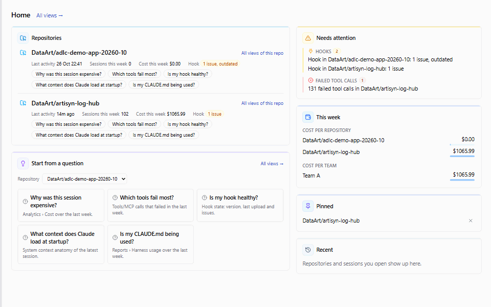

# Artisyn Log Hub

It ran alone for 10 minutes, cost $8 and shipped the feature. All good?
Your harness — CLAUDE.md, rules, skills, hooks, agents, workflows, MCP servers, the knowledge base,
memory — decides the quality, cost, speed, autonomy and safety of every Claude Code session.
You already control the cost — right and useful. Log Hub answers the next questions:
what each harness element does to each of the five, for one session and across the team.
[Docs](user-docs/install-server.md) ·
[Site](https://dataart.github.io/artisyn-log-hub/) ·
[Deck](https://dataart.github.io/artisyn-log-hub/deck/)



[](https://github.com/DataArt/artisyn-log-hub/blob/ci-reports/REPORT.md)
[](https://github.com/DataArt/artisyn-log-hub/actions/workflows/security-scans.yml)

Artisyn Log Hub is a self-hosted server and web app that measures your
[Claude Code](https://docs.claude.com/en/docs/claude-code) harness. A hook, installed into a project,
uploads the session transcripts, OpenTelemetry data and a snapshot of the harness to your own Log Hub
server. The web app shows what each element did: **Live** for what runs right now, the **Session Map**
for how the agents worked through a session, **OTEL** for cost by model, skill and MCP server,
**OKF** for how the agents used the knowledge base, **System context anatomy** for what Claude loads
at startup, and **Tools/MCP** for the MCP and CLI tool calls and their failures — for
one session, and across a team in analytics and reports.

> **Disclaimer.** This project is not affiliated with or endorsed by Anthropic, Cursor or GitHub.
> "Claude" and "Claude Code" are trademarks of Anthropic.

**The hook uploads complete session transcripts, including file contents and command output — read [What is collected](user-docs/data-collection.md#what-is-collected) before you install it.**

## Quick start

Install or upgrade the server (Docker Engine with Compose v2):

```sh
# Linux, macOS, WSL
curl -fsSL https://github.com/DataArt/artisyn-log-hub/releases/latest/download/install.sh | sh
```

```powershell
# Windows (PowerShell)
irm https://github.com/DataArt/artisyn-log-hub/releases/latest/download/install.ps1 | iex
```

Options, upgrades and other ways to run: [Install the server](user-docs/install-server.md).

Open http://localhost:5003, sign in first and check that you are the admin:
[Check that you are the admin](user-docs/install-server.md#check-that-you-are-the-admin).

Install the hook from the root of the project you want to record (the web app's **My API Keys** →
**Install** tab gives you the exact command):

```sh
npx "<server-origin>/static/artisyn-hooks-installer.tgz" install --server-url "<server-origin>" --api-key "<your-api-key>"
```

All options and uninstalling: [Install the hook](hook/INSTALL_HOOK.md).

## Documentation

The user documentation lives in [`user-docs/`](user-docs/). The same pages are the in-app help
(the **?** button in the web app) and the docs of the [site](https://dataart.github.io/artisyn-log-hub/).

| Section | Pages |
|---|---|
| Get started | [Install the server](user-docs/install-server.md) · [Quick setup for a small team](user-docs/small-team-setup.md) · [Install the hook](hook/INSTALL_HOOK.md) · [Your first session](user-docs/getting-started.md) · [Connecting a repository](user-docs/connect-repository.md) |
| Configuration | [Authentication modes](user-docs/authentication-modes.md) · [Server settings](user-docs/server-configuration.md) · [Tuning your setup](user-docs/tuning-your-setup.md) · [OTEL for organization admins](user-docs/otel-admin-guide.md) · [Security hardening & configuration](user-docs/security-hardening.md) |
| Using Log Hub | [All views](user-docs/all-views.md) · [Working with the session list](user-docs/session-list.md) · [Session Log](user-docs/session-log.md) · [Understanding cost & context](user-docs/cost-and-context.md) · [Analytics & reports](user-docs/analytics-reports.md) · [OKF tab](user-docs/okf-tab.md) · [OTEL tab](user-docs/otel-tab.md) · [OTEL collection architecture](user-docs/otel-architecture.md) |
| Data and security | [Data collection notice](user-docs/data-collection-notice.md) · [Data collection & upload](user-docs/data-collection.md) · [Trust model](user-docs/trust-model.md) · [Component reference](user-docs/component-reference.md) · [Responsibility matrix (RACI)](user-docs/responsibility-matrix.md) · [Third-party components](user-docs/third-party-components.md) · [How the hook works](hook/HOW_HOOK_WORKS.md) |
| Changelog | [Changelog](user-docs/changelog.md) |

## Repository layout

| Path | Contents |
|---|---|
| `server/` | NestJS server: API, authentication, log ingestion, migrations, scheduled jobs. See [server/README.md](server/README.md). |
| `client/` | React web app. See [client/README.md](client/README.md). |
| `hook/` | The Claude Code hook (source of truth). See [hook/README.md](hook/README.md) and [hook/INSTALL_HOOK.md](hook/INSTALL_HOOK.md). |
| `artisyn-hooks-installer/` | The `npx` installer that puts the hook into a project. The server serves it. |
| `user-docs/` | User documentation (source of the in-app help and the site docs) and its `nav.json`. |
| `site/` | Site pages, example dataset and slide deck, published to GitHub Pages. |
| `release-template/` | Templates of the GitHub Release install kit (`docker-compose.yml`, `install.sh`, `install.ps1`, install guide). |
| `tests/` | Scenario suites (`tests/scenarios/`) and legacy Playwright end-to-end tests (`tests/e2e/`). |
| `docs/` | Knowledge base and task history. |

## For developers

The repository is set up so that a new developer can clone it and work the same way the maintainer
does: in the maintainer's Claude Code harness, with the project's own sessions logged to a local Log
Hub (dogfooding).

1. **Clone and install.** You need Node.js 22, [Bun](https://bun.sh), Docker and Git.

   ```sh
   git clone <repository-url>
   cd artisyn-log-hub
   npm install
   (cd server && npm install && cp .env.example .env)
   (cd client && bun install)
   ```

2. **Start Postgres, the server and the client.**

   ```sh
   docker compose -f server/artisyn-log-run-local/docker-compose.yml up -d
   (cd server && npm run start:dev)     # API on http://localhost:3000
   (cd client && bun run dev)           # web app on http://localhost:5173
   ```

   Point `DATABASE_URL` in `server/.env` at that database
   (`postgresql://postgres:pw@localhost:5432/a-log`). The end-to-end tests also need
   `PASSWORD_POLICY=any` and `AUTH_RATE_LIMIT_POINTS=0` in it.

3. **Work in the harness.** Open the repository in Claude Code. `CLAUDE.md` and `.claude/` (rules,
   skills, settings) are the maintainer's harness and are checked in on purpose: the build, lint and
   test commands, the work cycle and the project conventions all live there.

4. **Dogfood logging via `.artisyn/`.** `.claude/settings.json` enables the `log-hub-hooks` plugin from
   the project-local marketplace in `.artisyn/marketplace/`, a copy of `hook/`. Your Claude Code
   sessions in this repository are therefore uploaded to your local Log Hub. To make that work on
   your machine:
   - Sign in to your local Log Hub, create an API key and put your per-developer settings in the
     gitignored `.artisyn/config/log-hub.local.json`:
     `{ "apiKey": "<key>", "serverUrl": "http://localhost:5173", "otelReceiverPort": <port> }` — your
     own server URL and a free port. Without a key the hook only records locally. (Installing the hook
     with `--server-url`/`--api-key` writes this file for you.)
   - If you change `otelReceiverPort`, change the port in the `OTEL_EXPORTER_OTLP_*_ENDPOINT` values in
     the gitignored `.claude/settings.local.json` to match.
   - Change other local values (ports, `context` labels) the same way. Keep machine-specific secrets in
     the gitignored `*.local.json` files.

5. **Change the hook in `hook/`**, not in the `.artisyn/` copy. `npm run build:hooks-installer`
   rebuilds the installer, and `.claude/rules/hook.md` describes how to refresh the dogfood copy.

6. **Change user documentation in `user-docs/`**, never in `client/public/help/` — that folder is
   generated (`npm run build:help`). `npm run build:site` builds the site into `tmp/site/`. See
   [`docs/knowledgebase/user-docs-and-site.md`](docs/knowledgebase/user-docs-and-site.md).

The canonical build, lint and test commands are listed in `CLAUDE.md`.

**Optional: Claude sandboxes.** `scripts/claude-docker.ps1` (or `.cmd`) runs Claude Code in an
isolated Docker container per git worktree; see
[`docs/knowledgebase/docker-dev-container.md`](docs/knowledgebase/docker-dev-container.md). It is
opt-in: the host workflow above is unchanged. The very first run builds the sandbox image, which
takes ~20–30 min; later runs reuse it and start in seconds. A sandbox never works on a branch
listed in `.claude/claude-isolation.json` (by default `main`).

## License

Artisyn Log Hub is released under the MIT license; see [LICENSE](LICENSE). Third-party packages and
their licenses are listed in [THIRD_PARTY_NOTICES.md](THIRD_PARTY_NOTICES.md).
