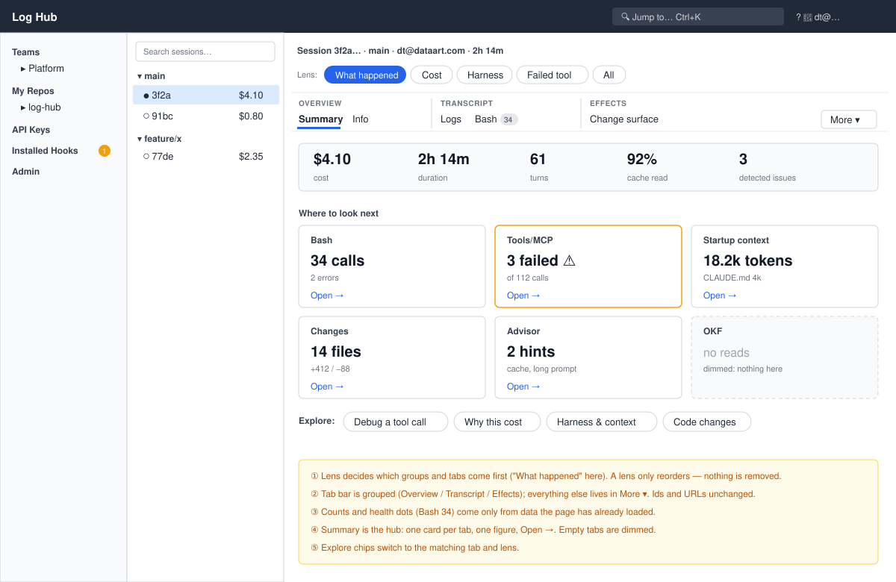
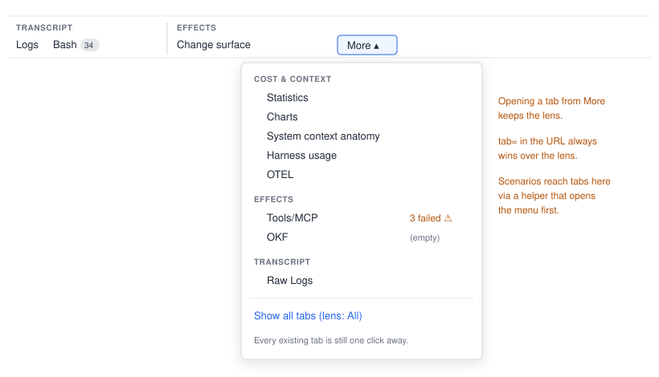
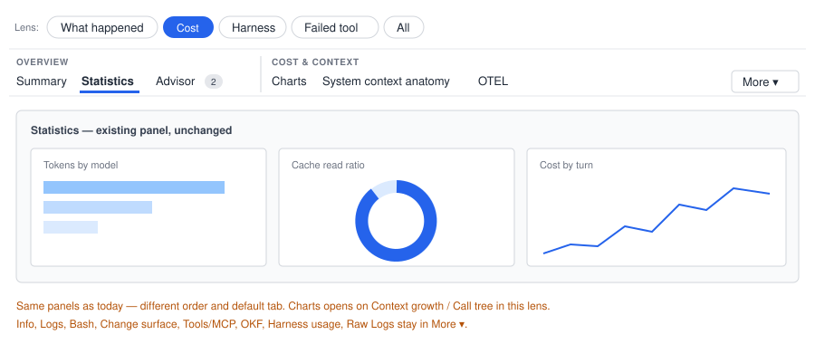
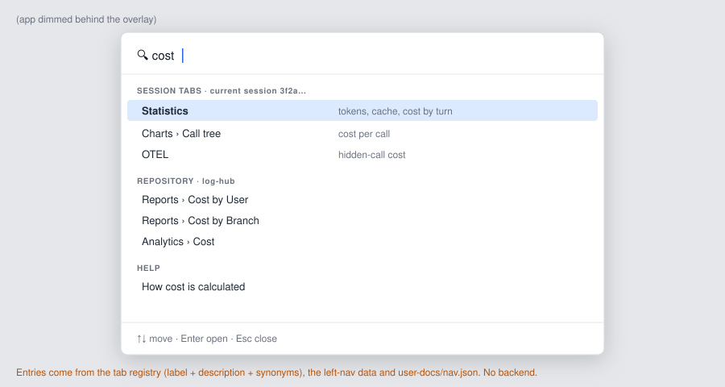
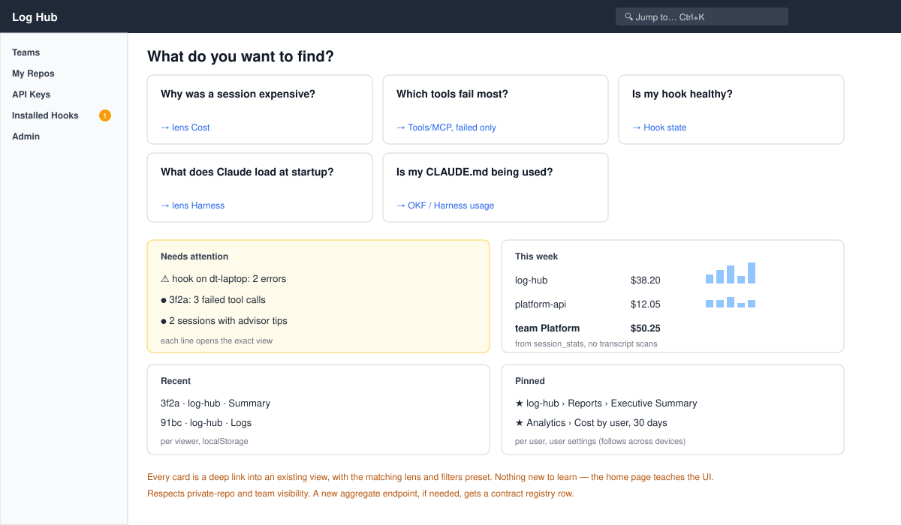
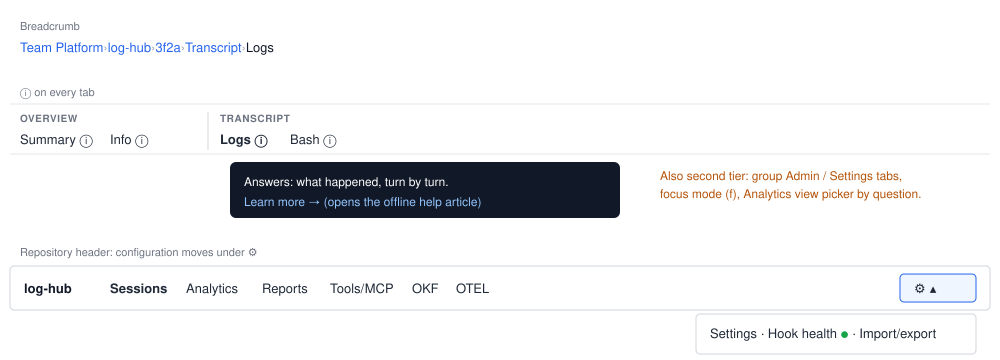

# Wireframes: the whole picture

How waves 1 and 2 look together. Wireframes, not pixel layouts; names and figures are examples.
Sources are the SVG files in [`wireframes/`](wireframes/).

## W1. Session pane — lens + grouped tab bar + Summary hub (wave 1: ideas 1–4)

- The **lens** decides which groups and tabs are shown first; "What happened" here.
- The tab bar shows **groups** (Overview / Transcript / Effects); groups and tabs not in the lens go to
  **More ▾**. Counts and health dots ("Bash 34") come from data already loaded.
- **Summary** is the hub: one card per tab with one figure and "Open →"; empty tabs are dimmed.

## W2. "More ▾" opened — nothing is gone

Opening a tab from "More" keeps the lens; `tab=` in the URL always wins over the lens.

## W3. Same session, lens "Cost"

Same panels as today, different order and default tab.

## W4. Command palette (wave 2: idea 5)

Entries come from the tab registry (label + description + synonyms), the left-nav data and
`user-docs/nav.json`.

## W5. Home page (wave 2: idea 6)

Every card is a deep link into an existing view, with the matching lens and filters preset.

## W6. Second tier on the same screen (for reference)

