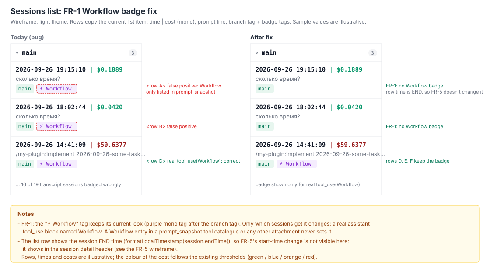
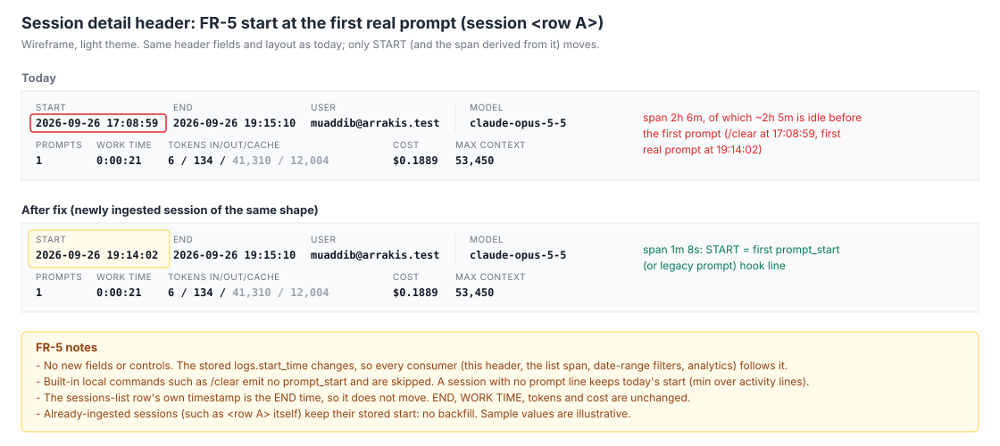

# 2026-09-26: Session List Anomalies and OTEL Port Drift Fixes

**Status:** todo
**Priority:** high
**Type:** bug
**Module(s):** server | client | hook | artisyn-hooks-installer
**Owner:** denis.tsyplakov
**Created:** 2026-09-26

## Description

Raw idea: "Session list/ingest anomalies found in the audited test repository + OTEL port drift — fix
list". This task bundles every fix found while auditing the last 20 root sessions of a test repository
(`http://localhost:5173/#/repos/<repo-id>`, plus a second test checkout of it with its own hook
install, all sessions on Claude Code 2.1.280, hook 2.17.4).

**Remaining scope (re-review 2026-10-21):** FR-1 detection, FR-2 and FR-7 are done; the work left
is FR-6 (installer endpoint rewrite + move to `settings.local.json`), FR-5 (start at first prompt),
the FR-3 KB/corpus entries and the FR-1/FR-3 regression coverage. The audited repository is a
different repository from this project's own dogfooded repo: there all OTEL ports agree, so
Finding 5 cannot show up there, and its Workflow badges are already correct.

### Finding 1 — the "⚡ Workflow" badge is a false positive on almost every session

`hasWorkflow` on the sessions list is computed in `server/src/logs/repositories.controller.ts`
(~L815-852) with a raw substring match on the whole transcript:

```sql
cl.body::text LIKE '%"name": "Workflow"%'
```

Claude Code 2.1.280 writes a new `attachment` event of type `prompt_snapshot` into every transcript.
It contains the full tool catalogue, including `{"name": "Workflow", "schema": {...}}`, so every
session in which the Workflow tool was merely *available* matches. Measured on the last 20 sessions
of the audited test repository: 19 have a claude log, all 19 get the badge, only 3 contain a real Workflow call
(`assistant` event → `message.content[]` block with `type = 'tool_use'` and `name = 'Workflow'`):

| session row | session id | prompt | real Workflow calls |
|---|---|---|---|
| `<row D>` | `11111111-aaaa-4bbb-8ccc-000000000004` | `/my-plugin:implement …` (a plugin skill command) | 1 (`wf_example1`) |
| `<row E>` | `11111111-aaaa-4bbb-8ccc-000000000005` | `/my-plugin:review …` (a plugin skill command) | 1 (`wf_example2`) |
| `<row F>` | `11111111-aaaa-4bbb-8ccc-000000000006` | `/my-plugin:review …` (a plugin skill command) | 1 (`wf_example3`) |
| 16 others | — | — | 0, still badged |

The per-session data is otherwise correct: sub-agent `sessions.workflow_run_id` values and
parent/child links are consistent — only the badge detection is wrong.

### Finding 2 — new Claude Code transcript event types are unknown to the app

None of these event types is referenced anywhere in `server/src`, `client/src` or
`docs/knowledgebase` (volumes are across the 19 sessions above):

| event | count | bytes |
|---|---|---|
| `attachment/prompt_snapshot` | 38 (every session) | 2.95 MB |
| `attachment/total_tokens_reminder` | 682 | 455 KB |
| `attachment/silent_turn_reminder` | 58 | 44 KB |
| `attachment/deferred_tools_record` | 24 | 55 KB |
| `attachment/remote_session_change` | 19 | 26 KB |
| `atis-latch` | 444 | 39 KB |
| `cost-state` | 14 | 11 KB |

`prompt_snapshot` embeds the system prompt / tool schemas, so any other logic that scans raw
transcript text (not just the badge) can produce the same class of false positive.

### Finding 4 — the session time span includes idle time before the first prompt

Session row `<row A>` (`11111111-aaaa-4bbb-8ccc-000000000001`) is listed as 17:08 → 19:15 (~2h 7m). Its transcript starts with
`/clear` at 17:08:59; the first real user prompt ("сколько время?") only arrives at 19:14:02. It has
1 turn, 134 output tokens and 0 min work time, so the 2h are pure idle before the first prompt.

### Finding 5 — OTEL data silently lost since 2026-09-24 (installer never updates its own endpoint)

The audited test repository has **no** OTEL data for any root session (24–26.09: 43 sessions,
`session_stats.telemetry_cost` and `claude_version_otel` all NULL). Root cause, verified in the
second test checkout:

- `.claude/settings.json` `env.OTEL_EXPORTER_OTLP_LOGS_ENDPOINT` /
  `OTEL_EXPORTER_OTLP_METRICS_ENDPOINT` point at `http://127.0.0.1:50280/...`.
- `.artisyn/config/otel-port.json` is `{"port": 50962, "allocatedAt": "2026-09-24T20:44:03.603Z"}`,
  and `log-hub.json` `otelReceiverPort` is `50962`.
- The receiver listens on 50962 (`receiver.log`, process verified); **nothing listens on 50280**.
  `.artisyn/ai_work_dir/telemetry/otel/` contains no `*.jsonl` at all — Claude Code exports into the
  void.

Installer cause: `mergeSettings()` in `artisyn-hooks-installer/src/install.ts` (~L1862-1966)
merges the OTEL `env` block per key "fill-if-absent" and never overwrites a key that already exists,
**including values the installer itself wrote earlier**. When the port is re-allocated (lost/removed
`otel-port.json`, `--otel-port` override), the exporter keeps posting to the old port. It only
prints a `Note: kept your existing ...` line.

The hook has no runtime check either: nothing in `hook.log` / `receiver.log` says the configured
exporter endpoint and the receiver port disagree.

## Functional Requirements

- **FR-1 (Workflow badge):** `hasWorkflow` on the sessions list is true only when the session's
  claude log has at least one real Workflow call: an `assistant` event whose `message.content[]`
  holds a `tool_use` block with `name = 'Workflow'`. The presence of the Workflow tool in a tool
  catalogue / system-prompt snapshot (`prompt_snapshot` or any other attachment) never sets it.
  Detection matches real `tool_use` blocks instead of `body::text LIKE`; no migration or stored column.
  Status: the detection is implemented (`repositories.controller.ts` ~L815-852, jsonb `@>`
  pre-filter + `EXISTS` over real `tool_use` blocks) and verified live: in this project's own repo
  3 of 14 root sessions are badged (the old `LIKE` would badge 13). Remaining: the `prompt_snapshot`
  regression coverage (a golden-load scenario step) and the AC check on the audited test repository.
- **FR-2 (raw-text scans audit):** every server/client detector that matches substrings over raw
  transcript text (`body::text LIKE …`, `JSON.stringify(...).includes(...)` and similar) is audited.
  Each one that can be fooled by `prompt_snapshot` / tool-catalogue content is changed to inspect
  structured fields instead.
  Status: done (2026-10-21). The old badge query was the only raw-text detector; every other match
  in `server/src`, `client/src` and `hook/` runs on structured fields or on a filter value. Nothing
  else changes. The audit list is in `notes.md`.
- **FR-3 (new event types):** the new event types listed in Finding 2 are accounted for: they
  are documented in the log-schema KB, and none of them feeds user/assistant content, token
  estimates, harness usage, cost or turn counts (existing sources for those stay as they are). Their
  bytes still count toward the transcript size, and the session log viewer shows them collapsed, the
  way it shows other system/attachment entries.
  Status: the metrics exclusion and the collapsed viewer rows already hold — every server/client
  extractor gates on its own event/attachment type, and the raw-logs tab renders every row collapsed
  by default (unknown types fall back to the type name as summary and `JsonBlock` when expanded).
  No parser or viewer code changes.
  `deferred_tools_record` (prototype on the dev DB, 2026-10-21) is a distinct, additive type: it is
  emitted alongside `deferred_tools_delta`, never instead of it, and holds the full tool catalogue
  (`entries[]` of `{name, description, input_schema, defer_loading, eager_input_streaming}`,
  `nameOnlyAnnouncements`, `toolInputCopies`). It is only excluded from metrics, like the other types;
  `walkDeferredToolsDelta` and the client parsers stay as they are. Claude Code 2.1.300 emits these
  types as well.
  Remaining: the log-schema KB entries, the two attachment types missing from
  `tests/corpus/known-format.json` (`deferred_tools_record`, `silent_turn_reminder`), and the
  regression coverage.
  The `docs/knowledgebase/log-schema/` entries for these types are written by hand: the generator
  scripts the banners cite (`tmp/analyze-*.js`) no longer exist. Each touched doc's header gets a
  note that entries after the 2026-06-15 snapshot are hand-maintained.



- **FR-5 (idle lead-in):** a session's time span / duration does not include the idle gap between
  the hook's `SessionStart` and the first real user prompt. In `extractTimestampRange`
  (`server/src/logs/artisyn-extractor.ts`), the artisyn log's `start_time` = timestamp of the first
  `prompt_start` (or legacy `prompt`) hook line when one exists, else today's min over activity
  lines; `end_time` is unchanged. Every consumer of `logs.start_time` (list span, session header,
  date-range filters, analytics) picks it up for newly ingested sessions. Already-ingested sessions
  are not backfilled (no `recompute-all-sessions` run is part of this task); if someone later runs
  `recompute-all-sessions` or re-uploads an old session, the new rule applies to it — no guard.
  The first prompt line is the earliest `prompt_start` / `prompt` line with a valid timestamp,
  whatever its prompt text (the hook emits it only on a submitted prompt). The defect also shows
  in this project's own repo: a session that starts 14:16 and gets its first prompt at 17:13.
- **FR-6 (installer endpoint update):** on `install` / `upgrade`, if the existing
  `OTEL_EXPORTER_OTLP_LOGS_ENDPOINT` / `OTEL_EXPORTER_OTLP_METRICS_ENDPOINT` is an Artisyn loopback
  receiver endpoint (same shape the uninstall path already recognises via
  `OTEL_LOOPBACK_LOGS_ENDPOINT_RE`) on a port different from the resolved one, the installer
  rewrites it to the resolved port and reports it. A user's own non-loopback collector endpoint
  stays untouched, as today.
  Scope of the rewrite: only the two endpoint keys. They are the only OTEL keys that carry the
  port. The other seven Artisyn OTEL env keys (telemetry switch, exporters, protocol, compression,
  tool details, export interval) do not depend on the port and keep today's fill-if-absent merge.
  The `LOGS` and `METRICS` endpoints are evaluated independently, each key on its own value and in
  each file separately — install/upgrade and uninstall alike (no single-unit `isOurs` decision).
  Ownership test: `OTEL_LOOPBACK_LOGS_ENDPOINT_RE` matches any loopback `/v1/logs` endpoint,
  including a user's own local collector (e.g. `http://localhost:4318/v1/logs`). So a loopback
  endpoint counts as Artisyn-owned only when its port also lies in the installer's allocation
  range `OTEL_PORT_MIN`..`OTEL_PORT_MAX` (25000-65535, `install.ts` ~L1297) or equals the port the
  installer recorded earlier (`.artisyn/config/otel-port.json` `port` read before re-allocation, or
  `log-hub.json` `otelReceiverPort`) — that covers an old `--otel-port` below 25000. The range was
  chosen to stay clear of 4318 and common dev-tool ports. Any other loopback endpoint is treated as
  the user's collector and kept.
  Storage location: the installer writes all nine Artisyn OTEL env keys to the gitignored
  `.claude/settings.local.json`, not the committed `.claude/settings.json`, so a fresh clone that
  has not run the installer exports no OTEL data. It makes sure `.claude/settings.local.json` is
  git-ignored with the same `git check-ignore` + add-entry logic used for
  `.artisyn/config/otel-port.json` (adding an entry to `.claude/.gitignore` and printing a Note if
  needed). On `install` / `upgrade` it removes from `.claude/settings.json` the Artisyn-owned
  endpoint keys and the seven other keys whose value still equals the installer's `OTEL_ENV_KEYS()`
  default (migrating installs that predate this change). If `.claude/settings.local.json` already
  holds a user-owned value for an endpoint key, that value wins: the installer leaves it as is,
  still drops the stale Artisyn key from `.claude/settings.json`, and prints a Note naming the
  file. A key that `.claude/settings.json` holds with a user-owned value (an endpoint that is not
  Artisyn-owned, or one of the seven other keys whose value differs from the `OTEL_ENV_KEYS()`
  default or that sits next to a user-owned endpoint in the same file) stays in `.claude/settings.json` and is not written to `.claude/settings.local.json`,
  because the local file would override it; the existing `Note: kept your existing …` line names
  it. The seven non-endpoint keys keep fill-if-absent inside `.claude/settings.local.json`.
  `uninstall` removes the Artisyn-owned keys (same tests) from both files; it rewrites (and backs
  up) `.claude/settings.local.json` only when it removes at least one key, and never deletes the
  file. This repository's
  own dogfooded `.claude/settings.json` gets the same migration as part of implementing this task.
  Rollout: a teammate who pulls the cleaned `.claude/settings.json` before re-running `upgrade` has
  no OTEL export until they do; the FR-7 missing-endpoint warning is the accepted mitigation.
  `upgrade` output says that already-running Claude Code sessions keep the old endpoint until
  restarted.
- **FR-7 (hook runtime mismatch detection) — done in hook 2.18.0:** on every `SessionStart` when
  `otelEnabled`, the hook reads the effective OTEL endpoints (settings.local → settings →
  `~/.claude/settings.json` → process env). A missing endpoint, or a loopback endpoint on a port other
  than its receiver port, produces one `hook.log` warn plus one `systemMessage` with the fix (re-run
  `upgrade`). Non-loopback collectors are ignored. It never rewrites settings.
- **FR-8 (backward compatibility):** the hook API stays backward compatible. Users on older hook
  versions must keep working unchanged against the updated server (per project rule).



## Non-Functional Requirements

- The FR-1 detection must not regress sessions-list performance (currently one query over the
  page's session ids). The server `npm run perf` metrics must not degrade by more than 20%.
- Installer changes bump the patch version in `artisyn-hooks-installer/package.json` (per
  `.claude/rules/installer.md`). Hook changes go to `hook/` and are propagated via
  `npm run build:hooks-installer` and the dogfooded `.artisyn/marketplace/plugins/log-hub-hooks/`
  install.

## Acceptance Criteria

- [ ] FR-1: on the audited test repository, exactly the three sessions `<row D>`, `<row E>` and
      `<row F>` of the audited 20 show the "⚡ Workflow" badge. A step in the golden-load scenario
      asserts `hasWorkflow = true` only for the golden root with a real Workflow `tool_use` (GS-05)
      and `false` for a golden root whose transcript has a `prompt_snapshot` listing the Workflow
      tool but no Workflow `tool_use`.
- [x] FR-2: the audit result (each raw-text detector found and what was done) is recorded in the
      task notes. No detector needed a change.
- [x] FR-3: `docs/knowledgebase/log-schema/` documents each event type from Finding 2, and
      `tests/corpus/known-format.json` lists all seven. A golden root transcript that gains all seven
      events keeps its expected content/token/turn/cost metrics unchanged (golden-load scenario +
      `tests/golden/check-arithmetic.mjs`).
- [x] FR-5: a newly ingested session shaped like `<row A>` (`/clear`, then a long idle gap, then
      the first real prompt) displays a span that starts at its first real prompt, not at
      `SessionStart`. Already-ingested sessions such as `<row A>` itself keep their stored span
      (no backfill). A test covers it (`docs/knowledgebase/algorithms/session-time-span.md` example
      rows, listed in the `docs/knowledgebase/algorithms/README.md` Docs table, + the server jest
      table test `server/src/logs/artisyn-extractor.algo.spec.ts`), plus the no-prompt case (start
      unchanged). The golden root GS-05 (`/clear` at 10:00:00, first prompt at 10:00:10) is listed
      with start 10:00:10 in the golden-load sessions-list step.
- [x] FR-6: a `tests/scenarios/` step covers the scenario: install (port A) → port store changes →
      re-install or `upgrade` resolves port B, and both env endpoints in `.claude/settings.local.json`
      now point at port B (extend an existing install/upgrade scenario if one already covers this
      area). A test asserts a non-loopback collector
      endpoint is still preserved, that `.claude/settings.json` carries no Artisyn OTEL keys after
      install, that `.claude/settings.local.json` is git-ignored, that a user endpoint already in
      `.claude/settings.local.json` is left unchanged, and that after `uninstall` neither file holds
      any Artisyn OTEL key.
- [x] FR-7: hook tests show a mismatched loopback port or a missing endpoint produces exactly one
      `hook.log` warning per SessionStart, and a matching port produces none.
- [ ] FR-8: an old-hook upload (v1 and v2 logs routes) still ingests correctly against the updated
      server (existing e2e/server tests stay green).
- [ ] Running the installer `upgrade` in a project whose settings point to a stale loopback port
      rewrites both endpoints (in `.claude/settings.local.json`) to the receiver's current port, and
      a Claude Code session started after the upgrade (a fresh process, not a resumed one) gets OTEL
      data (`telemetry_cost` / `claude_version_otel` non-null).

## Steps to Reproduce

1. Open `http://localhost:5173/#/repos/<repo-id>` as the repo owner.
2. Look at the latest 20 sessions: all sessions with a transcript show "⚡ Workflow", including
   one-prompt chats such as "сколько время?" (rows `<row A>`, `<row B>`).
3. Run `SELECT count(*) … WHERE body::text LIKE '%"name": "Workflow", "schema"%'` on their claude
   logs. Every one matches inside an `attachment/prompt_snapshot` event.
4. In the second test checkout, compare `.claude/settings.json` (`:50280`) with
   `.artisyn/config/otel-port.json` (`50962`). `.artisyn/ai_work_dir/telemetry/otel/` has no
   `*.jsonl`.

**Expected:** the badge shows only on sessions that ran a Workflow. OTEL records reach the
project's receiver and populate telemetry cost/version.
**Actual:** the badge shows on 16 of the 19 sessions with a transcript that never ran a Workflow.
No OTEL data at all since 2026-09-24. Idle-padded sessions show a span that starts long before the
first prompt.

## Open Questions

None.

## Common sense considerations

- Priority: high — OTEL data is silently lost on every affected install.
- FR-4 (empty SessionStart-only sessions) is dropped: the sessions list already hides sessions with no prompt and no claude transcript; FR numbers stay stable.
- FR-1: `hasWorkflow` is computed live per request, so no recompute step; detection uses jsonb containment in the existing single query.
- FR-5: start = first real user prompt, i.e. the first `prompt_start`/`prompt` hook line (built-in local commands like `/clear` never emit one; skill/custom slash commands do).
- FR-5: the stored `logs.start_time` changes (single source of truth); the analytics date shift is intended; existing rows are not backfilled (old sessions are out of scope).
- FR-5: a session with no prompt keeps today's start.
- FR-7: restated to the shipped hook 2.18.0 contract; "exactly one warning" is per SessionStart.
- FR-7: warn only, never self-heal — a rewrite would not reach the already-running Claude Code process.
- FR-5: no existing KB algorithm doc covers session time-span extraction; add
  `docs/knowledgebase/algorithms/session-time-span.md` with example rows for the
  prompt-start-first-exists and no-prompt cases.
- FR-6: install/upgrade port-rewrite is end-to-end CLI/filesystem behavior with no unit-test home
  under Test Policy (the old `install.test.ts` no longer exists); cover it with a
  `tests/scenarios/` step instead.
- Finding 1 / FR-6 code line references refreshed to current file state
  (`repositories.controller.ts` ~L815-852, `artisyn-hooks-installer/src/install.ts` ~L1862-1966).
- FR-3: `atis-latch` and `cost-state` are top-level event types, not `attachment` sub-types —
  document them in `claude-log-message-types.md`, not `attachment-types.md`.
- FR-3: AC requires running the corpus-approval step
  (`node scripts/corpus/diff-format.mjs <set> --approve`, see `tests/corpus/README.md`) for any of
  the 7 Finding-2 event types missing from `tests/corpus/known-format.json`, so `S-CORPUS-03` keeps
  passing.
- FR-2: audit scope is closed to these patterns: `body::text LIKE`, `.includes(`/`.indexOf(` on a raw
  transcript/log JSON string, `JSON.stringify(...).includes(...)`, and `.test()`/`.match()` run
  against a full transcript/log blob.
- FR-6: the `.claude/settings.local.json` write mirrors `settings.json`'s existing mutation contract
  — created if absent, install aborts with an error (not a silent overwrite) if the existing file
  isn't valid JSON, and a `.bak` snapshot is written before mutation.
- FR-1: detection already implemented; only the regression test and the live AC check remain.
- FR-3: none of the seven new types feeds any metric; bytes count toward transcript size; the viewer shows them collapsed.
- FR-3: `deferred_tools_record` does not replace `deferred_tools_delta` (prototype 2026-10-21); no parser changes.
- FR-3: the two attachment types no local corpus set contains are added to `known-format.json` by hand; `diff-format.mjs --approve` only merges what a set holds.
- FR-6: a user-owned value in `.claude/settings.json` is never shadowed by a key the installer writes to `.claude/settings.local.json`.
- FR-6: the installer has no unit-test home; coverage is steps in S-INST-01 / S-INST-02 / S-INST-04.
- FR-6: the FR-7 warning's "Fix:" text points at `upgrade` and `.claude/settings.local.json` instead of hand-editing `.claude/settings.json` (hook text-only change).
- FR-6: `.claude/settings.local.json.bak` is git-ignored together with `.claude/settings.local.json`.
- FR-5: `recompute-all-sessions` and re-uploads apply the new start rule; no guard.
- FR-5: test = server jest `artisyn-extractor.algo.spec.ts` + a row for `session-time-span.md` in the algorithms README.
- FR-6: `LOGS` and `METRICS` are evaluated per key and per file, on install, upgrade and uninstall.
- FR-6: all nine Artisyn OTEL keys live in `.claude/settings.local.json`; a fresh clone exports nothing until install.
- FR-6: an endpoint on the installer's previously recorded port counts as Artisyn-owned; the redundant `== 25317` clause is dropped.
- FR-6: a user endpoint already in `.claude/settings.local.json` wins and is left as is.
- FR-6: the installer ensures `.claude/settings.local.json` is git-ignored.
- FR-6: the pull-before-upgrade OTEL gap is accepted; FR-7's warning is the mitigation.
- FR-6: the upgrade AC is checked on a fresh session started after upgrade; `upgrade` tells the user to restart running sessions.

## Notes

<!-- Append timestamped notes here as work progresses -->
- 2026-09-26: audit source — DB queries against the last 20 root sessions of the audited test
  repository plus the hook install in the second test checkout. OTEL data between 2026-09-24 and the fix is lost and
  cannot be recovered.
- OTEL root-cause investigation (committed `settings.json` port, `OTEL_*` not forwarded to hooks,
  `hook.log` rotation) and the FR-7 implementation write-up: see `notes.md`.
- 2026-10-21: re-review against live data and current code (scope narrowed, FR-2 audit list,
  FR-3 prototype numbers): see `notes.md`.
