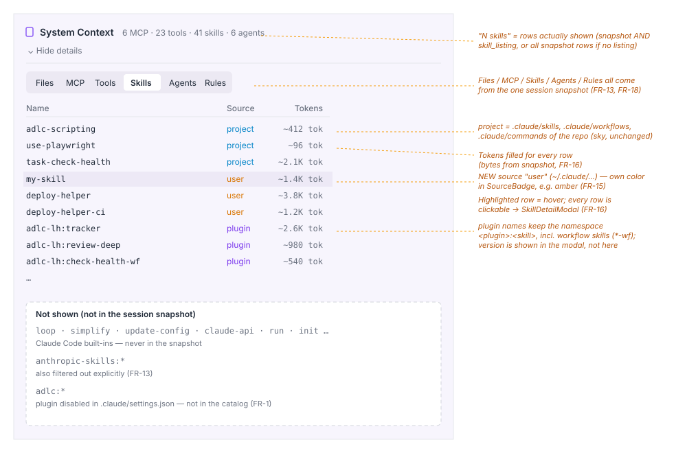
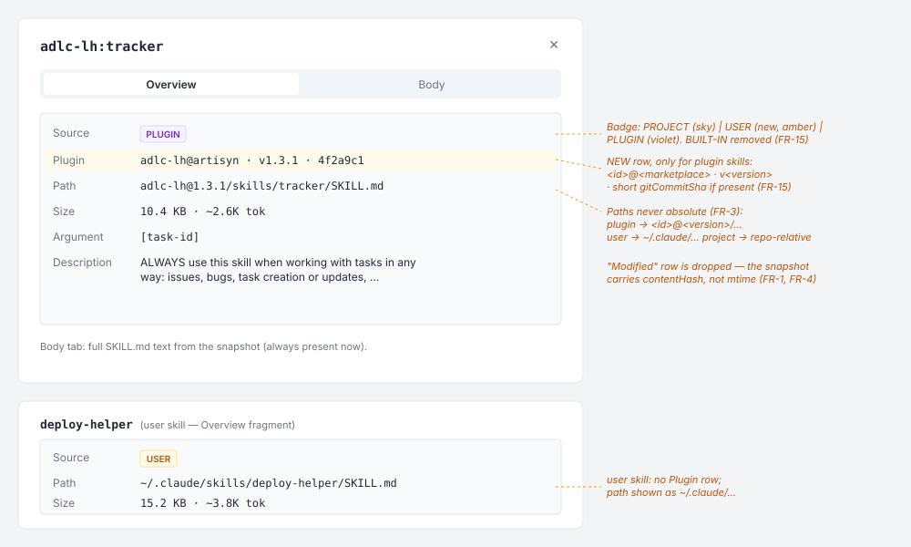
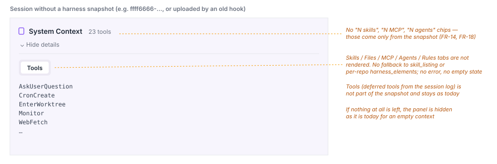

# 2026-10-16: System Context — Correct Skill Source (Project / User / Plugin) via Harness Snapshot

**Status:** todo
**Priority:** high
**Type:** bug
**Module(s):** hook, server, client
**Owner:** denis.tsyplakov
**Created:** 2026-10-16

## Description

User: "the system context for a session currently shows misleading entries; at the very least project
and non-project skills are mixed up".

### What is visible now

Session `ffff6666-6666-4666-8666-666666666666` → Logs → System Context → **Skills** tab
(92 skills):

- user-level skills from `~/.claude/skills/` (`my-skill`, `deploy-helper`, `deploy-helper-*`, `db-migrate`,
  `release-notes`, `lint-fix`) are labeled `project`;
- built-in Claude Code skills (`update-config`, `keybindings-help`, `code-review`, `simplify`,
  `fewer-permission-prompts`, `loop`, `schedule`, `claude-api`, `workflow-authoring`, `run`,
  `init`, `security-review`, `dataviz`, `artifact-*`) are labeled `project`;
- namespaced plugin skills (`adlc-lh:*`, `anthropic-skills:*`) have source `—`;
- the Tokens column is empty (`—`) for all 92 skills, clicking a row opens nothing (no
  definition).

### Cause

1. **Most sessions have no `skill-definitions` event.** The hook
   (`hook/.claude/telemetry_tool/send-logs-hook.js`, `getHarnessPrefix()` ≈ line 1411) sends it
   only when the harness fingerprint changed (`harness-state.js`, mtime-based), at most once per
   session, only into the current session's artisyn log and only after a successful upload. As long
   as skills have not changed, all subsequent sessions have no catalog. The server stores the
   catalog per-repo in `harness_elements` (without descriptions and bodies), so the session panel
   cannot rely on it.
2. **The hook's catalog itself is inaccurate** (`hook/.claude/telemetry_tool/skill-catalog.js`):
   - `~/.claude/plugins/` is scanned recursively in full — the catalog gets **all cached
     versions** of all plugins (`cache/artisyn/adlc-lh/1.3.0` and `1.3.1`), disabled plugins
     (e.g. `example@my-marketplace` is disabled in `.claude/settings.json`) and marketplace clones
     (`plugins/marketplaces/…`), rather than what is actually loaded into the session;
   - plugin skill names are taken from frontmatter without the namespace (`tracker`), whereas in
     the session they are named `adlc-lh:tracker` — matching against the listing does not work;
   - directory marketplaces are read from the working copy (`./.artisyn/marketplace/plugins/<id>`),
     while Claude Code loads the plugin from `installPath` in the cache (`installed_plugins.json`) —
     the versions may differ;
   - `enabledPlugins` is taken only from the project's `.claude/settings.json` /
     `settings.local.json`; the user-level `~/.claude/settings.json` is ignored;
   - workflow and command skills are not collected at all: the project's `.claude/workflows/*.js`
     (`task-check-health` …), the plugin's `workflows/*.js` (`adlc-lh:check-health-wf` …),
     `commands/`.
3. **The client distorts the source.** `log-parser.ts` (≈ line 2447) reduces everything that is not
   `plugin` to `project`; without a catalog it builds definitions from `skill_listing.content` and
   sets `project` for all; the regexp `^-\s+([\w-]+):` does not match names containing `:`.
   `SourceBadge` knows only `project | builtin | plugin`. The server (`artisyn-extractor.ts`,
   `extractHarnessSkillInventory`) turns `user` into `null`.

## Owner decisions (2026-10-16)

- The skill catalog is bound to **every** session via a **snapshot**: the session carries only a
  reference to the snapshot; the full catalog is sent once per each new snapshot.
- The snapshot must accurately describe what is loaded into the session: take into account the
  enabled plugins, their versions, installation scope, etc.
- Backward compatibility with old hook versions is **not required** (an exception to the
  CLAUDE.md § Hook API rule for this task). An old hook must not break uploads, but its sessions do
  not get a catalog.
- Already uploaded sessions without a snapshot: the Skills tab is **not shown** (no fallback to
  `skill_listing` and no per-repo `harness_elements`). No backfill.
- **One mechanism and one structure for the whole harness context.** The same "sent only when the
  fingerprint changes" problem exists for `agent-definitions`, `mcp-config`, `system-context` —
  they move to the same snapshot rather than to separate mechanisms: one snapshot per session
  covers skills, agents, MCP config and system-context, and is stored as **one row in one table**.
- **Unused snapshots are cleaned up**: a snapshot not referenced by any session is deleted (within
  this task, together with retention).

## Functional Requirements

### Hook — accurate catalog

- FR-1. The catalog includes the skills Claude Code will actually load into the session for the
  given `projectRoot`, with fields `name`, `source`, `description`, `argumentHint`, `body`, `path`,
  `bytes`, `contentHash`:
  - `project`: the repo's `.claude/skills/<name>/SKILL.md`, `.claude/workflows/*.js`,
    `.claude/commands/*.md`;
  - `user`: the same under `~/.claude/` (`claudeConfigDir()`);
  - `plugin`: only **enabled** plugins. The enabled set is the merge of `enabledPlugins` from
    `~/.claude/settings.json` → `.claude/settings.json` → `.claude/settings.local.json` (a later one
    overrides an earlier one, `false` disables). For each enabled `<id>@<marketplace>` the
    `~/.claude/plugins/installed_plugins.json` entry applicable to this project is taken (scope
    `user`, or `project`/`local` with `projectPath` = `projectRoot`); skills are read from its
    `installPath` (`skills/`, `workflows/`, `commands/` and the paths from
    `.claude-plugin/plugin.json`, if it defines them).
    The name is `<pluginName>:<skill>`; the entry has `plugin: { id, marketplace, version,
    gitCommitSha? }`.
  - The recursive scan of the whole `~/.claude/plugins/` and reading the directory marketplace's
    working copy are removed.
- FR-2. If a plugin is enabled but there is no matching `installed_plugins.json` entry, the plugin
  is skipped and the reason is written to hook.log (not an error).
- FR-3. Paths in the catalog: `project` — relative to `projectRoot`; `user` — `~/.claude/…`;
  `plugin` — `<id>@<version>/<path inside installPath>`. Absolute local paths are not sent to the
  server.

### Hook — snapshot

- FR-4. The snapshot is a **single structure for the session's whole harness context**: sections
  `skills` (the catalog from FR-1), `agents` (what `agent-definitions` sends now), `mcpServers`
  (now `mcp-config`), `systemContext` (now `system-context`). `snapshotId` = sha256 over the
  canonicalized content of all sections; for skills — over the sorted list of entries
  `(name, source, plugin.id@version, contentHash)`. `contentHash` is the sha256 of the file content
  (the file is read in full anyway), not mtime: a "touch" without an edit does not create a new
  snapshot, an edit with a preserved mtime does. A change in any section yields a new `snapshotId`.
  - The FR-3 path rules and the hash rule apply to **all** sections: `lastModified` is removed and
    replaced by `contentHash`; the `.claude/rules/` segment in relative rule paths is kept
    (`extractHarnessRuleInventory`). `systemContext` is collected, as now, from `cwd`; its content
    (relative paths + hashes) is part of the id.
  - For `mcpServers` only the static sanitized config (`name`, `command`, `args`, `configSource`)
    is part of the id. The MCP server probe (`connected`, `tools[].schemaSizeTokens`) runs only when
    the full snapshot is sent; its results are stored in the snapshot body but are not part of the
    id.
- FR-5. An event `{ type: 'harness-snapshot-ref', snapshotId }` is added to the artisyn log of
  **every** current session — at the start of **every** upload of that session (including chunks),
  because an upload overwrites `logs.body`.
- FR-6. The full snapshot (`{ type: 'harness-snapshot', snapshotId, projectRoot, skills, agents,
  mcpServers, systemContext }`) is sent only if the hook does not know that the server already has
  this `snapshotId` (local state in the work dir, written after a successful upload — as
  `harness-state.json` is now).
- FR-7. Self-healing: if the server, in its upload response, reports that the `snapshotId` is
  unknown to it (another machine, DB reset, lost upload), the hook resets its local state and sends
  the full snapshot on the next upload of the same session.
- FR-8. The hook no longer sends the separate `skill-definitions`, `agent-definitions`,
  `mcp-config`, `system-context` events — everything goes into `harness-snapshot`. The
  fingerprint logic of `harness-state.js` (mtime-based) is replaced by the "is the `snapshotId`
  known" check (FR-6). The inventory for harness-usage and other server-side consumers of these
  events take their data from the snapshot.

### Server

- FR-9. The server stores snapshots in **one table, one row per snapshot**: key — (log owner,
  `snapshotId`); body — the whole snapshot from FR-4 (all sections in one row, without splitting
  into separate per-element-type tables). Re-uploading the same snapshot is a no-op. The session is
  linked to its `snapshotId` from `harness-snapshot-ref` via a session column (e.g.
  `sessions.harness_snapshot_id`, without an FK — the ref may be processed before the snapshot): it
  is set by the first upload with a ref; later uploads do not clear or change it (COALESCE, like
  `git_repo_root`).
- FR-9a. Cleanup: a snapshot not referenced by any session (e.g. after sessions are deleted by
  retention) is deleted. Cleanup runs within the existing retention process; a snapshot with at
  least one reference is not deleted.
- FR-10. The upload response (`POST /api/v2/logs`) reports an unknown `snapshotId` (FR-7) without
  breaking the response format for the current hook: the hook passes `snapshotId` as a request
  parameter, the controller synchronously checks it against the snapshots table and against this
  owner's not-yet-processed queue rows, and returns an additional optional field (e.g.
  `unknownSnapshotId`); existing fields do not change. A snapshot waiting in the queue counts as
  known.
- FR-11. The session data endpoint the client uses to build Logs (`.../sessions/:id/logs` or a
  separate one) returns the session's snapshot to those who can see the session (same permissions
  as for the logs); without a snapshot — an explicit "no snapshot".
- FR-12. `harness_elements` (the inventory for the harness-usage report) is populated from
  `harness-snapshot`; `source` keeps `'project' | 'user' | 'plugin'`
  (`extractHarnessSkillInventory`, `harness-usage.service.ts`,
  `client/src/models/harness-usage.ts`). The "project skills only" filter still selects only
  `project`. The inventory upsert (Step 5d in `logs.service.ts`, incl.
  `harness_inventory_reported_at` and `harness_mcp_per_tool_supported`) runs on every binding of a
  session to a snapshot — by ref or by full snapshot — from the stored snapshot row into all repos
  linked to the log.

### Client

- FR-13. The Skills tab is built **only** from the session's snapshot: rows are the snapshot
  entries whose names are in this session's `skill_listing` (if there is no listing — all snapshot
  entries). Built-in Claude Code skills and `anthropic-skills:*` are not shown (they are not in the
  snapshot; `anthropic-skills:*` is additionally filtered out explicitly).
- FR-14. A session without a snapshot: no Skills tab, no `N skills` chip in the panel header.
  The `skill_listing` fallback in `log-parser.ts` (≈ lines 2770–2827) and the reading of the
  `skill-definitions` event (≈ lines 2425–2463) are removed.
- FR-15. `SkillDefinition['source']` = `'project' | 'user' | 'plugin'` (without `builtin`);
  `SourceBadge` and `SkillDetailModal` show `user`; for `plugin` the modal shows the plugin and
  version.
- FR-16. Tokens and row click work for all shown skills (all have `bytes` and `body` from the
  snapshot).
- FR-17. Chips of invoked skills in turns (`prompt-turn-helpers.tsx`) are shown as before; the
  definition for the tooltip is taken from the snapshot, if present.
- FR-18. The other System Context tabs that are now built from `agent-definitions`, `mcp-config`,
  `system-context` also take their data only from the session's snapshot (the same mechanism as
  FR-13/FR-14): no snapshot — no such tabs/data; reading of the separate events in `log-parser.ts`
  is removed.

## Acceptance Criteria

- [ ] A new session in this repo (new hook) with no skill changes since the previous session: the
      Skills tab is present; `adlc-lh:*` (including `*-wf`) — `plugin` with version `1.3.1`;
      `task-check-health` and the `.claude/skills/` skills — `project`; `my-skill`, `deploy-helper*` — `user`;
      `loop`, `simplify`, `anthropic-skills:*`, `adlc:*` (disabled) are not shown; all have Tokens
      and a modal with the body.
- [ ] After the second Stop of the same session the Skills tab is still present (the link to the
      snapshot is not lost when `logs.body` is overwritten).
- [ ] Two different log owners with the same `snapshotId` → two separate rows; each session shows
      its own owner's snapshot.
- [ ] A user without access to the session gets the same denial for the snapshot data as for its
      logs.
- [ ] `skill_listing` filter: a snapshot skill that is not in the session's listing is not shown;
      a session without `skill_listing` shows all snapshot skills; a namespaced name
      (`adlc-lh:tracker`) matches the listing.
- [ ] A hook released before this change uploads logs to the new server without errors in
      `hook.log` and without a retry loop; the new `POST /api/v2/logs` response field is additive.
- [ ] An MCP server that did not respond to the probe does not change the `snapshotId`.
- [ ] This session's artisyn log contains `harness-snapshot-ref` but not the full snapshot (the
      snapshot is already on the server) and not a single separate `skill-definitions` /
      `agent-definitions` / `mcp-config` / `system-context`.
- [ ] This session's agents, MCP servers and system-context are shown in System Context from the
      snapshot; in the DB the snapshot is one row in one table.
- [ ] Changing only the MCP config (same skills) → a new `snapshotId`, the next session gets the
      full snapshot.
- [ ] Deleting all sessions referencing a snapshot → after a retention run the snapshot is deleted;
      a snapshot still referenced by a session remains.
- [ ] A plugin update (new version in `installed_plugins.json`) → the next session gets a new
      `snapshotId` and the full catalog; the old session keeps showing its own snapshot.
- [ ] A server without the snapshot (clean DB) + a hook that considers the snapshot sent → after
      the first upload the hook gets "unknown" and sends the full catalog on the next upload; the
      session gets the catalog.
- [ ] No path in the snapshot/UI contains an absolute local path.
- [ ] Session `ffff6666-…` (no snapshot): no Skills tab, no errors.
- [ ] An upload from an old hook (`skill-definitions` without a snapshot) succeeds without errors;
      such a session has no Skills.
- [ ] `harness_elements.source = 'user'` for a user skill from the snapshot.
- [ ] Tests: a hook algorithm doc for building the catalog/`snapshotId` (a new doc in
      `docs/knowledgebase/algorithms/` + `hook/__tests__/*.algo.test.js`) with fixture examples:
      (a) two cached plugin versions — only the version from `installPath` is in the catalog;
      (b) a plugin enabled in `~/.claude/settings.json` but `false` in
      `.claude/settings.local.json` — excluded; (c) an `installed_plugins.json` entry with scope
      `project` and a foreign `projectPath` — excluded; (d) a plugin workflow →
      `<plugin>:<name>-wf`, `.claude/commands/x.md` → `project`; (e) an enabled plugin without an
      installed entry is skipped; (f) a touch without an edit keeps the `snapshotId`, an edit with
      a preserved mtime changes it; a contract row for the changed/new route
      (`server/test/contract/registry/`) — the "no snapshot" response shape, denial without
      access, the additive field in the `POST /api/v2/logs` response; a step in
      `tests/scenarios/view/s-sess-03.spec.ts` (session with / without a snapshot) and a step in a
      hook scenario (`tests/scenarios/hook/s-hook-01.spec.ts` or `s-hook-09.spec.ts` — wherever
      `skill-definitions` is already checked) for the ref + self-healing.

## Common sense considerations

- Hiding applies only to System Context data obtained from the snapshot (Skills and the tabs from
  FR-18).
- Snapshots are per-owner: user skills are personal; one user's snapshot is not linked to another
  user's session, even when the `snapshotId` matches.
- User skill bodies are visible to everyone who can see the session — as now with inline
  `skill-definitions`.
- The decision "which snapshot a session has" is made on the session's first upload; a skill edit
  mid-session goes into the next one (as now).
- After changing the hook — bump `version.json`, `npm run build:hooks-installer`, update
  `.artisyn/marketplace/plugins/log-hub-hooks/` (`.claude/rules/hook.md`),
  `update-install-instructions`.
- The catalog AC in this repo is a manual smoke; reproducible coverage is the algorithm-doc
  fixture examples.
- Owner isolation, access permissions and upload-response additivity are pinned by separate ACs
  and a contract row.
- The `skill_listing` filter is checked by a step in `s-sess-03`.
- `harness-snapshot-ref` goes into every upload of the session; the link is stored in a session
  column with COALESCE, without an FK.
- "Unknown `snapshotId`" — a synchronous check by request parameter (table + queue), an optional
  response field; a snapshot in the queue counts as known.
- The `mcpServers` id includes only the static config; the probe runs only when the full snapshot
  is sent.
- The FR-3/FR-4 path/hash rules apply to all sections; `systemContext` is collected from `cwd`, as
  now.
- The `harness_elements` inventory is updated on every binding of a session to a snapshot, from the
  stored row.

## Open Questions

(no open questions)

## Notes

<!-- Append timestamped notes here as work progresses -->
- Related task: `2026-10-16-sysctx-instruction-files` (same panel, CLAUDE.md instruction files);
  align so that task uses this snapshot rather than a separate mechanism.
- Requirements revision history is in `notes.md`.
