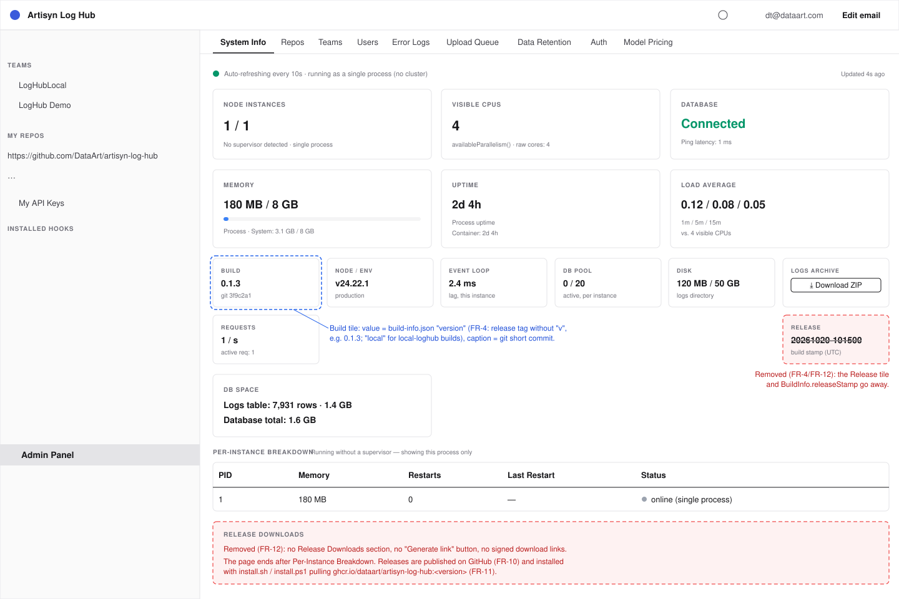

# 2026-10-20: GitHub Release Pipeline (release branch, Actions, GHCR)

**Status:** todo
**Priority:** high
**Type:** feature
**Module(s):** ci | release | server | client
**Owner:** denis.tsyplakov
**Created:** 2026-10-20

## Description

Set up the release pipeline on GitHub for the repository `DataArt/artisyn-log-hub`, which is
public (verified 2026-10-25). Being public is a precondition: the organisation is on the GitHub
Free plan (no rulesets for private repositories, and its 2,000 included Actions minutes are used
up by another repository), while for a public repository rulesets, the standard hosted runners
(including native arm64 `ubuntu-24.04-arm`), Actions storage and public GHCR packages are free.

State on 2026-10-25: the `release` branch exists, and the active ruleset `protect-main-release`
on `main` and `release` already blocks deletion and force-push, requires a pull request
(0 approvals, review threads resolved) and the status check `scan` (gitleaks); its only bypass
actor is the Admin repository role, in pull-request mode.

Organisation settings (checked by the owner): all actions and reusable workflows are allowed;
repository-level self-hosted runners are allowed (not to be used here, see FR-9).

How a release is built today: `node scripts/release.js` with `RELEASE_STAMP` (UTC
`YYYYMMDD-HHMMSS`) and `RELEASE_ARCHS` (`amd64,arm64`). For each architecture it runs
`docker buildx build --platform linux/<arch> --output type=docker,dest=<tar>` and packs a zip
with the image tar, `release-template/docker-compose.yml`, a generated `.env` with random
secrets, `.env.example` and `INSTALL.md`. The zips are also served from the app itself (Admin →
System → Release Downloads, signed download links).

### Owner decisions

- **Versioning:** semver tags, MAJOR.MINOR by hand, PATCH automatic on every push to `release`
  (FR-4).
- **What is released:** a push to `release` builds the Docker image for `linux/amd64` and
  `linux/arm64` and publishes it to GHCR; the GitHub Release carries a zip install kit
  (`docker-compose.yml`, README with install instructions, light automatic install scripts). The
  image is always pulled from GHCR — no zips with image tars.
- **Checks before the build:** only what runs in about 20 s; no e2e, no scenarios, cold lint left
  out (exact command set in FR-5). The typechecks matter most: neither build typechecks (see
  `CLAUDE.md`).
- **In-app release downloads are removed** together with everything that exists only for them.
- **Proof of a clean release:** only what is standard and cheap here (FR-14) — checksums,
  GitHub build-provenance attestations, an immutable release and a VirusTotal "Security scan"
  section in the release notes.

## Functional Requirements

### Branch and trigger

- **FR-1 (release branch):** a `release` branch exists (done); a push to it is what cuts a
  release.
- **FR-2 (branch protection):** `release` and `main` are protected: no force-push, no deletion,
  changes only through a pull request with the FR-5 check required, push restricted to
  maintainers. The only maintainer is the owner (GitHub user `denistsyplakov`, Admin role); the
  same account approves outside-contributor runs (FR-9). The existing `protect-main-release`
  ruleset covers all of this except the FR-5 check: its status-check name is added to the
  ruleset's required checks next to `scan`, once the check has run at least once.
- **FR-3 (workflow trigger):** the release workflow in `.github/workflows/` runs on `push` to
  `release` and on `workflow_dispatch`. No workflow of this repository runs on
  `pull_request_target`; the FR-5 check may run on `pull_request` (hosted runners only). A
  `workflow_dispatch` run fails at once unless `github.ref` is `refs/heads/release`.

  The release workflow and the FR-5 check follow the conventions of
  `.github/workflows/security-scans.yml` and pass its actionlint and zizmor jobs: actions pinned
  by commit SHA with a version comment, `permissions: contents: read` at the top and write
  permissions per job only, `persist-credentials: false` on checkout except in the job that pushes
  the tag, no workflow inputs (the version comes only from FR-4), no
  dependency cache in publishing jobs, the same `BUN_VERSION` / Node versions.

### Version

- **FR-4 (semver: manual MAJOR.MINOR, automatic PATCH):** the owner sets the version line by hand,
  every push to `release` gets the next PATCH unconditionally.
  - **Version line:** the `version` field of the root `package.json` (added by this task as
    `"1.0.0"`; the root package stays `private`). Only its `MAJOR.MINOR` is used; its PATCH part is
    ignored and kept `0` by convention. It must match `^[0-9]+\.[0-9]+\.[0-9]+$`, else the run
    fails. Raising MAJOR or MINOR is an ordinary reviewed commit to that field, merged into
    `release` like any other change.
  - **Next version:** the highest tag matching `^vX\.Y\.[0-9]+$` for the line `X.Y`, compared as
    semver → `vX.Y.(PATCH+1)`; no tag on that line yet → `vX.Y.0`. So the first release is
    `v1.0.0`, and a push that raises the line to `1.1` releases `v1.1.0`. Other `v*` tags are
    ignored.
  - **No going back:** if the line `X.Y` is lower than the line of the highest strict `vX.Y.Z` tag
    in the repository, the run fails before building, naming both versions.
  - There are no bump inputs and no commit-message bump tags; a `workflow_dispatch` run computes
    the version the same way (it exists for re-runs and FR-4 resume).
  - The workflow creates the tag itself; it never commits a version bump back to the protected
    branch (PATCH lives only in tags), and uses a concurrency group
    (`concurrency: { group: release, cancel-in-progress: false }`) to serialize release runs.
  - `server/package.json` / `client/package.json` keep their own `version` fields unchanged; they
    are not release versions and nothing reads them for the release.

  Version form: the git tag and the release name are `vX.Y.Z`; `<version>` everywhere else is
  `X.Y.Z` without the `v` — image tags `:X.Y.Z` / `:X.Y`, the zip name, `{{VERSION}}`, the
  `VERSION` build arg and `GET /health/version`.

  A run first checks the state of HEAD, before any image is pushed:
  - no release tag at HEAD and the computed tag does not exist → full run;
  - the computed tag already points at a different commit → fail without overwriting;
  - a release tag at HEAD with no GitHub Release or with a draft one → resume: no rebuild, the
    image index is taken from GHCR by its `:sha-<commit>` tag, the draft is created or completed,
    the remaining image tags are pushed and the release is published;
  - a release tag at HEAD with a published release → fail with "nothing to release".

  Order of a full run: per-arch images pushed by digest → manifest list pushed as
  `:sha-<full commit>` → git tag → draft GitHub Release with assets (FR-10, FR-14) → the index
  retagged `:<version>`, `:<major>.<minor>`, `:latest` → release published. Anything failing
  before the git tag leaves no tag, and a re-run recomputes the same version.

  The version reaches the image as a new `ARG VERSION` (`--build-arg VERSION=<tag without v>`,
  `--build-arg GIT_COMMIT=${{ github.sha }}`), replacing the Dockerfile's current
  `RUN node -p "require('./server/package.json').version" > .app-version` mechanism
  (`server/package.json`'s own version field is left unused by the image) and replacing
  `RELEASE_STAMP` and the `BuildInfo.releaseStamp` field (removed, not kept as a secondary field).
  The Dockerfile keeps its `build-info.json` generation step (the only source of
  `readBuildInfo()` for `GET /health/version` and Admin → System), now writing
  `{"version":"$VERSION","gitCommit":"$GIT_COMMIT"}` from `ARG VERSION` / `ARG GIT_COMMIT` declared
  in the runtime stage.

### Checks and build

- **FR-5 (fast checks):** before the build, one job runs the three typechecks and the three
  algorithm-test suites (client, server, hook) plus the build-script tests, the same commands as
  the `static` group in `.claude/repo_config/repo-health-checks.json` minus lint. A failure stops
  the release. The same job is offered as a pull-request check for FR-2.
- **FR-6 (per-arch build):** `linux/amd64` builds on `ubuntu-latest` and `linux/arm64` on
  `ubuntu-24.04-arm`, both natively, then a manifest list joins them.
- **FR-7 (Dockerfile build platform):** the build stages of `Dockerfile` use
  `FROM --platform=$BUILDPLATFORM`, so the client, the hooks installer and the server bundle are
  built natively and only the runtime stage is per architecture.

### Publication

- **FR-8 (GHCR image):** the workflow publishes the multi-arch image
  `ghcr.io/dataart/artisyn-log-hub:<version>` plus `:<major>.<minor>`, `:latest` and the FR-4
  staging tag `:sha-<full commit>`, with
  `GITHUB_TOKEN` (`permissions: packages: write`); `:latest` moves on every release. The GHCR
  package is public and linked to the repository; the owner switches it to public once after the
  first push (a `GITHUB_TOKEN` cannot change package visibility).
- **FR-9 (runner security):** only GitHub-hosted runners; no self-hosted runner for this public
  repository. Workflow runs from first-time / outside contributors need maintainer approval
  (repository Actions setting).
- **FR-10 (GitHub Release with install kit):** the workflow creates a GitHub Release for the tag
  with a zip install kit `artisyn-log-hub-<version>.zip` holding `README.md` (the install
  instructions, from `release-template/INSTALL.md`), `docker-compose.yml` pinned to
  `ghcr.io/dataart/artisyn-log-hub:<version>`, `.env.example`, `install.sh` (Linux/macOS) and
  `install.ps1` (Windows). The same files are also attached loose, because the FR-11 one-liner
  downloads them individually.

  The kit is assembled by a small script `scripts/release-kit.js` (replacing the kit part of
  `scripts/release.js`), which fills only `{{VERSION}}` and `{{GIT_COMMIT}}` in README.md and
  `docker-compose.yml`. `release-template/` is rewritten for the pull-based kit:
  `docker-compose.yml` uses `image: ghcr.io/dataart/artisyn-log-hub:{{VERSION}}` (still passing
  the `docker compose config` check of the `dockerfile-lint` job in `security-scans.yml`) and loses
  the `RELEASE_LINK_SECRET` line and the `releases` bind mount; INSTALL.md becomes one
  architecture-neutral guide without the tar / `docker load` / "release stamp" text and documents
  `install.sh` / `install.ps1`; `.env.example` and the INSTALL.md table lose `RELEASE_LINK_SECRET`.
  Release notes list the commits since the previous tag (for the first release, with no previous
  tag, all commits up to the tagged commit). A `CHANGES.md` asset ("What's new", added
  2026-10-25 at the owner's request) lists every `docs/changelog/` entry added since the previous
  tag, newest first (all entries on the first release); it is attested but not in `SHA256SUMS`.
- **FR-11 (light automatic install):** one command installs or upgrades a server, e.g.
  `curl -fsSL https://github.com/DataArt/artisyn-log-hub/releases/latest/download/install.sh | sh`
  (and a PowerShell equivalent). Before downloading or writing anything, the script checks that
  the `docker` CLI and `docker compose` exist and the daemon is reachable (`docker info`
  succeeds), else exits non-zero ("Docker is not running"). It then creates the install directory, downloads `docker-compose.yml` and `.env.example` (re-downloading and
  overwriting them on an upgrade too, so the compose file's image tag matches the requested
  version), generates `.env` with fresh random secrets on first install only (the secret
  generation that `scripts/release.js` does today), keeps an existing `.env` unchanged on upgrade,
  runs `docker compose pull && docker compose up -d`, and prints the install directory and the
  URL (`PUBLIC_BASE_URL` from `.env` when set, otherwise `http://localhost:5003`, the compose port
  binding). It accepts a version (`latest` by default) via a `VERSION` environment variable (e.g.
  `curl -fsSL .../install.sh | VERSION=v1.0.1 sh`; PowerShell:
  `$env:VERSION = 'v1.0.1'; irm .../install.ps1 | iex`), consistent across both scripts; `VERSION`
  is accepted with or without the leading `v` and normalized (`vX.Y.Z` for the download URL,
  `X.Y.Z` for comparing with the compose image tag); with `VERSION` set, the files come from
  `releases/download/v<X.Y.Z>/`, not `latest/`. The install
  directory is `$INSTALL_DIR` if set, otherwise `$HOME/artisyn-log-hub` (Windows:
  `$env:USERPROFILE\artisyn-log-hub`); an upgrade is a re-run against the same directory.
  `LOG_HUB_DATA_DIR` stays the relative `./loghub-db` from `.env.example`, so the data lives under
  the install directory. A `VERSION` older than the one in the existing `docker-compose.yml` is
  refused ("downgrade not supported — DB migrations are forward-only") unless `FORCE=1` is set.
  On Docker/Compose missing, an unresolved version/tag, or a
  failed `docker compose pull`, the script exits non-zero with a clear message and does not
  delete or modify an existing `.env`; a missing `.env` during an "upgrade" run is treated as a
  fresh install rather than an error. `INSTALL.md` documents the same steps by hand.

- **FR-14 (release verification; implements `2026-10-23-ci-cd-scans` FR-32/FR-33):**
  - the GitHub Release also carries `SHA256SUMS` covering every attached file;
  - the image is built with buildx provenance and SBOM attestations (`provenance: mode=max`,
    `sbom: true`), and the workflow adds GitHub artifact attestations
    (`actions/attest-build-provenance`, `permissions: id-token: write, attestations: write`) for
    the image index digest and for every attached file, verifiable with `gh attestation verify`;
  - the release is created as a draft, the attached files (zip, `install.sh`, `install.ps1`) are
    scanned with `scripts/ci/virustotal-scan.js` using the existing `VIRUS_TOTAL_KEY` secret
    (non-blocking, as ci-cd-scans FR-31: a detection or an API error is reported, never fails the
    run), then the release is published. The script, which today accepts only the two hook
    tarball names, gets release scopes matched by pattern (`artisyn-log-hub-*.zip` →
    `release-zip`, `install.sh` → `install-sh`, `install.ps1` → `install-ps1`), updated usage
    text and build-script test rows; immutable
    releases are enabled in the repository settings, so assets and the tag cannot change after
    publishing;
  - the release notes get a "Security scan" section: the image digest, per file its SHA-256 and
    VirusTotal result (`0/<engines>` + permalink), and the verification commands
    (`sha256sum -c SHA256SUMS`, `gh attestation verify`). A new `scripts/ci/release-notes.js`
    renders this section from the scan-row JSON files (`note` → `0/<engines>` or the detection /
    error text, `link` → permalink) and gets build-script test rows.

  The rest of ci-cd-scans FR-33 is dropped as over-engineering: no `security-scan-results.json` /
  `.md`, SARIF files or separate SBOM file attached, no Snyk Container totals in the release notes
  (that data stays in CI and the repository's Security tab; the SBOM travels as an image
  attestation).

### Removal of in-app release downloads

- **FR-12 (remove the feature):** remove release downloads from the app and everything that
  exists only for them. Inventory (2026-10-20, grep for `RELEASES_HOST_DIR`,
  `RELEASE_LINK_SECRET`, `release-token`, `ReleaseDownloads`, `/api/v1/releases/download`,
  `RELEASE_STAMP`):
  - `Dockerfile`: the `ARG RELEASE_STAMP` lines, the `releaseStamp` field of `build-info.json`
    and the `.app-version` line (the generation step itself stays, see FR-4);
  - other `releaseStamp` consumers: the Build-info row in `AdminSystemTab.tsx`,
    `build.releaseStamp` in `client/src/models/admin.ts`, step 2 of
    `tests/scenarios/platform/s-plat-01.spec.ts` (now asserts `{version, gitCommit}`) and the
    `GET /health/version` row in `server/test/contract/registry/f01-infra.ts`;
  - server: `server/src/releases/` (module, service, types, `release-download.controller.ts`,
    `release-token.ts` and its algorithm spec), the release-link endpoint in
    `admin/admin-panel.controller.ts` and `admin/dto/release-download-link.dto.ts`, the release
    parts of `common/static-dir.ts`, `common/build-info.ts` and `system-info/`;
    `RELEASES_HOST_DIR` and `RELEASE_LINK_SECRET` in `server/.env.example`, `server/README.md`
    and `known-secrets.ts` if listed;
  - client: `ReleaseDownloadsSection.tsx`, its use in `AdminSystemTab.tsx`, the API call in
    `viewer/api.ts`, the types in `models/admin.ts`, the section in
    `public/help/security-hardening.md`;
  - build and release: the `release` npm script and `scripts/release.js` become the FR-17 local
    bundle (`scripts/local-release-bundle.js`, test renamed to
    `scripts/__tests__/local-release-bundle.test.js`); `/releases/` and `/server/releases/` in
    `.gitignore` go (`/release` stays, FR-17); the releases bind mount in
    `release-template/docker-compose.yml` goes; `release-template/` becomes the FR-10 install kit;
  - tests: `tests/scenarios/platform/s-rel-02.spec.ts`, `tests/scenarios/helpers/releases.ts`,
    the release steps in `s-plat-01.spec.ts`, legacy `tests/e2e/admin-releases.spec.ts`, the
    release routes in `server/test/contract/registry/f01-infra.ts`;
  - docs: `docs/knowledgebase/algorithms/release-link-token.md` (and its row in
    `algorithms/README.md`), the release parts of `api-reference.md`, `server-endpoint-map.md`,
    `static-asset-serving.md`, `system-info-and-cluster.md`, `client-component-map.md`, and the
    `docs/qaa-overview` scenario docs 01, 04, 05 and `14-algorithm-units.md`;
  - docs and help: the install section of `README.md` (rewritten for the GHCR image and the
    `install.sh` / `install.ps1` one-liner, without `npm run release` / `docker load`), the
    Releases row and the `/app/dist/releases` mount row in
    `client/public/help/component-reference.md`, the release rows of
    `client/public/help/responsibility-matrix.md` (rewritten for the GitHub Release), the
    "INSTALL.md in the release bundle" wording in `security-hardening.md`;
  - tooling: big-prod-e2e-test keeps its UTC `YYYYMMDD-HHMMSS` run id, but `releaseStamp()` /
    `RELEASE_STAMP_RE` move from `scripts/release.js` into the skill's `scripts/lib/config.mjs` as
    `runStamp()` / `RUN_STAMP_RE`, and `stand.mjs` builds with `--build-arg VERSION=big-prod-<stamp>`
    plus `GIT_COMMIT` (its `scripts/__tests__/big-prod-e2e-test.test.js` rows follow); the release
    section of `.claude/skills/security-check/SKILL.md`.
  - the `post-impl-check-release` skill is deleted together with its entry in
    `docs/knowledgebase/task-checks-guide.md` (done 2026-10-25, owner decision).

  

- **FR-13 (backward compatibility):** the hook API and the installer endpoints are not touched.
  Removing `/api/v1/releases/download` breaks only old in-app links, which expire in 24 h anyway.

### Local build

- **FR-15 (local install stays):** `scripts/local-loghub.js` and its npm scripts
  `local-loghub:install` / `local-loghub:update` are kept. The owner uses them to run a server
  built from the current working tree, including code not yet committed to git, so they keep
  building the image locally and never pull from GHCR. After FR-12 they no longer import
  `scripts/release.js`: the helpers they need (git commit, host arch, `.env` secret generation)
  come from `scripts/release-kit.js`; the image is built with `--build-arg VERSION=local` (instead
  of `RELEASE_STAMP`) and `GIT_COMMIT`, tagged `ghcr.io/dataart/artisyn-log-hub:local`, and the
  install's `docker-compose.yml` is the FR-10 template with `{{VERSION}}` filled as `local`.

- **FR-17 (local release bundle for manual tests):** `npm run local-release-bundle`
  (`scripts/local-release-bundle.js`, the renamed `scripts/release.js`) keeps building offline,
  self-contained zip bundles from the working tree, including uncommitted changes, into the
  gitignored `release/` folder, so the owner can hand the very latest code to a colleague for
  manual testing. With a dirty working tree the `GIT_COMMIT` build arg is `<HEAD commit>-dirty`. One zip per architecture holds the image tar (`docker save` / `docker load`),
  `docker-compose.yml` from the FR-10 template, a generated `.env`, `.env.example` and install
  notes for that bundle. It is never published and nothing in CI runs it. The build uses
  `--build-arg VERSION=local-<stamp>` and `GIT_COMMIT` (no `RELEASE_STAMP`), with the image tag
  `ghcr.io/dataart/artisyn-log-hub:local-<stamp>`; the UTC `YYYYMMDD-HHMMSS` stamp and the
  architecture list come from `BUNDLE_STAMP` / `BUNDLE_ARCHS`, which replace `RELEASE_STAMP` /
  `RELEASE_ARCHS`.

### Documentation

- **FR-16 (KB article):** a new `docs/knowledgebase/release-pipeline.md`, listed in `index.md`,
  covers the trigger, the version rules (how to raise MAJOR.MINOR in the root `package.json`), the run states and order (FR-4), the GHCR tags, the install
  kit and scripts, verification, and a numbered owner rollout checklist: (1) after the first PR
  run, add the FR-5 check name to `protect-main-release`; (2) after the first push, make the GHCR
  package public and link it to the repository; (3) enable immutable releases; (4) require
  approval for outside-contributor runs. `git-hooks.md` (required checks of the ruleset) and
  `ci-security-scans.md` (the new workflow, VirusTotal on release assets) are updated.

## Acceptance Criteria

- [ ] A force-push or a direct push by a non-maintainer to `release` is rejected, and a pull
      request into `release` cannot merge while the FR-5 check is failing (FR-1, FR-2).
- [ ] A push to `release` starts the release workflow; a pull request runs only the FR-5 check
      (FR-3, FR-5).
- [ ] With the root `package.json` at `1.0.0` and no release tag yet, three pushes produce
      `v1.0.0`, `v1.0.1`, `v1.0.2`; after the field is changed to `1.1.0`, the next push produces
      `v1.1.0` and the one after `v1.1.1`; setting it back to `1.0.0` fails the run before
      building; no commit is pushed back to `release` (FR-4).
- [ ] `GET /health/version` of the released image reports the release version (FR-4).
- [ ] A type error or a failing algorithm test on `release` stops the run before any image is
      pushed (FR-5).
- [ ] `docker pull ghcr.io/dataart/artisyn-log-hub:<version>` works anonymously on an amd64 and
      an arm64 host and resolves to the right architecture (FR-6, FR-7, FR-8).
- [ ] The GitHub Release holds `artisyn-log-hub-<version>.zip` (README.md, `docker-compose.yml`,
      `.env.example`, `install.sh`, `install.ps1`), the same files loose, and no image tar (FR-10).
- [ ] `sha256sum -c SHA256SUMS` passes for the downloaded assets, and `gh attestation verify`
      succeeds for the zip and for `oci://ghcr.io/dataart/artisyn-log-hub:<version>` (FR-14).
- [ ] The release notes list the commits since the previous tag and hold the "Security scan"
      section: image digest, per-file SHA-256 and VirusTotal `0/<engines>` + permalink, the
      verification commands; the published release is immutable (FR-10, FR-14).
- [ ] The release has a `CHANGES.md` asset with the `docs/changelog/` entries added since the
      previous tag (FR-10).
- [ ] `:<major>.<minor>` and `:latest` resolve to the same digest as `:<version>`; the GHCR
      package is public and linked to the repository (FR-8).
- [ ] A run whose computed tag
      already points at another commit fails without pushing an image; a dispatch from a branch
      other than `release` fails at once (FR-3, FR-4).
- [ ] On a clean Linux host with Docker, the one-line `install.sh` starts the app and prints its
      URL; running it again with a newer version upgrades the app and keeps `.env` (FR-11).
- [ ] On Windows with Docker Desktop, `install.ps1` installs and upgrades the same way, and
      `VERSION=<tag>` installs that version; with Docker stopped, `install.sh` exits non-zero and
      leaves an existing `.env` byte-identical (FR-11).
- [ ] No workflow uses a self-hosted runner; outside-contributor runs wait for approval (FR-9).
- [ ] Nothing from the FR-12 inventory is left:
      `git grep -nE 'RELEASES_HOST_DIR|RELEASE_LINK_SECRET|release-token|ReleaseDownloads|/api/v1/releases/download|RELEASE_STAMP|releaseStamp|npm run release|docker load|/app/dist/releases' -- ':!docs/tasks/' ':!docs/changelog/' ':!scripts/local-release-bundle.js' ':!scripts/__tests__/local-release-bundle.test.js' ':!release-template/LOCAL-BUNDLE.md'`
      returns nothing, and Admin → System shows no Release Downloads section (FR-12).
- [ ] Tests follow the repo test policy: the removed scenario, contract rows and algorithm doc go
      away with the feature; the version computation (FR-4), if written as a script, gets an
      algorithm doc with examples and its table test, or rows in the build-script tests;
      `scripts/release-kit.js` gets rows in the build-script tests (`npm run test:scripts`).
- [ ] `npm run local-release-bundle` produces one zip per architecture in `release/`; the host-arch
      bundle installs with `docker load` + `docker compose up -d` and its `GET /health/version`
      reports `local-<stamp>` (FR-17).
- [ ] With uncommitted changes in the working tree, `npm run local-loghub:update` rebuilds the
      image from them and restarts `../local-loghub`; its `GET /health/version` reports `local`
      and the existing `.env` is unchanged (FR-15).
- [ ] `docs/knowledgebase/release-pipeline.md` exists, is listed in `index.md` and holds the
      four-step owner rollout checklist (FR-16).

## Open Questions

_None._

## Common sense considerations

- FR-4 version scheme (owner, 2026-10-25): MAJOR.MINOR by hand in the root `package.json`, PATCH
  +1 on every push to `release`, start at `1.0.0`; no bump input, no commit tags, no Conventional
  Commits / release-please.
- FR-4: `build-info.json` stays, now `{version, gitCommit}`; only `RELEASE_STAMP` /
  `releaseStamp` / `.app-version` go.
- FR-3: `workflow_dispatch` only on `release`; workflows follow `security-scans.yml` conventions
  and pass actionlint / zizmor.
- FR-6/FR-7: platform-independent stages are built once per arch job; the duplication is
  accepted (hosted minutes are free for a public repository).
- FR-8: `:latest` moves on every release.
- FR-8: GHCR package visibility is set to public once by the owner after the first push (a
  `GITHUB_TOKEN` cannot change it); listed in the FR-16 rollout checklist.
- FR-10: the kit is built by `scripts/release-kit.js`, filling only `{{VERSION}}` /
  `{{GIT_COMMIT}}`; `release-template/` is rewritten for pulling from GHCR.
- FR-11: the version is passed to `sh`, not `curl` (`curl … | VERSION=v1.0.1 sh`); pinned
  versions download from `releases/download/<VERSION>/`.
- FR-11: install dir `$INSTALL_DIR`, else `$HOME/artisyn-log-hub` (`$env:USERPROFILE\artisyn-log-hub`);
  data under it via `./loghub-db`.
- FR-11: the printed URL is `PUBLIC_BASE_URL`, else `http://localhost:5003`.
- FR-11: downgrades are refused unless `FORCE=1` (migrations are forward-only).
- FR-11: `docker-compose.yml` and `.env.example` are re-downloaded on every run; `.env` is
  generated only on first install and never touched otherwise, failures included.
- FR-11: a missing `.env` on upgrade means a fresh install; missing Docker/Compose, an unresolved
  version or a failed pull exit non-zero with a clear message.
- FR-12 acceptance uses a concrete `git grep` with `/api/v1/releases/download`, so CI tool
  download URLs and release asset URLs do not match.
- The first release's notes list all commits up to the tagged commit.
- FR-4: base tag = highest strict `vX.Y.Z` on the `package.json` line `X.Y`, by semver; release
  notes still list `<previous release tag>..HEAD`.
- FR-4: `<version>` is `X.Y.Z`; only the git tag and release name carry the `v`.
- FR-4: HEAD state is checked before any push; a tag at HEAD without a published release resumes
  without rebuilding, from the `:sha-<commit>` index.
- FR-4/FR-8: the index is first pushed as `:sha-<full commit>`, retagged after the draft release.
- FR-11: `docker info` must succeed before anything is downloaded or written; `VERSION` is
  accepted with or without `v`.
- FR-12: README and in-app help are in the inventory; the acceptance grep also matches
  `npm run release|docker load|/app/dist/releases`.
- FR-12: the `post-impl-check-release` skill and its `task-checks-guide.md` entry are deleted (owner
  decision 2026-10-25).
- FR-17: the offline zip bundle stays as `npm run local-release-bundle`, only for manual tests; its
  files are excluded from the acceptance grep (they legitimately say `docker load`).
- FR-12: big-prod-e2e-test owns its run stamp (`runStamp` / `RUN_STAMP_RE` in `config.mjs`).
- FR-14: `virustotal-scan.js` gets pattern-matched release scopes; `scripts/ci/release-notes.js`
  renders the "Security scan" section; the job uses `VIRUS_TOTAL_KEY`.
- FR-16: the pipeline is documented in a new KB article with the owner rollout checklist.

## Notes

- Local timing measurements behind the "about 20 s" FR-5 check budget: see `notes.md`.
