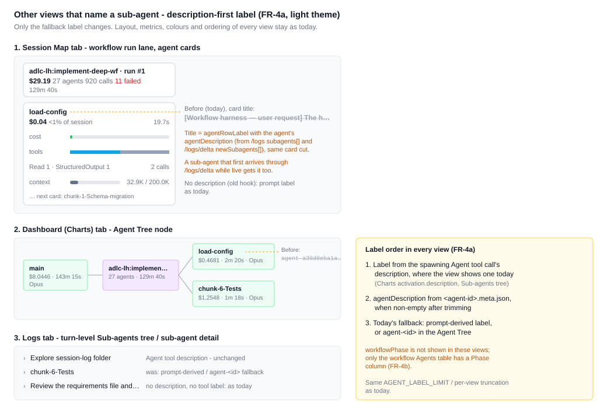
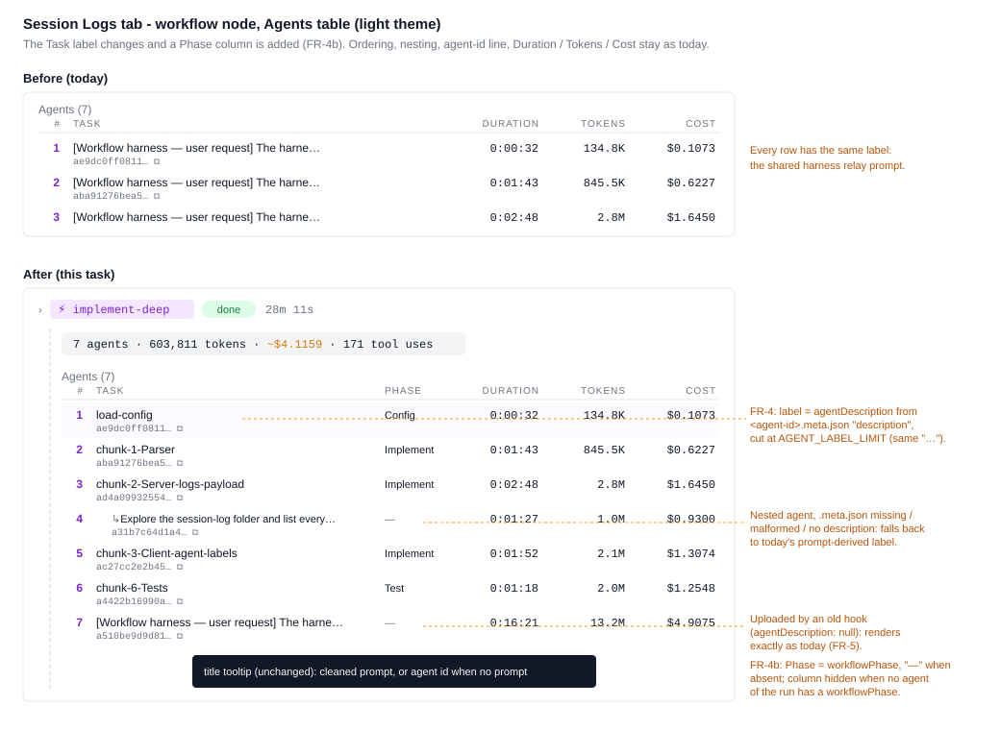
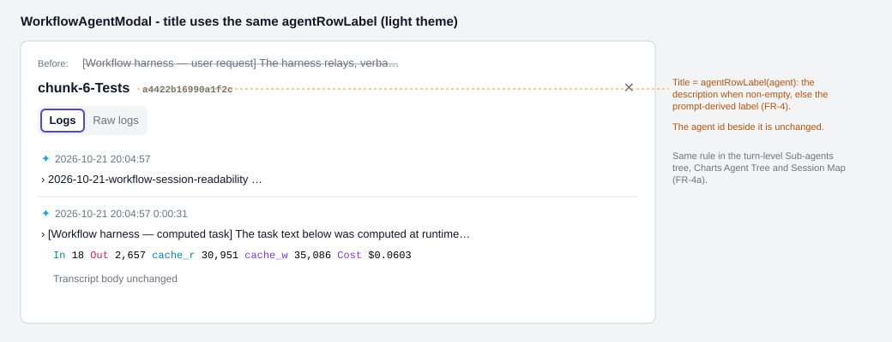

# 2026-10-21: Workflow Agent Labels From .meta.json

**Status:** todo
**Priority:** medium
**Type:** feature
**Module(s):** hook, server, client
**Owner:** denis.tsyplakov
**Created:** 2026-10-21
**Tracker:** GH-98 https://github.com/DataArt/artisyn-log-hub/issues/98

## Description

Follow-up to 2026-10-21-workflow-session-readability.

Every row of the workflow Agents table (`WorkflowAgentsTable`, label from `agentRowLabel` in
`client/src/viewer/pages/repository/session-log/workflow-agent-rows.ts`) shows the same label: the
label is the cleaned prompt, and every workflow agent's first user record is the shared harness
relay "[Workflow harness — user request] The harness relays, verbatim…" (the second record,
"[Workflow harness — computed task]", also starts with a shared template).

The hook already reads each sub-agent's sibling `<agent-id>.meta.json` (`readParentAgentId` in
`hook/.claude/telemetry_tool/send-logs-hook.js`), but only for `parentAgentId`. The same file
carries `description` (the workflow script's agent label, e.g. `chunk-6-Tests`, `load-config`) and
`workflowPhase` (e.g. `Implement`). Send both to the server, store them per agent session, return
them in the session `/logs` payload (and in `newSubagents` of `/logs/delta`), use `description`
as the sub-agent label everywhere a sub-agent is named in the session view, and show
`workflowPhase` as a Phase column in the workflow Agents table.

Example `.meta.json` next to a workflow agent transcript
(`subagents/workflows/<wf-run>/agent-<id>.meta.json`):

```json
{"agentType":"workflow-subagent","description":"chunk-6-Tests","workflowPhase":"Implement","spawnDepth":1,"requestShape":"foreground","requestNonInteractive":false}
```

## Functional Requirements

- FR-1: The hook reads `description` and `workflowPhase` from each sub-agent's sibling
  `<agent-id>.meta.json` (both the `subagents/` and the `subagents/workflows/<wf-run>/` scans,
  same file as `parentAgentId`) and sends them with that agent's upload as optional query params
  `agentDescription` and `workflowPhase` on `POST /api/v2/logs`, the same way `workflowRunId` is
  sent (`upload-logs.js`, plain and chunked paths).
- FR-2: The server accepts both params for `claude-subagent` uploads, carries them through the
  upload queue (like `workflowRunId`), and stores them on the agent's `sessions` row. The migration
  adds nullable `agent_description varchar(255)` and `workflow_phase varchar(255)` to both
  `sessions` and `upload_queue`; both values pass through `UploadQueueService` (plain and chunked
  paths), the scheduler and `LogsService.upsert`. The server trims each value, drops it when empty
  after trimming, and truncates it to 255 characters; these params never cause a 4xx or a failed
  upload.
- FR-3: `GET /api/v1/repositories/:repoId/sessions/:sessionId/logs` returns, for each entry of
  `subagents`, `agentDescription` and `workflowPhase` (`null` when unknown), next to
  `parentSessionId`. `GET /api/v1/repositories/:repoId/sessions/:sessionId/logs/delta` returns
  the same two fields (`null` when unknown) on each entry of `newSubagents`
  (`SessionLogsDeltaUpdate` in `server/src/logs/dto/session-logs-delta.dto.ts`, filled in
  `session-logs-delta.service.ts` next to `workflowRunId`); on the client
  `SessionLogsDeltaNewSubagent` gains them as optional fields (absent from old servers);
  `SessionMapSubagent` gains `agentDescription` / `workflowPhase` (`string | null`), set in
  `mergeSubagents` (`session-map-delta-merge.ts`) from `newSubagents`.
- FR-3a: Metadata that arrives on a later upload of an already-known agent reaches a live viewer
  without a reload.
  - Each `subagentAppends` entry of `/logs/delta` carries the agent's current
    `agentDescription` / `workflowPhase` (`null` when unknown).
  - A changed sub-agent with no new lines still gets an entry (`lines: []`) when either value is
    non-null. Every re-upload sets `logs.updated_at = now()`, so the delta already classifies it
    as changed. Old clients skip entries with empty `lines`.
  - `mergeSubagents` applies those values to the known `SessionMapSubagent`: a non-null value
    replaces the stored one, and `null` never clears it.
  - The Logs and Charts tabs pick the values up from the `/logs` refetch that the session
    watermark already triggers.
- FR-4: `agentRowLabel` labels a row with the agent's `agentDescription` when it is non-empty
  after trimming, otherwise with today's prompt-derived label; the same `AGENT_LABEL_LIMIT` cut
  applies to both. Data path: `SessionLogsData.subagents[]` (`client/src/viewer/api.ts`) gains
  optional `agentDescription` / `workflowPhase` (absent from old servers). `useRepositoryData.ts`
  builds `subagentMeta: Map<agentId, { agentDescription: string | null; workflowPhase: string |
  null }>` from it next to `subagentLogsMap`, keyed by agentId without the `agent-` prefix (like
  `subagentLogs` / `workflowRunIds`). It is passed as a new optional argument of
  `buildAgentNodesForIds` and a new optional `parseSessionLogs` option (used by
  `buildSubAgentTree`); `SubAgentNode` gains optional `agentDescription` / `workflowPhase` filled
  from it.
- FR-4a: The same description-first rule applies everywhere a sub-agent is named in the session
  view: the workflow Agents table and its agent modal title (`agentRowLabel`), the turn-level
  Sub-agents tree (`SubAgentNode.tsx` / `SubAgentDetail.tsx`), the Charts tab Agent Tree
  (`resolveAgent` in `charts/chart-data.ts`) and the Session Map (`session-map-model.ts`).
  - Charts tab: an `agentDescriptions: Map<agentId, string>` is built where `agentParentMap` is
    built and passed through `SessionChartsTab` to `agentTree` / `toolHeatmap` / `resolveAgent`;
    label order `activation.description ?? agentDescriptions.get(agentId) ?? agent-<id>`.
  - Session Map (built only from `/logs/delta`): `SessionMapParseInputs` gains an
    `agentDescriptions` map filled in `toParseInputs` from `SessionMapSubagent` (like
    `workflowRunIds`), and the `agentRowLabel({...})` call in `session-map-model.ts` passes the
    looked-up description.

  Where a view already shows a label from the spawning Agent tool
  call's `description`, that label stays; `agentDescription` replaces only the prompt-derived or
  `agent-<id>` fallback, and when `agentDescription` is absent each view renders as today.

  
- FR-4b: The workflow Agents table (`WorkflowAgentsTable`) gets a Phase column between Task and
  Duration showing the agent's `workflowPhase`, cut at `AGENT_LABEL_LIMIT` like the label, and
  `—` for an agent without one. The column is shown only when at least one agent of that
  workflow run has a `workflowPhase`, so a run uploaded entirely by an old hook renders exactly as
  today. Row order and nesting do not change (no grouping by phase).

  

  
- FR-5: Backward compatibility: a session uploaded by an old hook (no new params) renders exactly
  as today; an old server ignores the new query params and accepts the upload.

## Acceptance Criteria

- [ ] A workflow run uploaded by the new hook shows each agent's `.meta.json` `description` (e.g.
      `chunk-6-Tests`, `load-config`) as its Task label in the Agents table.
- [ ] An agent whose `.meta.json` is missing, malformed, or has no `description` shows the
      prompt-derived label, as today, and its upload still succeeds.
- [ ] A session uploaded by an old hook (no new params) renders exactly as today; `/logs` returns
      `agentDescription: null`, `workflowPhase: null` for its agents (a step in
      `tests/scenarios/hook/s-compat-01.spec.ts`).
- [ ] An upload from the new hook to a server without this change still succeeds (verified by
      inspection: `logs-v2.controller.ts` reads query params individually, unknown ones are
      ignored).
- [ ] An over-long `agentDescription` is accepted and stored truncated to 255 characters (row in
      `f15-ingest.ts`).
- [ ] Repository export/import round-trips `agentDescription` and `workflowPhase`; an archive
      exported before this change imports with both `null`.
- [ ] Contract registry rows: `POST /api/v2/logs` with the new params
      (`server/test/contract/registry/f15-ingest.ts`) and the `/logs` response fields
      (`f17-sessions.ts`).
- [ ] `docs/knowledgebase/algorithms/workflow-agent-rows.md` gains label rows for "description
      present", "description empty → prompt fallback" and "description whitespace-only → prompt
      fallback" (rows in `docs/algorithm-examples/workflow-agent-rows.json`).
- [ ] A step in an existing workflow scenario (`tests/scenarios/view/s-sess-03.spec.ts` or
      `s-sess-04.spec.ts`) checks a description-derived Agents-table label and the Phase column
      value.
- [ ] A workflow run whose agents carry no `workflowPhase` shows no Phase column.
- [ ] The turn-level Sub-agents tree, the Charts tab Agent Tree and the Session Map show
      `agentDescription` instead of the prompt-derived / `agent-<id>` fallback, including a
      sub-agent that first arrives through `/logs/delta` while the session is live.
- [ ] Contract registry row for the `/logs/delta` `newSubagents` fields
      (`server/test/contract/registry/f17-sessions.ts`).
- [ ] An open Session Map relabels an already-shown agent when its metadata arrives on a later
      upload, with or without new lines. This is covered by `subagentAppends` rows in
      `docs/algorithm-examples/session-map-delta-merge.json` and an F17 delta contract row.
- [ ] Algorithm rows: `docs/algorithm-examples/session-map-delta-merge.json` gains a new sub-agent
      with `agentDescription` (carried into the merged output) and one without it (`null`);
      `docs/algorithm-examples/session-map-model.json` gains a node labelled by its
      `agentDescription` instead of its prompt; the matching docs in
      `docs/knowledgebase/algorithms/` are updated.

## Common sense considerations

- The hook reads `.meta.json` once per agent (one helper returns `parentAgentId`, `description`,
  `workflowPhase`), fail-open as today; values are trimmed, and non-string or empty-after-trim
  values are not sent.
- Both values are capped at 255 characters (hook truncates; server columns are `varchar(255)`).
- A later upload without the params never overwrites stored values (same upsert rule as
  `workflowRunId`).
- `agentType`, `spawnDepth`, `requestShape`, `requestNonInteractive` are not sent.
- `workflowPhase` is displayed only in the workflow Agents table (FR-4b); other views do not show
  it in this task.
- The label change covers every view that names a sub-agent (FR-4a); the Session Map needs the
  `/logs/delta` change of FR-3 because it merges new sub-agents from `newSubagents`.
- Adding optional fields to `/logs` and `/logs/delta` responses is backward compatible: an old
  client ignores them, a new client treats their absence (old server) as `null`.
- The hook change follows `.claude/rules/hook.md` (installer rebuild, dogfooded install refresh).
- Priority: medium (follow-up polish of the workflow session view).
- Server-side sanitising (trim, drop empty, truncate to 255) keeps FR-5's "upload always succeeds".
- Whitespace-only `description` is treated as absent in both the hook and `agentRowLabel`.
- Old hook → new server is checked by a step in `s-compat-01`; new hook → old server by inspection.
- Metadata that first arrives on a later upload of an already-known agent is delivered live via
  `subagentAppends` (FR-3a), not deferred to a full reload.

## Open Questions

_None open._

## Notes

<!-- Append timestamped notes here as work progresses -->
