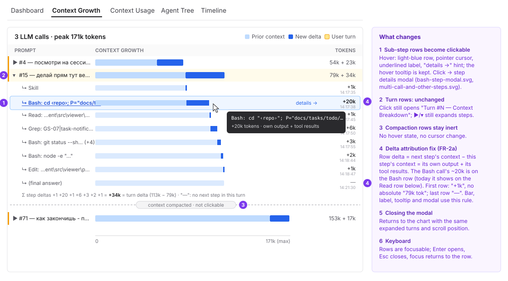
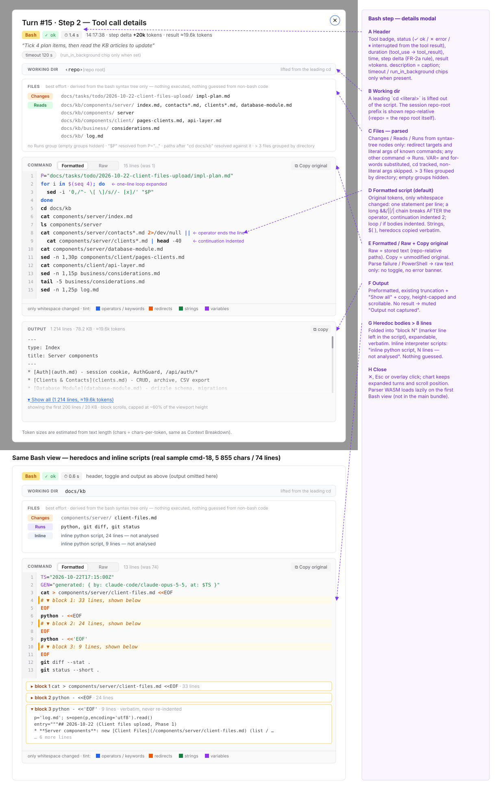
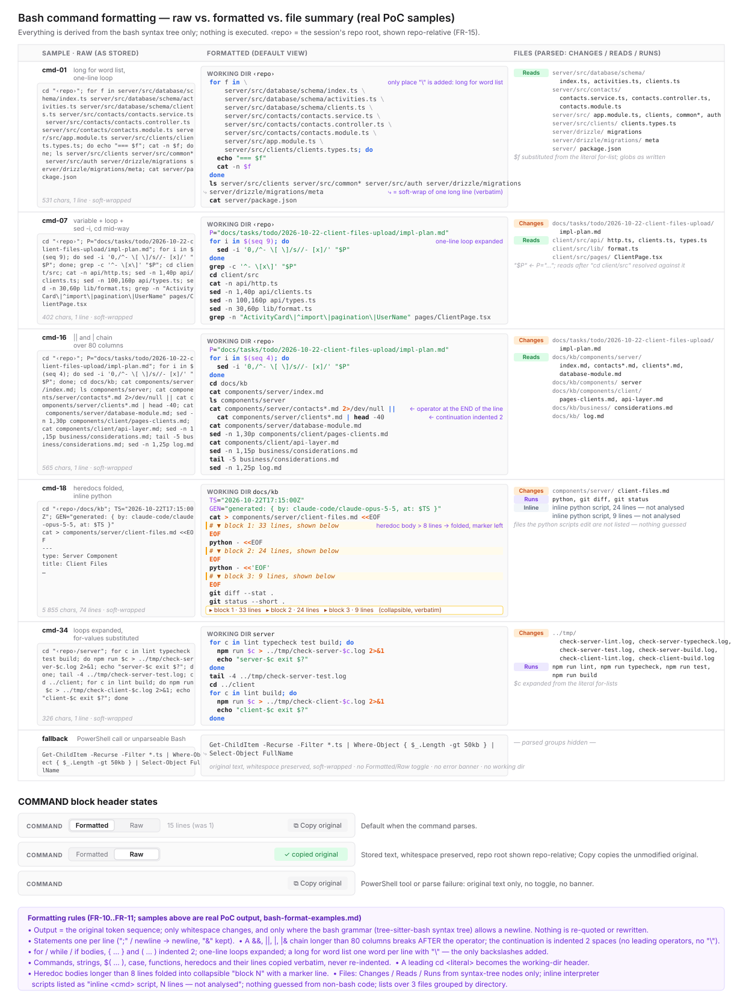
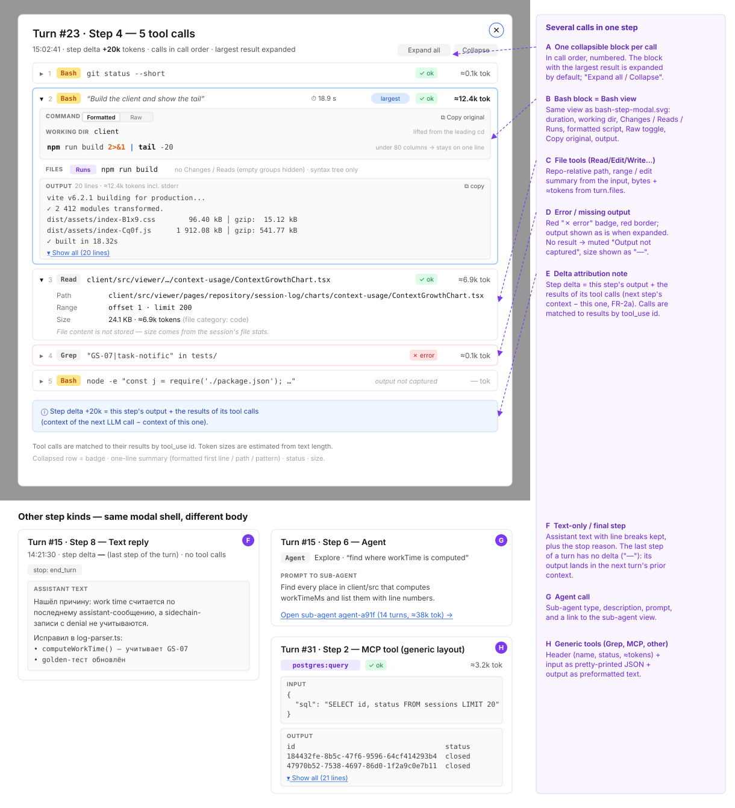
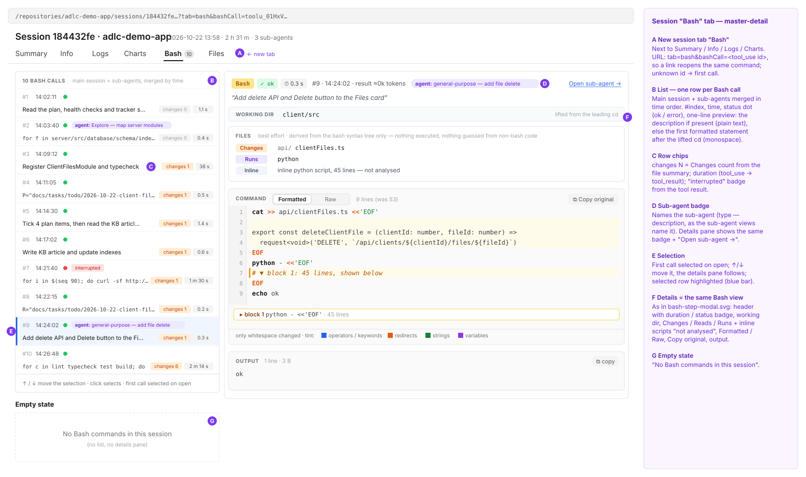

# 2026-10-22: Context Growth Chart: Item Details Modal

**Status:** todo
**Priority:** medium
**Type:** feature + bug fix (step delta attribution, FR-2a)
**Module(s):** client, server (tool outcome rule), hook (lifecycle event fields)
**Owner:** denis.tsyplakov
**Created:** 2026-10-22

## Description

Raw idea (verbatim):

> in session charts context grows I want to be able to click on line (some with high token
> contribution) and see details on this like in modal popup
> e.g. if it was basj call - I want to see detiails (prefferably formatted as nice as possible e.g.
> with line breaks)

On the session "context grows" chart, the user wants to click an individual item (a line/segment
that contributed tokens to the context — especially the ones with a high token contribution) and
open a modal popup with that item's details. For example, if the item was a Bash call, the modal
should show the call's details (the command and its output), formatted as readably as possible.

The main pain point is Bash commands: Claude writes them as long one-liners
(`cd <abs>; a; b; for …; done; … | tail`, heredocs with inline `python -` / `node -e` scripts), and
the user cannot see at a glance which files a command touched. The same readable rendering must
also be used in the session **Logs** tab, where tool calls open a details view on click, and in a
new session **Bash** tab that lists all Bash commands of the session with their details.

Today (`ContextGrowthChart.tsx`): turn rows already open a "Turn #N — Context Breakdown" dialog on
click; the expanded sub-step rows (one per LLM call, "↳ Bash: …") only have a hover tooltip that
flattens the command into one line. The tool-call details view of the Logs tab is
`ToolCallDetailModal.tsx` (used by `PromptTurnItem` and `SubAgentDetail`); it renders the input as
`JSON.stringify`, so a multi-line command shows as one escaped string.

PoC: [`docs/pocs/2026-10-22-2035-bash-pretty-format/`](../../../pocs/2026-10-22-2035-bash-pretty-format/README.md)
— a printer and a file extractor driven only by the `tree-sitter-bash` syntax tree; verified on 880
real commands (no failures, output always the same bash program); sample output in
[bash-format-examples.md](bash-format-examples.md) (local only, gitignored — real commands with local
paths; regenerate with `node format.mjs` in the PoC folder).

## Functional Requirements

### Chart

- FR-1: Sub-step rows of the context-growth chart are clickable (pointer cursor, hover state); their
  hover tooltip stays. Turn rows keep their existing Context Breakdown dialog unchanged; compaction
  rows stay non-clickable.
- FR-2: Clicking a sub-step row opens a details modal for exactly that step: its tool calls with
  their inputs and results, and its assistant text.
- FR-2a (bug fix — off-by-one attribution): a sub-step row's delta must be the context growth its
  own tool calls caused. Today (`ContextGrowthChart.tsx` ~453-469) row `si` shows
  `steps[si].contextTokens − steps[si-1].contextTokens` but is labelled with step `si`'s tool calls,
  whose results only enter the context of step `si+1` — so a big Bash output shows up on the next
  row. New rule:
  - row `si` (not last) delta = `steps[si+1].contextTokens − steps[si].contextTokens` (its output +
    its tool results);
  - the last step of a turn has no next step in the turn: delta "—" (its output reaches the next
    turn's prior context);
  - the first row no longer shows an absolute "Nk tok" label; it shows its delta like the others;
  - the sum of a turn's step deltas equals the turn row's delta
    (`contextTokens − contextTokensStart`);
  - every consumer of the step delta (bar, right label, hover tooltip, the new modal) uses this rule.
- FR-3: A step with several tool calls lists all of them in call order as collapsible blocks; with
  one call it is expanded, with several the one with the largest result is expanded.
- FR-4: The session-log parser keeps the tool_use id of every call on each sub-step
  (`toolCallIds: string[]` on `assistantSteps`, concatenated when steps are merged); the modal finds
  each call's result in `turn.allToolCalls` (FR-23) by id, never by name/position.
- FR-5: Closing the modal returns to the chart with expanded rows and scroll position unchanged.

### Tool call rendering (shared by the chart modal and the Logs tab)

- FR-6: Per-tool rendering lives in the shared `ToolCallDetailModal` (or a component it uses), so the
  chart modal, the Logs tab (`PromptTurnItem`) and `SubAgentDetail` show the same view.
- FR-7: Every call shows a header: tool name, status (red "error" badge on error), estimated tokens
  of its result (`result.length / charsPerToken`, the same formula as `context-data.ts`).
- FR-8: Output is preformatted text with line breaks kept, in a scrollable block capped at ~60% of
  the viewport height, using the truncation + "show all" + copy of `ToolCallDetailModal`, with the truncation limit raised from 2 000 to 20 000 characters.
  No result → muted "Output not captured".
- FR-9: Read / Edit / Write / MultiEdit / Glob calls: repo-relative path, bytes and estimated tokens
  from `turn.files`, plus the input. Agent: description, prompt and a link to the sub-agent.
  Other tools (Grep, MCP, unknown): input as pretty-printed JSON + output. A step without tool
  calls shows the assistant text and the stop reason.

### Bash command view

- FR-10: Everything in the Bash view is derived from the bash syntax tree (`tree-sitter-bash`), never
  from text patterns or the model's layout habits.
- FR-10a: The command is shown as an indented script. The output is the original token sequence;
  only whitespace changes, and only where the grammar allows a newline:
  - between statements (`;` / newline → newline; `&` kept);
  - after `&&` / `||` / `|` / `|&` when the one-line form exceeds 80 columns, continuation indented,
    operator at the end of the line;
  - `for` / `while` / `if` bodies, `{ … }` and `( … )` indented, one-line loops expanded; a long
    `for` word list one word per line;
  - every other node (commands, strings, `$(…)`, `case`, functions, heredocs and their lines)
    copied verbatim, multi-line verbatim text never re-indented;
  - a leading `cd <literal>` lifted into a working-directory header;
  - heredoc bodies longer than 8 lines folded into collapsible blocks, a marker left in the script.
- FR-11: Above the script, a best-effort file summary built from syntax-tree nodes only:
  - **Changes**: redirect targets (`>`, `>>`, `&>`), and literal arguments of `sed -i`, `rm`, `mv`,
    `cp` (destination), `mkdir`, `touch`, `tee`;
  - **Reads**: `<` sources and literal arguments of `cat`, `head`, `tail`, `ls`, `wc`, `sed -n`,
    `grep` (after the pattern), …; globs as written;
  - **Runs**: every other command (`npm run x`, `git x`, `docker x`, …);
  - literal `VAR=…` assignments and `for x in <literal words>` values are substituted; `cd` is
    tracked (not inside pipelines, subshells scoped); non-literal arguments are skipped;
  - inline scripts (`python -` / `node -e` / `bash -c` / heredoc into an interpreter) are listed as
    "inline <cmd> script, N lines — not analysed"; nothing is guessed from non-bash code;
  - lists over 3 files are grouped by directory.
- FR-12: The call's `description` is shown as a caption; `timeout` and `run_in_background` when
  present.
- FR-13: A Formatted / Raw toggle and a "Copy original" button (copies the unformatted command).
- FR-13a: The command (Formatted and Raw) is syntax-highlighted from the same bash syntax tree
  (the `tree-sitter-bash` highlight query), never from regex: keywords/operators, redirects, strings,
  variables/expansions, command names, flags and comments get distinct colours, with a small legend
  under the block. Fallback text (FR-14) is not highlighted.
- FR-14: If the command cannot be parsed, or the call came from the PowerShell tool, the original
  text is shown with whitespace preserved (soft-wrapped), no toggle, no error banner.
- FR-15: Paths follow the client path rule: the session's repo-root prefix is shown as a
  repo-relative path (working-dir header, file summary, formatted and raw command, output); "Copy
  original" copies the unmodified text.
- FR-16: The parser (`web-tree-sitter` ~210 KB + `tree-sitter-bash` ~1.36 MB WASM) is loaded lazily
  on first open of a Bash view (`import()`), never in the main bundle.

### Session "Bash" tab

- FR-17: A new session-detail tab **Bash** (`bash` in `SESSION_TABS`, `tab=bash`) lists every Bash
  call of the session in chronological order as a master-detail view — the main session's calls and
  its sub-agents' calls merged by time. A sub-agent's row carries a badge naming the sub-agent (its
  type / description, as the session's sub-agent views name it); the details pane shows the same
  badge with a link to that sub-agent.
- FR-18: Left: a narrow list, one row per call — index, time, status (ok / error), a one-line
  truncated preview (the call's `description` if present, otherwise the first formatted statement
  after the lifted `cd`), Changes count from the file summary.
- FR-19: Right: the selected call's details — the same Bash view as FR-10..FR-15, plus its output
  (FR-8). The first call is selected on open; ↑/↓ move the selection.
- FR-20: The selected call is kept in the URL (`bashCall=<tool_use id>`), so a link opens the same
  command; an unknown id falls back to the first call.
- FR-21: A session without Bash calls shows "No Bash commands in this session".

- FR-22: The Bash view header shows the command's duration (tool_use → tool_result timestamps
  of the transcript) and an "interrupted" / "error" badge from the tool result.

### Tool-call data model (added 2026-10-22, replaces the hard-coded `SKIP` filter)

- FR-23: One classification decides the Logs section of every tool (file / skill / agent / other
  tools); every call of a turn is kept in one list (`allToolCalls`), and the Tools, Files, Skills
  and Agents sections are derived from it — no call lost, none shown twice, today's section
  contents unchanged.
- FR-24: Every call has a status: ok, error, rejected (the user declined it or it was
  interrupted) or "output not captured"; a rejection is recognised from the transcript's
  `toolDenialKind` (user-rejected / permission-rule / automode-blocked / interrupted), otherwise
  from Claude Code's rejection text on an `is_error` result only — the same rule on client (Logs,
  Statistics) and server (tool stats).
- FR-25: Failed or rejected file, skill and agent calls are visible: Files / Skills rows show the
  status and open the call's details on click; Agent calls that never started a sub-agent are
  listed in the Agents section; a failed Read adds no file bytes.
- FR-26: A permission request / denial is attached to the exact call it was raised for — by
  `tool_use_id` when the event has one, otherwise by tool name + input within the call's time
  window — never to "the first call with that name"; an event that matches no call stays
  unattributed.
- FR-28: The hook records the call's `tool_use_id` on PostToolUseFailure and PermissionDenied
  events (plus the denial `reason`), as it already does on PostToolUse; PermissionRequest has no id
  in Claude Code's payload and stays matched by name + input (FR-26).
- FR-27: Counts no longer double-count images on top of the call that returned them; the Summary
  band's tool count is labelled "other tool calls".

## Non-Functional Requirements

- NFR-1: The formatter + file extractor is an algorithm: a doc in `docs/knowledgebase/algorithms/`
  with an examples table (shaped after the PoC's 10 samples, but anonymized: no local absolute
  paths, user names or private repo content) and a `*.algo.test.ts` table test. The
  table test also asserts the formatting invariant: re-parsing the output gives the same token
  sequence as the input.
- NFR-2: No API change — the full tool input and results are already in the stored transcript
  parsed on the client. The only server change is the rejection rule of FR-24. The only hook
  change (FR-28) is additive and backward compatible.
- NFR-3: The section classification + permission attribution and the call-outcome rule are
  algorithms with docs and table tests in `docs/knowledgebase/algorithms/`.

## Acceptance Criteria

- [ ] AC-1 (FR-1): Hovering a sub-step row shows a pointer and hover state; turn rows still open
      the Context Breakdown dialog; compaction rows are not clickable.
- [ ] AC-2 (FR-2, FR-4): In a fixture session, clicking the sub-step row with the largest delta
      opens the modal for exactly that step; a Bash call returning ~20k tokens is shown with its
      command and full result, matched by tool_use id.
- [ ] AC-2a (FR-2a): In a fixture turn where step 2 runs a Bash call returning ~20k tokens and
      step 3 a small Read, the ~20k delta is on the step-2 (Bash) row, not on the Read row; the
      step deltas of the turn add up to the turn row's delta.
- [ ] AC-3 (FR-3): A step with several tool calls lists all of them in call order; the largest is
      expanded.
- [ ] AC-4 (FR-10, FR-11): The anonymised examples of the algorithm doc — shaped after the samples
      of [bash-format-examples.md](bash-format-examples.md) (local, gitignored) — render as specified
      (script lines and Changes / Reads / Runs lists).
- [ ] AC-5 (FR-6): Opening a Bash tool call in the Logs tab shows the same formatted view.
- [ ] AC-6 (FR-14): An unparseable command and a PowerShell call show the original text, no error.
- [ ] AC-7 (FR-15): No absolute local path of the repo root appears anywhere in the modal.
- [ ] AC-10 (FR-17..FR-19): The Bash tab of the sample session lists its 38 Bash calls in order;
      clicking a row (or ↑/↓) shows that call's formatted view and output on the right.
- [ ] AC-10a (FR-17): In a session with sub-agents, their Bash calls appear in time order among the
      main session's calls, each with a badge naming its sub-agent.
- [ ] AC-11 (FR-20, FR-21): Reloading `tab=bash&bashCall=<id>` re-opens the same call; a session
      with no Bash calls shows the empty-state text.
- [ ] AC-12 (FR-22): The Bash view shows the duration and an "interrupted" badge for an interrupted call.
- [ ] AC-13 (FR-13a): A formatted command shows keywords, strings, variables and redirects in their
      legend colours; the fallback text has no highlighting.
- [ ] AC-8 (FR-5): Closing the modal leaves expanded rows and scroll position unchanged.
- [ ] AC-14 (FR-23, FR-25): A failed Edit shows a red mark in Files and opens its details with the
      error text; Tools / Files / Skills contents are otherwise unchanged.
- [ ] AC-15 (FR-26): With two Bash calls in a turn and a permission request for the second, only
      the second carries the "requested" badge.
- [ ] AC-16 (FR-25): An Agent call that failed before starting a sub-agent appears in the Agents
      section with its error.
- [ ] AC-18 (FR-28): The hook records `tool_use_id` on PostToolUseFailure and PermissionDenied
      events (and `reason` on PermissionDenied), `null` when Claude Code does not provide it.
- [ ] AC-17 (FR-24): A declined call shows "rejected", not "error"; tool output that merely
      contains the rejection sentence is not a rejection.
- [ ] AC-9 (FR-16): The formatter WASM is absent from the main bundle and fetched on first Bash view.

## Common sense considerations

- Sub-step rows become clickable; turn rows keep the current dialog; compaction rows stay inert.
- Multi-call steps: all calls in call order, largest expanded.
- Tool calls are joined to results by a `toolCallIds` field on steps.
- Missing result → "Output not captured"; error → red badge, output as is.
- File tools show `turn.files` data; Agent links to the sub-agent; other tools use a generic JSON
  view; text-only steps show assistant text and stop reason.
- Rendering goes into the shared `ToolCallDetailModal` (the user asked for the same view in Logs).
- Formatter and file extractor: own code over the `tree-sitter-bash` syntax tree (lazy WASM), per the
  PoC; no text-pattern heuristics.
- Fallback for parse failure / PowerShell: raw text, no banner.
- Formatted/Raw toggle and "Copy original" are included; `description`, `timeout`,
  `run_in_background` are shown.
- Large outputs reuse the existing truncation mechanism with the limit raised to 20 000 characters; the block is height-capped and scrollable.
- Repo-root prefix is shown repo-relative everywhere (client path rule).
- Token estimate uses the `context-data.ts` formula.
- The "Raw text is not stored" footer stays only on the turn dialog, which still shows estimates.
- AC examples are the PoC's 10 real commands instead of synthetic ones.

## Open Questions

## Notes

<!-- Append timestamped notes here as work progresses -->
