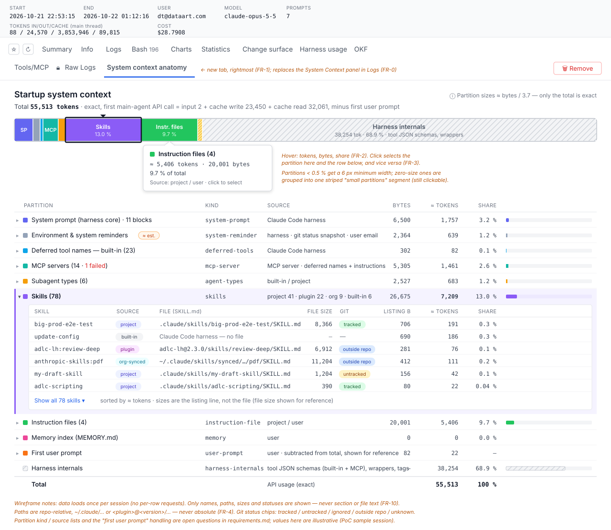
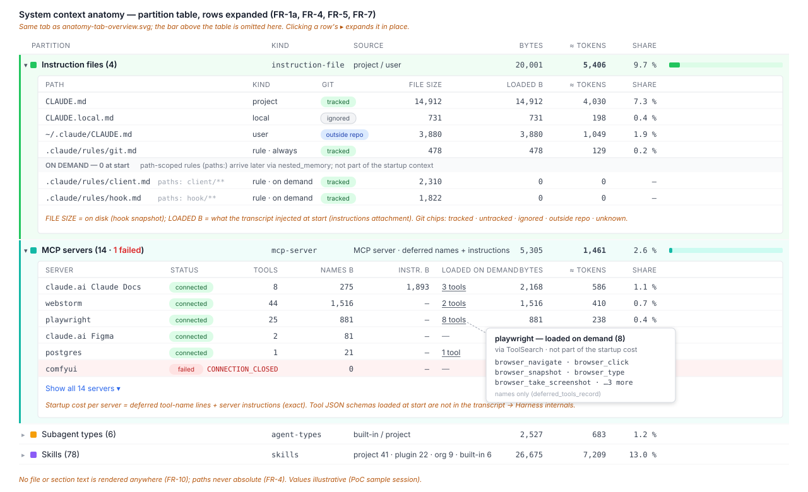
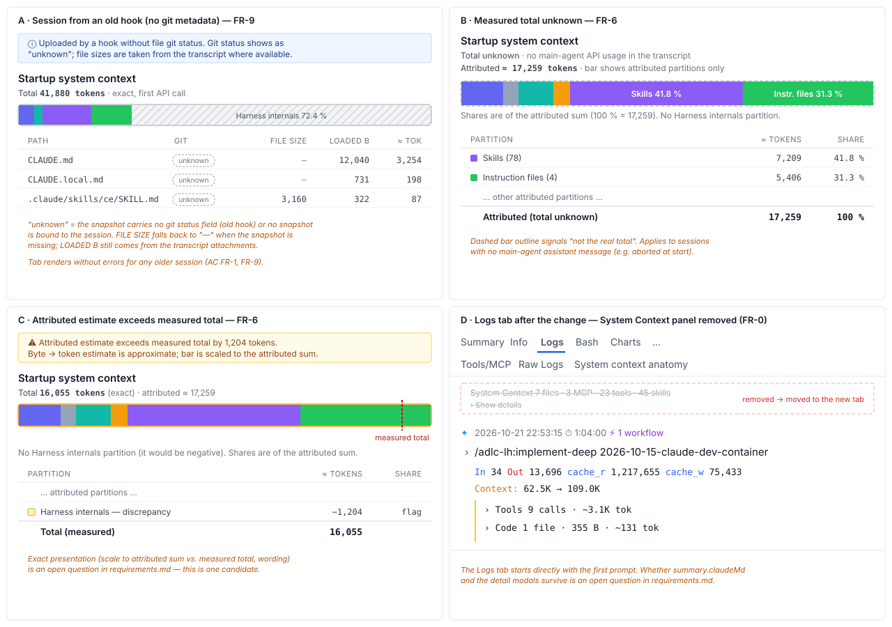

# 2026-10-29: Session Tab — System Context Anatomy (Disk-Partition View)

**Status:** todo
**Priority:** medium
**Type:** feature
**Module(s):** client | server | hook
**Owner:** denis.tsyplakov
**Created:** 2026-10-29
**Tracker:** GH-59 https://github.com/DataArt/artisyn-log-hub/issues/59

## Description

Original idea (user, in Russian, translated):

> I need a session tab "System context anatomy" — as detailed as possible. Do not record the text
> that is inside, but for every section: how much it takes and where it came from, down to the file
> name and size (git-tracked / not git-tracked must be visible too). Metaphor — hard-disk
> partitioning.

A new tab in the session view that shows what the session's **startup system context** is made of,
drawn like a disk partition manager: one horizontal bar is the whole startup context, split into
partitions (sections) proportional to their size, with a partition table underneath that drills
down to individual source files.

Sections to cover, as far as the available data allows:

- Claude Code built-in system prompt (harness core instructions, environment block, language /
  output style settings);
- built-in tool definitions (not split per tool, see FR-5);
- deferred tool names (listed by name only, schemas not loaded);
- MCP servers — connected / failed, their tools, server-provided instructions;
- subagent types list;
- skills listing — per skill file (`SKILL.md`), description size, source per FR-3;
- instruction files — `CLAUDE.md`, `CLAUDE.local.md`, user-level `~/.claude/CLAUDE.md`,
  `.claude/rules/*.md`;
- memory — `MEMORY.md` index of the memory dir;
- system reminders — git status snapshot, user email, commit/PR attribution;
- the first user prompt;
- a **Harness internals** partition: occupied space the transcript does not show (mostly tool
  definitions) — the remainder between the measured total and everything attributed above (FR-6).

Related (archived): `2026-10-16-sysctx-instruction-files` (Files/Rules tabs of the System Context
panel from the Claude log's `instructions` / `nested_memory` attachments) and
`2026-10-16-sysctx-skill-source` (harness snapshot, `docs/knowledgebase/algorithms/harness-snapshot.md`).

## Functional Requirements

- FR-0. **Goal and replacement.** The tab answers questions like "how many tokens does the declaration
  of MCP server X cost", "how many tokens does skill Y cost" and "how many tokens do skills cost
  in total". It **replaces** the current System Context panel at the top of the Logs tab
  (`7 files · 3 MCP · 23 tools · 47 skills` + Show details). The panel is removed and its
  information moves into the new tab. The existing merge logic carries over: skills = snapshot ∩
  `skill_listing`, the Files/Rules merge of `instructions` / `nested_memory` with the snapshot
  (`docs/knowledgebase/session-log-view.md`). `summary.claudeMd` stays — Session Info, Call Tree
  and Context Usage use it.
- FR-1. A new session-view tab **System context anatomy** is available for every session. It is
  placed as the rightmost tab of the session view.
- FR-1a. **Per-MCP-server cost.** For every MCP server, one row aggregates its startup cost:
  its deferred tool-name lines (`deferred_tools_delta`) and its server instructions
  (`mcp_instructions_delta`), both measured exactly. Connected / failed status
  (`failedMcpServers`) and tool count are shown too. Tools loaded later via ToolSearch
  (`deferred_tools_record`) are listed as "loaded on demand", separately from the startup cost.
- FR-2. **Partition bar.** One horizontal bar represents the whole startup context (100 %). Each
  section is a partition whose width is proportional to its token size (a byte-based estimate
  via the existing `resolveCharsPerToken(pricing, model)` in `log-parser.ts` — only the total is
  exact tokens, see FR-6); every partition has a
  distinct colour, a label and a hover tooltip with size (tokens, bytes) and share of total.
  Partitions smaller than a minimal visible width are still selectable (e.g. grouped into a
  "small partitions" segment or given a minimum width).
- FR-3. **Partition table.** Below the bar, a table lists every partition: name, kind, source,
  size in bytes, token estimate, share of total. Selecting a partition in the bar or the table
  highlights it in both. One shared vocabulary is used by the bar, the table and the drill-downs:
  - kinds: `system-prompt`, `environment`, `deferred-tools`, `mcp-server`, `mcp-instructions`,
    `agent-types`, `skills`, `instruction-file`, `memory`, `system-reminder`, `first-prompt`,
    `harness-internals`;
  - sources: `harness`, `project`, `user`, `plugin`, `org-synced`, `built-in`, `mcp-server`,
    `system-reminder`; valid for skills: `project`, `user`, `plugin`, `org-synced`, `built-in`.
- FR-4. **Drill-down to files.** A partition that comes from files expands into its files. Each file
  row shows: display path (repo-relative for project files, `~/.claude/...` for user-level,
  `<plugin>@<version>/...` for plugin files — never an absolute local path, per
  `.claude/rules/client.md` § Path display), file name, size on disk (bytes), token estimate, and
  **git status**: `tracked` / `untracked` / `ignored` / `outside repo` / `unknown`.
  - Partition and token sizes come from the transcript attachments (what was actually loaded); the
    snapshot's disk size is shown only in the "size on disk" column.
  - Files are matched between snapshot and transcript by display path. A transcript-only file has
    git status `unknown`, except paths under `~/.claude/...` or `<plugin>@<version>/...`, which the
    client marks `outside repo` itself. A snapshot-only file is listed as "not loaded at start"
    with 0 tokens.
  - User-level `~/.claude/CLAUDE.md` and `MEMORY.md` rows come from the transcript `instructions`
    attachment only; the hook does not scan them.
- FR-5. **Sections without files** show their size and origin ("Claude Code harness", "MCP server
  `<name>`", "git status snapshot", …) without a file path. Sizes come from the typed `attachment`
  lines the Claude Code transcript writes before the first main-agent assistant message (PoC
  `docs/pocs/2026-10-29-1504-sysctx-anatomy/`), measured exactly per item:
  - built-in system prompt — `prompt_snapshot.systemPrompt[]`, per block;
  - skill listing — `skill_listing` (per skill by splitting `content` on `- <name>: `);
  - instruction files — `instructions.files[]`;
  - deferred tool names, grouped per MCP server, and failed servers — `deferred_tools_delta`;
  - MCP server instructions — `mcp_instructions_delta`;
  - subagent types — `agent_listing_delta`;
  - system reminders (user email, git status) — `session_context`.

  Environment pieces (`environment`, `model`, `language`, `date`, `auto_mode`, …) are sized by
  their JSON length and marked as estimated, with the method shown in the tooltip. Tool JSON
  schemas (built-in and loaded MCP tools) are not in the transcript: they are not split per tool
  and make up the bulk of the Harness internals partition (FR-6). Path-scoped rules
  (`.claude/rules/*.md` with `paths:`) are not part of the startup context — they arrive later via
  `nested_memory` and are listed as "on demand, 0 at start".
- FR-6. **Measured total and the "Harness internals" partition.**
  - The anatomy is built from the **first startup block only**: the typed attachments before the
    first main-agent assistant message, and that message's usage. Later re-injections (after
    `/clear`, auto-compaction or `--resume`) are ignored.
  - Total = `input_tokens + cache_creation_input_tokens + cache_read_input_tokens` of the first
    non-sidechain assistant line with `message.usage`, counted once per `message.id`; a missing
    cache field counts as 0.
  - The first user prompt is **not subtracted**: it is its own partition "First user prompt"
    (kind `first-prompt`), sized from the typed text of the first `type:user` line only, excluding
    attachments and system-reminder blocks.
  - Harness internals = total − sum of attributed partitions. It is labelled **"Harness
    internals"** (kind `harness-internals`) — never "Unallocated" or "free": it is occupied space
    whose contents the transcript does not show. It is drawn as a sealed / hatched segment, not as
    empty space.
  - Its info icon and hover show a detailed hint (text below, numbers filled in):

    > **Harness internals — ≈ N tokens (P % of the startup context)**
    > Tokens that Claude Code sent in the first request but did not write to the session log, so
    > they cannot be split further. Measured total M minus everything attributed above (A).
    > Mostly:
    > • **Tool definitions** — the JSON schemas and descriptions of the built-in tools (Bash, Read,
    >   Edit, Grep, Agent, …) and of MCP tools loaded at start. Usually the largest part.
    > • **Message wrapping** — system-reminder tags, message framing and separators.
    > • **Estimate error** — every other partition is a byte-based estimate, while the total is
    >   exact; their combined error lands here (it can be positive or negative).
    > Deferred MCP tools are not here: only their names are loaded at start, shown under each
    > MCP server.

  - If attributed > total: the bar is scaled to the attributed sum, no Harness internals partition
    is drawn, and a warning reads "Attributed estimate exceeds measured total by N tokens".
  - If no main-agent assistant message with usage exists, the bar shows only attributed partitions
    and says the total is unknown.
- FR-7. **Per-skill / per-MCP breakdown.** The skills partition expands per skill (name, source per
  FR-3, file, description size); the MCP partition expands per server as in FR-1a.
- FR-8. **Hook: git status metadata.** The hook already sends `bytes` on every `skills[]`,
  `agents[]` and `systemContext.files[]` entry; the only new field is git status, on those same
  entries. Only metadata is sent — never content.
  - Field: `gitStatus?: 'tracked' | 'untracked' | 'ignored' | 'outside-repo'` — optional,
    additive. Absent means unknown (UI label `unknown`). `modified` / `missing` from the PoC are
    not sent (modification is already covered by `contentHash`).
  - `HARNESS_SNAPSHOT_SCHEMA_VERSION` stays `1`.
  - `computeSnapshotId` (harness-snapshot.md rule 7) appends `gitStatus` to an entry's tuple only
    when it is set (e.g. `[path, contentHash, gitStatus]`), so a snapshot without the field keeps
    exactly the old id; a status change (e.g. untracked → tracked) gives a different id and
    resends the snapshot.
  - Computation is batched, from the `getGitRoot` root: one `git ls-files -z -- <paths>` for
    tracked and one `git check-ignore --stdin -z` for ignored — at most 2 git processes per hook
    run. Paths outside the root are `outside-repo`; any git failure or non-repo case leaves the
    field unset.
  - Introduced in hook `2.28.0` (the next minor after the current `2.27.0`); the
    `docs/knowledgebase/hook-api-versioning.md` matrix gets the row.
- FR-9. **Backward compatibility.** Old hooks that do not send the new fields keep working: the
  server accepts snapshots without them, and the UI shows git status `unknown` and falls back to
  sizes it can derive (e.g. from `instructions` attachment content length). Old sessions render
  the tab with whatever data exists.
- FR-10. **No content.** Neither the hook nor the server stores new file text for this tab, and the
  tab never renders text of any section or file — names, paths, sizes, statuses only.

## Non-Functional Requirements

- No absolute local paths anywhere in the tab (Windows or POSIX).
- The tab must not issue extra heavy requests per row — data is loaded once per session.
- Bar and table readable in light and dark themes; partitions distinguishable without relying on
  colour only (labels / patterns on hover).

## Acceptance Criteria

- [ ] FR-0: the Logs tab no longer renders the System Context summary or Show details.
- [ ] FR-1: the tab appears in the session view and opens for a session with and without a bound
      harness snapshot.
- [ ] FR-2: the bar's partitions sum to 100 % of the shown total; hovering a partition shows tokens,
      bytes and share.
- [ ] FR-3: clicking a partition in the bar selects the same row in the table and vice versa.
- [ ] FR-4: for a session in this repo, `CLAUDE.md` shows `tracked`, `CLAUDE.local.md` shows
      `ignored` (or `untracked`), `~/.claude/CLAUDE.md` shows `outside repo`, each with a size.
- [ ] FR-5: rows without files show their origin label and an "estimated" mark where applicable.
- [ ] FR-6: for the golden fixture, total, attributed and Harness internals match fixed numbers
      (Harness internals = total − attributed); the partition is labelled "Harness internals" (no
      "Unallocated" anywhere in the tab) and its hint lists tool definitions, message wrapping and
      estimate error with the filled-in numbers; a fixture where attributed exceeds total shows the
      warning and no Harness internals partition; a compacted / resumed session uses only its
      first startup block.
- [ ] FR-7: the skills partition expands into one row per skill with its source and file.
- [ ] FR-8: a snapshot uploaded by the new hook contains `gitStatus` per entry and no file content
      beyond what was sent before; a snapshot without `gitStatus` has the same id as before.
- [ ] FR-9: a session uploaded by a hook without the new fields renders the tab with git status
      `unknown` and no errors; the server accepts the old snapshot shape.
- [ ] FR-10: no text of any instruction / skill / memory file appears in the tab's DOM.
- [ ] Tests: steps 8, 8a and 9 of `tests/scenarios/view/s-sess-03.spec.ts` (System Context panel)
      are rewritten against the new tab; the GS-05 golden fixture is extended with
      `prompt_snapshot`, `mcp_instructions_delta`, `session_context` and a first-assistant `usage`
      line; harness-snapshot algorithm doc rule 7 gets rows (status change → different id;
      no `gitStatus` → old id); contract registry row only if a route is added or changed.

## Open Questions

- Org-synced skills (`~/.claude/skills/synced/<org>/<skill>/SKILL.md`) are not in the harness
  snapshot today, so the tab cannot tell them from built-in skills (both are listing-only). Should
  the hook start scanning that folder (metadata only, path masked as
  `~/.claude/skills/synced/<org>/...`, a new snapshot `source` value `org-synced`, part of the
  snapshot id), or are org-synced skills shown with source `built-in` / `unknown` in this task?

yes start scan - we need to understand the whole picture

- Which features of the current System Context panel survive in the new tab beyond FR-0's merge
  logic: the skill / agent / rule / file / MCP detail modals (they render file text, which FR-10
  forbids — dropped, or kept as an explicit exception), the per-MCP call counts and the
  pricing-based token costs?

из текущей панели просто одна строка в текущей дизайне которая говорит что стартовый контекст Т токенов. и можно кликнуть по ней и пойти 
на таб с деталями

## Common sense considerations

- Priority set to `medium` (default; change if needed).
- Description aligned with FR-0: the Logs-tab System Context panel is removed.
- User-level `CLAUDE.md` and `MEMORY.md` come from the transcript; `outside repo` is derived from the masked path.
- `gitStatus` is the only new snapshot field; `bytes` already exists; `unknown` = field absent.
- `schemaVersion` stays 1 — older servers reject any other value.
- `gitStatus` joins the id tuple only when set, so old-shape snapshots keep their ids.
- Git status is computed with at most 2 batched git processes per hook run.
- Hook version for the new field: `2.28.0`.
- Measured total = first non-sidechain usage, de-duplicated by `message.id`.
- First user prompt is its own partition, not subtracted.
- Attributed > total: bar scales to attributed sum, warning shown, no Harness internals.
- Only the first startup block is used; later re-injections are ignored.
- Bar sizes come from the transcript; disk size is a separate column; match by display path.
- One shared kind / source vocabulary (FR-3).
- Token estimate reuses `resolveCharsPerToken` from `log-parser.ts`.
- s-sess-03 panel steps are rewritten, not duplicated; GS-05 fixture is extended.

## Notes

<!-- Append timestamped notes here as work progresses -->
- Owner answers and PoC findings (2026-10-29): see [notes.md](notes.md).
