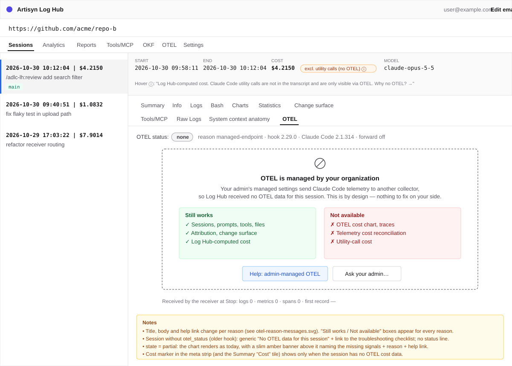
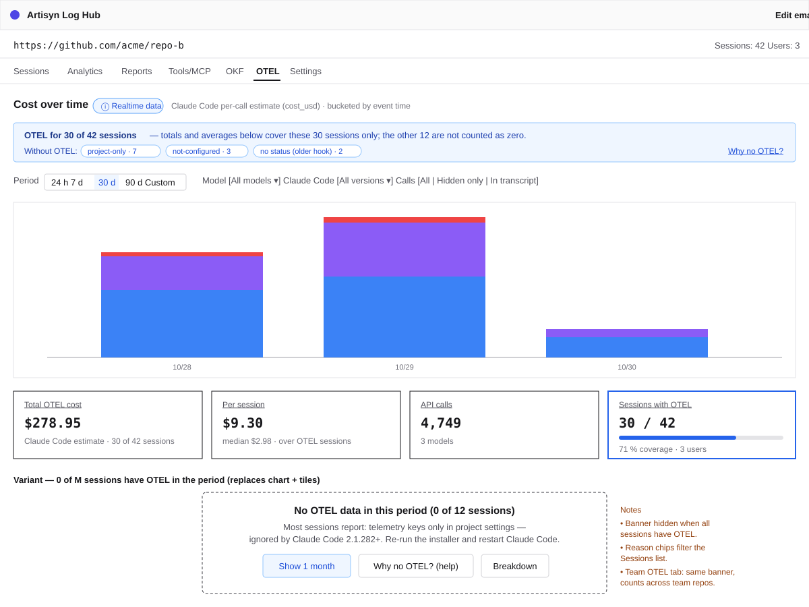
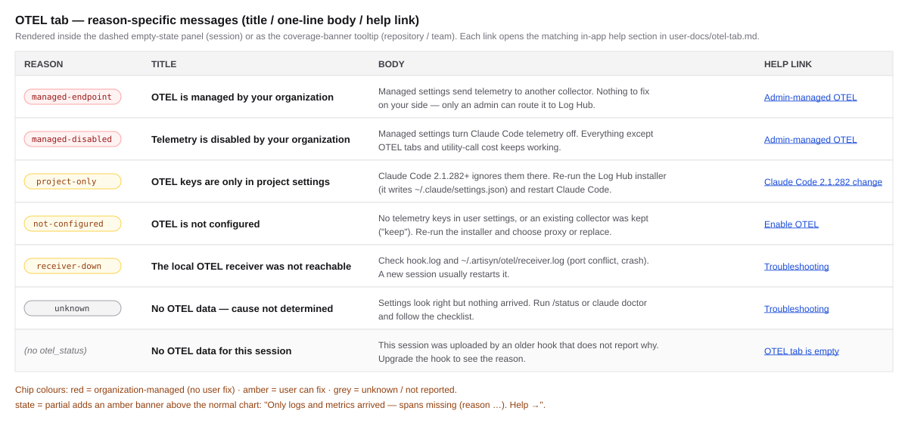

# 2026-10-30: Shared Per-User OTEL Receiver (Claude Code Ignores Project-Level Telemetry Env)

**Status:** done
**Priority:** high
**Type:** feature
**Module(s):** hook, artisyn-hooks-installer, server, client, user-docs
**Owner:** denis.tsyplakov
**Created:** 2026-10-30
**Tracker:** GH-67 https://github.com/DataArt/artisyn-log-hub/issues/67

## Description

Raw idea:

> Shared per-user OTEL receiver. Claude Code 2.1.282+ (verified on 2.1.314) silently ignores
> telemetry env vars (CLAUDE_CODE_ENABLE_TELEMETRY, OTEL_*_EXPORTER, OTEL_EXPORTER_OTLP_*,
> CLAUDE_CODE_ENHANCED_TELEMETRY_BETA, OTEL_LOG_TOOL_DETAILS, ...) in project .claude/settings.json
> and .claude/settings.local.json, so the hook's per-project receiver gets no OTEL data and OTEL
> tabs are empty. Move to one receiver per OS user on a fixed per-user port configured in
> ~/.claude/settings.json; receiver code = whoever spawned it first (dumb receiver, repo hook sends
> its settings on register); OTEL may be unavailable (admin managed settings) and Log Hub must work
> and explain; on install, if a foreign collector is configured, ask user to proxy/keep/replace and
> if proxy the receiver forwards raw payloads upstream.

### Background

- **Cause — intentional, documented Claude Code behaviour (v2.1.282+).** The official monitoring
  docs: "Claude Code ignores the OpenTelemetry exporter variables in a repository's
  `.claude/settings.json` and `.claude/settings.local.json`, so a repository can't use them to
  turn telemetry on, choose where it goes, or capture content. Set them in managed settings, or
  have each developer set them in their shell or `~/.claude/settings.json`." Also: "Claude Code
  doesn't pass `OTEL_*` environment variables to the subprocesses it spawns, including … hooks."
  Diagnostics: `/status`, `claude doctor`, `claude --debug`.
- **Exact ignored list** (extracted from the 2.1.314 binary): every `OTEL_EXPORTER_OTLP_*`
  (generic and per-signal ENDPOINT/HEADERS/PROTOCOL/CERTIFICATE/CLIENT_CERTIFICATE/CLIENT_KEY/
  INSECURE, incl. PROFILES), `OTEL_EXPORTER_PROMETHEUS_HOST/PORT`, `CLAUDE_CODE_ENABLE_TELEMETRY`,
  `OTEL_LOGS_EXPORTER`, `OTEL_METRICS_EXPORTER`, `OTEL_TRACES_EXPORTER`,
  `CLAUDE_CODE_ENHANCED_TELEMETRY_BETA`, `ENABLE_ENHANCED_TELEMETRY_BETA`, `OTEL_LOG_USER_PROMPTS`,
  `OTEL_LOG_ASSISTANT_RESPONSES`, `OTEL_LOG_TOOL_CONTENT`, `OTEL_LOG_TOOL_DETAILS`,
  `OTEL_LOG_MANAGED_SETTINGS`. Honoured sources: `userSettings`, `flagSettings`, `policySettings`.
  **Still honoured from project scope:** `OTEL_RESOURCE_ATTRIBUTES`, `OTEL_SERVICE_NAME`,
  `OTEL_METRIC_EXPORT_INTERVAL`, `OTEL_METRICS_INCLUDE_*`; a project may also set an exporter to
  `none`.
- **This is the new norm.** Claude Code has tightened these restrictions monotonically since
  2.1.217; plan for them to stay.

### Consequence for Log Hub

Today every project has its own receiver on its own random port and the installer writes the
endpoint into the project's `.claude/settings.local.json` (see `docs/knowledgebase/otel-receiver.md`
"One receiver per project — always", `docs/knowledgebase/hook-installation.md` "OTEL Settings").
With user-scope as the only place the endpoint can live, there is exactly **one** endpoint per OS
user, so the receiver must become one per user and route each record to its repository. Every
user on Claude Code ≥ 2.1.282 currently gets no OTEL data at all.

## Functional Requirements

### A. One receiver per OS user ("first spawner's code wins")

- **FR-A1 Per-user port.** The installer allocates one random loopback port per OS user once and
  stores it in a user-level Artisyn state dir (e.g. `~/.artisyn/otel/port.json`). Reused by every
  repository's install. Not a hard-coded constant (loopback is shared between OS users on one
  machine).
  - **Port resolution (new hook).** Source: `~/.artisyn/otel/port.json` (`{version:1, port}`). The
    port in the user-scope logs endpoint is a cross-check only (one `warn` on mismatch). The
    installer also writes the shared port into `otelReceiverPort` so old readers agree. New hooks
    always run in shared mode — no config toggle.
  - **Port conflict.** If the per-user port is held by anything that is not this user's shared
    receiver (409, a non-receiver answer, `EADDRINUSE` on spawn), the hook never picks a new port: it
    writes one `warn` and reports `reason = receiver-down` with detail `port-conflict`. Re-running
    the installer with `--otel-port <n>` re-allocates.
  - **`--otel-port <n>`** now pins the per-user port and rewrites `~/.claude/settings.json`, every
    registered repo's `settings.local.json` and `otelReceiverPort`, then tells the user to restart
    Claude Code.
- **FR-A0 Upgrade from the per-project receiver.** Upgrade rewrites `otelReceiverPort` to the
  shared port, retires `.artisyn/config/otel-port.json`, and leaves the old per-project receiver to
  its idle-exit (no shutdown call).
- **FR-A2 Receiver owner = OS user.** The receiver's owner identity becomes the OS user (home dir),
  not a `gitRoot`. The `409` guard now means "this port is held by another OS user's receiver"; the
  409 body (`{error:'owner-mismatch'}`) never contains the other user's home path.
- **FR-A3 First spawner wins.** Whichever repository's hook spawns the receiver first runs its own
  receiver code; later sessions (any repo, any hook version) reuse it. The hook **never** stops or
  restarts a running shared receiver because of a version difference (the current stale-receiver
  restart in `otel-register.js` does not apply to the shared port). The installer does not stop it
  either, except via an explicit flag (e.g. `--restart-otel-receiver`). The receiver is replaced
  only after its idle-exit: it exits after **10 minutes without any request** (OTLP, register,
  session-status), as today; there is no maximum lifetime.
- **FR-A4 Dumb receiver — the repo's hook supplies settings.** `POST /artisyn/register` carries
  everything the receiver needs for that session, computed by the registering repository's own
  hook: `sessionId`, `gitRoot`, `hookVersion`, `contract` (integer), `otelDir`, enabled `signals`
  (from `otelEnabled` / `otelTraces`), `uploader` (absolute path of that repo's
  `send-logs-hook.js`) and the realtime target (`serverUrl`, `apiKey`, `intervalMs`, enabled).
  The receiver does not read repository config files itself. Register is re-sent on
  `SessionStart` and on the throttled `UserPromptSubmit` re-arm, so config changes propagate.
- **FR-A5 Session registry.** The receiver keeps `sessionId → registration` and persists it to the
  user-level state dir so a receiver restart does not lose routing; an entry expires after 24 h
  without records or register for that session. Per-session received counters (per signal, first
  record time) are part of the persisted entry; pending-buffer records are reported as a separate
  `pending` count. A re-register
  of the same `sessionId` replaces the entry (latest wins): only later records follow it, written
  chunks stay, one `register-rebind session=… from=… to=…` line is logged.
- **FR-A6 Routing at write time.** For each record the receiver resolves `session.id` (record
  first, resource second — unchanged) → registration → writes the chunk into that repo's
  `otelDir/<session>/<epochMs>-<seq>.jsonl` exactly as today. Per-repo `dir-gone` check stays.
  Signals the repo did not enable (e.g. spans with `otelTraces: false`) are dropped for that repo.
- **FR-A7 Pending buffer.** Records for a not-yet-registered session are held in a bounded
  per-user pending spool; moved to the repo when the session registers; dropped after a TTL
  (sessions of projects without Log Hub end here and are never written to any repo). The PoC saw
  the first record ~0.4 s after `SessionStart` and none before it, so the spool only bridges the
  register round trip: TTL 5 min, cap 5,000 records per user; on overflow the oldest records are
  dropped and counted in the user-level `receiver.log`.
- **FR-A8 Uploads run the repo's own code.** The tail sweep spawns the registering repo's
  `uploader` path (`--otel-sweep --cwd <gitRoot>`), never the `send-logs-hook.js` next to the
  receiver. Realtime queue, timers and backoff are per repository/session using the registered
  target.
- **FR-A9 Version stamping.** Chunk lines carry `hookVersion` from the session's registration (not
  the receiver's own version) plus a new `receiverVersion` field. Old servers ignore the new field.
- **FR-A10 Contract and capabilities.** The register response returns
  `{receiverVersion, contract, capabilities[]}` (e.g. `spans`, `realtime`, `forward`). If a repo
  wants a capability the running receiver lacks, its hook writes exactly one `warn` line to its
  `hook.log` (naming the receiver version and that it will be replaced after idle) and does nothing
  else. The receiver ignores unknown register fields and answers `400` with a reason when required
  fields are missing. The register contract changes additively only.
- **FR-A11 Only shared-capable receivers bind the shared port.** Shared mode and forwarding (D)
  ship in the same release, so every receiver that can ever bind the per-user port supports both.
  Old hooks keep using their per-project port from `otelReceiverPort` and never touch the shared
  port.
- **FR-A12 Receiver independent of its origin repo.** After start the receiver reads nothing next
  to its own script (version read once at start, uploader by registered path), so deleting or
  reinstalling the repo that spawned it does not break it.
- **FR-A13 Resource-attribute routing fallback.** The installer also writes
  `OTEL_RESOURCE_ATTRIBUTES` with an Artisyn repo tag into `.claude/settings.local.json` (appended
  to an existing user value, never replacing it); Claude Code still honours this key from project
  scope and the PoC confirmed it reaches logs, metrics and spans. The receiver uses it for a
  session that has no registration (e.g. register failed); registration wins on conflict, and the
  tag is only accepted for a repo already present in the user-level repo registry (FR-B3).
- **FR-A14 Register authentication.** `/artisyn/register`, shutdown and session-status calls are
  authenticated with a per-user secret in a user-only file (e.g. `~/.artisyn/otel/token`); the
  secret itself never crosses the socket in clear (mutual challenge, mechanism set in the plan).
  The hook sends `serverUrl`/`apiKey` only after the receiver has proven knowledge of the secret.
  Unauthenticated calls get `401` and a `receiver.log` line and spawn nothing. The receiver accepts
  an `uploader` only if it is an absolute, existing `send-logs-hook.js` under the registering
  `gitRoot` or the user's Artisyn plugin dir, else `400`.
- **FR-A15 Shared launch contract.** Shared mode is launched with its own arguments (owner home,
  state dir, port; no `--owner`, no `otelDir`); the legacy `--owner` launch stays unchanged for
  per-project ports. Repo hooks spawn their own receiver copy (that is "first spawner"); the
  FR-D7 user-level hook spawns the copy the installer places in `~/.artisyn/otel/bin/` (with its
  `version.json`) on every install/upgrade.
- **FR-A16 Session-status route.** `POST /artisyn/session-status {sessionId}` →
  `{receiverVersion, received:{logs,metrics,spans}, firstRecordAt, pending, forward}`, same loopback
  defences as register, advertised as capability `session-status`. A 404 or a missing capability
  makes the hook report `reason = unknown`.

### B. Where the installer writes the settings

- **FR-B1** The installer writes the Artisyn-owned telemetry keys
  (`CLAUDE_CODE_ENABLE_TELEMETRY`, `OTEL_LOGS_EXPORTER`, `OTEL_METRICS_EXPORTER`,
  `OTEL_EXPORTER_OTLP_PROTOCOL`, `OTEL_EXPORTER_OTLP_COMPRESSION`, the per-signal endpoints,
  `OTEL_LOG_TOOL_DETAILS`, `OTEL_METRIC_EXPORT_INTERVAL`, and when traces are on
  `CLAUDE_CODE_ENHANCED_TELEMETRY_BETA`, `OTEL_TRACES_EXPORTER`, traces endpoint) into
  `~/.claude/settings.json`, per-key merge, owning only its own keys (same ownership rules as the
  current `settings.local.json` writer).
- **FR-B2 Backward compatibility with Claude Code < 2.1.282.** The installer keeps writing the env
  block into `.claude/settings.local.json`, but pointing at the **shared per-user port**, so older
  Claude Code (which honours project scope, with local above user) reaches the same receiver.
- **FR-B3 Repo registry and uninstall.** A user-level list of repositories with Log Hub installed;
  uninstalling the last one removes the Artisyn keys from `~/.claude/settings.json` (and restores
  the user's original keys if D applies).
- **FR-B4 Effective-config check.** `otel-endpoint-check.js` checks the user scope, not just the
  project file, and computes what Claude Code will actually apply (version, managed, user,
  project). It reports a mismatch as one `warn` line (e.g. "keys only in project scope — ignored
  by Claude Code ≥ 2.1.282").

### C. OTEL may be unavailable — Log Hub must keep working and explain

- **FR-C1** Everything not built on OTEL (transcripts, sessions, prompts, tools, files,
  attribution, Log Hub-computed cost) works unchanged when no OTEL data arrives.
- **FR-C2 Fact.** At `Stop` the hook asks the receiver what it received for the session via the
  FR-A16 route (counts per signal, first record time; or "receiver unreachable").
- **FR-C3 Reason.** The hook derives the reason by reading the settings sources Claude Code uses:
  managed (`managed-settings.json` at the OS path, OS policies/registry, the server-managed cache
  `~/.claude/remote-settings.json`), `~/.claude/settings.json`, the Claude Code version. Reasons:
  `managed-endpoint`, `managed-disabled`, `not-configured`, `project-only`, `receiver-down`,
  `unknown`. The fact decides availability; the reason only explains it.
- **FR-C4** The hook writes an `otel-status {timestamp, state: ok|partial|none, reason,
  received:{logs,metrics,spans,firstAt}, claudeVersion, forward}` event (kebab-case, like
  `hook-status`) into the session's artisyn log plus one `hook.log` line. It is written at the
  first `Stop` where the receiver reports ≥ 1 record, else at `SessionEnd`; a later `Stop` may
  write one corrected event when the state improves; the server keeps the latest. `ok` = every
  signal the repo enabled has ≥ 1 record, `partial` = some do, `none` = none.
- **FR-C5** The hook and installer never try to override managed OTEL settings.
- **FR-C6 Installer.** When managed settings pin OTEL, the installer does not write user keys and
  prints: OTEL is managed by your organization → OTEL tabs unavailable, everything else works.
- **FR-C7 Server/UI.** OTEL tabs (repository, session, team) show the reason and what to do
  instead of an empty view; sessions from hooks without `otel-status` show a generic "no OTEL
  data". Aggregates show OTEL coverage ("OTEL for N of M sessions"; `ok` and `partial` count)
  instead of counting missing sessions as zero.
  - **Storage.** Additive nullable storage per session, no backfill (NULL = no status reported);
    exact columns set in the plan. Unknown `state`/`reason` values are stored as `unknown`.
  - **Ingest.** `otel-status` is added to `NON_ACTIVITY_LINE_TYPES` so it never moves session
    start/end. On an old server it may extend `end_time` to the Stop time — accepted.
  - **API.** The session DTO carries the status; the repository and team OTEL aggregates gain
    coverage fields (e.g. `otelSessions` / `totalSessions`); each changed route gets its
    `server/test/contract/registry/` row.
  - **Cost marker** "excludes Claude Code utility calls (no OTEL)": shown when the root session of
    the tree has no OTEL API-call rows and its state is not `ok` (not keyed on `telemetry_cost`,
    which is also NULL for a zero OTEL sum and only set on the root). Carried as
    `costExcludesUtilityCalls` on the session/cost DTO.
- **FR-C8** In-app help (`user-docs/otel-tab.md`) explains every reason and the fix (offline-first).

### D. Existing foreign collector — proxy / keep / replace

- **FR-D1 Detection.** At install/upgrade the installer detects a non-Artisyn OTEL configuration
  in user scope (`~/.claude/settings.json` `env`, `otelHeadersHelper`) and in the user's
  environment variables. Managed settings are not this flow (see C).
- **FR-D2 Question.** Interactive install shows, per signal, the endpoint, protocol, whether
  headers are set (values masked) and the exporter, and asks:
  1. **Proxy** (recommended) — Log Hub receives the data and forwards everything to the existing
     collector as before;
  2. **Keep** — do not touch the user's collector; Log Hub OTEL tabs will not work;
  3. **Replace** — data goes only to Log Hub; the existing collector stops receiving it.
  The prompt discloses what changes in the forwarded stream (FR-D9).
- **FR-D3 Non-interactive.** `--otel-existing=proxy|keep|replace`; default without the flag is
  `keep`. The choice is remembered; `upgrade` re-asks only if the foreign config changed.
- **FR-D4 Original config backup.** The user's original keys per signal (endpoint, protocol,
  headers, compression, exporter, certificates, `otelHeadersHelper`) are saved to a user-only
  file (e.g. `~/.artisyn/otel/forward.json`, versioned schema). Header values never appear in any
  log or installer output. Uninstall of the last repo restores the original keys exactly.
- **FR-D5 Forwarding.** With `proxy`, the receiver forwards each received request's **raw payload
  unchanged**, for **all** sessions and projects (including non-Log-Hub ones), only for the signals
  the user originally exported. Headers: in `proxy` mode the user's header keys
  (`OTEL_EXPORTER_OTLP_*HEADERS`, `otelHeadersHelper`) stay in place, so Claude Code sends them to
  the receiver (PoC: the helper's headers arrive on every request); the receiver passes the
  incoming headers upstream as-is and neither stores header values nor runs the helper.
  `otelHeadersHelper` is supported this way from the start. It answers Claude Code `200` after the
  local write; forwarding is asynchronous with a bounded in-memory queue, retry with backoff on
  `429`/`5xx`/network errors, drop on other `4xx`, and counts drops.
- **FR-D6 Protocol limit.** Forwarding supports OTLP/HTTP JSON upstreams. If the original exporter
  uses `grpc` or `http/protobuf`, the installer says so and offers: enter an OTLP/HTTP URL of the
  same collector (typically `:4318`), `keep`, or `replace`.
- **FR-D7 Receiver availability for all projects.** With `proxy`, the installer adds a minimal
  user-level `SessionStart` hook in `~/.claude/settings.json` that only ensures the shared receiver
  is running (fast, fail-silent, script under the user-level Artisyn dir), so sessions in projects
  without Log Hub still reach the user's collector. In no-collector and `replace` modes it is not
  installed; non-Log-Hub sessions then export to a port where nothing may listen (the PoC showed
  this is silent: no error, no slowdown), and records that do reach a running receiver are dropped
  after the pending TTL, only counted in the user-level `receiver.log`.
- **FR-D8 Health visibility.** The receiver logs `forward signal=… status=… queued=… dropped=…`
  (never headers) and a forward summary at idle-exit; `otel_status.forward` = `ok|degraded|off`.
- **FR-D9 Stream changes.** Artisyn user-level keys (e.g. `OTEL_LOG_TOOL_DETAILS=1`, intervals,
  traces) change what the user's collector receives. Nothing is stripped: the full stream is
  forwarded unchanged, and the installer prompt and the FR-D11 note disclose what is added.
- **FR-D10 Drift.** If the user later changes the user-scope endpoints manually,
  `otel-endpoint-check.js` writes one `warn` line and changes nothing; the next install/upgrade
  re-asks.
- **FR-D11 In-place change note.** Whenever the installer changes the user's existing OTEL config
  (`proxy` or `replace`), it leaves a note right there in `~/.claude/settings.json` saying what
  Log Hub changed, what the previous values were (header values masked) and where the full backup
  is (FR-D4). Uninstall removes the note together with restoring the original keys. Format: a
  top-level key `"_artisynOtel": {note, mode, previous, backup}` (the PoC showed unknown top-level
  keys are accepted silently). A known key with a wrong type makes Claude Code skip the **whole**
  settings file, so the installer validates everything it writes into `~/.claude/settings.json`
  against the expected types before saving and keeps a copy of the file it replaced.

### E. Observability (gaps found while debugging this issue)

- **FR-E1** On `SessionStart` the hook logs the Claude Code version.
- **FR-E2** The hook logs which OTEL keys are effective per scope vs. ignored (FR-B4), so "configured
  but not applied" is visible without reading Claude Code's own diagnostics.
- **FR-E3** `receiver.log` idle-exit line includes the number of ingests since start; every
  `ingest` line includes the target repo and `receiverVersion`.
- **FR-E4** A user-level `~/.artisyn/otel/receiver.log` for shared events, plus `ingest` lines
  mirrored into each repo's `receiver.log` so per-project debugging looks as it does today.

### F. PoC before planning

- **FR-F1** Verify on the current Claude Code: (1) OTLP records arriving before the `SessionStart`
  hook's register (size of the pending-buffer problem); (2) that `OTEL_RESOURCE_ATTRIBUTES` from
  `.claude/settings.local.json` reaches log, metric and span records (needed only for FR-A13);
  (3) behaviour with a managed-settings endpoint (which keys are stripped); (4) what `/status` /
  `claude doctor` print for ignored project keys; (5) whether exporting to a port with no listener
  is silent for the user (no visible errors, no slowdown). Uses real `claude -p` sessions (spends
  credits). All five are answered in
  [docs/pocs/2026-10-30-2327-otel-user-scope-behaviour/](../../../pocs/2026-10-30-2327-otel-user-scope-behaviour/README.md)
  (items 3–4 on 2026-10-31: a managed endpoint overrides per signal; `claude doctor` names the
  ignored project keys).

### G. User documentation (in-app help, site, shipped READMEs)

- **FR-G1 What is collected and how.** A user-facing section (in `user-docs/` — so it ships as
  in-app help and lands on the GitHub Pages site via `npm run build:site` — and summarised in
  `hook/README.md` / the release-kit README) explains: which OTEL signals Log Hub collects (logs,
  metrics, traces) and what they contain (incl. tool details via `OTEL_LOG_TOOL_DETAILS`, no
  prompt/response content), the path (Claude Code → loopback receiver on a per-user port → per-repo
  chunks → upload/realtime), which keys the installer writes to `~/.claude/settings.json` and
  `.claude/settings.local.json` and why, and the proxy/keep/replace choice for an existing
  collector.
- **FR-G2 Version boundary.** State plainly: starting with **Claude Code 2.1.282** telemetry
  variables in project settings (`.claude/settings.json`, `.claude/settings.local.json`) are
  ignored by Claude Code, so they must live in user settings or managed settings; older versions
  still read the project file. Link to the official Anthropic docs
  (https://code.claude.com/docs/en/monitoring-usage) as the reference — as an extra next to the
  self-contained explanation, never as the only place the fact is documented (Offline first).
- **FR-G3 "If your admin has taken OTEL over, there is no way around it."** State clearly: when
  the organization's managed settings (managed-settings file, OS policy/MDM, or server-managed
  settings from the Claude admin console) pin the OTEL endpoint or disable telemetry, Claude Code
  removes the user-level keys and Log Hub cannot receive OTEL data — by design, nothing the user or
  Log Hub can do. What still works (sessions, prompts, tools, files, attribution, Log Hub cost) and
  what does not (OTEL tabs, traces, telemetry cost reconciliation, utility-call cost). The only
  route is the admin: e.g. point the managed endpoint at a collector that forwards to Log Hub.
- **FR-G4 Troubleshooting.** A "OTEL tab is empty" checklist mapped 1:1 to the `otel_status`
  reasons (FR-C3): what each means, how to check (`/status`, `claude doctor`, `claude --debug`,
  `hook.log`, `receiver.log`), how to fix (restart Claude Code after install, re-run the installer,
  upgrade the hook, ask the admin).
- **FR-G5** The UI messages of FR-C7 link to the matching in-app help section.
- **FR-G6 Admin guide (in scope).** A `user-docs/` page for organization admins (in-app help and
  the GitHub Pages site): how to deploy managed settings (managed-settings file, OS policy/MDM,
  server-managed settings) that point the OTEL endpoint at a collector forwarding to Log Hub, which
  keys to set, how to verify, and what users see when OTEL is managed. Offline-first, like FR-G1.

## Non-Functional Requirements

- **Backward compatibility** (CLAUDE.md "Hook API", "Compatability"): old hooks in other repos
  keep working on their per-project ports; old servers ignore the new fields/events; Claude Code
  < 2.1.282 keeps working via FR-B2; chunk format and the upload path are unchanged.
- **Security:** loopback only, existing Origin/Referer and Content-Type defences unchanged; a repo
  can only route its own registered sessions; registration wins over any repo-supplied resource
  attribute; forward headers stored with user-only permissions and never logged; never override
  managed settings.
- **Receiver dependencies:** Node built-ins only (unchanged rule).
- **Offline first:** every explanation lives in shipped in-app help, not online.
- **No path tuning to the developer machine** (CLAUDE.md "display/process paths rules"):
  user-level paths come from `os.homedir()`, managed paths per OS.
- **Tests and tooling must not touch the real user dirs:** scenarios run with an isolated
  HOME/USERPROFILE and managed-settings location (CLAUDE.md "never delete directories outside
  the repository").

## Acceptance Criteria

- [ ] AC-A1: With Claude Code ≥ 2.1.282 and Log Hub installed in two repositories, sessions in
      both repos produce OTEL chunks in their own `otelDir` and the OTEL tabs show data for both;
      only one receiver process listens, on the per-user port.
- [ ] AC-A2: A session in repo B served by a receiver spawned from repo A (older hook version)
      writes to repo B's `otelDir`, chunk lines carry repo B's `hookVersion` and the receiver's
      `receiverVersion`, and the tail sweep runs repo B's `send-logs-hook.js`.
- [ ] AC-A3: A hook never stops/restarts the shared receiver on a version difference; a missing
      capability produces exactly one `warn` line in that repo's `hook.log`.
- [ ] AC-A4: Records arriving before register are delivered to the repo after register; records of
      a session that never registers are dropped after the TTL and written nowhere.
- [ ] AC-A5: Deleting the repo that spawned the receiver does not stop other repos' OTEL ingest.
- [ ] AC-A6: `otelTraces: false` in repo B drops spans for B's sessions while repo A still gets
      spans.
- [ ] AC-A7: After a receiver restart a registered session keeps routing to its repo without
      re-register; after the registry TTL it is gone.
- [ ] AC-A8: Register without `sessionId` / `gitRoot` / `otelDir` → `400` with a reason; a valid
      register returns `receiverVersion`, `contract` and `capabilities`.
- [ ] AC-A9: Upgrading a repo installed with the per-project receiver ends with one shared receiver
      and no stale port in any file.
- [ ] AC-A10: A register call without valid authentication is rejected (`401`) and nothing is
      spawned; an `uploader` outside the allowed locations gets `400`.
- [ ] AC-A11: With the per-user port held by a foreign process, the hook logs one `warn`, reports
      `receiver-down` / `port-conflict` and does not change any port.
- [ ] AC-B1: After install, `~/.claude/settings.json` contains the Artisyn keys (other user keys
      untouched) and `.claude/settings.local.json` points at the same per-user port.
- [ ] AC-B2: Uninstalling the last repo removes the Artisyn keys from `~/.claude/settings.json`,
      the user-level SessionStart hook and its files under `~/.artisyn/otel/`, and restores the
      original OTEL keys.
- [ ] AC-B3: With keys only in project scope on Claude Code ≥ 2.1.282, `hook.log` shows one
      `warn` saying they are ignored.
- [ ] AC-C1: With a managed-settings endpoint, the installer prints the "managed by your
      organization" message and writes no user keys; sessions upload normally; the session's OTEL
      tab shows reason `managed-endpoint`; cost shows the "excludes utility calls" marker.
- [ ] AC-C2: `otel-status` follows the FR-C4 write rule (incl. a session whose metrics arrive only
      after the first `Stop` ends as `ok`); an old server accepts the upload unchanged.
- [ ] AC-C3: OTEL tabs show a reason-specific message for each reason, and a generic message for
      sessions without `otel-status`; in-app help documents each reason.
- [ ] AC-C4: Repository and team OTEL aggregates show "OTEL for N of M sessions" and do not count
      non-OTEL sessions as zero.
- [ ] AC-D1: With a foreign OTLP/HTTP collector in `~/.claude/settings.json` and choice `proxy`, the
      upstream receives byte-identical payloads for all sessions (including a project without Log
      Hub) for the originally exported signals, and Log Hub receives its copy.
- [ ] AC-D2: Choice `keep` leaves the user's settings unchanged and the OTEL tab explains why it is
      empty; choice `replace` saves the original config; uninstall restores it exactly.
- [ ] AC-D3: Non-interactive install without `--otel-existing` behaves as `keep`.
- [ ] AC-D4: A `grpc` upstream gets the protocol message and the three alternatives; forwarding is
      not enabled silently.
- [ ] AC-D5: No header value appears in installer output, `hook.log` or `receiver.log`.
- [ ] AC-D6: Upstream down → Log Hub ingest unaffected, drops counted, `otel-status.forward =
      degraded`.
- [ ] AC-D7: Scenario with a mock foreign OTLP/HTTP collector (arbitrary port and path) configured
      in the isolated `~/.claude/settings.json`: after install with `--otel-existing=proxy` the mock
      keeps receiving payloads, Log Hub receives its copy, and the settings file carries the FR-D11
      note (what changed, previous values, backup path); uninstall restores the original file
      content and removes the note.
- [ ] AC-D8: Manually editing a user-scope endpoint produces exactly one `warn` in `hook.log` and
      no file change.
- [ ] AC-E1: `hook.log` shows the Claude Code version at `SessionStart`; `receiver.log` idle-exit
      shows the ingest count.
- [ ] AC-E2: Every `ingest` line in `~/.artisyn/otel/receiver.log` names the target repo and
      `receiverVersion` and is mirrored into that repo's `receiver.log`.
- [ ] AC-G1: In-app help (offline) and the built site contain the "what is collected and how"
      section, the Claude Code 2.1.282 boundary with the link to the official monitoring docs, the
      "admin-managed OTEL → no OTEL in Log Hub, nothing to do on the user side" statement with the
      list of what still works, and the troubleshooting checklist per `otel_status` reason;
      `hook/README.md` and the release-kit README carry a self-contained summary.
- [ ] AC-G2: Each OTEL-tab "no data" message links to its help section.
- [ ] AC-G3: The admin guide (FR-G6) is in the in-app help and on the built site.
- [ ] AC-A12: The receiver exits after 10 minutes without any request and stays up while requests
      keep arriving.
- [ ] AC-A13: A session whose register failed but whose records carry the FR-A13 repo tag still
      lands in that repo's `otelDir`.
- [ ] AC-D9: With `otelHeadersHelper` in user settings and `proxy`, the upstream receives the
      helper's headers; no header value is stored by Log Hub.
- [ ] AC-X1 Final end-to-end check (before done, on a real install): a real `claude` prompt in a
      Log Hub repo on Claude Code ≥ 2.1.282 → hook → shared receiver → upload → the session,
      repository and team OTEL tabs show the data, verified with Playwright screenshots; the same
      for a "no OTEL" reason message, the proxy case with a foreign collector, and the
      documentation — in-app help pages (incl. the admin guide) and the built site — checked in
      the browser.
- [ ] AC-F1: PoC README under `docs/pocs/` answers the five FR-F1 questions before `impl-plan.md`.
- [ ] Tests follow the CLAUDE.md test policy: steps in existing OTEL/install scenarios (fake
      upstream collector, isolated HOME and managed-settings path); algorithm docs + table rows
      for any new pure algorithm (e.g. effective-OTEL-config reason resolution, routing).

## Open Questions

- None.

## Common sense considerations

- Server storage of the OTEL status: additive nullable, no backfill; columns set in the plan.
- Event name `otel-status` (kebab-case, like `hook-status`); unknown values stored as `unknown`.
- `otel-status` is a non-activity line; old servers may stretch `end_time` to the Stop time.
- Every changed route gets its contract-registry row (test policy).
- Cost marker keyed on root-session OTEL API-call rows + state, not on `telemetry_cost`.
- New hooks read the port from `~/.artisyn/otel/port.json` and always run shared; the installer
  mirrors it into `otelReceiverPort`.
- Upgrade retires `otel-port.json` and lets the old per-project receiver idle-exit.
- `--otel-port` pins the per-user port and rewrites all settings that point at it.
- A port conflict is reported, never auto-resolved by the hook.
- Session-status is a dedicated receiver route with its own capability; counters are persisted.
- `otel-status` written at first Stop with records, else SessionEnd; latest wins.
- Register is authenticated with a per-user secret; secrets go only to a receiver that proved it.
- Re-register of a `sessionId` rebinds it (latest wins) with a log line.
- Repo hooks spawn their own receiver copy; the user-level hook spawns the installer's copy.
- The user-level SessionStart hook is installed only in `proxy` mode unless PoC item 5 says
  otherwise.
- Late metrics, restart routing, 400 on bad register, uninstall cleanup, drift and ingest-line ACs
  added (AC-A7..A11, AC-B2, AC-C2, AC-C4, AC-D8, AC-E2).

## Notes

<!-- Append timestamped notes here as work progresses -->
- **2026-10-30:** PoC [otel-user-scope-behaviour](../../../pocs/2026-10-30-2327-otel-user-scope-behaviour/README.md): no records before SessionStart; project-scope resource attributes reach all signals; unknown settings keys accepted, a wrong-typed known key disables the whole file; dead endpoint is silent; helper headers reach the endpoint; records arrive after the last Stop.
- **2026-10-30:** Investigation evidence (symptom on local prod, restriction history, community
  practice and known Claude Code issues): see `notes.md`.
- **2026-10-30:** Sources: https://code.claude.com/docs/en/monitoring-usage ,
  https://code.claude.com/docs/en/settings-reference ,
  https://docs.fiddler.ai/integrations/agentic-ai/claude-code-integration ,
  https://github.com/Jack-Kiefer/sw-cortex/pull/142 ,
  https://github.com/Arize-ai/claude-code-otlp-collector ,
  https://github.com/anthropics/claude-code/issues/91766 ,
  https://github.com/anthropics/claude-code/issues/93338 ,
  https://github.com/anthropics/claude-code/issues/95269 . Offline-first: these are research
  references for this task only, not user documentation.
- **2026-10-30:** Immediate personal workaround: copy the env block from `.claude/settings.local.json`
  to `~/.claude/settings.json` and restart Claude Code (works for one repo only until this task).
- **2026-10-30:** Side observation: `receiver.log` `start listening … ownerRepo=` alternates between
  the GitHub URL and the local path during the day — check during implementation.
