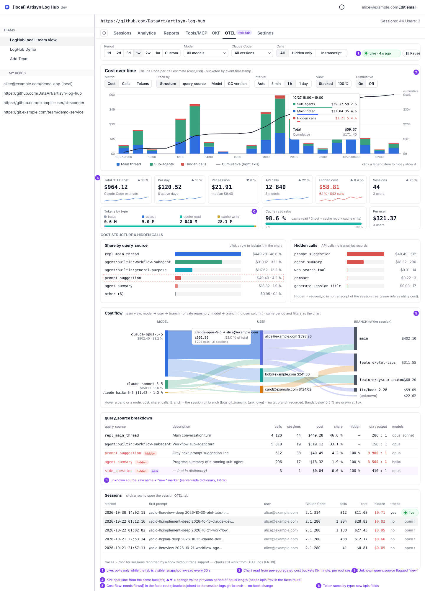
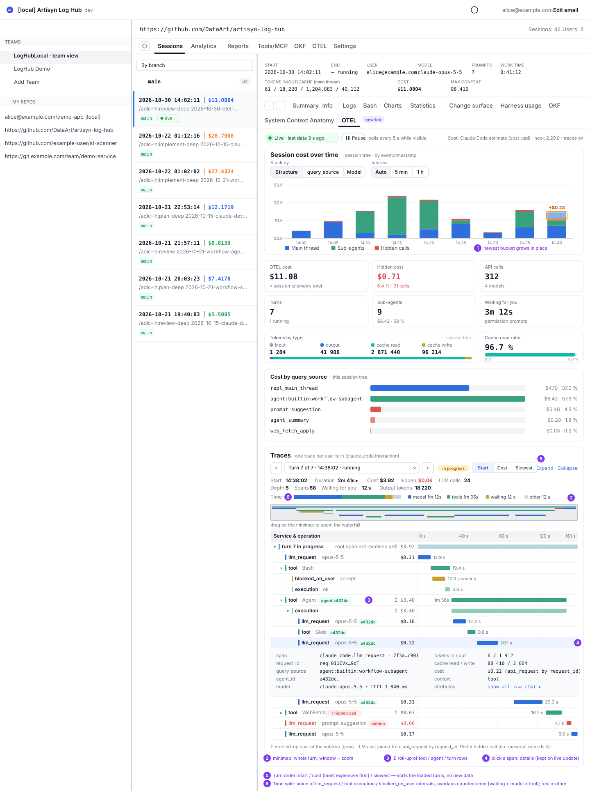
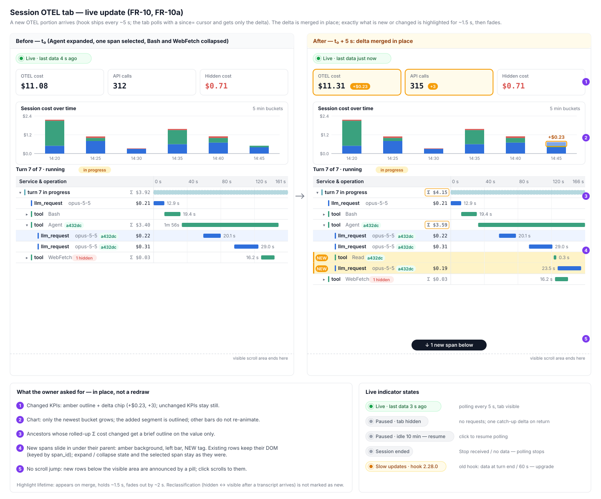
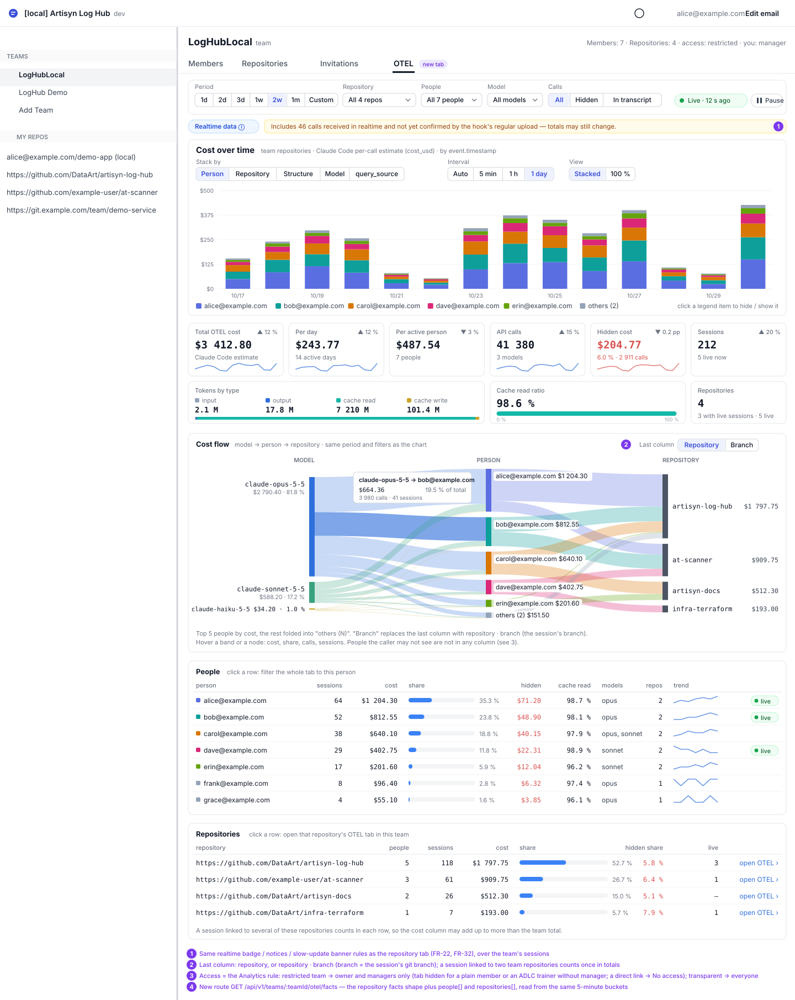
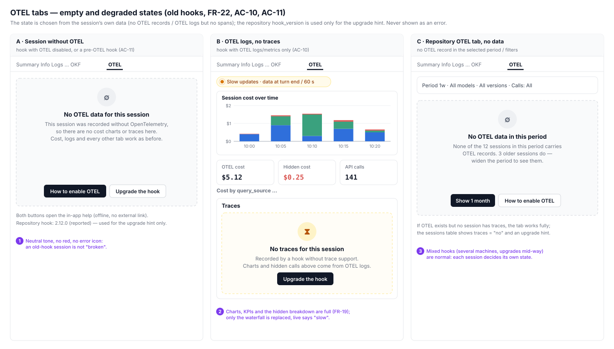

# 2026-10-30: OTEL Tabs for Repository and Session — Cost Charts and Jaeger-Style Traces, Near-Realtime

**Status:** done
**Priority:**
**Type:** feature
**Module(s):** client | server | hook
**Owner:** denis.tsyplakov
**Created:** 2026-10-30
**Tracker:** GH-66 https://github.com/DataArt/artisyn-log-hub/issues/66

## Description

Raw idea (verbatim):

> OTEL tabs on repository and session: Grafana-like cost charts + Jaeger-style traces, near-realtime
> (5–15 s). Based on PoC docs/pocs/2026-10-30-1407-otel-traces-session-view/ (README has all
> findings). Scope: (1) Repository OTEL tab — top: classic cost-over-time stacked bar chart (stack by
> structure main thread / sub-agents / hidden calls, or query_source, model, Claude Code version;
> interval auto/5m/1h/1d; absolute/100%; cumulative line; per-bar tooltip), KPIs, then cost structure
> & hidden calls section (share by query_source — e.g. prompt_suggestion 4.2%, hidden-calls bars,
> source table with descriptions and context:output ratio, sessions table); filters period/model/CC
> version/hidden-visible/metric. Buckets by each call's own event.timestamp. (2) Session OTEL tab —
> same chart for one session, KPIs, cost by source, Jaeger-style trace waterfall per turn (minimap,
> collapsible tree, durations, per-span cost joined from api_request by request_id, rolled-up cost,
> span details), live updates. (3) Hook: collect OTEL traces (CLAUDE_CODE_ENHANCED_TELEMETRY_BETA=1,
> OTEL_TRACES_EXPORTER, OTEL_EXPORTER_OTLP_TRACES_ENDPOINT in the env block with per-key ownership;
> receiver accepts /v1/traces) and ship OTEL batches every ~5 s while traffic flows (Stop/60 s sweep
> stay as fallback). (4) Server: otel_spans storage, event-time on otel_api_calls, incremental
> ingest, routes for repo facts / session traces, live polling (since=) or SSE; server-side
> query_source dictionary, unknown sources flagged as new. Backward compatibility: old hooks send no
> traces, old servers ignore the new kind. Open: verify prompt_suggestion / agent_summary spans in an
> interactive session; traces are a beta Claude Code feature — store raw attributes, degrade to
> logs-only views.

Why: users of this kind of tool expect Grafana-style cost charts and trace views; without them Log
Hub loses against alternatives. On top of that, Claude Code makes API calls no transcript records
("hidden" calls such as `prompt_suggestion`, `agent_summary`); today Log Hub prices them but shows
them only as one "Utility calls" number. The PoC measured them at 6.1 % of a repository's OTEL cost
(`prompt_suggestion` alone 4.2 %).

PoC: [docs/pocs/2026-10-30-1407-otel-traces-session-view/](../../../pocs/2026-10-30-1407-otel-traces-session-view/README.md)
— findings, the clickable prototype (`template.html`) and the measured export latency.

## Functional Requirements

**Repository OTEL tab**

- FR-1: A new "OTEL" tab on the repository view. Its top element is a cost-over-time chart: stacked
  bars, stack by structure (main thread / sub-agents / hidden calls), `query_source`, model or Claude
  Code version; interval auto / 5 min / 1 h / 1 day; absolute or 100 % view; optional cumulative
  line on a second axis; per-bar tooltip with the breakdown, the total and the cumulative value.
- FR-2: Each call is placed in time by its own OTEL `event.timestamp`, not by the ingest time of its
  chunk.
- FR-3: KPIs under the chart: total OTEL cost, per day, per session, API calls, hidden cost (share
  and call count), sessions.
- FR-4: A "cost structure & hidden calls" section below: share bars by the chosen grouping (clicking
  a row isolates it in the chart), hidden-call bars, a `query_source` table (description, calls,
  sessions, cost, share, hidden share, context:output ratio, models) and a sessions table that opens
  the session OTEL tab.
- FR-5: Filters: period, model, Claude Code version, calls (all / hidden only / in transcript),
  metric (cost / calls / tokens).
- FR-6: A call is "hidden" when its `request_id` is in no transcript of the session tree — the same
  rule `utilityCostsCte` uses.
- FR-6a: Until the transcript that covers a call has reached the server (it uploads at `Stop` /
  `SessionEnd` / the sweep, while OTEL arrives every ~5 s), the call is classified provisionally by
  `query_source` — the existing `utilityCostsCte` fallback (`repl_main_thread` / `sdk` / `agent:*` =
  visible, the rest = hidden); the `request_id` rule is final. When a transcript or sub-agent
  transcript is ingested, the transaction that rewrites `session_request_ids` only queues the
  session for reclassification; the next OTEL projection tick (≤ 5 s) reclassifies its calls and
  recomputes every pre-aggregated OTEL figure that depends on them (buckets, hidden totals, shares,
  span rollups) in one transaction, so transcript ingest never waits on OTEL work. A
  reclassification is not highlighted as new data.
- FR-6b: Structure: hidden = FR-6/FR-6a; sub-agent = not hidden and (`query_source` starts with
  `agent:` or the `request_id` is in a sub-agent transcript); main thread = everything else. Calls
  without an agent id (e.g. `agent_summary`) fall under these same rules.
- FR-24: The repository KPI tiles for total cost, per day, API calls and hidden cost show a
  sparkline over the selected period (from the same buckets and interval as the chart; the
  per-session and sessions tiles have none, since buckets cannot count distinct sessions). Every
  tile shows the change against the previous period of equal length
  (`▲ 18 %`; percentage points for a share). The change is neutral grey (a rise in cost is neither
  good nor bad) and is omitted when the previous period has no OTEL data.
- FR-25: A second KPI row: tokens by type (input / output / cache read / cache write, with a stacked
  share bar), cache read ratio = cache read / (input + cache read + cache write) on a fixed
  0–100 % bar (the bounded-ratio rule of `ui-principles.md`: no zone colours, `n/a` on a zero
  denominator), and cost per user.
- FR-26: A "Cost flow" Sankey right after the hidden-call bars, for the same period and filters as
  the chart. On a repository opened in a team context it is model → user → branch; in a private
  repository (always one person) it is model → branch, with no user column (the team tab's variant
  is FR-33). The branch is the **session's** git branch (`logs.git_branch` of the root session); a
  session without it goes to "(unknown)". It is per session, not per call (owner's decision: a
  per-call branch is unreliable with git worktrees), so a session that switched branches counts
  fully to its recorded branch. Hovering a band shows cost, share, calls and sessions; hovering a
  node shows cost, share and calls; bands below 0.5 % are drawn at 1 px; a band takes its source
  node's colour.
- FR-27: The chart tooltip lists the series sorted by value, largest first, each with a thin share
  bar, then the total and the cumulative value.
- FR-28: The live indicator on every OTEL tab has a Pause / Resume button. Paused means no polling until
  Resume, on top of the automatic pauses of FR-10b; Resume fetches one catch-up delta (FR-10b).

**Session OTEL tab**

- FR-7: A new "OTEL" tab on the session view with the same cost-over-time chart scoped to the session
  tree (stack by structure / `query_source` / model; interval auto / 5 min / 1 h), session KPIs and
  cost by `query_source`.
- FR-8: A Jaeger-style trace waterfall, one trace per user turn (`claude_code.interaction`): header
  (start, duration, cost and hidden cost, LLM calls, depth, span count, time waiting for the user,
  output tokens), minimap, collapsible service & operation tree, duration bars and labels, span
  details on click; sub-agent spans labelled by `agent_id`; hidden LLM calls marked.
  Hidden calls run outside a tool (`prompt_suggestion`, `agent_summary`) are `llm_request` spans
  with `query_source`; depending on timing their `llm_request.context` is `interaction` (child of
  the turn) or `standalone` (a root span with its own trace id — checked in the Claude Code 2.1.314
  code). A `standalone` span is attached to the turn of the same session whose time range contains
  it, else to the latest turn that started before it, and is shown there as a separate root row.
  "Time waiting for the user" is the union of the turn's `blocked_on_user` intervals (FR-31).
- FR-9: Each `llm_request` span shows its cost, joined from the `api_request` event (`otel_calls`)
  by `request_id`; tool / agent / interaction rows show the rolled-up cost of their subtree.
- FR-10: The session tab updates while the session runs: new spans and calls appear within 15 s of
  Claude Code exporting them (target 5 s). A turn still running shows its finished spans before its
  `interaction` root arrives: spans whose parent has not arrived are shown under a provisional "turn
  in progress" row of their `trace_id` and move under the real parent when it arrives; a later
  `api_request` updates the span's and its ancestors' cost in place. Transport is polling with the
  `since=` cursor every 5 s (no SSE, no WebSocket).
- FR-10b: Polling lifecycle: it stops while the browser tab is hidden (`document.visibilityState`),
  after 10 min without user input, when the user presses Pause (FR-28), and when the session has
  ended (no new data for 10 min); a "live / paused (tab hidden, idle, by you) / ended / slow updates
  (old hook or realtime off, FR-22)" indicator shows the state. On return the tab fetches one
  catch-up delta and shows it with the FR-10a highlight.
- FR-10a: Live changes are visible as such (owner's explicit wish): when a new portion of data
  arrives, the new spans, trace rows, chart bar growth and KPI changes appear in place with a short
  animation / highlight of exactly what is new — no full redraw, no scroll jump, no lost expand /
  collapse or selection state.
- FR-29: A third session KPI row: tokens by type and cache read ratio (FR-25 formula) for the
  session tree, computed on the client from the calls already in the session response.
- FR-30: The trace navigator orders turns by start (default), by cost (most expensive first) or
  slowest first; the order drives the turn dropdown and ‹ / ›. Client-only, from the loaded spans.
- FR-31: The turn header has a "Time" bar: model / tools / waiting for you / other. Each part is the
  union of the turn's `llm_request`, `tool.execution` and `tool.blocked_on_user` span intervals,
  clipped to the turn; time covered by several kinds counts once, by priority
  waiting > model > tool (sub-agent LLM calls run inside an Agent tool and count as model);
  other = the rest of the turn duration. For a running turn the end is the latest span end.

**Team OTEL tab**

A team has many people and usually more than one repository, so it gets its own view.

- FR-33: A new "OTEL" tab on the team page (`TeamDetailPage`, after Invitations) over every
  repository of the team, top to bottom:
  - filters: period, repository (multi), people (multi), model, calls (all / hidden / in
    transcript); live indicator with Pause (FR-28, 30 s snapshot like the repository tab, FR-16);
  - the "Realtime data" badge and notices (FR-32) and the slow-update banner (FR-22, repository rule
    over the team's repositories);
  - cost over time, stack by person (default) / repository / structure / model / `query_source`,
    interval auto / 5 min / 1 h / 1 d, absolute / 100 %, legend toggle, the FR-27 tooltip;
  - KPI tiles as FR-24 / FR-25, with "per active person" instead of "per session" (and instead of
    FR-25's "per user", which would be the same number) and a "repositories" tile (count, how many
    have live sessions);
  - "Cost flow": model → person → repository; a switch makes the last column repository · branch
    (the session's branch, FR-26). The chart legend and the Sankey show the top 5 people by cost
    and fold the rest into "others (N)";
  - a People table: sessions, cost, share, hidden cost, cache read ratio, models, repositories,
    trend sparkline, live; clicking a row filters the whole tab to that person;
  - a Repositories table: people, sessions, cost, share, hidden share, live sessions; clicking a
    row opens that repository's OTEL tab in this team's context.
  A session linked to several of the team's repositories counts once in totals, KPIs, the chart and
  per person, and once in each of its repositories' rows (so the Repositories table may sum to more
  than the total; the table says so).
- FR-34: OTEL is cost analytics, so in a team context it follows the existing **Analytics / Reports**
  rule (owner's decision), on the team tab and on a repository's OTEL tab opened from the team
  alike: in a `restricted` team only the owner and managers see it (the acknowledged members); for
  a plain member and an ADLC trainer without the manager flag the OTEL tab is hidden (as the OKF
  tab is today) and a direct link or API call answers "No access"; in a `transparent`
  team everyone sees everyone. Everyone still sees their own data on the repository's OTEL tab in
  their personal (non-team) view. The session OTEL tab follows the session's usual visibility, like
  the other session tabs. People the caller may not see appear nowhere — not in the Sankey, the
  People table, the filters or "others".

**Hook**

- FR-11: The installer writes the trace keys into the OTEL env block with the existing per-key
  ownership rules: `CLAUDE_CODE_ENHANCED_TELEMETRY_BETA=1`, `OTEL_TRACES_EXPORTER=otlp`,
  `OTEL_EXPORTER_OTLP_TRACES_ENDPOINT=http://127.0.0.1:<port>/v1/traces`. Because traces are a beta
  Claude Code feature, install and upgrade ask the user whether to enable them, default "yes"
  (an upgrade does not ask again once an answer is stored in `log-hub.json`); the
  answer is the user's, and "no" writes none of the three keys. The endpoint is validated like the
  logs/metrics endpoints (`env-context.js`, `otel-endpoint-check.js`).
- FR-12: The OTEL receiver accepts `POST /v1/traces` (OTLP/JSON) and stores trace chunks next to the
  log and metric chunks.
- FR-13: While OTEL traffic flows, the hook's OTEL receiver also forwards the `logs` and `spans`
  lines it writes to the server in realtime (about one request per 5 s per running session, new
  hook route `POST /api/v2/otel-realtime`). This channel is best effort: in-memory only, capped,
  with backoff. Chunk files, their upload at `Stop` and the 60 s tail sweep are unchanged and stay
  the durable channel that fills any realtime gap.

**Server**

- FR-14: Trace spans are stored in `otel_spans(session_id FK → sessions ON DELETE CASCADE,
  trace_id, span_id, parent_span_id NULL, name, start_time, end_time, request_id NULL, agent_id NULL,
  attributes jsonb, cost_usd_micros NULL, rollup_cost_usd_micros NULL)`, unique
  `(session_id, trace_id, span_id)`. `session.id` is the root session, so sub-agent spans attach to
  the root and are told apart by `agent_id`. Per-call OTEL facts live in a new table `otel_calls`
  (not on `otel_api_calls`, so existing cost code stays untouched): `event_time` (the
  `event.timestamp` attribute, else the record's `timeUnixNano`, else the line's `receivedAt`),
  `claude_code_version` (resource `service.version`), `prompt_id`, `agent_id`, `query_source`,
  model, tokens, cost and structure. Rows are keyed by `request_id`, else by a hash of the record,
  so realtime and chunk copies of one call merge. Historic data is backfilled from
  `logs_otel.body`.
- FR-15: Ingest is incremental and leaves the existing path alone. A realtime batch is written
  synchronously into the OTEL tables (calls, spans, per-span cost/rollup, 5-minute buckets) with
  idempotent upserts. Every `claude-otel` chunk is still ingested exactly as today (upload queue,
  `ingestOtelChunk`, the session `telemetry_cost` SUM unchanged) and is then projected into the same
  OTEL tables by a background drain, without re-processing the session; that projection confirms
  realtime rows, fills gaps and backfills history. Latency budget to the 15 s target, counted from
  Claude Code's export (FR-10): realtime send ≤ 5 s + write < 1 s + client poll ≤ 5 s ≈ 11 s.
  Claude Code itself exports up to 5 s after a span ends.
- FR-16: Routes serve the repository facts (bucketed, filterable), a session's facts and a session's
  traces. Parameters: `from`, `to`, `model[]`, `ccVersion[]`, `calls=all|hidden|transcript`,
  `metric=cost|calls|tokens` (applied on the client: buckets carry all three), `interval=auto|5m|1h|1d` (`auto` picks the interval from the period
  length), `stackBy=structure|querySource|model|ccVersion`, `tz` (the viewer's browser timezone; 1 h
  and 1 d buckets are cut in it). `since=` is an opaque server-issued ingest-order cursor (a
  monotonic sequence bumped on every insert and update of a span or call row), never an event
  timestamp. A delta returns `{ cursor, spans, calls, buckets, kpis }`: new or changed spans and
  calls, the full new values of every changed bucket, and the changed KPIs; the client merges by
  span id / call key / bucket start and highlights exactly those keys. A delta with nothing new is
  empty. The repository and team tabs are live too: while their period includes now they re-read
  the whole (small, pre-aggregated) snapshot every 30 s instead of using `since=`, and highlight
  only buckets whose values grew from new or updated calls — never a confirmation, a gap fill or a
  reclassification.
- FR-17: A server-side `query_source` dictionary (name, description, hidden or not); an unknown
  source is shown as is and flagged as new.

**Backward compatibility with old hooks (hard requirement)**

Many users keep an old hook for a long time. Every combination below must work; nothing may require
a hook upgrade to keep what works today.

| Hook | Server | Must happen |
|---|---|---|
| old, no OTEL (OTEL disabled or pre-OTEL hook) | new | Session/repository OTEL tabs show an empty state that explains why ("no OTEL data — enable OTEL / upgrade the hook"); no error; every other view unchanged |
| old, OTEL logs/metrics only (uploads at `Stop` / 60 s sweep) | new | Full charts (FR-1…FR-7) from its existing uploads; event time read from the stored records; no waterfall (empty state "no traces — upgrade the hook"); live view updates as chunks arrive (minutes, not seconds) and says so |
| new (traces + realtime channel) | old | Uploads succeed exactly as today; the old server ignores what it does not know (realtime route → 404 → realtime off for an hour); no hook errors, no lost logs, no retry storm |
| new | new | Everything, live |

- FR-18: No change to any existing route, query parameter, upload kind or chunk line type the old
  hooks use; the new data is additive only.
- FR-19: Charts and the hidden-cost breakdown work from data old hooks already upload: the call's
  event time is derived on the server from the stored OTEL records (`logs_otel.body`), including a
  backfill for data uploaded before this change — no hook change is needed for FR-1…FR-7.
- FR-20: Spans travel in the existing `claude-otel` upload as an extra chunk line type (e.g.
  `signal:"spans"`), not as a new upload kind or route. Old servers already skip chunk lines whose
  `signal` is not `logs` (`summarizeOtelChunk`), so they store spans inertly in `logs_otel.body`;
  after that server is upgraded, spans are extracted from the stored bodies (backfill), so traces
  recorded against the old server are not lost. If the plan picks a different transport, it must
  give the same guarantees (old server: no rejection, no data loss; upgrade: recovered).
- FR-21: The realtime channel (FR-13) never endangers the chunk upload: an old server answers its
  route with 404 and the hook turns realtime off for an hour (one log line, no retry storm); on
  5xx / timeouts it backs off up to 60 s; on 401 / 403 it turns off like 404. Chunk uploads, their
  dedup (`chunk_key`) and the per-route body limit are unchanged, and a realtime failure never
  touches chunk files.
- FR-22: The UI tells the user what an old hook is missing (no traces, no live updates); it never
  shows an old-hook session as broken. The empty-state message comes from the session's own data:
  no OTEL records → "no OTEL"; OTEL logs but no spans → "no traces — upgrade the hook" when the
  session's hook is older than 2.29.0, "traces are off for this session" otherwise. A session with
  OTEL data but no realtime data shows a banner at the top, by reason: hook older than 2.29.0 →
  "Data updates slowly — update the hook"; newer hook → "Data updates slowly — the hook's realtime
  channel is off or cannot reach the server". Both link to the offline in-app help. The repository
  tab shows the "update the hook" banner when the newest `hook_version` among its repository rows
  is older than 2.29.0.
- FR-32: Realtime data is labelled as such (owner's wish: never hide that numbers may still
  change). Every OTEL tab (repository, session, team) shows a permanent "Realtime data" badge with a
  tooltip explaining the two channels, and a notice for each state: N calls received in realtime
  and not yet confirmed by the regular upload; the regular upload is delayed (over 10 min behind
  realtime; on the repository and team tabs: "in N sessions"); some realtime data was missed (gap)
  and will be filled (likewise per session count). The transient "Filled N calls / M spans from the
  regular upload" notice is shown on the session tab only, which receives deltas. Unconfirmed
  sessions carry an "unconfirmed" chip in the sessions table, and unconfirmed waterfall rows a
  dotted left border.
- FR-23: Installer upgrade adds the three trace env keys per key with the existing ownership rules
  and leaves the user's own values untouched; uninstall removes only the keys the installer owns.

## Non-Functional Requirements

- Backward compatibility: see the section above; the plan must name, for every hook/server
  combination in that matrix, the code path that handles it and the scenario step that checks it.
- Traces depend on a beta Claude Code flag (`CLAUDE_CODE_ENHANCED_TELEMETRY_BETA`); their shape may
  change between versions — store raw attributes, never fail ingest on an unknown attribute or span
  name.
- Server load (owner's explicit wish): the feature — realtime batches from every running session
  plus live polling from every open OTEL tab — must not overload the server. Reads are served from
  storage shaped for the OTEL views: a pre-aggregated 5-minute bucket table keyed by root session
  with user, model, Claude Code version, `query_source` and structure columns (no repository
  column: sessions link to repositories many-to-many, so the repository read resolves its session
  set first), maintained at ingest (1 h / 1 d buckets are rolled up from it), plus per-span
  cost/rollup computed at ingest — so the repository view never scans every call joined through
  sessions. Incremental `since=` responses return only the delta, and idle, hidden or paused tabs
  stop polling (FR-10b, FR-28). Expected rate: one realtime request per ~5 s per running session,
  one poll per 5 s per visible session tab, one per 30 s per visible repository or team tab. The plan
  defines the perf cases; their measured per-request cost is recorded in the KB article
  (`otel-tabs.md`) during implementation.
- Offline first: no runtime fetches; charts use the libraries the client already ships (Recharts /
  d3).
- Visibility: the tabs follow the existing repository/session access rules (private repos, team
  scope).
- Cost: the OTEL tabs are a self-contained mode — every cost in them is Claude Code's per-call
  `cost_usd` from OTEL; Log Hub's own pricing is not used there. The UI states the source.

## Acceptance Criteria

- [ ] AC-1 (FR-1, FR-5): on a repository with OTEL data the OTEL tab opens with the stacked cost
      chart on top; switching stack-by, interval, view, cumulative and every filter redraws it.
- [ ] AC-2 (FR-2): a call made at 10:03 lands in the 10:00 bucket at 5-minute interval even when its
      chunk was uploaded later.
- [ ] AC-3 (FR-3, FR-4, FR-6): on the PoC data set the structure section shows `prompt_suggestion`
      as a hidden source with its share of cost, and the hidden total equals
      SUM(`otel_api_calls.cost_usd_micros`) of the calls `utilityCostsCte` classifies as utility for
      the same sessions.
- [ ] AC-4 (FR-7): the session OTEL tab shows the session-tree chart, KPIs and cost by source; once
      the session's chunks are uploaded (no unconfirmed rows), its total equals the session's
      `telemetry_cost`.
- [ ] AC-5 (FR-8, FR-9): for a session recorded with traces, the waterfall shows one trace per turn
      with nested tool and sub-agent spans; every `llm_request` span with a matching `api_request`
      shows its cost, and the interaction row's rolled-up cost equals the sum of its LLM calls.
- [ ] AC-6 (FR-10, FR-13): during a running session, a finished tool span appears in the open session
      tab within 15 s of Claude Code exporting it (Claude Code batches spans for up to 5 s after
      they end, so ≤ 20 s after the span's end) without a page reload.
- [ ] AC-7 (FR-11, FR-12): after install/upgrade the env block holds the three trace keys, and a
      session produces trace chunks on disk that are uploaded.
- [ ] AC-8 (FR-14, FR-15): uploading the same trace chunk twice, or the same lines first in realtime
      and then as a chunk, creates no duplicate spans or calls; a new chunk is ingested without
      reprocessing earlier ones.
- [ ] AC-9 (FR-17): a call with an unseen `query_source` is listed under its raw name with a "new"
      marker.
- [ ] AC-10 (FR-19, FR-22): a session uploaded by the previous released hook (OTEL logs only, no
      traces) shows the OTEL tabs with full charts and the hidden breakdown, plus a "no traces —
      upgrade the hook" empty state instead of the waterfall, with no error.
- [ ] AC-11 (old hook, no OTEL): a session from a hook with OTEL disabled shows the OTEL tabs' empty
      state; all other session views are unchanged.
- [ ] AC-12 (FR-19): data uploaded before this change (existing `logs_otel` chunks) is placed by
      its event time after the server upgrade, without re-uploading.
- [ ] AC-13 (FR-20, FR-21): the new hook against the previous released server: uploads return as
      today, no hook errors or retries, logs/cost data is complete; after upgrading that server, the
      traces recorded meanwhile appear in the waterfall.
- [ ] AC-14 (FR-18): the existing contract rows for the upload routes pass unchanged.
- [ ] AC-15 (FR-23): `upgrade` on a project installed by an old installer adds the trace keys and
      keeps a user-set value of any OTEL key; `uninstall` removes only installer-owned keys.
- [ ] AC-16 (FR-10a): with the session tab open, one trace node expanded and one span selected, a
      new portion arrives; only the new spans, rows, bar segments and changed KPIs are highlighted
      for about 1–2 s; expand/collapse state, selection and scroll position stay the same; existing
      rows are not re-mounted.
- [ ] AC-17 (server load, FR-10b, FR-16): a `since=` request with nothing new returns an empty delta
      without scanning the session's full span set; a hidden tab sends no poll requests; on return
      one catch-up delta arrives and is highlighted.
- [ ] AC-18 (FR-6a): during a running turn, a `repl_main_thread` call is not shown as hidden; a
      `prompt_suggestion` call is; after the transcript upload the hidden total equals AC-3's figure.
- [ ] AC-19 (FR-10, FR-16): a chunk arriving out of order (children before the `interaction` root,
      or an `api_request` after its span) ends in the same tree and costs as in-order delivery.
- [ ] AC-20 (FR-16): each new route has its row in `server/test/contract/registry/`.
- [ ] AC-21 (FR-24): on a 1-week period the "Total OTEL cost" tile shows the change against the
      previous 7 days; with no OTEL data in the previous period no change is shown.
- [ ] AC-22 (FR-25, FR-29): the cache read ratio equals Σ cache read / Σ (input + cache read +
      cache write) over the same calls; a zero denominator shows `n/a`, not 0 %.
- [ ] AC-23 (FR-26): each Sankey column sums to the total OTEL cost under the same filters; a
      session without a git branch lands in "(unknown)"; a team view has the user column, a
      private repository does not.
- [ ] AC-24 (FR-31): for a turn where a sub-agent's LLM call overlaps a main-thread tool execution,
      the time bar parts sum to the turn duration and no second is counted twice.
- [ ] AC-25 (FR-28): after Pause no poll request is sent; Resume sends one catch-up request.
- [ ] AC-26 (FR-32): with realtime rows not yet confirmed the tab shows the "Realtime data" badge
      and the unconfirmed notice; after the chunk upload the rows turn confirmed without a highlight;
      a skipped realtime batch shows the gap notice, and the later chunk shows the "Filled" notice.
- [ ] AC-27 (FR-33): for a team with two repositories and three people, the team tab's total equals
      the sum of the two repositories' OTEL totals minus the sessions linked to both (counted once);
      the People and Repositories tables and the Sankey columns reconcile with it; a Repositories row
      opens that repository's OTEL tab with the team context.
- [ ] AC-28 (FR-34): in a `restricted` team a manager sees every acknowledged member on the team
      tab and on a team repository's OTEL tab; for a plain member and an ADLC trainer without the
      manager flag both OTEL tabs are hidden and a direct link shows "No access", while the plain
      member still sees their own data on the repository's OTEL tab in the personal view.

## Open Questions

- What priority should this task have (for example `high`)?

## Common sense considerations

- Hidden calls outside a tool (`prompt_suggestion`, `agent_summary`) are `llm_request` spans with `query_source`, context `interaction` or `standalone` (verified in Claude Code 2.1.314 code) — FR-8.
- Live transport: polling with `since=` every 5 s; no SSE, no WebSocket (owner) — FR-10.
- Cost in OTEL tabs: only OTEL `cost_usd`; the tabs are a self-contained mode (owner) — NFR Cost, AC-3, AC-4.
- Trace flag: installer asks on install/upgrade, default "yes", user decides (owner) — FR-11.
- Slow updates: banner at the top of the OTEL tabs, "update the hook" for hooks before 2.29.0, a realtime-off text otherwise (owner + plan DD-15) — FR-22.
- Live calls are classified provisionally by `query_source` until the transcript arrives; reclassification recomputes aggregates and is not highlighted — FR-6a.
- Structure rule: hidden / sub-agent (`agent:*` or sub-agent transcript) / main thread — FR-6b.
- Per-call facts (`event_time`, `claude_code_version`, `prompt_id`, `agent_id`, structure) live in a new `otel_calls` table, extracted at ingest and backfilled; `otel_api_calls` is untouched — FR-14.
- Event time: `event.timestamp` → `timeUnixNano` → chunk `received_at` — FR-14.
- `otel_spans` schema with unique `(session_id, trace_id, span_id)`, attached to the root session — FR-14.
- Two channels into one OTEL read model: a best-effort realtime route plus the unchanged chunk upload, projected by a background drain; the existing ingest and `telemetry_cost` SUM stay as they are; 15 s latency budget — FR-13, FR-15, FR-21.
- Route parameters, browser-timezone buckets, ingest-order `since=` cursor and delta shape — FR-16.
- Repository tab is live, polling every 30 s while its period includes now — FR-16.
- Polling stops on hidden tab, 10 min idle or ended session; one highlighted catch-up delta on return — FR-10b.
- Orphan spans sit under a provisional "turn in progress" row and re-parent on arrival — FR-10.
- Read model: pre-aggregated 5-minute bucket table keyed by root session (no repository column) — NFR Server load.
- Empty-state message from the session's own data; the repository's `hook_version` decides only the repository banner — FR-22.
- ACs added for the live highlight, server load, provisional classification, out-of-order delivery and contract rows — AC-16…AC-20.
- Realtime data is always labelled: badge, unconfirmed / delayed / gap / filled notices (owner) — FR-32, AC-26.
- Tiles, cost flow and turn views from the market review; Sankey branch per session, user column only in a team context (owner) — FR-24…FR-31, AC-21…AC-25.
- A separate team-level OTEL tab, because a team has many people and several repositories (owner) — FR-33, AC-27.
- Team-context OTEL access = the Analytics / Reports rule (owner): restricted → owner and managers only — FR-34, AC-28.

## Notes

- 2026-10-30: FR-24…FR-31 come from a review of other Claude Code OTEL dashboards (Grafana /
  Prometheus community boards, SigNoz, Honeycomb, Dash0, Datadog). Considered and **left out** for
  lack of data in this plan: an LLM-latency heatmap (`otel_calls` has no `duration_ms`), failed tool
  calls, API errors / retries and compaction markers (only `api_request` and spans are extracted;
  span status is not stored), a PR pipeline view, and a per-call branch (worktrees — FR-26).

- 2026-10-30: PoC findings — `docs/pocs/2026-10-30-1407-otel-traces-session-view/README.md`.
  Measured export lag with Claude Code defaults: traces and logs batch every 5 s (median 3.9 s,
  max 5.6 s); today Log Hub uploads OTEL at `Stop` or the 60 s sweep, which is the bottleneck.
