# 2026-11-02: UX Navigation Overhaul (Tab Registry, Grouped Tabs, Lenses, Summary Hub, All Views Map, Home Page)

**Status:** todo
**Priority:** medium
**Type:** feature
**Module(s):** client
**Owner:** denis.tsyplakov
**Created:** 2026-11-02
**Tracker:** GH-74 https://github.com/DataArt/artisyn-log-hub/issues/74

## Description

Implements all six ideas of the UX analysis `docs/ux-analysis/` (waves 1 and 2, wireframes W1–W5 in
`docs/ux-analysis/wireframes.md`) as one task. The app has grown to 14 session tabs in one flat row,
hand-written tab lists in every tab bar, no search or keyboard navigation and an empty `/main` page.
The goal is to make the growing UI digestible without hiding or removing anything:

| Part | Idea | UX doc |
|---|---|---|
| A | Tab registry with metadata — the shared foundation | `wave-1/01-tab-registry.md` |
| B | Grouped session tab bar with "More ▾" overflow | `wave-1/02-grouped-session-tab-bar.md` |
| C | Use-case lenses for the session view | `wave-1/03-use-case-lenses.md` |
| D | Summary tab as a hub with per-tab cards | `wave-1/04-summary-as-hub.md` |
| E | "All views" map of every view with a filter, opened by Ctrl+K (replaces the flat palette) | `wave-2/05-command-palette.md`, `tab-map-idea.md` |
| F | Home page overview instead of the placeholder | `wave-2/06-home-page.md` |

Build order follows the dependencies: A → B → C → D → E → F. B, C and E read tab metadata from A; C
uses B's "More ▾"; D's Explore chips and F's question cards open C's lenses.

## Functional Requirements

### A — Tab registry

- FR-A1: One registry module describes every tab of all seven tab groups in `tab-ids.ts`: session
  pane, repository page, repository settings, admin panel, team page, API keys page and the session
  Charts sub-tabs (`scope: chart`, parent tab `charts`). Each row: `id`, `label`, `scope`, `group`,
  `description` (one line: what question the tab answers), `synonyms`, and a visibility rule where a
  tab is conditional.
  - Required on every row: `id`, `label`, `scope`, `description`. `group` is required for session
    tabs (Part B) and optional elsewhere; `synonyms` are filled for every tab (the map filter, Part E).
  - The registry stays a pure TS module (no React/JSX/router/asset imports) loadable from Node; the
    exported `*_TABS` id arrays and their types stay, derived from the registry.
  - `label` is a plain string. Decorations (Bash count badge `session-bash-count`, Raw Logs lock icon)
    stay in the tab-bar component, keyed by tab id.
  - Conditional tabs: session Advisor (has an advisor result), session Raw Logs (`canSeeRawLogs`),
    repository tabs other than Sessions (`canSeeTeamWideTabs`), team OTEL (`canSeeOtel`), admin tabs
    other than Data retention (`isAdmin`). The rule is a pure predicate over a plain context object
    (`{ hasAdvisorResult, canSeeRawLogs, canSeeTeamWideTabs, canSeeOtel, isAdmin }`) built by the tab bar.
  - Legacy session id `call-tree` is a redirect-only row (`aliasOf: 'charts'`), never rendered.
- FR-A2: Every existing tab bar renders its tabs (labels, order, visibility) from the registry instead
  of its own hard-coded list. Row order = today's rendered order of each tab bar (array position, no
  `order` field); the `*_TABS` arrays are reordered to match.
- FR-A3: Tab ids, URL parameter values (session `tab`, repository `mtab`, settings `stab`, admin `tab`)
  and `data-testid`s stay exactly as today. Team, API keys and Charts sub-tab selection keep their
  current storage (local state / localStorage). A deep link to a hidden tab keeps today's fallback per
  screen.
- FR-A4: Each tab shows its `description` as a hover tooltip via the shared `ui/tooltip` (no native
  `title`). `PageTabs` gets an optional per-tab `description`. Raw Logs keeps its amber tooltip with
  the registry description as the first line, followed by the existing privacy text.

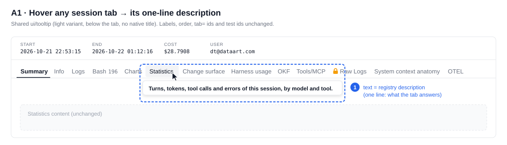

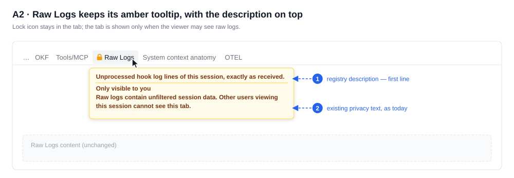

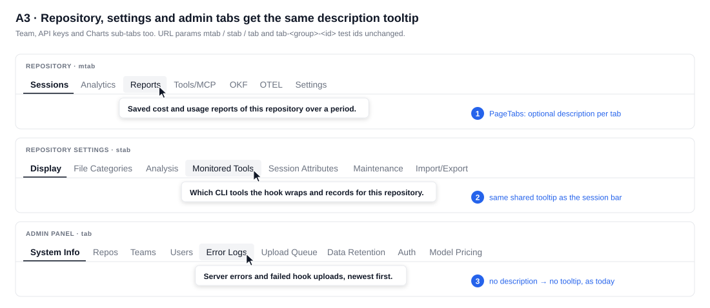

### B — Grouped session tab bar

> **Revised 2026-11-02 after the first implementation (owner's decision).** The shipped bar had
> four levels (lens row → group row → tab row → Charts sub-tabs); the owner's rule is **at most
> two**. Replacement, implemented in place of FR-B1–B4 below and the segmented switcher of FR-C5:
> - The session bar has **one level of tabs**. The lens is a compact **"View" select** at the start
>   of the tab row (`data-testid="session-lens"`, value = lens id), not a row of its own.
> - There is **no group row**: session groups are only the section headings of "More ▾" (and of
>   the All views map). The "All" lens ("All tabs") puts every visible tab in the row; what does
>   not fit the width goes to More. Nothing remembers a per-group tab any more.
> - The **seven charts are plain session tabs** (`dashboard` labelled "Dashboard", `context-growth`,
>   `context-usage`, `agent-tree`, `timeline`, `tool-heatmap`, `call-tree`); the Charts sub-tab bar
>   and the `chart` registry scope are gone. Backward compatibility: an old `tab=charts` link
>   opens the chart this browser last showed (`charts-sub-tab`, else the dashboard); `tab=call-tree`
>   is a real tab now.
> - The lenses promote chart tabs directly (Cost: Summary, Statistics, Call Tree, Context Growth,
>   Dashboard, Advisor, OTEL; see `docs/knowledgebase/algorithms/session-lens-row.md`).
>
> The original text below is kept for history.

- FR-B1: The session tab bar is a **two-level bar** (option B of `wave-1/02-grouped-session-tab-bar.md`;
  the one-row-with-dividers option A and its UX wireframe W2 are not used). The top row shows the
  groups: Overview (Summary, Info, Statistics, Advisor), Transcript (Logs, Bash, Raw Logs), Cost &
  context (Charts, System context anatomy, Harness usage, OTEL), Effects (Change surface, Tools/MCP,
  OKF). The row below shows the tabs of the selected group. Group membership and order come from the
  registry `group` field. A group whose tabs are all hidden by their visibility rule is not shown.
- FR-B1a: Selecting a group opens the tab last used in that group (remembered per viewer in browser
  storage, reads and writes wrapped in try/catch), else its first visible tab. Opening a tab by any
  route (URL `tab=`, Summary card, the map, "More ▾") selects its group too.
- FR-B2: When either row does not fit the pane width, the entries that do not fit go into a "More ▾"
  menu at the end of that row; every tab is always reachable in one or two clicks.
- FR-B3: Tabs show a count or health dot only from data the pane has already loaded; no extra request
  and no early load of lazy tab chunks. Bash keeps its existing count; Tools/MCP shows a dot (not a
  number) when the transcript-derived MCP-server failures used by Statistics are non-zero.
- FR-B4: Selecting a tab from "More ▾" works the same as selecting it from the bar; `tab=` values and
  `tab-session-*` test ids are unchanged.

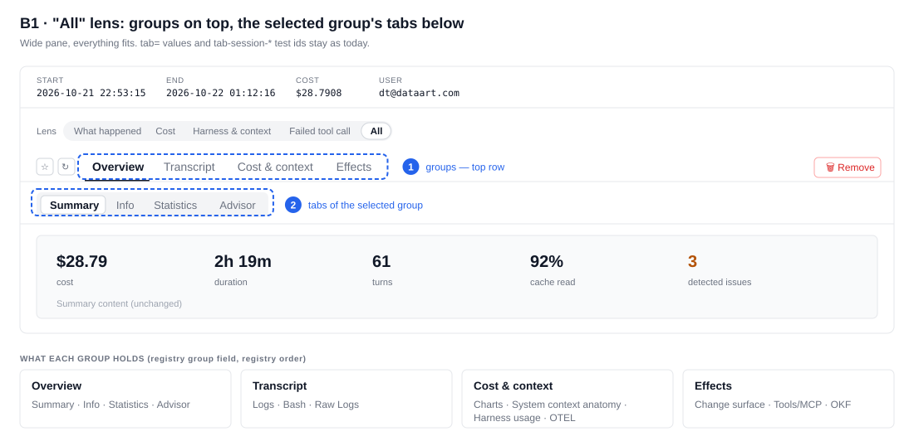

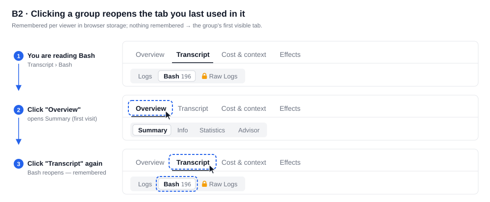

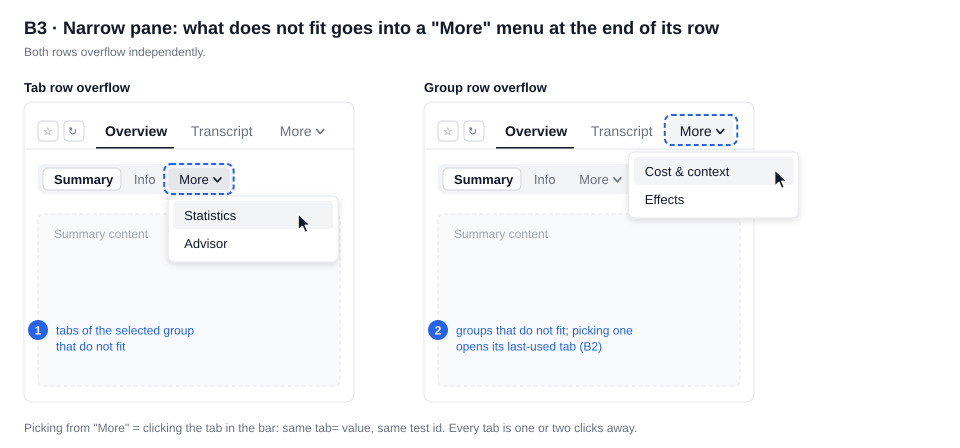

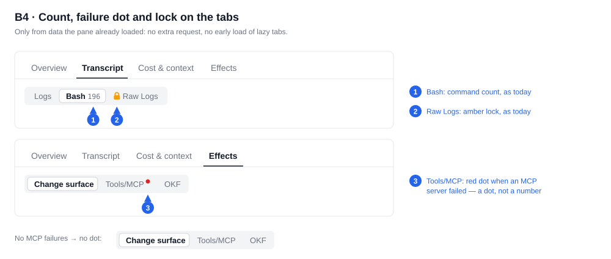

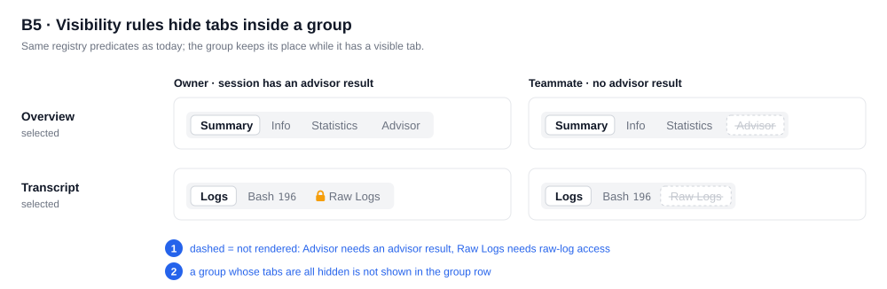

### C — Use-case lenses

- FR-C1: A lens switcher above the session tab bar with a fixed list: What happened, Cost,
  Harness & context, Failed tool call, All.
- FR-C2: Each lens other than "All" replaces the two-level bar with one row of its promoted tabs in
  lens order, picks a default tab, and puts every other tab in "More ▾", listed by group (lens
  contents per the wave-1 doc table). "All" shows the two-level grouped bar of Part B. Nothing is
  hidden for good. A tab opened that is not promoted by the active lens (from `tab=`, a card, the
  map or "More ▾") is shown as the active tab in the row so the user always sees where they are.
- FR-C3: The active lens is kept in an optional `lens=` URL parameter and remembered per viewer in
  browser storage (reads and writes wrapped in try/catch; page works without storage).
- FR-C3a: Default lens, used when the URL has no `lens=` and nothing is remembered (first visit, or
  storage unavailable): **Cost**, for every user (no per-role default).
- FR-C4: An explicit `tab=` in the URL always wins over the lens default tab. An unknown `lens=` value
  is treated as missing (FR-C3a applies). A session URL without `tab=` opens Summary, as today, under any lens; a lens's default tab
  is opened only when the user switches lens (and is then written as `tab=`).
- FR-C4a: Lens default tabs follow the wave-1 lens table; "All" defaults to Summary. Any tab selection
  under any lens updates its group's last-used tab (FR-B1a); that memory is read only when a group is
  clicked in the "All" two-level bar.
- FR-C5: The active lens is always visibly marked.
- FR-C6: Lenses are documented in the offline in-app help (`user-docs/`).

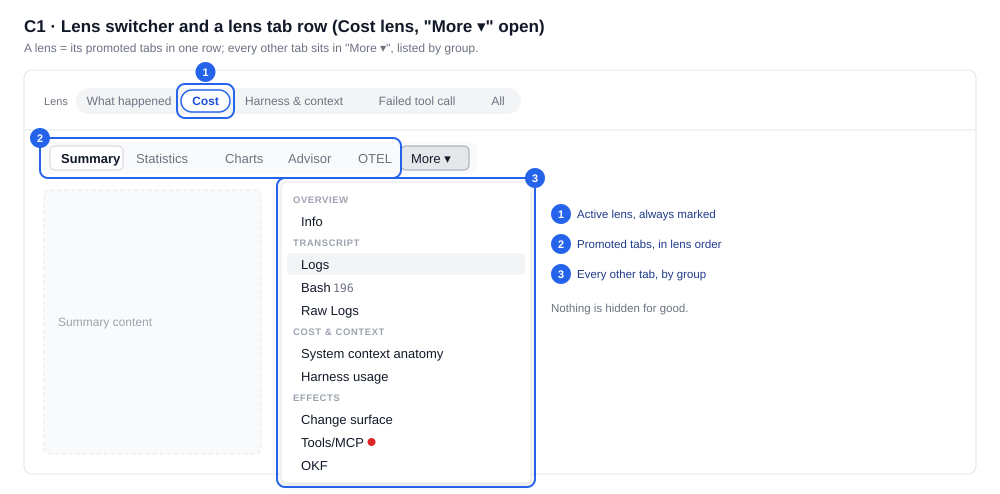

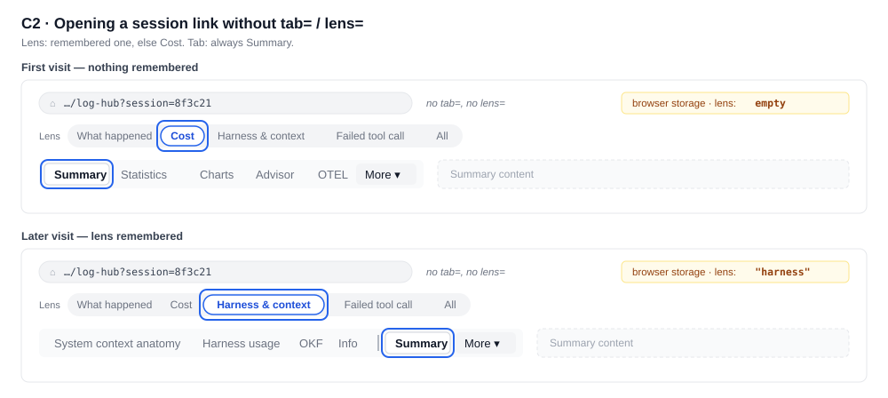

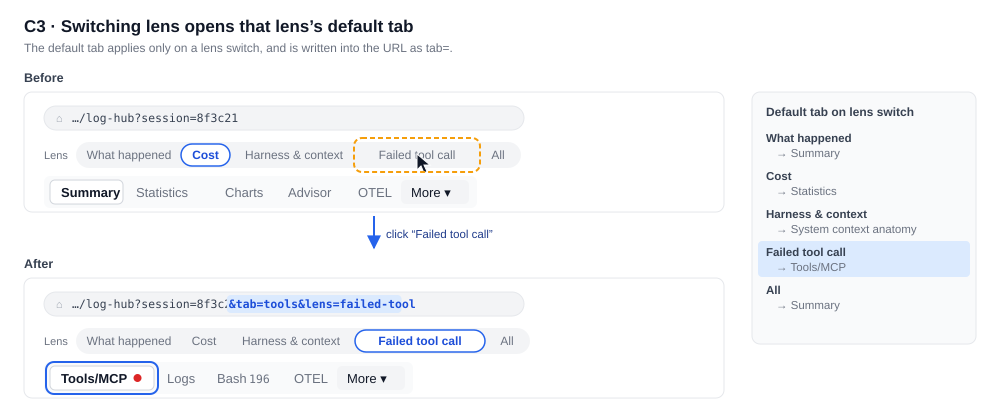

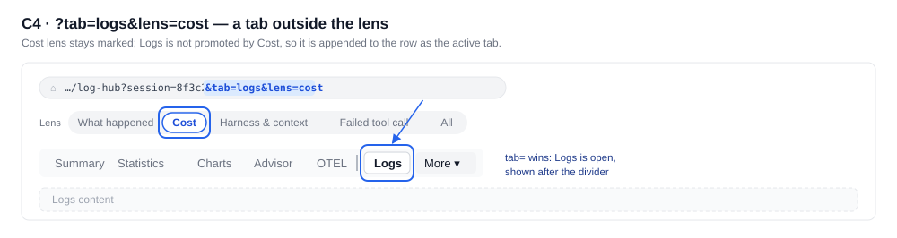

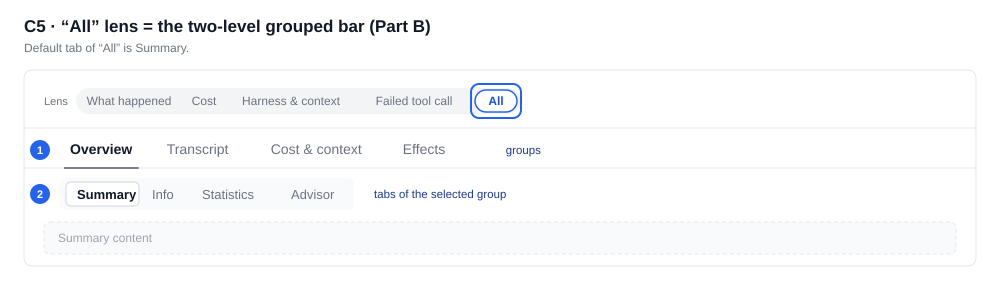

### D — Summary as a hub

- FR-D1: Summary shows a "Where to look next" block of 6–8 cards below `SummaryExecutiveBand`, one per
  target tab. The cards carry roughly the figures today's Summary already shows, regrouped by the tab
  they belong to (e.g. cost and tokens → Info / Statistics, peak context and context growth → Charts,
  code impact → Change surface, delegation / sub-agents → Info, detected issues → Advisor or
  Tools/MCP); no new figure is computed for a card. The plan lists the exact card set and the figure on
  each card, mapped from the existing `SummaryExecutiveBand` / `SummaryExtendedDetails` figures.
- FR-D2: Each card has a title, one headline figure, an optional sub-line and "Open →" that switches
  to that tab via the existing `onSessionTabChange`.
- FR-D3: A card whose tab has no data (decided from already-loaded data, e.g. Change surface
  with no changed paths) is dimmed and says so. A card whose data sits behind
  its tab's own query (OKF, Harness usage, Tools/MCP) shows no figure and is not dimmed — title, one
  line of description and "Open →" only.
- FR-D4: Card figures come only from data the session pane has already loaded; lazy tab chunks
  (Charts, Change surface, Harness, Bash) are not loaded to render a card.
- FR-D5: An "Explore" row of task chips switches to the matching tab and lens (Part C).

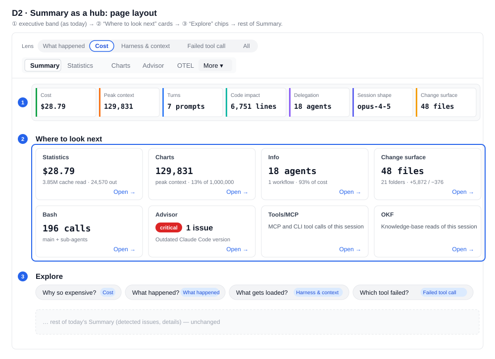

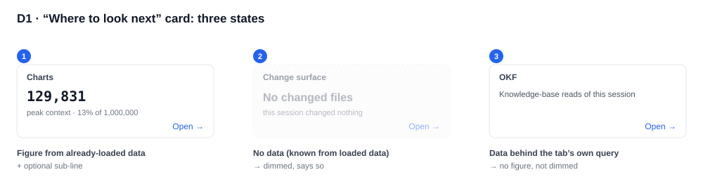

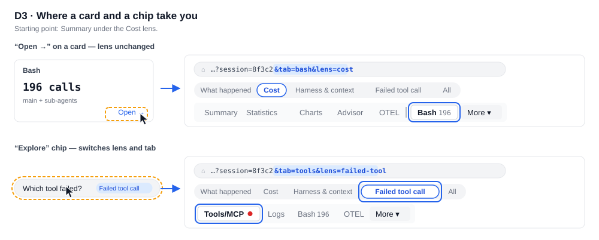

### E — "All views" map with a filter (replaces the flat command palette)

The palette only helps a user who already knows a name; the map shows what exists. Ctrl+K opens the
map with its filter focused, so there is one surface, not a palette plus a map. Design background:
`tab-map-idea.md`.

- FR-E1: Route `#/map`, titled "All views": an Explorer-style tree of every view in the app.
  - Teams → one row per team the user is in → its tabs (`TEAM_TABS`).
  - Repositories → one row per repo the user can see (left-nav data; team repos open via
    `routes.teamRepo`) → page tabs, Analytics views, Reports by category, Settings tabs, Hook state.
  - Under a repository: Sessions → exactly one session instance (the context session, see FR-E3) →
    the four groups of Part B → session tabs → Charts sub-tabs. Sessions are never listed as rows.
  - API keys tabs; Admin panel (shown as today: admins all tabs, a non-admin team owner Data
    retention only); Help → `user-docs/nav.json` sections → articles (opens the help modal).
  - Built from the tab registry (Part A) plus the report catalog, the Analytics view list and
    `nav.json`; reports and Analytics views get `description` + `synonyms` like registry rows.
- FR-E2: Every row shows an icon (container / tab), label, the same decorations as the tab bar and a
  "What it answers" column with the one-line `description` (a hover tooltip on narrow screens).
  Every leaf is a real link to its existing URL. Containers expand/collapse and show a child count
  when collapsed; the expand state is remembered per user (try/catch, FR-F2a); default: top level and
  the current context path open.
- FR-E3: A context rail (Team / Repository / Session) above the tree is prefilled from the page the
  map was opened from, else from the last visit (Recent, FR-F2, marked "from Recent"), else
  "choose…". Nodes whose context is missing stay visible, greyed with "choose a session ▸" (or repo /
  team); clicking one opens an inline picker (recent and latest sessions of that repo, search by id
  or first prompt, "Open the session list instead →"). Picking fills the rail and opens the clicked
  node. Nothing is picked silently.
- FR-E4: The filter input sits at the top of the map and is focused when the map opens. Typing
  highlights the matching rows (match on label, then synonyms, then description; case-insensitive;
  a word prefix or a ≥ 3-character substring; every typed word must match). Branches that hold a
  match expand automatically; rows that do not match stay visible but dimmed; a counter shows
  "N of M views". ↑/↓ move between matches, Enter opens the selected one, Esc clears the filter.
  Filtering does not change the stored expand state.
- FR-E5: A "Start from a question" section on top lists the five FR-F1 questions plus "Who spent how
  much this week?"; they match the filter through synonyms ("expensive", "fail", "hook", …) and open
  the same targets as the Home question cards for the context repository (picker if none).
- FR-E6: Visibility: nodes the user has no permission for (admin tabs, Raw Logs, team-wide repo tabs,
  team OTEL) are not listed; tabs hidden only for lack of data (Advisor with no result) are listed,
  greyed, with the reason. Repos the user cannot see never appear.
- FR-E7: Doors: Ctrl/Cmd+K from any page, including inside text inputs (the browser's own Ctrl+K is
  suppressed), and an "All views" button in the top nav open the map with the filter focused; Home has
  "All views →" and, per repository entry, "All views of this repo" (rail prefilled). No other key is
  captured outside the map. Esc on an empty filter, or Back, returns to the page the map was opened
  from.
- FR-E8: Keyboard in the tree (Explorer conventions): ↑/↓ move, → expand or go to the first child,
  ← collapse or go to the parent, Enter open, Home/End, `/` focuses the filter.
- FR-E9: Opening a session tab from the map behaves like `tab=` in a URL (lens kept, FR-C4; group's
  last-used tab updated, FR-B1a); the map never writes `lens=`. A Charts sub-tab or a team tab (no URL
  parameter) writes its stored selection (`CHART_TAB_STORAGE_KEY` for Charts, try/catch) and opens the
  parent tab; an already-mounted Charts tab follows that change.
- FR-E10: Deep link `#/map` with optional `teamId=`, `repoId=`, `session=` (the rail) and `q=` (the
  filter); unknown values are ignored. The map has its own `user-docs/` help article.

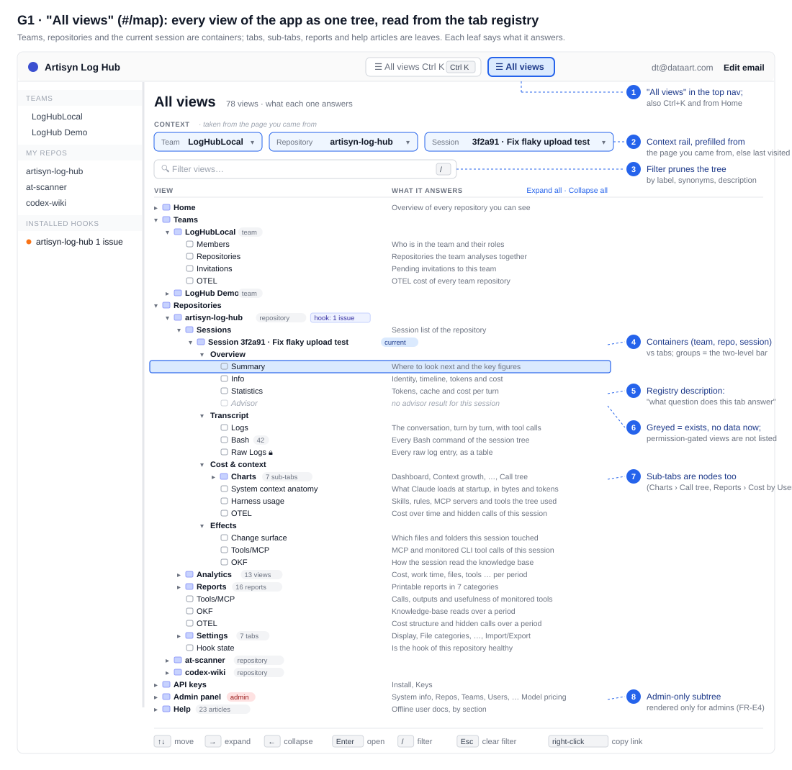

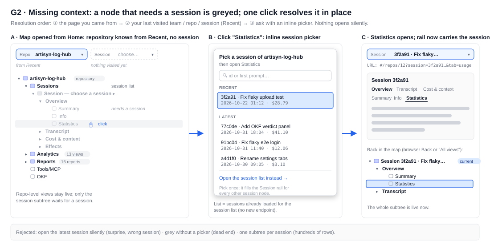

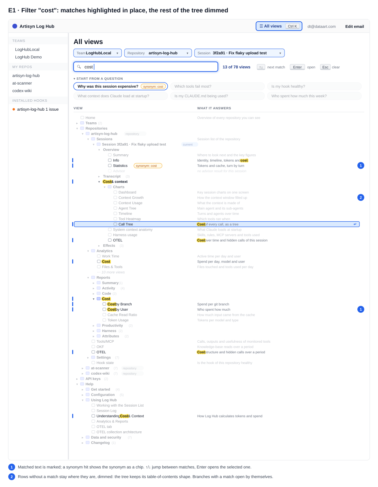

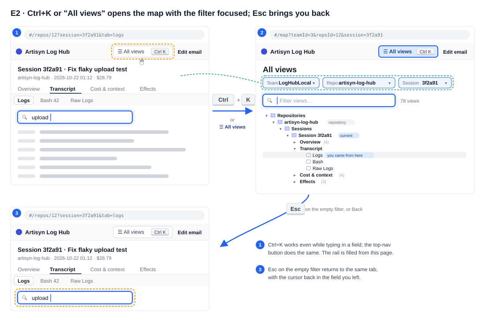

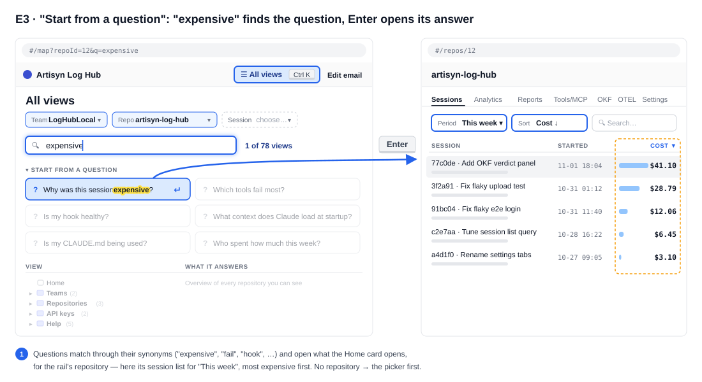

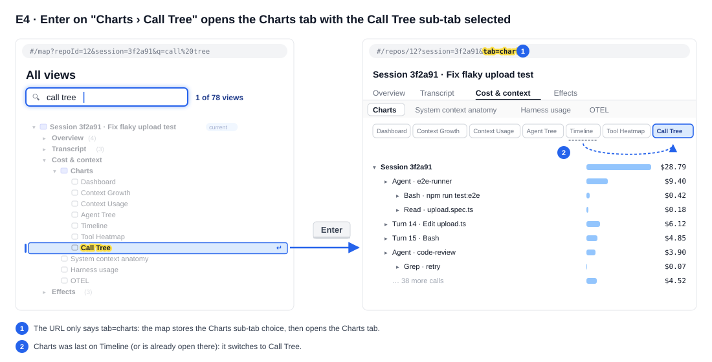

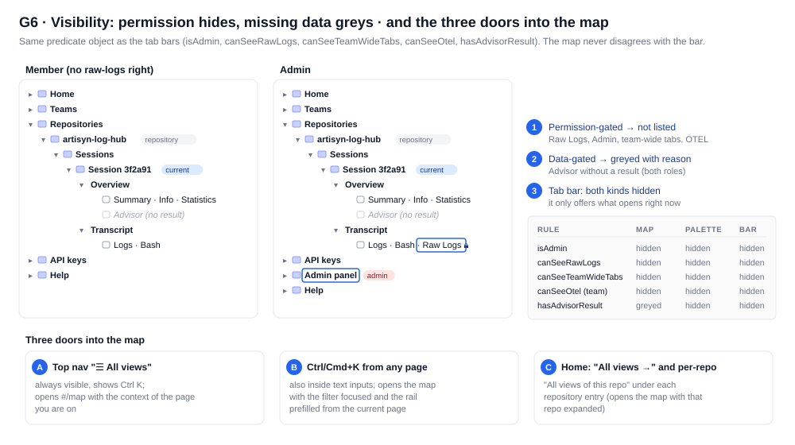

### F — Home page

- FR-F0: `/main` replaces "Select an item from the left panel" with an overview across all
  repositories the user can see — a per-repository summary (one entry per repo), not a page tied to a
  single selected repo; there is no repo picker. A repo entry shows name, last activity, session
  count and cost for "This week", and hook status; entries are sorted by last activity, the first 10
  are shown with a "show all" link, and per-repo data is requested only for the entries shown.
- FR-F1: The page offers question cards ("Why was this session expensive?", "Which tools fail most?",
  "Is my hook healthy?", "What context does Claude load at startup?", "Is my CLAUDE.md being used?");
  each question is answered per repository — it opens an existing view of the repository it is shown
  for, with the matching lens and filters preset. The plan gives the question → route + preset
  filters table for approval ("Why was this session expensive?" opens the repo's session list
  sorted by cost for the "This week" period).
- FR-F2: "Recent" lists recently visited repos and sessions with their tab (browser storage,
  try/catch), at most 10 repos + 10 sessions, newest first, deduplicated. It is filtered against
  the repos the user can currently see before it is shown or used by the map (FR-E3); a session
  that fails to load is dropped silently.
- FR-F2a: All per-viewer browser storage of this task (Recent, remembered lens, per-group last-used
  tab) is keyed by the current user id, so switching identity in one browser shows nothing of the
  previous user.
- FR-F3: "Pinned" lists repos, analytics views and sessions the user pinned. Pinned sessions are the
  existing session favorites (`isFavorite`, favorite endpoint) — no second session-pin concept. Repo
  and analytics-view pins get a pin toggle in the repository header and in each Analytics/Report view
  header, and are stored in user settings key `home.pins` as versioned JSON
  `{v:1, items:[{kind:'repo'|'view', repoId, teamId?, view?, addedAt}]}`, at most 50 items; unknown
  `v` or `kind` values are skipped. Every Pinned line has an unpin control.
- FR-F4: "Needs attention" lists hooks with problems (`GET /repositories/hooks` rows with issues or
  outdated), sessions with advisor results (`hasAdvisorAdvice` in the session list) and sessions with
  failed tool calls (tool-monitoring calls with error status) over the "This week" period, newest
  first, at most 5 lines per kind plus a "show all" link to the filtered view; each line opens the
  exact view (Hook state, session `tab=advisor`, session `tab=tools-mcp`).
- FR-F5: "This week" = the last 7 days ending now, browser local time. It shows cost per repo from
  the existing executive-summary report endpoint for that range (reads `session_stats`, no
  request-time transcript scans). Cost per team = the sum of the same report called with `teamId`
  over the team's repositories (`GET /teams/:teamId/repositories`) that the user can see — one
  request per repo × team pair, loaded asynchronously like every home widget (FR-F5a).
- FR-F5a: All home widgets (Needs attention, This week, Pinned, per-repo entries) are built on the
  client from existing endpoints. Each widget loads
  asynchronously and shows its own placeholder while its requests are in flight; a slow or failed
  widget does not block the others. Consolidating into an aggregate endpoint is a later follow-up,
  decided after the first version has been looked at.
- FR-F6: New users with no data see a "Get started" block instead of empty sections.
- FR-F7: Everything respects private-repo and team visibility rules.

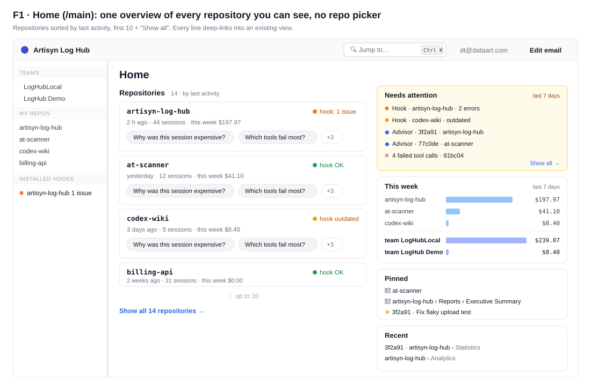

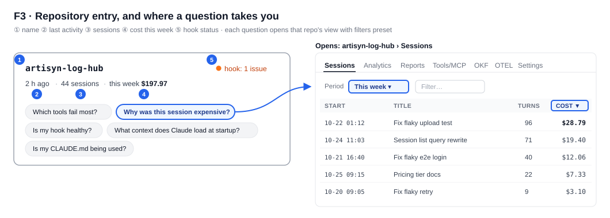

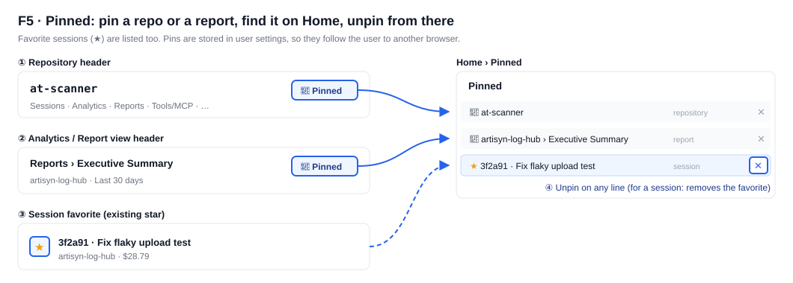

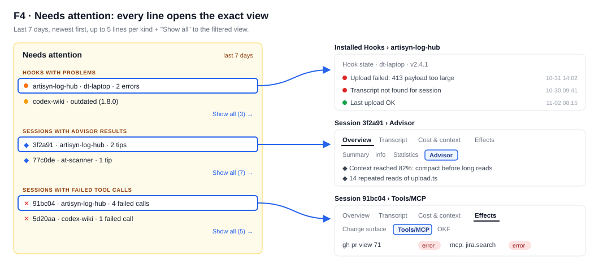

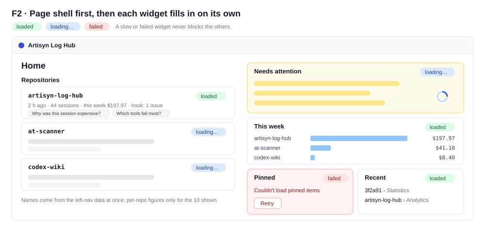

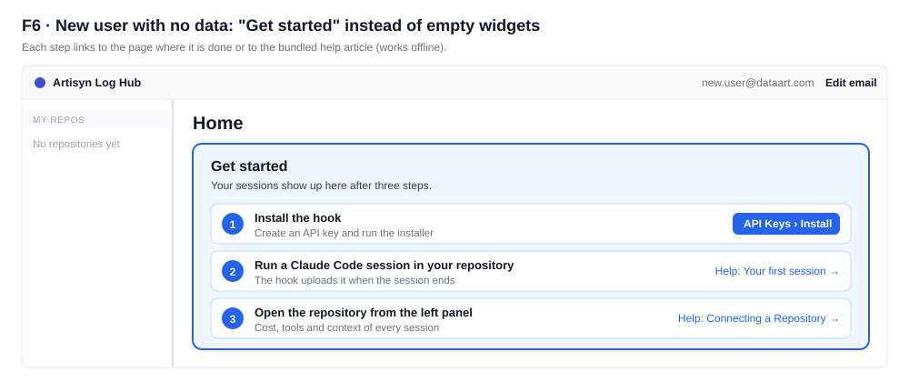

## Non-Functional Requirements

- Backward compatibility: every old deep link (`tab=`, `mtab=`, `stab=`, admin `tab=`) opens the same
  tab (FR-A3, FR-C4); the pin settings key is ignored by old clients.
- Offline first: no runtime fetch from the internet; lens and map help ships in `user-docs/`.
- Opening Summary or the session pane makes no extra network request compared to today (B, D).
- The session tab bar must not jump while counts load.
- The Ctrl+K shortcut must not break keyboard navigation inside the Bash list or text inputs.
- No server change in this task: Parts A–F are client only; Part F uses existing endpoints.
- The home page stays responsive for a user with many repos: the page shell renders before any widget
  data arrives (per-widget loading: FR-F5a).
- Release: when the task is done, raise the release line in the root `package.json` `version` from
  `1.1.0` to `1.2.0` (MINOR bump per `docs/knowledgebase/release-pipeline.md` → Version rules), so
  the next release is `v1.2.0`.

## Acceptance Criteria

- [ ] Adding a tab needs a registry row plus the panel component, no edit of a tab-bar component (FR-A1, FR-A2).
- [ ] Every existing deep link opens the same tab as before; existing scenarios pass unchanged (FR-A3).
- [ ] Hovering any tab shows its one-line description (FR-A4).
- [ ] With the "All" lens, the session tab bar shows the four groups on the top row and the selected group's tabs below; switching to another group and back reopens the tab last used in it (FR-B1, FR-B1a).
- [ ] At a narrow pane width, the entries that do not fit appear in "More ▾" and open normally (FR-B2, FR-B4).
- [ ] Bash shows its count and Tools/MCP its failure dot without any new network request (FR-B3).
- [ ] Switching lens reorders the tab bar and opens the lens default tab; all other tabs are in "More ▾" (FR-C1, FR-C2).
- [ ] Reloading or sharing the URL keeps the lens; a fresh visit restores the viewer's last lens (FR-C3).
- [ ] A first visit with empty browser storage and no `lens=` opens with the Cost lens marked active, on Summary when the URL has no `tab=` (FR-C3a, FR-C4).
- [ ] Selecting Summary under the Cost lens and reloading keeps Summary open (FR-C4).
- [ ] `?tab=logs&lens=cost` opens Logs, shown as the active tab; a link without `lens=` opens with the remembered lens, else Cost (FR-C2, FR-C4).
- [ ] The help article describes the lenses (FR-C6).
- [ ] Summary shows the cards with figures matching what the target tabs show; "Open →" opens that tab (FR-D1, FR-D2).
- [ ] A session with no changed paths shows a dimmed Change surface card; the OKF card shows no figure, only "Open →" (FR-D3); the network log shows no new request when Summary opens (FR-D4).
- [ ] `#/map` shows every team and visible repo, one session instance with its four groups and Charts sub-tabs, API keys, Help; every row has a description and opens its view (FR-E1, FR-E2).
- [ ] Opened from a session, the rail shows that team / repo / session and the whole tree is live; opened from `/main` with no history, session nodes are greyed and clicking one opens the picker, then the chosen tab (FR-E3).
- [ ] Typing "cost" highlights Statistics, Charts › Call tree, OTEL, the cost reports and the cost help article, expands their branches and dims the rest; Enter opens the selected match (FR-E4).
- [ ] Typing "expensive" highlights "Why was this session expensive?" (FR-E5).
- [ ] A non-admin sees no admin nodes; a session without an advisor result shows Advisor greyed with the reason (FR-E6).
- [ ] Ctrl+K from any page, also inside a text input, opens the map with the filter focused; the top-nav button does the same; Esc on an empty filter returns to the previous page (FR-E7).
- [ ] With another Charts sub-tab open, choosing "Charts › Call tree" in the map switches to Call tree (FR-E9).
- [ ] `/main` shows an overview entry for each repository the user can see, with the question cards, and each opens the right view of that repository (FR-F0, FR-F1).
- [ ] Each home widget shows a placeholder while loading and fills in independently; the network log shows only existing endpoints (FR-F5a).
- [ ] Visiting a session then returning home lists it under Recent (FR-F2).
- [ ] A pinned view appears under Pinned on another browser after login; unpinning it from Home removes it after reload; a favorite session is listed under Pinned (FR-F3).
- [ ] After identifying as another user in the same browser, Recent shows none of the previous user's repos or sessions (FR-F2a).
- [ ] A repo whose hook has errors is listed under Needs attention and the line opens Hook state (FR-F4).
- [ ] This week's cost per repo matches the repo's executive-summary report for the same last-7-days range (FR-F5).
- [ ] A user without data sees Get started (FR-F6); another user's private repo never appears (FR-F7).
- [ ] The root `package.json` `version` is `1.2.0` (NFR Release).
- [ ] Tests: steps in existing session scenarios for "More ▾", lens switch, Summary card, map filter and jump; a step that opens a home question card (no new route, so no contract registry row).

## Common sense considerations

- All seven `tab-ids.ts` groups are in the registry, so "a new tab = one row" holds everywhere.
- Rendered order wins over current `*_TABS` array order.
- Registry stays Node-loadable; scenario tooling keeps using the `*_TABS` exports.
- Deep-link fallbacks for hidden tabs stay as today.
- No team / API keys / Charts sub-tab URL param is added.
- The plan author drafts all `description` and `synonyms` values in the impl plan; the user approves them with the plan.
- Lenses apply to the session view only in this task; no per-role default lens (Cost for everyone).
- The tooltip wireframes above show Part A on today's flat bar; after Part B the same tooltips sit on
  the tabs of the two-level bar.
- The plan splits the work into chunks by part (A…F) so each part can ship and be checked on its own.
- A session URL without `tab=` opens Summary under any lens (backward compatibility); lens default tabs apply only on a lens switch.
- "All" lens defaults to Summary; other lens defaults follow the wave-1 lens table.
- Pinned sessions are the existing session favorites; `home.pins` holds only repo and analytics-view pins.
- "This week" = last 7 days ending now, browser local time; repo cost comes from the executive-summary report.
- Needs attention: 7-day window, max 5 lines per kind plus "show all", one existing endpoint per kind.
- Home repo entries: sorted by last activity, first 10 shown; per-repo requests only for shown entries.
- Question card → route table is drafted in the plan and approved with it.
- Summary cards backed by a lazy tab query (OKF, Harness usage, Tools/MCP) show no figure, only "Open →"; no Advisor card when the session has no advisor result (its tab is hidden).
- Tools/MCP tab indicator is a dot from transcript-derived MCP failures; Bash keeps its count.
- Browser storage of this task is keyed by user id; Recent is capped at 10 repos + 10 sessions and filtered by visibility.

## Open Questions

(None open.)

## Notes
