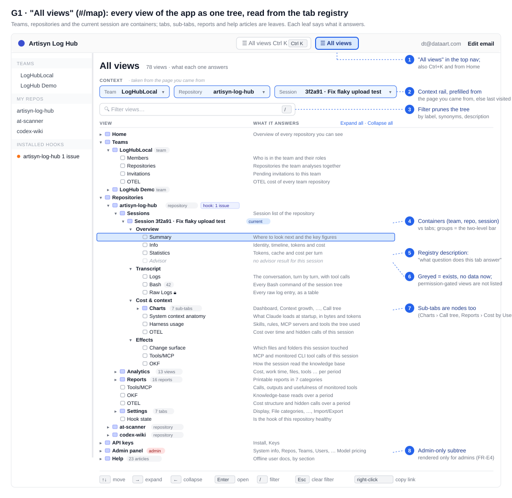
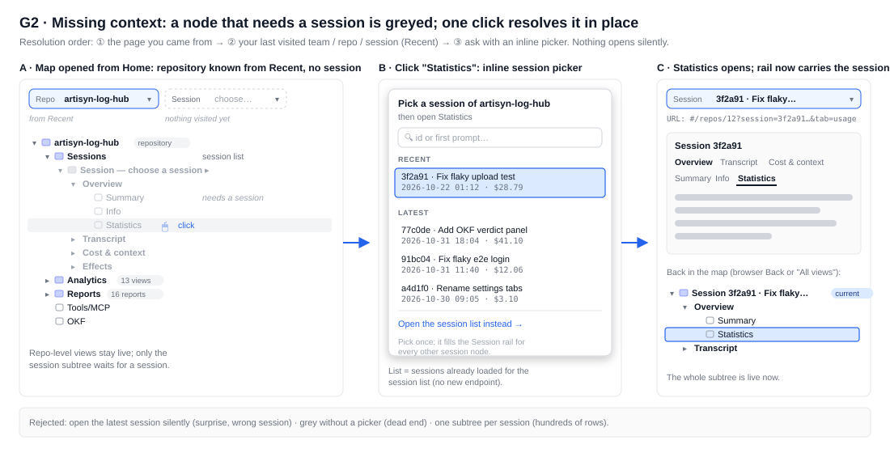
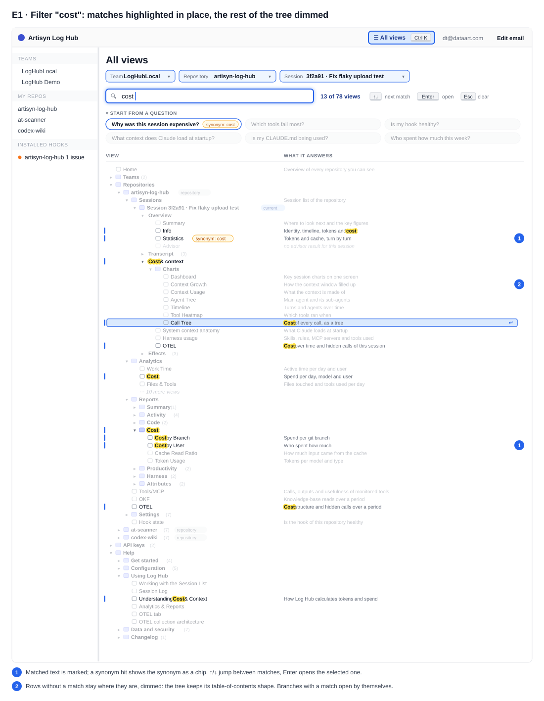
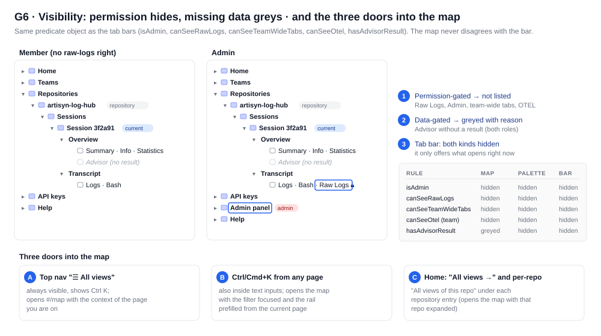

# Tab map ("All views") — idea, design and the palette gap analysis

Status: design background. Integrated into `requirements.md` Part E on 2026-11-02 with the owner's
answers; where this doc differs, `requirements.md` wins. Superseded here: the palette as a separate
browse-mode / flat-result list (Ctrl+K now opens this map with its filter), and filtering by pruning
(the filter highlights matches and dims the rest).
Wireframes: `wireframes/g1`, `g2`, `g6`, `e1`–`e4`. Basis: the tab universe in `client/src/viewer/tab-ids.ts`, the report
catalog (`reports/report-catalog.ts`), the Analytics view list, `user-docs/nav.json`, the left nav
(`AppLeftNav.tsx`), the route helpers (`useHashRoute.ts`) and the UX analysis in `docs/product-kb/ux-analysis/`.

## Idea

An explicit, Explorer-style **tree of every view in the app** — Team → its tabs, Repository → its page and
settings tabs, Session → groups → tabs → Charts sub-tabs, plus API keys, Admin and Help — as a screen of
its own. It answers the question the palette cannot: *"what exists, and what is each thing for?"*
A palette only helps a user who already knows a name to type; the map is for the one who does not.
The two are two shapes of one model: the map is the tree, the palette is a flat, filtered view of it.

## Recommendation

- **Own route `#/map`, titled "All views"**, opened from three doors: a top-nav button next to
  "Jump to…", the palette footer "Browse all views", and Home ("All views →" plus "All views of this
  repo" under each repository entry). Alternatives considered: a Home block (too big: ~78 leaves; Home
  stays an overview), a side drawer (fights the resizable left nav), a palette mode (no room for a
  description column and the context rail). *(G1, G6)*
- **The map is the primary discovery surface; the palette is demoted to an accelerator on top of it.**
  Palette with an empty query = browse mode (questions to start from, Recent, the tree of the current
  context), not a blank box; typing switches to a flat filtered list of the same nodes with their tree
  path. *(G4, G5)*
- **Missing context is never guessed silently.** A context rail (Team / Repository / Session) is
  prefilled from the page the map was opened from, else from the viewer's last visit (Recent, FR-F2),
  else left empty. Nodes whose context is missing stay visible but greyed with "choose a session ▸";
  clicking one opens an inline picker (recent + latest sessions of that repo, search by id / first
  prompt) and then navigates. *(G2)*
- **One registry, one node model, one matcher** feed the tab bars (A/B), lenses (C), Summary cards (D),
  the palette (E), Home's Recent (F) and the map. A tab added as a registry row appears in all of them.
- Visibility: permission-gated views (admin, Raw Logs, team-wide tabs, team OTEL) are **not listed**;
  data-gated views (Advisor without a result) are **greyed with the reason**; the palette lists only
  what opens right now. *(G6)*



## Tree structure

Driven by the registry (Part A): `label`, `description`, `group`, `synonyms`, visibility predicate, plus a
few non-tab sources that become nodes of the same shape (reports, Analytics views, help articles).

| Level | Node | Kind | Children (order = today's rendered order) | Needs |
|---|---|---|---|---|
| 0 | Home | page | — | — |
| 0 | Teams | container | one node per team the user is in (left-nav data) | — |
| 1 | *Team X* | instance | Members, Repositories, Invitations, OTEL (`TEAM_TABS`, OTEL by `canSeeOtel`) | team |
| 0 | Repositories | container | one node per repo (My Repos + team repos; team repos carry `teamId` for `routes.teamRepo`) | — |
| 1 | *Repository Y* | instance | Sessions, Analytics, Reports, Tools/MCP, OKF, OTEL, Settings (`REPO_MAIN_TABS`, non-Sessions by `canSeeTeamWideTabs`), Hook state (page) | repo |
| 2 | Sessions | container | *one* session instance: the current one, or a picker | repo |
| 3 | *Session Z* | instance | the four groups of Part B | session |
| 4 | Overview / Transcript / Cost & context / Effects | group | the session tabs of that group (`SESSION_TABS` minus `call-tree`) | session |
| 5 | Charts | tab + container | Dashboard, Context Growth, Context Usage, Agent Tree, Timeline, Tool Heatmap, Call Tree (`CHART_TABS`) | session |
| 2 | Analytics | container | the 13 views (`av=`) | repo |
| 2 | Reports | container | 7 categories → 16 reports (`report-catalog.ts`) | repo |
| 2 | Settings | container | Display … Import/Export (`SETTINGS_TABS`, `stab=`) | repo |
| 0 | API keys | container | Install, Keys (`API_KEYS_TABS`) | — |
| 0 | Admin panel | container, admin only | the 9 admin tabs (`ADMIN_TABS`; non-admin team owner sees Data Retention only, as today) | — |
| 0 | Help | container | `nav.json` sections → articles, opened in `HelpModal` | — |

- **Containers** (Teams, a team, a repository, Sessions, a session, Charts, Analytics, Reports, Settings,
  Admin, Help) expand/collapse and carry a count badge when collapsed ("13 views", "7 sub-tabs").
  **Instances** (a team, a repo, the session) are the only nodes whose children depend on data.
- **Leaves** are tabs, sub-tabs, views, reports, articles and the two standalone pages (Home, Hook
  state). Every leaf has a real URL built with `routes.*` + the existing params (`tab=`, `mtab=`,
  `stab=`, admin `tab=`, `av=`); Charts sub-tabs and Team tabs, which have no URL param, are opened the
  FR-E6 way (write the stored sub-tab, then open the parent tab).
- **Only one session instance is ever rendered** (the current / chosen one). Listing sessions as tree
  rows is rejected: hundreds of rows, and the session list already exists as a view.
- The session subtree **is** the two-level bar of Part B, in the same group order; lens membership is not
  a tree level (a lens is an ordering over leaves, not a container) — a session leaf shows its lens chips
  on hover only.

## Missing context



Resolution order, applied per level (team, repo, session) independently:

1. **The page the map was opened from** — `useNavContext()` parses `teamId` / `repoId` / `session`
   from the current location; opening the map from a session gives a fully live tree with zero clicks
   (the 80 % case).
2. **Last visited** — the Recent store of FR-F2 (per user id, try/catch); the rail marks it "from Recent".
3. **Ask** — the rail pill reads "choose…", the dependent subtree is greyed with "choose a session ▸"
   on the instance node and "needs a session" on leaves. Clicking any greyed node (or the pill) opens
   the inline picker: Recent sessions of that repo, then the latest ones from the already-loaded session
   list query, a search box over id / first prompt, and "Open the session list instead →". Picking fills
   the rail, so every other session node becomes live; the clicked leaf opens immediately.

Why this and not the alternatives: silently opening the latest session surprises (wrong session, and a
history entry the user did not ask for); greying without a picker is a dead end; per-node defaults
("Statistics of the most expensive session") hide a decision inside a click. The rail makes the one
decision visible and explains every grey node at once.

Repo-level and team-level nodes resolve the same way with their own pickers (a plain list — the
left-nav data). With no repo at all the map still shows the full structure: the Repository subtree is
rendered once, greyed, so a brand-new user sees what the product has before any data exists.

## Interaction details

- **Rows**: caret, kind icon (folder = container, tab icon = leaf), label, badges (`current`, `team`,
  `repository`, counts, `admin`, the Bash count and Raw Logs lock — the same decorations as the bar,
  keyed by tab id), and a right-hand **"What it answers"** column with the registry `description`.
  The description doubles as the hover tooltip (FR-A4) when the column is hidden at narrow widths.
- **Keyboard** (Explorer conventions): ↑/↓ move, → expand (or go to first child), ← collapse (or go
  to parent), Enter opens, Home/End, `/` focuses the filter, Esc clears the filter, type-ahead jumps
  to the next row starting with the typed letters when the filter is empty. Right-click → copy link
  works because every row is an `<a href>` with the hash route.
- **Filter** *(G3)*: one input, the same matcher as the palette (label > synonyms > description;
  case-insensitive, token-prefix or ≥ 3-char substring; multi-token = AND). Matches are shown with
  the matched text in blue, a synonym hit shows the synonym as a chip; ancestors stay, dimmed; empty
  branches disappear; "9 of 78 views". Enter opens the first match. Filtering never changes the stored
  expand state.
- **Expand state** is remembered per user (`artisyn:<userId>:map.expanded`, try/catch); default:
  top level open, current context path open, everything else collapsed. "Expand all / Collapse all".
- **Lenses and the two-level bar**: opening a session tab from the map behaves exactly like `tab=` in a
  URL (FR-C2/C4): the current lens stays, a non-promoted tab is shown as active after the divider, the
  group's last-used tab is updated (FR-B1a). The map never writes `lens=`.
- **Deep links**: `#/map` with optional `teamId=`, `repoId=`, `session=` (the rail) and `q=` (the
  filter); all optional, unknown values ignored. Old links unaffected (new route only).
- **Offline first**: the tree is built from the registry, the report catalog, the view list and
  `nav.json` — all bundled; instance data comes from queries the left nav and the session list already
  run; no new endpoint. The map gets its own `user-docs/` article; the Help subtree opens `HelpModal`.
- **Backward compatibility**: no tab id, param or `data-testid` changes; new storage keys are per user
  id (FR-F2a) and versioned; the map is a lazy route chunk in the Workspace group.
- **Narrow screens**: the description column folds into the tooltip; the rail stacks; the tree is one
  column. The map is also the fallback for devices without Ctrl+K.



## Palette gaps

Part E of `requirements.md` and `e1…e4` describe a *name-driven* palette. The owner's main objection —
**it gives no discoverability** — is the first row; the rest are the mechanical gaps found going through
FR-E1…E6 and the wireframes.

| # | Gap / ambiguity | Proposed answer |
|---|---|---|
| 1 | **Discoverability.** The palette only rewards a user who already knows a name ("Statistics", "OTEL"). Someone who does not know what exists gets a blank box and a prompt to type. E1 shows Recent + repos for the empty query; nothing says what the app can show. | Make the **map the primary answer** to "what exists" and demote the palette to an accelerator on top of it. Concretely: (a) **empty query = browse mode** (G4): "Start from a question" chips, Recent, then the **tree of the current context** (the same nodes and descriptions as the map, collapsible with →), footer "Browse all views" → `#/map`; (b) every result row carries the registry description ("what it answers") and its tree path; (c) question-oriented entries live beside name-oriented ones (row 2); (d) three doors into the map from everywhere (G6). The palette is then never the only way in, and typing is an optional shortcut. |
| 2 | Question-oriented vs name-oriented entry points. FR-F1's question cards exist only on Home; the palette matches names. | Register the question cards as **nodes of kind `question`** (label = the question, description = the view it opens, synonyms = "expensive", "fail", "hook", "startup", "CLAUDE.md"). They appear first in browse mode and match queries like "expensive" or "why". Each resolves to a route + lens + preset filters for the context repo (rail / Recent), with the same picker when the repo is missing. |
| 3 | How a user learns what a tab is for. | Description on every row in palette, map and tooltip; in browse mode the tree rows show it in the right column; a highlighted row shows "Learn more" (→ the help article the registry links by slug) when one exists. The wording rule for `description`: "answers the question …" style, one line, drafted with the plan (already required by Part A). |
| 4 | "Tabs of the current session / repository / settings / admin" — undefined when no session (or repo) is open. | Context = `useNavContext()` (URL) → Recent → none, the same rail as the map. With a session: its tabs are listed under "THIS SESSION · id · repo". Without one: session-tab nodes are still listed in a group "OTHER SESSIONS" with a path "repo › Sessions › ? › …" and an amber "needs a session ▸" chip; Enter opens the picker (G5). Never a silent guess. |
| 5 | Ranking is unspecified; a query like "cost" hits 9+ entries. | Score: exact label > label prefix > synonym > description word; ties broken by context distance (current session › current repo › other repos › reports › help › admin). Recent appears only in browse mode (empty query). Stable, no fuzzy matching in v1. |
| 6 | How Recent is recorded (when, what, dedupe). | One `useRecentVisits()` hook (shared with Home FR-F2): on location settle (debounced ~1 s) record `{kind: 'repo'\|'session', repoId, teamId?, sessionId?, tab, at}`; dedupe by ids keeping the latest tab; cap 10 + 10; keyed by user id; filtered by visibility before display. The map's "last visited" rail uses the same store. |
| 7 | What Enter does for a tab of another context (another repo's Analytics, a session tab while another session is open). | Every entry carries a **fully resolved target** `{path, params, sideEffects}` built with `routes.*`; Enter always navigates there (push, so Back returns). Same page + only params change → `setSearchParams(…, { replace: true })` to avoid a history entry. Charts sub-tabs and Team tabs use the FR-E6 side effect (write stored sub-tab, open parent tab). |
| 8 | Scope switching / searching sessions by prompt. | Not in v1: no `>`-prefix commands, no session content search (that is the deferred global search). Repos and teams are entries; picking one navigates. "Browse all views" is the scope switch. |
| 9 | Empty-query state is only sketched in E1. | Browse mode as in row 1 (G4): questions (≤ 6), Recent (≤ 5, first row preselected so Enter = "go back"), Pinned (≤ 5, if any), the current-context tree (session level if a session is open, else repo level, else Home level), footer. |
| 10 | Result limits. | Per group ≤ 5 with "+N more" (expands that group), total ≤ 30; groups in ranking order. |
| 11 | Synonym matching rules. | Case-insensitive, diacritic-insensitive; a query token matches if it is a prefix of a word in label/synonyms or a ≥ 3-char substring; description matches count only as the lowest tier; multi-token = all tokens must match somewhere. Synonyms are plain strings in the registry (drafted with the plan). |
| 12 | Mouse vs keyboard. | Hover highlights only after the pointer moves (so keyboard selection is not stolen); click = Enter; backdrop click = Esc; → on a group row expands it in browse mode; the footer button is focusable in the Tab order. |
| 13 | Mobile / narrow. | No Ctrl+K on touch; the top-nav "Jump to…" becomes an icon; the palette is full-screen under 640 px; the map is the primary surface there. |
| 14 | Help entries have no URL (`HelpModal` is state only). | A help node's target is "open `HelpModal` at slug"; `?help=<slug>` is a later follow-up (raw report 3, idea 8), not required here. |
| 15 | Analytics views and reports are not in the registry (Part A covers only tab bars). | Extend the node model, not the tab registry: `report-catalog.ts` and the Analytics view list already have titles; give them `description` + `synonyms` fields (they are the "Cost by User" and "Analytics › Cost" rows in E2). |
| 16 | Visibility context outside a tab bar. | One `useTabVisibilityContext()` hook returns `{hasAdvisorResult, canSeeRawLogs, canSeeTeamWideTabs, canSeeOtel, isAdmin}` for the context session/repo/team; tab bars, palette and map all call it. Palette hides both permission- and data-gated nodes; the map hides permission-gated and greys data-gated (G6). |
| 17 | Current repository on a team route (`/teams/:tid/repos/:rid`). | `useNavContext()` returns `teamId` too; targets use `routes.teamRepo` when present, so the user stays in the team view. |
| 18 | Keyboard conflicts: Ctrl+K while the palette is open; Esc with `HelpModal` or a dialog open. | Ctrl+K with the palette open selects the input text; the palette is the top layer and Esc closes only it; it is never opened while a modal dialog has focus trap priority (documented, not configurable). |
| 19 | Decorations in results (Bash count, failure dot). | None; results show label + path + description only. Counts belong to the bar (FR-B3). |
| 20 | How the palette relates to the map. | Same node list, same matcher, same ranking, same targets; the palette = flat view, the map = tree view. The typed query is carried into the map filter via "Browse all views" (`#/map?q=…`). |


## Shared model

One pure TS module (`nav-tree.ts`, Node-loadable like the registry) builds the node list; everything
else is a view over it.

```
NavNode {
  id          'session:usage' | 'chart:call-tree' | 'repo:analytics:cost' | 'report:cost-by-user' | 'help:cost-and-context' | 'question:expensive' | 'team' | 'repo' | 'session' …
  kind        'page' | 'container' | 'instance' | 'group' | 'tab' | 'subtab' | 'view' | 'report' | 'help' | 'question'
  label, description, synonyms           ← registry row / catalog entry / nav.json / question table
  parent                                  ← tree position (group → session instance → Sessions → repo …)
  needs       null | 'team' | 'repo' | 'session'
  visible(ctx)                            ← the registry predicate, ctx from useTabVisibilityContext()
  target(ctx) → { path, params, sideEffect? } | { missing: 'session' | 'repo' | 'team' }
}
```

- **Map** = render the tree; filter = `match(query, node)`; greyed = `target()` returned `missing`.
- **Palette** = `nodes.filter(visible).map(match).sort(rank)` grouped by nearest instance; browse mode =
  the subtree of the current context + question nodes + Recent.
- **Two-level bar** = the `group`/`tab` nodes under the session instance; **lenses** = ordered id lists
  over the same nodes; **Summary cards** and **Home question cards** reference nodes by id, so their
  labels and descriptions never drift.
- Adding a tab = one registry row → bar, tooltip, map, palette; adding a report = one catalog entry
  with `description` + `synonyms`.



## Owner decisions (2026-11-02)

All seven questions answered with the recommended option (a), except the palette: Ctrl+K and the
top-nav button open this map with its filter focused; typing highlights the matching rows. See
`requirements.md` Part E.
