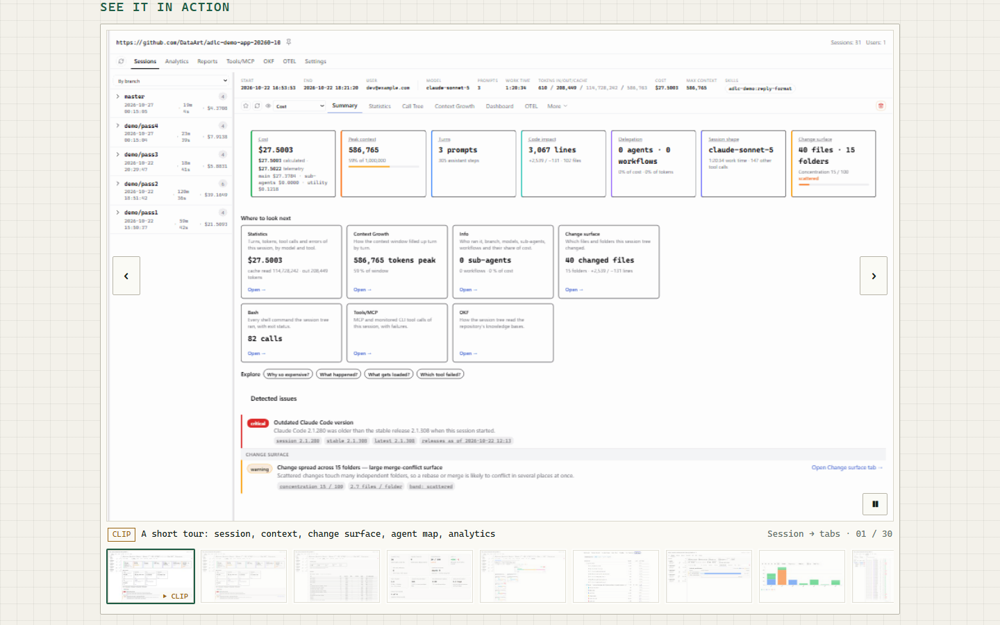
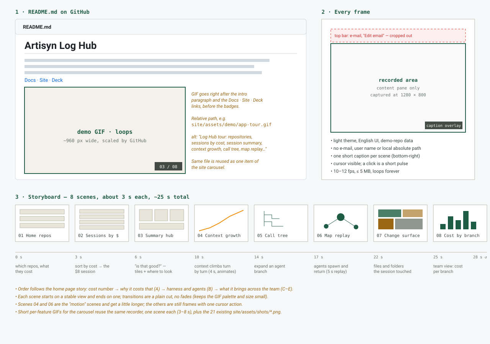
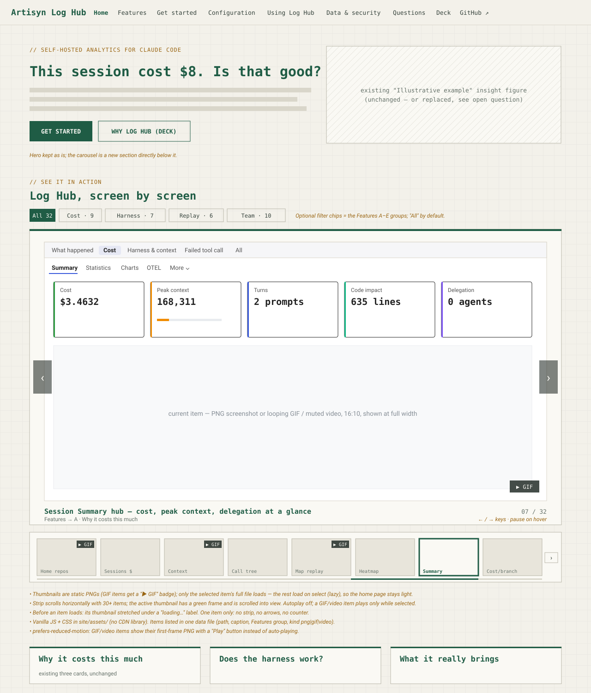
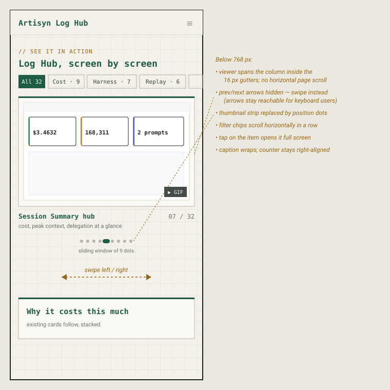

# 2026-11-03: App Demo GIF and Media Carousel for README and Site Home Page

**Status:** todo
**Priority:** medium
**Type:** feature
**Module(s):** docs, site, scripts
**Owner:** denis.tsyplakov
**Created:** 2026-11-03
**Tracker:** GH-94 https://github.com/DataArt/artisyn-log-hub/issues/94

## Description

Raw idea (verbatim, Russian): "записать gif картинку с видами приложения для read me и главной страницы сайта"

(Translation: record a GIF image showing the application's views, for the README and for the home page of the site.)

Record an animated GIF that walks through the main views (screens) of the Log Hub app and embed it
in the repository README. On the home page of the GitHub Pages site (built by `npm run build:site`,
see `docs/knowledgebase/user-docs-and-site.md`) add a Steam-style media carousel of 30+ screenshots
and short clips, with the same GIF as its first item. All media are produced by one reusable
capture script.

The capture method and the carousel were verified in a PoC:
[docs/pocs/2026-11-03-2041-site-media-carousel/](../../../pocs/2026-11-03-2041-site-media-carousel/)
(numbers in its README). Its screenshots are the visual reference; where the wireframes below differ
(position dots, no autoplay, grey fill), the requirements and the PoC win.

## Functional Requirements

- FR-1: Produce one animated, infinitely looping GIF that shows a sequence of the application's views (screens).
  - Captured by read-only browsing of local prod's demo repository (`adlc-demo-app`), never by starting another instance.
  - "Presentation mode" injected before the app boots: left nav collapsed, top bar hidden, every e-mail rewritten to `dev@example.com`, branch groups with non-English prompts folded.
  - Each scene waits until no "Loading…" text is on screen, and the mouse is parked in a corner so no hover card stays in the frame.
  - Nothing is cut mid-element: if content overflows 1280×800, the viewport grows by the same factor in both directions (up to 1.5×) with deviceScaleFactor reduced to keep the output size; a pane still longer gets a short fade to white at its bottom edge.
  - Light theme, like the existing `site/assets/shots/*.png`.
  - Storyboard, about 3 s per scene, in this order: Home repo list → session list sorted by cost → session Summary hub → context growth → Call Tree → Session Map replay → Change surface → Analytics cost by branch.
  - About 25 s total, at most 10 fps, 1280×800 CSS px output at 960×600, at most 5 MB; identical consecutive frames are merged into one longer frame.
  - Produced by a reusable Node script `scripts/site/record-demo.mjs` (Playwright, GIF encoded with the `gifenc` npm package) that is rerun by hand when the UI changes and is not part of `npm run build:site` or any health check. The same script captures every carousel item and its thumbnail.
- FR-2: The GIF is one file at `site/assets/demo/app-tour.gif`, so it ships with the repo and the site build copies it (no external hosting — offline-first).
- FR-3: `README.md` shows the GIF after the intro paragraph and the Docs · Site · Deck links, referenced as `site/assets/demo/app-tour.gif`, with descriptive alt text.
- FR-4: The site home page shows the same GIF as the first carousel item (FR-5), referenced as `assets/demo/app-tour.gif`, with descriptive alt text; under `prefers-reduced-motion` a static first-frame PNG is shown instead.
- FR-5: The site home page gets a Steam-style media carousel with 30+ items; the demo from FR-1 is its first item. It is vanilla JS and CSS in `site/assets/` using only `theme.css` tokens (no new CDN library), and only the visible item's full media is loaded; the others load when selected.
  - Placement: a new "See it in action" section directly below the home hero (the hero stays as it is).
  - Items: all captured by the FR-1 script at one 16:10 frame (1280×800 CSS px at deviceScaleFactor 2) — the demo, about 20 stills and about 10 short GIF clips of 5–8 s each, each with a caption and "where in the app". The existing `site/assets/shots/*.png` are not reused in the carousel (mixed sizes sit small in the frame) and stay where they are.
  - Each item has its own small thumbnail file (about 256×160 JPEG).
  - Frame: every item fills the same 16:10 frame on white (the app's background, in both site themes); the whole image is fitted in, never cropped; thumbnails are rendered the same way.
  - Controls: prev/next buttons at the left and right edges of the frame and a pause/play button in its corner, on desktop and phone; arrow keys switch items.
  - Autoplay: a still stays 5 s, a clip stays for its own length; pause stops it; under `prefers-reduced-motion` the carousel starts paused.
  - Desktop: the caption, "where in the app", an `NN / NN` counter and a thumbnail strip under the frame.
  - Below 768 px: swipe instead of the thumbnail strip, the counter as the only position indicator, tap opens the current item full size.
  - A loading placeholder shows until an item's media has loaded.
- FR-6: Tooling is Node only: Playwright from the repo and `gifenc` for the GIF; no ffmpeg/gifski, no Python.

## Acceptance Criteria

- [ ] AC-1 (FR-1): `site/assets/demo/app-tour.gif` loops forever, shows the eight storyboard scenes in order, runs about 25 s, is 960×600 and is at most 5 MB.
- [ ] AC-2 (FR-1): No frame of any GIF or still shows an e-mail, user name, absolute local path, loading state, hover card or non-English UI text, and no element is cut off mid-way.
- [ ] AC-3 (FR-2): The GIF is committed under `site/assets/demo/` and referenced only by relative paths, not by an external URL.
- [ ] AC-4 (FR-3): Opening `README.md` on GitHub renders the animated GIF after the intro paragraph, with alt text.
- [ ] AC-5 (FR-4): The site built by `npm run build:site` plays the demo GIF first in the carousel; with `prefers-reduced-motion` it shows the static first frame.
- [ ] AC-6 (FR-5): The site home page built by `npm run build:site` shows the carousel with at least 30 items, all filling a 16:10 white frame uncropped, with prev/next and pause buttons; autoplay advances a still after 5 s and pause stops it; on first load it fetches only the first item's media plus the visible thumbnails.
- [ ] AC-7: The new demo and carousel media files are listed in the Screenshots table in `docs/knowledgebase/user-docs-and-site.md`.

## Open Questions

_None — all answered (2026-11-03)._

## Common sense considerations

- File location: one copy under `site/assets/demo/` — the site build copies only `site/assets/`, and `user-docs/images/` accepts only PNG/SVG.
- Data source: local prod's demo repository, browsed read-only (owner decision 2026-11-03).
- The demo repository URL (`DataArt/adlc-demo-app-…`) may stay visible in frames, even though the repo is private for now (owner decision 2026-11-03).
- Site format: the same GIF as the README (PoC tour: 16 s, 1.6 MB); Playwright `recordVideo` is not used — it records page loads and pre-cleanup frames.

## Notes

<!-- Append timestamped notes here as work progresses -->

- 2026-11-03 — owner input for review (verbatim, Russian): "подумай какие выигрышные фичи показать; как записывать; какой длинны; на сам сайт может вообще вставить карусель как в стиме для продукта на главную чтобы там было 30+ разных картинок и gif".
  (Translation: decide which winning features to show; how to record; what length; for the site home page consider a Steam-style product media carousel with 30+ different screenshots and GIFs.)
