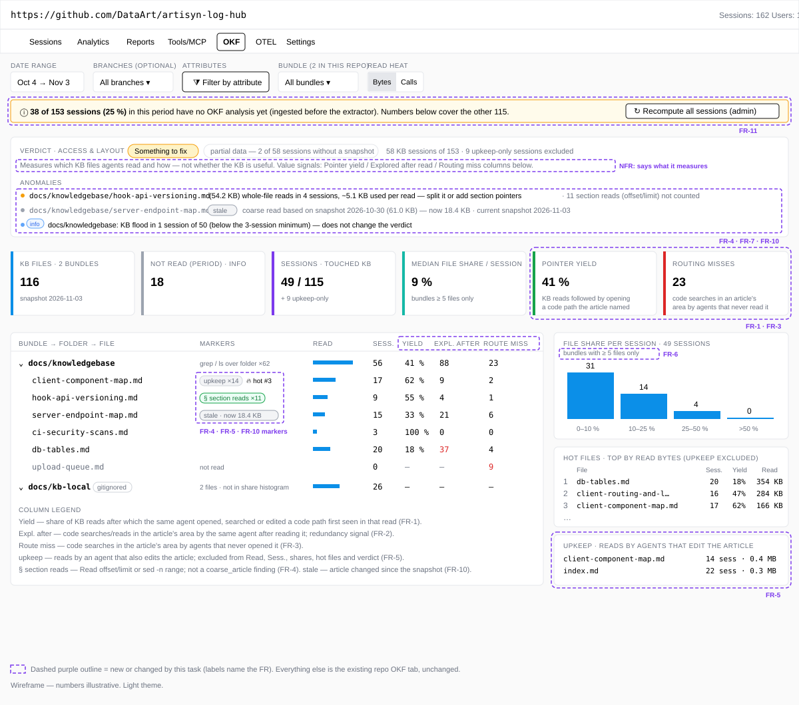
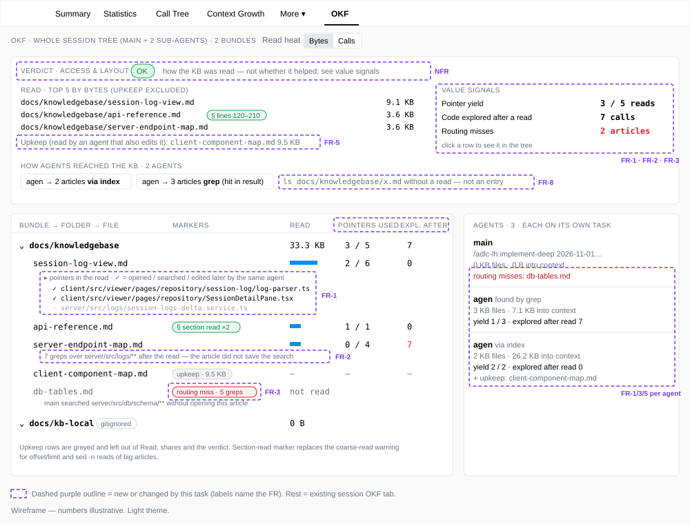
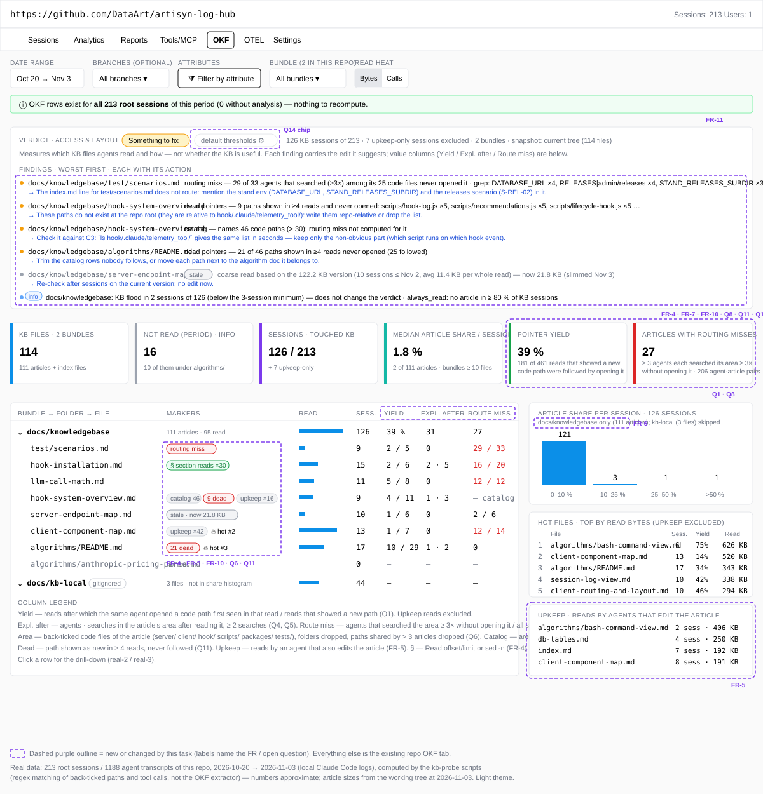
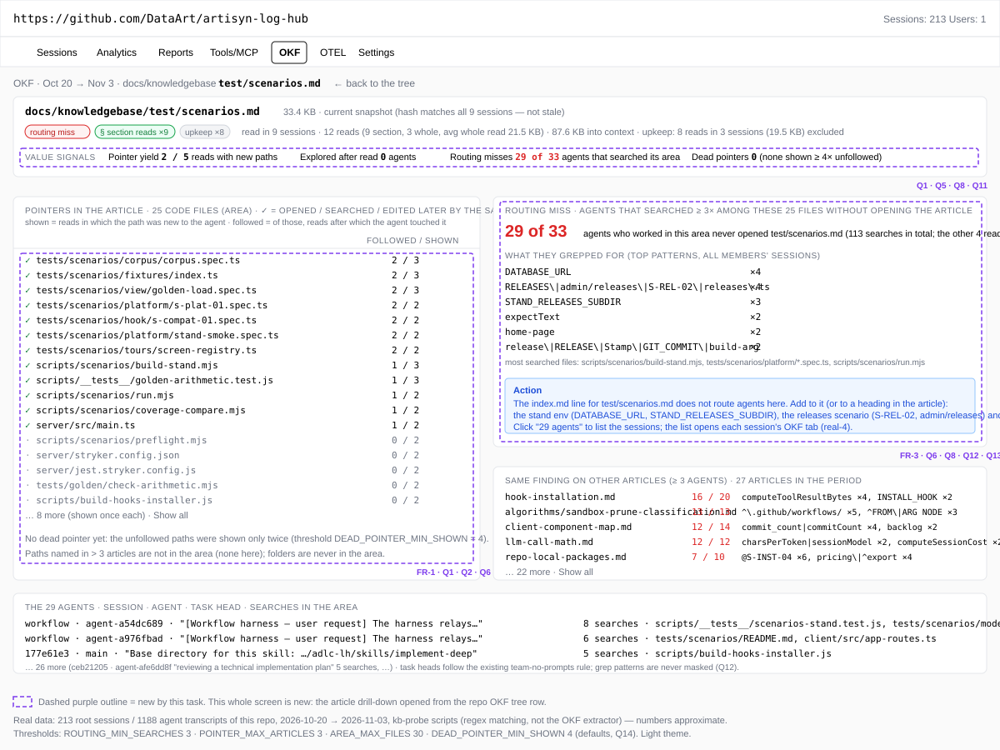
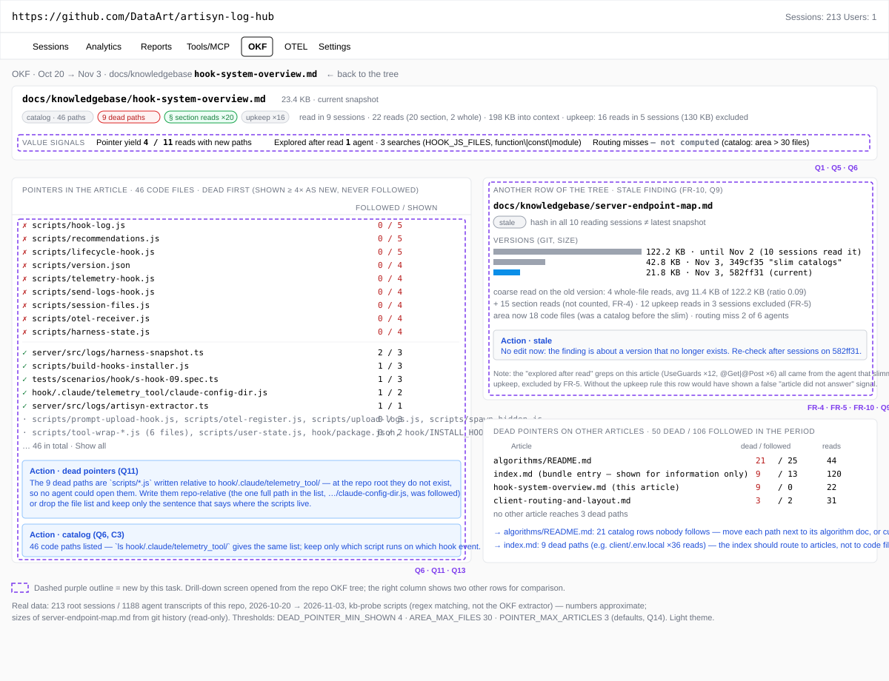
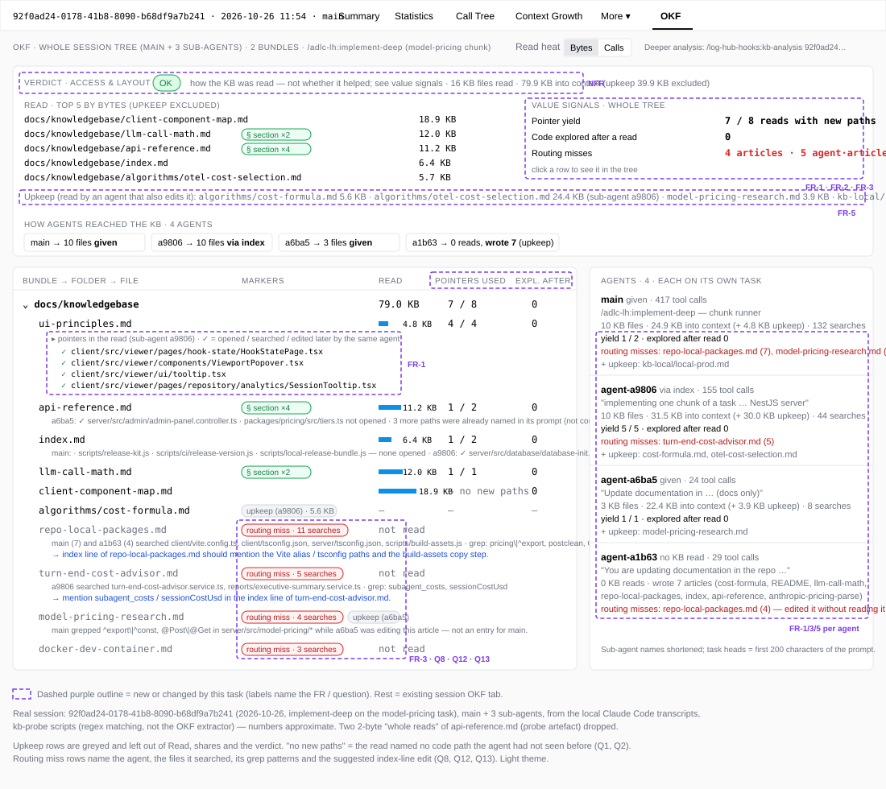
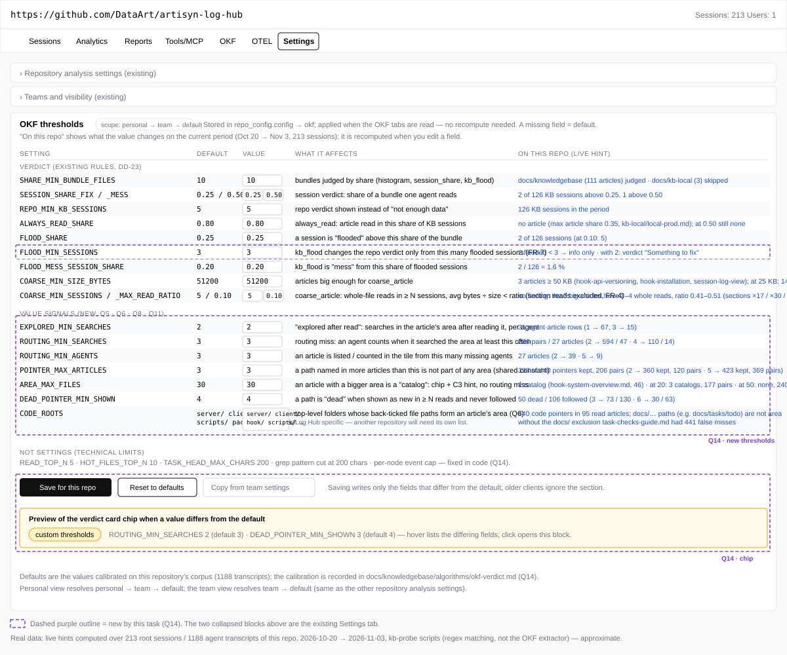

# 2026-11-03: OKF View — Tell What to Change in the KB and Where

**Status:** todo
**Priority:** medium
**Type:** feature
**Module(s):** server (`server/src/logs/okf/`, repo config) | client (session and repo OKF tabs, repo Settings)
**Owner:** denis.tsyplakov
**Created:** 2026-11-03
**Tracker:** GH-88 https://github.com/DataArt/artisyn-log-hub/issues/88

## Description

Raw idea (owner, verbatim, 2026-11-03):

> в loghub локальном проде есть анализ OKF я хочу понять насколько моя knowledge base вообще полезна
> и насколько тут для анализа полезен log hub
> …
> две задачи
> 1. тюним эту локальную KB
> 2. оцениваем насколько OKF view вообще полезна для такого тюнинга
> …
> задачу 2 сделай отдельно scratch

Owner's goal for the result (2026-11-03): a human looks at the OKF view and understands **what to
change in which KB file** — which article to split, trim or extend, which index line to rewrite,
which path in an article is useless or wrong. A number that does not lead to a concrete edit of a
concrete file is noise and is not shown.

The owner's definition of a good KB is C1–C4 in
`docs/tasks/todo/2026-10-27-kb-completeness-deep/requirements.md` (saves code exploration; carries
implicit knowledge; holds nothing easily derived and found from code; fills unknown unknowns).

Today the OKF view is a correct **access** sensor (which files, bytes, entry door, bundle share) and
its `coarse_article` findings on the big catalogs were right (acted on in commit 349cf35). But it
measures none of C1–C4: the extractor keeps only `.md` keys, so it never sees the code an agent
explored after (or instead of) a KB read, and it never looks at what an article told the agent.
Several of its signals also mislead, and the verdict sounds more certain than the data allows.

This task adds deterministic (no LLM in the server, `2026-10-27-okf-usage-tab` FR-19) **value
signals with an action text each**, fixes the misleading signals, and makes every threshold a
repository setting. LLM judgements (derivability, unknown unknowns for articles nobody reads,
correlation with user corrections) stay in the `kb-analysis` skill,
`2026-10-27-kb-completeness-deep`, which gets the new raw data through the facts route.

The rules below are the signal variants that produced a readable list (not noise) on a probe over
this repo's own transcripts (see Notes).

Problems observed in the current view:

- `coarse_article` cannot tell a badly cut article from an agent correctly reading one section:
  the extractor drops `offset/limit`, and about half of KB `Read` calls are ranged.
- Reads of an article by an agent that also edits it (KB upkeep) count as use; `afterOwnEdit`
  only covers reads *after* the edit.
- The repo share histogram takes the best share over all bundles without the
  `SHARE_MIN_BUNDLE_FILES` guard, so tiny bundles fill the "50+" bin.
- `kb_flood` turns the repo verdict to `fix` from a single session (`flooded > 0`).
- `entry: search` fires on `ls <kb>/x.md` existence checks with zero reads.
- The even byte split of a multi-file `cat` under-credits big articles, and `coarse_article` is
  computed from those bytes.
- Article sizes come from the bound snapshot with no marker when the KB has since changed.
- Sessions ingested before the feature have no rows until `recompute-all-sessions` is run; the tab
  does not say how much history it is missing.

## Functional Requirements

Terms used below:

- **Pointer** — a back-ticked repo-relative path in the text of a KB read result
  (`tool_result`), normalised: `:line` suffix stripped, a glob reduced to its fixed prefix, no
  trailing `/`. Only pointers in the text actually returned count, so a section read yields only
  that section's pointers.
- **New pointer** — not present in any earlier text of the same agent node: user messages
  (including a sub-agent's prompt from its parent and `system-reminder` content), assistant texts
  and all earlier tool results. A path the task itself named is never credited to the KB.
- **Partial read** — a KB read whose result is `<persisted-output>` (preview only), is empty after
  trimming, or is an error. It counts for bytes and access as today but is left out of FR-1…FR-3
  and FR-13 (no yield, no area, no dead-pointer shows); the article drill-down says "N reads cut
  to a preview / empty, not counted".
- **Code event** — a non-KB access of a repo-relative path by an agent node, in order: `read`
  (Read, Bash `cat`/`sed -n`/`head`/`tail`), `search` (Grep, Glob, Bash `grep`/`rg`/`git grep`/
  `find`/`ls`), `write`. One event per path argument of a call, not per result line. Paths outside
  the repo root, `node_modules`, `.git` and build output are not stored.
- **Article area** — the article's new pointers that are files (not folders) under one of the
  setting `codeRoots`, minus pointers that occur in more than `pointerMaxArticles` articles. Built
  over **all** stored reads of the article in the scope (not only the period), for the article's
  current hash; when the current hash has no reads yet, the most recent older hash, marked "area
  from an older version". An article nobody ever read has no area — its signal stays "not read".
- **Catalog** — an article whose area has more than `areaMaxFiles` files (FR-15).
- All thresholds named in `code font` below are repository settings (FR-17), applied at **read
  time** so a change shows immediately without recompute; the extractor stores raw events and
  pointers without these filters.

### Value signals (each with an action text)

- **FR-1 Pointer yield.** For an article: share of its non-partial reads that showed at least one
  new pointer after which the **same agent** read, searched or edited at least one of those
  pointers (a code event on that path or under it). Denominator = reads with ≥ 1 new pointer
  only; reads without new pointers are not counted (an article without such reads shows "—", not
  a finding). Shown as "k / n reads" in the repo tree, hot files and the session tree; the number
  of pointers appears only in the article drill-down. Yield ranks articles; the action comes from
  FR-13.
- **FR-2 Searched after reading.** For an (agent, article) pair: `search` code events in the
  article's area by that agent after it read the article. Reads of a pointed file are FR-1 hits,
  never FR-2. A pair is listed only with ≥ `exploredMinSearches` such searches. Shown as a number
  of agents per article, searches and the top search patterns (FR-14) in the drill-down. Action:
  "after reading <article>, agents searched for <top patterns> — add these facts to the article
  or a section pointer to them".
- **FR-3 Routing miss.** For an (agent, article) pair: the agent made ≥ `routingMinSearches`
  `search` events in the article's area and never opened the article. Shown per article as
  "X of Y agents that searched this area did not open the article" (Y = agents with ≥ 1 search
  in the area), with the top patterns. A sub-agent's read does not clear the main agent's miss.
  An article becomes a routing-miss finding only with ≥ `routingMinAgents` such agents; the repo
  KPI tile counts **articles** with the finding, not pairs. Action: "agents searched <area> for
  <top patterns> without opening <article> — mention these in its index.md line (or in
  CLAUDE.md routing)".
- **FR-13 Dead pointers.** For an (article, pointer): shown as new in ≥ `deadPointerMinShown`
  reads (of distinct agents) and never followed (no FR-1 hit). The drill-down lists the article's
  pointers as "✓ followed ×k" / "· shown ×n, never followed", plus a "N dead paths" chip on the
  article row when N ≥ 3. When the pointer path does not exist in the latest snapshot's repo and
  no code event of the period touched it, it is marked "path not found" (a path written relative
  to a sub-folder counts here — the action is the same). Action: "remove <path> from <article>,
  or write it as a full repo-relative path next to the fact it serves".
- **FR-14 Search patterns.** A `search` code event keeps its pattern (Grep `pattern`; the first
  pattern argument of Bash `grep`/`rg`/`git grep`; Glob keeps none), cut to 200 characters. The
  drill-down shows the top 5 patterns for FR-2 and FR-3. Patterns are **never masked**: in the
  team view they are visible for all members' sessions and all roles, including `team-no-prompts`
  in a `restricted` team (owner's decision 2026-11-03 — a code search pattern is a KB signal, not
  a prompt; a deliberate exception to the task-head / OTEL-span masking).
- **FR-15 Catalog.** An article with more than `areaMaxFiles` files in its area gets an `info`
  finding `catalog` ("<article> lists N code paths"). Action: "check it against C3 — paths that
  grep finds in seconds need not be listed; keep the non-obvious ones". Its FR-3 is not computed;
  FR-1, FR-2 and FR-13 still are.
- **FR-16 Action text for every finding.** Every verdict finding and every value-signal row shows
  a second line with the action, built on the client from the rule id and its params (a
  dictionary like `okf-verdict-text.ts`; no server text, no LLM): `coarse_article` → "split
  <file> at its headings or add section pointers to index.md"; `always_read` → "move the facts of
  <file> into index.md / CLAUDE.md"; `kb_flood` → "the index lines of <bundle> do not route —
  agents read a quarter of the bundle; sharpen the one-line descriptions"; `routing_miss`,
  `searched_after`, `dead_pointers`, `catalog` → as in FR-2, FR-3, FR-13, FR-15; `stale` →
  "re-check after sessions on the current version"; `not_read` → no action (info only). An
  unknown rule id shows the id and raw params, as today.

### Fix misleading signals

- **FR-4 Section reads.** Keep `Read` `offset/limit` and Bash `sed -n a,b` / `head -n` /
  `tail -n` ranges (additive range field in `@loghub/bash-view`; additive ranged-call and
  ranged-byte counters per row). Ranged reads are left out of the `coarse_article` ratio, which is
  computed over whole-file reads only; the row shows "§ section reads ×N". No preceding heading
  grep is required; "big article" = `coarseMinSizeBytes`.
- **FR-5 Upkeep.** Reads of an article by an agent node that writes the same article anywhere in
  its sequence (before or after) are upkeep: excluded from read totals, shares, hot files, FR-1,
  FR-2, FR-3 and verdict rules, and shown separately ("Upkeep — reads by agents that edit the
  article"). A session whose only KB accesses are upkeep is not a KB session for the verdict; it
  counts in the upkeep tally.
- **FR-6** Apply `shareMinBundleFiles` to the repo share histogram.
- **FR-7** `kb_flood` changes the repo verdict level only with ≥ `floodMinSessions` flooded
  sessions; below that it is listed as `info`.
- **FR-8** `entry: search` only when the search result actually contained the article and the same
  node later reads the bundle; a `list` / `grep` of a single named file is not an entry, and the
  extractor stops producing a folder row for `ls <file>`.
- **FR-9** Split the bytes of a multi-file read proportionally to the bound snapshot sizes of the
  files; even split when there is no snapshot or a target has no size. Applied at extraction;
  `recompute-all-sessions` re-applies it.
- **FR-10 Stale.** An article is stale for a finding when its **hash** in the snapshot the finding
  is based on differs from its hash in the latest snapshot (the snapshot bound to the most recent
  root session in the tab's scope). Findings are computed over sessions whose article hash equals
  the latest one; when those are below the rule's minimum but older-hash sessions are above it,
  the finding is shown with a `stale` chip, "based on an older version (N of M sessions)", and
  the current size with the old one in brackets. An article missing from the latest snapshot
  shows "removed" and is dropped from the verdict.
- **FR-11** The repo tab states "X of Y sessions in this period have no OKF analysis yet" (root
  sessions without the per-session extraction marker ÷ all root sessions in the period). The
  marker is an additive per-session field set even when zero rows are written. The "Recompute
  all sessions" link is shown only to users the existing `recompute-all-sessions` route
  authorises, called with the tab's current `teamId`.

### Settings

- **FR-17 OKF thresholds are repository settings.** A new optional `okf` section in
  `RepoConfigJson` (`repo_config` personal, `team_repo_config` team; resolved by
  `resolveEffectiveConfig()` — personal view: user → team → default, team view: team → default).
  An absent field means the built-in default; no migration. Defaults are the values calibrated on
  the Log Hub repo:

  | Setting | Default | Affects |
  |---|---|---|
  | `shareMinBundleFiles` | 10 | bundles smaller than this are skipped by share rules and the histogram |
  | `sessionShareFix` / `sessionShareMess` | 0.25 / 0.5 | session verdict levels |
  | `repoMinKbSessions` | 5 | minimum KB sessions for repo rules |
  | `alwaysReadShare` | 0.8 | `always_read` |
  | `floodShare` / `floodMessSessionShare` | 0.25 / 0.2 | `kb_flood` |
  | `floodMinSessions` | 3 | FR-7 |
  | `coarseMinSizeBytes` / `coarseMinSessions` / `coarseMaxReadRatio` | 51200 / 5 / 0.1 | `coarse_article` |
  | `exploredMinSearches` | 2 | FR-2 |
  | `routingMinSearches` / `routingMinAgents` | 3 / 3 | FR-3 |
  | `pointerMaxArticles` | 3 | article area (shared pointers dropped) |
  | `areaMaxFiles` | 30 | FR-15 catalog |
  | `deadPointerMinShown` | 4 | FR-13 |
  | `codeRoots` | `server/ client/ hook/ scripts/ packages/ tests/` | article area — specific to Log Hub, other repos will change it |

  Not settings: top-list sizes (`READ_TOP_N`, `HOT_FILES_TOP_N`), `TASK_HEAD_MAX_CHARS`, the
  pattern cut and the per-node event cap. Validation: integers ≥ 1, shares in (0, 1],
  `codeRoots` non-empty repo-relative folders; an invalid value is rejected by the settings save,
  an invalid stored value falls back to the default.
  UI: an "OKF thresholds" block in the repository Settings tab — each field with its default and
  a one-line "what it affects"; "Reset to defaults". The verdict card shows a "custom thresholds"
  chip when the effective values differ from the defaults.

### Facts route for the skill

- **FR-12** `GET /api/v2/okf-usage/facts` returns, per agent, the ordered sequence of KB and code
  accesses (op, path, offset/limit when present, search pattern) and, per KB read, its new
  pointers, as optional additive fields — built on demand from the transcript like
  `otherReadsTop`. The `kb-analysis` skill uses them for its redundancy and routing passes
  (`2026-10-27-kb-completeness-deep` FR-7 passes 5/6) and for unknown unknowns.

### Dropped (checked on data, not to be built)

- A "searches drop after the first KB read" tile: control agents with no KB read show the same
  drop, so it measures the task phase, not the KB, and would be read as "the KB works".
- Pointer yield per pointer: an article lists many paths and an agent needs one or two, so the
  number says nothing; pointers appear only as the FR-13 list.
- Folder pointers and pointers outside `codeRoots` in the area: with them the routing-miss list
  is dominated by articles that merely name a docs folder.

### Wireframes

Concept (the first draft, illustrative numbers):

On this repo's real data (approximate probe numbers, 2026-10-20 … 11-03):

## Data model (additive)

- `session_okf_event` — one row per code event of a tree node: `session_id` (node), `ord`,
  `op` (`read` / `search` / `write`), `path`, `range_from` / `range_to` (nullable), `pattern`
  (nullable, ≤ 200 chars). Delete-then-insert per node like `session_okf_access`; cascades with
  the `sessions` row; removed by `purgeSessionChildData` like `session_okf_access`. Per-node cap
  as a named constant; a capped node is marked so the UI can say "events truncated".
- `session_okf_pointer` — one row per (node, KB read call, pointer): `session_id`, `article_path`,
  `article_hash` (from the bound snapshot, nullable), `read_ord`, `pointer`, `is_new`,
  `followed`, `partial`. Delete-then-insert per node, so recompute, delete and the team filter
  work as for the other OKF rows; per-article aggregates (area, yield, dead pointers) are computed
  at read time over the sessions in scope.
- `session_okf_access`: additive ranged-call / ranged-byte counters (FR-4).
- Per-session OKF extraction marker (FR-11).
- `RepoConfigJson.okf` (FR-17) — jsonb, no migration.
- Team filter (fail closed, DD-30) applies to the new rows like to `session_okf_access`: a
  pointer or event row of a snapshot-less tree, or of an ignored KB path, never reaches a team
  view. Code paths and patterns are not filtered by `ignored` (they are not KB files).

## Non-Functional Requirements

- No LLM in the server (FR-19 of `2026-10-27-okf-usage-tab`).
- Backward compatibility: new tables, columns, config fields and response fields are additive; an
  older client or skill ignores them; hooks need no change (everything comes from transcripts
  already uploaded). Existing sessions gain the new data only through `recompute-all-sessions`.
- The verdict card says what it measures (access, layout and value proxies), not that the KB is
  useful.
- Repo tab response time stays within the current OKF tab budget on a repo of ~200 root sessions
  per month; the per-node event cap bounds the new tables.

## Acceptance Criteria

Examples are this repo's real cases from the probe; checks run on scenario fixtures modelled on
them.

- [ ] FR-1: an agent reads `ui-principles.md` and then opens a file it named (not named before in
      the prompt) → a yield hit; the same file named in the sub-agent's prompt → no hit; a read
      with no new pointers is not in the denominator.
- [ ] FR-2: reads of `server-endpoint-map.md` followed by ≥ 2 greps over the paths it names show
      as "searched after reading" with the patterns; the same greps by the agent that edits the
      article (upkeep) do not.
- [ ] FR-3: agents that grep ≥ 3 times in the area of `test/scenarios.md` without opening it show
      as "X of Y agents"; 2 greps do not; a folder pointer or a `docs/` pointer never puts a
      search into the area; a sub-agent's read does not clear the main agent's miss.
- [ ] FR-13: a pointer shown as new in 4 reads and never followed is listed as dead with the
      action; a path written relative to a sub-folder (`scripts/hook-log.js` in
      `hook-system-overview.md`) is marked "path not found".
- [ ] FR-14: Grep and Bash `grep` patterns show in the drill-down top 5, unmasked in the team view
      for a `team-no-prompts` caller.
- [ ] FR-15: an article with more than 30 area files gets `catalog` and no routing-miss finding.
- [ ] FR-16: every finding row and value-signal row has an action line; an unknown rule id shows
      raw.
- [ ] FR-4: a `Read` of a big article with `offset/limit` is not a `coarse_article` finding; a
      whole-file read used for a small part still is.
- [ ] FR-5: in a session that edits `client-component-map.md`, its reads by the editing agent
      appear as upkeep, not in hot files, shares or value signals.
- [ ] FR-6: a 2-article bundle does not put sessions into the "50+" share bin.
- [ ] FR-7: one flooded session out of 50 does not turn the repo verdict to `fix`; it is `info`.
- [ ] FR-8: `ls <kb>/x.md` without a read is not counted as `entry: search`.
- [ ] FR-9: a `cat` of a 20 KB and a 1 KB article credits them ~20:1.
- [ ] FR-10: after the KB slim commit, a `coarse_article` on `server-endpoint-map.md` based on old
      sessions shows `stale` with the current size; comparison is by hash.
- [ ] FR-11: the repo tab shows the share of sessions without OKF analysis; the recompute link
      only for authorised users.
- [ ] FR-12: the facts response carries the ordered sequence with patterns and pointers; an older
      skill parsing the old fields still works.
- [ ] FR-17: changing `routingMinSearches` from 3 to 2 in repo Settings changes the routing-miss
      list without recompute; a team value applies in the team view, a personal one overrides it
      in the personal view; the "custom thresholds" chip appears; an absent section = defaults.
- [ ] Partial reads: a `<persisted-output>` or empty KB read adds no yield, area or dead-pointer
      show.

## Tests (policy: algorithm rows, contract rows, scenario steps only)

- Algorithm: new rows in `docs/algorithm-examples/okf-access-extraction.json` (code events,
  patterns, ranges, pointers, new-pointer rule, partial reads, FR-8, FR-9) and
  `docs/algorithm-examples/okf-verdict.json` (FR-5, FR-6, FR-7, FR-10, FR-15, settings
  overrides). The read-time value signals (area, FR-1, FR-2, FR-3, FR-13) are a new algorithm:
  a new doc `docs/knowledgebase/algorithms/okf-value-signals.md` with its rows file and
  `*.algo.spec.ts` table test.
- API contract: changed response shapes of the session and repo `okf-usage` routes, the facts
  route and the repo settings route get their rows in `server/test/contract/registry/`
  (`f21-reports.ts`, `f19-change-surface.ts` / the settings registry file — check the router
  meta-test).
- Scenario: extend `tests/scenarios/repos/s-repo-16.spec.ts` (OKF tab steps 7–11, `helpers/okf.ts`)
  with steps for a routing miss, a yield hit, a dead pointer, upkeep exclusion, the team view
  showing patterns, and a threshold change in Settings; `s-repo-09` / `s-repo-11` cover recompute
  and import of the new rows (one step each).

## Open Questions

_None._ (Answered in the task's `open_questions_ru.md`, folded in 2026-11-03.)

## Notes

- Probe evidence (numbers behind every threshold default and dropped signal, real findings worth
  acting on in the KB task itself): see `notes.md`.
- To verify while planning: in the probe, Workflow sub-agent transcripts sat under a
  `workflow/` folder without a root session — check how Log Hub attaches them to the session tree
  before relying on per-tree FR-1.
- Code pointers: share histogram in `okf-usage.service.ts` (best share over all bundles, no
  guard); `afterOwnEdit` declared but not used by the verdict rules in `okf-verdict.ts`;
  `kb_flood` `flooded > 0` → `fix` in `okf-verdict.ts`; byte split DD-2 in
  `okf/okf-access-extractor.ts`; dual-scope config in `RepoConfigJson`
  (`server/src/database/schema/index.ts`) and `resolveEffectiveConfig()`.
- Related: `2026-10-27-okf-usage-tab` (done — the feature), `2026-10-27-kb-completeness-deep`
  (LLM skill; C1–C4), `2026-10-28-kb-tag-search`.
