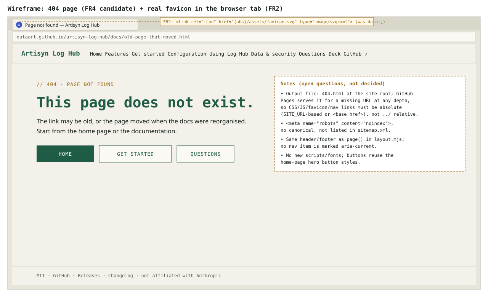
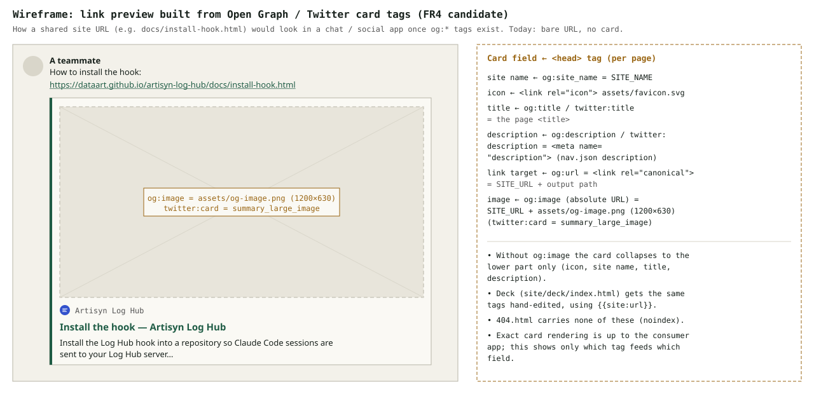

# 2026-11-03: Site SEO — Sitemap, Favicon and Missing Basics

**Status:** todo
**Priority:** medium
**Type:** feature
**Module(s):** site (`scripts/site/`, `site/`)
**Owner:** denis.tsyplakov
**Created:** 2026-11-03
**Tracker:** GH-95 https://github.com/DataArt/artisyn-log-hub/issues/95

## Description

Raw idea (verbatim): "добавить к sitemap, siteicon и подумать что еще из SEO упущенно"
(add a sitemap and a site icon to the site, and think about what else is missing for SEO).

Scope is the GitHub Pages site built by `npm run build:site` (`scripts/site/build-site.mjs`,
`scripts/site/layout.mjs`, `site/`), served under `https://dataart.github.io/artisyn-log-hub/`
(`SITE_URL` in `layout.mjs`), including the reveal.js deck (`site/deck/index.html`).

State observed when the task was scratched:

- `layout.mjs` `<head>` has only `charset`, `viewport`, `<title>` and `<link rel="icon" href="data:,">`
  (an intentionally empty favicon). The deck has the same empty icon but does have a
  `<meta name="description">`.
- No `sitemap.xml`, no `robots.txt`, no per-page `<meta name="description">`, no
  `<link rel="canonical">`, no Open Graph / Twitter card tags, no 404 page in the site output.
- The app already ships an icon: `client/public/favicon.svg`.

## Functional Requirements

- FR1 — Sitemap: the site build emits `sitemap.xml` at the site root listing every indexable HTML
  page (home, features, questions, every docs page from `user-docs/nav.json`, the deck; not
  `404.html`). Namespace `http://www.sitemaps.org/schemas/sitemap/0.9`, every `<loc>` XML-escaped,
  no `<lastmod>` / `changefreq` / `priority` (deterministic build).
- FR1a — Canonical URL form, one shared helper used by the sitemap, `<link rel="canonical">` and
  `og:url`: `index.html` → `SITE_URL`, `deck/index.html` → `SITE_URL + 'deck/'`, every other page →
  `SITE_URL + <output path>` (e.g. `docs/install-hook.html`). `page()` in `layout.mjs` gets new
  `path` and `description` arguments.
- FR2 — Site icon: every site page and the deck reference a real favicon instead of `data:,`. The icon
  is a committed copy of `client/public/favicon.svg` at `site/assets/favicon.svg` (copied verbatim to
  `assets/`); the build fails with exit 1 if it is missing.
- FR4 — SEO basics, adopted:
  - per-page `<meta name="description">`. Docs pages: an optional-in-schema, required-in-build
    `description` field per article in `user-docs/nav.json` (no front matter in `user-docs/*.md`).
    Home / Features / Questions: a fourth element in the `[name, title, activeSection]` tuple in
    `build-site.mjs`. Deck: its existing `<meta name="description">`. A missing or duplicate
    description fails the build with exit 1, reported like the existing link errors.
  - `<link rel="canonical">`;
  - Open Graph / Twitter card tags: `og:site_name`, `og:title`, `og:description`, `og:url`,
    `og:image`, `twitter:card = summary_large_image`;
  - one site-wide social preview image: a new 1200×630 PNG screenshot of the repository OTEL tab's
    per-team cost Sankey (`client/src/viewer/pages/repository/otel/OtelCostFlow.tsx`), committed
    as `site/assets/og-image.png` and referenced by an absolute `SITE_URL` URL;
  - `apple-touch-icon`: a committed 180×180 PNG rendered once from `favicon.svg` (Node/Playwright,
    no Python) at `site/assets/apple-touch-icon.png`;
  - a `404.html` page: absolute `SITE_URL`-based URLs for stylesheet, script, favicon and nav (GitHub
    Pages serves it at any depth), `<meta name="robots" content="noindex">`, no canonical, no OG tags,
    not in the sitemap;
  - heading / alt-text hygiene pass over `site/pages/*.html` and the layout.
- FR5 — Deck: it is copied, not rendered by `layout.mjs`, so its favicon (`../assets/favicon.svg`),
  canonical, `og:*` tags are hand-edited into `site/deck/index.html`, with absolute URLs via the
  existing `{{site:url}}` placeholder.

## Non-Functional Requirements

- Offline-first: the site stays an online extra; nothing added here may become required by the app,
  in-app help or shipped docs, and no new runtime fetches to third-party hosts.
- No new external scripts or fonts on the site.
- Output stays inside the site output dir (`tmp/site` / `--out`); `docs/` deploy layout unchanged
  apart from the new files.

## Acceptance Criteria

- [ ] AC1 (FR1) — `npm run build:site` produces a well-formed `sitemap.xml` with the sitemap 0.9
      namespace whose `<loc>` set equals the set of indexable generated HTML pages (all except
      `404.html`), each in the FR1a form; the build fails with exit 1 if any page URL does not start
      with `SITE_URL`.
- [ ] AC2 (FR2) — no generated page or the deck contains `href="data:,"`; `assets/favicon.svg` exists
      in the output and returns 200 when loaded from the site and the deck.
- [ ] AC4 (FR4, FR5) — every page except `404.html` (deck included) has exactly one
      `<meta name="description">` of 50–160 characters, no two pages share a description,
      `<link rel="canonical">` equals its FR1a URL, and `og:title` / `og:description` / `og:url` match
      the title, description and canonical; `og:image` is the absolute URL of
      `assets/og-image.png`, which exists in the output, as does `assets/apple-touch-icon.png`. `404.html` has `noindex`, no canonical and loads its
      stylesheet and favicon from a nested missing URL. Every rejected candidate has a one-line reason
      in Notes.
- [ ] AC5 — the CI site check (`npm run build:site -- --out tmp/site-check`) still passes.
- [ ] AC6 — AC1, AC2 and AC4 are checked by new steps in the existing scenario `@S-SITE-01`
      (`tests/scenarios/platform/s-site-01.spec.ts`); its existing step 13 (only local, `data:` and
      versioned-CDN requests) keeps passing.

## Open Questions

None.

## Common sense considerations

- Docs-page descriptions come from a `description` field in `user-docs/nav.json`; front matter is ruled out (it would leak into in-app help and the shipped `hook/INSTALL_HOOK.md`).
- Home / Features / Questions descriptions are a fourth tuple element in `build-site.mjs`; the deck keeps its existing description.
- A missing or duplicate description fails the site build with exit 1.
- Adopted: description, canonical, OG/Twitter with image, apple-touch-icon, 404 page, heading/alt hygiene.
- AC4 is measurable: one description of 50–160 chars, unique, canonical and `og:*` consistent; 404 excluded.
- One canonical URL form (root → `SITE_URL`, deck → `SITE_URL + 'deck/'`, else `SITE_URL + path`) shared by sitemap, canonical and `og:url`.
- `page()` gets `path` and `description` arguments; one helper builds absolute URLs.
- Sitemap excludes `404.html` and omits `<lastmod>` / `changefreq` / `priority`.
- 404 page uses absolute `SITE_URL` URLs, `noindex`, no canonical.
- Deck head tags are hand-edited in `site/deck/index.html` via `{{site:url}}`; favicon lives at `site/assets/favicon.svg`.
- "Valid sitemap" = well-formed, sitemap 0.9 namespace, escaped `<loc>`, all under `SITE_URL`; missing favicon or off-site URL fails the build.
- Verification is new steps in `@S-SITE-01` (test policy: extend an existing scenario).
- Sitemap submission to Google Search Console / Bing Webmaster Tools is a manual owner step, recorded in Notes.

## Notes

<!-- Append timestamped notes here as work progresses -->

- 2026-11-03 — Rejected: `robots.txt` — crawlers read it only at the host root `dataart.github.io` (RFC 9309), which a project site cannot serve; the sitemap is submitted manually instead.
- 2026-11-03 — Rejected: JSON-LD `SoftwareApplication` — without ratings/reviews Google shows no rich result; revisit if the project gets reviews.
- 2026-11-03 — Manual owner step after deploy: submit `https://dataart.github.io/artisyn-log-hub/sitemap.xml` to Google Search Console and Bing Webmaster Tools.
