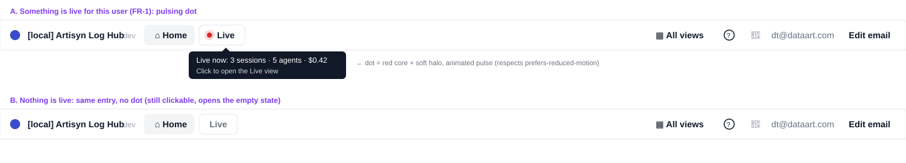
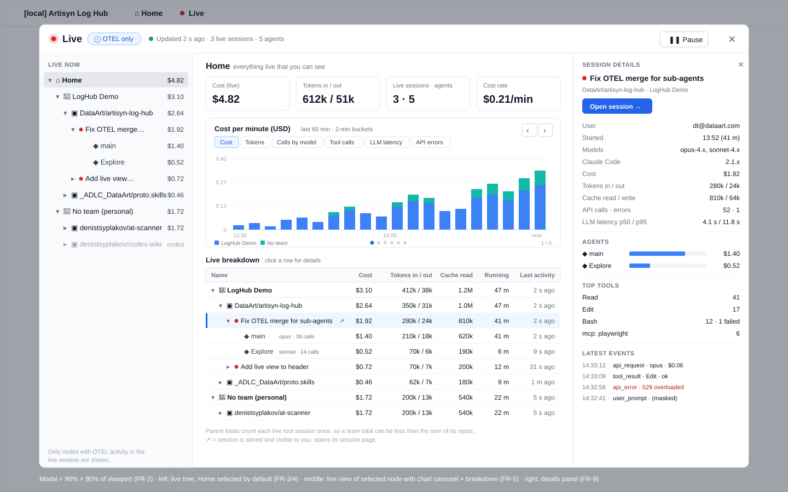
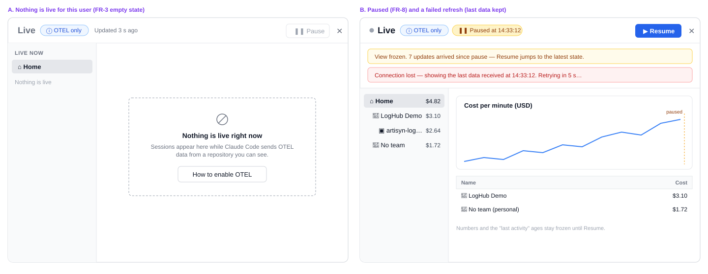
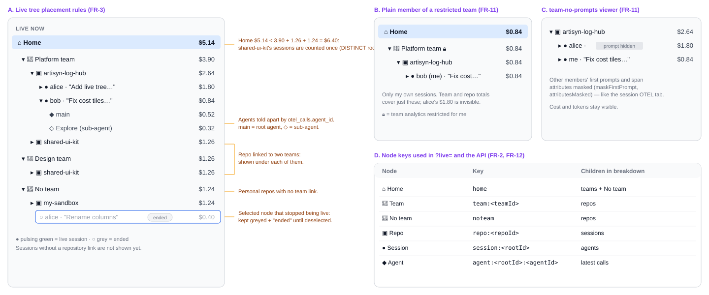
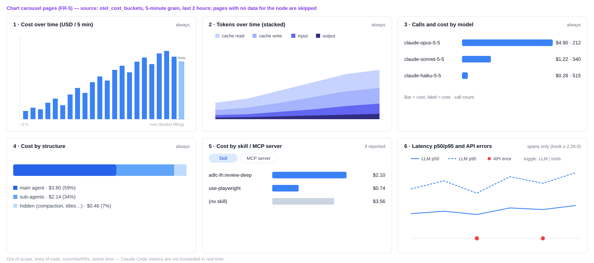
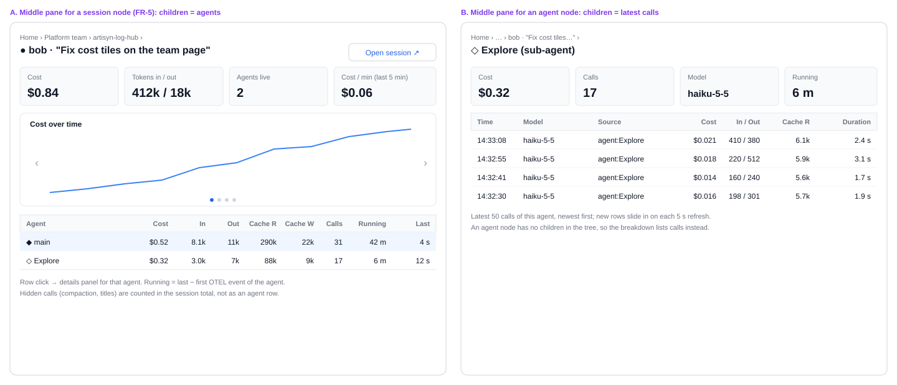
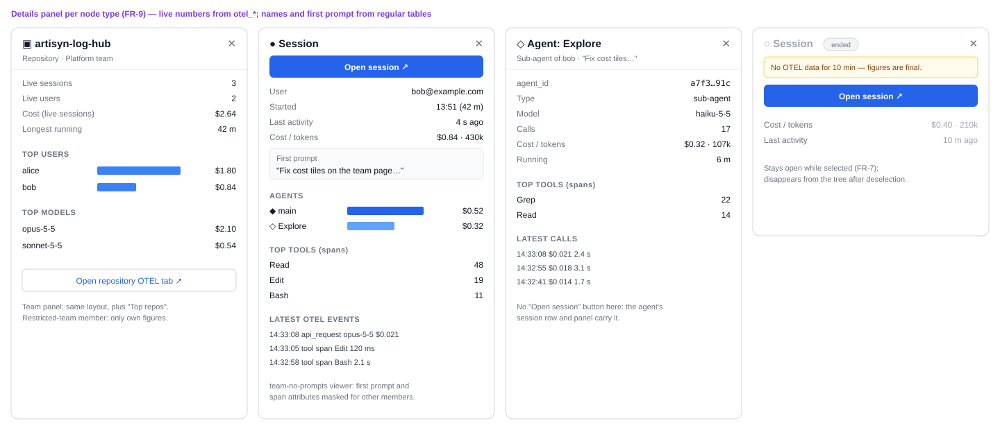
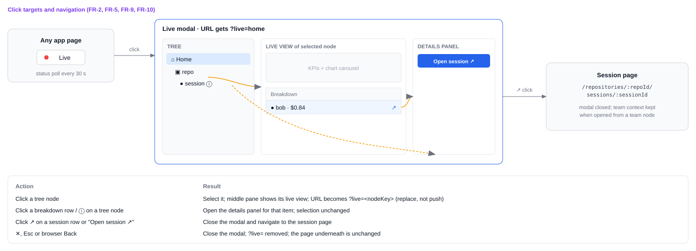

# 2026-11-04: OTEL Live View

**Status:** todo
**Priority:** medium
**Type:** feature
**Module(s):** client | server
**Owner:** denis.tsyplakov
**Created:** 2026-11-04
**Tracker:** GH-100 https://github.com/DataArt/artisyn-log-hub/issues/100

## Description

Raw idea (verbatim, as typed by the user):

> раз уж я все равно собираю OTEL сделать вид live
> для home, team, repo, session
> там прям вот я прямом эфире древовидно дерево репа - сессися - агент
> для его стоимость токены, время работы может еще что
> если нет лайв ничего нет
> кнопка pause - заморозить не показывать
> там же сверху карусель графиков - стоимость/токены/что еще обычно на графану кладут и что из OTEL видно
>
> ЧИСТО live из open telemetry
>
> если сессия уже есть в обычной базе клик- переход туда.
> ну и на клик - справа панель с детаолями - там обогащаем чем можем
>
> одна странца сверху из заголвка Live (c пульсирующей точкой если есть Live) - открыват модалку на 90% ширины и высоты и там слева дерево слева что есть лайв сейчас и справа при клике на нод дерева лавй вид
> по дефолту выбрал корень home
>
> показываем все к чему имеет доступ этот пользователь

Summary: since Log Hub already collects OpenTelemetry data, add a **Live** view that shows, in real
time and from OTEL, what is running right now — as a tree (home → team → repo → session → agent)
with cost, tokens, running time and other metrics per node, plus a carousel of Grafana-style
charts on top. It opens from a **Live** entry in the top header (with a pulsing dot when anything
is live) as a modal taking 90% of the viewport width and height.

## Functional Requirements

- **FR-1 Entry point.** The top header has a **Live** item, shown to every signed-in user. When at
  least one live root session is visible to the current user, it shows a pulsing dot and a hover
  tooltip with the live session count; otherwise no dot. The header reads this from the status
  route (FR-12), polled every 30 s only while the browser tab is visible.
- **FR-2 Modal.** Clicking **Live** opens a modal sized 90% of viewport width and 90% of height.
  The modal state is in the URL (`?live=<nodeKey>` on the current page): reload keeps it open on
  the same node, browser Back and ✕ / Esc close it.
- **FR-3 Live tree (left pane).** The left pane shows a tree of what is live right now:
  home (root) → team → repo → session → agent. Only nodes with live activity appear; when nothing
  is live, the tree holds only Home and the right pane shows the empty state.
  - **Live** is the existing rule `computeOtelLiveness` (`rt_last_at` or `chunk_last_at` within
    `OTEL_SESSION_ENDED_MS` = 10 min). Agents are told apart by `otel_calls.agent_id`.
  - Repos with no team link visible to the user sit under a **No team** node directly under home.
  - A repo linked to several teams the user can see appears under each of those teams.
  - A live OTEL root with no repository link yet (no linked `artisyn` log) is not shown; it appears
    once the hook's per-prompt upload links it.
  - Every parent total (home, team, No team, repo) counts each root session once (DISTINCT root,
    as on the team OTEL tab), so a parent can be less than the sum of its children; a footnote in
    the breakdown says so.
- **FR-4 Default selection.** On open (without a node in the URL), the root (home) node is
  selected.
- **FR-5 Live view (middle pane).** Selecting a tree node shows the live view for that scope:
  - KPI tiles: cost, tokens in/out, live sessions / agents, cost per minute (last 5 min).
  - A chart carousel on top, built from `otel_cost_buckets` (5-minute grain, the last 2 hours,
    same source as every other OTEL chart). Pages: cost over time, tokens over time
    (input / output / cache read / cache write), calls and cost by model, cost by structure
    (main / sub-agent / hidden), cost by skill / MCP server, and — only when spans exist
    (hook ≥ 2.29.0 with traces) — tool and LLM latency p50/p95 and API errors. Pages with no data
    for the node are skipped. Claude Code OTEL **metrics** (lines of code, commits/PRs, active
    time) are not forwarded in real time and are out of scope.
  - A breakdown table of the node's direct children with fixed columns: cost, input tokens,
    output tokens, cache read, cache write, calls, running time, last activity. A session node
    lists its agents; an agent node lists its latest 50 calls instead.
  - **Running time**: session or agent = its last OTEL event − its first OTEL event; parent nodes =
    the maximum over their live sessions.
- **FR-6 Data source.** Live figures (cost, tokens, timing, calls, agents, charts) come only from
  the `otel_*` tables, never from the hook-transcript pipeline. Repo/team placement and access come
  from the existing scope path (`scopedTreeCtes` + `resolveTeamScope`), i.e. the root's `artisyn`
  log linked to a repository. Names (team, repo, user email) are read from their regular tables.
- **FR-7 Live updates.** While the modal is open, the tab is visible and the view is not paused,
  it re-reads the tree and the selected node every 5 s. A node that stops being live disappears on
  the next refresh, unless it is selected or open in the details panel: then it stays, greyed and
  marked **ended**, until the user selects something else.
- **FR-8 Pause.** **Pause** stops polling for the modal and freezes everything in it, showing a
  "Paused at hh:mm:ss" badge. The header dot keeps updating. **Resume** fetches the current state
  at once and continues polling (no replay of the missed updates).
- **FR-9 Details panel.** Clicking a row in the breakdown (or the ⓘ on a tree node) opens a
  details panel on the right. Content per node type is shown in
  `wireframes/details-panel-variants.svg`: team / repo — live sessions, top users, top models, a
  link to that team's / repo's OTEL tab;
  session — user, started, first prompt, agents with cost, top tools, latest OTEL events; agent —
  agent name/type, model, calls, top tools, latest calls. Live figures come from OTEL; names and
  the first prompt come from the regular tables.
- **FR-10 Link to stored session.** A session row and the session details panel have an explicit
  **Open session ↗** link to `/repositories/:repoId/sessions/:sessionId` (with the team context
  when the session sits under a team node). Every session shown in the tree has a repository link
  (FR-3), so the link is always present. Following it closes the modal.
- **FR-11 Access scope.** The view shows only sessions the user can see elsewhere in the app, and
  every aggregate (node totals, KPIs, charts) is computed over those sessions only:
  - In a team where the user lacks `analyticsAllowed` (a plain member of a restricted team), the
    team node shows only the user's own sessions, and its totals and charts cover only those.
  - For a `team-no-prompts` viewer, the first prompt of other members' sessions and span attributes
    in the details panel are masked, as on the session OTEL tab (`maskFirstPrompt`,
    `attributesMasked`).
- **FR-12 API.** Two new read routes, each with a row in `server/test/contract/registry/`:
  - `GET /api/v1/otel/live/status` → `{ live: boolean, liveSessions: number }`. It is cheap
    because it first filters `otel_session_state` to recently active roots, then applies the scope.
  - `GET /api/v1/otel/live?node=<nodeKey>&tz=` → the full live tree with per-node totals, plus KPIs,
    chart buckets and the breakdown for the selected node. The node key encodes the type and id
    (`home`, `team:<id>`, `noteam`, `repo:<id>`, `session:<rootId>`, `agent:<rootId>:<agentId>`).
- **FR-13 Refresh failure.** If a refresh fails, the modal keeps the last data and shows a
  "Connection lost — showing data from hh:mm:ss, retrying" banner; it never switches to the empty
  "nothing is live" state because of an error.

## Acceptance Criteria

- [ ] AC-1 (FR-1): with an active OTEL-emitting session visible to the user, the header **Live**
  item shows a pulsing dot within 30 s; when no session has had OTEL data for 10 min, the dot is
  gone.
- [ ] AC-2 (FR-2): clicking **Live** opens a modal occupying 90% of viewport width and height;
  reloading the page with `?live=repo:<id>` reopens it on that repo; Back closes it.
- [ ] AC-3 (FR-3): the tree lists only teams/repos/sessions/agents with live OTEL activity, nested
  home → team → repo → session → agent; with no live activity the empty state is shown.
- [ ] AC-3a (FR-3): a live session in a repo linked to two teams appears under both teams, and the
  home cost equals its cost counted once.
- [ ] AC-3b (FR-3): a live session in a repo with no team link appears under **No team**.
- [ ] AC-4 (FR-4): on open, the home root node is selected and its live view is displayed.
- [ ] AC-5 (FR-5): selecting any tree node shows its KPI tiles, a breakdown of its children with
  the fixed columns, and a carousel with at least the cost and tokens charts.
- [ ] AC-6 (FR-6): the live view works for a session that has OTEL data and the per-prompt
  `artisyn` log but no uploaded transcript.
- [ ] AC-7 (FR-7): new OTEL data arriving while the modal is open appears within 5 s without a
  manual reload; a selected session that stops being live stays visible marked **ended**.
- [ ] AC-8 (FR-8): after pressing **Pause**, newly arriving OTEL data does not change the modal
  while the header dot still updates; after **Resume**, the latest state appears at once.
- [ ] AC-9 (FR-9): clicking a breakdown row opens a right-side details panel with that item's
  details for its node type.
- [ ] AC-10 (FR-10): **Open session ↗** on a live session closes the modal and opens its session
  page.
- [ ] AC-11 (FR-11): a user sees no teams, repos or sessions in the live view that they cannot
  see elsewhere in the app; a plain member of a restricted team sees only their own sessions under
  that team, and the team totals equal the sum of those sessions.
- [ ] AC-11a (FR-11): a `team-no-prompts` viewer sees other members' first prompts masked.
- [ ] AC-12 (FR-12): both routes have contract-registry rows; the status route returns
  `{ live: false, liveSessions: 0 }` for a user with nothing live.
- [ ] AC-13 (FR-13): when a refresh fails, the last data stays on screen with the retry banner.

## Common sense considerations

- "Live" reuses `computeOtelLiveness` / `OTEL_SESSION_ENDED_MS` (10 min); no new definition.
- Sub-agents are identified by `otel_calls.agent_id` (DD-1 of `otel-tabs.md`).
- Transport is polling, the house convention: header 30 s (`OTEL_REPO_POLL_MS`), modal 5 s
  (`OTEL_SESSION_POLL_MS`), only while the tab is visible; no SSE/WebSocket.
- Charts read `otel_cost_buckets` at 5-minute grain, the source of every OTEL chart; no new table.
- Metrics-based charts (LOC, commits/PRs, active time) are out of scope: no hook change in this
  task; forwarding metrics in real time would be a separate, backward-compatible hook task.
- Repo/team placement and access come from the session → repository link; only figures are
  OTEL-only.
- Sessions without a repository link are hidden until the hook links them.
- Personal repos go under a **No team** node; a repo in several teams appears under each.
- Parent totals count each root once (DISTINCT root), with a footnote in the breakdown.
- Aggregates are always computed over what the viewer may see; a restricted-team member's team
  node covers only their own sessions.
- `team-no-prompts` masking matches the session OTEL tab.
- Running time = last − first OTEL event per session/agent; parents take the maximum.
- Breakdown columns are fixed: cost, input, output, cache read, cache write, calls, running time,
  last activity.
- Row click opens the details panel; navigation only via an explicit **Open session ↗** link,
  which closes the modal.
- An ended node disappears on the next refresh unless selected or open in the panel.
- Pause stops modal polling only; Resume jumps to the latest state.
- A failed refresh keeps the last data with a retry banner.
- The modal is deep-linkable via `?live=<nodeKey>`; Back closes it.
- The details panel may use regular tables for names and the first prompt; live numbers stay
  OTEL-only.
- The session link condition is "has a repository link", which every shown session meets.

## Open Questions

_None._

## Notes

<!-- Append timestamped notes here as work progresses -->
