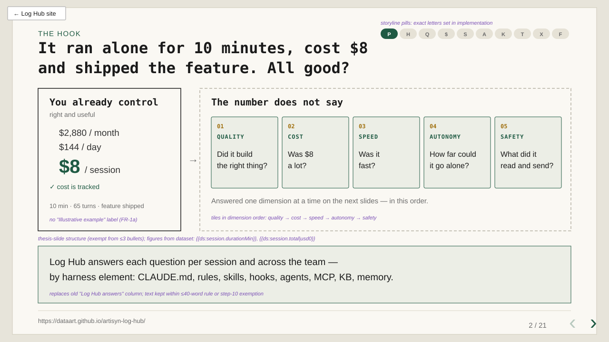
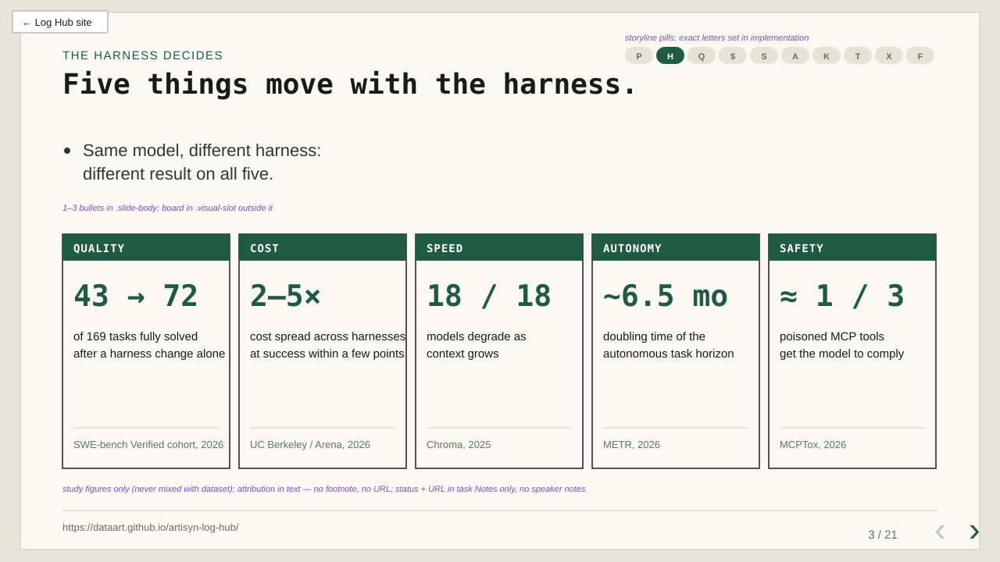
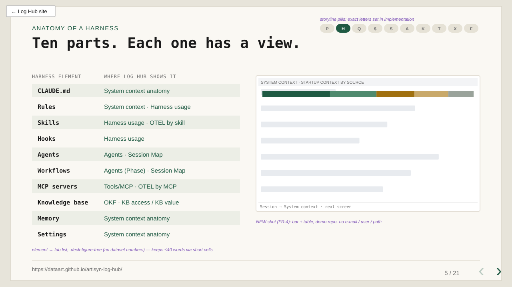
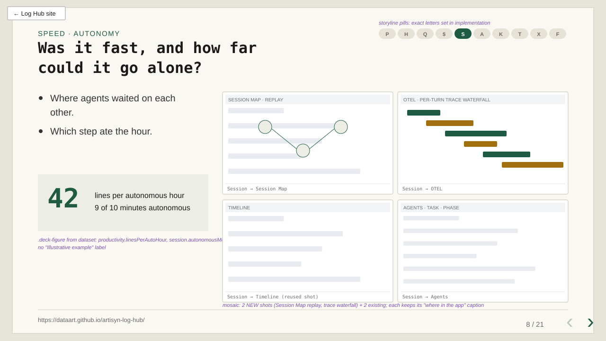
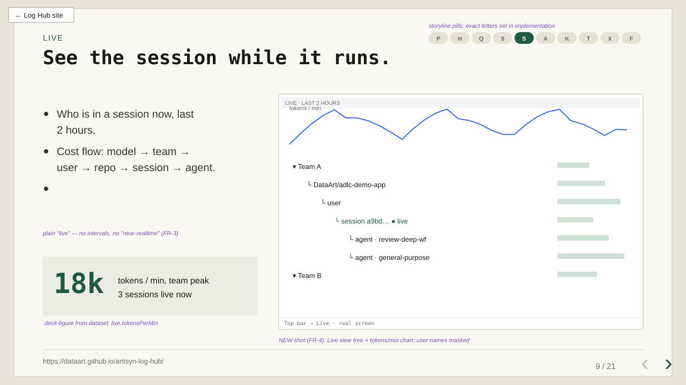
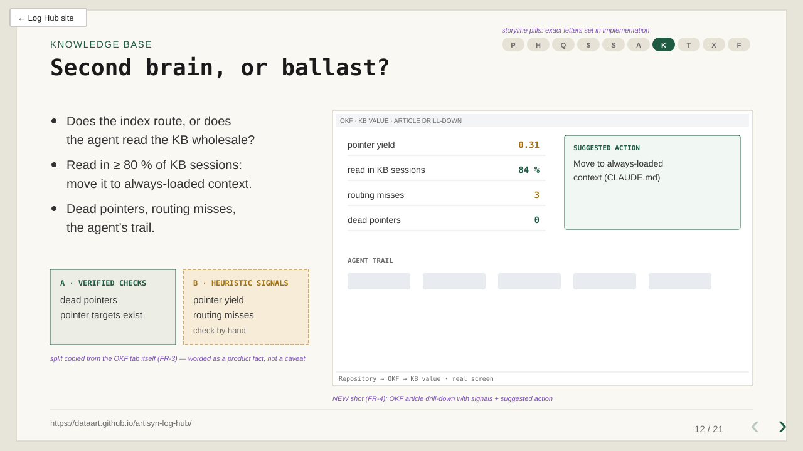
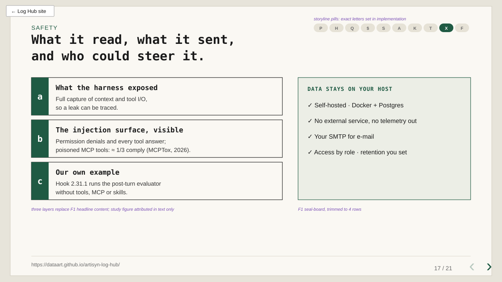
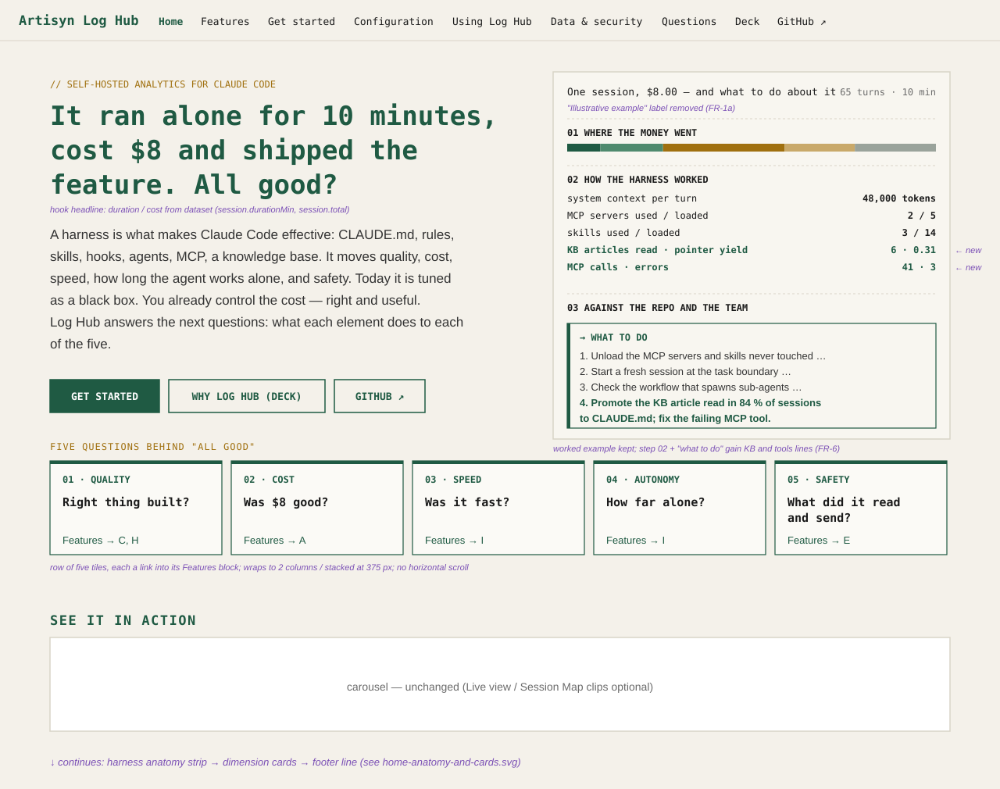
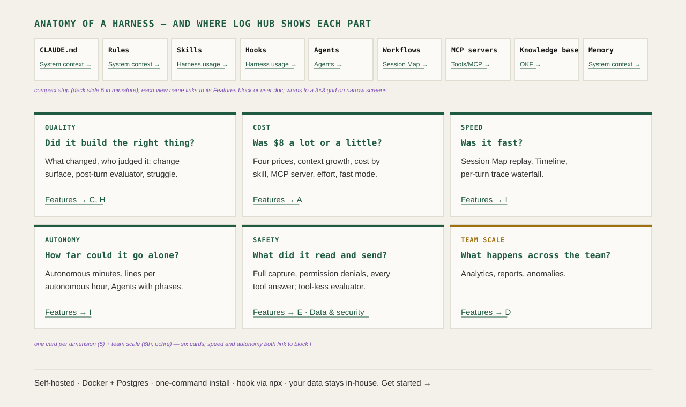
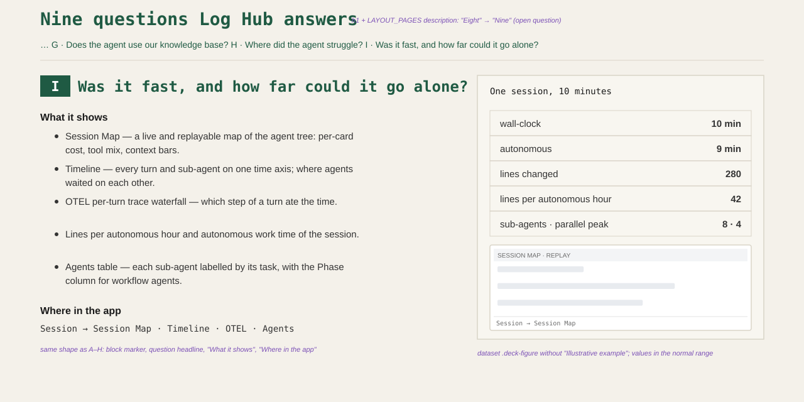

# 2026-11-06: Deck v2 — Your Harness, Measured

**Status:** todo
**Priority:** medium
**Type:** feature
**Module(s):** site (`site/deck/`, `site/pages/home.html`, `site/pages/features.html`, `scripts/site/build-site.mjs` Home description, `site/data/example-dataset.json`, `site/assets/shots/`), tests (`@S-SITE-01` Home and deck steps)
**Owner:** denis.tsyplakov
**Created:** 2026-11-06
**Tracker:** GH-112 https://github.com/DataArt/artisyn-log-hub/issues/112

## Description

Raw idea (the brief distilled in the session, verbatim):

> Deck v2 "Your harness, measured": rework the "Why Log Hub" deck (site/deck/) around the harness
> thesis — without a harness Claude Code gives random results; the harness moves five dimensions
> (quality, cost, speed, autonomous-work time, safety/security); today it is tuned as a black box;
> Log Hub shows what each harness element (CLAUDE.md, rules, skills, hooks, agents, workflows, MCP,
> knowledge base, memory) does to each dimension. Add the features released 2026-10-27..2026-11-06
> that the deck does not cover: OKF KB-value tabs (verified checks vs heuristic signals), System
> context anatomy, OTEL cost by skill/MCP/effort/fast mode and trace waterfall, Session Map (live +
> replay), OTEL Live view (near-realtime, polling intervals stated honestly), Home / All views
> navigation, tool-less post-turn evaluator (hook 2.31.1) as a security example. Audience:
> sceptical senior people in NYC — every claim must be verifiable; prefer independent sources
> (UC Berkeley/Arena HarnessTax, Shandong Univ. harness cost study, PointFive prompt-induced
> waste, "Same Model, Different Harness", Chroma context rot, METR time horizons, MCPTox /
> Log-To-Leak / CSA agentjacking prompt-injection measurements, practitioner MCP-overhead
> write-ups) over Anthropic's own posts (owner: Anthropic's opinion is the least interesting, cite
> only as "even the vendor admits"). No links on the slides themselves; numbered footnotes pointing
> to a hidden Sources appendix slide plus the same links in speaker notes. Keep the site scenario
> constraints (one headline, ≤3 bullets, ≤40 words, every dataset block is a .deck-figure labelled
> "Illustrative example"); never present unshipped work (antipattern detector, budgets/alerts,
> read-only demo user) as shipped; new real screenshots from the demo repository on local prod
> (Live view, Session Map, System context anatomy, OKF article drill-down, OTEL by skill/MCP,
> trace waterfall) with no e-mail / user name / local path.

Superseded by later owner decisions (FR-1a, FR-2, FR-3): no footnotes, no Sources slide, no
speaker notes, no "Illustrative example" label, no "near-realtime" or polling intervals.

Owner's words from the session (translated from Russian): the deck at
`https://dataart.github.io/artisyn-log-hub/deck/` says nothing about realtime, nothing about the
knowledge-base optimisation (the OKF tabs) and probably misses more of the last ten days. The core
idea to rebuild around: **a harness is what makes Claude Code effective; without one its results
are more or less random.** The harness moves quality of the result, cost, speed, how long the agent
works autonomously, and safety in every sense. Log Hub lets you stop debugging the harness as a
black box and look inside to see exactly how each element works. Today's ADLC architecture is
"a ton of stuff": skills, hooks, tools, a knowledge base ("second brain") and more. The audience is
smart, sceptical people in NYC: everything must be checked and, where possible, backed by
independent sources. Links are not put on the slides, but it must be possible to produce them on
request. Anthropic's own posts are the least interesting source ("they tend to talk nonsense"):
rely on independent authors.

### Current deck (2026-11-06) and what it misses

Thirteen slides: Title → P (the "$8 session" thesis) → A ×3 (cost breakdown, context growth,
chart mosaic) → B ×2 (harness tax, harness usage) → C (change surface) → D ×3 (team analytics,
mosaic, anomalies) → E ×2 (tool authors, admins) → F ×2 (data flow, data collected) → Closing.
Its thesis is cost-first; the harness is one block of six.

Released since the deck went live and absent from it (dates = changelog entries):

| Date | Release | Deck today |
|---|---|---|
| 10-28, 11-05 | OKF tabs: KB access, then KB value (pointer yield, routing misses, dead pointers, verified checks vs heuristic signals, agent trail, per-repo thresholds) | one sentence in speaker notes |
| 10-29 | System context anatomy tab (startup context by source, drill-down to skills, files, MCP; org-synced skills; git status of files) | absent |
| 10-31, 11-04 | OTEL tabs: cost over time, per-turn trace waterfall, cost by skill / MCP server / effort / fast mode, plan mix, "from OTEL" sub-agent cost | absent |
| 11-03 | Session Map tab: live and replayable map of the agent tree with per-card cost, tool mix, context bars | absent |
| 11-05 | OTEL Live view: "Live" top-bar item, tokens/min mini chart, 2-hour tree of teams → repos → users → sessions → agents, cost flow, share page | absent |
| 11-02 | Navigation overhaul: Home page, All views map (Ctrl/Cmd+K), lenses, "Start from a question" | absent |
| 11-04 | Sub-agents labelled by their task description, Phase column for workflow agents | indirectly |
| 11-06 | Hook 2.31.1: post-turn evaluator (`claude -p`) runs without tools, MCP or skills so the analysed session cannot act on it | absent |
| 11-01 | Session list / analytics timeline on large transcripts: 13–29 s → under 1 s on a real instance | absent |

Not shipped, not in the deck or on the site: session antipattern detector
(`2026-11-02-session-antipatterns`), read-only demo user (`2026-11-05-readonly-demo-user`),
budgets and threshold alerts (`2026-11-05-budgets-threshold-alerts`).

## Functional Requirements

### FR-1 New storyline

Replace the cost-first storyline with the harness-first one. Owner (2026-11-06): the slide count
is extended rather than squeezed — pictures matter ("visual people must get their pictures"), so
every existing chart mosaic survives as a mosaic and the new tabs get real screens. Target about
20–22 slides (scenario bound: FR-7). Existing slides are reused where marked; new ones are marked
*(new)*.

**The hook (owner, 2026-11-06).** The "$8" figure stays — the reader must get a number — but it
need not be the first slide; what must come first is the hook: *it ran on its own for ten
minutes, cost $8 and, it seems, coded the feature. But is everything really fine?* That question
is then answered along the storyline, one dimension at a time: was the feature really done right
(quality), was $8 good (cost), was it fast (speed), how far could it have gone alone (autonomy),
what did it read and send on the way (safety). The duration, the amount and the "feature done"
come from the dataset (FR-5); "10 minutes" is the example.

**Order of the five dimensions:** quality, cost, speed, autonomous-work time, safety — the order
the independent write-ups use (success rate first, then cost, then calls/latency, then horizon,
then risk), and the owner's own order.

| # | Slide | Content | Visual |
|---|---|---|---|
| 1 | Title | Subtitle "Your harness, measured" with the second line "what each skill, hook, MCP server and KB article does to quality, cost, speed, autonomy and safety". | as today |
| 2 | P1 · The hook *(new, absorbs the old thesis slide)* | "It ran alone for {{ds:session.durationMin}} minutes, cost {{ds:session.total}} and shipped the feature. All good?" Below: the five questions behind "all good", one per dimension (did it build the right thing; was $8 a lot; was it fast; how far could it go alone; what did it read and send). Keeps the old slide's "you already control the monthly / daily / session cost — right and useful" column as the ✓ part, and "the number does not say" as the problem. | hook headline + five question tiles, dataset figures |
| 3 | P2 · The harness decides *(new)* | The five dimensions and one independent finding per dimension, attributed in text (institution, year), no footnote: quality — a harness-only change lifted fully solved tasks from 43 to 72 of 169 ("Same Model, Different Harness", 2026); cost — up to 5× per task at similar success (UC Berkeley / Arena, 2026); speed — 20× the fixed context before the first action (Liu and Han, 2026); autonomy — all 18 tested models degrade as input grows (Chroma, 2025); safety — poisoned MCP tool descriptions succeed in 36.5 % of attacks (MCPTox, 2025). Figures as verified in `## Notes`. | board of five tiles |
| 4 | P3 · Black box vs glass box *(new)* | How a harness is tuned today: edit CLAUDE.md, run, "feels better". Even the vendor's own advice is to read the traces and remove one component at a time ("even the vendor admits", in text). Log Hub is those traces, split by harness element. | two-column contrast |
| 5 | Anatomy of an ADLC harness *(new)* | CLAUDE.md, rules, skills, hooks, agents, workflows, MCP servers, knowledge base, memory, settings. For each: which Log Hub tab shows it (System context anatomy, Harness usage, Tools/MCP, OKF, Agents, Session Map, OTEL). | new shot: System context anatomy |
| 6 | Cost · four prices plus sub-agents | Existing A1. | as today |
| 7 | Cost · context, not output | Existing A2. Add a key figure from OTEL cost attribution: cost by skill / MCP server / effort / fast mode. New dataset keys. | existing pair of shots |
| 7b | One session from every side | Existing A mosaic kept as is (Agent Tree, Timeline, Tool Heatmap, Call Tree) — owner: pictures matter. | as today |
| 8 | Speed and autonomy *(new)* | Session Map replay, per-turn trace waterfall, lines per autonomous hour, autonomous minutes of the hook session. Questions: where did agents wait on each other, which step ate the hour. | new mosaic: Session Map, trace waterfall, Timeline (reused), Agents table |
| 9 | Live *(new)* | Live view: who is in a session now, tokens per minute, last 2 hours, cost flow model → team → user → repo → session → agent. | new shot: Live view |
| 10 | Harness tax | Existing B1; replace the Context Usage shot with System context anatomy (or keep both if space). | shot swap |
| 11 | What the agent really uses | Existing B2 (Harness usage + Tools/MCP). | as today |
| 12 | Knowledge base: second brain or ballast *(new)* | OKF tabs: does the index route or does the agent read the KB wholesale; an article read in ≥ 80 % of KB sessions belongs in always-loaded context; dead pointers; routing misses; agent trail. The slide keeps the tab's own split "A · verified checks" vs "B · heuristic signals, check by hand". | new shot: OKF article drill-down |
| 13 | Quality: what changed and who judged it | Existing C plus an evaluator line: cost advisor and session attributes as an independent post-turn review. Closes the hook's first question ("did it build the right thing?"). Self-grading bias attributed in text if a non-vendor source is found; otherwise "even the vendor admits" only. | as today |
| 14–15 | Team: analytics, reports, anomalies | Existing D1, D2 (mosaic) and D3 compressed to two slides. | as today |
| 16 | Tools: author and admin | Existing E1 and E2 merged into one slide, both visuals kept (the tool table tile and the Tools/MCP shot). Market context in text: vendors themselves say token observability is solved and MCP tool observability is not. | tool table + tools-mcp shot |
| 17 | Safety *(new, replaces F1)* | Three layers: (a) what the harness exposed to the model and to tools — full capture is a design decision so leaks can be analysed; (b) permission denials and every tool answer readable, i.e. the prompt-injection surface is visible, with one measured injection rate attributed in text (MCPTox or Log-To-Leak, 2026); (c) own example: hook 2.31.1 runs the post-turn evaluator without tools, MCP or skills so the analysed session cannot steer it. Plus the F1 "data stays on your host" board, trimmed. | seal-board as today |
| 18 | Collected · visible to · kept for | Existing F2 unchanged. | as today |
| 19 | Closing | Existing, links unchanged. The hook's answer in one line: "$8 and ten minutes were fine — now you know why." (final wording in implementation). | as today |

The storyline pills grow from P A B C D E F to the new blocks (hook / harness /
anatomy, then the dimensions); exact letters in implementation.

### FR-1a Voice: a deck for sharp outside experts

Owner (2026-11-06): the deck speaks in plain declarative statements, like any product deck written
for senior, sceptical outside experts.

- No self-commentary on any slide or on Home: no remarks about the deck itself, its author, the
  owner or how a claim was obtained ("as the owner states", "we believe", "to be fair",
  "admittedly", "honestly", "note that", "according to our data").
- No hedging around figures. Dataset figures ($8, ten minutes, tokens, lines, team totals) are an
  ordinary worked example in the normal range for such sessions; they are stated plainly, with no
  qualifier, no "illustrative", "fictional", "hypothetical" or "example values" wording and no
  "Illustrative example" label — on the deck, on Home and on Features (the existing labels are
  removed).
- Study figures carry only the in-text attribution of FR-2 (institution or group, year). Source
  status (preprint, vendor blog, practitioner write-up, single run) and the "anecdotal" /
  "market opinion" labels of the FR-2 source table never appear in the deck or on the site.
- No speaker notes: the deck has no `<aside class="notes">`; the existing ones are removed.
- The OKF verified/heuristic split (FR-3) is a product feature and stays; it is worded as a fact,
  not as a caveat.

### FR-2 Evidence rules

- No footnotes, no Sources slide, no source URLs anywhere the audience sees (owner: "whoever
  needs them can find them"). A figure from a study is attributed **in the sentence itself** — institution or group and
  year ("UC Berkeley / Arena, 2026") — so a sceptical listener can find it. Nothing more on the
  slide.
- The source list (title, institution, date, URL, status of each quoted figure) lives in this
  task's `## Notes` (AC-5) and in `docs/knowledgebase/user-docs-and-site.md`; nowhere in the deck
  or on the site.
- Independent sources first. An Anthropic statement is used only framed as the vendor's own advice
  or admission ("even the vendor admits"); in that framing it may stand alone (slides 4 and 13).
- Status per source: peer-reviewed, preprint (arXiv id and version), vendor blog, practitioner
  write-up, single run. Secondary write-ups (VentureBeat etc.) are not cited where the primary is
  reachable; numbers are checked against the primary before the deck ships.
- Figures from studies are never mixed with Log Hub's dataset figures on one tile.

Candidate sources collected on 2026-11-06 (verify against primaries during implementation):

| Claim | Source | Status / caveat |
|---|---|---|
| Harness choice changes success rate by only a few points but cost by 2–5×; Claude Code ≈ 2.0× Pi, 1.6× Codex on SWE-bench Lite | HarnessTax, UC Berkeley Sky Computing Lab + Arena, 2026-09-16, harnesstax.github.io, Arena.ai blog | multipliers differ across secondary write-ups; take from the paper |
| Cost per task up to 3× across harnesses at accuracy within 2 pp; first-call fixed context 16 581 tokens (Claude Code) vs 7 025 (OpenCode) vs 829 (mini-SWE-agent) | Shandong University, arXiv 2610.04433 (via VentureBeat 2026-10-23) | preprint; read the paper |
| Cost per success 5–30× between harnesses; fixed prefix 16–20 k tokens vs 1.1–1.6 k; 10–41 turns vs 5–7 | PointFive, arXiv 2608.01347 v6 | preprint, small tasks (≤ 4 files) |
| Neutral harness costs 1.2–1.6× per solved task, accuracy within ±1.25 pp | arXiv 2609.11987 | single author, corrected revision |
| Changing only how old tool results are handled: fail-to-pass 28 % → 49 %, complete solutions 43 → 72 of 169 SWE-bench Verified tasks | "Same Model, Different Harness", arXiv 2608.26218 | preprint |
| Predefined tool set lifts a weaker model +15 %, a stronger one +1.6 % | "An Empirical Study of Harness Design for Coding Agents", arXiv 2609.20804 | preprint |
| Further harness studies to screen | "The Scaffold Effect", arXiv 2607.22585; Harness-Bench, arXiv 2605.27922; Claw-SWE-Bench, arXiv 2606.12344 | not yet read |
| All 18 tested models degrade as input grows; degradation already at ~113 k tokens | Chroma, "Context Rot" | industry research report |
| 50 %-success task horizon doubles every ~6.5 months (196 days, Time Horizon 1.1, Jan 2026) | METR | secondary summaries; take from METR's page |
| Poisoned MCP tool descriptions: 36.5 % average attack success across 20 models | MCPTox benchmark | check primary |
| MCP injection 62–100 % ASR across 18 model–server pairs | Log-To-Leak, arXiv 2610.36108 | preprint |
| 85 % exploitation across Claude Code, Cursor, Codex CLI via a Sentry MCP injection | Cloud Security Alliance research note, June 2026 | vendor-disclosed case |
| 314 payloads vs Cursor / Copilot with auto-approve: up to 84 % success | empirical coding-editor study | find primary |
| MCP definitions 66 k tokens before the first message; 12 servers 63 k vs 5.8 k with tool search; CLAUDE.md grown to 4 800 tokens | practitioner write-ups ("Most of your Claude Code tokens are overhead", Firecrawl, itechify) | blogs, older Claude Code builds; label as anecdotal |
| "Token observability is solved, MCP tool observability isn't" | MintMCP and other vendor blogs | marketing; cite as market opinion |
| Even the vendor: "agents reliably skew positive when grading their own work"; "read its traces… remove one component at a time"; solo run $9 / 20 min vs $200 / 6 h with the full harness | Anthropic, Harness design for long-running apps, 2026-03-24 | vendor; "even the vendor admits" only |

### FR-3 Honesty constraints

- The Live view is called "live" / "realtime" plainly (every chart has some delay, and an LLM turn
  takes up to a minute); no "near-realtime" and no polling intervals on slides or on Home.
- The OKF slide shows the tab's verified/heuristic split.
- Unshipped work (antipattern detector, read-only demo user, budgets and alerts) does not appear.

### FR-4 Screenshots

New real screens of the demo repository on local prod, cropped to the content pane, English UI,
no e-mail, user name or local path, saved under `site/assets/shots/`: Live view (tree + tokens/min
chart), Session Map (replay state), System context anatomy (bar + table), OKF article drill-down
(signals + suggested action), OTEL repository tab stacked by skill or MCP server, OTEL session
trace waterfall. Existing shots stay where reused. Each `<figure class="shot">` keeps the "where in
the app" caption.

### FR-5 Dataset

New keys in `site/data/example-dataset.json` for every new tile: `session.durationMin`,
`session.autonomousMin`, `session.linesChanged`, KB keys (articles read, pointer yield, share of
org-synced startup context), tool keys (MCP calls, errors), cost-share keys (by skill / MCP server
/ effort / fast mode, summing to 100 %), `live.tokensPerMin`. Values stay in the normal range for
such sessions and teams; no new cross-checks are added to `checkDataset` for the hook figures
(owner: $8 and ten minutes need no verification). Existing `checkDataset` rules stay. Every
placeholder states its format (`{{ds:session.total|usd0}}`). Dataset blocks stay `.deck-figure`
elements but carry no "Illustrative example" label (FR-1a).

### FR-6 Home page: the same, wider claim

The site's Home page widens its claim to the harness thesis, the same as the deck's. Today the Home hero is the cost thesis ("This session cost $8. Is that
good?", "You already control…", "Log Hub answers the next questions"), then the worked example
"One session, $8 — and what to do about it" (01 where the money went, 02 how the harness worked,
03 against the repo and the team, → what to do), the "See it in action" carousel, three question
cards (A; B; C, D, E) and the self-hosted footer line.

- **Hero.** Same hook as the deck's slide 2: headline "It ran alone for
  N minutes, cost $8 and shipped the feature. All good?" — the number stays in the first screen.
  Under it the five dimensions as a row of five tiles, each phrased as the question behind "all
  good" (right thing built? $8 good? fast? how far alone? what did it read and send?) and linking
  to the Features section that answers it. The lead paragraph carries the harness claim: a harness
  is what makes Claude Code effective; it moves these five things; today it is tuned as a black
  box; Log Hub shows what each element does. "You already control the cost — right and useful"
  and "Log Hub answers the next questions" stay in the lead.
- **Harness anatomy strip.** One compact block (the deck's slide 5 in miniature): CLAUDE.md,
  rules, skills, hooks, agents, workflows, MCP servers, knowledge base, memory — each with the Log
  Hub view that shows it, linking to the matching Features block or user doc.
- **Worked example** kept; step 02 "How the harness worked" gains a line for the knowledge base
  (articles read / value signal) and for tools (MCP calls, errors) from the dataset, and "→ What
  to do" gains the matching action. New dataset keys follow FR-5.
- **Cards.** The three question cards become six: one per dimension, each with its question, one
  line of what Log Hub shows and a link into Features (quality → C, H; cost → A; speed → I;
  autonomy → I; safety → E and the Data & security docs), plus team scale → D.
- **Features block I · "Was it fast, and how far could it go alone?"** A new section on `features.html` after H, same shape as A–H (block marker, question
  headline, what it shows, where in the app): Session Map (live and replay), Timeline, OTEL
  per-turn trace waterfall, lines per autonomous hour, autonomous work time, Agents table with
  phases. `@S-SITE-01` step 4 ("eight blocks A–H") is extended to A–I.
- **Facts in text.** Quoted independent figures follow FR-2 and FR-1a.
- **Meta.** The Home description in `scripts/site/build-site.mjs` (`LAYOUT_PAGES`, 50–160
  characters, unique) and the deck's `<meta name="description">` / `og:*` tags updated together
  with the new claim; the Features description in `LAYOUT_PAGES` and the `features.html` `<h1>`
  change from "Eight questions" to "Nine questions"; the README pitch line is aligned if it repeats
  the old thesis.
- **Carousel.** `site/assets/demo/` is the committed output of the manual `npm run record:demo`;
  adding Live view / Session Map clips to it is optional and done only if the recorder covers them
  without new tooling.
- **Scenario.** `@S-SITE-01` step 3 ("Home: the thesis, three questions and links…") is extended
  to the new structure: hook headline with the dataset figures, five dimension tiles, the card
  count, the anatomy strip, and the unchanged links to the deck, Features and Get started; step 4
  checks blocks A–I.
- `user-docs/` unchanged. `docs/knowledgebase/user-docs-and-site.md`: Home, Features and deck
  sections updated (structure, slide list, in-text attribution convention and where the URLs live,
  new shots table rows, new dataset keys).

### FR-7 Scenario constraints kept

`@S-SITE-01` steps 9–11 keep their checks: every slide fits 1280×720 and the 480×900 narrow
layout, content slides have one headline, ≤ 3 bullets and ≤ 40 words of body text. Step 11's
"every figure block carries Illustrative example" check is inverted: no slide, Home or Features
block contains "Illustrative example" (FR-1a). Step 9's slide-count bound is raised from 10–20 to cover the
new deck (e.g. 10–24; the exact bound in implementation). Slide 2 keeps the `section.thesis-slide`
structure (outside the content-slide checks). Slide 3 is a `.content-slide` with 1–3 bullets in
`.slide-body` and the five study tiles in a `.visual-slot` outside `.slide-body`, without the
`deck-figure` class; Home hero tiles that quote a study get no `.figure-block`. Text in a
`.visual-slot` or `.deck-figure` is not body text and does not count toward the 40 words, as step
10 already counts.

## Non-Functional Requirements

- Offline-first unchanged: the only external assets remain reveal.js (pinned, SRI); no new CDN
  assets, fonts or runtime fetches; no source URLs on the site.
- PDF export (`?print-pdf`) renders the new slides at 1280×720.
- Dark and light palettes for every new tile (hook tiles, board of five, anatomy strip).

## Acceptance Criteria

- [ ] AC-1 (FR-1) The deck opens with the hook (minutes, $8, "feature shipped — all good?", five questions), then "the harness decides" and "black box vs glass box"; the existing A and D mosaics and both E visuals are kept; about 20–22 slides, no Sources slide, no footnote marks, no source or study URL, no speaker notes (the site-URL footer and the Closing slide links stay).
- [ ] AC-1a (FR-1, FR-5) The hook's duration, cost and "feature shipped" come from the dataset; the Closing slide answers the hook in one line.
- [ ] AC-1b (FR-1a) No slide, Home text or Features block contains self-commentary or hedging (owner/author remarks, "illustrative", "fictional", "anecdotal", "preprint" and the like).
- [ ] AC-2 (FR-1) Each of these shipped features has its own slide or tile with a real screenshot: OKF KB value, System context anatomy, OTEL cost attribution (skill / MCP / effort / fast mode), trace waterfall, Session Map, Live view; hook 2.31.1 tool-less evaluator is on the safety slide.
- [ ] AC-3 (FR-2) Every non-dataset number on a slide or on Home is attributed in its own sentence (institution or group, year); `## Notes` and the KB article list title, institution, date, URL and status for each such figure; no source URL, footnote or Sources list is visible on any slide or on Home.
- [ ] AC-4 (FR-2) Every Anthropic statement on a slide is framed as the vendor's own advice or admission ("even the vendor admits" or equivalent).
- [ ] AC-5 (FR-2) Each cited figure was checked against its primary source during implementation; the check is recorded in `## Notes` (source, figure, where found).
- [ ] AC-6 (FR-3) No "near-realtime" and no polling intervals on slides or on Home; the OKF slide shows the verified/heuristic split; antipatterns, the demo user and budgets/alerts are not mentioned.
- [ ] AC-7 (FR-4) New shots exist, show English UI only, contain no e-mail, user name or local path, and are listed in the KB shots table.
- [ ] AC-8 (FR-5, FR-7) `npm run build:site` passes; `@S-SITE-01` passes in mode A including steps 9–11 with the raised slide-count bound and the inverted step-11 check (no "Illustrative example" anywhere on the site).
- [ ] AC-9 (FR-6) Home hero leads with the hook (minutes, $8, feature, "all good?") and a row of five dimension-question tiles, carries the harness claim in the lead, keeps the worked example, shows the harness anatomy strip and six cards (five dimensions plus team scale) with working links into Features; Features reads "Nine questions"; every quoted figure is attributed in text; Home description, deck meta tags, README pitch and the KB article are updated consistently; `generate-help.js --check` passes.
- [ ] AC-9a (FR-6) `@S-SITE-01` step 3 is extended to the new Home structure and passes; the page renders at 375 px without horizontal scroll and in both colour schemes (Playwright screenshots in `tmp/`).
- [ ] AC-9b (FR-6) `features.html` has block I "Was it fast, and how far could it go alone?" in the A–H shape (marker, question headline, what it shows, where in the app) with Session Map, Timeline, trace waterfall, lines per autonomous hour and the Agents table; `@S-SITE-01` step 4 checks A–I and passes; the Home speed/autonomy card links to it.
- [ ] AC-10 (NFR) PDF export and both colour schemes checked visually for the new slides (Playwright screenshots in `tmp/`).

## Open Questions

## Common sense considerations

- Budgets and alerts are out of the deck and the site (owner).
- Placement of the remaining shipped features: All views (Ctrl/Cmd+K) and "Start from a question" → one line on slide 5; sub-agent task labels and the Phase column → the Agents table on slide 8; OTEL cost over time, plan mix and "from OTEL" sub-agent cost → slide 7 with the cost-attribution figure; the session-list speed-up stays out of the deck.
- FR-5 lists every new dataset key; no new `checkDataset` cross-checks for the hook figures.
- Every dataset placeholder states its format (`|usd0` etc.).
- Slide 2 stays a `section.thesis-slide`; slide 3 is a `.content-slide` with the study tiles in a `.visual-slot` outside `.slide-body` (FR-7).
- Text in `.visual-slot` / `.deck-figure` does not count toward the 40-word body rule.
- The site-URL footer and the Closing slide links stay; the "no URL" rule covers source URLs only.
- Features heading and description change to "Nine questions"; `site/pages/features.html` added to Module(s).
- An Anthropic statement may stand alone when framed as the vendor's own advice or admission (FR-2, AC-4).
- Home has six cards: five dimensions plus team scale; speed and autonomy both link to block I.
- Source URLs live in this task's `## Notes` and the KB article only; no speaker notes in the deck.
- Live view is called "live" / "realtime" with no intervals (owner).

## Notes

<!-- Append timestamped notes here as work progresses -->

Requirements change log (owner decisions of 2026-11-06): see `notes.md`.

### 2026-11-06 — implementation: source checks (AC-3, AC-5)

Each study figure on a slide or on Home was checked against its primary source on 2026-11-06. The
same list is in `docs/knowledgebase/user-docs-and-site.md` → "Study figures and sources".

| Figure as used (where) | Title · institution | Date · status | URL | Result · where found |
|---|---|---|---|---|
| "up to 5×" cost per task, same model, similar success (deck 3; Home lead) | HarnessTax: How Much Does the Harness Matter for Coding Agents? · UC Berkeley Sky Computing Lab + Arena | 2026-09 (refs 2026-09-16) · research blog | https://harnesstax.github.io/ (also https://arena.ai/blog/coding-agents-harness-tax/) | CORRECTED from "2–5×": the page says "similar success rates at up to 5x costs"; typical gap 1.5–2.0× (Claude Code ≈ 2.0× Pi, 1.6× Codex on SWE-bench Lite, geometric mean); success within ±2 pts (SWE-bench Lite) / ±5 pts (Terminal-Bench 2.0) |
| 43 → 72 of 169 tasks fully solved after a harness-only change (deck 3) | Same Model, Different Harness: Different Coding-Agent Results · S. Lewis | 2026-08-26 · preprint arXiv 2608.26218 v1 | https://arxiv.org/abs/2608.26218 | CONFIRMED (abstract, Table 2; n = 169 in Table 7). Wording changed: the treatment is a bundle (old tool results, stall detection, command guards), so the slide says "harness-only change", not "only how old tool results are handled" |
| 18 models; performance degrades as input grows (deck 3) | Context Rot: How Increasing Input Tokens Impacts LLM Performance · Chroma | 2025-07-14 · industry research report | https://www.trychroma.com/research/context-rot | CONFIRMED: "model performance consistently degrades with increasing input length"; 18 models. Year 2025, not 2026 |
| ~7 months doubling of the 50 % task horizon (not used since the final review: model progress, not a harness effect) | Measuring AI Ability to Complete Long Tasks · METR | 2025-03 · preprint arXiv 2503.14499 | https://arxiv.org/abs/2503.14499 | CONFIRMED: "doubling time of approximately seven months". The candidate "~6.5 months" (METR Time Horizon 1.1, 2026-01-29, 196.5 days) was not used because its rounding could not be confirmed verbatim |
| 36.5 % average success of poisoned MCP tool descriptions, 20 agent settings (deck 3) | MCPTox: A Benchmark for Tool Poisoning Attack on Real-World MCP Servers | 2025-08-19 · peer-reviewed (AAAI-26), arXiv 2508.14925 | https://arxiv.org/abs/2508.14925 | CONFIRMED (§4.2 "average ASR … 36.5%", §4.1 "20 distinct model settings"). "About a third" replaced by the exact 36.5 % |
| 62–100 % MCP prompt-injection success, 18 model–server pairs (deck 19) | Log-To-Leak: Prompt Injection Attacks on Tool-Using LLM Agents via the Model Context Protocol | 2026-10-26 · preprint arXiv 2610.36108 v1 | https://arxiv.org/abs/2610.36108 | CONFIRMED (abstract: 62.64–100 %) |
| LLM judges favour their own output (deck 15) | LLM Evaluators Recognize and Favor Their Own Generations · Panickssery, Bowman, Feng | NeurIPS 2024 · peer-reviewed (arXiv 2404.13076) | https://arxiv.org/abs/2404.13076 | CONFIRMED (self-preference correlates with self-recognition) |
| Vendor advice: read the traces, remove one component at a time (deck 4, framed "even the vendor advises") | Harness design for long-running application development · Anthropic | 2026-03-24 · vendor blog | https://www.anthropic.com/engineering/harness-design-long-running-apps | CONFIRMED as verbatim fragments ("read its traces…", "removing one component at a time") |
| 16,581 vs 829 tokens of first-call fixed context (deck 3, Speed tile, since the final review) | What Does a Harness Buy? Tokens, Mostly · Liu, Han (Shandong affiliation not shown) | 2026-10-03 · preprint arXiv 2610.04433 | https://arxiv.org/abs/2610.04433 | 3× cost and 16,581 / 7,025 / 829 tokens confirmed; "accuracy within 2 pp" is wrong (paper: within 5 pts) — dropped from the deck |

Not used: PointFive, arXiv 2609.11987, 2609.20804, the screening list, CSA, the 314-payload study,
the practitioner MCP-overhead write-ups and MintMCP (the tools slide says "token dashboards are
common; per-call tool visibility is not" without a figure).

### 2026-11-06 — implementation: what was built

- Deck: 21 slides (list in the KB article); speaker notes, the notes plugin, footnote marks and the
  "Illustrative example" labels removed.
- Screenshots: six new subjects from local prod (system context anatomy, OTEL cost by skill,
  Session Map replay, trace waterfall, Live view, OKF KB value A/B). The demo repository has no
  OTEL traces, no KB and no live activity, so the trace waterfall, OTEL cost by skill, OKF and Live
  shots come from the Log Hub repository; on the Live shot the user e-mail and team name were
  replaced in the DOM ("Developer A", "Team A"). No OKF single-article drill-down and no Agents
  table (Phase column) shot: the repository OKF view (verified vs heuristic) and
  `lines-per-hour.png` are used instead.
- `checkDataset` unchanged; no algorithm rows added.

### 2026-11-06 — final review pass

- Slide 3 tiles: Chroma moved from Speed to Autonomy (a long solo run is a growing input; the
  finding is about accuracy, not speed); METR left the deck (it measures model progress, not a
  harness effect); Speed now carries Liu and Han, 2026 (arXiv 2610.04433, confirmed above):
  16,581 vs 829 tokens of first-call fixed context, Claude Code vs mini-SWE-agent. The source
  table in the KB article is updated.
- Screenshot captions are only "where in the app": the " · real screen, demo repository" suffix
  implied the rest was not real and was wrong for the four Log Hub repository shots.
- American spelling on the site pages and the deck (audience in New York); `docs/` and
  `user-docs/` unchanged.
- Dataset: `session.autonomousMin` 9 → 10 and `productivity.linesPerAutoHour` 1867 → 1680, so the
  hook's "ran alone for 10 minutes" agrees with the speed slide and Features I.
- Live cost flow reworded: the app drills from the model down level by level (Home: model → team
  → user → session; a session: model → agent); it is not one six-column flow.
