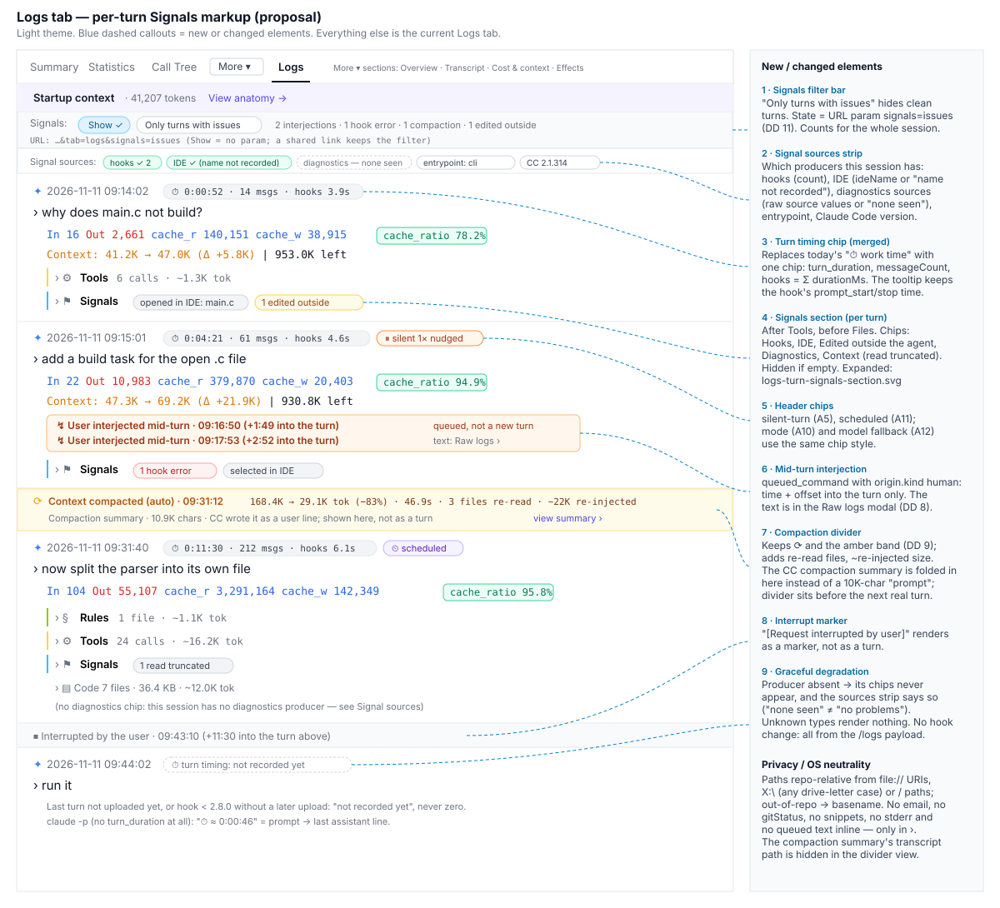
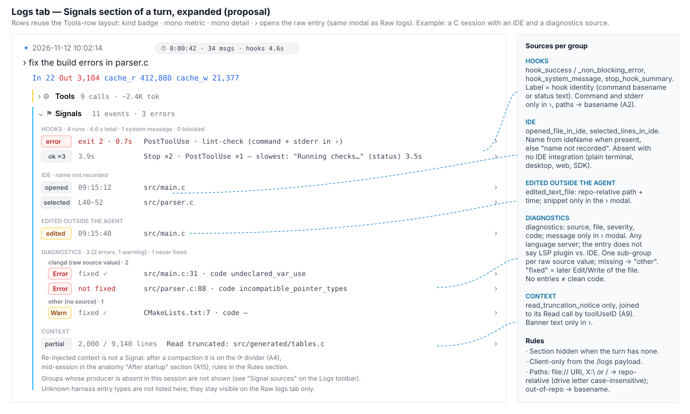

# 2026-11-10: Harness-Injected Transcript Entries — Where to Show Them, and a Logs Tab Review

**Status:** todo
**Priority:** medium
**Type:** feature
**Module(s):** client
**Owner:** denis.tsyplakov
**Created:** 2026-11-10
**Tracker:** GH-124 https://github.com/DataArt/artisyn-log-hub/issues/124

## Description

Raw idea: besides `diagnostics`, Claude Code transcripts carry ~30 kinds of harness-injected
entries (attachments, `system` entries). Make an analysis: which of them should be shown simply as
extra markup / info on the existing session tabs, and which deserve a new tab, chart or report.
In particular, review the **Logs** tab — it was the first tab built and has barely changed since.

This task is an **analysis**: its deliverable is a research document plus a list of follow-up
tasks, not code.

### Survey already done (2026-11-10, 12 recent sessions of this repo incl. subagent transcripts)

Count = entries, sessions = in how many of the 12, chars = size of what reached the model's
context (`rendered`). Scripts: `tmp/attach-scan.js`, `tmp/diag-scan.js`, `tmp/snapshot-scan.js`
(throwaway, not committed).

| Entry | Count / sessions | Chars in context | Payload (what can be extracted) | Read by Log Hub today |
|---|---|---|---|---|
| `skill_listing` | 30 / 12 | ~800 K | skill list; re-injected after compaction (~27 K chars each) | anatomy tab (startup only) |
| `instructions` | 27 / 12 | ~625 K | CLAUDE.md / rules files with content | parser (`claudeMd`), anatomy |
| `deferred_tools_delta` | 44 / 12 | ~165 K | deferred / MCP tool names added/removed | anatomy (startup) |
| `agent_listing_delta` | 27 / 12 | ~127 K | subagent types | anatomy (startup) |
| `invoked_skills` | 1 / 1 | ~75 K | full bodies of invoked skills | raw logs only |
| `mcp_instructions_delta` | 30 / 11 | ~64 K | MCP server instructions | anatomy (startup) |
| `environment` | 78 / 12 | ~58 K | cwd, worktree, git flags, changes | anatomy (startup) |
| `session_context` | 31 / 12 | ~56 K | userEmail, gitStatus (sensitive) | anatomy (startup) |
| `nested_memory` | 10 / 5 | ~55 K | rules loaded on demand | parser (per-turn Rules) |
| `diagnostics` | 31 / 10 | ~31 K | language-server problems: `source`, file, severity, code, message — the entry does not say whether an LSP plugin or an IDE integration produced it (in this sample: all `typescript-lsp` plugin) | raw logs (file list only) |
| `prompt_snapshot` | 62 / 12 | 0 (not sent) | full system prompt parts + tool definitions (~148 K chars) | anatomy (startup, no tools) — see task `2026-11-10-sysctx-prompt-viewer` |
| `turn_duration` (system) | 88 / 11 | 0 | `durationMs`, `messageCount` per turn | not read |
| `stop_hook_summary` (system) | 91 / 12 | 0 | hook count, infos, errors, added context | not read |
| `hook_success` / `hook_non_blocking_error` | 88 / 12, 1 / 1 | small | hook name, event, exit code, `durationMs`, stderr | raw logs only |
| `silent_turn_reminder` | 39 / 10 | ~6 K | harness nudge: agent silent too long | not read |
| `queued_command` | 9 / 5 | ~4 K | user message sent mid-turn: text, timestamp, origin | raw logs only |
| `edited_text_file` | 14 / 6 | ~8 K | file changed outside the agent (user / IDE / other agent) + snippet | raw logs only |
| `read_truncation_notice` | 3 / 2 | ~2 K | agent saw only part of a file | not read |
| `compact_boundary`, `compact_file_reference`, idle compaction `informational` | few | small | compaction moments, files re-read after it | partly (boundary) |
| `scheduled_task_fire` (system) | 13 / 3 | small | `/loop` / cron firings | not read |
| `budget_usd`, `total_tokens_reminder` | 8 / 1, 6 / 1 | small | session budget / token limit in effect | not read |
| `auto_mode`, `command_permissions`, `model`, `language`, `date` | many | ~30 K | session mode (bypass etc.), permissions, model, language | partly (`model`) |
| `remote_session_change`, `credential_org`, `deferred_tools_record` | many | small | commit/PR attribution text, org id, per-call tool copies | not read — likely no value |
| `task_reminder` | 1015 (KB corpus) | — | harness task-list nudge | not surveyed yet |
| `opened_file_in_ide`, `selected_lines_in_ide` | 125 / 15 (KB corpus) | — | IDE file / selection the user pointed at | not surveyed yet |
| `plan_mode`, `plan_mode_exit` | 1 / 1 (KB corpus) | — | plan-mode enter / exit | not surveyed yet |
| `dynamic_skill`, `file`, `date_change` | 12 / ? / 8 (KB corpus) | — | skill loaded mid-session, attached file, day rollover | not surveyed yet |
| `local_command` (system) | ? | — | local slash-command output | not surveyed yet |

The "Read by Log Hub today" column lists client consumers only; FR-6 extends it to every consumer
(client parser, anatomy, Raw Logs renderer, server extractors `claude-extractor.ts` /
`turn-walk.ts` and the DB table each lands in — e.g. `nested_memory` → `session_harness_usage`
kind=rule, `deferred_tools_delta` → `session_harness_usage.is_initial`, `compact_boundary` read in
`turn-walk.ts`). Rows marked "(KB corpus)" carry counts from
`docs/knowledgebase/log-schema/attachment-types.md`, not from this survey.

Diagnostics signal worth keeping (mostly mid-edit noise otherwise; details in `notes.md`):
broken-then-fixed edits, errors never followed by another edit of that file, recurring config-gap
errors (in this sample `80001`, missing `@types/node` — examples only, see FR-8).

Candidate analytics found so far (to be validated by the analysis, not pre-decided):
context tax by source over the whole session (not just startup), user mid-turn interventions
(`queued_command`), turn timing (`turn_duration`, `silent_turn_reminder`), hook health/overhead
(incl. Log Hub's own hook), concurrent edits (`edited_text_file`), compaction cost, diagnostics
noise vs. signal, session-mode segmentation (`auto_mode`).

## Functional Requirements

- FR-1. For every entry type — every attachment type in
  `docs/knowledgebase/log-schema/attachment-types.md`, every `system` subtype in
  `claude-log-message-types.md`, and every new type the FR-6 re-run finds — the analysis decides
  one of: (a) extra markup / info on an existing tab (name the tab and the place), (b) a new tab,
  chart or report (session- or repo/team-level), (c) not worth showing — with a one-line reason
  each. Grouped table rows are split into one decision line per type; types share a reason only
  if they share the decision.
- FR-2. For each (a) and (b) item: what exactly is shown, which fields are read, whether it needs
  the server (aggregation across sessions, DB) or is client-only from the `/logs` payload (a
  server item names the existing ingest extractor it extends, if any), whether the hook must
  change (and the backward-compatibility impact), the equivalent already recorded in the hook's
  own `artisyn` log (e.g. `turn_duration` ↔ `prompt_start`/`prompt_stop`, `compact_boundary` ↔
  `PreCompact`/`PostCompact`, Log Hub hook health ↔ `hook-status`) and which source it prefers and
  why, its degraded behaviour (FR-7), and privacy: no email, no local absolute paths; no prompt,
  file or command text in new tabs, charts, reports or server-side aggregates; per-turn Logs tab
  markup may show text only if that session's Logs tab (not Raw logs) already shows it; repo/team
  items carry only counts, durations, codes and repo-relative paths.
- FR-3. Logs tab review: walk the current Logs tab (`PromptTurnItem` sections, metrics row,
  `StartupContextLine`, sub-agents, workflows) on real sessions and list (i) which harness entries
  belong there as per-turn markup (candidates: `queued_command` as "user interrupted" markers,
  `turn_duration`, compaction boundaries, `silent_turn_reminder`, hook errors, `edited_text_file`,
  diagnostics count, `read_truncation_notice`, re-injected context), (ii) what is outdated,
  redundant with newer tabs (Session Map, Timeline, Context Growth, Info, Summary, Harness usage,
  System context, Usage) or hard to read today, and (iii) concrete UX improvements, each with a
  wireframe for any non-trivial change. Per-invocation hook records (`hook_success`: hook name,
  event, exit code, duration, stderr) exist in the transcript, so a Harness usage hook follow-up
  can be client-only and must correct the opposite statement in
  `docs/knowledgebase/harness-usage-tab.md`. The Hooks group labels rows by `command` (since
  `hookName` equals the event) and reduces paths in `stderr` to basenames. The per-turn section that groups these entries
  (hook results, edits made outside the agent, diagnostics, context events) is named
  **Signals**; the toolbar reads "Signals: Show · Only turns with issues". Under it a **Signal
  sources** strip lists the producers the session has (hooks, IDE, diagnostics `source` values or
  "none seen", `entrypoint`, Claude Code version), so a missing group reads as "not produced", not
  as "no problems" (FR-8).

  

  
- FR-4. Cross-check against open tasks so nothing is duplicated — at least
  `2026-11-09-session-waiting-breakdown` (turn timing / waiting), `2026-11-02-session-antipatterns`
  (behaviour signals), `2026-11-10-sysctx-prompt-viewer` (prompt snapshot) — and say for each
  finding whether it extends one of them or needs a new task.
- FR-5. Output: a prioritised list of follow-up tasks, each ready to be passed to
  `/adlc-lh:scratch`: title, 2–3 line description, value H/M/L (share of sessions from the FR-6
  numbers + the question it answers), effort S/M/L (client-only / server+DB / hook change), the
  linked FR-1 decision lines and the open task it extends (FR-4).
- FR-6. Survey re-run before priorities are set: ≥ 30 sessions, counted in the transcripts Log Hub
  stored (`/logs` payload or the local-prod DB), not local `~/.claude/projects` files; more than one
  user/repo if local prod has them (otherwise record that and proceed). Output: the table updated
  with the same columns plus the corrected consumer column, saved under `research/`; scan scripts
  kept in `research/` so the numbers are reproducible. Every newly seen type gets a row and an
  FR-1 decision; a type absent from the sample is kept and marked "rare / setup-dependent" with
  its source (e.g. `diagnostics` ← `typescript-lsp` plugin).
  The table is **segmented by source**: every session is tagged with setup facets read from the
  stored transcript itself — `entrypoint` (`cli`, `sdk-cli`, `sdk-ts`, …), Claude Code `version`,
  OS family from the `cwd` shape (`X:\…` vs. `/…`), IDE from `*_in_ide` entries — `ideName` when
  present, "IDE, name not recorded" when only `opened_file_in_ide` (no `ideName`) is seen, "none"
  when no `*_in_ide` entry (`entrypoint` does not tell an IDE terminal from a plain one), the set of diagnostics `source` values (`typescript`, `Java`, …), and
  configured hook names. For each entry type the table gives counts / sessions per facet value,
  not only a total; `diagnostics` gets one sub-row per `source`. A facet value seen in < 3
  sessions is reported as "n < 3", not as a share. The scan script prints the facet matrix
  (sessions per facet value) so the coverage gap of the sample is visible.
- FR-7. Degradation: every (a)/(b) item states what the UI shows when its entry is absent or has an
  unknown shape (older/newer Claude Code, old hook). Items built on Stop-time entries
  (`turn_duration`, `stop_hook_summary`, `hook_success`) state how the last turn looks when the
  entry has not been uploaded yet and their dependency on the SessionEnd flush (hook ≥ 2.8.0).
  `claude -p` sessions carry no `turn_duration` (only `stop_hook_summary`), so turn timing needs a
  fallback there.
- FR-8. Setup neutrality. The initial survey is one user, one repo, one setup (Windows, WebStorm,
  `typescript-lsp` plugin, CLI, this repo's hooks), so it says nothing about other setups. The
  analysis:
  - names, per entry type, what produces it and which setups lack it: IDE integration (none /
    VS Code-family / JetBrains — `opened_file_in_ide`, `selected_lines_in_ide`, `ideName`), LSP
    plugins of any language (`diagnostics`), Claude Code surface (CLI, IDE extension panel,
    desktop, web, SDK / `-p`), OS, configured hooks, `/loop` / cron, plan mode;
  - never labels an entry by the producer we happen to use (no "IDE diagnostics" when the entry
    does not say IDE; show the payload's own `source` / `ideName`);
  - treats file paths as OS-neutral: `file://` URIs, `C:\…` and `/…` paths, both separators,
    case-insensitive drive letters — reduced to repo-relative before display or aggregation;
  - keeps language-neutral rules: "signal" heuristics (e.g. broken-then-fixed, never fixed) work
    on `severity` + file + later edits, never on TypeScript codes such as `2304` / `80001`;
  - in FR-5, value counts the share of sessions *where the producer is present* (the FR-6
    segment) and states separately how common that producer is likely to be; an entry absent from
    our setup is not "low value" by default;
  - the setup-neutrality audit `research/setup-neutrality-audit.md` (server, client, hook; findings
    A1–A5, B6–B13, C14–C16) is input to FR-5: each finding becomes a follow-up item or is merged
    into one, with the same FR-5 fields; items outside harness entries (repo identity, team scope,
    PowerShell counting, version check) are still listed there, marked "outside this task's
    harness scope", so nothing is lost;
  - every (a)/(b) item that shows diagnostics groups them by `source` (one sub-group per language
    server, label = the raw `source` value, unknown / missing `source` → "other"); repo/team
    diagnostics reports are filterable by `source`, and the same facets (`entrypoint`, IDE, OS)
    are offered as filters wherever a repo/team report mixes setups.

## Non-Functional Requirements

- The research lives in this task folder (`research/` + a summary in `requirements.md` or a
  separate `harness-entries-analysis.md`), in English.
- Formats of these entries are undocumented Claude Code internals: every proposal must say how it
  degrades when an entry is missing or renamed (FR-7).
- Committed research files hold only aggregates (counts, sizes, codes) and redacted examples: no
  emails, no absolute paths, no session IDs mapped to people, no verbatim prompt/file text from
  other users. Raw scan output stays in `tmp/`.
- Use the product KB (`docs/product-kb/`) for competitor parity where relevant; record new product
  ideas there, not in `docs/knowledgebase/`.

## Acceptance Criteria

- [ ] AC-1 (FR-1): every entry type in the FR-1 scope has its own decision line (a)/(b)/(c) with a
      reason.
- [ ] AC-2 (FR-2, FR-7): every (a)/(b) item states fields, client vs. server, hook impact,
      `artisyn`-log equivalent and preferred source, privacy, and degraded behaviour.
- [ ] AC-3 (FR-3): the Logs tab review lists per-turn additions, outdated/redundant parts and
      improvements, with wireframes (SVG in `wireframes/`) for the non-trivial ones.
- [ ] AC-4 (FR-4): each finding is mapped to an existing open task or marked "new".
- [ ] AC-5 (FR-5): a prioritised follow-up list exists with the FR-5 fields per item; the user
      picks which ones to scratch.
- [ ] AC-6 (FR-6): `research/` holds the re-run table (≥ 30 stored sessions) and its scan scripts,
      and FR-5 priorities cite its numbers.
- [ ] AC-7 (FR-8): every (a)/(b) item names its producer and the setups where it is absent; no UI
      label, heuristic or priority depends on WebStorm, Windows, TypeScript or this repo's hooks;
      the FR-6 table is segmented by the source facets, with diagnostics split by `source`; every
      finding of `research/setup-neutrality-audit.md` appears in the FR-5 list.

## Open Questions

- Should hook-health and diagnostics analytics also cover other users' sessions (repo/team
  reports), or stay per-session first?

per repo & per team

- Is a session-mode segmentation (`auto_mode` bypass vs. not) a metric the product wants to show
  at all, given it hints at how a user works?

show

## Common sense considerations

- Decision scope = every KB-documented attachment type and `system` subtype plus newly seen types; missing types added to the table now (FR-1).
- One decision line per entry type; grouped rows are split (FR-1, AC-1).
- Degraded behaviour is part of every (a)/(b) item and of AC-2 (FR-7).
- Stop-time entries: each proposal states how the not-yet-uploaded last turn looks and its hook ≥ 2.8.0 SessionEnd-flush dependency (FR-7).
- The consumer column is corrected to list server extractors and DB tables; server items name the extractor they extend (FR-2, FR-6).
- Each proposal is compared with the `artisyn` hook log and names its preferred source (FR-2).
- Logs tab redundancy check also covers Harness usage, System context and Usage; hook records in the transcript are a recorded finding (FR-3).
- Privacy rule made precise: no prompt/file/command text outside per-turn Logs markup already shown on the Logs tab; repo/team items are aggregates only (FR-2).
- Survey re-run is FR-6 / AC-6: ≥ 30 stored sessions, results and scripts in `research/`, disagreements handled as listed.
- Follow-up items use H/M/L value and S/M/L effort scales and a fixed field set (FR-5).
- Committed research is aggregates and redacted examples only; raw output stays in `tmp/` (NFR).
- The initial survey reflects one setup (Windows + WebStorm + `typescript-lsp`); labels, heuristics and priorities must not assume it (FR-8, AC-7).

## Notes

<!-- Append timestamped notes here as work progresses -->
- **2026-11-10:** KB starting points: `docs/knowledgebase/session-log-view.md` (Logs tab,
  § "Special log event fields" lists the types the parser ignores),
  `docs/knowledgebase/raw-logs-renderers.md`, `docs/knowledgebase/log-schema/attachment-types.md`,
  `docs/knowledgebase/sysctx-anatomy-tab.md`, `docs/knowledgebase/harness-usage-tab.md`,
  `hook/HOW_HOOK_WORKS.md` (the `artisyn` log events). Git history of the Logs tab files starts at
  2026-10-20 in this repo, so "barely changed" is the owner's observation, not something history
  here can confirm.
- Diagnostics deep-dive of the initial survey, the VS Code / WSL samples and the local-prod facet
  matrix: `notes.md`. Setup-neutrality audit of the whole product:
  `research/setup-neutrality-audit.md`.
- **2026-11-11:** Deliverable (the separate document named in the NFRs): [harness-entries-analysis.md](harness-entries-analysis.md).
