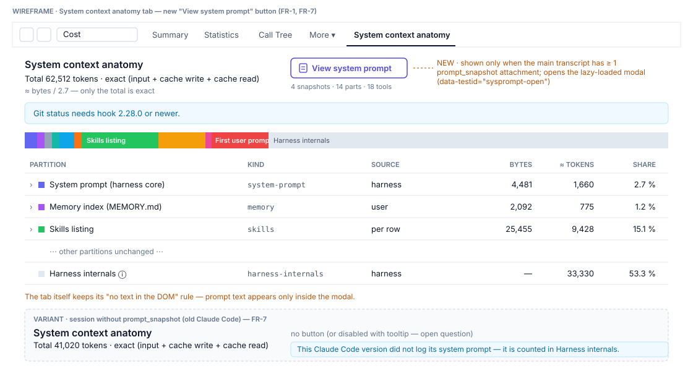
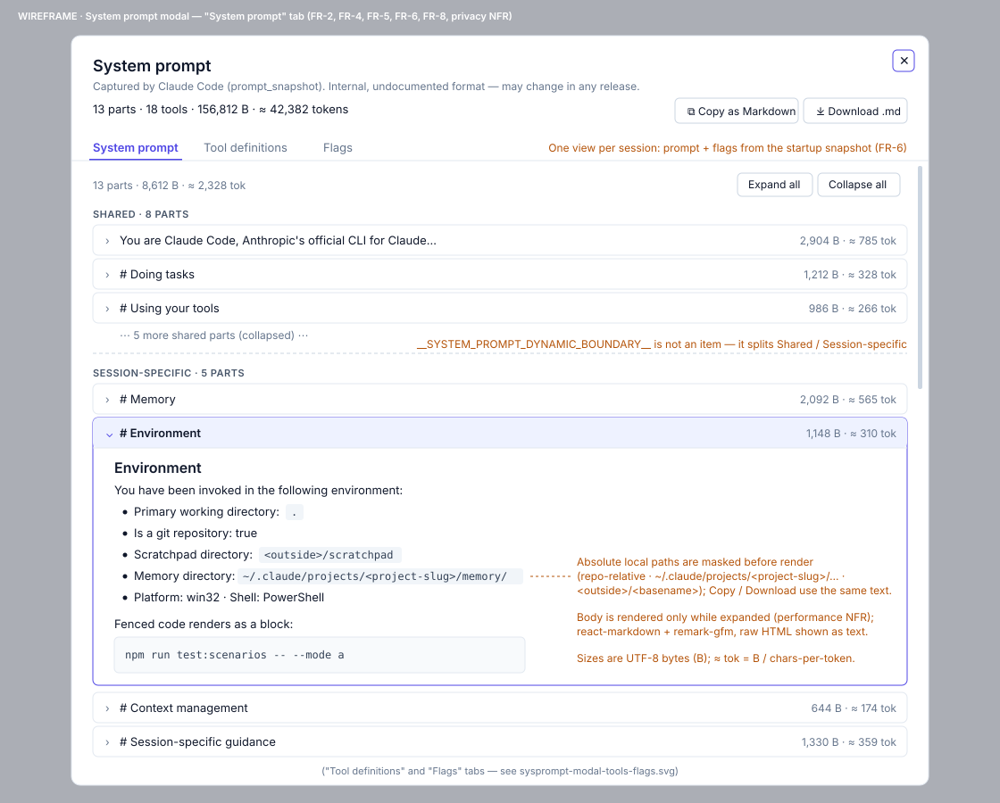
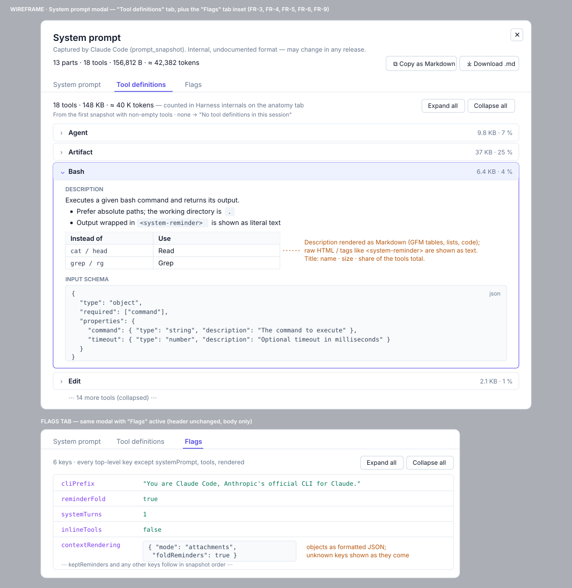

# 2026-11-10: System Prompt Viewer on the System Context Anatomy Tab

**Status:** todo
**Priority:** medium
**Type:** feature
**Module(s):** client
**Owner:** denis.tsyplakov
**Created:** 2026-11-10
**Tracker:** GH-123 https://github.com/DataArt/artisyn-log-hub/issues/123

## Description

Raw idea: System context anatomy tab: add a button that opens a modal showing the session's
captured system prompt (`prompt_snapshot` attachment: `systemPrompt[]` parts and tool definitions)
as an accordion — one item per part, rendered as formatted Markdown.

Context. Claude Code writes a `prompt_snapshot` attachment into the main transcript (it is not sent
to the model — `rendered` is empty). Checked on 15 recent sessions of this repo:

- `systemPrompt` — an array of ~14 text parts (~8.6 K chars): the core block, `# Memory`,
  `# Environment`, `# Context management`, `# Session-specific guidance`, …, with a
  `__SYSTEM_PROMPT_DYNAMIC_BOUNDARY__` marker part between the shared and the per-session parts.
- `tools` — an array of `{name, description, schema}` (18 tools, ~148 K chars, ≈ 40 K tokens;
  `Artifact` alone ~37 K chars). In every checked session the **first** snapshot (startup block)
  has no `tools`; a second snapshot carrying `tools` is written after the first assistant reply.
  Some sessions have more snapshots later (e.g. 4), and the tool set can differ between sessions
  (15 vs 18 tools).
- Other keys are small flags (`cliPrefix`, `reminderFold`, `systemTurns`, `inlineTools`,
  `keptReminders`, `contextRendering`, …).

Today the tab (`docs/knowledgebase/sysctx-anatomy-tab.md`) measures only the startup block, shows
system-prompt parts as "Block n" sizes and, by rule, never puts prompt text in the DOM. A local
dump of the same data (`tmp/system-prompt.md`, made by a throwaway script) proved very useful for
seeing what Claude Code actually tells the model — this task brings that view into the product.

The format is undocumented and internal to Claude Code; it can change or disappear in any release.

## Functional Requirements

- FR-1. The System context anatomy tab shows a "View system prompt" button when the session's main
  transcript contains at least one `prompt_snapshot` attachment; the button is not rendered when
  there is none.
- FR-2. The button opens a modal with three tabs — "System prompt", "Tool definitions", "Flags" —
  each an accordion. Tab "System prompt": one accordion item per
  `systemPrompt[]` part, titled by the part's first Markdown heading (or its first words when it has
  none) plus its size (see Sizes); the dynamic-boundary marker part is not an item — it splits the
  list into "Shared" and "Session-specific" groups.
  - The boundary marker is a part whose trimmed text equals `__SYSTEM_PROMPT_DYNAMIC_BOUNDARY__`.
    No marker → one ungrouped list without group headers; several markers → split at the first,
    drop the others; an empty group is not rendered; a part that is empty after conversion is
    skipped.
- FR-3. Tab "Tool definitions": the tool-definitions share of the context that the anatomy tab
  leaves inside "Harness internals" — a summary line (tools count, total size, ≈ tokens), then one
  accordion item per tool definition in snapshot order, titled by tool name plus size and its share
  of the tools total; expanded, it shows the description rendered as Markdown and the input schema
  as a formatted JSON block. Tools come from the first snapshot that has a non-empty `tools`
  (usually written after the first assistant reply, not in the startup block).
- FR-4. Item bodies are rendered as formatted Markdown (GFM: headings, lists, tables, code blocks)
  using the client's existing `react-markdown` + `remark-gfm`; raw HTML in the text is not rendered.
- FR-5. Items are collapsed by default; each tab offers expand all / collapse all; the modal
  header shows the totals (parts count, tools count, total size and ≈ tokens of parts + tools).
- FR-6. One view per session, no snapshot picker: prompt and flags from the startup snapshot, tools
  from the FR-3 snapshot; later snapshots are not shown. A session whose snapshots carry no `tools`
  shows "No tool definitions in this session" in the Tool definitions tab.
- FR-7. Old sessions / old Claude Code versions without `prompt_snapshot` keep working exactly as
  today (no button, no error). A malformed snapshot never breaks the modal: `systemPrompt` that is
  not an array shows "System prompt not in a recognised format"; a tool without `name` is titled
  `(unnamed tool #n)`; a tool without a schema omits the JSON block; a tool without `description`
  shows "no description"; an empty section shows an empty-state line; any parse failure shows an
  inline message instead of a blank modal.
- FR-8. The modal offers "Copy as Markdown" (to the clipboard) and "Download .md" for the whole view
  (all three tabs, whichever is open) — one Markdown document in the shape of the local `tmp/system-prompt.md`
  dump: the system-prompt parts in order (with the Shared / Session-specific split), then each tool
  (name heading, description, input schema as a fenced `json` block), then the flags (FR-9). The
  exported text uses the same masked paths as the modal (privacy NFR); generated client-side, no
  server request.
- FR-9. Tab "Flags": the snapshot's small non-array keys (`cliPrefix`, `reminderFold`,
  `systemTurns`, `inlineTools`, `keptReminders`, `contextRendering`, … — every top-level key other
  than `systemPrompt`, `tools` and `rendered`) are shown as a compact key / value list (objects as
  formatted JSON). Unknown keys are shown as they come, so new Claude Code flags appear without a
  code change.

Payload shapes accepted by the parser: a part's text is the string itself, else `.text`, else
`JSON.stringify` (the tab's existing `blockText`); a tool's schema is `schema ?? input_schema`;
non-array `systemPrompt` / `tools` values are ignored without error (FR-7 messages).

Sizes: every size is UTF-8 bytes, labelled "B", and ≈ tokens = bytes / `resolveCharsPerToken`
(the tab's own measure), so a modal part matches its "Block n" row in the tab. A part's size is its
`blockText`; a tool's size is `name` + `description` + `JSON.stringify(schema)`. Header totals sum
parts and tools; flags and the boundary marker are excluded.

## Non-Functional Requirements

- Privacy: the text is shown only in this modal, only to users who can already open the session;
  the anatomy tab itself keeps its "no text in the DOM" rule. Absolute local paths are masked
  (`client.md` § Path display) in every string shown or exported — prompt parts, tool descriptions,
  string values inside tool schemas, flag values, contents of code blocks. Masking is applied once
  to the parsed model, so the modal and the Copy / Download output always match:
  - Detection: the known `repoRoot` prefix (case-insensitive, `\` and `/` treated alike, spaces
    allowed), plus one regex for other absolute paths — a drive letter followed by `:\` or `:/`, or
    a leading `/` followed by a known root (`Users`, `home`, `tmp`, `var`, `opt`, `mnt`) — up to
    whitespace or a closing quote, bracket or backtick. Masking runs on parsed string values, before
    any `JSON.stringify`, so doubled JSON backslashes never reach it.
  - Rewrite: a path under `repoRoot` becomes repo-relative (`repoRoot` itself → `.`); a path
    containing `/.claude/` becomes `~/.claude/...` with the `projects/<slug>` segment replaced by
    `<project-slug>`; any other path becomes `<outside>/<basename>`.
- Offline first: no external fetch; rendering works in a network-isolated install.
- Performance: the modal is lazy-loaded and parses only when opened; ~150 K chars of tool text must
  not freeze the UI (render item bodies only when expanded).
- Light theme only, existing modal/collapsible components (`ui-components` skill).
- Parsing, grouping, sizing, snapshot selection and path masking live in one pure client module,
  documented as a new algorithm doc in `docs/knowledgebase/algorithms/` with its rows file in
  `docs/algorithm-examples/` and an `*.algo.test.ts` table test.

## Acceptance Criteria

- [ ] AC-1 (FR-1, FR-7): a session with `prompt_snapshot` shows the button; a session without it
      shows no button and the tab renders as before.
- [ ] AC-2 (FR-2): the modal lists every `systemPrompt` part except the boundary marker, grouped
      into Shared / Session-specific, each titled by its heading with a size.
- [ ] AC-3 (FR-3): the Tool definitions tab shows the tools count, total size and ≈ tokens, and
      lists every tool of the first snapshot with `tools`, including
      when that snapshot comes after the first assistant reply; an expanded item shows the Markdown
      description and the JSON schema.
- [ ] AC-4 (FR-4): Markdown headings, lists, tables and fenced code render formatted; an HTML tag
      in the text is shown as text, not executed.
- [ ] AC-5 (FR-5): expand all / collapse all work; header totals match the snapshot (UTF-8 bytes of
      parts + tools).
- [ ] AC-6 (FR-6): a session with several snapshots shows no picker — the startup prompt and the
      first tools snapshot only.
- [ ] AC-7 (privacy NFR): no absolute local path from prompt parts, tool descriptions, tool schemas
      or flag values appears unmasked in the modal or in the copied / downloaded Markdown.
- [ ] AC-8 (FR-8): "Copy as Markdown" puts the whole view on the clipboard and "Download .md"
      saves a `.md` file with the same content (prompt parts, tools, flags).
- [ ] AC-9 (FR-9): the Flags tab lists every top-level snapshot key except `systemPrompt`,
      `tools` and `rendered`, with its value.
- [ ] Tests per the repo test policy:
  - Algorithm: the new algorithm doc + rows file (boundary split, headings, payload shapes, sizes,
    snapshot selection, masking input → output examples).
  - Scenario: a step in `tests/scenarios/view/s-sess-03.spec.ts` on GS-05 extended with a startup
    snapshot (a shared part with a heading, the boundary marker, a session part with an absolute
    path) and a second snapshot after the first assistant line (`tools` with an HTML tag and a table
    in a description, an object-valued flag); if the anatomy numbers move, its `expected.json` is
    updated in the same change. The step asserts the tab switching, group headers, item count, late
    tools list with its summary line, masked path, HTML shown as text, header totals and
    clipboard / download content via test ids (`sysprompt-modal`, `sysprompt-tab-<id>`,
    `sysprompt-item[data-section]`).

## Open Questions

None.

## Common sense considerations

- Button with no `prompt_snapshot`: not rendered (FR-7 / AC-1 already say "no button").
- No snapshot picker: startup prompt + first snapshot with non-empty `tools`; export covers all three tabs.
- Tool definitions are shown as a modal tab; the anatomy tab's stacked bar and partition table stay unchanged (no mixing of startup-block and later data).
- Sizes: UTF-8 bytes / `resolveCharsPerToken`, same as the tab; totals = parts + tools.
- Path masking: covers every shown/exported string, applied once to the parsed model; `repoRoot` → repo-relative, `~/.claude/…/<project-slug>`, else `<outside>/<basename>`.
- Payload shapes, boundary-marker edge cases and malformed snapshots: tolerant parsing with inline messages, never throws.
- Rules live in a pure module with its own algorithm doc + rows file (repo test policy).
- Scenario: extend GS-05 and step into s-sess-03, no new scenario file.

## Notes

<!-- Append timestamped notes here as work progresses -->
- **2026-11-10:** Survey source — 15 recent sessions of this repo, scripts in `tmp/`
  (`snapshot-scan.js`, `dump-system-prompt.js`). KB: `docs/knowledgebase/sysctx-anatomy-tab.md`,
  `docs/knowledgebase/algorithms/sysctx-anatomy.md`,
  `docs/knowledgebase/log-schema/attachment-types.md`.
