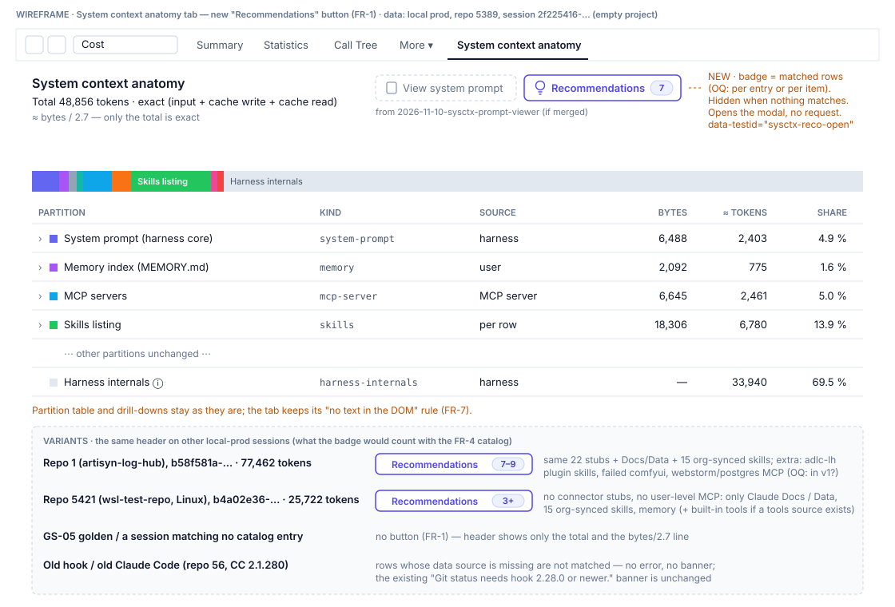
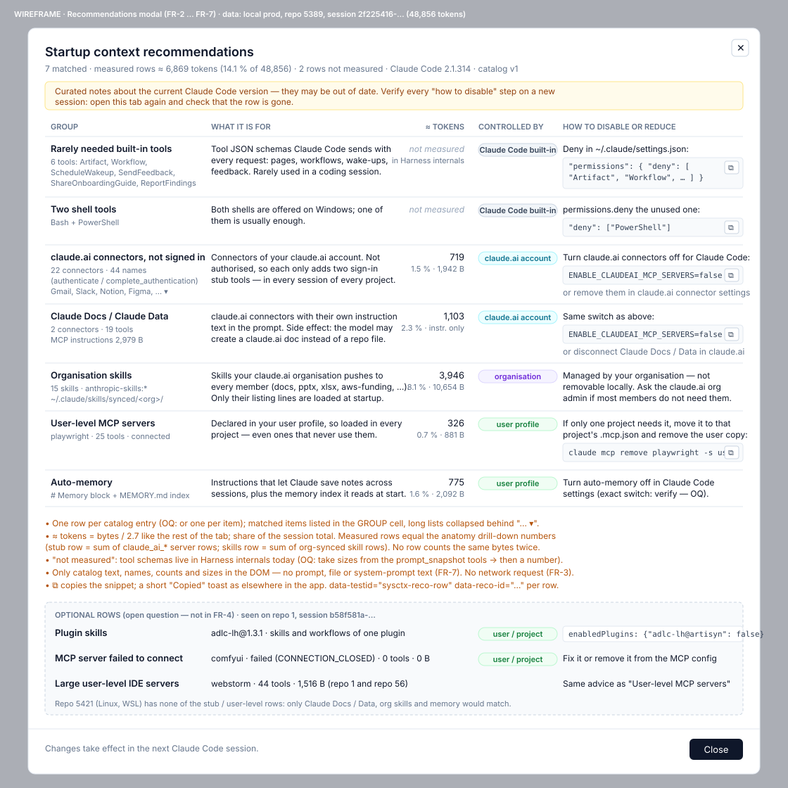

# 2026-11-11: Startup Context Recommendations on the System Context Anatomy Tab

**Status:** todo
**Priority:** medium
**Type:** feature
**Module(s):** client, packages, docs
**Owner:** denis.tsyplakov
**Created:** 2026-11-11
**Tracker:** GH-130 https://github.com/DataArt/artisyn-log-hub/issues/130

## Description

Raw idea: System context anatomy tab: "Recommendations" button that opens a modal with a table of
recommendations for the session's startup context — for each known block group found in the
context (built-in Claude Code tools like Artifact/Workflow/ScheduleWakeup/SendFeedback, claude.ai
account connectors incl. unauthenticated authenticate stubs, org-synced skills, user-level MCP
servers, built-in skills, auto-memory section, etc.) say what it is for, its estimated token cost,
and how to disable it (settings.json permissions.deny, env ENABLE_CLAUDEAI_MCP_SERVERS=false,
claude.ai connector settings, …). v1: recommendations are static text blocks from a known catalog,
triggered by the presence of known groups in the context.

Why. An empty project on local prod (session `2f225416-…`, repo 5389) started at **48,856 tokens**
of context. The anatomy tab shows *how big* each partition is but not *what a block is for* or
*whether the user can drop it*. A manual breakdown of that session found that almost none of it came
from the user's own profile (`~/.claude`) — it came from Claude Code built-ins and the claude.ai
account:

| Group | ≈ tokens | Origin |
|---|---|---|
| Built-in tool JSON schemas (20 tools) | ~32 K | Claude Code; `Artifact` alone ~13 K, `PowerShell` ~3.3 K, `Agent` / `SendFeedback` / `Workflow` / `AskUserQuestion` / `ScheduleWakeup` ~1.6–2 K each, `ReportFindings` / `ShareOnboardingGuide` / `ListAgents` smaller |
| Skills listing (32 skills) | ~6.5 K | ~3.5 K org-synced `anthropic-skills:*` (`~/.claude/skills/synced/<org>/`), rest built-in (`dataviz`, `claude-api`, `artifact-*`, `code-review`, …) |
| Deferred tool names (110) | ~3.5 K | 44 `authenticate` / `complete_authentication` stubs of 22 unauthenticated claude.ai connectors, Claude Data (11) and Claude Docs (8), user-level `playwright` MCP (25) |
| System prompt | ~3 K | Claude Code, incl. the `# Memory` block (~0.7 K) |
| Subagent types listing | ~1.6 K | built-in agents |
| MCP instructions | ~1 K | claude.ai Claude Data / Claude Docs |

The tool figures above come from the raw `api-request-shape` line and are illustrative only.

Across local prod (301 root sessions, 5 repos, Claude Code 2.1.211–2.1.322) the startup total ranges
24.5 K–77.5 K tokens (median ≈ 60 K). Built-in tool schemas are the largest group (median ≈ 31 K).
The groups vary by session: 0–23 unauthenticated connectors, 3 or 15 org-synced skills, no `Artifact`
/ `SendFeedback` / connector stubs in `claude -p` sessions, no `PowerShell` on WSL.

The user cannot learn from the tab today that e.g. `Artifact` costs 13 K and can be removed with a
`permissions.deny` rule, or that 22 connectors they never authenticated still cost tokens in every
session of every project. This task adds that explanation as a recommendations modal.

Related: `2026-11-10-sysctx-prompt-viewer` (same tab, system prompt / tool definitions viewer) and
`2026-11-02-session-antipatterns` (catalog of session antipatterns incl. "unused MCP", "oversized
startup") — the catalog here may later feed or be fed by that one.

## Functional Requirements

- FR-1. The System context anatomy tab shows a **Recommendations** button (with the number of
  matched recommendations) when at least one catalog entry matches the session's startup context;
  it is hidden or disabled when none match.
- FR-2. The button opens a modal with a table, one row per matched recommendation: group name,
  what it is / what it is for, estimated tokens in this session (and share of the total), who
  controls it (Claude Code built-in, claude.ai account / organisation, user profile, project), and
  how to disable or reduce it (copyable snippet where there is one).

- FR-3. Recommendations come from a static, versioned **catalog** in the client: each entry has an
  `id`, a `title`, a `controller` (`built-in` / `claudeai-account` / `org` / `user` / `project`), a
  matcher returning the matched item names and their bytes (`null` when not measured), an
  explanation text, a `disable` text with an optional snippet and a `verifiedOn` Claude Code version;
  the catalog has a `CATALOG_VERSION`. No server, DB or API change; no LLM.
- FR-3b. The catalog is shared with `2026-11-02-session-antipatterns` from the start: it lives in a
  repo-local package under `packages/` (see `docs/knowledgebase/repo-local-packages.md`), entry ids
  are one namespace for both features, and this task creates the package.
- FR-3a. One catalog entry yields at most one row; an entry covering several items (tools,
  connectors, servers) lists the matched item names inside its row, with per-item size where
  measured. The button count is the number of rows.
- FR-4. v1 catalog covers at least these groups (matcher → recommendation):
  - built-in tools that are rarely needed in a coding session (`Artifact`, `Workflow`,
    `ScheduleWakeup`, `SendFeedback`, `ShareOnboardingGuide`, `ReportFindings`) → what each does,
    how to hide it with `permissions.deny` in `settings.json`;
  - both `Bash` and `PowerShell` present → one of them can be denied;
  - claude.ai connectors (anatomy `mcp-server` rows whose key starts with `claude_ai_`, any
    connector, not only Docs / Data), as two entries: unauthenticated stubs (every deferred name of
    the connector ends in `__authenticate` / `__complete_authentication`; the row reports N
    connectors) and authenticated connectors → what claude.ai connectors are,
    `ENABLE_CLAUDEAI_MCP_SERVERS=false` for Claude Code, or disabling them in claude.ai connector
    settings;
  - MCP instructions of claude.ai Claude Docs / Claude Data → as above, plus the side effect (the
    model may create a claude.ai document instead of a repo file);
  - org-synced skills (matched by `anthropic-skills:*` listing names; the snapshot `source:
    org-synced` exists only from hook 2.28) → managed by the organisation, not removable locally;
  - user-level MCP servers (snapshot `configSource: user`) → loaded in every project; move to the
    project's `.mcp.json` if only one project needs it, or "remove the user-level copy" when the
    snapshot also lists it with `configSource: project`; a user-level server that failed to connect
    still matches and shows status "failed" with 0 tokens;
  - auto-memory → matches when the `# Memory` block or any MEMORY.md file is in the startup
    context; size = the anatomy Memory partition; what it is and how to turn it off;
  - project CLAUDE.md files (startup `instructions` that are not MEMORY.md) → the largest group the
    user controls; trim it, move rarely needed parts into rules or skills;
  - project MCP servers (snapshot `configSource: project`), one row listing the servers with their
    sizes → remove unused servers from `.mcp.json` or deny their tools;
  - MCP servers that failed to connect (anatomy row `status: 'failed'` or snapshot
    `connected: false`) → attempted at every start and useless; fix or remove;
  - plugin skills (snapshot skills with `source: plugin`), grouped per plugin → disable with
    `enabledPlugins: {"<plugin>@<marketplace>": false}` in `settings.json`;
  - built-in `AskUserQuestion`, `Agent`, `ListAgents` tools → what each does, `permissions.deny`;
  - the subagent types listing → where the types come from (built-in, plugins, `.claude/agents/`).
- FR-4a. Tool presence and per-tool size come from the anatomy `tool-definitions` partition, which
  `findToolDefinitions` (`sysctx-anatomy/tool-definitions.ts`) fills — the same source as the View
  system prompt modal's Tool definitions tab: the `api-request-shape` of the first main request when
  logged (Claude Code 2.1.312+), otherwise the first `prompt_snapshot` with a non-empty `tools[]`. A
  tool's size follows the FR-8 rule. Without a tools source (`anatomy.toolSource === null`) the tool
  rows and the Bash + PowerShell row are not matched.
- FR-5. The token estimate of each row uses the same bytes-per-token ratio and the same
  "≈ estimated" wording as the rest of the tab. Every measured byte belongs to at most one row:
  connector rows count only deferred-name bytes, the Claude Docs / Data instructions row only
  instruction bytes, the user-level MCP row both, for non-claude.ai servers only. "not measured"
  is shown only for a group with no per-item size in the data.
- FR-6. The modal states that the catalog is curated knowledge about the current Claude Code
  version and may be out of date, and every "how to disable" is advice to verify on a new session.
  The disclaimer names the session's Claude Code version (transcript `version` field) and the
  catalog's `verifiedOn` version.
- FR-7. The tab's "no text in the DOM" rule still holds: the modal shows only catalog text, names,
  counts and sizes — never content of the user's prompts, files or system prompt.
- FR-8. The tool byte rule (already built in `2026-11-10-sysctx-prompt-viewer`, no code change
  here): a tool's bytes = name + description + `JSON.stringify(input_schema)`, where `input_schema`
  is `schema.input_schema` when a snapshot `tools[]` item's `schema` is the whole wire tool
  definition, so the description is counted once (`Artifact` ≈ 38 KB, not ≈ 60 KB). The anatomy
  `tool-definitions` partition, the View system prompt modal's Tool definitions tab and the
  recommendation tool rows all use this one rule through `findToolDefinitions`, so their numbers
  are equal.

## Non-Functional Requirements

- Client and `packages/` only; works with sessions recorded by old hooks (rows whose data source is missing are
  simply not matched — no error, no banner noise).
- The catalog lives in one file so adding an entry needs no UI change; the matching logic is a pure
  function covered by the algorithm-test convention if it gets an algorithm doc.
- Every "how to disable" text and snippet is checked on the current Claude Code version during
  implementation (a bare `permissions.deny` entry removes the tool from the model's tool list;
  `ENABLE_CLAUDEAI_MCP_SERVERS=false` removes claude.ai connectors; how auto-memory is turned off);
  one that cannot be confirmed ships worded as "verify".
- Depends on `2026-11-10-sysctx-prompt-viewer` (merged first).

## Acceptance Criteria

- [ ] FR-1: on the session above the button is visible with a count; on a session whose startup
      matches no catalog entry the button is not shown (or disabled).
- [ ] FR-2: the modal table lists group, purpose, ≈ tokens + share, controller and how-to-disable
      for every matched row; snippets can be copied.
- [ ] FR-3: catalog entries are static client data; no new request appears in the network log when
      the modal opens.
- [ ] FR-4: on the session above the modal shows rows for `Artifact` and the other listed built-in
      tools, Bash + PowerShell, claude.ai connector stubs (N connectors as counted by the FR-4 rule;
      22 on this session), Claude Docs / Data, org-synced skills (15), user-level `playwright` MCP
      and the memory block. On local prod a `claude -p` session shows no `Artifact` and no stubs row,
      and the WSL session `b4a02e36` (repo 5421) shows no Bash + PowerShell row.
- [ ] FR-4 (extra groups): on local prod a repo 1 session shows rows for project CLAUDE.md, project
      MCP servers (`webstorm`), the failed `comfyui` server, `adlc-lh` plugin skills,
      `AskUserQuestion` / `Agent` / `ListAgents` and the subagent types listing.
- [ ] FR-8: on session `2f225416` the recommendation row for `Artifact` reports the same size as
      the Tool definitions tab and the anatomy `tool-definitions` row (≈ 38 KB, not ≈ 60 KB); in the
      GS-05 golden the tool rows' bytes equal the `tool-definitions` drill-down.
- [ ] FR-5: tool rows equal the per-tool tokens of the View system prompt → Tool definitions tab;
      the other measured rows equal the anatomy partition / drill-down numbers; the shares of all
      rows sum to at most 100 %.
- [ ] FR-6: the modal shows the disclaimer text with the session's and the catalog's Claude Code
      versions.
- [ ] FR-7: no prompt, file or system-prompt text appears in the modal DOM.
- [ ] GS-05 golden is extended with an `Artifact` and a `PowerShell` tool in `prompt_snapshot.tools`,
      one claude.ai connector with only `authenticate` / `complete_authentication` names and one
      `configSource: user` MCP server; `expected.json` gets a `recommendations` block (matched ids,
      count, ≈ tokens per row) checked by `tests/golden/check-arithmetic.mjs`.
- [ ] A step in the existing sysctx scenario (`tests/scenarios/view/s-sess-03.spec.ts`) opens the
      modal and asserts the button count and the rows of that `recommendations` block.

## Open Questions

None.

## Common sense considerations

- Tool data source: the anatomy `tool-definitions` partition (`findToolDefinitions`:
  `api-request-shape` first, else the first `prompt_snapshot` with `tools[]`) (FR-4a).
- Tool size per the FR-8 rule, equal to the Tool definitions tab (FR-4a, FR-5).
- Hard dependency on `2026-11-10-sysctx-prompt-viewer`; reuse its `findToolDefinitions`.
- "not measured" only for groups with no per-item size in the data (FR-5).
- Description tool figures are marked illustrative.
- Scenario coverage extends the GS-05 golden and its `expected.json` (AC).
- Catalog entry shape fixed in FR-3; one row per entry, button count = rows (FR-3a).
- Disclaimer shows the session's and the catalog's Claude Code versions; no per-row marks (FR-6).
- claude.ai connectors: any `claude_ai_*` server, split into stubs and authenticated (FR-4).
- Each byte belongs to one row; shares sum to ≤ 100 % (FR-5).
- Memory row = whole Memory partition (FR-4).
- User-level MCP also declared in the project → "remove the user-level copy"; failed → status "failed", 0 tokens (FR-4).
- Disable mechanisms verified during implementation, unconfirmed ones worded "verify" (NFR).

## Notes

<!-- Append timestamped notes here as work progresses -->

- 2026-11-11: FR-8 and the tool source of FR-4a were already implemented in
  `2026-11-10-sysctx-prompt-viewer`, differently from the text above: a tool's size is name +
  description + `JSON.stringify(schema.input_schema)`, and tools come from `findToolDefinitions`
  (`sysctx-anatomy/tool-definitions.ts`) — the `api-request-shape` of the first main request when
  logged (Claude Code 2.1.312+), else the first snapshot with tools; the anatomy has a
  `tool-definitions` partition with one row per tool. Re-read FR-4a / FR-5 / FR-8 against that
  before planning.
- Evidence (FR-8 key survey, size-rule rationale): see `notes.md`.
- 2026-11-11: FR-4a, FR-8, the FR-8 AC and the matching Common-sense lines were reworded to the
  built behaviour (impl-plan DD 1). FR-3's per-entry `verifiedOn` became one catalog-wide
  `VERIFIED_ON` constant exported by `@loghub/recommendations` (impl-plan DD 5), because all entries
  are verified in one pass; FR-6's disclaimer names it.
- 2026-11-11 (user decision, after implementation): the FR-6 disclaimer, `VERIFIED_ON` and the
  per-entry `verify` flag ("Verify:" prefix) were removed. Instead every catalog entry carries
  `docs` — links to the Claude Code documentation pages of its setting, shown as **Docs:** in the
  row. FR-6, its AC and the matching Common-sense / NFR lines are superseded by this note.
