# 2026-11-13: Artisyn AI Work Hub — Alpha

**Status:** todo
**Priority:** medium
**Type:** feature
**Module(s):** work-hub (new sub-product in `work-hub/`: Rust backend, React frontend, Postgres)
**Owner:** denis.tsyplakov
**Created:** 2026-11-13
**Tracker:** GH-142 https://github.com/DataArt/artisyn-log-hub/issues/142

## Description

Add one more service to this repository: **Artisyn AI Work Hub**. Raw idea, as given:

> I start the service and log in (the same login modes as Log Hub). A workspace there == a git
> repository. It is a kind of web IDE with an IDEA-like layout: I can open files, view them, and
> edit the ones that are text. I can create a workstream — it is ONE chat with an agent that works
> in a worktree and runs on the server.
>
> The server must be agnostic and use devcontainers. For now this is strictly alpha functionality —
> more features come later.
>
> Workstreams: a switcher at the top, above the tabs; the workstream's chat window is the leftmost
> tab in the tab row, pinned.
>
> Flow: I open a workspace, it sits on the working branch (say `main`, set in the settings). I can
> look at files. I press "Open workstream" — it asks for a name, a worktree is created
> automatically in the container and the chat looks at it; I chat, and I can tell it to close.
> BUT all chats are remembered and I can look at the history later.
>
> Authorization is inherited.
>
> Tech stack: Postgres, Rust BE, React FE.

### Reference scenario

Keep this simple scenario in mind for every decision:

> A woman from accounting opens a workspace, and in it we build a dashboard application. She knows
> nothing about code and nothing about git. The basic flow is very simple: she made an area
> (workspace), opened a stream of work there, said what she needs — and the code was made for her.
> IMPORTANT: if asked, the agent runs the code, and she can look at the result and download it.

Expected outcome of the alpha: a user who knows neither code nor git logs in, creates a workspace,
opens a named workstream, tells the agent what they need, has the agent run the result, looks at it
and downloads it, then closes the workstream keeping (or discarding) the work — and can come back
to the same workstream later. Files can be dragged into and out of the file tree. Everything
git-related happens behind plain buttons.

## Terms

- **Workspace** — one git repository registered in Work Hub, personal to the user who created it.
  Has a *working branch* (e.g. `main`) set in its settings.
- **Workstream** — a named unit of work inside a workspace: exactly one chat with one agent, bound
  to its own git worktree and its own container. States: open, closed (can be reopened), done
  (closed as already merged elsewhere; container removed, only its chat remains), discarded
  (deleted, only its chat remains).
- **Workspace container** — the devcontainer of a workspace: its tools and configuration. The
  repository (on the working branch) and the agent profile with the workspace's Claude login are
  mounted into it as the workspace's own volumes.
- **Workstream container** — a container branched off the workspace container when a workstream is
  opened, with its own repository and profile volumes; the workstream's worktree and agent live in
  it.
- **Checkpoint** — a saved state of the workspace container's own filesystem (tools and
  configuration, not the volumes), made by the configuration session (FR-25a); workstreams opened
  afterwards start from the latest checkpoint. Until the first checkpoint, the workspace's built
  image (the default one or the repository's devcontainer definition) plays its role.
- **Working-branch view** — the workspace with no workstream selected: the files of the working
  branch.

## Functional Requirements

### Sub-product and stack

- FR-1. Work Hub is a separate sub-product in `work-hub/` in this repository, with its own backend
  (Rust), its own frontend (React), its own Postgres storage, its own tests inside that folder and,
  later, its own release; it starts and runs independently of Log Hub.
- FR-1a. The Work Hub server is configured by environment variables, the way Log Hub is: its port,
  the Postgres connection, the Docker Engine endpoint, a data directory (the file area of FR-5g
  plus terminal recordings, FR-32) and the auth mode with its mode-specific settings, mirroring Log Hub's. Exact names are
  set in the plan.
- FR-1b. Work Hub runs two ways: **dockerized** — its own Docker image plus a compose file (Work
  Hub, its Postgres, the host's Docker Engine socket mounted) that can be deployed locally to try
  it out; and **inline** without Docker for the server itself — started from `work-hub/` against a
  local Postgres, the way the local Log Hub dev server is. Either way the workspace and workstream
  containers run on the host's Docker Engine.
- FR-2. The server is agent-agnostic: the agent a workstream chat talks to is behind an adapter,
  and nothing outside the adapter depends on a concrete agent. The alpha ships and is tested with
  one agent: Claude Code.
- FR-3. The server uses devcontainers as the execution environment: one workspace container per
  workspace, and every workstream gets its own workstream container branched off the workspace
  (its latest checkpoint and its volumes) at the moment the workstream is opened; from then on the
  two diverge (later changes on the working branch do not appear in already open workstreams).
- FR-4. Workstreams are isolated from each other: files, processes and the agent of one workstream
  are not visible to and cannot be disturbed by another workstream or by the working-branch view.
- FR-5. Everything is personal: a user sees only their own workspaces, workstreams, chats and
  containers; users never share a container.

### Container and repository model

Verified by PoC [`docs/pocs/2026-11-13-1906-workhub-container-branching/`](../../../pocs/2026-11-13-1906-workhub-container-branching/README.md)
(snapshot branching, bundle transfer, checkpoint size); the volume copy on opening a workstream
(FR-5b) is not covered by it.

- FR-5a. The container's own filesystem holds only tools and configuration. The frequently
  changing data lives outside it, in host folders of the file area (FR-5g) that Work Hub
  bind-mounts into the container — called volumes below: the **repository volume** (the git tree)
  and the **profile volume** (the container user's home with the agent state, such as
  `~/.claude`). Every container has its own pair of volumes — the
  workspace container its own, every workstream container its own; a volume is never shared
  between two containers (FR-4).
- FR-5b. Opening a workstream starts the workstream container from the workspace's latest
  checkpoint image (FR-25b; no `docker commit` at opening), with new repository and profile
  volumes made as copies of the workspace's at that moment; the workstream branch is checked out
  in its own copy of the repository there. The volumes are copied by a short-lived helper
  container started from Work Hub's own default image (no pull), with a tar pipe that keeps
  owner, mode and symlinks; git writes in the workspace (save, upload, move, merge) wait until the
  copy is done.
- FR-5c. Commits travel between a workstream container and the workspace container as a git
  bundle piped through the container runtime — no network between containers, no credentials.
- FR-5d. Devcontainers are Work Hub's own documented subset of `devcontainer.json` (image or
  Dockerfile build, container environment, post-create command), applied over the Docker Engine
  API; the official devcontainer CLI is not used. The default container image (FR-10) is Work
  Hub's own, built locally (no internet pull at runtime), with git, tmux and the Claude CLI.
  The host prerequisite is a Docker Engine reachable by the Work Hub server. All file and git work
  inside the volumes goes through the Docker Engine API (exec for git and listings, archive
  endpoints for upload and download), so it runs as the container user; the server itself only
  creates and removes the volume folders of FR-5g.
- FR-5g. File area. Every volume is an ordinary folder under the data directory (FR-1a) on the
  host, so a user's files stay readable with ordinary tools when the Work Hub server or the Docker
  Engine is down. The layout is readable without the database:
  `<data dir>/users/<user email>/<workspace slug>-<short id>/{workspace,home}` for a workspace and
  `…/<workspace folder>/workstreams/<workstream slug>-<short id>/{workspace,home}` for a
  workstream (`workspace/` is what the container sees as `/workspace`),
  plus a `workspace.json` / `workstream.json` beside them (name, owner, branches, dates). `workspace/repo/`
  of a workspace is a normal git repository with every commit, the branches of closed workstreams
  included. A profile folder (`home/`, which holds the agent login) is readable only by its
  owner. Docker objects (containers, checkpoint images) are disposable environment and are not
  needed to recover files. Unix hosts are the main platform; on Docker Desktop (Windows, macOS)
  it works with slower file access.
- FR-5h. Disk use of workstreams (owner, 2026-11-14). The agent does not update itself inside
  containers (the image pins its version), so a workstream does not download its own copy of
  the agent. When a workstream is closed ("Bring into main", "Close for now"), what the agent can
  download or rebuild again is deleted from its home (which paths is the adapter's business,
  FR-2); its files, branch, login and chat transcripts stay, so reopening works as before.
  History shows how much disk each workstream takes.
- FR-5e. Container lifecycle: an open workstream's container runs; "Bring into main" and "Close for now" stop it
  and keeps it with its volumes; reopening starts it again; *discard* removes the container and
  its volumes. The workspace container is started on demand, when an action needs it (file
  view or change, login, Configure, opening a workstream), and stays running; after a
  host restart it is started again on demand.
  Containers do not depend on the Work Hub server process; after a host restart Work Hub starts
  the containers of open workstreams again and resumes their agents (FR-31).
- FR-5f. Failures: if creating a workspace container or opening a workstream fails at any step,
  everything that attempt created (volumes, branch, container) is removed, nothing is recorded,
  and the user sees a plain-language message with "Try again". When Docker is unreachable, Work
  Hub says so in plain language instead of the workspace page. A workstream whose container
  cannot be started is shown as "Unavailable" with "Try again", and its history stays viewable.

### Login

- FR-6. Work Hub organises authentication the same way Log Hub does — the same login modes (the
  four `AUTH_MODE`s, see `docs/knowledgebase/authorization-and-authentificaiton.md`) and the same
  overall design. The inheritance is logical, not by code: Work Hub re-implements that design in
  its own backend and shares no auth code, session or database with Log Hub; it has its own users
  table, separate from Log Hub's users.

### No code or git knowledge needed

- FR-7. The basic flow — create a workspace, open a workstream, say what is needed, look at the
  result, download it, close the workstream — can be completed by a user who knows neither code
  nor git: nothing in it requires typing a command or understanding a git term.
- FR-8. Actions are buttons wherever possible (open, close, reopen, bring into main, discard, run-result
  view/download, authorize) — the user is not expected to type an instruction to the agent to
  trigger a product action.

### Workspace

- FR-9. A workspace corresponds to exactly one git repository. In the alpha any logged-in user
  creates their own workspace by **starting empty** — a new local repository with no remote, with
  an initial commit on `main` holding a `.gitignore` for common dependency and build folders
  (cloning, git authorization, push and pull requests: NFR-1). Creating a workspace asks for a
  name: any non-empty text up to 100 characters, unique among the user's workspaces; it is not
  renamed in the alpha. Container, volume and repository identifiers come from an internal id,
  never from the name.
- FR-10. If the repository has no devcontainer definition, Work Hub adds its own empty default
  one, so a workspace always gets a container.
- FR-11. A workspace has settings; the alpha needs at least the **working branch** (e.g. `main`),
  chosen from the repository's existing branches. A workstream records the working branch at its
  opening as its base.
- FR-12. Opening a workspace shows it on its working branch, with no workstream selected.
- FR-12a. The start page lists the user's workspaces (name, working branch, number of open
  workstreams). A workspace can be deleted after confirmation; that removes its containers,
  checkpoints, volumes (and with them the stored Claude login) and the history of its
  workstreams.

### IDE page

- FR-13. The workspace page has an IDEA-like layout: a project file tree on the left, an editor
  area with a row of tabs on the right.
- FR-14. The user can open any file from the tree in a tab and view it.
- FR-15. Text files can be edited and saved by hand — both in a workstream and directly in the
  working-branch view (e.g. the user corrects a requirements file the agent wrote). Non-text files
  are view-only. An open tab follows changes on disk: with no unsaved edits it reloads silently;
  with unsaved edits it says the file was changed by the agent and offers "Keep mine" or "Take
  theirs" — Save never overwrites a newer version on disk without that choice. A tab whose file
  was moved follows the new path; one whose file was deleted says so and offers to close.
- FR-15a. Saving a hand edit commits it right away, on whatever branch the user is on — a commit
  is the equivalent of "save the document"; there is no separate "save without commit" and no
  staging in the alpha. The commit holds only the saved file; other uncommitted changes in the
  worktree (e.g. the agent's) stay as they are. Uploads (FR-19) and moves (FR-21) likewise commit
  only the paths they touched, one commit per action; when the target name is taken, the user
  confirms the overwrite or cancels.
- FR-16. A workstream switcher sits at the top, above the tab row. It lists the workspace's open
  workstreams, shows which one is selected, has the "Open workstream" action, and lets the user go
  back to the working-branch view.
- FR-17. When a workstream is selected, its chat is the leftmost tab of the tab row and is pinned:
  it cannot be closed or moved, and file tabs open to the right of it.
- FR-18. When a workstream is selected, the file tree and file tabs show that workstream's
  worktree, not the working branch.

### Drag and drop in the file tree

Wanted very much; support it as far as browsers allow.

- FR-19. **Into the tree:** files and folders dragged from the user's computer onto the tree (onto
  a folder or the root) are uploaded to that place. The drop target is highlighted while dragging.
- FR-20. **Out of the tree:** a file dragged from the tree to the user's computer is downloaded
  there. Where the browser cannot do that, the same result is always available by a "Download"
  action on the file (and on a folder, as an archive).
- FR-21. **Inside the tree:** a file or folder dragged onto another folder is moved there.

### Agent authorization (Claude Code)

- FR-22. Claude Code is already installed for the user in their containers; the user installs
  nothing.
- FR-23. The Claude login is per workspace, i.e. per git repository. Everything inside the
  workspace inherits it transparently: every workstream opened in the workspace — its container
  and its agent — is already authorized, and the user is not asked again inside a workspace while the login works (FR-24a).
- FR-24. **One agent login per user** (owner, 2026-11-14 — replaces per-workspace logins and
  "copy from one of my workspaces", which broke each other: Claude's refresh token rotates, so
  every copy invalidated the others). A user without a login is asked for it when they create a
  workspace or open a workstream. The login runs the agent's long-lived token flow in a terminal
  tab attached to the workspace container (for Claude `claude setup-token`: open the sign-in
  page, paste the code back, Enter). Above the terminal Work Hub shows the sign-in link whole,
  with "Open sign-in page" and "Copy link"; a paste into the terminal is confirmed ("Pasted N
  characters"); Ctrl+C with text selected copies it. Work Hub takes the token the CLI prints and
  from then on every workspace and workstream of the user is logged in, with no copying.
- FR-24a. **Secrets are not readable on disk** (owner, 2026-11-14). Everything a user works on
  stays readable on disk (FR-5g); secrets do not. The agent's token — and later secrets — live
  in Work Hub's secret store: one AES-256-GCM encrypted file per secret under
  `<data dir>/secrets/`, the key in Work Hub's database (generated on first start), so a copy of
  the data directory alone or of the database alone gives nothing away. A secret is decrypted
  only in the server's memory and passed to the agent process as an env variable when it starts
  (chat, configure); it is never written into a container, a workspace folder or a recording.
  Old login files in the homes are removed when the agent starts with the token. Which env
  variable and which login command is the agent adapter's business (FR-2). Limits (documented):
  whoever has the whole host or the Docker socket can still get it.
- FR-24b. Logout (owner, 2026-11-14). The workspace Settings show whether the user is logged in
  to the agent and offer "Log out of <agent>" with a confirmation. It deletes the user's token, so
  all of the user's workspaces show the login question again; running chats keep working until
  they are restarted, new workstreams ask for a login.
- FR-25. A user with no other authorized workspace is offered only the new login. If the step is
  skipped or fails, the workspace still opens for viewing and editing files, the same question
  stays available in it, and opening a workstream leads back to it.

### Workspace configuration session

- FR-25a. A **"Configure"** action (wrench icon) on the workspace page opens a service session: a
  terminal tab with the workspace's agent (Claude, with the workspace's login) running in the
  workspace container, started with the instruction "this session configures the container — do
  what the user asks". The user asks in plain language for tools, libraries or settings, and the
  agent installs them into the workspace container.
- FR-25b. When the session ends, its changes to the container's own filesystem are saved as a
  checkpoint (`docker commit`, which stores only the changed layer); the repository and profile
  volumes are not part of it (FR-5a). Every workstream opened afterwards starts from the latest
  checkpoint; already open workstreams keep what they had (FR-3). The session ends with an
  explicit "Finish configuration" button or when the agent process exits; closing the tab or the
  browser keeps it running (FR-27c). One configuration session per workspace at a time; while it
  runs, workstreams open from the previous checkpoint, and logins and saves work as
  usual (they touch only the volumes).
- FR-25c. The alpha has no rollback to an earlier checkpoint (NFR-1).

### Workstream lifecycle

- FR-26. "Open workstream" asks for a name: any non-empty text up to 100 characters (spaces,
  Cyrillic and punctuation allowed), unique among the workspace's not discarded workstreams; the
  git branch name is derived from it automatically, so the user never sees a git error. On
  confirm, the server branches a workstream container off the workspace container, creates a git
  worktree for the workstream in it, starts the agent there with that worktree as its working
  directory, and the UI switches to the new workstream with its chat tab in front.
- FR-27. A workstream has exactly one chat. The agent runs on the server, in the workstream
  container, not in the browser.
- FR-27a. The chat is a real terminal: the chat tab shows the interactive Claude CLI running in
  the workstream container, like a Guacamole terminal shows a remote console (Guacamole itself is
  not installed or required). Work Hub adds no structure of its own on top of what the CLI draws
  (no result cards, no extracted file names, no per-message buttons).
- FR-27b. The terminal is complete enough for the CLI to behave as in a local console: colours
  and text attributes, cursor positioning and screen redraws, resizing with the tab, scrollback,
  copy and paste, and every special key and control sequence the CLI uses — arrows, Enter, Esc,
  Tab, Ctrl combinations. In particular, when Claude asks the user a question, its prompt is shown
  and answered exactly as in a real terminal (choose with the arrows, confirm with Enter).
- FR-27c. The terminal session lives on the server: reloading the page, closing the browser or
  restarting the Work Hub server does not stop the agent, and coming back shows the session where
  it is now. The session is held by tmux inside the workstream container; the browser reaches it
  over a WebSocket. One viewer at a time: a second browser tab takes the session over.
- FR-28. **Running the code.** When asked, the agent runs the code it made inside the workstream
  container and says in the chat, in its own words, how it ended and where the results are. The
  user finds the result files in the file tree, opens them there to look at them, and downloads
  them from there (the "Download" action or dragging out). In the alpha the result is only the
  files of the workstream — the code and whatever files the run produced (no live preview,
  NFR-1).
- FR-29. **Closing** is a button. **"Bring into main" takes everything** (owner, 2026-11-14, for
  users who do not know git): before merging, Work Hub saves (commits) every change in the
  worktree outside `.gitignore` itself, so nothing the agent left unsaved is lost and no git step
  is asked of the user. "Already merged elsewhere", which deletes the workstream's files, lists
  the changed files that would be lost (worded without git terms) and offers "Back to chat" or
  "Close anyway"; "Close for now" keeps every file. Closing while the agent is still working asks
  for a confirmation first. The close dialog offers:
  - **Bring into main** (the main path, local, no remote needed): Work Hub brings the workstream
    branch into the workspace repository (bundle, FR-5c), merges it into the workstream's base
    branch (FR-11) and stops the container, keeping it (FR-5e). If the merge conflicts, the base
    branch is unchanged, the workstream stays open, Work Hub brings the current base branch into
    the workstream container (bundle) and tells the user to ask the agent in the chat to combine
    it, then to close again.
  - **Already merged elsewhere** (e.g. the user had the agent push and open a pull request on a
    remote the user added): Work Hub merges nothing and removes the container and its volumes;
    the workstream becomes *done*, its chat stays in the history and it cannot be reopened.
  - **Close for now**: no merge; the container is stopped and kept, to be reopened later.
- FR-30. The other path is *discard* ("it came out rubbish, delete everything"): after an explicit
  confirmation the workstream's branch, worktree and container are deleted.
- FR-31. **Reopening.** A closed workstream (not *done*, not discarded) can be reopened and continued
  in the same context — the same chat, the same agent conversation, the same files; coming back to
  the work where it was left is an important feature. The agent adapter has two operations,
  *start* and *resume*; for Claude, resume restarts the CLI in the worktree with its conversation
  continued (`--continue` / `--resume <session id>`, the id stored per workstream). A reopened
  workstream continues on its own branch as it was left.
- FR-32. Every chat is remembered: the terminal session of every workstream — open, closed or
  discarded — is stored on the server (indexed in Postgres) and survives closing the workstream,
  discarding it and a server restart. It is recorded as the raw output stream of the session plus
  its resize events, and copied out of the container into Work Hub's own storage. The `tmux
  pipe-pane` log is written to a fixed path in the workstream's profile volume; the server copies
  it by byte offset into files under its data directory (FR-1a) on attach and detach,
  periodically while the container runs, and always before stop or discard. Postgres indexes each
  recording and stores every resize event with the byte offset it applies to, so replay is
  exact.
- FR-33. The user can view the history: a list of the workspace's past workstreams with their
  state, and the stored terminal session of any of them — shown as it looked, scrollable,
  read-only while the workstream is closed.

## Non-Functional Requirements

- NFR-1. Alpha scope: only what is listed above. Anything else (several chats per workstream,
  terminals, diff UI, search, sharing and collaboration, sending agent sessions to Log Hub, live
  preview of a running application, save-without-commit for advanced users, cloning remote
  repositories with git authorization, push and pull requests, dragging files into the chat,
  limits on running containers, size limits or retention for terminal recordings and uploads,
  renaming a workspace, rollback of the workspace container to an earlier checkpoint,
  hardened storage of agent logins — e.g. a server-held encrypted token injected into each
  container, …) is
  out of scope and comes as later tasks; the design must not block adding features.
- NFR-1a. The alpha has one theme — light — for the whole UI, the terminal included (light
  background, dark text, the CLI's colours mapped to a light palette). A dark theme comes later.
- NFR-2. Offline first, like the rest of the product: no runtime fetches from the internet by the
  Work Hub app itself (the agent's own network use and git remotes are the user's business).
- NFR-3. Not tuned to the developer's machine/OS: paths shown and processed are repository-relative
  or container paths, never host-specific. The only host path is the configured data directory
  (FR-5g), never a hard-coded one.
- NFR-4. Existing Log Hub behaviour and its backward compatibility are untouched — Work Hub is an
  addition.
- NFR-5. Work Hub's build, lint and test commands are its own and live in `work-hub/`. The
  repository's current test policy and health checks describe Log Hub; the task defines Work
  Hub's counterparts and documents them (`CLAUDE.md`, the development KB) rather than bending Log
  Hub's. Work Hub follows the same three test kinds (algorithm, API contract, scenario); its
  checks are added to `.claude/repo_config/repo-health-checks.json` as Work Hub's own entries; the
  Rust toolchain is stable, pinned by `rust-toolchain.toml` in `work-hub/`.
- NFR-6. Work Hub's own dependencies use only free, permissive licences — nothing paid and nothing
  under the GPL family; the file editor is Monaco (MIT). File preview stays plain text in the alpha.

## Acceptance Criteria

- [ ] AC-1 (FR-1). `work-hub/` builds, tests and starts with its own commands; the service works
      with the Log Hub server stopped.
- [ ] AC-1a (FR-1b). `docker compose up` of Work Hub's compose file serves a working Work Hub
      (login, workspace, workstream) on the host; and the inline start from `work-hub/` against a
      local Postgres does the same.
- [ ] AC-2 (FR-2). The workstream/chat code has no reference to a concrete agent outside its
      adapter; the Claude Code adapter is the one implemented and tested.
- [ ] AC-3 (FR-3). After opening a workstream there is a separate workstream container for it,
      created from the workspace's latest checkpoint; something installed through "Configure"
      before opening is present in the workstream container, and a file saved on the working
      branch after opening is not.
- [ ] AC-3a (FR-5f). When opening a workstream fails midway, no workstream, branch, volume or
      container of that attempt is left, and the user sees a plain message with "Try again"; a
      workstream whose container cannot start is shown as "Unavailable" with its history viewable.
- [ ] AC-3b (FR-5g). After creating a workspace and opening a workstream, their folders exist
      under `<data dir>/users/<email>/` with the documented names; with the Work Hub server and
      the containers stopped, `git log` in the workspace's `workspace/repo/` shows its commits
      and the workstream's `workspace/worktree/` holds its files; deleting the workspace removes its folder.
- [ ] AC-4 (FR-4). With two workstreams open, a file written and a process started in one are
      absent in the other and in the working-branch view; closing one leaves the other's agent
      and chat working.
- [ ] AC-5 (FR-5). User B sees none of user A's workspaces, workstreams or chats, in the UI and
      through the API, including by guessing an id.
- [ ] AC-6 (FR-6). Under each auth mode, the Work Hub login page shows the same login form as
      Log Hub does under that mode, and an unauthenticated request to a Work Hub API is rejected.
      A user registered in Log Hub does not exist in Work Hub until they log in to Work Hub.
- [ ] AC-7 (FR-7, FR-8). The reference scenario is walked end to end using only buttons and chat
      messages in plain language — no command typed, no git term to be understood.
- [ ] AC-8 (FR-9). A new workspace shows an empty project on `main` and works with no remote;
      the UI offers no clone; its initial commit holds a `.gitignore`. An empty name, a name over
      100 characters or a name the user already has for another workspace is rejected with a
      message.
- [ ] AC-8a (FR-12a). The start page lists the user's workspaces; deleting one after confirmation
      removes its containers, checkpoints, volumes (with the stored Claude login) and history, and
      cancelling changes nothing.
- [ ] AC-9 (FR-10). A repository without a devcontainer definition still gets a working workspace
      container, from Work Hub's default.
- [ ] AC-10 (FR-11, FR-12). A workspace with working branch `main` opens showing the files of
      `main` and no selected workstream; changing the working branch in the settings changes what
      the working-branch view shows.
- [ ] AC-11 (FR-13, FR-14). Clicking a file in the tree opens it in a new tab with its content;
      clicking an already open file focuses its tab.
- [ ] AC-12 (FR-15). Editing a text file and saving changes the file on the server, in a
      workstream and in the working-branch view alike; reopening shows the saved content. A binary
      file offers no editing.
- [ ] AC-12b (FR-15). When the agent changes a file open in a tab, the tab reloads if it has no
      unsaved edits; with unsaved edits it offers "Keep mine" / "Take theirs", and Save does not
      overwrite the agent's version until the user chooses.
- [ ] AC-12a (FR-15a). After a save there is a new commit on the current branch holding exactly
      the saved file, and other uncommitted changes are untouched; the UI offers one "Save" and no
      separate commit step.
- [ ] AC-13 (FR-16). The switcher above the tabs lists the open workstreams and the working-branch
      entry, and switching between them changes the selected one.
- [ ] AC-14 (FR-17). With a workstream selected, the chat tab is the first tab, has no close
      control, and stays first after opening and closing file tabs.
- [ ] AC-15 (FR-18). A file changed by the agent in the worktree shows the changed content in the
      workstream view and the unchanged content in the working-branch view.
- [ ] AC-16 (FR-19). Dropping a file and a folder from the computer onto a tree folder puts them
      into that folder, and they appear in the tree without a page reload.
- [ ] AC-16a (FR-15a, FR-19, FR-21). Each upload and each move creates one commit holding only the
      touched paths; on a taken target name the user is asked to overwrite or cancel, and cancel
      changes nothing.
- [ ] AC-17 (FR-20). Dragging a file from the tree to the desktop saves it there in a browser that
      supports it; in every browser the "Download" action saves the same file, and a folder as an
      archive.
- [ ] AC-18 (FR-21). Dragging a file onto another folder in the tree moves it, and an open tab of
      that file follows the new path.
- [ ] AC-19 (FR-22, FR-24). A user without a login creating a workspace is asked for it; "new
      login" runs `claude setup-token` in a terminal tab attached to the workspace container,
      shows the sign-in link with Open / Copy, and after the user pastes the code the workspace is
      logged in and stays so after reload and server restart.
- [ ] AC-20 (FR-24, FR-24a). After one login, a second workspace of the same user is logged in
      without any step and its agent answers. No file under the data directory other than
      `secrets/*.enc` contains the token; the token is not in any container's files or in the
      chat recording. Another user's login is never used.
- [ ] AC-20a (FR-23). Every workstream opened in an authorized workspace answers its first chat
      message without any authorization step, including workstreams opened later and reopened ones.
      A workstream whose agent asks to log in again is logged in in its own terminal.
- [ ] AC-20b (FR-25). In a workspace whose login was skipped, files open and save normally, and
      "Open workstream" shows the login question instead of creating a workstream.
- [ ] AC-20c (FR-5a, FR-24a). The repository and the Claude login files
      (`~/.claude/.credentials.json`) are in the workspace's volumes, not in the container layer
      (a `docker commit` of the workspace container holds neither); a workstream container has its
      own copies, and a file written in a workstream's repository is absent in the workspace's.
      When the workspace's login no longer works, the workspace shows the login question again.
- [ ] AC-20e (FR-24b). In Settings of a logged-in workspace, "Log out of <agent>" → confirm logs
      the workspace out: Settings say "Not logged in", the workspace shows the login banner, and
      opening a workstream asks for a login. Cancel changes nothing.
- [ ] AC-20f (FR-5h). After a workstream ran the agent and was closed, its home holds no copy of
      the agent CLI and none of the adapter's disposable paths; reopening it resumes the chat; its
      size is shown in History.
- [ ] AC-20d (FR-25a, FR-25b, FR-25c). "Configure" opens a terminal with the agent in the
      workspace container; a tool installed there through it is present in a workstream opened
      afterwards and absent in a workstream that was already open. The checkpoint is taken on
      "Finish configuration" or agent exit, not on closing the tab; a second "Configure" while one
      runs is refused; a workstream opened mid-session starts from the previous checkpoint. No
      rollback is offered.
- [ ] AC-21 (FR-26). "Open workstream" with a name creates the container and worktree, and the
      chat tab of the new workstream is shown and accepts a message. An empty or duplicate name is
      rejected with a message.
- [ ] AC-21a (FR-26). A 100-character name with spaces, Cyrillic and punctuation creates a
      workstream with no git error; 101 characters is rejected; two names whose derived branch
      names would clash still get distinct branches.
- [ ] AC-22 (FR-27, FR-27a). The chat tab of an open workstream shows the interactive Claude CLI
      of that workstream's container; typing a request and pressing Enter gets Claude's answer,
      drawn as the CLI draws it. The workstream has no way to start a second chat.
- [ ] AC-22a (FR-27b). Colours, cursor movement and redraws of the CLI are rendered correctly;
      a question Claude asks with options is answered by moving with the arrow keys and pressing
      Enter, and Esc cancels it; resizing the browser re-flows the CLI; text can be copied out
      and pasted in.
- [ ] AC-22b (FR-27c). After a page reload, and after a restart of the Work Hub server, during a
      long agent action the terminal shows the same session still running (the same CLI process),
      with the output produced meanwhile.
- [ ] AC-22c (FR-5e). After a Docker/host restart, open workstreams' containers run again and
      their chat shows the resumed agent conversation; kept (closed) workstreams' containers stay
      stopped.
- [ ] AC-22d (FR-27c). Opening the same workstream chat in a second browser tab moves the live
      session there, and the first tab shows that it was taken over.
- [ ] AC-23 (FR-28). After "run it", the agent's reply in the chat tells that the code ran and
      how it ended; the produced files appear in the tree without a page reload, open for viewing
      in a tab and download to the computer from the tree.
- [ ] AC-23a (FR-27a). No Work Hub element depends on parsing file names or run results out of the
      terminal output. No running application is proxied or embedded.
- [ ] AC-24 (FR-29). With uncommitted files outside `.gitignore`, every close option first lists
      them; "Back to chat" leaves the workstream open. "Bring into main" on a clean worktree makes
      the working-branch view show the workstream's files, and the workstream is closed and
      reopenable. On a conflicting change saved on the working branch after opening, the working
      branch is unchanged, the workstream stays open with the current working branch brought into
      it, and after the agent combines it in the chat the next "Bring into main" succeeds.
      Closing while the agent is working asks for confirmation first.
- [ ] AC-24a (FR-29). "Already merged elsewhere" changes nothing in the workspace repository,
      removes the container and volumes, and leaves the workstream *done* with its chat in the
      history and no reopen. "Close for now" changes no branch and the workstream reopens with
      its files.
- [ ] AC-25 (FR-30). *Discard* asks for confirmation; after confirming, the branch, worktree and
      container are gone, and cancelling the confirmation changes nothing.
- [ ] AC-26 (FR-31). A closed, not discarded workstream reopens with its earlier terminal
      session visible and its files in place, and the agent answers a follow-up knowing the earlier
      conversation. A *done* or discarded one offers no reopen.
- [ ] AC-27 (FR-32). After a server restart, the stored terminal sessions of open, closed and
      discarded workstreams are still shown in full.
- [ ] AC-28 (FR-33). The history lists past workstreams with name, state and dates; opening one
      shows its whole terminal session with the original colours and layout.
- [ ] AC-29 (NFR-5). `work-hub/` has documented build/lint/test commands in `CLAUDE.md` and a KB
      article, its checks are in `repo-health-checks.json`, and its tests are only of the three
      allowed kinds.
- [ ] AC-30 (NFR-2). With the host network cut off after installation, a workspace and a
      workstream are created and the UI loads with no external request (the agent's own traffic
      excepted).
- [ ] AC-31 (NFR-1a). Every page and the terminal render in the light theme.
- [ ] AC-32 (NFR-4). Log Hub's existing health checks pass unchanged.

## Wireframes

Sketches of the alpha, light theme, following the reference scenario: an accountant building an
expenses dashboard.

Workspace list and workspace settings (working branch):

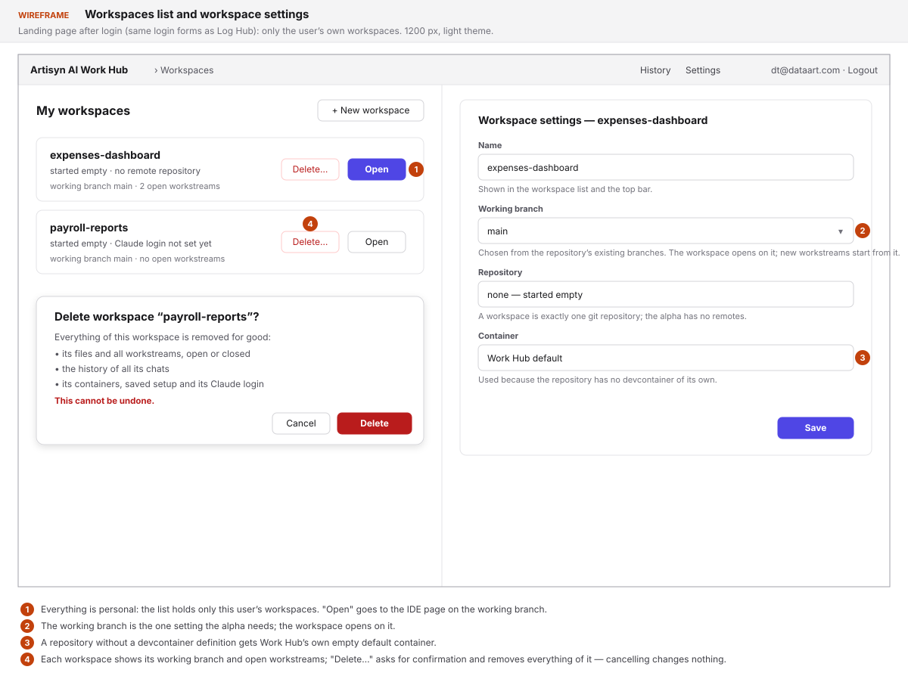

New workspace — clone a repository or start empty (the alpha has only "start empty", FR-9; the
clone half of this sketch is for a later version):

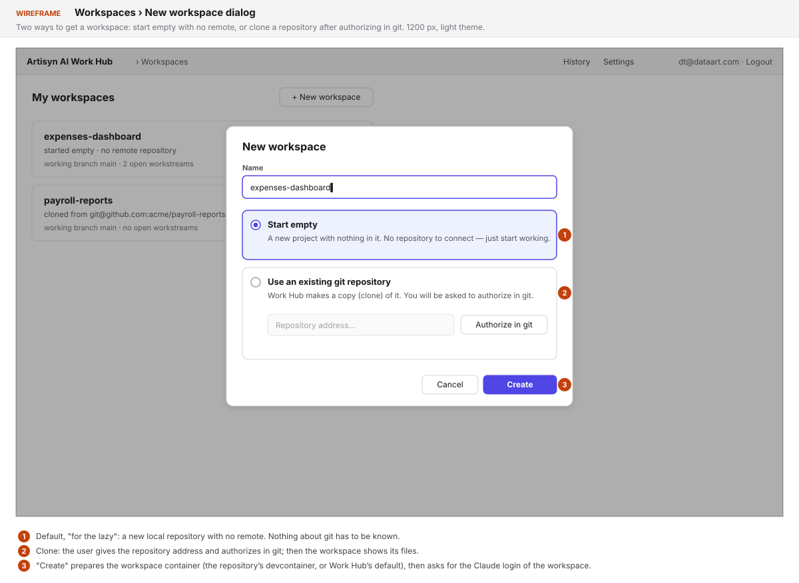

Claude login for a new workspace — a new login, or copy it from another workspace:

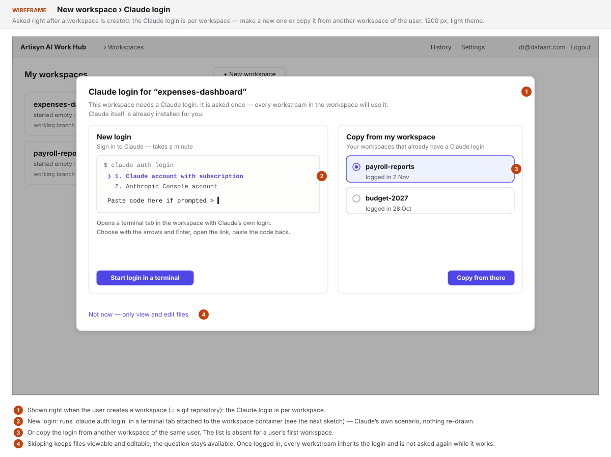

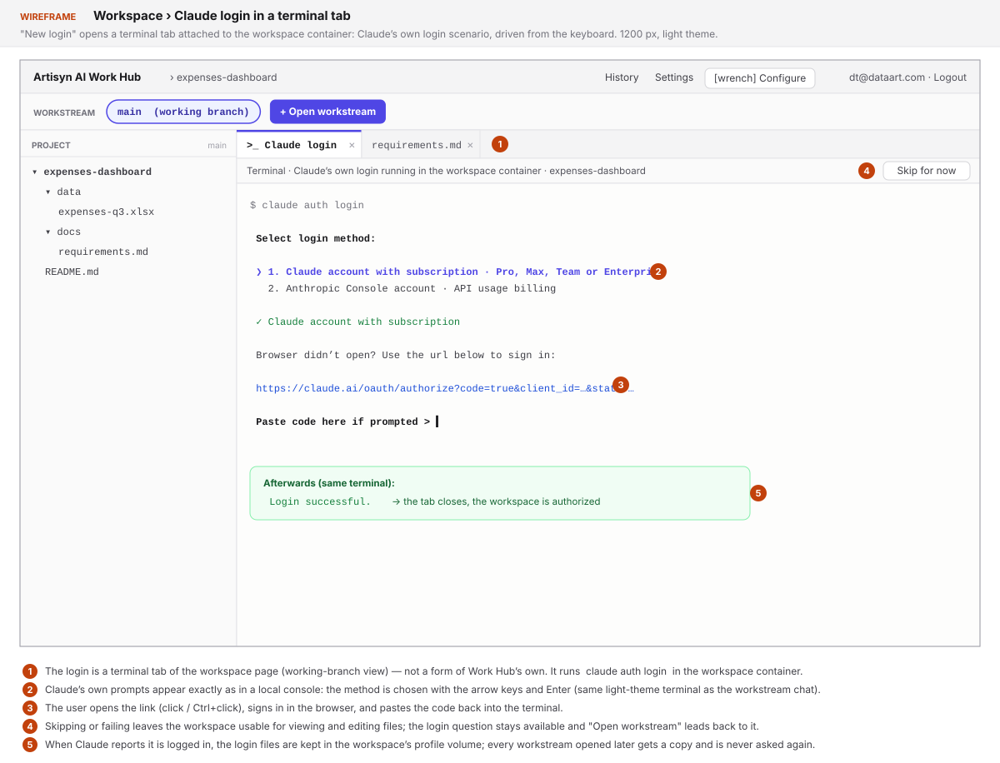

Workspace on its working branch, no workstream selected, with the "Configure" (wrench) action of
FR-25a in the header:

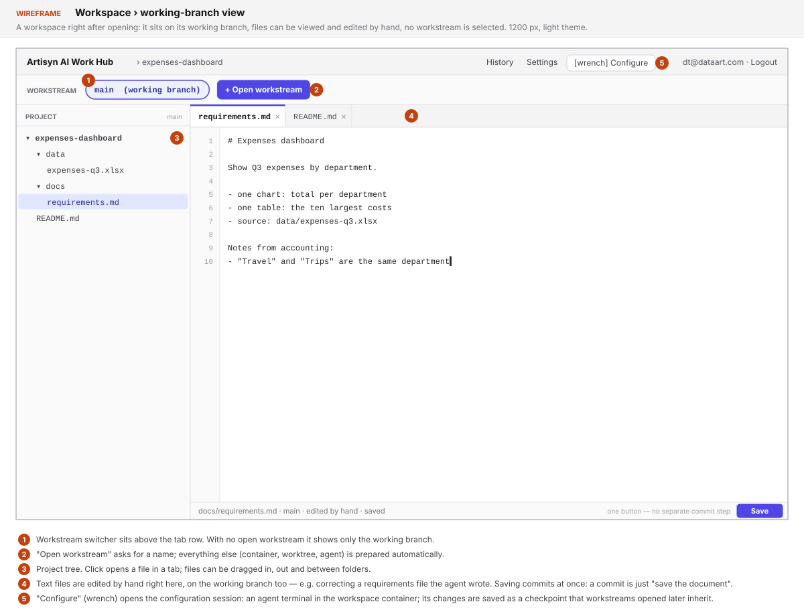

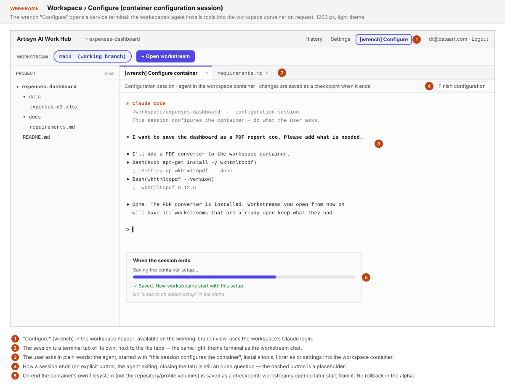

"Open workstream" dialog:

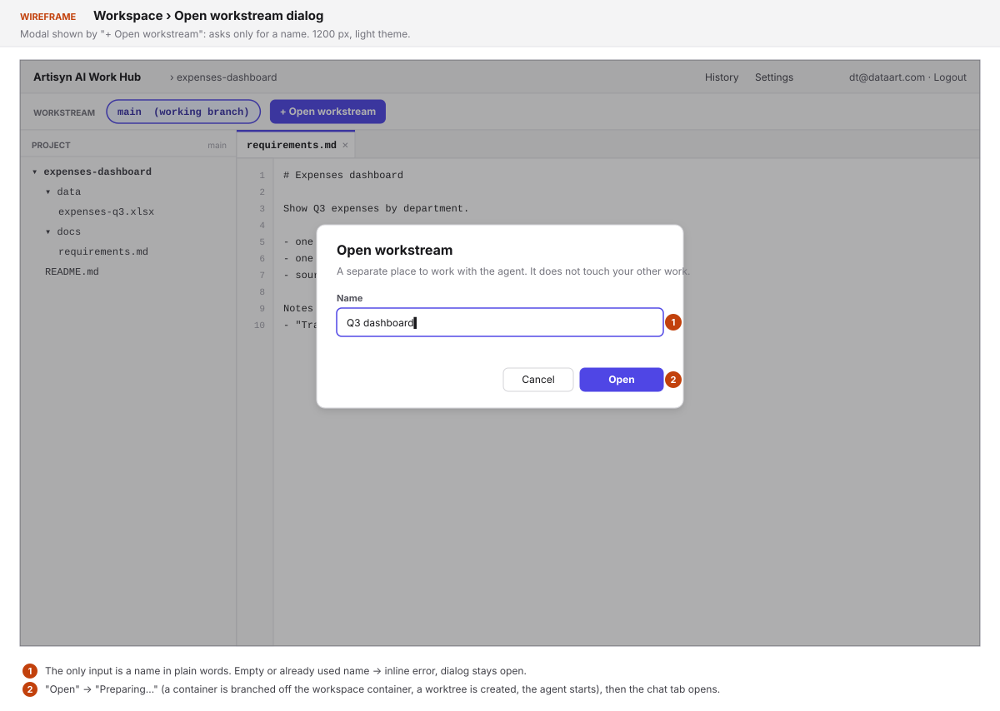

A selected workstream: switcher above the tabs, pinned chat tab leftmost — a real terminal with
the Claude CLI, here asking a question:

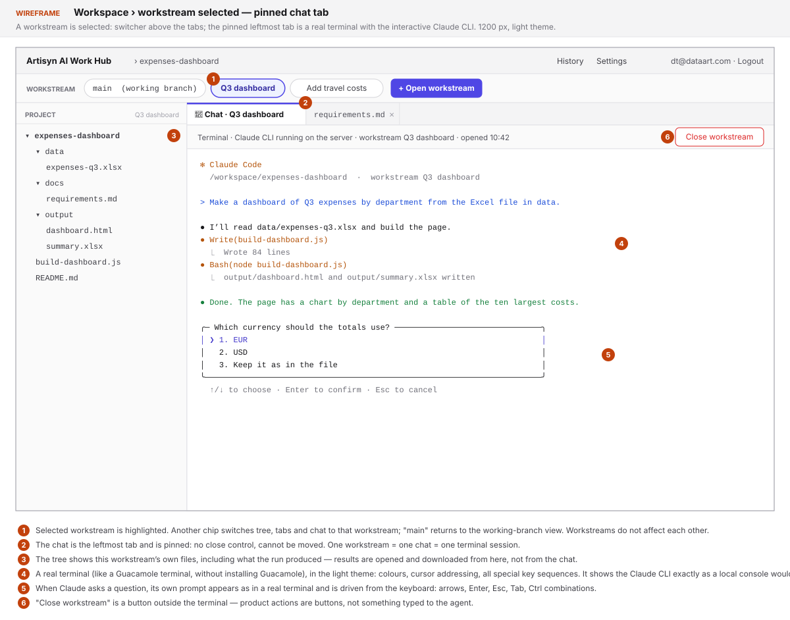

Looking at a result file opened from the tree, and downloading it:

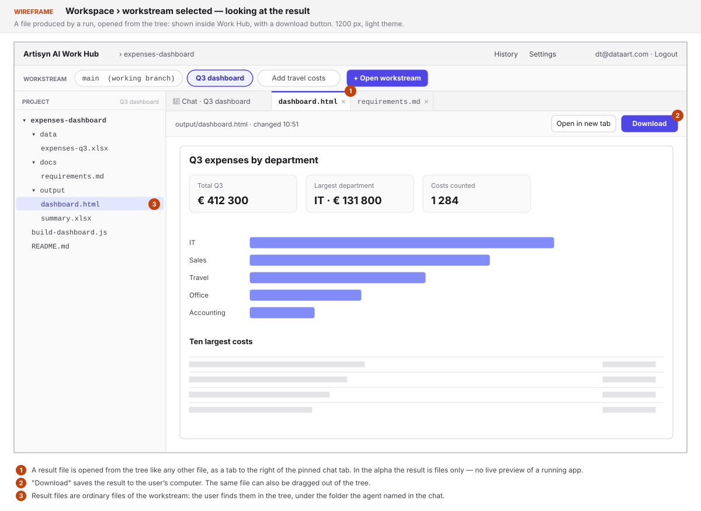

Drag and drop into, out of and inside the file tree:

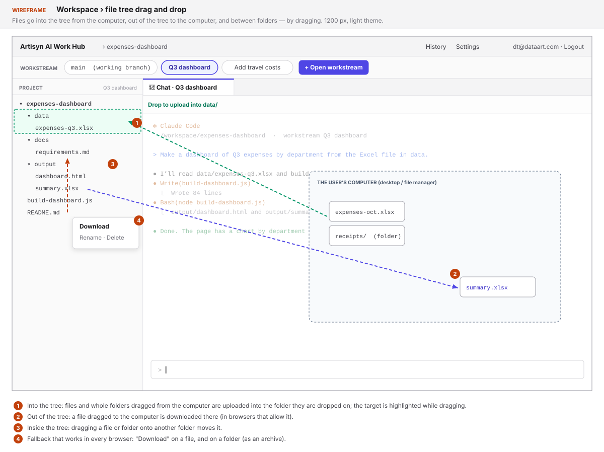

Closing a workstream — bring into main, already merged elsewhere, close for now, or discard:

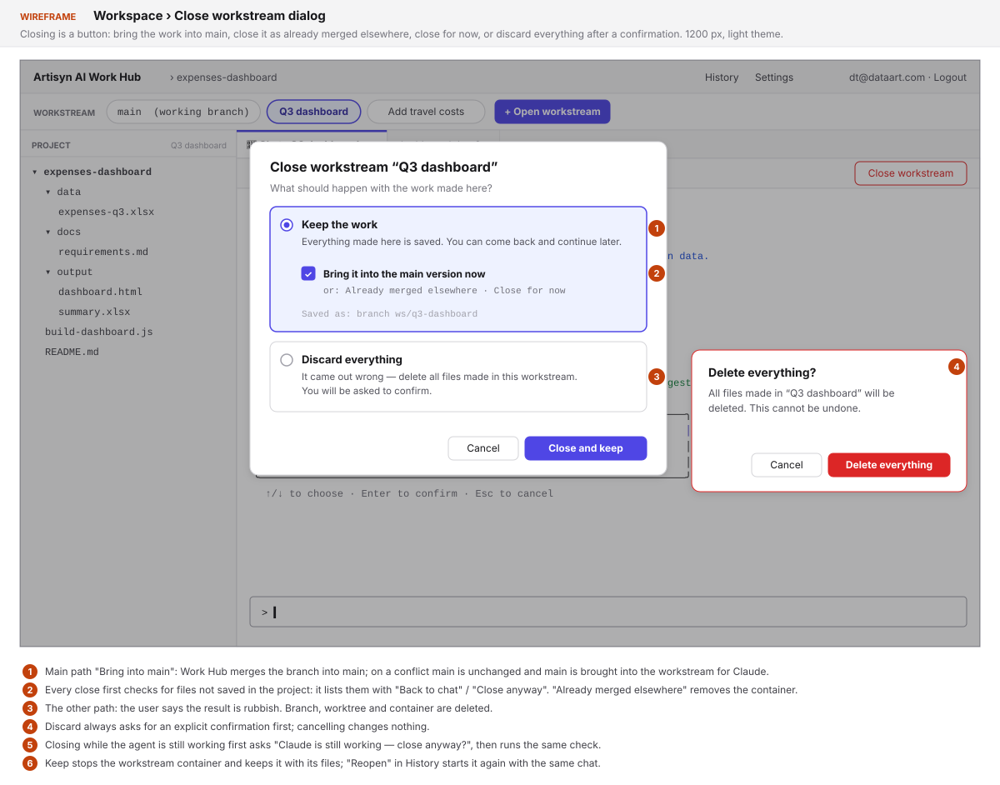

History of workstreams, with reopen:

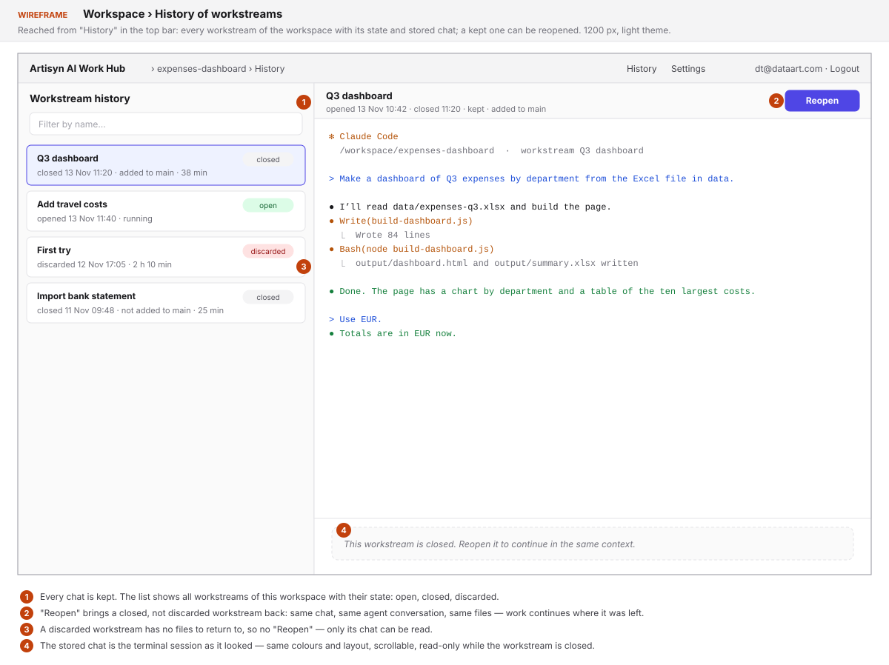

## Common sense considerations

- A discarded workstream's terminal session stays in the history, read-only.
- No dragging files into the chat in the alpha (NFR-1); a path can be typed or pasted into the
  terminal.
- "Bring into main" and "Close for now" stop the workstream container and keep it; reopen starts
  it and resumes the agent.
- Open workstreams survive a Work Hub server restart (tmux in the container); after a host
  restart Work Hub starts their containers and resumes the agents.
- No limit on running containers per user in the alpha.
- The agent's session id is stored per workstream; reopen resumes that conversation.
- A reopened workstream continues on its own branch as it was left.
- Claude's login runs in a terminal tab in the workspace container; the code is pasted into
  that terminal.
- Git credentials and remote sync are not needed: the alpha has no remotes.
- The workspace list shows name, working branch and open workstreams; delete removes everything
  of the workspace, history included.
- The repository and home live in per-container volumes outside the container filesystem;
  workstreams start from the latest checkpoint image plus copies of the workspace's volumes; commits
  travel back as git bundles.
- The Claude login is the agent's own files in the profile volume
  (`~/.claude/.credentials.json`); hardening comes later.
- The configuration session ("Configure", wrench) is in the alpha; it saves checkpoints of the
  workspace container, with no rollback yet.
- Devcontainers are Work Hub's own subset over the Docker API, with a locally built default
  image; no devcontainer CLI and no Node on the host.
- The terminal is tmux in the container, bridged over a WebSocket; history is the raw output
  stream plus resize events, copied into Work Hub's storage.
- A save, upload or move commits only the paths it touched; a name clash asks to overwrite.
- A workstream name is any non-empty text up to 100 characters, unique among not discarded
  workstreams; the branch name is derived from it.
- The working branch is chosen from existing branches; a workstream records the working branch
  at its opening as its base; an empty workspace starts with an initial commit on `main`.
- Every FR behaviour without an AC got one (AC-3a, AC-12b, AC-16a, AC-21a, AC-22c, AC-22d, the
  AC-20a/AC-20d/AC-24 additions); AC-8a lists everything workspace deletion removes.
- The workspace container starts on demand when an action needs it and stays running.
- File and git work in volumes goes only through the Docker Engine API; the server only creates
  and removes the volume folders.
- Volumes are host folders (bind mounts) under the data directory, laid out by user email and
  workspace/workstream name, so files survive a dead server or Docker (owner, 2026-11-13).
- A workstream starts from the latest checkpoint image; there is no `docker commit` at opening.
- A Configure session ends with "Finish configuration" or agent exit; one per workspace; other
  actions keep working meanwhile.
- The server is configured by environment variables, like Log Hub.
- Terminal recordings are files in the data directory, indexed in Postgres; no size limit or
  retention in the alpha.
- A workspace name follows the workstream name rules; no rename in the alpha; ids are internal.
- Work Hub uses the same three test kinds and adds its own checks to `repo-health-checks.json`;
  NFR-1a, NFR-2, NFR-4 and NFR-5 have ACs.
- Volumes are copied by a helper container from the default image with a tar pipe; workspace git
  writes wait for the copy.
- The pane log lives in the profile volume and is synced by byte offset; resizes are stored with
  their offsets.
- An open tab reloads on agent changes when clean and asks "Keep mine / Take theirs" when dirty.
- A failed Docker step rolls back its attempt and offers "Try again".
- "Bring into main" commits the agent's unsaved changes (outside `.gitignore`) itself before the
  merge (owner, 2026-11-14; replaces "Work Hub never commits for the user"); only "Already merged
  elsewhere" lists files that would be lost. The default repository ships a `.gitignore`.
- Close options: "Bring into main" (local merge via bundle), "Already merged elsewhere" (remove,
  state *done*), "Close for now", plus *discard*. A merge conflict is combined by the agent in the
  chat after Work Hub brings the current working branch into the workstream.

## Open Questions

None open. Kept in `open_questions_ru.md` next to this file (Russian copy).

## Notes

<!-- Append timestamped notes here as work progresses -->

- 2026-11-13 — owner's answers (rounds 1–10) and PoC results: see [notes.md](notes.md).
- 2026-11-13 — whether copies of `~/.claude/.credentials.json` survive refresh-token rotation
  (FR-24a) is checked by the owner during implementation; FR-24a is adjusted then if needed.
- 2026-11-13 — owner (during planning): after implementation Work Hub must be deployable locally
  as a dockerized server, or started inline without Docker like the local Log Hub → FR-1b, AC-1a.
- 2026-11-13 — owner (during planning): preview is plain text for now; editor Monaco or similar;
  licences neither paid nor GPL → NFR-6, impl-plan D19/D20, research/editor-choice.md.
- 2026-11-13 — planning PoC
  [`docs/pocs/2026-11-13-2008-workhub-volume-copy/`](../../../pocs/2026-11-13-2008-workhub-volume-copy/README.md)
  covers FR-5b's volume copy: 14/14 — a checkpoint holds neither repo nor login, a root helper
  container's tar pipe keeps owner, mode and symlinks (about 2 s with 20 000 extra files).
