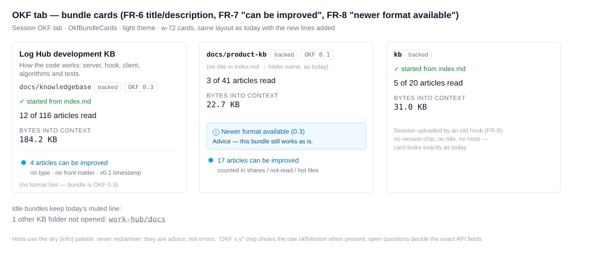
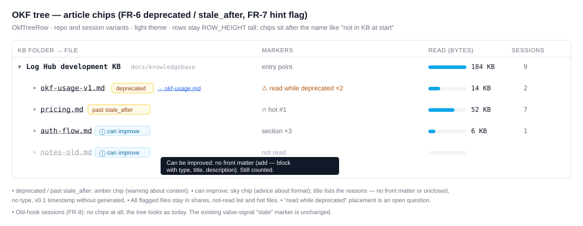

# 2026-11-19: OKF Tab Support for v0.3 and Any-Version Bundles

**Status:** todo
**Priority:** medium
**Type:** feature
**Module(s):** server | hook | client
**Owner:** denis.tsyplakov
**Created:** 2026-11-19
**Tracker:** GH-156 https://github.com/DataArt/artisyn-log-hub/issues/156

## Description

The OKF tab supports OKF v0.3 bundles (spec: SPEC.md v0.3 at
https://github.com/open-knowledge-format/open-knowledge-format) and bundles of any version,
including partly broken ones:

1. Server, must, size M: resolve KB pointers per v0.3 §6 (FR-1).
2. Server, should, size S: reserved `index.md` / `log.md` and dot-paths are not articles (FR-2).
3. Hook, should, size S: detect `okf_version` past the 512-byte window (FR-3).
4. Hook + server + client, should: surface key v0.3 metadata (FR-6).
5. Hook + server + client, should: flag format deviations and pre-0.3 bundles as improvement
   hints, never as errors — the files still count (FR-7, FR-8).

Hard requirement from the user: nothing may crash or drop a bundle of any version or a partly
broken one, per the consumer rules of v0.3 §11.2 (FR-4), and old hooks stay compatible (FR-5).

## Functional Requirements

- FR-1: KB pointers resolve per OKF v0.3 §6. The extraction version is bumped so stored sessions
  show the existing "extracted by an older version" state until recomputed (`recompute-all-sessions`).
  - Article's bundle: the snapshot bundle with the longest root that contains the article. Bundle
    roots (the folder of each bundle `index.md`) reach the extractor as a new optional
    `ExtractOkfAccessOptions` field, filled by all three callers (`okf-access-writer.ts`,
    `okf-facts.service.ts`, `okf-usage.service.ts`). With no snapshot, or for an article outside
    every bundle, the bundle root is the root of the repo the read resolved to (today's behaviour).
  - `./x` and `../x`: joined onto the article's folder and normalised (`.` / `..` collapsed) before
    any other handling. A result above the repo root drops the pointer; leaving the bundle but
    staying inside the repo is valid.
  - `/x`: first resolved as an absolute path against the session roots (today's behaviour); only
    when that does not resolve, `<bundleRoot>/x`. Drive-letter paths (`C:/…`) are always absolute.
  - Bare `p`: candidates in order `dir(article)/p`, `repo/p`, `<bundleRoot>/p` (the third is the
    §12.1 fallback, tried for every bundle — the snapshot carries no version), de-duplicated.
  - Each span still stores exactly one row with one repo-relative `pointer` (no schema change),
    chosen in the extractor's final pass (like `followed`): the first candidate present in the
    bound snapshot or touched by any call of the same node, otherwise `repo/p`.
  - A pointer is followed when any of its candidates is read later; value-signals `notFound` is
    computed on the stored pointer only.
  - "New pointer" is computed from the raw span text, not the resolved path.
- FR-2: `index.md` and `log.md` at any depth are not counted as articles (shares, not-read list,
  hot files), but reads of them still count as KB access for the entry-point logic. A path with a
  segment (relative to the bundle root) starting with `.` is outside the bundle: not an article and
  not KB access. Pointer logic for such paths is unchanged.
- FR-3: The hook detects a bundle whose `okf_version:` line appears anywhere inside the bundle-root
  `index.md` front matter, scanning up to the closing `---` or `OKF_FRONT_MATTER_READ_BYTES = 8192`,
  whichever comes first; a match before either point is a bundle.
- FR-4: A bundle of any declared version (absent, `0.1`, `0.2`, `0.3`, unknown, numeric) and a
  partly broken bundle (malformed front matter, missing `type`, broken links, unparseable dates,
  missing nested `index.md`) is processed without error and without being dropped. An article with
  malformed, missing or unparseable front matter, or no `type`, is still listed and counted as an
  article; only its metadata is ignored. A bundle root is detected by the `okf_version:` line match,
  whatever the YAML validity or the value's type.
- FR-5: Server-side changes (FR-1, FR-2, FR-4) work with every existing hook version; new hook
  fields, if any, are optional and absent fields fall back to today's behaviour. An old hook
  (512-byte window) still misses bundles whose `okf_version` sits past 512 bytes — accepted.
- FR-6: v0.3 metadata comes from the hook, not from a YAML parser:
  - Per bundle: optional `okfVersion` (raw string of the `okf_version` value), `title`,
    `description` from the bundle-root `index.md` front matter (the head FR-3 already reads).
  - Per article file: optional `meta` with a fixed whitelist of top-level scalar keys — `type`,
    `status`, `superseded_by`, `stale_after` — plus booleans `frontMatter` (a `---` block was
    found and closed), `hasGenerated` (top-level `generated:` key) and `hasTimestamp`
    (top-level `timestamp:` key). Parsed with a line regex over the first
    `OKF_FRONT_MATTER_READ_BYTES` of the content the hook already reads for hashing, and cached
    with the hash in `okf-state.json`, so unchanged files are not re-read.
  - Scalar values: trimmed, a trailing ` #` comment and one pair of surrounding quotes stripped;
    empty, `null` and `~` mean absent (v0.3 §11.2); `status` compared case-insensitively; each
    value capped at 200 chars.
  - Hash cache entry: `[mtimeMs, size, sha256, meta|null]`. A legacy 3-element entry is a miss
    (the file is read once to fill `meta`), and the cache is rewritten whenever an entry was
    upgraded, not only on a tree-key or count change. `OKF_STATE_VERSION` stays 1 so
    `knownSnapshotIds` is kept.
  - Snapshot id: `computeOkfSnapshotId` projects `okfVersion`, `title`, `description` and each
    file's `meta` only when present, so an upgraded hook on an unchanged, already-uploaded KB gets
    a new id and uploads one full body, while old-hook ids stay identical.
  - Server: `normaliseSnapshot` passes the new keys through; the server derives the deprecated,
    `stale_after` and hint flags and exposes them as new optional fields on `OkfBundleSummary` and
    file `OkfTreeNode` (names fixed in the plan) on every OKF route that returns those types; the
    client only renders them. The contract-registry rows of the changed routes are updated.
  - UI: the bundle card shows `title` / `description` when present, otherwise the folder name as
    today. An article with `status: deprecated` gets a "deprecated" chip, with a link to
    `superseded_by` when present; each read of it in the access trail shows the same chip.
    Verdicts, shares and counts are unchanged. An article whose `stale_after` is in the past or
    unparseable (v0.3: never fresh) gets a "past stale_after" chip (API name distinct from the
    existing value-signals `stale` marker, which stays unchanged). A date-only `stale_after` means
    00:00 UTC of that day, offset values are compared in UTC, any other format is unparseable.
- FR-7: Format deviations are improvement hints, never errors: the file stays an article and is
  counted everywhere as today. Article hints: no front matter or an unclosed one; no `type` (not a
  v0.3 concept); `timestamp` without `generated` (v0.1 style). The OKF tab shows a hint flag on
  the article and a per-bundle count of articles with hints ("can be improved"), worded as advice,
  not as a failure.
- FR-8: A bundle whose `okfVersion` is absent, not a version number, or older than `0.3`
  shows a "newer format available (0.3)" hint on its bundle card — advice, not an error.

  

  
- FR-9: Without the new hook fields (old hook), FR-6 to FR-8 show nothing and everything else
  works as today.

## Non-Functional Requirements

- No `schemaVersion` bump of the OKF snapshot for additive fields; an old hook keeps uploading
  unchanged snapshots, and an older server ignores the new fields (it stores the body verbatim and
  `normaliseSnapshot` projects only the known keys).
- Snapshot size: `meta` adds at most a few short strings per file; the FR-6 value cap keeps a
  broken front matter from inflating the body towards `OKF_SNAPSHOT_MAX_BYTES`.

## Acceptance Criteria

- [ ] An article in `kb/algorithms/x.md` with the pointer `` `../okf-usage.md` `` that the agent
      then reads is counted as a followed pointer, not as a dead pointer (FR-1).
- [ ] A `/tables/x.md` pointer in a bundle rooted at `kb/` resolves to `kb/tables/x.md`; an
      absolute path inside the session repo still resolves as today (FR-1).
- [ ] In a bundle rooted at `kb/`, `kb/a/x.md` names `` `tables/y.md` ``, the agent reads
      `kb/tables/y.md`, and the pointer counts as followed (FR-1, bundle-root fallback).
- [ ] When both `dir(A)/p` and `repo/p` exist and only `repo/p` is read: followed = 1, dead = 0
      (FR-1).
- [ ] `./x`, `../x` and a `..` that escapes the repo each have an algorithm row; the escaping one is
      dropped (FR-1).
- [ ] A session with no snapshot uses the repo root as bundle root; `./x`, `../x` and bare `p`
      still resolve relative to the article folder first (FR-1, FR-5).
- [ ] Nested `index.md`, `log.md` and `.hidden/a.md` do not appear in article shares, the not-read
      list or hot files (FR-2).
- [ ] A session that reads `kb/sub/index.md` and then `kb/sub/a.md` keeps KB access and today's
      entry-point verdict (`okf-verdict` row); reading only `.hidden/a.md` gives the same verdict as
      no KB read (FR-2).
- [ ] A bundle-root `index.md` with 1 KB of `description` before `okf_version` is detected by the
      new hook; `okf_version` past 8192 bytes is not (FR-3).
- [ ] Algorithm rows / scenario steps cover bundles with no, `0.1`, `0.2`, `0.3`, unknown and
      numeric `okf_version`, malformed YAML front matter, missing `type`, broken links and
      unparseable dates — each yields the same bundle membership and article counts as the
      well-formed equivalent (FR-4).
- [ ] A session uploaded by the previous released hook still gets an OKF tab on the new server
      (FR-5), with no metadata chips and no hints (FR-9).
- [ ] A bundle-root `title` is shown on the bundle card; a bundle without one shows the folder name
      (FR-6).
- [ ] An article with `status: deprecated` + `superseded_by` shows the chip and the link, and a
      session read of it shows the chip in the access trail; one with a past or unparseable
      `stale_after` shows "past stale_after" (FR-6).
- [ ] Algorithm rows cover quoted, commented, empty / `null` front-matter values and date-only,
      offset, past, future and unparseable `stale_after` (FR-6).
- [ ] After upgrading the hook on an unchanged, already-uploaded KB, the next session shows the
      metadata chips and hints (FR-6).
- [ ] `user-docs/okf-tab.md` explains the title/description, the deprecated and "past
      stale_after" chips, the hint flags, the "can be improved" count and the "newer format
      available (0.3)" hint and how to clear them; help regenerated by `npm run build:help`.
- [ ] An article with no `type`, one with no front matter and one with only `timestamp` each show a
      hint flag and are still counted in shares / not-read / hot files (FR-7).
- [ ] Bundles with `okf_version` absent, `0.1`, `0.2`, numeric `1` and unknown `foo` show the
      "newer format available" hint; `0.3` does not (FR-8).
- [ ] An unchanged article is not re-read on the next snapshot (meta comes from the hash cache)
      (FR-6).

## Open Questions

- What reference time decides that `stale_after` is "in the past": the session start time (was
  the article stale when the agent read it) or the time the page is viewed? The repo-level report
  has no single session time — should it use view time there?

  Answer (2026-11-20): session tab and trail — the root session's start time; repo tab — view time.
  "Read while deprecated" is shown only as the per-read chip in the access trail (no tree counter).
- FR-8 vs the acceptance criteria: should a numeric `okf_version: 1` show the "newer format
  available" hint (as the AC says) or not (FR-8: only absent, unparseable or older than 0.3)? The
  proposed rule is: strip quotes, parse `MAJOR.MINOR[.PATCH]`, compare numerically — `0.3`,
  `"0.3"`, `0.3.1`, `0.10` and `1` get no hint. Or is only `0.3.x` current?

assume semver

## Out of scope

- Extracting markdown link targets (`[text](../x.md)`) as pointers.
- Trust tier from `generated` / `verified` (needs list parsing and date comparison) — follow-up.

## Common sense considerations

- The bundle-root fallback for bare pointers applies to every bundle, whatever its `okfVersion`.
- One stored row per pointer span; no schema or migration change.
- Fallback stored path for an unmatched bare pointer is `repo/p`, so code pointers look as today.
- Bundle roots reach the extractor as an optional option; absent → today's repo-relative behaviour.
- `/x` tries the absolute-path resolution first, so existing absolute pointers do not regress.
- Dot-paths follow v0.3: outside the bundle, not KB access.
- Malformed front matter never removes an article or a bundle; it only loses metadata.
- Front-matter read cap is the named constant 8192 bytes.
- Snapshot id includes the new fields only when present: upgraded hooks re-upload once, old-hook ids unchanged.
- Legacy 3-element hash-cache entries are a miss; `OKF_STATE_VERSION` stays 1.
- Server derives all metadata flags; the client only renders them.
- New API fields are optional; exact names are fixed in the plan; contract-registry rows updated.
- Deprecated reads are marked in the access trail only; verdicts, shares and counts unchanged.
- The `stale_after` state has its own name ("past stale_after"); the value-signals `stale` marker is unchanged.
- Front-matter scalars are normalised per v0.3 §11.2 (null/empty = absent), capped at 200 chars.
- Pointer candidate is chosen in the extractor's final pass; `notFound` uses the stored pointer.
- With no snapshot the bundle root is the repo root; article-relative resolution still applies.
- In-app help (`user-docs/okf-tab.md`) documents every new chip and hint (offline-first).

## Notes

- Tests per the repo test policy: algorithm rows in `docs/algorithm-examples/` for the `okf-*`
  algorithm docs (`okf-access-extraction`, `okf-verdict`, `okf-value-signals`, `okf-snapshot`) and
  steps in the existing OKF scenarios — no new unit tests.
- Code-analysis findings (file locations), spec sources, version changes and the KB migration
  already done: `notes.md`.
