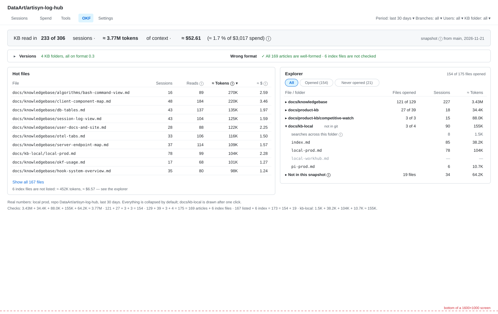
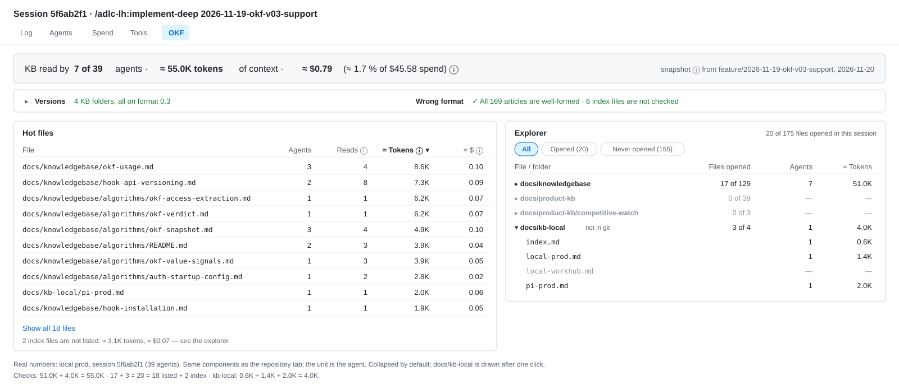
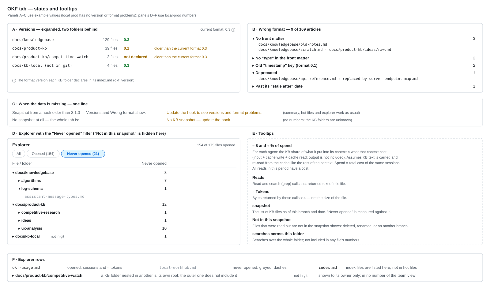

# 2026-11-21: OKF Tab — Cut Down to Four Clear Views

**Status:** todo
**Priority:** medium
**Type:** feature
**Module(s):** client | server
**Owner:** denis.tsyplakov
**Created:** 2026-11-21
**Tracker:** GH-161 https://github.com/DataArt/artisyn-log-hub/issues/161

## Description

Shrink the repository and session OKF tabs to four views a user understands at a glance — versions,
wrong format, hot files and a file explorer — plus one summary line with the KB cost.

The complex parts of today's tabs are removed, not fixed: the tabs are too long, full of
unexplained jargon, their numbers use contradicting denominators, and the verdict and heuristics
are mostly noise (critique in `notes.md`).

Rule: keep only what is a plain count of facts. Anything that claims to judge the KB — even
"coarse article" ("big file, small reads → split it") — needs an understanding of what the agent
was looking for, which a rule without an LLM cannot get right (a small read may be exactly the
right read of a well-structured article), so it goes. Hot files and the explorer show the facts;
the user draws the conclusion.

## Functional Requirements

What stays. The page answers five questions and nothing else: is the KB used (FR-5), what it
costs in context (FR-5a), which articles carry the load (FR-3), which are never opened (FR-4), and
is the KB well-formed (FR-1, FR-2). The repository tab shows them over the selected period; the
session tab shows the same views, built by the same components, for one session tree.

- **FR-0 Counting rules (one set for every number on the page).**
  - A **read** is a `session_okf_access` row with `op = 'read'` or `op = 'grep'` under a bundle
    root, `after_own_edit` included: a search returns article text into the context just as a read
    does. A file is "opened" when it has at least one such row. A `grep` row on a folder belongs to
    no file: it counts in the totals and in N and is shown in the explorer as a "searches across
    this folder" row inside that folder, with its sessions and tokens (tooltip: not included in
    any file's numbers). `list` and `write` rows, paths with glob characters and `.md` paths
    outside every bundle root are not counted anywhere. Bundle roots come from the reference
    snapshot (FR-5); a snapshot from a hook older than 3.1.0 has them too. In the team view the
    existing team filter removes a gitignored bundle before anything is counted, so its reads are
    in no number on the page.
  - **Reads** = the `calls` of those rows (tooltip: reads and searches). **≈ tokens** = their
    `bytes` / 4 (bytes returned by the calls, not the file size — said in a tooltip). Tokens are
    the only size unit on the page; bytes are not shown.
  - **Sessions** on the repository tab = root sessions; M = all root sessions matching the tab
    filters (the same count the Sessions tab shows, with or without a snapshot or extraction),
    N = those with at least one read. On the session tab the unit is the agent: M = all nodes of
    the tree, N = nodes with at least one read, and the columns are labelled "Agents".
  - **Each file belongs to exactly one bundle** — the deepest bundle root above it. A bundle nested
    in another bundle has its own row in versions and is its own top-level root in the explorer;
    the outer bundle never includes its files.
  - Hot files and the explorer are built from one `files[]` list of the response, so per-file
    values are equal by construction; the explorer's roots (files plus folder-level searches) add
    up to the summary totals.
  - `index.md` / `log.md` are index files: they are meant to be read often, so they are not
    listed in hot files (FR-3), but their reads count in N, in the tokens and in the cost, and
    they are listed in the explorer (FR-4) like any file. They stay exempt from the format checks
    of FR-2.
- **FR-1 Versions.** One row per KB bundle (folder with `okf_version` in its `index.md`): path,
  file count, declared `okf_version` (or "not declared"), and a plain "older than the current
  format 0.3" marker (existing `okfVersionHint`). When every bundle is on the current format the
  block is one collapsed line ("4 KB folders, all on format 0.3") that expands to the rows. When
  the snapshot came from a hook older than 3.1.0 (no metadata), say so in one line ("update the
  hook to see versions") instead of showing blanks.
- **FR-2 Wrong format.** List of KB articles with format problems, grouped by problem, each group
  with a plain-language title and count: no front matter, no `type`, old v0.1 `timestamp` key,
  deprecated (with its replacement), past its `stale_after` date (existing `articleMetaFlags` /
  `formatHints`). N articles = the snapshot's files without the index files; the empty state is
  one line that says so ("All 169 articles are well-formed · 6 index files are not checked"). Same
  old-hook line as FR-1.
- **FR-3 Hot files.** Top KB files by ≈ tokens read, columns: file, sessions, reads, ≈ tokens,
  ≈ $. Top 10 with "show all". Sorted by ≈ tokens, descending; every numeric column is sortable
  and the arrow marks the active one. No hidden subsets (no upkeep exclusion, no "current version
  only"). Rows are not clickable. Index files are left out; one line under the table says how
  many and what they add ("6 index files are not listed: ≈ 452K tokens, ≈ $6.57 — see the
  explorer"), so the table plus that line plus the folder-level searches add up to the summary.
- **FR-4 Explorer.** A tree with one top-level root per KB bundle of the snapshot; every root and
  folder is collapsed by default. A file row shows sessions and ≈ tokens, or is greyed when never
  opened. A folder row shows "X of Y files opened", the sessions that read anything in it and the
  ≈ tokens read in it; the header shows "X of Y files opened" for the whole KB. An expanded folder
  lists its "searches across this folder" row, its sub-folders and then all its own files —
  nothing is cut to "N more". A filter — All (default on both tabs) / Opened / Never opened, each
  with its count — narrows the tree; under "Never opened" the folder rows show only "K never
  opened". Files under a bundle root that were read in the period but are not in the snapshot
  appear under one more root, "Not in this snapshot" (tooltip: deleted, renamed, or on another
  branch), shown under All and Opened; they are outside "X of Y", and their reads count in the
  totals, in N and in hot files. A gitignored bundle is shown to its owner only.
- **FR-5 One summary line.** At the top: "KB read in **N of M** sessions ·
  **≈ X tokens** of context · **≈ $Y** (≈ P % of $T spend) · snapshot from `<branch>`, `<date>`"
  (session tab: "N of M agents"). It is the only ratio of sessions (or agents) on the page; the explorer's "X of Y files"
  counts files, not sessions. The repository tab takes the newest snapshot among the filtered root
  sessions on the repository's default branch, or the newest of all when there is none (how the
  default branch is known is decided in the plan); the session tab takes the snapshot bound to the
  tree's root. The tooltip of "snapshot" says it is the list of KB files as of that branch and
  date. With no snapshot at all the bundle roots are unknown, so the whole tab is one line ("No KB
  snapshot — update the hook") and shows no numbers.
- **FR-5a KB cost.** An estimated dollar cost of the KB in the context, cache included. For each
  agent (node): KB share = its KB ≈ tokens / the tokens it put into the context (`input_tokens` +
  `cache_write_tokens` of `session_stats`), capped at 1; KB cost = that share × the agent's
  context-side cost (`cost_input` + `cost_cache_write_5m` + `cost_cache_write_1h` +
  `cost_cache_read` of `session_costs`; output is not included). A file's cost is the same formula
  with the file's tokens, so the per-file values add up to the total. The estimate assumes KB text
  is carried and re-read from the cache like the rest of the context. An agent without a computed
  cost adds its tokens and no dollars. The server computes it and returns it as optional fields
  (per file and a total) in both `okf-usage` responses. Shown as the total in the summary line and
  as the "≈ $" column of hot files, with two decimals and "< $0.01" below that, always labelled
  "≈" with a tooltip that states the formula and how many reads have no cost. Next to the total
  the summary shows the KB share of the spend: P = KB cost / T, where T is the total cost of the
  same session set — all M root sessions with their sub-agents on the repository tab (the Spend
  tab's total under the same filters), the whole tree on the session tab. Shown as "≈ P %" with
  one decimal below 10 %, "< 0.1 %" below that, and omitted when T is unknown or zero.

What goes:

- **FR-6 Remove from both tabs:** the verdict card and its level, the checks list, Anomalies, the
  KPI tiles, the whole section B (pointer yield, routing misses, value signals to check by hand,
  dead pointers, searched after reading, catalog), the upkeep panel and upkeep markers, the
  file-share histogram, the "Not read" list (the explorer covers it), the "How agents reached the
  KB" chips and the Agents panel, the Bytes/Calls heat toggle, the "Read · top 5" block of the
  session tab (replaced by FR-3), the "285 of 290 have no OKF analysis" banner and its Recompute
  button (nothing kept depends on the extractor version), the article drill-down with its route
  `reports/okf-usage/article` and URL param `okfArticle`, the session agent trail
  (`OkfAgentTrail.tsx`, route `…/okf-usage/trail`, URL param `okfAgent`), and the "default
  thresholds" link. Also removed: the session-tab KB folder cards
  (`OkfBundleCards.tsx`, replaced by FR-1), the explorer's tree markers (`entry_point`,
  `folder_scan`, `own_edit`), the WRITE bar, the "Deeper analysis" hint, and the Settings →
  Analysis "OKF thresholds" section with its code-roots input. The repo filter strip keeps date
  range, branches, users, attribute filter and bundle select (the `bundle` query param stays).
- **FR-7 Remove the server side that only fed the removed UI** (verdict, value signals, upkeep
  logic, thresholds) and its now-unused routes / response fields, KB docs, algorithm docs and rows
  files — per the test policy, code no scenario reaches is deleted, not kept. Keep what FR-1..5
  need: snapshot ingest, `session_okf_access` extraction, `okf-metadata.ts`. Pointer / event
  extraction (`okf-pointers.ts`, `okf-task-context.ts`, rules 14-15 of `okf-access-extraction.md`
  and their rows) stays because the facts route returns it. Helpers the kept code imports from
  `okf-verdict.ts` move to a kept module; which module and which algorithm doc takes their rules
  is decided in the plan.
- **FR-8 Backward compatibility.** Old hooks keep uploading unchanged (snapshot line, query
  params); the server keeps accepting every field it accepts today, even ones it stops using. The
  API-key facts route used by the local KB-analysis skill keeps its contract. DB tables/columns
  that become unused (`session_okf_event`, `session_okf_pointer`, the stored OKF thresholds) are
  not dropped in this task — a follow-up task drops them; the writer stops filling the event /
  pointer rows unless the plan finds the facts route reads them, and keeps writing
  `sessions.okf_extract_version`. The hook is not changed.
  A settings PUT that still carries an `okf` section is accepted without validation and the stored
  value is kept untouched; `okfDefaults` / `okfFixedLimits` leave the settings responses.
- **FR-9 Docs.** `docs/knowledgebase/okf-usage.md`, the in-app help page for the OKF tab
  (`user-docs/`) and the KB index are rewritten for the four views; removed algorithm docs are
  removed from `docs/knowledgebase/index.md` and `algorithms/README.md`.

## Non-Functional Requirements

- The repo OKF tab fits its summary, versions and wrong-format blocks plus the top of hot files on
  one 1600×1000 screen; long lists are collapsed with "show all".
- No unexplained jargon: every label is plain English understandable without the KB.
- Follow `ui-components` conventions.

## Acceptance Criteria

- [ ] FR-1: the repo OKF tab on a repo with two bundles shows two version rows; a bundle without
      `okf_version` shows "not declared" and the older-format marker; an old-hook snapshot shows the
      "update the hook" line.
- [ ] FR-2: articles without front matter / without `type` / with `timestamp` / deprecated / past
      `stale_after` appear under their group with the right counts; a clean bundle shows the
      one-line empty state.
- [ ] FR-0: a file touched only by `grep` is listed as opened with its tokens; a session that only
      searched the KB counts in N; a folder-level `grep` adds its tokens to that folder's row and to
      the summary; a `list` row and a `.md` path outside every bundle root appear nowhere on the
      page and change no number; with a bundle nested in another, the
      file counts of the version rows add up to the explorer header's Y, and the "X of Y" of the
      explorer roots add up to the header's.
- [ ] FR-1: with every bundle on the current format the block is one line and expands to the rows.
- [ ] FR-3: hot files are sorted by ≈ tokens and the arrow is on that column; no bytes column; for
      any file, sessions and ≈ tokens in hot files equal those of the same file in the explorer;
      `index.md` / `log.md` are not in the table, the line under it gives their count, ≈ tokens and
      ≈ $, and they are listed in the explorer with the same values.
- [ ] FR-4: the explorer lists every snapshot file; never-opened files are greyed; "Never opened"
      shows exactly the files with no read and its count equals Y − X of the header; a file read in
      the period but absent from the snapshot is under "Not in this snapshot".
- [ ] FR-5: the summary line shows N of M, ≈ tokens and the snapshot branch/date; M equals the
      session count of the Sessions tab under the same filters; no other session ratio is on the page.
- [ ] FR-5a: the summary shows "≈ $" total; hot files has a sortable "≈ $" column; the per-file
      ≈ tokens and ≈ $ of "show all" plus the index-files line plus the folder-level searches add
      up to the summary totals;
      the tooltip states the formula; the summary shows "≈ P % of $T spend", where $T equals the
      Spend tab's total under the same filters and P = KB cost / T; with T unknown the share is
      not shown.
- [ ] Session tab: the same views with "Agents" as the unit everywhere (summary, hot files,
      explorer); no column is labelled "Sessions".
- [ ] FR-6: none of the removed blocks (verdict, checks, anomalies, KPI tiles, section B, upkeep,
      histogram, not-read, agents, agent trail, article drill-down, banner) renders on either tab.
- [ ] FR-7: removed server modules and their routes/fields are gone; lint, typecheck, build and the
      remaining algorithm tests pass; the contract registry matches the remaining routes.
- [ ] FR-8: an upload from hook 2.26 and from the current hook both succeed and both populate
      FR-3/FR-4; the facts route response for the contract fixture is unchanged, including
      `accessSeq`; a settings PUT with an `okf` section returns 200.
- [ ] Non-functional: a scenario step on the corpus repo checks that at 1600×1000 the summary,
      versions, wrong format and the first hot-files row are visible without scrolling.
- [ ] FR-9: KB and in-app help describe only the four views plus the summary line.
- [ ] Tests: the existing OKF scenario in `tests/scenarios/` is cut down to steps for FR-1..5 (no new
      scenario file); algorithm rows only for docs that remain (`okf-metadata`, `okf-snapshot`,
      `okf-access-extraction`, `okf-task-context`).

## Open Questions

None.

## Common sense considerations

- This task is implemented on top of the merged `2026-11-19-okf-v03-support`; the hook is not
  changed.
- One counting rule set (FR-0) feeds every number: reads and searches (owner, 2026-11-21: a grep
  returns article text and costs tokens), tokens as the only size unit, root sessions on the
  repository tab, agents on the session tab, one bundle per file.
- The session tab does not show which agents read what (owner, 2026-11-21: not critical).
- M is every root session under the filters, so it matches the Sessions tab; never-extracted
  sessions (10 of 306 on local prod) are in M and there is no Recompute.
- `.md` paths outside every bundle root are dropped (72 % of the read bytes on local prod are
  task plans, not KB).
- The cost includes the cache (owner, 2026-11-21): KB share of what an agent put into the context
  × that agent's input + cache-write + cache-read cost. On local prod ≈ $52.61 of $3,017 (≈ 1.7 %);
  pricing each read once at the input rate gave $16.42, because almost nothing is billed as plain
  input.
- With no snapshot the tab is one line; a gitignored bundle is in no number of the team view.
- The explorer is collapsed by default with the "All" filter on both tabs.
- Index files are not hot files — an index is supposed to be read often — but they count in the
  cost and totals (owner, 2026-11-21); on local prod 6 index files are ≈ 452K of ≈ 3.77M tokens.
- The summary shows the KB cost as a share of the total spend of the same sessions (owner,
  2026-11-21).
- The reference snapshot is the newest on the default branch among the filtered sessions.
- Versions collapses to one line when every bundle is current; wrong format already has a one-line
  empty state.
- The explorer may show file ratios ("X of Y files opened") and has a "Never opened" filter; the
  summary holds the only session ratio.
- The session tab reuses the repository tab's components with agents as the unit.
- The article drill-down and the agent trail are removed with their routes; rows are not clickable.
- Session bundle cards, tree markers, the WRITE bar, the "Deeper analysis" hint and the Settings
  "OKF thresholds" section are removed; the filter strip is kept as is.
- A settings PUT with an `okf` section is accepted and ignored; `okfDefaults` / `okfFixedLimits`
  leave the responses.
- Unused tables are dropped in a follow-up task, not here.
- Pointer / event extraction stays for the facts route; `okf-task-context` stays an algorithm doc.
- Where the `okf-verdict.ts` helpers move, how the default branch is known and the exact response
  shape are decided in the plan.
- A gitignored bundle is shown to its owner and hidden in the team view.
- "Fits one 1600×1000 screen" is a scenario step; "no unexplained jargon" is checked in review.

## Notes

- Evidence — the original raw idea, the five-agent critique of the current tabs, and the critic
  verdict on the first real-data drawing of the planned tab — is in `notes.md`.
- The three wireframes in `wireframes/` follow FR-0 and carry real local-prod numbers (repo
  `DataArt/artisyn-log-hub`, last 30 days; session `5f6ab2f1`); panels A–C of the states sheet use
  example values.
