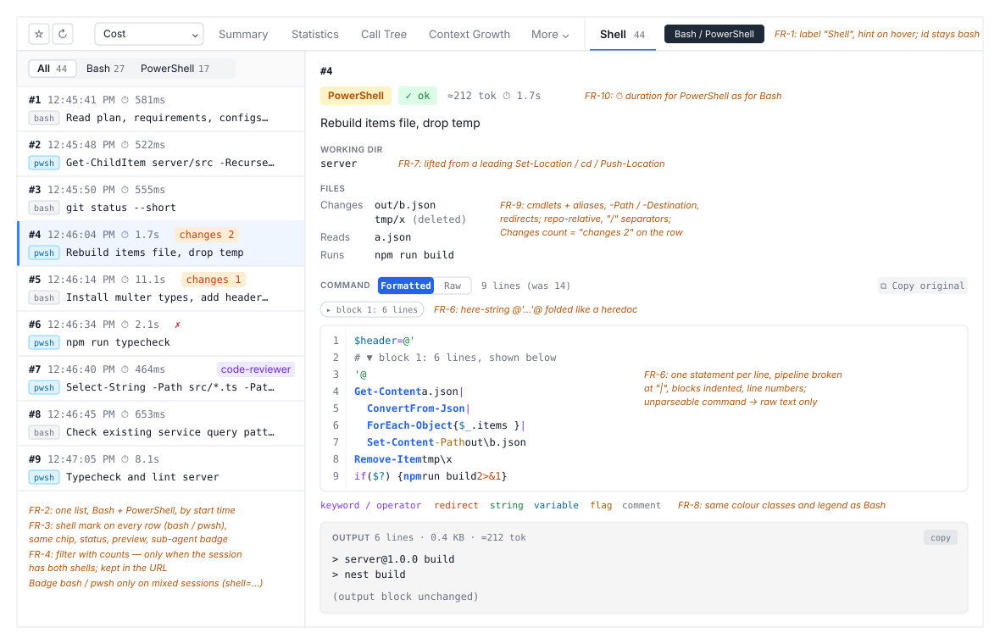
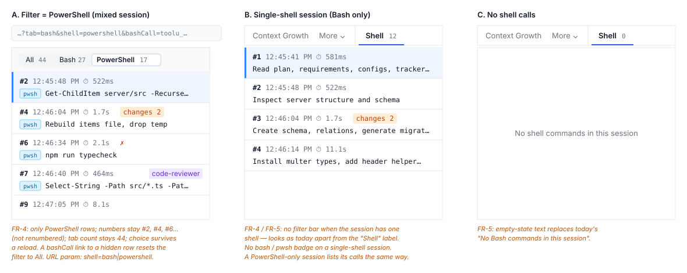

# 2026-11-22: Shell Tab: PowerShell Calls Next to Bash, Fully Formatted

**Status:** todo
**Priority:** medium
**Type:** feature
**Module(s):** client | server | shared (`packages/bash-view`)
**Owner:** denis.tsyplakov
**Created:** 2026-11-22
**Tracker:** GH-163 https://github.com/DataArt/artisyn-log-hub/issues/163

## Description

Raw idea (verbatim):

> также как сейчас bash Надо добавить powershell - не отдельной вкладкой по факту bash/powershell
> это один тип инструмента на win использутеся микс так что и смотреть надо интегрированно

In English: PowerShell calls must be shown the same way Bash calls are shown today — not as a
separate tab. Bash and PowerShell are in fact one kind of tool (a shell); on Windows a session uses
a mix of both, so they must be viewed together, integrated.

Governing principle (owner): Bash and PowerShell are two alternative ways for Claude to talk to the
OS, and Log Hub shows and counts both with identical functionality. Any feature a Bash call has —
view, preview, chips, counters, extraction — a PowerShell call has too; a difference is a defect
unless it comes from the shell's own syntax. Where this document is silent, this principle decides.

Today the session **Bash** tab (`client/.../session-log/bash-tab/`) lists only Bash calls:
`collectBashCalls` filters the session's tool calls to `name === 'Bash'`, so a Windows session that
ran half of its commands through the PowerShell tool shows only half of its shell activity, and the
tab count is wrong for it. The shared tool view renders a PowerShell call as raw text only
(`ToolCallView`: `PowerShell` → `BashCommandView` with `forceFallback` — no formatted script, no
highlighting, no FILES summary), and only from the Logs tab and the Context Growth step modal.

### Parser package

- The PowerShell view takes the same route as the Bash view: a tree-sitter syntax tree
  (`@loghub/bash-view` + `web-tree-sitter` 0.27.1, grammar WASM lazy-loaded; Bash uses
  `tree-sitter-bash` 0.25.1).
- The grammar is `tree-sitter-powershell` (airbus-cert, the upstream grammar; 0.26.6, MIT, prebuilt
  WASM 1.1 MB, ships `queries/highlights.scm`).
- Only its `.wasm` and `.scm` are used; its `install` script (`node-gyp-build`) builds a native
  binding we do not use, same as with `tree-sitter-bash`.
- The alternative `tree-sitter-pwsh` (wharflab) is not used: a fork, twice the size, not updated for
  six months.

## Functional Requirements

### Tab and list

- FR-1 **Shell tab.** The session tab is labelled `Shell`, with the hint "Bash / PowerShell" (tab
  tooltip / registry description). The tab id stays `bash` and the URL param stays `bashCall`, so
  existing links keep working; `powershell` joins the tab's search synonyms.
- FR-2 **One list.** The tab lists Bash and PowerShell tool calls together — the main transcript and
  every sub-agent, same dedupe and numbering as today, ordered by start time, so a mixed session
  reads in the order the commands ran. No separate tab or list; the tab count covers both tools.
- FR-3 **Row.** A PowerShell row shows everything a Bash row shows — number, time, duration, status
  mark, "changes N" chip, preview (the description, else the first formatted statement, else the
  first raw line), sub-agent badge. When the session has calls of both shells (the same condition as
  the filter), every row also has a shell mark: a short text badge `bash` / `pwsh` before the
  preview. A single-shell session has no mark. In `ToolCallView` the existing tool badge (`Bash` /
  `PowerShell`) is the mark; nothing is added there.
- FR-4 **Filter.** The list has a shell filter: All / Bash / PowerShell, each with its count. It is
  shown only when the session has calls of both shells. Row numbers do not change with the filter.
  The filter is kept in the URL param `shell` = `bash` | `powershell` (absent = All), written with
  `replace: true` like `bashCall`. An unknown value, or a value naming a shell the session has no
  calls of, is treated as All. Opening a link whose `bashCall` row is hidden by its `shell` value
  drops `shell` (All) and selects that row. When the user picks a filter value that hides the
  selected row, the selection moves to the first visible row and `bashCall` is rewritten (the filter
  is not reset).
- FR-5 **Empty and single-shell sessions.** A Bash-only session looks as today (apart from the
  label); a PowerShell-only session lists its calls; the empty state reads "No shell commands in
  this session".

### PowerShell command view (same level as Bash)

- FR-6 **Formatted script.** A PowerShell command is shown as a short indented script built from the
  syntax tree, with the Formatted | Raw toggle, "N lines (was M)", line numbers and "Copy original":
  one statement per line, pipelines and `;` chains broken at the same width limit as Bash, blocks
  (`if`, `foreach`, `try/catch`, script blocks `{ … }`) indented, here-strings (`@'…'@`, `@"…"@`)
  folded like heredocs. The formatted text is always the same program as the original (as for
  Bash); an unparseable command falls back to the raw text. Both Windows PowerShell 5.1 and
  PowerShell 7 syntax (`&&` / `||`, ternary, null-coalescing) must format; where the grammar gives
  an error node for one of them, the gap is closed in this task (grammar version, or a rule that
  formats around the node) — the fallback rate on real session commands must not be worse than the
  Bash one.
- FR-6a **Log Hub wrapper prefix.** If the stored command carries the prefix Log Hub's own hook
  prepends (`tool-wrap-powershell.js`: `__lhWrap` plus one function per monitored CLI tool), the
  prefix is recognised and removed before formatting, the row preview, the working-dir lift and the
  file analysis; Formatted and "Copy original" show the command as the agent typed it, Raw shows the
  stored text unchanged. Hook versions that wrote an older prefix shape are recognised too.
- FR-7 **Working dir.** A leading `Set-Location` / `cd` / `Push-Location` is lifted into the
  WORKING DIR header, like `cd` for Bash.
- FR-8 **Highlighting.** PowerShell syntax colours from the grammar's `highlights.scm`, with the
  same seven colour kinds and legend as Bash. PowerShell has its own capture-to-kind map (the Bash
  `CAPTURE_KIND` map does not fit its capture names): `keyword` and `operator` -> keyword; `string`
  -> string; `variable` -> variable; `function` -> command; `comment` -> comment; two captures added
  by us, `(command_parameter)` -> flag and `(redirection)` -> redirect; `number`, `property`,
  `type`, `delimiter`, `array`, `assignvalue` -> plain. The map is recorded in the new algorithm doc.
- FR-9 **Files summary.** The FILES block lists what the command read, wrote, deleted and ran, with
  repo-relative display paths (Windows `\` and `/` separators, drive letters, quoted paths with
  spaces), from PowerShell command tables, `-Path` / `-LiteralPath` / `-Destination` / `-FilePath`
  parameters and positional arguments, redirects (`>`, `>>`), native executables run through the
  same tables Bash uses (`git`, `npm`, `node`, …), the call operator `&`. "changes N" on the row is
  the count of written / deleted files from this analysis.
  - Closed list of cmdlets and aliases for the first version (any other command is shown as a run
    command only; the PoC over real session commands may add entries, the list lives in the
    algorithm doc): `Get-Content` / `gc` / `cat` / `type`, `Select-String` / `sls`, `Get-ChildItem`
    / `gci` / `ls` / `dir`, `Get-Item` / `gi`, `Test-Path`, `Set-Content` / `sc`, `Add-Content` /
    `ac`, `Clear-Content` / `clc`, `Out-File`, `Tee-Object` / `tee`, `New-Item` / `ni`, `mkdir` /
    `md`, `Remove-Item` / `ri` / `rm` / `del` / `erase` / `rd` / `rmdir`, `Copy-Item` / `cpi` /
    `cp` / `copy`, `Move-Item` / `mi` / `mv` / `move`, `Rename-Item` / `rni` / `ren`.
  - Cmdlet, alias and parameter names match case-insensitively. An abbreviated parameter name (`-Pa`
    for `-Path`) is recognised when it is unambiguous among that cmdlet's parameters (per-cmdlet
    parameter table in the algorithm doc). In a PowerShell call the aliases shared with Unix tools (`rm`,
    `cat`, `ls`, `cp`, `mv`) are read by the PowerShell tables, not the Bash ones.
  - Two-path cmdlets follow the Bash rules for `cp` / `mv`: `Copy-Item` = source read, destination
    written; `Move-Item` and `Rename-Item` = both paths changed; `New-Item` (also `-ItemType
    Directory`) = written.
  - Never listed and never counted in "changes N": `$null` (`> $null`, `2>$null`), `Out-Null`, and
    non-file provider paths (`Env:`, `HKLM:`, `HKCU:`, `Variable:`, `Function:`, `Alias:`, `Cert:`)
    — the counterpart of `/dev/*` in the Bash view.
  - A path built from a variable or a sub-expression (`$env:TEMP\x`, `"$dir\a.txt"`,
    `(Join-Path …)`) counts as "unresolved", as in the Bash view.
- FR-10 **Everywhere the view is used.** The PowerShell view is the shared `ToolCallView` body, so
  the Logs tool modal, `SubAgentDetail` and the Context Growth step modal get it too (the
  `forceFallback` branch goes away); the tool header shows `⏱` duration for PowerShell as for Bash.
  A PowerShell call also gets the same one-line tool summary in the Logs tab (first command line,
  same cut; `log-parser.ts`), the same Context Growth step label (`step-label.ts`) and the same
  tool pill colour (`getOtherToolStyle`) as a Bash call.
- FR-11 **Same figures elsewhere.** Places fed by the same collector (the Summary hub card that
  counts Bash commands) count both shells, so they agree with the tab.

### Everything else that reads shell commands (first class, not worse than Bash)

- FR-12 **Commits and pull requests.** The commit and pull-request counters (`countCommits` /
  `countPullRequests` in server `claude-extractor.ts` and the client twin
  `session-usage-derive.ts`) count `git commit` / `gh pr create` run through PowerShell exactly as
  those run through Bash.
- FR-13 **OKF accesses.** The OKF access extraction (`okf-access-extractor.ts`) reads KB accesses
  from PowerShell commands too (`Get-Content docs/…`, `Select-String`, …), reusing the file
  analysis of FR-9 on the server with a server PowerShell parser next to the Bash one.
- FR-14 **No Bash-only place left.** Every other place in client and server that treats
  `name === 'Bash'` as "a shell command" (found by a code search during planning) treats
  `PowerShell` the same, unless the place is about Bash syntax itself.
- FR-15 **Stored sessions.** Figures already stored for existing sessions (commit / PR counts, OKF
  facts) are brought to the new rules by a backfill, so old and new sessions agree; the plan picks
  the mechanism (existing re-extraction or a data migration).

## Non-Functional Requirements

- The UI part is computed on the client from the `/logs` payload already loaded. No server route,
  hook or API change: the server changes only its extraction (FR-12, FR-13), so sessions uploaded
  by any hook version get the mixed list, the formatted view and the corrected figures.
- The server ships the PowerShell grammar WASM the same way as the Bash one (`scripts/copy-wasm.js`).
- The PowerShell rules live in the shared package next to the Bash ones (`packages/bash-view`, pure
  TypeScript, never importing `web-tree-sitter`), behind the same parser interface; no hand-kept
  twin.
- Each grammar WASM is loaded lazily and only when needed: a Bash-only session never downloads the
  PowerShell grammar and the other way round; neither is in the main bundle. The Bash parser is
  never asked to parse PowerShell text.
- Offline: the WASM and the query file ship with the build (`dist/`), like the Bash ones — no
  runtime download from the internet.
- Licences: the new dependency is MIT; it must pass the existing licence / security scans.
- No OS overtuning: paths are shown repo-relative; nothing assumes the viewer's own OS.

## Tests

- **Algorithm:** a new doc `docs/knowledgebase/algorithms/powershell-command-view.md` with its rows
  file `docs/algorithm-examples/powershell-command-view.json` (format, working-dir lift, here-string
  fold, files summary incl. aliases and Windows paths, wrapper-prefix removal, 5.1 and 7 syntax,
  fallback), run by a new table test next to `bash-view.algo.test.ts`. PowerShell rows are added to
  the rows files of the existing algorithm docs that cover the commit / PR counters and the OKF
  access extraction, where such docs exist. The list filter / mixed collection is plain filtering —
  covered by the scenario, no algorithm doc.
- **PoC (plan stage, `poc` skill, like the Bash one in
  `docs/pocs/2026-10-22-2035-bash-pretty-format/`):** real PowerShell commands from stored sessions — fallback rate
  for 5.1 / 7 syntax, whether the stored command carries the `__lhWrap` prefix and in which shapes,
  missing cmdlets for the FR-9 list.
- **API contract:** none (no route changes).
- **Scenario:** extend `tests/scenarios/view/s-sess-14.spec.ts` (`@S-SESS-14`, already covers the
  Bash view and its WASM loading) with steps on a session that has both shells: the Shell tab count,
  a PowerShell row with its mark, chip and formatted view, the filter, and that the PowerShell WASM
  is requested only then. Commit / PR counts and OKF accesses from PowerShell commands are steps in
  the existing scenarios that already check those figures for Bash.

## Acceptance Criteria

- [ ] FR-1: The tab bar shows `Shell` with the hint "Bash / PowerShell"; an old
      `?tab=bash&bashCall=<id>` link opens the same call.
- [ ] FR-2: A session with interleaved Bash and PowerShell calls shows them all in one list in start
      order, including sub-agent calls; the tab count equals Bash + PowerShell calls.
- [ ] FR-3: A PowerShell row has number, time, duration, status, "changes N", a first-statement
      preview and the shell mark.
- [ ] FR-4: The filter shows All / Bash / PowerShell with counts on a mixed session and is absent on
      a single-shell one; choosing PowerShell leaves only PowerShell rows with their original
      numbers; the choice survives a reload. Opening `?tab=bash&shell=powershell&bashCall=<bash row
      id>` shows All with that row selected; picking PowerShell while a Bash row is selected
      selects the first PowerShell row.
- [ ] FR-5: A PowerShell-only session lists its calls; a session with no shell calls shows "No shell
      commands in this session".
- [ ] FR-6: A long one-line PowerShell pipeline with a `foreach` block and a here-string renders as
      an indented multi-line script with the here-string folded; Raw shows the original; an
      unparseable command shows the raw text and no error.
- [ ] FR-7: `Set-Location <dir>; …` shows `<dir>` in WORKING DIR and not in the script.
- [ ] FR-8: The PowerShell script is coloured and the legend matches the Bash one.
- [ ] FR-9: `Get-Content a.json | … | Set-Content -Path out\b.json; Remove-Item tmp\x` lists `a.json`
      as read, `out/b.json` as written, `tmp/x` as deleted, repo-relative, and the row shows
      "changes 2".
- [ ] FR-10: The same PowerShell call opened from the Logs tab and from a Context Growth step shows
      the formatted view and its duration; in the Logs tab a PowerShell row without a description
      shows its first command line, and its pill has the Bash colour.
- [ ] FR-6: A command using `&&`, `||` and a ternary renders formatted, not as raw fallback.
- [ ] FR-6a: A stored command with the `__lhWrap` prefix shows the typed command in the preview,
      the formatted script and FILES; Raw shows the stored text.
- [ ] FR-11: The Summary card's command count equals the Shell tab count on a mixed session.
- [ ] FR-12: A session whose only `git commit` and `gh pr create` ran through PowerShell shows 1
      commit and 1 pull request, on the server figures and in the client twin.
- [ ] FR-13: A session that read a KB file with `Get-Content` through PowerShell shows that access
      in the OKF view, as the same read through Bash `cat` does.
- [ ] FR-14: A code search for `'Bash'` tool-name checks finds no place where PowerShell is left
      out without a stated reason.
- [ ] FR-15: After the backfill a session stored before this change shows the same commit / PR
      counts and OKF accesses as if it were uploaded now.
- [ ] NFR: Opening a Bash-only session requests no PowerShell WASM; the build ships the WASM and the
      app works with the network cut off.

## Open Questions

None. Owner decision (2026-11-22): PowerShell is first class everywhere, not worse than Bash — no
part is deferred to a follow-up task.

## Common sense considerations

- Grammar package: `tree-sitter-powershell` (upstream); its `install` script has the same shape as
  the already installed `tree-sitter-bash`.
- Shell filter URL contract: param `shell`, rules in FR-4.
- Shell mark: only on mixed sessions, text badge `bash` / `pwsh` (FR-3).
- PowerShell gets the Logs one-line summary, the Context Growth step label and the Bash pill colour
  (FR-10).
- PowerShell has its own highlight capture map, recorded in the algorithm doc (FR-8).
- Files summary: closed cmdlet / alias list, case-insensitive names, unambiguous abbreviated
  parameters,
  non-file targets ignored, variable-built paths unresolved, two-path cmdlets as Bash `cp` / `mv`
  (FR-9).

## Notes

<!-- Append timestamped notes here as work progresses -->
- **2026-11-22:** Related: `2026-10-23-bash-view-algo-review` (todo, Bash view algorithm review);
  the Bash tab itself came from `2026-10-22-context-growth-item-modal` (done). KB:
  `docs/knowledgebase/session-log-view.md` § "Bash tab" and § "ToolCallView",
  `docs/knowledgebase/algorithms/bash-command-view.md`.
- Evidence for the grammar choice (package comparison, quick load / parse check): `notes.md`.
- **2026-11-22 PoC** [docs/pocs/2026-11-22-1443-powershell-format/](../../../pocs/2026-11-22-1443-powershell-format/README.md):
  over 1 060 real PowerShell commands the grammar alone falls back on 2.64 %; ten same-length masks plus a
  top-level `;` split bring it to 0 raw fallbacks (Bash: 0.05 %), and the formatted text is the same token
  stream for PowerShell 5.1 and 7 on all 1 060. Stored commands never carry the `__lhWrap` prefix; today's
  commit regex already matches the real PowerShell commits once the `'Bash'` gate is lifted.
