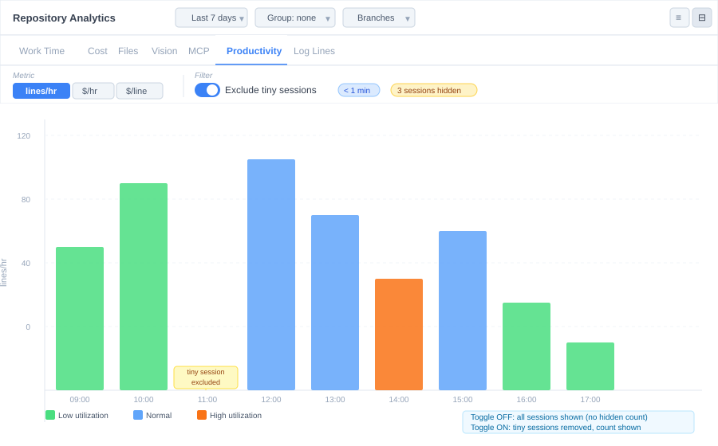

# T-28: Exclude Tiny Sessions from Analytics

**Status:** todo
**Priority:** medium
**Type:** feature
**Module(s):** client
**Owner:** denis.tsyplakov
**Created:** 2026-06-19

## Description

Add a toggle in the Productivity analytics sub-tab to exclude very short sessions from metrics and charts, with a visible threshold label and excluded-count indicator.

## Wireframe

## Functional Requirements

- Add a toggle control labeled "Exclude tiny sessions" in the Productivity sub-tab controls row (alongside the metric selector: lines/hr | $/hr | $/line)
- "Tiny" is defined as `workTimeMs < 60 000` (less than 1 minute of actual work time, using the `workTimeMs` field already present in `TimelineSession`)
- The threshold value is shown as a read-only badge next to the toggle: `< 1 min`
- When the toggle is ON, filter out tiny sessions from the `TimelineSession[]` array **client-side** before feeding data into `ProductivityChart` and `HorizontalBarChart` (productivity metric only); other analytics sub-views (work-time, cost, files, vision, mcp, log-lines) are **not** affected
- When the toggle is ON and at least one session was excluded, show a count badge: `N sessions hidden`; when toggle is OFF, show nothing
- Filter state is persisted via URL search param `aet=1` (present when ON, absent when OFF), following the existing convention in `analytics-url.ts`; the `AnalyticsState` interface gains a new field `excludeTiny: boolean` (default `false`)

## Acceptance Criteria

- [ ] A toggle labeled "Exclude tiny sessions" appears in the Productivity sub-tab controls row, to the right of the metric selector, separated by a vertical divider
- [ ] Activating the toggle removes sessions with `workTimeMs < 60 000` from `ProductivityChart` and the horizontal-layout productivity view; all other sub-tabs are unaffected
- [ ] A read-only badge `< 1 min` is always visible next to the toggle when the Productivity sub-tab is active, showing the current threshold
- [ ] When toggle is ON and N > 0 sessions are excluded, a secondary badge `N sessions hidden` (amber/yellow) is shown to the right of the threshold badge
- [ ] When all sessions are excluded (N = total), show the same empty state as when there is no productivity data: "no sessions with productivity data"
- [ ] Filter state persists across page reloads via URL param `aet=1`
- [ ] `aet` is omitted from the URL when the toggle is OFF (default)

## Technical Notes

- Filtering is **client-side only** — no API or server changes required
- `TimelineSession.workTimeMs` is the correct field to use (pre-computed, always present, defaults to 0)
- New URL param key: `aet` — add to `analyticsFromParams()` and `applyAnalyticsToParams()` in `analytics-url.ts`
- New `AnalyticsState` field: `excludeTiny: boolean` — default `false`
- UI control: reuse existing `ToggleGroup`/checkbox pattern already used in analytics; place in the Productivity sub-tab render branch inside `RepositoryAnalytics.tsx`
- The `workTimeMs = 0` edge case (sessions with no artisyn events) should be treated as "tiny" when the toggle is ON, since 0 < 60 000

## Open Questions

- Should the threshold ever be user-configurable (e.g., a slider or dropdown for 1 min / 2 min / 5 min)? For now: fixed at `< 1 min`; revisit if users request it.
- Should the "tiny" definition also consider `logLineCount` (proxy for prompt count) instead of / in addition to `workTimeMs`? Current decision: `workTimeMs` only, as it directly measures effort.
- Should the excluded-session count be shown when the toggle is OFF as "0 sessions hidden"? Current decision: show nothing when OFF, to reduce visual noise.

## Notes

<!-- Append timestamped notes here as work progresses -->
