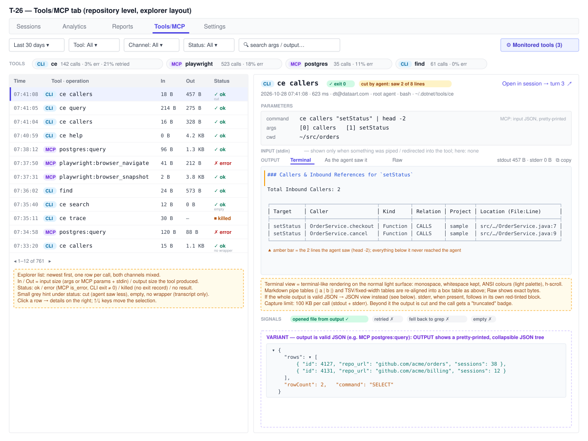

# T-26: Tools/MCP tab — monitoring of MCP servers and command-line tools

**Status:** todo
**Priority:** medium
**Type:** feature
**Module(s):** client | server | hook
**Owner:** denis.tsyplakov
**Created:** 2026-06-19 (rewritten 2026-10-28)

## Description

A tool author (an MCP server, or a CLI such as CodeExplorer `ce`) needs to know how the agent
actually uses the tool: what it was asked, what it returned, whether that output was any good,
and how often it failed. Today this means digging through raw logs session by session. The goal is
a single pane of glass: a repository-level **Tools/MCP** tab that lists every invocation of the
tools under observation, with input, output, errors and usefulness signals, aggregated per tool and
per operation, with drill-down to the individual call.

Two **call channels** feed the same tab, and their data is collected in different ways:

| | MCP | Command-line tool (CLI) |
|---|---|---|
| How the agent calls it | a `tool_use` named `mcp__<server>__<tool>` | a Bash / PowerShell `tool_use` whose command runs the tool |
| Which calls are monitored | **all** MCP servers, automatically — no configuration | only tools the user **added by name in the UI** for the repository |
| Where the data comes from | the transcript only (`tool_use` + matching `tool_result`) — already uploaded, no hook change | a **wrapper** the hook puts in front of the tool (full output, exit code, real binary), plus the transcript (what the agent saw) |
| History before the feature / older hooks | full | transcript only: recognised by tool name in the command, no exit code, no full output |

The CLI side must support **any** command-line tool, including tools unknown today and whose
authors will never cooperate with Log Hub — the wrapper knows nothing about the tool except its
name. It must work on Windows (Git Bash and PowerShell), Linux and macOS.

The research and the POC behind this design (what was verified on which OS, rejected approaches,
an MCP snapshot from a local install) are in [research-cli-tool-capture.md](research-cli-tool-capture.md).

**Relation to existing views.** The session **Harness usage** tab counts element use per session
(`mcp` / `tool` kinds) — it answers "was it used". This tab answers "what did it return and was
that good", across sessions. Neither replaces the other. The original per-prompt "MCP" section
from the first version of this task is out of scope here —
see Open Questions.

## Functional Requirements

### FR-1 Tools/MCP tab (repository level) — explorer layout

- A new main tab **Tools/MCP** on the repository page, next to Sessions / Analytics / Reports /
  Settings, URL-backed like the other main tabs and with a `tab-repo-<id>` test id.
- **Top bar**: date range (default last 30 days), Tool, Channel (`MCP` / `CLI`), Status filters, a
  free-text search over arguments / input and output, and the **Monitored tools** button (FR-2).
  The same user scope rules as the Sessions tab apply (personal view → own sessions; team view →
  team rules). Sub-agent and workflow-agent calls are included (the whole session tree, see
  `docs/knowledgebase/session-metrics-scope.md`).
- **Tools strip** under the top bar: one chip per tool (channel badge, name, calls, error %,
  retried %); clicking a chip sets the Tool filter. Per-operation figures (MCP tool / CLI
  subcommand — the first non-option argument, or `(none)`) are shown when one tool is filtered.
- **Left pane — calls table** (explorer list), newest first, both channels mixed, paginated,
  keyboard ↑/↓ moves the selection. Columns:
  - **Time**;
  - **Tool · operation** with a channel badge (`MCP` / `CLI`), e.g. `ce callers`,
    `postgres:query`;
  - **In** — input size: CLI arguments + stdin, MCP input JSON;
  - **Out** — output size the tool produced (wrapper data), else the size the agent saw;
  - **Status** — `ok` / `error` (MCP `is_error`, CLI exit code ≠ 0) / `killed` (no exit record) /
    `no result`, with a small hint underneath when relevant: `cut` (the agent saw less), `empty`,
    `truncated` (100 KB limit hit), `no wrapper` (transcript-only data).
- **Right pane — details of the selected call**:
  - header: channel, tool + operation, exit code / error badge, `cut by agent` /
    `truncated` / `persisted` badges, timestamp, duration, user, agent (root / sub-agent / workflow
    agent), shell (`bash` / `powershell`), resolved binary path, and **Open in session** → the
    session's Logs tab at the prompt turn that holds the call;
  - **Parameters** — CLI: the command line as the agent typed it, the parsed argument list, cwd;
    MCP: the input JSON, pretty-printed;
  - **Input (stdin)** — only when something was piped or redirected into the tool (CLI); hidden
    otherwise;
  - **Output**, with three views:
    - **Terminal** (default): monospace, whitespace kept, ANSI colour codes rendered, long lines
      scroll horizontally — "terminal" means terminal-like *formatting*, on the app's normal light
      surface (light block, dark text, ANSI colours mapped to a light palette; no dark background);
      **tables are shown aligned**: Markdown pipe tables
      and TSV / fixed-width column output are detected and re-aligned into a box table; the lines
      the agent actually received are marked (e.g. a bar next to the first 2 lines after `| head -2`);
    - **As the agent saw it** — the transcript's `tool_result` text;
    - **Raw** — the exact captured bytes, no formatting;
    - when the whole output is **valid JSON**, the Terminal view is replaced by a **pretty-printed,
      collapsible JSON tree** (MCP outputs are often JSON; MCP content blocks with JSON text are
      detected the same way);
    - stderr, when present, follows in its own red-tinted block; copy-to-clipboard per block;
  - **Signals** (FR-5) as chips.
- Long inputs/outputs are collapsed beyond a reasonable height with an expand toggle.

### FR-2 Monitored CLI tools — configuration in the UI

- On the Tools/MCP tab, a **Monitored tools** panel lists the repository's CLI tools under
  observation. Per tool:
  - `name` — the command name as typed in a shell (`ce`, `find`, …); validated as a single command
    name (no spaces, no path separators, no shell metacharacters);
  - `enabled` — on / off;
  - `capture` — `full` (stdout + stderr) or `meta` (arguments, exit code, sizes, duration — no
    output text);
- Add / edit / disable / remove. Everyone without edit rights sees the list read-only.
- MCP servers need no configuration and are always shown.

**Two configuration levels**, following the existing personal / team split of repository settings:

| Level | Where it is edited | Whose sessions are recorded | Who can edit |
|---|---|---|---|
| **Personal** | the repository opened in personal view | only the current developer's own sessions in this repository | the developer |
| **Team** | the repository opened in team view | the sessions of every member of the team in this repository | per the existing team-config rights (`canEditTeamConfig`) |

- **What is recorded for a session = the union** of the session owner's personal list and the
  lists of every team the repository belongs to (that the owner is a member of). Example: personal
  `tool1`, team `tool1` + `tool2` → both `tool1` and `tool2` are wrapped and recorded.
- A tool present on both levels with different options: `full` capture wins over `meta` (more
  data is never lost because of the other level).
- Disabling a tool on one level does not switch off recording that the other level enabled. The
  panel shows, for each tool, the level(s) it is enabled on, so the user can see why it is still
  recorded.
- **Recording and display are separate.** Data recorded because of a team setting is shown only
  under the existing session-visibility rules (personal view: own sessions; team view: team
  transparency rules, owner/trainer rights) — the same rules as the Sessions tab. Enabling a tool
  for the team never widens who can see whose sessions.
- The hook-facing config route (FR-4) returns the already-merged list for the user identified by
  the API key and the repository identified by the hook; the hook never merges levels itself.
- The panel shows, per tool, when wrapper data was last received, and a hint when none has
  arrived yet (e.g. the hook is too old to wrap tools — FR-6).

### FR-3 MCP channel — collection

- Server-side extraction from the uploaded transcripts (`claude` and `claude-subagent` logs):
  every `assistant` `tool_use` whose name starts with `mcp__`, joined to the `user` `tool_result`
  with the same `tool_use_id`.
- `server` / `operation` parsed from `mcp__<server>__<tool>` (`[1]` = server, `[2..]` joined = tool).
- Status: `error` when `tool_result.is_error === true`; `no result` when no `tool_result` exists;
  otherwise `ok`.
- Duration: `tool_result` event timestamp minus `tool_use` event timestamp.
- Output: the `tool_result` content (string or content blocks; non-text blocks such as images are
  shown as a typed placeholder, not inlined).
- No hook change; works for every session already uploaded.

### FR-4 CLI channel — collection

**Hook (client machine):**

1. On `SessionStart` the hook fetches the effective monitored-tools list (personal ∪ team, merged
   by the server — FR-2) from a new hook-facing route (API-key auth, repository identified the same
   way uploads identify it, short timeout). The last good response is cached on disk; when the server is unreachable the
   cache is used; when there is no cache, nothing is wrapped.
2. For the **Bash tool**: the hook generates one wrapper script per enabled tool in a per-project
   shim directory and appends `export PATH="<shim-dir>:$PATH"` to `$CLAUDE_ENV_FILE` (Git-Bash
   path form on Windows).
3. For the **PowerShell tool** (which does not read `CLAUDE_ENV_FILE`): a `PreToolUse` hook with
   matcher `PowerShell` returns `updatedInput` with wrapper functions prepended — only when the
   command mentions an enabled tool; otherwise it exits immediately without output.
4. The config is refreshed on `UserPromptSubmit` (throttled), and the wrappers read the cached
   config on every call: a tool disabled in the UI stops being recorded from the next prompt (the
   wrapper becomes a pure pass-through until the session ends).
5. Records reach the server through the existing upload path, together with the session's other
   artisyn data. Old servers must ignore them without failing the upload.

**Wrapper behaviour (both shells) — the hard rules:**

- **The shell runs the real tool, exactly as it would without the wrapper**: same PATH lookup
  (minus the shim dir / the wrapper function itself), same argument handling (including Git Bash
  path conversion on Windows), same stdin, same stdout/stderr text, same exit code. The wrapper
  only observes. A Node process must never be the one that launches the tool (verified in the POC
  to change behaviour — see the research note, "Rejected").
- **Full output even when the agent cut it**: when the agent pipes the output into something that
  stops reading (`| head`, `Select-Object -First`), the wrapper keeps capturing to the end, up to
  the capture limit. The one allowed behaviour difference: the tool then runs to completion instead of
  being stopped early (in PowerShell, `$LASTEXITCODE` is the tool's real code instead of `-1`).
- **Capture limit: 100 KB per call**, fixed (stdout + stderr together; stdin has its own 100 KB).
  Beyond it the capture stops, the call is marked `truncated` and the tool is no longer drained
  after the agent stopped reading. Outputs larger than that are out of scope for this feature.
- **Stdin**: when the agent pipes or redirects data into the tool (`cat x | ce …`, `… < file`,
  a heredoc, PowerShell pipeline input), the wrapper captures it (up to 100 KB) while passing it to
  the tool unchanged. Known difference: the tool then reads stdin from a pipe, not from the
  redirected file directly. With no piped input, stdin is passed through untouched.
- **Crash-safe**: a `start` record is written before the tool runs; output is written as it
  arrives (Bash) or right after the tool exits (PowerShell); an `exit` record closes the call. A
  call without `exit` is shown as `terminated`.
- **Never breaks the tool**: every logging step is best-effort; a logging failure must not change
  the tool's output or exit code. A tool that is not installed behaves exactly as without the
  wrapper (`command not found`, exit 127 in Bash).
- Recorded per call: call id, timestamp, `session_id` (from `CLAUDE_CODE_SESSION_ID`), tool,
  arguments exactly as typed, resolved real binary path, cwd, shell, exit code, duration,
  stdin/stdout/stderr byte counts, `consumer_closed` (agent cut the output), `truncated`, and — for
  `capture: full` — the stdin, stdout and stderr text.

**Server:**

- Joins each wrapper record to its transcript `tool_use` (same session, tool, arguments, time
  window) to attach "output seen by the agent", the prompt turn, the agent id and the follow-up
  signals. A wrapper record with no transcript match (a call made from inside a script the agent
  ran) is still listed, marked `indirect`.
- **Transcript-only fallback**: for monitored tool names, Bash / PowerShell `tool_use` commands
  are recognised in the transcript even without wrapper data (older hooks, history before the tool
  was added, calls the wrapper cannot see). Those calls show the output seen by the agent, no exit
  code, no full output, and a `no wrapper data` badge.
- Not covered and documented as such: calls by absolute path (`C:\…\ce.exe`, `./bin/ce`),
  `npx <tool>`, shell builtins and aliases.

### FR-5 Usefulness signals (both channels)

Per call, computed from the next 3 tool calls of the same agent in the same transcript:

- `empty` — the output is empty, or states that nothing was found;
- `retried` — the same tool + operation is called again (the first answer was not enough);
- `fell back` — a Grep / Glob, or a `grep` / `rg` / `findstr` / `Select-String` command, follows;
- `opened file` — a Read / Edit of a file named in the output follows (the output led somewhere).

Plus per-call error status (MCP `is_error`; CLI non-zero exit code, or `is_error` in the
transcript-only fallback). These are heuristics and are labelled as such in the UI.

### FR-6 Backward compatibility

- **New server, old hook**: no config fetch, no wrapping. MCP data is complete; CLI tools fall back
  to transcript-only data; the Monitored tools panel shows the "hook too old" hint.
- **New hook, old server**: the config route returns 404 → nothing is wrapped and the hook
  continues normally; nothing new is uploaded.
- **Hook API**: the config route is additive; its response shape is versioned so that a later
  server can add fields without breaking an older hook.
- Disabling or removing every tool in the UI leaves the agent's shell environment untouched from
  the next session on.

### FR-7 Storage — one row per session and tool

- A new table keyed by **session + tool**: `session_id` (the session whose transcript or artisyn
  log holds the calls — root or sub-agent, like `session_request_ids`), `channel` (`mcp` / `cli`),
  `tool` (MCP server name or CLI tool name), and **one `jsonb` column with all of that tool's
  calls in the session** plus their pre-computed per-operation aggregates (calls, errors, empty,
  retried, fell back, opened file, duration and size figures).
- **Not one row per call**: a session with ~300 tool calls would otherwise write and read hundreds
  of rows per session and make the tab slow.
- The row is **recomputed and overwritten as a whole** every time the session's data changes
  (each upload, including prompt-triggered partial uploads, and re-uploads) — no incremental
  patching of the jsonb.
- The Tools/MCP summary reads the pre-computed aggregates only; the calls list and call detail
  read the calls array. Full outputs must not have to be read to render the summary (e.g. kept in
  the same jsonb but outside the aggregate part, or in a sibling column — plan decides; see Open
  Questions).
- **When a CLI tool is added** on a level, existing sessions of that level's scope (personal: the
  developer's sessions; team: the team members' sessions) in the repository are re-extracted in
  the background for that tool from their transcripts (transcript-only data, FR-4 fallback).
  Removing a tool stops new recording; already stored rows stay.
- MCP rows are produced for every session regardless of any configuration (FR-3), including a
  one-off backfill of existing sessions.

## Non-Functional Requirements

- **Cross-platform**: Windows (Git Bash, Windows PowerShell 5.1, PowerShell 7), Linux, macOS.
  No path or behaviour tuned to the developer's machine.
- **Overhead**: an unmonitored command pays nothing (Bash: no wrapper on PATH for it; PowerShell:
  `PreToolUse` exits without output). A monitored call pays one extra Node start in Bash and no
  extra process in PowerShell; to be measured on a high-frequency tool (`find`) and reported.
- **Storage**: capture size per call limited to 100 KB (FR-4); MCP outputs stored as the transcript
  already holds them (no duplication of the transcript bytes beyond what the tab needs to query).
- **Tab performance**: the summary for a repository with thousands of sessions must not re-parse
  transcripts per request — it reads only the pre-computed aggregates of the FR-7 rows.
- **Write cost**: recomputing the FR-7 rows of a session on every upload must stay proportional to
  that session's size; a row rewrite must not need to re-read other sessions.
- **Data capture**: full input and output are captured by design — see
  `docs/knowledgebase/product-purpose-and-data-capture.md`.
- Hook changes follow the hook rules: version bump, installer rebuild, dogfooded copy refresh,
  `INSTALL_HOOK.md` sync.

## Acceptance Criteria

- [ ] The repository page has a **Tools/MCP** main tab; MCP servers used in the date range appear
      without any configuration, with correct calls / error / duration figures.
- [ ] Adding `ce` (or `find`) in **Monitored tools** and starting a new Claude Code session makes
      its calls appear on the tab with full output and exit code — verified in Git Bash and
      PowerShell on Windows and in Bash on Linux.
- [ ] A call whose output the agent cut (`ce … | head -1`, `… | Select-Object -First 1`) shows the
      full output and the `cut by the agent` badge; the output seen by the agent is shown separately.
- [ ] Wrapped and unwrapped calls behave identically for the agent: same output, same exit code
      (including errors and `find /nonexistent` in Git Bash) — except the documented early-stop case.
- [ ] Disabling a tool in the UI stops new records from the next prompt; removing it stops wrapping
      from the next session.
- [ ] With an old hook, monitored CLI tools still appear from the transcript, marked
      `no wrapper data`; with an old server, a new hook runs normally and wraps nothing.
- [ ] Call detail shows input, output seen by the agent, full output (when available), exit code,
      status, usefulness signals, and opens the session's Logs tab at the right prompt turn.
- [ ] Summary row per tool expands into operations; figures add up across both channels.
- [ ] Personal `tool1` + team `tool1`, `tool2` → a session of that developer records both tools; a
      teammate without a personal setting records `tool2` and `tool1` through the team setting; a
      developer of the same repository outside the team records neither.
- [ ] Team-level recording does not widen visibility: in personal view a user sees only their own
      sessions' calls; in team view the team's existing visibility rules apply.
- [ ] A session with 300 tool calls produces one stored row per (session, tool), not one per call;
      a re-upload overwrites those rows rather than adding new ones.
- [ ] Adding a CLI tool back-fills transcript-only data for existing sessions of that level's scope.
- [ ] The tab has the explorer layout of the wireframe: calls table on the left (Time, Tool ·
      operation, In, Out, Status), details of the selected call on the right.
- [ ] Output in the Terminal view keeps whitespace and ANSI colours; a Markdown pipe table (e.g.
      `ce callers` output) and a fixed-width table are shown as aligned tables; a valid-JSON output is
      shown as a pretty-printed collapsible tree; Raw shows the exact bytes.
- [ ] Data piped into a monitored tool appears in the Input (stdin) block; the section is hidden
      when nothing was piped.
- [ ] An output over 100 KB is stored cut at 100 KB with the `truncated` badge; the agent still
      receives the tool's full output.

## Tests (per the repo test policy)

- **Algorithm** (new docs under `docs/knowledgebase/algorithms/` + their table tests):
  CLI command recognition (tool name + subcommand from a Bash / PowerShell command line);
  wrapper-record ↔ transcript-call matching; usefulness signals (FR-5); MCP name parsing and
  status/duration derivation (FR-3); output format detection for the Output block (JSON / Markdown
  pipe table / fixed-width or TSV table / plain text) and table re-alignment (FR-1).
- **API contract**: rows in `server/test/contract/registry/` for the hook-facing config route, the
  monitored-tools settings routes, and the Tools/MCP summary / calls / call-detail routes.
- **Scenario**: a new scenario (no existing one covers the feature) — configure a monitored tool in
  the UI, upload a session carrying both MCP calls and wrapper records, check the tab's summary,
  calls list, call detail and the old-hook transcript-only fallback.

## Open Questions

- Where the two config levels are stored: inside the existing personal / team repository config
  blobs (alongside file categories / analysis settings) or a dedicated table — to be decided in the
  plan; the levels and the merge rule (FR-2) are fixed.
- Size of the FR-7 row: with the 100 KB per-call limit a tool called 300 times can still reach
  ~30 MB in one row, rewritten on every upload. Plan to decide: keep full outputs in the same jsonb
  or in a sibling column/table so that summary queries and rewrites stay cheap.
- Record transport: extra lines in the session's artisyn JSONL vs a separate per-session file —
  concurrency of appends from several wrappers and the hook on Windows must be checked.
- Should the per-prompt view (Logs tab, `PromptTurnItem`) also get a compact "Tools/MCP" section
  linking to the call detail (the original scope of this task)? Proposed: follow-up task.
- Should the tab also allow monitoring MCP servers selectively (hide noisy ones such as
  `playwright`), or is a UI filter enough?
- LLM-based judgement of output quality (input + output + next steps), on demand, like the OKF
  analysis skill — follow-up task.

## Notes

<!-- Append timestamped notes here as work progresses -->
**2026-10-28:** Requirements rewritten from "per-prompt MCP section" to a repository-level
Tools/MCP tab covering two channels (MCP from transcripts, CLI tools via a UI-configured wrapper).
Research and POC: [research-cli-tool-capture.md](research-cli-tool-capture.md); POC code in
[`docs/pocs/2026-10-28-1140-cli-tool-capture/`](../../../pocs/2026-10-28-1140-cli-tool-capture/README.md). Snapshot of a local install: 559 MCP calls, `playwright:browser_navigate`
fails in 41 % of calls (mostly 30 s timeouts).

**2026-10-28:** Config is two-level (personal / team); a session records the union of its owner's
personal list and the repository's team lists; display follows the existing visibility rules.
Storage: one jsonb row per session + tool, overwritten as a whole (FR-7) — not one row per call.

**2026-10-28:** Wireframe replaced by `wireframes/tools-mcp-tab.svg` (explorer layout: calls table
left, call details right; terminal-style output with table alignment, JSON pretty-print). Capture
limit fixed at 100 KB per call (no per-tool setting); stdin is captured when piped.
