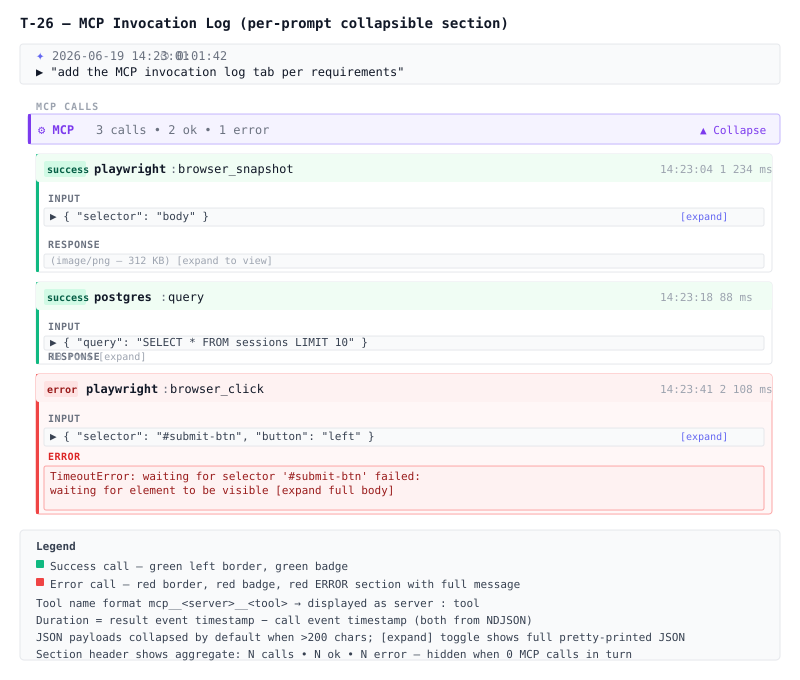

# T-26: MCP Invocation Log Tab

**Status:** todo
**Priority:**
**Type:** feature
**Module(s):** client
**Owner:** denis.tsyplakov
**Created:** 2026-06-19

## Description

Add a collapsible "MCP" section inside each `PromptTurnItem` (the per-prompt row in the session log view) that lists every MCP tool invocation with full input parameters, response payload, and error details. The section is hidden when the turn contains no MCP calls.



## UI Location Clarification

The existing per-prompt view (`PromptTurnItem.tsx`) does **not** use a tabbed UI — it uses collapsible sections (Skills, Rules, Tools, Files, Images, Agents, Sub-agents). The new MCP feature should follow the same pattern: a collapsible section with a violet accent border (matching the existing MCP color in `prompt-turn-helpers.tsx`), shown in the "Tools" area of the turn row.

There is already a session-level "MCP" tab in `SessionContextPanel` (which shows server-level summaries). This feature is distinct — it is **per-prompt** and shows **per-call detail**.

## Data Model Changes

### New type `McpInvocation` (add to `types.ts`)

```ts
export interface McpInvocation {
  /** Full tool name e.g. "mcp__playwright__browser_snapshot" */
  toolName: string;
  /** Parsed server segment: mcp__<server>__<tool> → server */
  serverName: string;
  /** Parsed tool segment: mcp__<server>__<tool> → tool */
  toolShortName: string;
  /** tool_use block id — used to correlate with tool_result */
  callId: string;
  /** Full input from the tool_use block */
  input: Record<string, unknown>;
  /** ISO timestamp of the assistant event carrying the tool_use block */
  callTimestamp?: string;
  /** ISO timestamp of the user event carrying the tool_result block */
  resultTimestamp?: string;
  /** Duration in ms: resultTimestamp - callTimestamp (absent if either missing) */
  durationMs?: number;
  /** false = tool_result with is_error !== true; true = is_error === true */
  isError: boolean;
  /** Raw tool_result content (string or array of content blocks) */
  resultContent?: string | Array<{ type: string; text?: string; [k: string]: unknown }>;
}
```

### `PromptTurn` extension (update `types.ts`)

Add field:

```ts
mcpInvocations: McpInvocation[];
```

### Parser change (`log-parser.ts`)

In `parseSessionLogs`, after extracting `toolCalls` in each turn, extract MCP invocations:

- Iterate over all `assistant` events in the turn uuid set; collect every `tool_use` block where `block.name.startsWith('mcp__')`.
- For each such block, find the matching `tool_result` block (matching by `tool_use_id === block.id`) in any `user` event in the turn uuid set.
- Parse `serverName` and `toolShortName` from `toolName.split('__')` — segments: `[0]='mcp'`, `[1]=server`, `[2+]=tool`.
- Derive `durationMs` from the difference between the `user` event timestamp (result) and the `assistant` event timestamp (call), if both are valid ISO strings.
- Set `isError = toolResultBlock.is_error === true`.
- Order chronologically by `callTimestamp`.
- Also add to the existing `mcpCalls` session-level aggregate (already implemented — no change needed there).

MCP calls must also be **removed from `otherToolCalls`** for the same turn — they will be shown exclusively in the new `mcpInvocations` section to avoid duplication.

## Functional Requirements

- The "MCP" collapsible section appears inside each `PromptTurnItem` when `turn.mcpInvocations.length > 0`; hidden otherwise.
- The section header shows: `⚙ MCP  •  N calls  •  N ok  •  N error`; the `N error` segment is omitted when 0.
- The section uses a violet left accent border (color `border-l-violet-300 dark:border-l-violet-700`) consistent with MCP color in `prompt-turn-helpers.tsx`.
- Each invocation is rendered as a card showing:
  - Left border: green (`#10b981`) for success, red (`#ef4444`) for error
  - Header row: status badge (green `success` / red `error`), server name (bold), colon, tool short name, right-aligned timestamp and duration
  - Tool name format: `mcp__<server>__<tool>` → displayed as `<server> : <tool>`
  - **Input params**: label `INPUT` + collapsible JSON block (collapsed by default when serialised length > 200 chars, always expanded when ≤ 200 chars)
  - **Response**: label `RESPONSE` + collapsible JSON/text block (collapsed by default)
    - When `resultContent` is absent: show `(no response recorded)`
  - **Error block** (only when `isError === true`): label `ERROR` with red styling + full `resultContent` rendered as text (and `[expand full body]` toggle for long content)
- Cards are ordered chronologically by call order within the turn.
- Count badge on section header: always show total call count; show `N error` only when > 0.
- No separate sub-section for failed calls — interleaved with successes in call order.
- Existing collapsible sections (Tools, Files, Skills, etc.) in `PromptTurnItem` are unaffected.

## Acceptance Criteria

- [ ] "MCP" section appears in `PromptTurnItem` when `turn.mcpInvocations.length > 0`; absent otherwise
- [ ] Section header shows correct total / ok / error counts
- [ ] Each call card shows server name, tool short name, and success/error badge
- [ ] Timestamp and duration (ms) shown in card header when available
- [ ] Input params rendered as collapsible JSON (collapsed when > 200 chars serialised)
- [ ] Response payload rendered as collapsible JSON/text (collapsed by default)
- [ ] Error calls render `ERROR` block with red styling and full error message
- [ ] MCP calls no longer appear in the existing "Tools" section of the same turn (no duplication)
- [ ] No console errors in the browser when viewing the section
- [ ] Existing tabs/sections (Messages, Context, etc.) are unaffected
- [ ] `npm run build`, `npm run lint`, `npx vitest run`, `npx playwright test` all pass

## Open Questions — Resolved

- **Which log events carry MCP invocation data?**
  Confirmed from code (`log-parser.ts:1467-1478`, `raw-logs/user.tsx:13`):
  - Call: `tool_use` blocks in `assistant` events where `block.name.startsWith('mcp__')`
  - Result: `tool_result` blocks in `user` events matched by `block.tool_use_id === call.id`

- **Are error details a separate event or embedded in `tool_result`?**
  Embedded: `tool_result` block has `is_error === true` and `content` (string or array) containing the error message. Confirmed in `raw-logs/user.tsx:13`.

- **Should the tab show a count badge?**
  Yes — section header shows `N calls • N ok • N error` (error count omitted when 0).

- **Should failed calls be in a separate sub-section or interleaved?**
  Interleaved in chronological call order. Failed calls are visually distinguished by red card border + ERROR block.

## Open Questions — Remaining

- Should sub-agent MCP calls (spawned within this turn) be included in the parent turn's MCP section, or only direct (top-level) calls? The current turn traversal (`collectTurnUuids`) includes sub-agent events, so sub-agent MCP calls would appear unless explicitly excluded.

## Notes

<!-- Append timestamped notes here as work progresses -->
