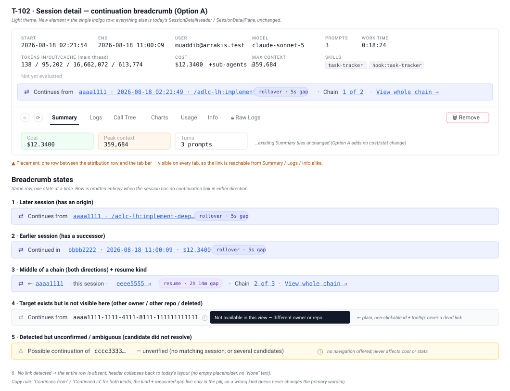
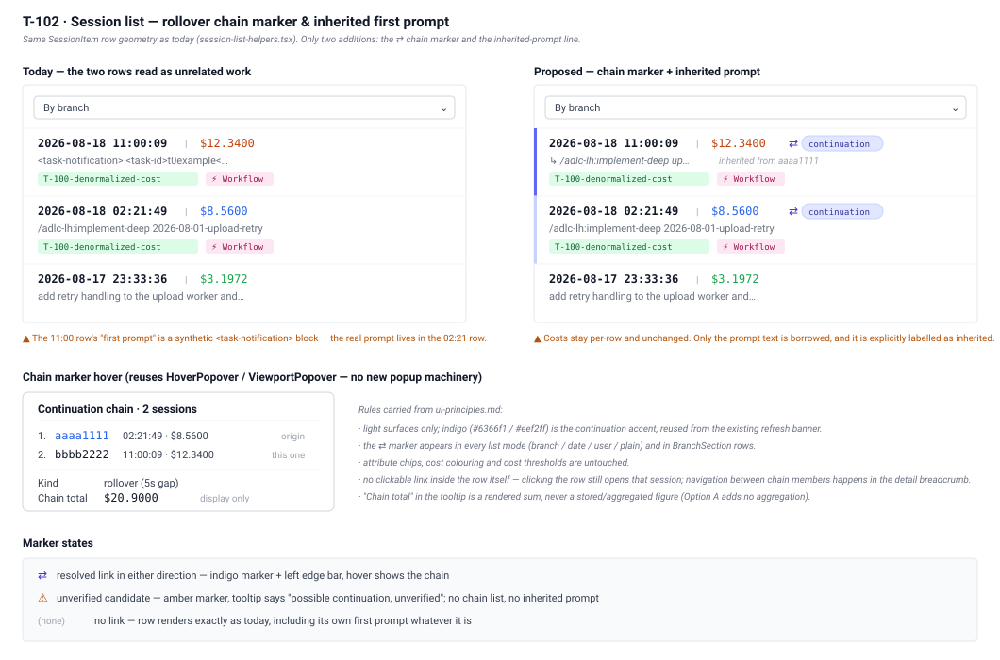
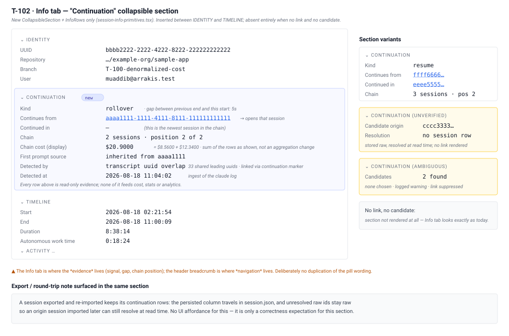
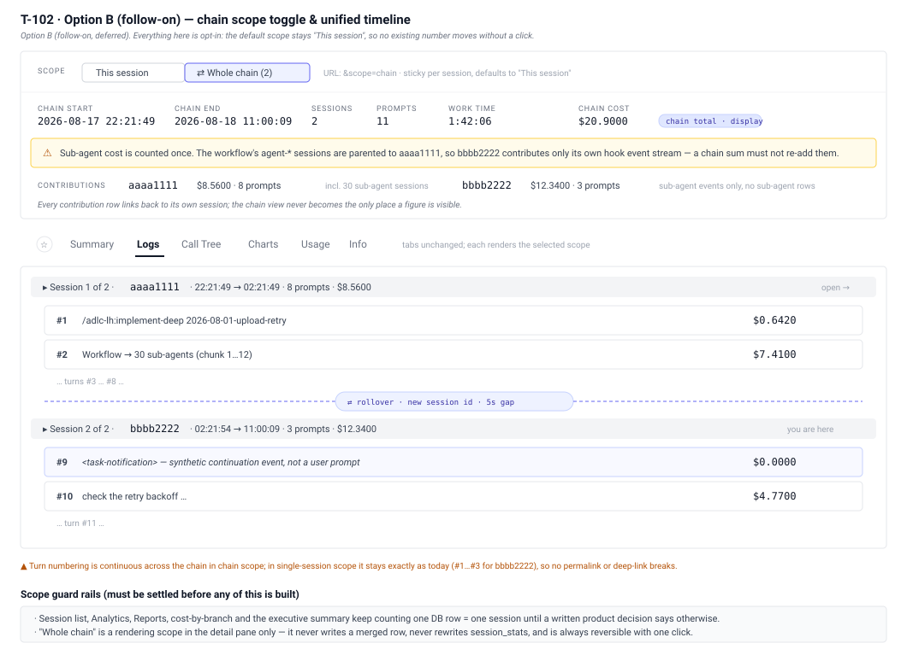

# T-102: Session Rollover Linking

**Status:** todo
**Priority:** medium
**Type:** feature
**Module(s):** server, client, hook
**Owner:** denis.tsyplakov
**Created:** 2026-08-18

## Description

Claude Code's CLI can "roll over" a single continuous piece of work into a **new top-level session
id** mid-run — the old session ends, a new session starts seconds later with a fresh `session_id`
and `parent_session_id IS NULL` (so today's data model has no way to tell it's not an unrelated,
brand-new session), and in-flight background activity (e.g. a `Workflow` tool run's sub-agents)
carries over into the new session id.

The motivating pair: session `bbbb2222-2222-4222-8222-222222222222` continued session
`aaaa1111-1111-4111-8111-111111111111`, starting 5 seconds after it ended. The actual user prompt
(`/adlc-lh:implement-deep 2026-08-01-upload-retry`) was typed into `aaaa1111`; `bbbb2222` never received a real user
prompt, so its own `first_prompt` extraction picked up a `<task-notification>` completion event
instead.

Sub-agent rows are unaffected by a rollover: a workflow run's `agent-*` sessions keep
`parent_session_id` pointing at the *origin* session, so their rows, `session_stats` and cost
already roll up there via `descendantSessionsCte` (`server/src/logs/session-tree.sql.ts:38-44`).
Only the hook-side `artisyn` event stream moves to the new session id. Any chain-merging work must
therefore not re-add sub-agent cost.

**Impact today:**
- The session list shows these as two unrelated sessions, each with its own cost/stats totals.
- The rolled-over session's displayed "first prompt" is confusing/misleading — it shows a
  `<task-notification>` block (or similar synthetic content) instead of the real prompt that
  started the work, because that prompt lives in the *other* session row.
- There is no link a user can follow from one session to the other to understand they're the same
  piece of work.

### Detection mechanism

Verified semantics of the three per-line signals in `claude` transcripts:

| Signal | What it actually means |
|---|---|
| `sessionId` (camelCase) | The session file the line **currently lives in**. Rewritten on copy, so it can never mark a copied line. |
| `session_id` (snake_case) | A per-line stamp of the session the line's **content originated in**, preserved across copies — so it names a chain *root*, not the immediate predecessor. |
| `uuid` | A stable content id, **preserved verbatim when a background fork copies the predecessor's transcript prefix**. |

Two further CLI-provided markers, both currently discarded by this project:

- **`sessionKind: "bg"`** — present on every message line of a background-fork session and absent
  from ordinary ones. A perfect classifier for "this session is a continuation", with no pointer to
  *which* session it continues.
- **The `SessionStart` hook's `source` field** — the CLI hands hooks
  `"startup" | "resume" | "clear" | "compact" | "fork"` on every session start, and `SessionEnd`'s
  `reason` is `"clear" | "resume" | "logout" | "prompt_input_exit" | "other"`.
  `hook/.claude/telemetry_tool/lifecycle-hook.js:111-113` already handles both events but records
  neither field. This is the authoritative answer to "is this session a continuation, and of what
  kind", straight from the CLI, with zero inference.

Three measured properties fix the layering below: reading the snake_case `session_id` off the new
session's earliest lines does not identify the predecessor; the uuid-containment rule (predecessor
= the session whose uuid set is contained in this one, ranked by shared-uuid count) has total
precision but only partial recall, because a `bg` session that shares no uuids with anything cannot
be resolved at all; and `--resume` does not preserve uuids, so the snake_case field and the uuid
rule are complementary rather than competing.

**The chosen approach is therefore layered, ordered by authority:**

1. **Hook-provided (authoritative, forward-looking).** Record `source` on `SessionStart` and
   `reason` on `SessionEnd`. Purely additive to the artisyn event schema, so older hook installs
   simply omit them and fall through to layer 2 (per CLAUDE.md's hook backward-compatibility rule).
2. **uuid-boundary resolution (identifies *which* session; works retroactively on stored bodies).**
   Deterministic, immutable, time-independent, and it produces the whole chain ordered by overlap
   size rather than just a pair.
3. **snake_case `session_id`, `--resume` only, as a last-resort origin hint** — recorded as
   "origin of copied content", never as the immediate predecessor, and only when layer 2 finds
   nothing.

The `docs/knowledgebase/session-id-vs-sessionid.md` rule stands unchanged: the snake_case field must
never be used as a per-line join or attribution key. Layer 3 is a session-level, last-resort hint
and must be commented and tested as such.

This is a scratch/raw-idea task, not a fully scoped plan; it still needs to go through
`adlc-lh:plan-deep` to pin down exact schema and call sites. **Decision (2026-08-18): Option A is the
chosen approach for this task** — see "Deferred: full merge" below for why the fuller alternative
(previously "Option B") is out of scope here.

### Option A — link + breadcrumb (chosen)

- Detect the continuation at ingest time and on recompute, using the layered mechanism above.
- New columns on `sessions`, siblings to the existing `parent_session_id` (weak reference, no FK,
  no cycle check): `continued_from_session_id`, `continuation_kind`
  (`fork` | `resume` | `unknown`), plus the denormalized `first_line_uuid` / `last_line_uuid` /
  uuid-count needed to make the reverse lookup an indexed query instead of a body scan.
- UI: a "continues from ←" / "continued in →" breadcrumb with a clickable link in the session
  detail view (session-log / session-info tabs) whenever a link exists in either direction, and an
  honest "background continuation, origin not found" state for the ~half of `bg` sessions whose
  predecessor cannot be resolved.
- No changes to cost/analytics aggregation anywhere — this is read-path/UI only. Each session row
  in a detected pair keeps its own independently-computed cost/token/OTEL figures exactly as today
  (see "OTEL behavior under rollover" below) — Option A never sums or reconciles them across the
  link.
- **Neither session in a pair may look broken on its own.** A link/breadcrumb is additive; it must
  never be the *only* thing standing between a session and a confusing or empty-looking detail
  view. Concretely this requires also fixing the misleading first-prompt display (folded into
  Functional Requirements below, not split into a follow-on) so a continuation session with no
  human prompt of its own shows the inherited prompt instead of a raw `<task-notification>` block.
- **Risk: low.**

### OTEL behavior under rollover (research finding, 2026-08-18)

The per-project OTEL receiver (`otel-receiver.js`, see `docs/knowledgebase/hook-system-overview.md`
§ "OTEL receiver") is a single long-lived process that persists across a rollover — it is not
restarted per session — but it demultiplexes purely by the `session.id` OTLP attribute the CLI
process itself reports, with no concept of "continuation." So it splits exactly like the
`claude`/`artisyn` streams: records emitted before the rollover file into
`<otelDir>/<oldSessionId>.jsonl`, records emitted after into `<otelDir>/<newSessionId>.jsonl`.

- **No data is lost in transport.** `send-logs-hook.js`'s `Stop` collection sweeps every `*.jsonl`
  in `otelDir` unfiltered, so both fragments get uploaded regardless of which of the two sessions'
  `Stop` fires first.
- **Cost splits the same way computed cost does.** `session_stats.telemetry_cost` (T-100) is
  recomputed per session id from `SUM(logs_otel.cost_usd_micros)` scoped to that session's own
  chunks (`server/src/logs/otel-cost.sql.ts`), so a rollover pair ends up with two independent
  OTEL-vs-computed reconciliations (`isOtelCostIncomplete`/`OTEL_INCOMPLETE_RATIO`) — the same
  as any two ordinary sessions, not a special case Option A needs to handle.
- **Residual risk, accepted for now:** a rollover splits one continuous OTEL export mid-stream, so
  a short fragment's own OTEL total could look disproportionately small next to its own computed
  cost and trip the existing incomplete-OTEL fallback — this is an existing, generic heuristic
  behavior for any short session, already believed harmless, not something rollover-specific to
  special-case here.
- **Relevance to a future full merge:** if the deferred full-merge alternative below is ever picked
  up, its combined cost figure must sum each fragment's own OTEL-reconciled cost, not just the
  computed-cost figures — noted here so that work doesn't have to re-derive this.

### Deferred: full merge (previously "Option B")

A fuller alternative was scoped and explicitly **not** chosen for this task: actually stitch the
continued sessions' turns/tool-calls/cost into one unified timeline and one displayed total in the
UI (similar to how sub-agent trees are already combined for display via the `descendantSessionsCte`
recursive lookup in `server/src/logs/session-tree.sql.ts`, documented in
`docs/knowledgebase/db-tables.md`). It would require a chain-aware read path walking the Option A
link transitively, must not re-add sub-agent cost when merging, and needs an explicit product
decision on whether analytics/reports (cost-by-branch, executive summary, session lists,
productivity counters, etc.) should treat a whole chain as one logical session or keep counting each
DB row separately as they do today — a decision that changes what "one session" means for every
cost and count in the system, not just a rendering change. Risk: higher, since it touches cost
aggregation across many report call sites rather than just one view.

Rejected for now on measured evidence: only ~3% of sessions roll over (12 of 383), and only 5 of
those have a resolvable origin — high enough to justify Option A's breadcrumb, not high enough to
justify a chain-aware read path across every report. Revisit if that rate climbs or if a specific
report's users ask for chain-aware totals. The wireframe and scope notes are kept here rather than
deleted so this doesn't have to be re-researched if revisited.

## Functional Requirements

- Record the `SessionStart` `source` and `SessionEnd` `reason` fields in the hook's artisyn event
  stream as new optional fields, and read them server-side when present.
- Detect, at `claude` log ingestion time and on recompute, whether a session continues another one,
  using the layered mechanism in the Detection mechanism section, and resolve the predecessor
  session where the evidence allows.
- Persist the link and its kind between the two session rows (Option A schema).
- Surface the link in the session detail UI as a navigable breadcrumb in both directions (the
  earlier session shows "continued in →", the later session shows "← continues from"), including
  the unresolved-predecessor state.
- Fix the misleading first-prompt display so neither session in a pair looks broken on its own:
  prefer the first `origin.kind === "human"` line for `first_prompt` extraction, falling back to
  today's behaviour on older transcripts that don't tag `origin.kind`; for a continuation session
  with no human prompt of its own at all, display the origin session's prompt, visibly marked as
  inherited, instead of a raw `<task-notification>` (or similar synthetic) block. In scope for this
  task, not split into a follow-on.

## Acceptance Criteria

- [ ] Given the motivating pair, after ingest or a repository recompute, `bbbb2222` has
      `continued_from_session_id = aaaa1111-1111-4111-8111-111111111111` and
      `continuation_kind = 'fork'`.
- [ ] Run against all sessions of the dogfood repository, detection produces zero links between
      sessions that share no transcript uuids and no hook-recorded continuation, i.e. no false
      positives.
- [ ] A `bg` session whose predecessor cannot be resolved is recorded as a continuation of unknown
      origin, not silently as a normal session, and the UI says so rather than rendering nothing.
- [ ] Re-uploading a session, or uploading it in chunks, never changes or clears an
      already-recorded link; a link is still established when the continued session is ingested
      before its origin session's row exists.
- [ ] The session detail view for either session in a detected pair shows a working link to the
      other session, and renders a non-clickable id with a tooltip when the target is outside the
      viewer's repository scope.
- [ ] Exporting a repository containing a detected pair and re-importing it into an empty instance
      preserves the link in both directions.
- [ ] No existing per-line/per-event stat extraction, cost computation, or analytics query is
      changed by this work — the snake_case `session_id` field is still never used to attribute an
      individual line/event/cost to a session.
- [ ] A hook install that predates this change still uploads successfully and still gets links via
      the uuid layer.
- [ ] For the motivating pair (and any other detected pair), the session detail view for **both**
      sessions renders a coherent, non-broken-looking page on its own: the continuation session's
      `first_prompt` shows the real (or explicitly inherited) prompt rather than a raw
      `<task-notification>` block, and neither session's cost/OTEL reconciliation is affected by
      the link (each keeps its own independently-computed figures, per "OTEL behavior under
      rollover" above).

## Common sense considerations

- The snake_case `session_id` field is **not** a predecessor pointer and is not used as one.
- Both background rollovers and `--resume` continuations are in scope, stored as one relation with
  a `continuation_kind` discriminator; the kind comes from the hook's `source`, never from a
  guessed time threshold.
- No time-adjacency heuristic is used: uuid identity is exact, and `sessions` has no timestamp
  columns anyway (`logs.start_time`/`end_time` are populated only for `logType === 'artisyn'`).
- Chains can exceed two sessions (`cccc3333` → `aaaa1111` → `bbbb2222` is one), and ranking
  candidates by shared-uuid count yields the whole ordered chain, with the largest overlap being
  the immediate predecessor.
- Direction is decided by containment, not by timestamps: the session whose uuid set is contained
  in the other's is the predecessor.
- Multiple candidates are not a tie to break — the lower-ranked ones are transitive ancestors and
  are simply not the immediate predecessor.
- Detection scans `log_type = 'claude'` bodies only, in `LogsService.upsert()`'s existing
  `logType === 'claude'` branch — `artisyn` bodies carry a self-referential snake_case
  `session_id` on nearly every line and `claude-subagent` bodies are already linked via
  `parent_session_id`.
- Detection is never gated on `logResult.isNewInsert` (mirroring the step-5 comment at
  `server/src/logs/logs.service.ts:206-212`), and a later upload that yields no candidate leaves an
  already-recorded link untouched rather than nulling it.
- Detection also runs from `RepositoriesService.recomputeForRepo()` /
  `POST :repoId/recompute-all-sessions`, which is how historical sessions get linked; the migration
  itself does not backfill, matching the convention in `docs/knowledgebase/db-tables.md`.
- The new columns join the repository export/import round-trip — `SessionJson`
  (`server/src/logs/export-import-zip.ts:75-78`) and `importSessionLog()`
  (`server/src/logs/logs.service.ts:467-479`) — under the same "always upsert when non-null" rule
  as `parentSessionId` / `workflowRunId`.
- Link resolution is restricted to non-deleted, top-level (`parent_session_id IS NULL`) sessions
  owned by the uploading user, exposed through the existing repo-scoped session endpoint so the
  standard access guard applies; a target outside that scope renders as non-clickable text with the
  id and a tooltip, never as a dead link.
- The forward link is at most one row; the reverse lookup may return several (two forks from the
  same point), so the "continued in →" side renders a list ordered by start time. It gets an index
  mirroring `sessions_parent_session_id_idx`.
- Predecessor lookup uses the denormalized `last_line_uuid` column plus a scan of the new session's
  own body, rather than a full per-line uuid index table — O(1) extra storage per session, and it
  resolved every detectable pair in the measurement recorded in `notes.md`.
- The `workflow_run_id` + `SubagentStart`/`SubagentStop` split is a corroborating signal only, not
  needed for detection given uuid identity.
- The hook change is additive-only, per CLAUDE.md's rule that old hook installs must keep working.

## Open Questions

Both questions previously listed here are resolved as of 2026-08-18:

- ~~Is the misleading first prompt fixed in this task or split into a named follow-on?~~ **Resolved:
  in scope for this task** (see Functional Requirements and Acceptance Criteria above) — the "neither
  session should look broken" bar applies to this task, not a later one.
- ~~Is the full-merge alternative ("Option B") worth doing?~~ **Resolved: deferred, not pursued in
  this task** — see "Deferred: full merge" above for the rationale and the measured continuation
  rate it's based on. Revisit as a separate task if the rate climbs or a report explicitly needs
  chain-aware totals.

No open questions remain that block scoping this task via `adlc-lh:plan-deep`.

## Notes

- The measurement write-ups, per-signal verification evidence and transcript survey behind the
  detection design are in `notes.md` in this folder.
- The transcript JSONL format has no published spec, so the uuid layer must be covered by tests
  using recorded fixtures.
