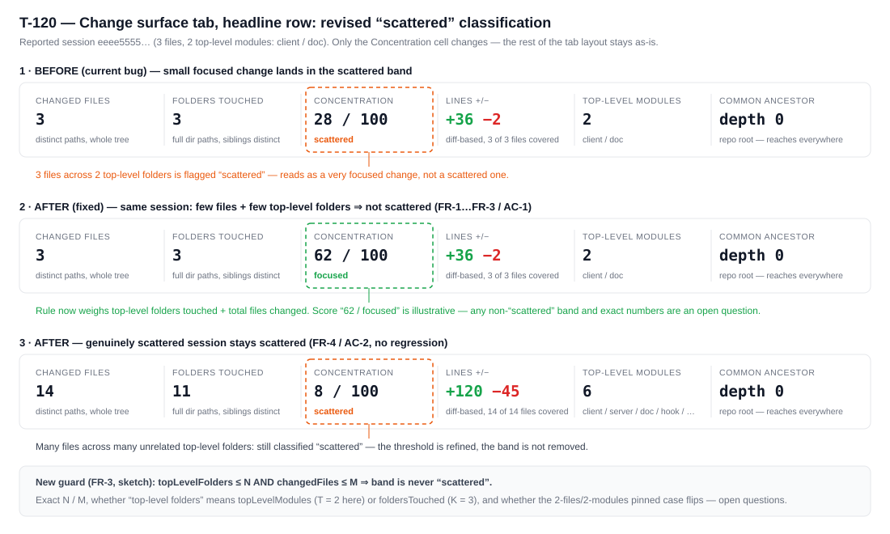
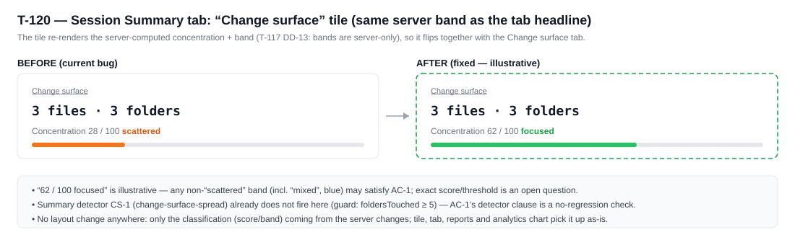

# T-120: Revise Change-Surface Scattered Classification Rule

**Status:** todo
**Priority:** medium
**Type:** bug
**Module(s):** server: logs/change-surface metric + `repo_config` (repositories.service,
repositories.controller); client: Repository Settings → Analysis tab; session-log summary
detector thresholds (only if the guard changes)
**Owner:** denis.tsyplakov
**Created:** 2026-08-28

## Description

Reported against `http://localhost:5173/#/teams/<team-id>/repos/<repo-id>?session=<session-id>&tab=change-surface`
(see attached screenshot): the session's change surface is classified/flagged as **scattered**,
but the actual change touched only 3 files, split between `docs/` and `client/` — which reads as a
very focused change, not a scattered one.

The current rule does not adequately weigh how few files and how few top-level modules were
touched, so a small, cross-cutting-but-focused change can still land in the "scattered" band. The
"scattered" the user sees is the server-computed concentration band (≈ 28 for this session) shown
on the change-surface tab headline and the Summary "Change surface" tile, computed in
`server/src/logs/change-surface/change-surface-metrics.ts`.

The small-change threshold behind that rule also becomes a per-repository, per-scope setting
rather than a hardcoded constant (FR-6…FR-13).

## Wireframes

## Functional Requirements

- FR-1: The scattered classification (the server-side concentration band computed in
  `computeChangeSurface()`) must take into account the **number of distinct top-level modules
  touched** (`topLevelModules` / T — 2 for the reported session: `client`, `doc`), not only the
  current entropy/proximity-derived score.
- FR-2: The classification must also take into account the **total number of files changed** in
  the session.
- FR-3: Any scope whose changed-file count is **≤ the effective "Merge surface threshold"** bands
  as **"focused"**, regardless of top-level module spread ("I fixed the API on the server, then the
  form on the client, then the doc — that is a very focused change"); scopes above the threshold
  keep the existing score-based banding. The implementation shape is a score floor
  (`concentration = max(score, BAND_FOCUSED_MIN)`); a band override is an acceptable alternative,
  to be settled during planning.
- FR-4: Genuinely scattered changes (many files across many unrelated top-level folders) must
  continue to be classified/flagged as scattered — this is a refinement of the existing rule's
  threshold, not a removal of the scattered classification.
- FR-5: T-117's small-change-leniency framing need not be preserved or annotated; update its
  artifacts only as the new behavior requires — the pinned unit tests in
  `change-surface-metrics.spec.ts`, the worked-checks table and leniency section in
  `docs/knowledgebase/change-surface.md`, and the leniency comment in `change-surface-metrics.ts`.
- FR-6: **The threshold is configurable per repository, in two independent scopes** — a personal
  (private-repo / user-scoped) value and a team-scoped value — stored as a new optional integer
  field in the existing `repo_config.config` jsonb blob (`RepoConfigJson`), exactly like T-83's
  `highCacheCreationThreshold`. No new table and no migration: absent means "use the built-in
  default", so the product default can change without touching data.
- FR-7: **Resolution order is user row → team row → built-in default**, resolved per reader and
  per repo — the same walk `getEffectiveCacheThreshold(userId, repoIds, teamId?)` implements,
  including its "the same `repo_url` can exist as several `repositories` rows" handling. A
  malformed or non-integer stored value is treated as absent and falls through to the next scope.
- FR-8: **The built-in default is 10 changed files**, replacing today's hardcoded
  `FOCUSED_SMALL_CHANGE_MAX_FILES = 5`. The constant is declared once per side and shared, in the
  style of `DEFAULT_HIGH_CACHE_CREATION_THRESHOLD` (server) / `cache-ratio-ui.ts` (client).
- FR-9: **UI:** the setting is edited in Repository Settings → **Analysis** tab, alongside the
  existing "High cache-creation threshold" control, labelled **"Merge surface threshold"** with
  the unit stated in files. It shows the value currently in force and follows the existing scope
  rules: a team owner may edit the team-scoped value; a non-owner sees the team value read-only
  with the existing "Managed by team owner" hint; every user may set a personal value, which wins
  over the team's.
- FR-10: **Validation** on write (server-side, in `validateConfig`, HTTP 400 on violation):
  integer only, `>= 1`, and `<=` a sane upper bound — a `*_MIN` / `*_MAX` constant pair mirroring
  the cache-creation threshold's. The client control rejects the same range before save.
- FR-11: **The effective threshold applies to every surface that renders the metric** — the
  session change-surface tab, the Summary tile, the change-surface report period, chart buckets
  and per-group aggregates — by being threaded into the single `computeChangeSurface(facts,
  options)` fold as an option. No second implementation of the rule, and no caller may keep using
  the built-in default implicitly (including the currently option-less per-bucket call in
  `change-surface-aggregate.service.ts`).
- FR-12: **Backward compatibility:** no API request/response shape break and no DB schema change.
  Existing configs without the field, and every historic session, keep working and pick up the
  default (10) automatically — concentration/band are never stored and are recomputed at read
  time.
- FR-13: The Tier-2 "closeness blend" constant (`SMALL_CHANGE_MAX_FILES = 6`) stays a hardcoded
  internal constant and is **not** made configurable; only the focused floor is.

## Acceptance Criteria

- [ ] AC-1: A session with 3 changed files split across 2 top-level modules (e.g. `docs/`,
      `client/`) shows the **"focused"** band on the change-surface tab headline and the Summary
      "Change surface" tile; the CS-1 `change-surface-spread` detector still does not fire for it
      (no-regression check, not a change to verify).
- [ ] AC-2: Genuinely scattered scopes still band as "scattered". Because banding now depends on
      the threshold in force, every pinned case in `change-surface-metrics.spec.ts` and the
      worked-checks table in `docs/knowledgebase/change-surface.md` §2 states its threshold
      explicitly: the 6 files / 6 folders / 6 top-level modules / score 8 case must keep banding as
      scattered when the effective threshold is below 6, and a separate above-threshold scattered
      anchor is pinned (e.g. 12 files / 12 folders / 12 modules at the default threshold).
- [ ] AC-3: The new/adjusted threshold(s) are covered by unit tests alongside the existing
      change-surface metric and detector tests.
- [ ] AC-4: The pinned case "2 files in 2 unrelated top-level modules (`a/x` + `z/y`)" bands as
      **"focused"** in both `change-surface-metrics.spec.ts` and the worked-checks table in
      `docs/knowledgebase/change-surface.md` §2.
- [ ] AC-5: With nothing configured anywhere, a scope of exactly 10 changed files bands as
      **focused**, and one of 11 falls back to pure score-based banding.
- [ ] AC-6: Setting the threshold on the **team** scope (as team owner) changes the band shown to
      a team member who has no personal value; setting a **personal** value on the same repo
      overrides the team value for that user only and leaves other users' view unchanged.
- [ ] AC-7: Never setting (or clearing) the personal value falls back to the team value; with
      both absent it falls back to 10.
- [ ] AC-8: A `PUT` of a config whose "Merge surface threshold" is non-integer, `< 1` or above
      the max is rejected with HTTP 400 and no partial write; a garbage value written
      out-of-band does not break any read path (treated as absent).
- [ ] AC-9: All five surfaces use the same effective threshold for the same viewer and repo — the
      session tab, the Summary tile, the report period, chart buckets and group aggregates cannot
      disagree.
- [ ] AC-10: `docs/knowledgebase/change-surface.md` (leniency section, worked-checks table, §5
      storage notes) plus the repo-config / API / settings KB pages document the new setting, its
      two scopes, the resolution order and the default.

## Open Questions

- OQ-1 (non-blocking, naming): the owner-chosen label is **"Merge surface threshold"**, while the
  feature, KB article, DB columns and API field family are all named **change surface**.
  Recommendation: keep the owner's label in the UI as requested, and reference the code-level name
  in docs so the two are never confused. Confirm the stored field name during planning
  (`mergeSurfaceThreshold` vs `changeSurfaceFocusedMaxFiles`).
- OQ-2 (non-blocking): the upper validation bound — proposal `1000` files; above that every
  realistic scope becomes focused and the "scattered" band stops being reachable. Confirm during
  planning.

_(All original T-120 questions were resolved on 2026-08-28; the two above come from the same-day
scope extension.)_

## Common sense considerations

- The fix lives server-side in `computeChangeSurface()` (score/band): the client CS-1 detector's
  `foldersTouched >= 5` guard already keeps it silent for the reported session, and T-117 DD-13
  keeps band boundaries server-only.
- "Top-level folders touched" means folders at the project root — i.e. distinct top-level modules
  (`topLevelModules` / T), not `foldersTouched` (K / `cs_folders_touched`).
- FR-5: T-117 is done; no need to preserve its leniency framing — its pinned artifacts are simply
  updated to match the new behavior.
- AC-1's requirement is the "focused" band (owner: any change up to the threshold is focused),
  not just "anything non-scattered".
- The whole T-83 stack is the precedent to copy rather than reinvent: `RepoConfigJson`'s optional
  field, `readConfigThreshold()`'s garbage tolerance, `getEffectiveCacheThreshold()`'s
  user→team→default walk with its `source` marker, `validateConfig()`'s range check, and the
  `CacheCreationThresholdSetting` control in the Analysis tab.
- Because report/chart scopes fold *many* sessions, the floor applies to those aggregates too: a
  whole report period with ≤ threshold distinct files bands focused. That is the existing
  behaviour of the floor (DD-4), just configurable and with a larger default.
- Surfacing *where* the effective threshold came from (`user` / `team` / `default`) in the
  change-surface UI, the way the cache-ratio report does, is **out of scope** unless it falls out
  for free.
- No migration/backfill needed: concentration/band are never stored and are recomputed at read
  time, so historic sessions pick up the new rule automatically (KB §5). The setting itself rides
  in the existing `repo_config.config` jsonb, so it needs no schema change either.
- Raising the default from 5 to 10 re-flips pinned artifacts a second time — the KB worked-checks
  table and the metric spec must state the threshold in force for each pinned case instead of
  assuming a single global one.

## Notes

<!-- Append timestamped notes here as work progresses -->

- Origin (raw idea as reported) and the requirements' revision history: see `notes.md`.
- 2026-08-28: `impl-plan.md` re-planned against FR-6…FR-13 (config + API + UI scope) and is current;
  it resolves OQ-1 as `changeSurfaceFocusedMaxFiles` and OQ-2 as an upper bound of `1000`. The
  earlier server-constant-only plan and `research/findings-1.md` are superseded.
