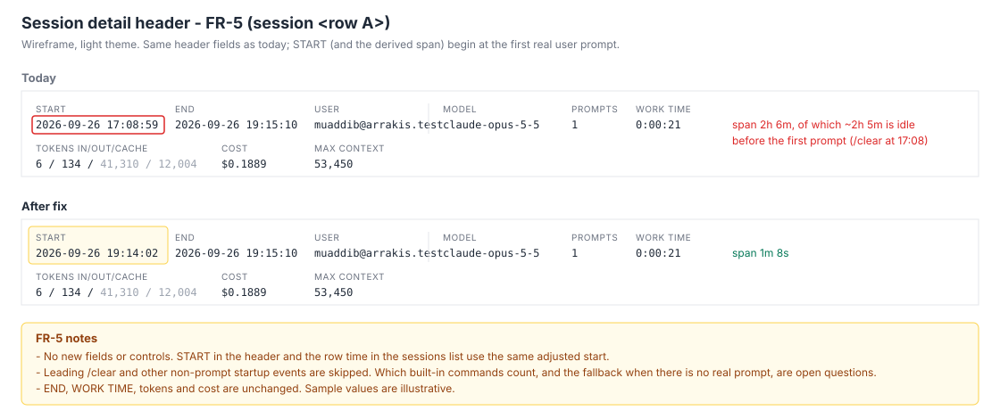

# 2026-09-26: Session List Anomalies and OTEL Port Drift Fixes

**Status:** todo
**Priority:** high
**Type:** bug
**Module(s):** server | client | hook | artisyn-hooks-installer
**Owner:** denis.tsyplakov
**Created:** 2026-09-26

## Description

Raw idea: "Session list/ingest anomalies found in the audited test repository + OTEL port drift — fix
list". This task bundles every fix found while auditing the last 20 root sessions of a test repository
(`http://localhost:5173/#/repos/<repo-id>`, plus a second test checkout of it with its own hook
install, all sessions on Claude Code 2.1.280, hook 2.17.4).

### Finding 1 — the "⚡ Workflow" badge is a false positive on almost every session

`hasWorkflow` on the sessions list is computed in `server/src/logs/repositories.controller.ts`
(~L748-764) with a raw substring match on the whole transcript:

```sql
cl.body::text LIKE '%"name": "Workflow"%'
```

Claude Code 2.1.280 writes a new `attachment` event of type `prompt_snapshot` into every transcript.
It contains the full tool catalogue, including `{"name": "Workflow", "schema": {...}}`, so every
session in which the Workflow tool was merely *available* matches. Measured on the last 20 sessions
of the audited test repository: 19 have a claude log, all 19 get the badge, only 3 contain a real Workflow call
(`assistant` event → `message.content[]` block with `type = 'tool_use'` and `name = 'Workflow'`):

| session row | session id | prompt | real Workflow calls |
|---|---|---|---|
| `<row D>` | `11111111-aaaa-4bbb-8ccc-000000000004` | `/my-plugin:implement …` (a plugin skill command) | 1 (`wf_example1`) |
| `<row E>` | `11111111-aaaa-4bbb-8ccc-000000000005` | `/my-plugin:review …` (a plugin skill command) | 1 (`wf_example2`) |
| `<row F>` | `11111111-aaaa-4bbb-8ccc-000000000006` | `/my-plugin:review …` (a plugin skill command) | 1 (`wf_example3`) |
| 16 others | — | — | 0, still badged |

The per-session data is otherwise correct: sub-agent `sessions.workflow_run_id` values and
parent/child links are consistent — only the badge detection is wrong.

### Finding 2 — new Claude Code transcript event types are unknown to the app

None of these event types is referenced anywhere in `server/src`, `client/src` or
`docs/knowledgebase` (volumes are across the 19 sessions above):

| event | count | bytes |
|---|---|---|
| `attachment/prompt_snapshot` | 38 (every session) | 2.95 MB |
| `attachment/total_tokens_reminder` | 682 | 455 KB |
| `attachment/silent_turn_reminder` | 58 | 44 KB |
| `attachment/deferred_tools_record` | 24 | 55 KB |
| `attachment/remote_session_change` | 19 | 26 KB |
| `atis-latch` | 444 | 39 KB |
| `cost-state` | 14 | 11 KB |

`prompt_snapshot` embeds the system prompt / tool schemas, so any other logic that scans raw
transcript text (not just the badge) can produce the same class of false positive.

### Finding 3 — SessionStart-only sessions appear in the list as empty rows

Session row `<row C>` (`11111111-aaaa-4bbb-8ccc-000000000003`) has only one `artisyn` log with a
single `SessionStart` event (2026-09-26T15:20:47.524Z). It has no claude transcript, no
`session_stats` row, no prompt and zero duration: a Claude Code session opened and closed without a
prompt. It shows in the sessions list as noise.

### Finding 4 — the session time span includes idle time before the first prompt

Session row `<row A>` (`11111111-aaaa-4bbb-8ccc-000000000001`) is listed as 17:08 → 19:15 (~2h 7m). Its transcript starts with
`/clear` at 17:08:59; the first real user prompt ("сколько время?") only arrives at 19:14:02. It has
1 turn, 134 output tokens and 0 min work time, so the 2h are pure idle before the first prompt.

### Finding 5 — OTEL data silently lost since 2026-09-24 (installer never updates its own endpoint)

The audited test repository has **no** OTEL data for any root session (24–26.09: 43 sessions,
`session_stats.telemetry_cost` and `claude_version_otel` all NULL). Root cause, verified in the
second test checkout:

- `.claude/settings.json` `env.OTEL_EXPORTER_OTLP_LOGS_ENDPOINT` /
  `OTEL_EXPORTER_OTLP_METRICS_ENDPOINT` point at `http://127.0.0.1:50280/...`.
- `.artisyn/config/otel-port.json` is `{"port": 50962, "allocatedAt": "2026-09-24T20:44:03.603Z"}`,
  and `log-hub.json` `otelReceiverPort` is `50962`.
- The receiver listens on 50962 (`receiver.log`, process verified); **nothing listens on 50280**.
  `.artisyn/ai_work_dir/telemetry/otel/` contains no `*.jsonl` at all — Claude Code exports into the
  void.

Installer cause: `mergeSettings()` in `artisyn-hooks-installer/src/install.ts` (~L1646-1668)
merges the OTEL `env` block per key "fill-if-absent" and never overwrites a key that already exists,
**including values the installer itself wrote earlier**. When the port is re-allocated (lost/removed
`otel-port.json`, `--otel-port` override), the exporter keeps posting to the old port. It only
prints a `Note: kept your existing ...` line. This behaviour is pinned by the test
`--otel-port on a re-install moves the store but leaves the endpoints the user already has`
(`artisyn-hooks-installer/src/__tests__/install.test.ts` ~L2241).

The hook has no runtime check either: nothing in `hook.log` / `receiver.log` says the configured
exporter endpoint and the receiver port disagree.

## Functional Requirements

- **FR-1 (Workflow badge):** `hasWorkflow` on the sessions list is true only when the session's
  claude log has at least one real Workflow call: an `assistant` event whose `message.content[]`
  holds a `tool_use` block with `name = 'Workflow'`. The presence of the Workflow tool in a tool
  catalogue / system-prompt snapshot (`prompt_snapshot` or any other attachment) never sets it.
  Detection matches real `tool_use` blocks instead of `body::text LIKE`; no migration or stored column.
- **FR-2 (raw-text scans audit):** every server/client detector that matches substrings over raw
  transcript text (`body::text LIKE …`, `JSON.stringify(...).includes(...)` and similar) is audited.
  Each one that can be fooled by `prompt_snapshot` / tool-catalogue content is changed to inspect
  structured fields instead.
- **FR-3 (new event types):** the new event types listed in Finding 2 are accounted for: they
  are documented in the log-schema KB, and they do not count toward user/assistant content, token or
  byte estimates, harness usage, or turn counts (unless a type is meant to carry that data).
- **FR-4 (empty sessions):** a session with no claude transcript and only a `SessionStart` artisyn
  event is not shown as a normal session row in the sessions list (see Open Questions for hide vs.
  mark).
- **FR-5 (idle lead-in):** a session's time span / duration does not include the idle gap between
  the hook's `SessionStart` and the first real user prompt. In `extractTimestampRange`
  (`server/src/logs/artisyn-extractor.ts`), the artisyn log's `start_time` = timestamp of the first
  `prompt_start` (or legacy `prompt`) hook line when one exists, else today's min over activity
  lines; `end_time` is unchanged. Every consumer of `logs.start_time` (list span, session header,
  date-range filters, analytics) picks it up; the recompute path lives in `repositories.service.ts`.
- **FR-6 (installer endpoint update):** on `install` / `upgrade`, if the existing
  `OTEL_EXPORTER_OTLP_LOGS_ENDPOINT` / `OTEL_EXPORTER_OTLP_METRICS_ENDPOINT` is an Artisyn loopback
  receiver endpoint (same shape the uninstall path already recognises via
  `OTEL_LOOPBACK_LOGS_ENDPOINT_RE`) on a port different from the resolved one, the installer
  rewrites both to the resolved port and reports it. A user's own non-loopback collector endpoint
  stays untouched, as today.
- **FR-7 (hook runtime mismatch detection) — done in hook 2.18.0:** on every `SessionStart` when
  `otelEnabled`, the hook reads the effective OTEL endpoints (settings.local → settings →
  `~/.claude/settings.json` → process env). A missing endpoint, or a loopback endpoint on a port other
  than its receiver port, produces one `hook.log` warn plus one `systemMessage` with the fix (re-run
  `upgrade`). Non-loopback collectors are ignored. It never rewrites settings.
- **FR-8 (backward compatibility):** the hook API stays backward compatible. Users on older hook
  versions must keep working unchanged against the updated server (per project rule).



## Non-Functional Requirements

- The FR-1 detection must not regress sessions-list performance (currently one query over the
  page's session ids). The server `npm run perf` metrics must not degrade by more than 20%.
- Installer changes bump the patch version in `artisyn-hooks-installer/package.json` (per
  `.claude/rules/installer.md`). Hook changes go to `hook/` and are propagated via
  `npm run build:hooks-installer` and the dogfooded `.artisyn/marketplace/plugins/log-hub-hooks/`
  install.

## Acceptance Criteria

- [ ] FR-1: on the audited test repository, exactly the three sessions `<row D>`, `<row E>` and
      `<row F>` of the audited 20 show the "⚡ Workflow" badge. A test covers a transcript that has a
      `prompt_snapshot` listing the Workflow tool but no Workflow `tool_use`, and asserts
      `hasWorkflow = false`.
- [ ] FR-2: the audit result (each raw-text detector found and what was done) is recorded in the
      task notes. Every detector changed has a regression test with a `prompt_snapshot` fixture.
- [ ] FR-3: `docs/knowledgebase/log-schema/` documents each event type from Finding 2. A test shows
      a transcript with those events produces the same content/token/turn metrics as one without
      them.
- [ ] FR-4: sessions like `<row C>` (SessionStart-only, no transcript) are no longer shown as
      normal rows in the sessions list, verified in the UI on the audited test repository.
- [ ] FR-5: session `<row A>` displays a span starting at its first real prompt (≈19:14), not 17:08.
      A test covers it, plus the no-prompt case (start unchanged).
- [ ] FR-6: an installer test covers the scenario: install (port A) → port store changes → re-install
      or `upgrade` resolves port B, and both env endpoints now point at port B. The existing test at
      `install.test.ts` ~L2241 is updated to the new behaviour. A test asserts a non-loopback
      collector endpoint is still preserved.
- [x] FR-7: hook tests show a mismatched loopback port or a missing endpoint produces exactly one
      `hook.log` warning per SessionStart, and a matching port produces none.
- [ ] FR-8: an old-hook upload (v1 and v2 logs routes) still ingests correctly against the updated
      server (existing e2e/server tests stay green).
- [ ] Running the installer `upgrade` in a project whose settings point to a stale loopback port
      rewrites both endpoints to the receiver's current port, and new sessions there get OTEL data
      (`telemetry_cost` / `claude_version_otel` non-null).

## Steps to Reproduce

1. Open `http://localhost:5173/#/repos/<repo-id>` as the repo owner.
2. Look at the latest 20 sessions: all sessions with a transcript show "⚡ Workflow", including
   one-prompt chats such as "сколько время?" (rows `<row A>`, `<row B>`).
3. Run `SELECT count(*) … WHERE body::text LIKE '%"name": "Workflow", "schema"%'` on their claude
   logs. Every one matches inside an `attachment/prompt_snapshot` event.
4. In the second test checkout, compare `.claude/settings.json` (`:50280`) with
   `.artisyn/config/otel-port.json` (`50962`). `.artisyn/ai_work_dir/telemetry/otel/` has no
   `*.jsonl`.

**Expected:** the badge shows only on sessions that ran a Workflow. OTEL records reach the
project's receiver and populate telemetry cost/version.
**Actual:** the badge shows on 16 of the 19 sessions with a transcript that never ran a Workflow.
No OTEL data at all since 2026-09-24. Empty SessionStart-only and idle-padded sessions show up as
normal rows.

## Open Questions

- FR-4: hide SessionStart-only sessions from the list entirely, or keep them with an "empty"
  marker / behind a filter?
- FR-6: should the rewrite also apply to the other OTEL env keys the installer owns (protocol,
  exporters, interval)? Or only to the two endpoints whose port drifted?
- FR-6: `.claude/settings.json` is committed to git, but the OTEL port is random per checkout. Where
  should the installer write the OTEL endpoints? The options are: (a) the gitignored
  `.claude/settings.local.json`, removing Artisyn-owned loopback keys from `.claude/settings.json`
  and cleaning both files on uninstall; (b) keep `.claude/settings.json` and, when `otel-port.json`
  is absent, adopt the existing loopback endpoint's port as the allocation; (c) rewrite
  `.claude/settings.json` in place. When the committed endpoint port and `otel-port.json` both exist
  and disagree (second test checkout: 50280 vs 50962), which one wins? Should an AC check that after install
  on a second checkout, `git diff .claude/settings.json` is empty and the effective endpoint matches
  that checkout's receiver port?
- FR-6: how should the installer tell an Artisyn-owned loopback endpoint from a user's own local
  OTel collector (e.g. `http://localhost:4318/v1/logs`), given that `OTEL_LOOPBACK_LOGS_ENDPOINT_RE`
  matches both? For example, should it rewrite only when the existing port matches a port the
  installer previously recorded (old `otel-port.json`, `log-hub.json otelReceiverPort`, or a marker),
  and otherwise keep the value?
- FR-4: in which exact view and API endpoint did session row `<row C>` appear as an empty row, and
  why does it pass that query's filters? `GET /repos/:repoId/sessions` and `/sessions/ids` already
  require `first_prompt IS NOT NULL` and an existing `claude` log, so it should not be returned
  there. If it cannot be reproduced there, should FR-4 target a different surface or be dropped?
- FR-3: for each new event type from Finding 2 (`prompt_snapshot`, `total_tokens_reminder`,
  `silent_turn_reminder`, `deferred_tools_record`, `remote_session_change`, `atis-latch`,
  `cost-state`), should it be ignored for all metrics or feed a specific metric (e.g. `cost-state`
  as a cost source, `total_tokens_reminder` for token counts)? Should its bytes count toward the
  session's transcript size, and should it be shown, collapsed or hidden in the session log viewer?

## Common sense considerations

- Priority: high — OTEL data is silently lost on every affected install.
- FR-1: `hasWorkflow` is computed live per request, so no recompute step; detection uses jsonb containment in the existing single query.
- FR-5: start = first real user prompt, i.e. the first `prompt_start`/`prompt` hook line (built-in local commands like `/clear` never emit one; skill/custom slash commands do).
- FR-5: the stored `logs.start_time` changes (single source of truth); the analytics date shift is intended; existing rows are backfilled via the existing recompute path.
- FR-5: a session with no prompt keeps today's start.
- FR-7: restated to the shipped hook 2.18.0 contract; "exactly one warning" is per SessionStart.
- FR-7: warn only, never self-heal — a rewrite would not reach the already-running Claude Code process.

## Notes

<!-- Append timestamped notes here as work progresses -->
- 2026-09-26: audit source — DB queries against the last 20 root sessions of the audited test
  repository plus the hook install in the second test checkout. OTEL data between 2026-09-24 and the fix is lost and
  cannot be recovered.
- OTEL root-cause investigation (committed `settings.json` port, `OTEL_*` not forwarded to hooks,
  `hook.log` rotation) and the FR-7 implementation write-up: see `notes.md`.
