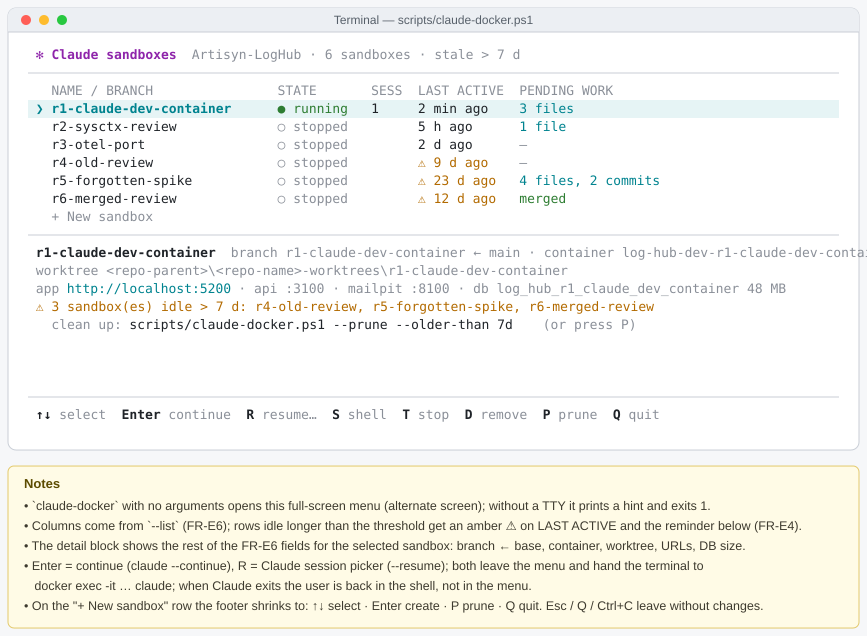
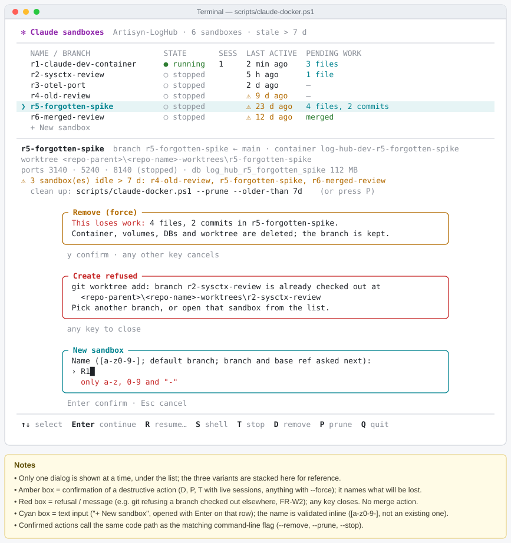

# 2026-10-15: Claude Code Dev Container (docker-dev + local infra + hook)

**Status:** todo
**Priority:**
**Type:** feature
**Module(s):** infra / dev environment, hook
**Owner:** denis.tsyplakov
**Created:** 2026-10-15

## Description

Provide Claude Code dev containers for this repository so that Claude can run with
`--dangerously-skip-permissions` in an isolated Linux environment instead of directly on the
developer's host. Each container is a self-contained **sandbox**: its own git worktree and branch,
its own database in the shared Postgres server, its own backend, client and Mailpit running inside
the container. Several sandboxes can run in parallel. Stopping a sandbox's container stops
everything in it; the worktree, branch and database persist. While the sandbox runs, the developer
opens its client in a host browser at the sandbox's own URL (`http://localhost:<sandbox client port>`)
to see how the agent's work looks; a stopped sandbox is brought back for viewing with `--serve`.

The work has these parts:

- **A. Local infrastructure:** a checked-in compose file with the shared Postgres server (data on a
  persistent named Docker volume) and a Mailpit for host use.
- **W. Sandbox:** worktree, database, in-container dev stack, host ports and lifecycle per sandbox.
- **B. Dev image and launcher:** a Linux image with Node/npm, bun, Claude Code, Chrome, Playwright and
  Mailpit; OS-dependent directories on container volumes; the host TEMP directory mounted for pasted
  images; a launch script in this repo.
- **C. Telemetry hook in the container:** Claude sessions run inside a sandbox are reported to the
  sandbox's own Log Hub.
- **E. Cleanup:** removing a sandbox and its resources, finding orphans.

Currently the DB is `server/artisyn-log-run-local/docker-compose.yml` (`postgres:18.4`, `127.0.0.1:5432`,
DB `a-log`, data is a bind mount from the Windows disk).

## Phase 1 — PoC: review sandbox

The first deliverable is a minimal sandbox in which Claude reviews a task (e.g.
`/adlc-lh:review-deep <task>`) in its own worktree and branch, with no servers and no code changes;
the result is merged back and everything is cleaned up. Phases 2+ (the rest of this document) build
on it.

- PoC-1. **Scope.** From the FRs below only: FR-W1 (no DB, no ports), FR-W2, FR-W3, FR-B1 (slim image:
  Node/npm, Claude Code, git ≥ 2.48, `jq`, `ripgrep` — no Chrome, Playwright, Mailpit, bun),
  FR-B3, FR-B6 (no socat, no dev stack, no `node_modules` volumes), FR-B8, FR-B9, FR-D1. Out of the
  PoC: section A (no Postgres needed), FR-W4–W6, FR-B2, FR-B4, FR-B10, section C (no server, so no
  telemetry: the entrypoint disables `log-hub-hooks` for the worktree with a local-scope
  `enabledPlugins` override; no hook changes), `--serve`. Cleanup
  (section E, without the DB steps) is in the PoC.
- PoC-2. **Plugins.** The project plugins enabled in `.claude/settings.json` (`adlc-lh`,
  `log-hub-hooks`) are registered and installed into the shared `claude-home` by the entrypoint
  (`claude plugin marketplace add` / `claude plugin install --scope project`, idempotent), so the
  `/adlc-lh:*` skills and the `Workflow` tool work in the sandbox.
- PoC-3. **Review-only guard.** The container guide (FR-B7, PoC version) says: review mode — only
  files under `docs/` may be changed; do not start servers, do not run builds or tests; no git write
  commands (as in the repo `CLAUDE.md`).
- PoC-4. **Launcher commands.** `claude-docker <name> [--from <ref>]` (create/start + Claude session),
  `--shell <name>`, `--stop <name>`, `--list`, `--remove <name> [--force]`, `--prune`, the stale-sandbox
  reminder (section E without the DB steps), `--continue`/`--resume` passed to `claude`, the
  interactive menu (FR-W8, without `--serve`), and a new
  `--merge <name>`:
  1. refuses if the branch or the uncommitted worktree changes touch anything outside `docs/`;
  2. commits all worktree changes on the host with the host git identity (Claude in the container
     never commits), message `review: <name>`;
  3. merges the branch into the base branch the sandbox was created from (recorded at creation); the
     main checkout must be on that branch, and git's own refusal on conflicting local changes stops
     the merge with a message; on a content conflict the launcher runs `git merge --abort`, keeps
     the sandbox, worktree and branch, prints the conflicting files and exits non-zero; a re-run
     with nothing left to commit skips step 2;
  4. on success runs `--remove <name>` and deletes the merged branch (`git branch -d`).
  Every git write is done by the launcher, i.e. by the user's command, never by Claude.
- PoC-5. **Host prerequisite.** Host git ≥ 2.48 (`worktree.useRelativePaths`); the launcher checks it
  (FR-W2). The host currently has 2.45.1 and must be upgraded first.

PoC acceptance criteria:

- [ ] `claude-docker r1` creates worktree + branch `r1` from the current `HEAD` and opens Claude in the
      container; `/adlc-lh:review-deep <task>` runs to completion there and changes only files under
      `docs/` of the worktree.
- [ ] The main checkout's working tree is untouched while `r1` works; `git worktree list` on the host
      shows `r1` and `git -C <worktree> status` works from the host.
- [ ] `--merge r1` commits the review result, merges it into the base branch, removes the container,
      the worktree and the branch; afterwards `git worktree list` and `--list` show no `r1`, and no
      `r1` container or volume is left in `docker ps -a` / `docker volume ls`.
- [ ] `--merge` refuses a branch that touches files outside `docs/`, and refuses when the main checkout
      is on another branch; a conflicting merge leaves the main checkout clean and the sandbox intact.
- [ ] A review session in `r1` produces no hook errors and creates nothing outside the worktree.
- [ ] `--remove r2` on an unmerged sandbox removes container and worktree, keeps branch `r2`, and
      refuses on uncommitted changes without `--force`.
- [ ] No launch ever removes a sandbox. Power-loss simulation: `docker kill` the container in the
      middle of a session that has not changed any file yet (and, separately, leave Claude with
      Ctrl+C); after any number of launches the sandbox still exists, and
      `claude-docker r1 --continue` reopens that conversation in the same worktree so the review can
      be finished and merged.
- [ ] With the threshold set to a few minutes (env), a launch prints the stale sandboxes with branch,
      last activity and pending work, and ends with the exact `--prune --older-than …` command;
      running that command shows the plan, asks for confirmation, removes the nothing-to-lose ones
      and keeps the ones with work unless `--force`.
- [ ] `claude-docker` without arguments opens the menu: it lists the sandboxes, creates a new one,
      continues an existing one (Claude opens in the same terminal), merges, removes and prunes —
      each destructive action only after a confirmation; Esc/`Q` leaves without changes.

## Functional Requirements

### A. Infrastructure

- FR-A1. Compose file `local-run/docker-compose.yml` (checked-in) with `postgres` and `mailpit`;
  fixed `container_name`/`hostname` (`log-hub-postgres`, `log-hub-mailpit`) and network name, so that
  sandbox containers connect by name. Replaces `server/artisyn-log-run-local/docker-compose.yml`:
  the old compose and its data directory are deleted together with the database, references to them
  are updated.
- FR-A2. `postgres:18.4`, data in an external named volume `log-hub-pgdata` (`external: true`, so
  `docker compose down -v` does not delete it), mounted at `/var/lib/postgresql` with the image's
  default `PGDATA` (postgres 18 refuses a mount at the old `/var/lib/postgresql/data`); the volume is
  created by an idempotent `docker volume create`. Not a bind mount: a Windows bind mount does not
  honor fsync and lists a changing directory inconsistently, so after a power loss the cluster may
  fail WAL recovery (`could not create file …: File exists`). The DB is created from scratch, the
  schema is applied by the server migrations on startup.
- FR-A3. Host-side ports and credentials are unchanged: `5432` (`a-log`, `postgres`/`pw`), Mailpit
  `1025`/`8025`; published only on `127.0.0.1`. The host `server/.env`, `.mcp.json`, jest and
  scenarios work without changes.
- FR-A4. healthcheck (`pg_isready`), `restart: unless-stopped`, `stop_grace_period` (e.g. `2m`, so
  Postgres can shut down cleanly); `max_connections` sized for several sandboxes running test suites
  in parallel.
- FR-A5. `local-run/` is the only local infra stack: `tests/scenarios/docker-compose.yml` is deleted,
  and on the host scenarios, corpus and contract use `log-hub-postgres` and `log-hub-mailpit`. Every
  reference to the deleted compose is updated: `CLAUDE.md`, `repo-health-checks.json →
  environmentNotes`, `docs/knowledgebase/test/scenarios.md`, `tests/scenarios/README.md`,
  `tests/corpus/README.md`, `tests/scenarios/helpers/mailpit.ts`, `scripts/scenarios/preflight.mjs`,
  `scripts/corpus/bootstrap.js`.

### W. Sandbox

- FR-W1. **Identity.** A sandbox is identified by a name (`[a-z0-9-]`, validated by the launcher). It
  owns: container `log-hub-dev-<name>`, branch `<name>` (or the one given with `--branch`),
  worktree, databases `log_hub_<name>` and `log_hub_<name>_test` (dashes → underscores), its `node_modules` volumes and its
  host port pair.
- FR-W2. **Worktree.** Created by the launcher on first launch with `git worktree add` from the main
  checkout's current `HEAD` (or `--from <ref>`); an existing branch is checked out instead of
  created. Location: a sibling directory of the repo, `<repo-parent>/<repo-name>-worktrees/<name>`
  (overridable by an env variable), so the main checkout's tools and IDE never index it. The worktree
  links (`<worktree>/.git` and `.git/worktrees/<name>/gitdir`) are **relative**
  (`worktree.useRelativePaths`, git ≥ 2.48), so the same worktree works from the Windows host and
  from the container; the launcher checks the host git version and exits with a message if it is
  older (see PoC-5).
- FR-W3. **Mounts.** Only the sandbox's worktree and the main repo's `.git` directory are mounted,
  read-write, at container paths that mirror their relative host layout (so the relative links
  resolve); the main checkout's working tree is not mounted. Nothing else of the host file system is
  writable from the container except `docker-dev/claude-home` (FR-B6).
- FR-W4. **Database.** The launcher creates `log_hub_<name>` in `log-hub-postgres` if missing
  (`docker exec log-hub-postgres createdb …`, idempotent). The container gets
  `DATABASE_URL=postgresql://postgres:pw@localhost:5432/log_hub_<name>` (through the socat forward,
  FR-B4) as an environment variable; the server, contract and scenarios already honour
  `DATABASE_URL` from the environment. The worktree's git-ignored `server/.env` is generated by the
  launcher on creation (`AUTH_MODE=none`, no secrets copied from the host checkout). Mirroring the
  host split (runner on `postgres`, dev server on `a-log`), the launcher also creates
  `log_hub_<name>_test` for the test runners: the backend and the e2e helpers use `log_hub_<name>`,
  the scenario and contract runners get the test DB through an explicit env variable (named in the
  plan), so the scenario runner's schema fingerprint never sees the live backend's hook uploads. All
  test schemas (`contract_*`, `scn_*`) of a sandbox live in its own DBs, so stale-schema cleanup in
  one sandbox never touches another sandbox's run.
- FR-W5. **In-container dev stack.** The entrypoint starts, as user `dev`, the backend
  (`npm run start:dev`, `3000`), the Vite client (`bun run dev`, `5173`, bound to `0.0.0.0` through an
  env-driven `server.host` in `client/vite.config.ts` that only the launcher sets) and Mailpit
  (`1025`/`8025`, binary in the image) under a small supervisor; logs go to `/var/log/dev/*.log`. A
  helper `devctl status|restart|stop|logs <server|client|mailpit>` lets Claude manage them. They stop
  when the container stops and start again when it starts.
- FR-W6. **Host ports.** Inside the container the ports are the usual `3000`/`5173`/`8025`, so all
  checked-in configs work unchanged. On the host each sandbox gets its own port triple, allocated by
  the launcher on first launch (first free slot from a base, e.g. `3100+10·n` / `5200+10·n` /
  `8100+10·n`), published on `127.0.0.1` only and kept for the sandbox's lifetime. The sandbox state
  file (FR-E4) is the single source of truth; container labels are a copy written on (re)create. A
  slot is free when no state file claims it and all three host ports are bindable on `127.0.0.1`;
  allocation holds an exclusive lock file in `.sandboxes/` from choosing the slot until the state
  file is written. Host ports `3000`/`5173` stay free for a host dev server.
- FR-W7. **Lifecycle.** Launcher commands:
  - `claude-docker <name> [args]` — create or start the sandbox and open a Claude session in it;
    running it again in another terminal opens one more session in the same container. Prints the
    sandbox URLs.
  - `--serve <name>` — start the sandbox (dev stack up) without a Claude session, to look at its UI.
  - `--shell <name>` — a bash shell in the sandbox.
  - `--stop <name>` — stop the container (and with it the dev stack and sessions).
  - `--list`, `--remove`, `--prune` — see section E.
  - `--reset <name>` — rebuild the image with cache and recreate the container; keeps worktree, DB
    and volumes; refused while `pgrep -x claude` finds a process in the container.
  The container keeps running after the last Claude session exits, until `--stop`.
- FR-W8. **Interactive mode.** `claude-docker` without arguments opens a full-screen terminal menu in
  the Claude Code style (keyboard-driven, single list, hotkey footer):
  - the list of sandboxes with the `--list` columns (FR-E6), stale ones (FR-E4) highlighted;
  - on the selected sandbox: Enter = continue (`--continue`), `R` = pick a session (`--resume`),
    `S` = shell, `T` = stop, `M` = merge, `D` = remove; a "+ New sandbox" row asks for the name (and
    optionally the base ref);
  - `P` = prune: shows the `--prune` plan in the menu and runs it only after a confirmation; every
    destructive action (`D`, `M`, `P`, anything with `--force`) asks for a confirmation that names
    what will be lost;
  - choosing a session leaves the menu and hands the terminal to `docker exec -it … claude`; when
    Claude exits, the launcher returns to the shell (not to the menu).
  Every menu action calls the same code path as its command-line flag; the flags stay for scripting.
  The layout, key map and dialogs follow the approved UI prototype
  `docs/pocs/2026-10-21-1316-sandbox-menu-tui/` (zero-dependency Node: raw ANSI + readline keypress,
  alternate screen); without a TTY the menu prints a hint and exits 1.

  

  

  

### B. Dev image and launcher

- FR-B1. **Image** `docker-dev/Dockerfile`: `ubuntu:24.04`, user `dev` uid 1000 (the stock `ubuntu`
  user is removed so the uid is free), passwordless sudo; Node/npm of the host versions, bun,
  Claude Code (native binary), Google Chrome and Playwright chromium, Mailpit, git ≥ 2.48, language
  server for `typescript-lsp`, `postgresql-client`, `socat`, `jq`, `ripgrep`.
  `Dockerfile.dockerignore` is an allow-list. No Python. One image serves all sandboxes.
  Design notes:
  - Split downloads across parallel BuildKit stages; a multi-connection downloader (e.g.
    `aria2c -x16 -s16`) helps when sites throttle per-connection speed.
  - Verify every downloaded archive against its official sha256.
  - Claude Code: the official native binary, verified against its release manifest, laid out the
    same way `claude install` does so that auto-update works.
  - Chrome: the official `.deb` plus its dependencies fetched with `apt-get install --download-only`
    and installed offline (list `libasound2t64` explicitly on 24.04).
- FR-B2. **Volumes**: per sandbox, five `node_modules` volumes (root, `client/`, `server/`, `hook/`,
  `artisyn-hooks-installer/`) mounted over the worktree; shared across sandboxes, the caches `~/.npm`,
  `~/.bun`, `~/.cache/ms-playwright`. The entrypoint stores a hash of the matching lockfile in each
  `node_modules` volume and runs `npm ci` / `bun install --frozen-lockfile` when the volume is empty
  or the hash differs.
- FR-B3. **Host TEMP** read-only at `/host-tmp` + the `HOST_TEMP` variable, for images pasted with
  Ctrl+V (they arrive as Windows paths); the guide (FR-B7) explains how to translate a Windows path
  to `/host-tmp/…`.
- FR-B4. **Forwards**: inside the container, socat forwards `127.0.0.1:5432` to `log-hub-postgres:5432`,
  so that the DB URLs work unchanged. There is no WebStorm MCP forward: the host IDE works on the main
  checkout, which a sandbox must never touch (FR-W3).
  `nodelay` is set on both legs of every socat forward (without it Nagle + delayed ACK add ~40 ms per
  DB round trip and make tests several times slower).
- FR-B5. **Launch script**: the logic is a Node script `scripts/claude-docker.mjs` (Node is on the host
  anyway; the FR-W8 menu is built with Node built-ins only, as in the approved prototype), with
  thin `scripts/claude-docker.ps1` / `.cmd` wrappers; it implements the commands of FR-W7 and FR-W8. On every launch it brings up the infrastructure
  with `docker compose up -d --no-recreate` (without `--no-recreate` a changed compose would recreate
  a service that running sandboxes depend on) and builds the image if it is missing. The image
  carries a hash of `docker-dev/*` as a label; a normal launch never rebuilds, but warns and suggests
  `--reset` when the label differs from the current files.
- FR-B6. **Entrypoint and Claude profile**: `docker-dev/entrypoint.sh` (runs as root) `chown`s the
  volumes to `dev`, populates/refreshes `node_modules` volumes (FR-B2), merges
  `docker-dev/settings.template.json` into the profile with `jq -s '.[0] * .[1]'` (user keys win),
  starts the socat forwards (FR-B4) and the dev stack (FR-W5). `CLAUDE_CONFIG_DIR` points to the
  main checkout's `docker-dev/claude-home` (git-ignored, mounted into every sandbox), so the login and
  history are shared by all sandboxes and survive `--reset`/`--remove`. The project plugins
  (`log-hub-hooks`, `adlc-lh`, `typescript-lsp`) work; a shim `npx.cmd` → `npx` for Playwright MCP.
  The entrypoint registers a local-scope `postgres` MCP server for the worktree path
  (`claude mcp add --scope local postgres … /log_hub_<name>`), which overrides the tracked
  `.mcp.json` entry (`a-log`) in the sandbox only; `.mcp.json` stays unchanged for the host.
- FR-B7. **Guide** `docker-dev/CLAUDE.container.md` → `/etc/claude-code/CLAUDE.md` (managed policy,
  takes priority over the repo `CLAUDE.md` where they diverge): Linux/bash; the sandbox has its own
  branch, DB, backend, client and Mailpit, already running — manage them with `devctl`, never start a
  second copy; build and the full test set (including `contract`, `scenarios-a/b/c`, `e2e-full`) run
  in the sandbox against its own DB; `/host-tmp` for images; Docker is not available from inside; the
  WebStorm MCP and the `web-storm-mcp` skill are unavailable (use Read/Edit/Grep and `typescript-lsp`).
- FR-B8. **Git**: `safe.directory` for the worktree path, `core.autocrlf input`, `core.filemode false`,
  `worktree.useRelativePaths true`, author taken from the host `git config`.
- FR-B9. Everything in `docker-dev/`, `local-run/` and the launch script is checked-in, with no
  developer machine paths (they are taken from the environment).
- FR-B10. **Build isolation**: `npm run build` in a sandbox must not disrupt its own backend running in
  watch mode (the build rewrites `server/src/public/static/*`, which the watch backend reloads on).
  The guide (FR-B7) states that the build and the e2e/contract suites never run concurrently (the
  `app` group of `repo-health-checks.json`).

### C. Hook in the container

- FR-C1. **Own Log Hub.** Claude sessions from a sandbox (transcript, prompts, OTEL through the
  receiver inside the container) are reported only to the sandbox's own server: the tracked
  `.artisyn/config/log-hub.json` `serverUrl` (`http://localhost:5173`) resolves inside the container
  to the sandbox client, which proxies to the sandbox backend. Nothing from a sandbox reaches the
  host Log Hub or another sandbox; sandbox sessions are lost when the sandbox is removed (accepted).
- FR-C2. **Hook root = worktree in a sandbox.** Today the hook resolves its root with
  `git rev-parse --git-common-dir` (`hook/.claude/telemetry_tool/git-context.js` `getGitRoot`), so in
  a linked worktree it reads `.artisyn/config/*` and writes `.artisyn/ai_work_dir/` of the **main**
  checkout — which is not mounted into the sandbox (FR-W3). The hook gets a backward-compatible env
  override of that root (e.g. `ARTISYN_PROJECT_ROOT`); unset → current behaviour, so host sessions
  and old hook installs are unaffected. The launcher sets it to the worktree path, so in a sandbox
  the hook reads the worktree's own config (tracked `log-hub.json` + git-ignored
  `log-hub.local.json`, `otel-port.json`) and keeps its state in the worktree's own
  `.artisyn/ai_work_dir/` — never shared with the host checkout or another sandbox. The sandbox key
  is not a temporary override of the host's files: the main checkout's `.artisyn/` is never mounted,
  copied or rewritten. The plan checks the other `getGitRoot` users (code inventory, skill catalog,
  OTEL registration, session-file matching) behave correctly with the override.
- FR-C3. **Provisioning.** After the sandbox backend is healthy, the entrypoint provisions the hook,
  idempotently:
  - identifies (`POST /api/v1/auth/identify`, the server runs with `AUTH_MODE=none`) as the host
    git `user.email`, passed by the launcher — on a fresh DB the first user becomes admin, and the
    developer sees the sandbox sessions in the browser by identifying with the same email;
  - creates an API key (`POST /api/v1/api-keys`) and writes only the git-ignored hook files of the
    worktree: `.artisyn/config/log-hub.local.json` (`apiKey`), `.artisyn/config/otel-port.json` and the
    OTEL `env` keys of `.claude/settings.local.json`, in the installer's formats; tracked files
    (`.claude/settings.json`, `log-hub.json`) are not modified;
  - reuses an existing key if the server accepts it, otherwise (e.g. the DB was recreated) creates a
    new one;
  - writes a readiness marker; the launcher opens a Claude session only after it exists, because the
    hook silently skips uploads while `apiKey` is empty. The wait is bounded (env-configurable,
    e.g. 180 s) and shows progress; on timeout the launcher prints the failing component and the
    `devctl logs <server|client>` hint and opens the session anyway with a warning that telemetry
    upload is off. The entrypoint retries provisioning whenever the backend later becomes healthy.
- FR-C4. Hook changes (FR-C2): in `hook/` with tests,
  `npm run build:hooks-installer`, update of the dogfood install; the upload format is backward
  compatible.

### E. Cleanup

- FR-E1. `--remove <name> [--force] [--delete-branch]`, in this order: stop and remove the container;
  remove its `node_modules` volumes; drop `log_hub_<name>` and `log_hub_<name>_test` (`dropdb --force`,
  terminating open connections); `git worktree remove` (refused on uncommitted or untracked changes
  unless `--force`) and `git worktree prune`; release the host ports (delete the sandbox state file). The branch is kept; `--delete-branch` deletes it
  with `git branch -d` (refuses an unmerged branch). Everything a sandbox wrote — its DB (sessions,
  test schemas), `ai_work_dir`, server logs — goes with it. Shared caches are never touched.
- FR-E2. Each step of `--remove` is idempotent and tolerates the resource already being gone, so a
  failed or interrupted removal can simply be re-run.
- FR-E3. **No automatic cleanup.** Nothing is ever removed without an explicit command: a session
  ended by power loss, a crash or a stray Ctrl+C looks the same as a finished one, so the launcher
  cannot tell an abandoned sandbox from one the developer will come back to. Any existing sandbox
  can be resumed with `claude-docker <name> --continue` (or `--resume` for the picker): the launcher
  passes the flag to `claude`, which finds the transcript because `claude-home` is shared and the
  worktree path inside the container is stable.
- FR-E4. **Stale-sandbox reminder.** The launcher keeps per-sandbox state on the host, outside the
  worktree (e.g. `<worktrees-dir>/.sandboxes/<name>/`: base branch, ports, creation time, last
  activity = the last start or end of a Claude session or `--shell`). On every launch, if any
  sandbox has had no activity for longer than a threshold (default 7 days, configurable by env), the
  launcher prints the list — name, branch, last activity, pending work (changed files / unmerged
  commits) — and ends with the ready-to-run cleanup command, e.g.
  `scripts/claude-docker.ps1 --prune --older-than 7d`. It does not ask and does not remove anything.
- FR-E5. **`--prune [--older-than <age>] [--force] [--yes] [--include-running]`** removes inactive
  sandboxes in one call.
  - **Candidates** by default are sandboxes whose container is stopped or missing.
    `--include-running` adds running containers with no `claude` process (`pgrep -x claude`; from
    phase 2 their UI may be open in a browser). A container with a live `claude` process is never
    pruned, even with `--force`. `--older-than` limits it to sandboxes whose last activity is older
    than `<age>`.
  - Each candidate is classified:
    - **nothing to lose** — the worktree is clean and the branch is merged into its base branch or
      has no commits of its own → full `--remove` including the branch;
    - **has work** — uncommitted/untracked changes or unmerged commits → kept and listed with what is
      pending and the hint `--merge <name>`; removed (keeping the branch) only with `--force`.
  - **Orphans** are found by cross-checking sandbox resources by name — `log-hub-dev-*` containers,
    their volumes, `log_hub_*` databases, worktrees under the worktrees directory, git worktree
    metadata (`git worktree prune`) — and resources without a worktree are removed. A worktree is
    never treated as an orphan.
  - It always prints the plan first (what will be removed, what is kept and why) and asks for
    confirmation unless `--yes`. Each step reuses the idempotent `--remove` steps (FR-E2).
- FR-E6. `--list` shows, per sandbox, branch, base branch, state, active `claude` sessions, last
  activity, pending work (changed files / unmerged commits), URLs, worktree path and DB size.

### General

- FR-D1. `.gitignore`: `docker-dev/claude-home/`.
- FR-D2. KB article `docs/knowledgebase/docker-dev-container.md` (sandbox model, launcher commands,
  what is mounted, ports, volumes, DB per sandbox, limitations) + a line in `index.md`; references in
  `CLAUDE.md`/`README.md` to the new compose and the launcher.
- FR-D3. `CLAUDE.md` and `repo-health-checks.json → environmentNotes` say Claude starts the server and
  client itself when needed on the host; in a sandbox they are already running (FR-B7).
- FR-D4. After the DB is recreated, the user wipes the working directories (old DB data,
  `.artisyn/ai_work_dir/`, etc.) and reinstalls the hook (new API key) themselves; this is out of the
  task scope; the old state does not need to be migrated or preserved.

## Non-Functional Requirements

- The container has no Docker socket and no private keys or credentials beyond the Claude login.
- Tests in a sandbox are not noticeably slower than on the host (`nodelay` on socat is mandatory).
- At least three sandboxes can run their full test sets in parallel without interfering.

## Acceptance Criteria

- [ ] `claude-docker a` from scratch brings up `log-hub-postgres` (data in `log-hub-pgdata`) and
      `log-hub-mailpit`, builds the image, creates worktree + branch `a` and DB `log_hub_a`, starts the
      in-container backend, client and Mailpit and opens Claude; the printed URL opens the sandbox UI
      from the host; a second console is a second session in the same sandbox.
- [ ] Sandboxes `a`, `b` and `c` run in parallel with different host ports, branches and DBs; a change
      committed in `a` is not visible in `b`'s working tree; their full test sets pass concurrently.
- [ ] `devctl restart server` restarts the backend and `devctl logs client` shows the Vite log; after
      `--stop` and a new start all three services are up again.
- [ ] Changing one of the five lockfiles makes the next start reinstall only that `node_modules`
      volume; an unchanged lockfile skips the install.
- [ ] `--stop a` stops the backend, client and Mailpit of `a`; the worktree stays readable on the host
      and `git status`/`git log` work there; `--serve a` brings the UI back on the same ports with the
      same data.
- [ ] `--list` shows every sandbox with branch, state, URLs, worktree path, DB size and last start;
      `--remove a` drops `log_hub_a` (even with an open connection), removes the container, volumes
      and worktree, keeps branch `a`, and refuses on uncommitted changes without `--force`; re-running
      an interrupted `--remove a` completes it.
- [ ] With sandboxes in every state — running with a session, stopped and merged, stopped with no
      commits, stopped with uncommitted changes, stopped with unmerged commits, and an orphan whose
      worktree was deleted manually — `--prune` removes exactly the merged, the no-commit and the
      orphan ones (container, volumes, DB, worktree, branch), keeps the rest, and prints why each
      kept one was kept; with `--force` it also removes the ones with work but keeps their branches;
      `--include-running` also takes a running sandbox with no `claude` process, never one with a
      live session.
- [ ] The old `server/artisyn-log-run-local/docker-compose.yml` and `tests/scenarios/docker-compose.yml`
      are deleted; the cluster is still in `log-hub-pgdata` after `docker compose down -v && up -d`.
- [ ] `log-hub-postgres` reports healthy; `docker compose stop` logs `database system is shut down`
      without a forced kill.
- [ ] In a sandbox the fast set and the full set (`contract`, `scenarios-a/b/c`, `e2e-fast`,
      `e2e-full`) pass; `npm run build` passes and does not drop the running watch backend mid-suite.
- [ ] An image pasted with Ctrl+V is readable by Claude in the sandbox through `/host-tmp`.
- [ ] Playwright MCP and postgres MCP work in the sandbox; `select current_database()` through the
      postgres MCP in sandbox `a` returns `log_hub_a`; the Claude login is shared by all sandboxes
      and survives `--reset`.
- [ ] A sandbox whose server fails to start still opens Claude after the readiness timeout with a
      warning; after the fix (`devctl restart server`) provisioning completes and uploads resume.
- [ ] A tampered sha256 fails the image build; `which python3` is empty in the image.
- [ ] The launcher refuses an invalid sandbox name and a host git older than 2.48 with a message;
      `--reset` with a live `claude` exits non-zero with a message; an edited `docker-dev/*` file
      triggers the stale-image warning.
- [ ] The main checkout's working tree and `node_modules` are untouched by sandbox work; the host
      `git status` shows no false changes and no `docker-dev/claude-home/`; a commit made in a sandbox
      has the host author and LF line endings.
- [ ] `docker-dev/`, `local-run/` and the launch script contain no developer machine paths or user
      names.
- [ ] A session from sandbox `a` is visible, with logs, cost and OTEL data, in `a`'s own UI after
      identifying with the host git email from the host browser; it is absent from the host Log Hub
      and from sandbox `b`; host sessions keep uploading to the host Log Hub.
- [ ] Recreating `log_hub_a` (drop + restart of the sandbox) re-provisions a new API key and uploads
      resume; no tracked file in the worktree changes due to provisioning.
- [ ] Without the root override (host sessions, including a host session inside a linked worktree)
      the hook reads config and writes state exactly as before; the main checkout's `.artisyn/` is
      unchanged after sandbox work.
- [ ] The KB article and index are updated.

## Open Questions

- What priority should this task have (e.g. `medium` or `high`)?
- In phase 2 (sandboxes that change code), how does `--merge <name>` behave, and should it be listed in FR-W7? Does the "only files under `docs/`" guard of the PoC stay always, stay only for sandboxes created in review mode (e.g. with `--review`), or go away? What is the commit message for code changes (e.g. `sandbox: <name>`, or asked from the user)? Does a successful merge still run `--remove` and delete the branch automatically, or only on request (e.g. `--merge <name> [--keep]`)?
- In a phase-2 sandbox, may Claude make git commits itself (the PoC guide forbids any git write by Claude)? If yes, should `--merge` commit only the remaining uncommitted changes? Should the merge into the base branch be a fast-forward when possible or always a merge commit?
- What measurable threshold should replace "tests in a sandbox are not noticeably slower than on the host" (e.g. server `npm run test:contract` in a sandbox takes at most 1.3x the host time)?
- Should the `--branch` option mentioned in FR-W1 be dropped (the branch name always equals the sandbox name), or defined as `claude-docker <name> --branch <existing-or-new> [--from <ref>]`? If kept: is the branch name recorded in the sandbox state, what does the launcher do when that branch is already checked out in the main checkout or another worktree, and how do `--remove --delete-branch` and the prune "merged" check use it?
- All sandboxes register the directory marketplace from `.claude/settings.json` (`./.artisyn/marketplace`, relative to the project) into one shared `claude-home`, each from its own worktree path, so the same marketplace name ends up pointing at whichever worktree registered last (or first, if the add skips an existing name), possibly a removed sandbox. How should this be resolved: re-point the marketplace at the current worktree on every container start, mount every worktree at one stable container path such as `/workspace` (which conflicts with the mirrored layout of FR-W3), or give each sandbox its own plugin and marketplace state while sharing only credentials and history? Should there be an acceptance criterion that after `--remove a`, sandbox `b` still loads `/adlc-lh:*` and the hook from its own worktree?

## Common sense considerations

- `log-hub-pgdata` is mounted at `/var/lib/postgresql` with the postgres 18 default `PGDATA`.
- Vite binds `0.0.0.0` in the container via an env-driven `server.host` set only by the launcher.
- `tests/scenarios/docker-compose.yml` is deleted; `local-run/` is the single local infra stack.
- `node_modules` volumes are refreshed on lockfile-hash change; `--reset` keeps all volumes.
- "claude alive" means `pgrep -x claude` in the container; hook background processes don't block `--reset`.
- A normal launch warns on a stale image (hash label), never rebuilds.
- Worktrees live in a sibling directory, not inside the repo, so host tools never scan them.
- Each sandbox runs its own Mailpit, so parallel mail-based scenarios cannot read each other's mail.
- The sandbox DB is created in the shared server; all test schemas of a sandbox stay in its DB.
- Worktree links are relative so one worktree works from both Windows and Linux.
- The container outlives its last Claude session so the UI stays viewable until `--stop`.
- `--remove` keeps the branch; work is never lost by removing a sandbox.
- With the hook root pointed at the worktree, each sandbox has its own `ai_work_dir` and hook config.
- Sandbox telemetry goes to the sandbox's own server (user decision, for isolation); losing it on `--remove` is accepted.
- The sandbox user is the host git `user.email`, so the developer sees the sessions in the browser without switching identity.
- Provisioning writes only git-ignored files, so it never shows up in the worktree's `git status`.
- No automatic cleanup (user decision): the launcher only reminds about sandboxes idle > 7 days and prints the `--prune` command.
- Pending work is removed only with an explicit `--force`; branches with unmerged commits are never deleted by prune.
- The sandbox postgres MCP targets `log_hub_<name>` via a local-scope override; the tracked `.mcp.json` is untouched.
- `--merge` on a content conflict aborts the merge, keeps the sandbox and exits non-zero; a re-run skips an empty commit.
- The parallel AC uses three sandboxes, matching the NFR.
- `devctl` and the lockfile-driven volume refresh each get an acceptance criterion.
- Each sandbox has a separate test DB `log_hub_<name>_test`, mirroring the host runner/dev-server split.
- No WebStorm MCP in a sandbox: it works on the main checkout, which the sandbox must not touch.
- The PoC disables `log-hub-hooks` in the sandbox (no server, no hook changes).
- The readiness wait is bounded; on timeout Claude opens anyway with a telemetry-off warning.
- Prune never touches a container with a live `claude` process; `--include-running` adds only idle running ones.
- The sandbox state file is the source of truth for ports; slot allocation is guarded by a lock file.

## Notes

<!-- Append timestamped notes here as work progresses -->
History (merged drafts, scope changes) and the worktree side discussion are in `notes.md`.
