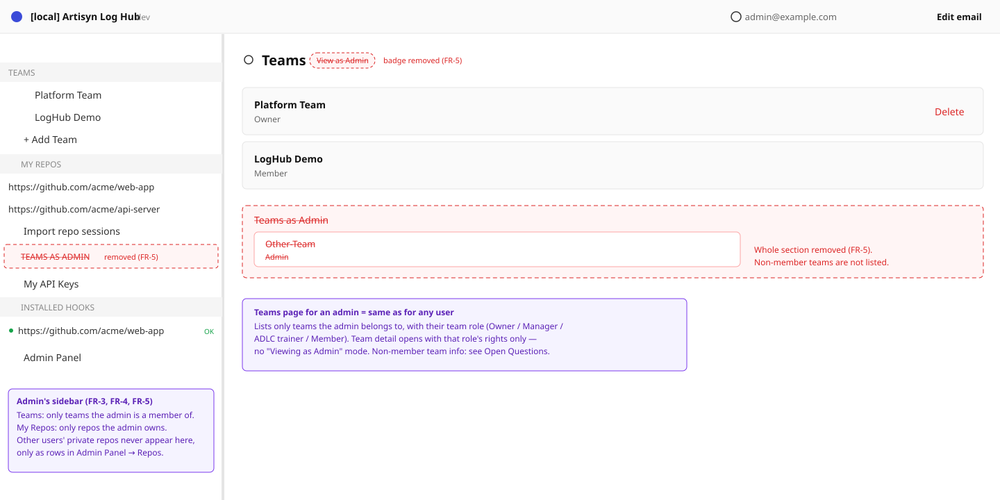
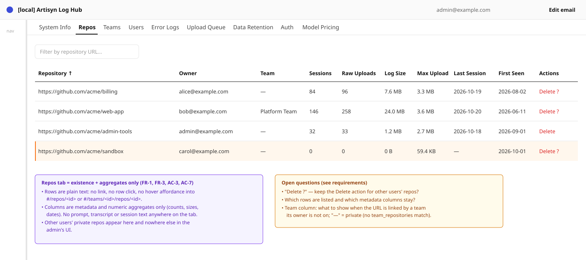
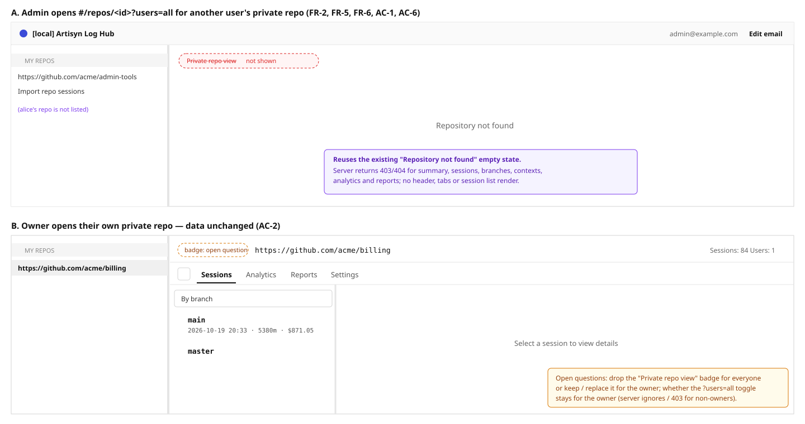
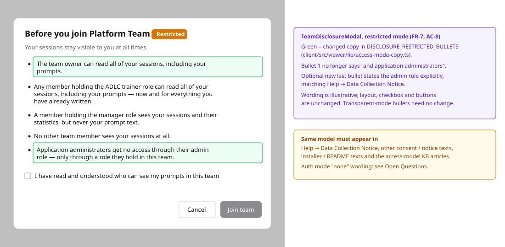

# 2026-10-21: Private Repo Visibility — Admin Administers, Never Reads Data

**Status:** todo
**Priority:** high
**Type:** bug
**Module(s):** server | client | docs
**Owner:** denis.tsyplakov
**Created:** 2026-10-21

## Description

A security review found that the real access model contradicts what the product tells users.

- Help → Data Collection Notice promises that a user's own repositories are private: their
  sessions, prompts and transcripts are visible only to the owner, and administrators do not get
  access to private repository data.
- In practice an administrator can read all sessions of another user's private repository (one
  that is not part of any team) — see Steps to Reproduce.
- The team invitation text says that the team owner and application administrators can read all of
  the invitee's sessions, including prompts.

The privacy rules are tightened: **the admin role only administers** — it keeps the server running
but grants **no access to session data** (FR-1…FR-7).

## Functional Requirements

- **FR-1 — The admin role grants no data access.** Being an application administrator never widens
  what session data a user can read: sessions, prompts, transcripts, and every derived view
  (session list, session view, reports, analytics, change surface, any other per-repo data). The
  admin role covers only administration: users, retention, system settings and server operation.
  Aggregates in the admin panel are allowed. These are numbers such as per-user or per-repo session
  counts, token usage and cost, and they never include session content, prompts or transcripts.
  Admin operational endpoints follow the same rule: `GET /api/v1/admin/upload-queue/:id/file` no
  longer returns the raw payload (the upload-queue tab shows metadata only), and server/error logs
  (`logs-archive`, `error-logs`) must not contain prompt or transcript text.
- **FR-2 — Private repo sessions are owner-only.** For a repository that is not part of any team,
  all of that data is returned only to the repo owner.
- **FR-3 — Admin sees existence only, on the admin tab.** An administrator can see that another
  user's private repo exists only as a row in the admin tab's repositories table. That row is
  metadata only and does not link to the repo's content. The repo is not listed in the admin's
  left sidebar. The table keeps listing all `repositories` rows with its current metadata/aggregate
  columns; its "Delete repo" action stays (administration, no content read).
- **FR-4 — Team repos: membership and team role only.** For repositories that are part of a team,
  visibility follows the existing team policy: the team role (owner / manager / ADLC trainer /
  member) and the team access mode (`transparent` / `restricted`). An administrator who is not a
  member of the team gets no access to its repos. An administrator who is a member gets exactly the
  rights of their team role. Outside the admin panel a non-member admin sees nothing of the team:
  `GET /api/v1/teams` returns only teams the admin belongs to, and team detail, members, team
  repositories, pending invitees and disclosure-acknowledgement data return 403. A non-member
  admin has no team-management powers (remove member, unlink/delete team repo, invitations):
  `TeamOwnerOrAdminGuard` and `TeamAccessGuard` lose their admin branch. The only exception is
  FR-8.
- **FR-8 — Admin can set a new team owner from the admin panel.** The admin panel's Teams tab
  (`AdminTeamsTab`, `GET /api/v1/admin/teams`) gets one row action, "Set new owner", available to
  any admin whether or not they are a team member. It picks the new owner from the team's current
  members (same rule as `TeamsService.transferOwnership`: the new owner must be a member) and is
  served by an admin-only endpoint, since `POST /api/v1/teams/:teamId/transfer` stays
  `TeamOwnerGuard`. The member picker shows only member identity (name/email), no session data.
- **FR-5 — Admin browsing UI is removed.** The "Private repo view" mode (the `RepositoryHeader`
  badge, removed for everyone including owners; admin access to someone else's private repo via
  `?users=all`) is removed, together with all the
  "Teams as Admin" UI. That covers the left-nav "Teams as Admin" accordion, the "Teams as Admin"
  section and "View as Admin" label on the Teams page, and the "Viewing as Admin" mode on the team
  detail page.
- **FR-6 — Enforcement is server-side.** Every endpoint that returns repo or session data enforces
  the rules in the server. Admin bypass branches in access checks are removed, not just hidden
  behind UI. The rule is per route: on the personal route (no `teamId`) only the `repositories`
  row's owner gets data, for every role and even when a team links the same repo URL; on the team
  route (`teamId`) only team membership plus the team policy apply. This covers
  `assertRepoAccess`, `assertRepoOwnerOrAdmin`, raw session logs, export-scope,
  recompute-all-sessions, `TeamAccessGuard`, `listTeams`, `getMembers` and the
  `SessionsService.deleteSession` admin override (deleting a session becomes owner-only).
  Retention routes under `AdminOrTeamOwnerGuard` keep their admin access.
- **FR-7 — All docs and disclaimers match the real model.** Every user-facing text that describes
  data visibility states the same rules as FR-1…FR-4, with no contradictions between them. That
  includes Help → Data Collection Notice, the team invitation text (which must no longer say that
  application administrators can read the invitee's sessions), any other in-app notice or consent
  text, and installer/README texts. The KB articles that describe the access model are updated to
  match. In auth mode `none` the Data Collection Notice states that identity is not verified, so
  whoever identifies with an email acts as that user. The admin's ability to issue a password-reset
  link for any user (`POST /api/v1/admin/users/:userId/reset-password-link`) stays unchanged, and
  the Data Collection Notice states that admins can reset users' passwords.

## Acceptance Criteria

- [ ] AC-1 (FR-1, FR-2, FR-6): An admin calling any session, report or analytics endpoint directly
  for another user's private repo gets no data (403/404 or an empty result).
- [ ] AC-2 (FR-2): The repo owner still sees all sessions and data of their private repo, as
  before.
- [ ] AC-3 (FR-3): Another user's private repo appears in the admin tab's table and not in the
  admin's left sidebar. The table row exposes no session content and no link into it.
- [ ] AC-4 (FR-1, FR-4, FR-6): An admin who is not a member of a team gets no data for that team's
  repos, whether through the UI or by calling the API directly.
- [ ] AC-5 (FR-4): An admin who is a member of a team sees exactly what a non-admin with the same
  team role sees. Behaviour for team owners, managers, ADLC trainers and members is unchanged.
- [ ] AC-6 (FR-5): Opening `#/repos/<id>?users=all` as an admin for someone else's private repo
  shows none of the owner's data. No "Private repo view", "Teams as Admin", "View as Admin" or
  "Viewing as Admin" UI remains. The owner still has the `?users=all` toggle on their own repo.
- [ ] AC-7 (FR-1): The admin panel still works for users, retention and system settings, and it
  still shows aggregates (session counts, token usage, cost). No prompt, transcript or session
  content is reachable from it, including via `upload-queue/:id/file`.
- [ ] AC-8 (FR-7): Help → Data Collection Notice, the team invitation text and every other
  visibility disclaimer or doc describe exactly the FR-1…FR-4 model. A text search for visibility
  statements (e.g. "administrator", "admin can") finds no contradicting wording.
- [ ] AC-9 (FR-4, FR-8): A non-member admin calling remove-member, unlink/delete team repo or
  invitation endpoints gets 403. From Admin → Teams the same admin can set any current member as
  the new team owner, and afterwards that member is the team owner; picking a non-member is
  rejected.

## Wireframes

## Steps to Reproduce

1. Sign in as an administrator.
2. Open another user's private repository (not part of any team) via `#/repos/<id>?users=all`.

**Expected:** No access to the owner's sessions, prompts or transcripts, as the Data Collection
Notice promises.
**Actual:** The repo opens with a "Private repo view" badge, and the admin can read all of its
sessions and their contents.

## Common sense considerations

- `GET /api/v1/admin/upload-queue/:id/file` stops returning the raw payload; upload-queue rows are metadata only.
- Server and error logs must not contain prompt or transcript text.
- Deleting a session (`DELETE /api/v1/sessions/:sessionId`) is owner-only; the admin override is removed.
- The admin tab's "Delete repo" action stays.
- Export-scope and recompute-all-sessions lose the admin bypass; retention routes keep admin access.
- A non-member admin sees a team only in the admin panel; `GET /api/v1/teams` returns only the admin's own teams, other team endpoints return 403.
- In auth mode `none` the Data Collection Notice states that identity is not verified.
- The "Private repo view" badge is removed for everyone, owners included.
- The owner keeps the `?users=all` toggle on their own repo.
- Access is defined per route: personal route → `repositories` row owner only; team route → team membership and team policy only.
- The admin repos table keeps listing all `repositories` rows with its current metadata/aggregate columns and Team column.

## Notes

<!-- Append timestamped notes here as work progresses -->
