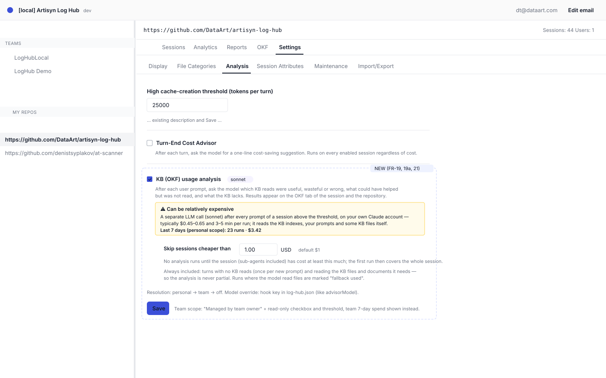

# 2026-10-27: OKF Usage Tab — Knowledge-Base Read/Write Heatmap and LLM Usage Analysis

**Status:** todo
**Priority:** medium
**Type:** feature
**Module(s):** hook | server | client
**Owner:** denis.tsyplakov
**Created:** 2026-10-27
**Tracker:** GH-44 https://github.com/DataArt/artisyn-log-hub/issues/44

## Description

Raw idea (translated from the session, Russian original paraphrased):

> I want a report on how the articles of a knowledge base are used and updated — more precisely,
> which files Claude looks at while working on a task. I mark a folder as a knowledge base and see
> its usage across a group of sessions, say over a week, in order to organise the KB better. If I
> have a file about how cost is computed and it was not read, that is one problem; if I was fixing
> the cost computation and 60 % of the whole KB got read (the agent pulls all text into context),
> that is another.
>
> UI: an **OKF** tab for the repository and for the session. OKF indexes are auto-detected by the
> hook. For a session you see which parts were read/written — a tree with a heatmap. For the repo
> the same thing, with filters by date, branch, etc. The personal view pulls all OKF bases and
> files; the team view shows only what is in git — what is gitignored is not shown.
>
> Plus an LLM post-turn analysis, switched on by a checkbox like the advisor: for a session it feeds
> Sonnet what was in the requirements and prompts plus the KB index, and asks what was read wrongly
> and why, and what could have been useful but was not read. If the analysis was on, overlay it on
> the OKF view for the session and for the repo.

This feature is **separate from file categories**: it neither reads nor changes
`repo_config.fileCategories` or `session_file_stats`. It has its own detection (OKF bundles found by
the hook), its own tables, its own tab and its own analysis toggle.

## Functional Requirements

### Phase 1 — Server: OKF access facts from transcripts (no hook change)

- **FR-1** At ingest of `claude` / `claude-subagent` logs, extract every access to a `.md` file
  with the existing session analyser (FR-23): Read (whole file, or the range from
  `offset`/`limit`); Bash — the files `analyzeBash` reports as reads / changes, with a line range
  added for `sed -n`, `head`, `tail` and the matched lines of `grep -n`; Grep; Glob / `ls` on a
  folder (listing); Edit / MultiEdit (write — range from the position of `old_string` when it can
  be located, else the whole file); Write (write, whole file). Store the bytes of each call's
  `tool_result`; when one Bash command touches several files, its bytes are split evenly between
  them, never charged to each in full.
- **FR-2** Normalise paths against the repo and worktree roots with a helper that returns
  `string | null` (built on `stripRepoRootPreservingCase()` / `usableRepoRoots()`; not
  `normaliseReadPath()`, which falls back to the absolute path). A path that does not resolve under
  a repo root, or a session with no known roots, stores nothing (no absolute local paths in the DB).
- **FR-3** Store the facts in a new table `session_okf_access(session_id int FK sessions.id cascade,
  path_key varchar, op 'read'|'grep'|'list'|'write', after_own_edit bool, line_ranges jsonb
  [[start,end],…] (null = whole file), bytes bigint, calls int)`, unique on
  `(session_id, path_key, op, after_own_edit)`, one set of rows per session-tree node (the tree sum
  comes from `getDescendantSessionIds` at read time). `after_own_edit` = the access comes after an
  Edit/Write of the same path by the same agent earlier in its transcript. The writer runs
  everywhere `writeSessionFileStats` runs (ingest, import, the claude-before-artisyn heal,
  recompute) with per-node delete-then-insert. Bundle and section are resolved at read time from
  the snapshot (FR-8), so old sessions never need rewriting when a snapshot appears.
- **FR-4** All figures are summed over the whole session tree (sub-agents included), per
  `session-metrics-scope.md`.
- **FR-5** History is filled by the existing `recompute-all-sessions`; the migration only creates
  the table.
- **FR-6** Before building on the data, explain why identical Reads appear in pairs in sub-agent
  logs (`\` vs `/` paths, same result size — a double upload of the sub-agent log or two agents)
  and, if they are duplicates, count them once.

### Phase 2 — Hook: OKF snapshot

- **FR-7** The hook detects OKF bundles: an `index.md` whose front matter has `okf_version`; a nested
  `index.md` without it belongs to the parent bundle. The bundle is the index's folder. Links from
  an index to paths outside the repo (e.g. `../../../private_kb`) and files referenced outside the
  bundle folder are **not** followed or included. Global OKF bases outside the project (e.g.
  `~/.claude`) are **not** searched.
- **FR-8** Snapshot content per file: path, `ignored` flag (via `git check-ignore --stdin` on the
  found files only), size, line count, outline (headings with line ranges), content hash. File
  content is never sent.
- **FR-9** Exclusions: `okf.exclude` (glob patterns) in `log-hub.json` / `log-hub.local.json`;
  `tmp/` excluded by default (it holds junk KB copies such as `tmp/kb-baseline`).
- **FR-10** Delivery mirrors `harness-snapshot`: a content-addressed `okfSnapshotId`; the full
  snapshot is sent once, later uploads carry only the reference. Wire format, named like the harness one: NDJSON lines `okf-snapshot` /
  `okf-snapshot-ref` (listed in `NON_ACTIVITY_LINE_TYPES`, written without `timestamp` so an old
  server does not stretch the session time span), upload query params `okfSnapshotId` /
  `okfSnapshotFull`, response field `unknownOkfSnapshotId`, columns `upload_queue.okf_snapshot_id`
  and `sessions.okf_snapshot_id`, table `okf_snapshots(user_id, snapshot_id varchar(64), body jsonb,
  created_at)` unique on `(user_id, snapshot_id)`. The snapshot lines and params ride only on the
  root session's `artisyn` upload, like the harness snapshot; the root session is bound to the
  snapshot of its first upload that carries one and is never rebound, like `harness_snapshot_id`.
  Sub-agent rows keep `okf_snapshot_id` null, and every node of a tree resolves sections through
  the root's snapshot. If the KB changes during the session, sections still resolve against that
  bound snapshot; accessed ranges beyond its line count show as "outside known outline". Lifecycle:
  a `deleteOrphanOkfSnapshots(tx)` sweep runs wherever `deleteOrphanHarnessSnapshots` runs;
  repository export writes the `okf-snapshot` / `okf-snapshot-ref` lines from `okf_snapshots` and
  import rebinds `sessions.okf_snapshot_id`, as for harness snapshots.

### Phase 3 — UI: OKF tab in the session view

- **FR-11** Tree "bundle → folder → file → section" with two heat scales: read (bytes put into
  context by default, toggle to call count) and write.
- **FR-12** Markers: grep/listing over a whole folder; whether the session started from `index.md`
  (the chronologically first OKF access in the whole session tree, any op, targets the bundle's
  `index.md`); and, as plain information only, "re-read of own edit" (`after_own_edit` reads, FR-3)
  and "read by N agents". The last two describe cost, not KB quality: each sub-agent is an
  independent task with an empty context and may need the same article (owner decision), so they
  never feed the verdict.
- **FR-13** Summary: share of each bundle that reached the context — files = distinct files with at
  least one read/grep range ÷ bundle files; sections = sections whose lines overlap any read/grep
  range ÷ all sections (any overlap counts, one `grep -n` hit line included); content = deduplicated
  union of read/grep line ranges ÷ total bundle lines. Listing ops and greps without line numbers
  count toward no share, only heat and markers. The heat scale uses raw summed `tool_result` bytes
  (can exceed file size); the UI labels it "bytes into context".
- **FR-14** Without a snapshot (old hook): the tree is built only from accessed paths (no sections,
  no "not read" list), with an "update the hook" hint.
- **FR-14a** **Verdict summary at the top of the tab** — the first thing on the tab, above the
  bundle cards, so the owner gets a quick answer without opening the tree. One card with:
  - a verdict badge on a three-step scale: **OK** (green) / **Something to fix** (amber) / **Mess**
    (red), plus a grey **KB not used** when the session tree made no OKF access and no analysis
    reported a miss;
  - **Why** — one plain-language line per triggered rule (below), worst first;
  - **Read** — the top 5 files by read bytes, with bytes, the own-edit marker and the false-read
    marker when the analysis has one;
  - **Should have been read, but wasn't** — the analysis' `missed` entries with their `why` (FR-24),
    with the `missingContext` caveat when present. With no analysis run the column says the
    analysis is off and links to the settings (FR-19), and the badge carries "access data only".

  Every line links to its node in the tree below (expands and scrolls to it); the tree, bundle
  cards and analysis panel stay as the drill-down. The rules judge **KB quality — granularity and
  findability — not cost**; the verdict is the worst severity triggered:
  - per agent of the tree (each agent is its own task, judged on its own reads): content in
    context (FR-13) of any bundle with ≥ 10 files > 50 % → **Mess**; > 25 % → **Something to fix**
    (smaller bundles are skipped; the share leaves out `after_own_edit` ranges and files the agent
    wrote, which still show in the heat);
  - analysis `missed` + false reads (FR-24) ≥ 5 → **Mess**; ≥ 1 → **Something to fix**;
  - analysis reads with `granularity: too_coarse` (FR-24) ≥ 1 → **Something to fix** ("agent X
    needed one section of a 156 KB article").

  **KB read bytes** = summed `bytes` of `read` and `grep` rows, `after_own_edit` rows included
  (`list` and `write` excluded); one definition for the Read top 5 and the repo hot sections
  (FR-16). Analysis input = the latest successful run (FR-25) after
  dropping paths outside the bound snapshot; the "Show analysis" toggle hides the overlay only and
  never changes the verdict; when that run's watermark is behind the current counts the badge adds
  "analysis may be stale". Boundary cases: no bundle in the snapshot and no access → no verdict
  card; no access and no misses → **KB not used**; no access but analysis misses → the missed rule
  applies as usual; no snapshot and no access → **KB not used**.

  Without a snapshot (FR-14) the share rule is skipped and the badge says "partial data". The
  verdict is computed on the server and returned in the session response (FR-18); thresholds are
  named constants pinned by the algorithm doc `algorithms/okf-verdict.md`.

### Phase 4 — UI: OKF tab in the repository view

- **FR-15** A separate **OKF** tab of the repository view, next to Analytics and Reports (not a
  report inside Reports). Aggregate over sessions with filters: period, branch, user (team view),
  `attr=`; filters apply at once — no Generate button. The
  bundle set is the latest snapshot in the filtered range (per branch when filtered by branch).
  Each session's accesses resolve to sections through its own bound snapshot, then fold into the
  latest tree by path + heading text (not line numbers); paths or headings missing from the latest
  snapshot go to a "no longer in KB" group; sessions without a snapshot add file-level heat only.
- **FR-16** Highlights: not read in the period, hot sections (top 10 by read bytes in the filter),
  distribution of the content read share per session (bins 0–10 %, 10–25 %, 25–50 %, > 50 %).
  "Not read" is **informational only** and neutral in the UI: an article may describe a module no
  session touched, and not reading it is then correct. An unread article counts as a problem only
  where an analysis marked it `missed` (FR-24, FR-28).
- **FR-17** Visibility: the personal view shows all bundles including gitignored ones; the team view
  shows only `ignored: false`. The filter is applied **on the server** — ignored paths never reach
  a team response. Fail closed: a path appears in a team response only if the accessing session's
  own snapshot lists it as `ignored: false` and no contributing snapshot marks it ignored; paths
  with unknown status (snapshot-less sessions, paths absent from the snapshot) are hidden.
- **FR-17a** **Verdict summary at the top of the repo tab** (above the KPI tiles), same badge scale
  as FR-14a plus a grey **Not enough data** when fewer than 5 sessions in the filter touched the
  KB (anomalies are still listed). Below the badge, an **anomaly list** — one plain-language line
  per finding with a link to its node, e.g. "`db-tables.md` is read in 44 of 49 KB sessions (90 %)
  — its key facts probably belong in `index.md`/`CLAUDE.md`, or it should be split". Rules, over the
  filtered sessions that touched the KB:
  - **Always read**: a file other than a bundle `index.md` read (read/grep op) in ≥ 80 % of them →
    Something to fix (one line per file);
  - **KB flood**: sessions with content read share > 25 % (FR-16 bins) — any → Something to fix;
    ≥ 20 % of the sessions → Mess;
  - **Index bypassed**: sessions that started from `index.md` (FR-12) < 50 % → Something to fix;
  - **Repeatedly missed** / **repeatedly false read**: a file marked so by ≥ 3 analysed sessions
    (FR-28) → Something to fix (one line per file, top 5 by count).

  Verdict = the worst severity triggered; three or more distinct rule kinds triggered → **Mess**.
  The six rule kinds are `always_read`, `kb_flood`, `index_bypassed`, `repeatedly_missed`,
  `repeatedly_false_read`, `repeatedly_too_coarse` (a file marked `too_coarse` by ≥ 3 analysed
  sessions → Something to fix: "split it or point the index line at its sections"); the count is of kinds, not lines (several always-read files are one
  kind). There is deliberately no rule for unread files (FR-16). A session here = a root session
  tree (FR-4). Not enough data, Always read and Index bypassed count every KB-touching tree in the
  filter, snapshot-less ones included; KB flood counts only trees with a bound snapshot; when
  snapshot-less trees are present the badge adds "partial data — N of M
  sessions without a snapshot". Per-session content share (FR-16 bins, KB flood, median tile) =
  union of read/grep lines across the bundles visible in the current view ÷ their total lines (team
  view: `ignored: false` bundles only). Boundary cases: 0 KB sessions in the filter → **KB not
  used**; 1–4 → **Not enough data** replaces the severity and the anomaly lines are shown without
  one. Computed on the server from the same filtered data as the tree, so in the team view no line
  ever names an ignored path (FR-17); thresholds are pinned by `algorithms/okf-verdict.md`.
- **FR-18** New `GET` routes: `GET /api/v1/repositories/:repoId/sessions/:sessionId/okf-usage`
  (session tree, like the per-session `change-surface` route, no `resolveUsageScope`) and
  `GET /api/v1/repositories/:repoId/reports/okf-usage?startDate&endDate&branches&users&teamId&attr`
  (`resolveUsageScope`). Both responses start with
  `verdict: { level: 'ok'|'fix'|'mess'|'kb_not_used'|'not_enough_data', qualifiers:
  ('access_data_only'|'partial_data'|'analysis_stale')[], findings: [{ rule, severity: 'fix'|'mess',
  params, node: { bundle, path?, sectionHeading? } }] }`, then `bundles`, `tree`, `analysis`. The
  server sends rule ids and numeric/path `params`, never finished text; the client renders the
  plain-language line. `node` uses the tree's own key (path + heading text, FR-15).

### Phase 5 — LLM analysis of KB usage

- **FR-19** A checkbox in `AnalysisSettings` next to the advisor: `okfUsageAnalysis.enabled`,
  personal and team scope with the advisor's resolution chain (personal → team → default off).
  Model defaults to `sonnet`, overridable by the hook key `okfUsageAnalysisModel` (like
  `turnEndCostAdvisorModel`). Turns without KB reads (FR-21) and the model's own reading of files
  (FR-22a) are always part of the analysis, not separate options. The one extra setting is **`okfUsageAnalysis.minSessionCostUsd`** — a number input
  next to the checkbox, default **1** (USD), same scopes and resolution chain: no analysis runs for a
  session whose tree has cost less than that so far. The hook computes the cost locally from the
  transcripts' usage with its plain-JS pricing copy; once the session crosses the threshold, the
  first run analyses the whole session.
- **FR-19a** The analysis can be relatively expensive, and the settings UI says so right next to the
  checkbox: it is a separate LLM call (`sonnet` by default) after every user prompt of a session
  above the cost threshold, billed to the user's own Claude account; its input carries the KB
  indexes, the prompts and the session facts (tens of KB per call, FR-22), and the model reading KB
  files and referenced documents itself (FR-22a) adds tool turns on top. The warning also shows the real spend: each run's cost (`total_cost_usd`
  from `claude -p --output-format json`, null when absent) is stored with the run (FR-25), and the
  settings show the total and the run count for the last 7 days in the current scope, from
  `GET /api/v1/repositories/:repoId/okf-analysis/spend?scope=personal|team`: personal = the
  caller's runs on this repo, team = all team members' runs on this repo; rolling 7 days by
  `created_at`; every run (failed included) counts in the run count, null `cost_usd` adds nothing
  to the total.

  
- **FR-20** It runs as a third branch of the existing `post-turn-analysis-worker.js`, through the
  user's own `claude -p`, with the same recursion guard (`ARTISYN_HOOK_SERVICE`) and its own log
  `.artisyn/ai_work_dir/okf-analysis.log`. The server never calls the LLM. The `claude -p` call runs
  with its working directory **outside the project** (a folder under the OS temp dir), with the repo
  root passed by `--add-dir` so the model can read KB files: Claude Code then loads none of the
  repo's `CLAUDE.md`, rules or project hook settings, which cut the PoC's per-turn overhead by
  ~8k tokens (`.artisyn/ai_work_dir/` is inside the project, so it does not qualify).
- **FR-21** It runs on `Stop` when the session tree's cost is at least `minSessionCostUsd` (FR-19)
  and a new user prompt or a new OKF access appeared since the last run (watermarks plus a failure
  cap, like attribution); each run analyses the whole session and replaces the previous result.
  Turns with **no** OKF access are analysed too: a short question answered from code alone is
  exactly where "the KB had the answer but was not read" shows up. Watermarks: the existing
  `promptWatermark` query param (already sent for attribution) plus a new optional
  `okfAccessWatermark` (default 0, the hook's local count of OKF access calls in the session tree),
  stored as `okf_analysis_runs.prompt_watermark` / `okf_access_watermark`.
  Failure cap: 3 consecutive failures, in local hook state like `session-attribution-state.js`.
- **FR-22** Prompt input — **no transcript text**: the model gets the task and the session's
  **preprocessed facts**, never raw tool calls or tool results.
  1. **User prompts**, verbatim, from the local transcript — the task. Often a single question or
     one phrase; then it is the whole task, nothing is inferred. Filtered: no
     `<task-notification>` (background-task results arrive in the user role), command output,
     system reminders; a slash command is kept as `/name args`, CLI utilities like `/clear` are
     dropped. The filter is an algorithm with its own doc and table test
     (`algorithms/okf-task-context.md`).
  2. **Session facts** from the session analyser that already exists (FR-23), **grouped per
     agent**: the main agent (its task = the user prompts) and each sub-agent with its own spawn
     prompt verbatim (its task — a sub-agent is an independent task with an empty context). Per
     agent: KB reads (bytes, the article's size, calls, line ranges, own-edit bytes), the order of
     its first KB accesses (how it reached each article), other files read (top by bytes), files
     changed. Tree-wide: other files changed and read, commands run.
  3. Each bundle's `index.md` text **only** — no other KB file and no outline, since a KB can weigh
     megabytes.

  Documents the prompts point at (a requirements file, a task folder name, an issue) are **not**
  pasted: the model reads them itself (FR-22a). The prompt (PoC `prompt-v4d.md`) says: the goal is
  **KB quality — granularity and findability — not cost**, so an article read by several agents or
  several times is not a KB problem; each agent's reads are judged against that agent's own task;
  the facts are measured — trust them over assumptions; an unread article is not a problem by
  itself; KB files the session itself wrote did not exist in that form when it started, so they
  are never evidence of a miss or a gap; check the KB before naming a gap; the task is not always a
  requirements document. Nothing of the prompts or the facts is cut: the prompt was 38–94 KB in
  the PoC (sub-agent prompts add up to ~40 KB in a 23-agent session), so this branch's cap is
  200 KB instead of the worker's default `DEFAULT_MAX_PROMPT_SIZE_KB` = 60; above it, only the
  "other files read" lists are cut to their top entries by bytes.
- **FR-22a** The model may read files itself, with **moderate curiosity**: a KB article when it
  needs the content to judge, documents and issues the prompts point at, and a little code when
  it helps (owner decision; seen in the PoC). The restriction is only an instruction in the prompt,
  with the worker's existing `claude -p` invocation and timeout unchanged — no
  `--disallowedTools` path rules and no `--max-turns` limit; revisit only if the logs show runs
  getting long. Those reads reflect the disk at analysis time; the result records whether the
  model read anything (`fallback_used`).
- **FR-23** The facts of FR-22 (2) come from the **existing session analyser**, not from a new
  extractor: the Bash file summary `analyzeBash` / `buildBashView` (`algorithms/bash-command-view.md`,
  today in `client/src/viewer/lib/bash-view/`) plus the Read / Edit / Write / Grep / Glob tool inputs,
  the same reads/changes the session view shows. The server computes them at ingest (FR-1 uses the
  same analyser; it moves to a repo-local package under `packages/` so the server and the client
  run one implementation — `repo-local-packages.md`), and the worker fetches them for the session
  tree from a new hook route `GET /api/v2/okf-usage/facts?sessionId=…` (API-key auth, like the other
  `/api/v2` hook routes; contract row). There is no plain-JS copy of the extraction in the hook.
  When the session is not ingested yet, the run waits for the next `Stop` with the watermarks
  unchanged, like attribution's not-yet-ingested path. Only the user prompts (1) are read from the
  local transcript.
- **FR-24** Output JSON schema (validated in the PoC, `docs/pocs/2026-10-27-1950-okf-analysis-cost/`):
  - `reads[] {agent: 'main' | <sub-agent id>, path, verdict: useful | partly | not_needed,
    granularity: ok | too_coarse | too_fine, findability: index | search | given | linked, reason}` —
    one entry per agent + KB file it read. A **false read** is `verdict: not_needed`; a **coarse
    read** is `granularity: too_coarse` (the agent needed one part, the article gave it no way to
    get just that part); `findability` says how the agent reached the article (`search` where the
    index should have led is a findability problem, named in `reason`);
  - `missed[] {agent, path, section?, why}` — articles that would have helped that agent's task and
    were not read (a read article appears only with the section not read);
  - `gaps[] {agent, topic, evidence, suggestion}` — knowledge an agent dug out of code that no
    article covers;
  - `kbFixes[] {path, change, helps}` — the concrete KB changes, most valuable first: split or
    restructure an article, point an index line at sections, add or reword an index line, add an
    article for a gap; `helps` names the agents and tasks it would have served;
  - `summary`, `taskKind: question | change | other`, and `missingContext[]` — only when a prompt
    points at something whose text the model could not obtain. A self-contained one-line question
    has an empty `missingContext`; missing documents are never inferred just because there are
    none.
- **FR-25** Posted to `POST /api/v2/okf-usage-analysis` with body `{sessionId, repoUrl,
  okfSnapshotId, model, promptWatermark, okfAccessWatermark, outcome: 'submitted'|'failed',
  failureReason?, result?, costUsd, fallbackUsed}` (response and not-yet-ingested handling as in
  session attribution); stored in `okf_analysis_runs(id, session_id varchar session UUID without FK,
  user_id FK, okf_snapshot_id, model, prompt_watermark, okf_access_watermark, status,
  failure_reason, result jsonb, cost_usd numeric null, fallback_used, created_at)` like
  `turn_end_advisor_runs`; the latest successful run is shown. Paths not in the
  bound snapshot are dropped server-side when the run is read (the snapshot may still be queued at
  POST time).
- **FR-26** `GET /api/v2/post-turn-analysis/config` gains a third half `okfAnalysis: {enabled,
  model?, minSessionCostUsd, evaluatedPromptWatermark, evaluatedOkfAccessWatermark,
  evaluationRequired}`, where `evaluationRequired` = `promptWatermark` or `okfAccessWatermark`
  above the stored values; the hook checks the cost threshold itself (FR-19). An unresolvable half answers all-off (`enabled:false`, watermarks null) and the other
  halves still work. Hooks that predate the feature never read this half.
- **FR-27** Overlay in the session tab: "false read" and "too coarse" markers with the reason and
  the agent, the findability of each read (index / search / given / linked), "could have helped,
  not read" markers on unread nodes, the analysis' `gaps` as a "KB lacks" list, `kbFixes` as a
  "Fix the KB" list, the summary, a show-analysis toggle, model and run-time badge. Without an
  analysis the tab works as before. A non-empty `missingContext` is listed and puts a caveat on
  the "could have helped" markers; `taskKind` is shown next to the summary.
- **FR-28** Overlay in the repo tab: per node, how many analysed sessions marked it a false read,
  too coarse, or missed; coverage "analysed X of Y sessions in the filter"; `kbFixes` repeated
  across sessions are grouped by path and change, ranked by the number of sessions. In the team
  view, markers and fixes on ignored paths are cut on the server.

### Phase 6 — later

- **FR-29** Section ↔ changed-code co-occurrence across sessions (no LLM): sections about a changed
  area that are never read.
- **FR-30** Staleness: sections read often, not edited for long, while their code changed.
- **FR-31** Before/after comparison of an index reorganisation (multi-index) on the same metrics.

## Non-Functional Requirements

- **Backward compatibility** (hook API): the snapshot field and the `okfAnalysis` config half are
  optional both ways — an old hook against a new server, and a new hook against an old server, keep
  working; checked against the matrix in `hook-api-versioning.md`.
- Detection must not slow down the interactive session: it runs at upload, not `SessionStart`.
  Re-measure on a large repo (thousands of `.md`); if slow, cache the snapshot by the mtime tree.
- Gitignored file content never leaves the machine; only metadata (path, size, outline, hash).
- The analysis' `claude -p` calls are service sessions like the advisor's: not charged to the user
  session.

## Acceptance Criteria

- [ ] FR-1/2: for a session that reads a KB article via `sed -n 10,40p`, `grep -n`, `cat` and Read
      with `offset`/`limit`, `session_okf_access` holds the expected path keys, ops, line ranges and
      bytes (algorithm doc `okf-access-extraction.md` examples).
- [ ] FR-3/5: after `recompute-all-sessions`, sessions ingested before the feature have OKF access
      rows.
- [ ] FR-4: a read done only inside a sub-agent shows in the root session's OKF tab.
- [ ] FR-6: the duplicate sub-agent Read pairs are explained and, if they are duplicates, counted
      once.
- [ ] FR-7/9: on this repo the hook detects `docs/knowledgebase` (with `log-schema/` and `test/`
      inside it) and `docs/kb-local`, and not `tmp/kb-baseline`; `private_kb` is not followed.
- [ ] FR-8: the snapshot carries path, ignored flag, size, line count, outline and hash per file and
      no file content.
- [ ] FR-10: a second upload with an unchanged KB sends only the `okfSnapshotId` reference.
- [ ] FR-11/13: the session tab shows the bundle tree with read and write heat per section and a
      bundle read-share summary; the scale toggles between bytes and calls.
- [ ] FR-9: an `okf.exclude: ["docs/kb-local/**"]` entry in `log-hub.local.json` removes that
      bundle from the snapshot.
- [ ] FR-10: a session that edits the KB across two uploads stays bound to its first snapshot.
- [ ] FR-12: a session that re-reads a file it edits shows the "re-read of own edit" marker on it; a
      session whose first KB access is `index.md` shows the started-from-index marker; a
      `grep -rn` over `docs/knowledgebase/` shows the folder-scan marker on that folder.
- [ ] FR-14: a session uploaded by a hook without snapshot support shows only accessed paths and the
      "update the hook" hint.
- [ ] FR-14a: the session tab opens with the verdict card above the tree; a session where one
      agent read > 50 % of a bundle shows "Mess"; a session where 12 agents each read the same
      article (and nothing else is wrong) shows "OK"; an analysis with a `too_coarse` read shows
      "Something to fix" with that reason; a session without KB access shows "KB not used"; the verdict cases match
      the `okf-verdict.md` examples; a session without an analysis shows "access data only" with a
      settings link; a session without a snapshot shows "partial data" and skips the share rule.
- [ ] FR-17a: the repo tab opens with the verdict card and anomaly list; a file read in ≥ 80 % of
      the KB sessions in the filter is listed as "always read"; with fewer than 5 KB sessions the
      badge is "Not enough data"; the team-view anomaly list names no ignored path; every rule kind
      and the "three or more kinds → Mess" rule match the `okf-verdict.md` examples.
- [ ] FR-14a/17a: clicking a Why or anomaly line expands and scrolls to its node in the tree.
- [ ] FR-10: deleting the last session bound to a snapshot removes the `okf_snapshots` row; a
      repository export/import keeps the OKF tab's sections (step in the export/import scenario).
- [ ] FR-15/16: the repo tab aggregates the filtered sessions, lists not-read nodes as neutral info (no warning colour), the
      top-10 hot sections and the read-share distribution.
- [ ] FR-17: the team-view response for a repo with an ignored bundle contains no ignored path; the
      personal view of the same user shows it; a snapshot-less session that read `docs/kb-local`
      adds nothing to the team view.
- [ ] FR-18/25/26: each new or changed route has its row in `server/test/contract/registry/`.
- [ ] FR-20: an analysis run writes to `.artisyn/ai_work_dir/okf-analysis.log`.
- [ ] FR-19/26: with the checkbox off, `post-turn-analysis/config` returns `okfAnalysis` off and the
      worker makes no OKF analysis call.
- [ ] FR-19/19a: the settings show one analysis checkbox (no sub-options), the
      `minSessionCostUsd` input with default 1, and the cost warning with the total cost and run
      count of the last 7 days from stored runs.
- [ ] FR-21: a session whose tree cost is below `minSessionCostUsd` gets no run; above it, a
      one-question session that read no KB gets one run per new user prompt, and a turn with
      neither a new prompt nor a new OKF access gets none.
- [ ] FR-22: the prompts of an adlc session (`/adlc-lh:implement-deep <task>` → kept as
      `/adlc-lh:implement-deep <task>`), a session with background tasks (no `<task-notification>`
      text) and a one-line-question session match the `okf-task-context.md` examples; the
      analysis prompt carries no tool call or tool result text.
- [ ] FR-23: the worker's facts for a session equal what `GET /api/v2/okf-usage/facts` returns;
      for a session that is not ingested yet the run waits for the next `Stop`.
- [ ] FR-24: a self-contained one-line question yields `taskKind: question` and an empty
      `missingContext`; a prompt saying "see the issue" with no obtainable issue text yields a
      non-empty `missingContext`.
- [ ] FR-22a: the analysis prompt always carries the "read relevant KB files and referenced
      documents yourself" instruction; a run in which the model read a file is marked `fallback_used`.
- [ ] FR-24/25: a posted analysis result with a path outside the snapshot is stored without that
      path.
- [ ] FR-27: after a result is posted, the session tab shows false-read, too-coarse and missed
      markers with their reasons and agents, each read's findability, the "KB lacks" and "Fix the
      KB" lists and the summary.
- [ ] FR-28: the repo tab shows per-node false-read / too-coarse / missed counts, "analysed X of Y"
      and the KB fixes grouped across sessions; the team view hides markers and fixes on ignored
      paths.
- [ ] Backward compatibility: an old hook (no snapshot, no `okfAnalysis` handling) uploads to the new
      server without errors; a new hook against an old server uploads without errors.

## Common sense considerations

- Verdict thresholds (FR-14a, FR-17a) are first-version defaults chosen from the local-prod week in
  `notes.md` (max 18 % read share); they live as named constants in
  `algorithms/okf-verdict.md` and are tuned there, not per repo.

- `okfAnalysis` config half, its all-off fallback and the watermarks follow the attribution half (FR-21, FR-26).
- Failure cap is 3 consecutive failures in local hook state, as `session-attribution-state.js`.
- No sub-option checkboxes: no-KB turns and the document fallback are always on; the only extra setting is `minSessionCostUsd`, default 1 USD (FR-19, owner decision).
- Watermarks are two counters (reused `promptWatermark` + new `okfAccessWatermark`), never one sum (FR-21).
- Routes: session `…/sessions/:sessionId/okf-usage`, repo `…/reports/okf-usage`; verdict sent as rule ids + params, text rendered by the client (FR-18).
- KB read bytes = `read` + `grep` bytes, own-edit rows included; one definition everywhere (FR-14a).
- Verdict uses the latest successful run after path filtering; the overlay toggle never changes it (FR-14a).
- Repo rule unit = root session tree; snapshot-less trees count only where no section data is needed (FR-17a).
- Mess-by-count counts five named rule kinds, not lines (FR-17a).
- Unread articles are never a problem by themselves: no dead-weight rule; only an analysis `missed` flags one (FR-16, owner decision).
- Per-session share = line union over the bundles visible in the current view (FR-17a).
- Session share rule is per agent and skips bundles under 10 files and own-edit/written ranges (FR-14a).
- The analysis and the verdict judge KB quality (granularity, findability), not cost; own-edit re-reads and "read by N agents" are information only (FR-12, FR-14a, owner decision).
- Each sub-agent is judged against its own spawn prompt, never against the tree's user prompts (FR-22, owner decision).
- The OKF analysis prompt cap is 200 KB, so prompts and facts are never cut (FR-22).
- Boundary badges: no bundle → no card; no access → KB not used; 1–4 repo sessions → Not enough data (FR-14a, FR-17a).
- Path normalisation returns null instead of an absolute fallback (FR-2).
- OKF snapshot rides on the root upload only; orphan sweep and export/import mirror harness snapshots (FR-10).
- Read-share formulas: files / overlapping sections / deduplicated lines; listings count only toward heat (FR-13).
- Hot sections = top 10 by read bytes; distribution bins 0–10 / 10–25 / 25–50 / > 50 % (FR-16).
- 7-day spend comes from a dedicated repo route with its own contract row; failed runs count, null cost adds nothing (FR-19a).
- Team view fails closed on unknown or conflicting `ignored` status (FR-17).
- `okf_analysis_runs` mirrors `turn_end_advisor_runs` (varchar session UUID, `user_id` owner); paths outside the snapshot are cut at read time (FR-25).
- Snapshot wire format mirrors harness-snapshot; first-upload binding replaces "nearest to its start" (FR-10).
- `session_okf_access` is per tree node, written wherever `writeSessionFileStats` runs; unresolved paths are not stored (FR-2, FR-3).
- "Re-read of own edit" is an `after_own_edit` split of read rows, not a per-path boolean (FR-3, FR-12).
- Repo aggregate folds accesses by path + heading via each session's own snapshot (FR-15).
- The analysis input is user prompts + the session analyser's facts + KB indexes, never transcript text; referenced documents are read by the model (FR-22, owner decision).
- Facts come from the existing session analyser (`analyzeBash`), moved to `packages/` and served to the hook by `GET /api/v2/okf-usage/facts`; no hook-side copy (FR-23).
- Occasional code reads by the analysis model are acceptable; no tool restrictions (FR-22a, owner decision).
- The prompt carries only the bundle `index.md` files; the model reads other KB files itself with moderate curiosity (FR-22, owner decision).

## Notes

- Tests follow the repo's three kinds only:
  - **Algorithm:** `algorithms/okf-access-extraction.md` (server table test; Bash rows reuse
    `bash-command-view.md` cases),
    `algorithms/okf-snapshot.md` (detection, nested indexes, exclusions, id),
    `algorithms/okf-task-context.md` (FR-22 prompt filter),
    `algorithms/okf-analysis-overlay.md` (folding false reads / `missed` across sessions into node
    counts, dropping paths outside the snapshot, cutting ignored paths in the team view),
    `algorithms/okf-verdict.md` (session and repo verdict rules and thresholds, FR-14a/FR-17a).
  - **API contract:** rows for the new `GET` routes, `POST /api/v2/okf-usage-analysis` and the
    changed `post-turn-analysis/config`.
  - **Scenario:** steps in existing session/repo scenarios — KB reads → heatmap; ignored bundle
    absent from the team view; old hook without snapshot; posting a ready analysis result →
    markers and repo counts; checkbox off → `okfAnalysis` off. No real LLM call in scenarios.
- Local-prod usage research, detection timing measurements and the decision history are in
  `notes.md`.
- Related KB: `harness-usage-tab.md`, `algorithms/harness-snapshot.md`, `turn-end-cost-advisor.md`,
  `session-metrics-scope.md`, `change-surface.md`, `hook-api-versioning.md`, `db-tables.md`
  (`session_file_stats` — explicitly not reused).
