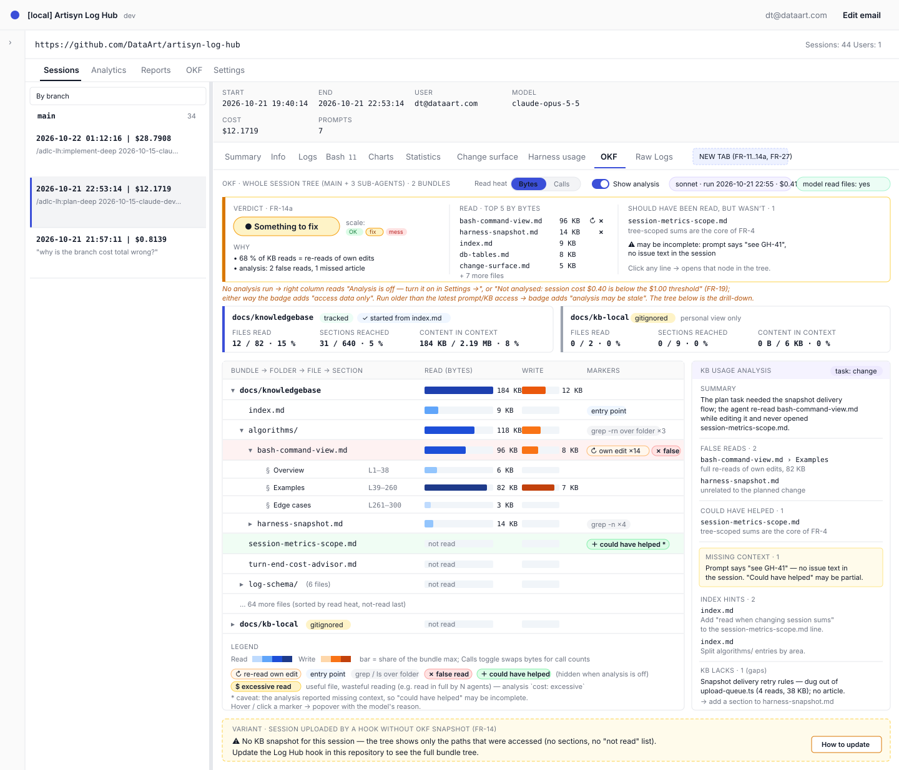
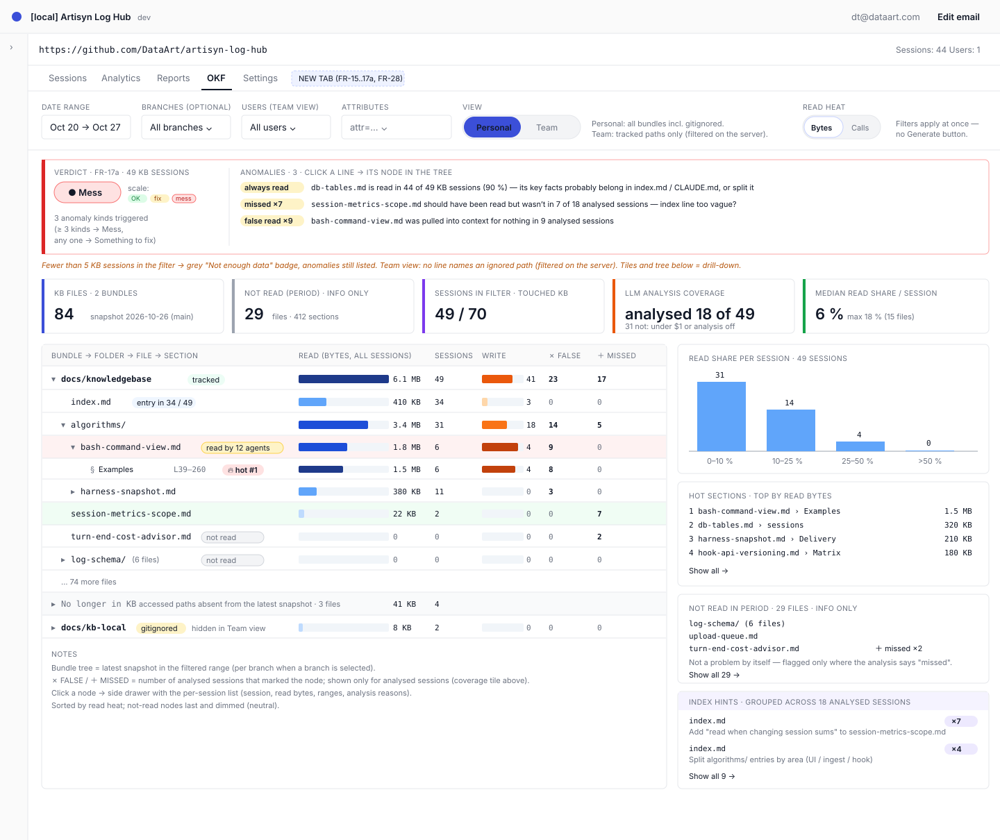

# 2026-10-27: OKF Usage Tab — Knowledge-Base Read/Write Heatmap

**Status:** todo
**Priority:** medium
**Type:** feature
**Module(s):** hook | server | client
**Owner:** denis.tsyplakov
**Created:** 2026-10-27
**Tracker:** GH-44 https://github.com/DataArt/artisyn-log-hub/issues/44

## Description

Raw idea (translated from the session, Russian original paraphrased):

> I want a report on how the articles of a knowledge base are used and updated — more precisely,
> which files Claude looks at while working on a task. I mark a folder as a knowledge base and see
> its usage across a group of sessions, say over a week, in order to organise the KB better. If I
> have a file about how cost is computed and it was not read, that is one problem; if I was fixing
> the cost computation and 60 % of the whole KB got read (the agent pulls all text into context),
> that is another.
>
> UI: an **OKF** tab for the repository and for the session. OKF indexes are auto-detected by the
> hook. For a session you see which parts were read/written — a tree with a heatmap. For the repo
> the same thing, with filters by date, branch, etc. The personal view pulls all OKF bases and
> files; the team view shows only what is in git — what is gitignored is not shown.
>
> Plus an LLM post-turn analysis, switched on by a checkbox like the advisor: for a session it feeds
> Sonnet what was in the requirements and prompts plus the KB index, and asks what was read wrongly
> and why, and what could have been useful but was not read. If the analysis was on, overlay it on
> the OKF view for the session and for the repo.

This feature is **separate from file categories**: it neither reads nor changes
`repo_config.fileCategories` or `session_file_stats`. It has its own detection (OKF bundles found by
the hook), its own tables and its own tab.

The LLM analysis from the raw idea is **not** part of this feature and nothing of it is shown in the
UI: a per-session LLM run measured $0.45–0.90 in the PoC, so it moved to an on-demand, local Opus
skill — task `2026-10-27-kb-completeness-deep` — whose results stay on the developer's machine
(owner decision). This feature shows deterministically what was read and written, and serves the
facts that skill uses (FR-20).

## Functional Requirements

### Phase 1 — Server: OKF access facts from transcripts (no hook change)

- **FR-1** At ingest of `claude` / `claude-subagent` logs, extract every access to a `.md` file
  **at file level only — no sections or line ranges** (owner decision), with the existing session
  analyser (FR-20): Read; Bash — the files `analyzeBash` reports as reads / changes; Grep; Glob /
  `ls` on a folder (listing); Edit / MultiEdit / Write (write). Store the bytes of each call's
  `tool_result`; when one Bash command touches several files, its bytes are split evenly between
  them, never charged to each in full.
- **FR-2** Normalise paths against the repo and worktree roots with a helper that returns
  `string | null` (built on `stripRepoRootPreservingCase()` / `usableRepoRoots()`; not
  `normaliseReadPath()`, which falls back to the absolute path). A path that does not resolve under
  a repo root, or a session with no known roots, stores nothing (no absolute local paths in the DB).
- **FR-3** Store the facts in a new table `session_okf_access(session_id int FK sessions.id cascade,
  path_key varchar, op 'read'|'grep'|'list'|'write', after_own_edit bool, bytes bigint, calls int)`,
  unique on
  `(session_id, path_key, op, after_own_edit)`, one set of rows per session-tree node (the tree sum
  comes from `getDescendantSessionIds` at read time). `after_own_edit` = the access comes after an
  Edit/Write of the same path by the same agent earlier in its transcript. The writer runs
  everywhere `writeSessionFileStats` runs (ingest, import, the claude-before-artisyn heal,
  recompute) with per-node delete-then-insert. The bundle is resolved at read time from the
  snapshot (FR-8), so old sessions never need rewriting when a snapshot appears.
- **FR-4** All figures are summed over the whole session tree (sub-agents included), per
  `session-metrics-scope.md`.
- **FR-5** History is filled by the existing `recompute-all-sessions`; the migration only creates
  the table.
- **FR-6** Before building on the data, explain why identical Reads appear in pairs in sub-agent
  logs (`\` vs `/` paths, same result size — a double upload of the sub-agent log or two agents)
  and, if they are duplicates, count them once.

### Phase 2 — Hook: OKF snapshot

- **FR-7** The hook detects **every** OKF bundle of the repo — a repo can have two or more: an
  `index.md` whose front matter has `okf_version`; a nested `index.md` without it belongs to the
  parent bundle. The bundle is the index's folder. A nested `index.md` with its own `okf_version`
  starts a separate bundle, and a file belongs to the deepest bundle that contains it. Links from
  an index to paths outside the repo (e.g. `../../../private_kb`) and files referenced outside the
  bundle folder are **not** followed or included. Global OKF bases outside the project (e.g.
  `~/.claude`) are **not** searched.
- **FR-8** Snapshot content per file: path, `ignored` flag (via `git check-ignore --stdin` on the
  found files only), size, content hash. No outline and no file content is sent.
- **FR-9** Exclusions: `okf.exclude` (glob patterns) in `log-hub.json` / `log-hub.local.json`;
  `tmp/` excluded by default (it holds junk KB copies such as `tmp/kb-baseline`).
- **FR-10** Delivery mirrors `harness-snapshot`: a content-addressed `okfSnapshotId`; the full
  snapshot is sent once, later uploads carry only the reference. Wire format, named like the harness one: NDJSON lines `okf-snapshot` /
  `okf-snapshot-ref` (listed in `NON_ACTIVITY_LINE_TYPES`, written without `timestamp` so an old
  server does not stretch the session time span), upload query params `okfSnapshotId` /
  `okfSnapshotFull`, response field `unknownOkfSnapshotId`, columns `upload_queue.okf_snapshot_id`
  and `sessions.okf_snapshot_id`, table `okf_snapshots(user_id, snapshot_id varchar(64), body jsonb,
  created_at)` unique on `(user_id, snapshot_id)`. The snapshot lines and params ride only on the
  root session's `artisyn` upload, like the harness snapshot; the root session is bound to the
  snapshot of its first upload that carries one and is never rebound, like `harness_snapshot_id`.
  Sub-agent rows keep `okf_snapshot_id` null, and every node of a tree resolves bundles through
  the root's snapshot; a file the session created is shown as "not in the KB at session start".
  Lifecycle:
  a `deleteOrphanOkfSnapshots(tx)` sweep runs wherever `deleteOrphanHarnessSnapshots` runs;
  repository export writes the `okf-snapshot` / `okf-snapshot-ref` lines from `okf_snapshots` and
  import rebinds `sessions.okf_snapshot_id`, as for harness snapshots.

### Phase 3 — UI: OKF tab in the session view

- **FR-11** Tree "bundle → folder → file" (no sections) with two heat scales: read (bytes put into
  context by default, toggle to call count) and write.
- **FR-12** Markers, all **plain information that never feeds the verdict**: grep/listing over a
  whole folder; per bundle, whether the session started from its `index.md` (the chronologically
  first access to that bundle in the whole session tree, any op, targets that bundle's
  `index.md`); "re-read of own edit" (`after_own_edit` reads, FR-3); "read by N agents". Reaching
  an article without the index is fine when a grep found it (owner decision); re-reads and several
  agents describe cost, not KB quality — each sub-agent is an independent task.
- **FR-13** Summary per bundle: files read = distinct files with at least one `read` or `grep` row
  ÷ bundle files (the **file share**), and the bytes into context. Listings count toward no share,
  only heat and markers. The heat scale uses raw summed `tool_result` bytes (can exceed file size);
  the UI labels it "bytes into context".
- **FR-14** Without a snapshot (old hook): the tree is built only from accessed paths (no "not
  read" list), with an "update the hook" hint.
- **FR-14a** **Verdict summary at the top of the tab** — the first thing on the tab, above the
  bundle cards, so the owner gets a quick answer without opening the tree. One card with:
  - a verdict badge on a three-step scale: **OK** (green) / **Something to fix** (amber) / **Mess**
    (red), plus a grey **KB not used** when the session tree made no OKF access;
  - **Why** — one plain-language line per triggered rule (below), worst first;
  - **Read** — the top 5 files by read bytes, with bytes and the own-edit marker (information);
  - **How agents reached the KB** — per agent: started from the index, went by grep/listing, or got
    the path in its prompt.

  Next to the tree, an **Agents** panel lists every agent of the tree with the head of its task
  (user prompts for main, the spawn prompt for a sub-agent), how it reached the KB and its KB reads;
  clicking an agent filters the tree to its reads.

  Every line links to its node in the tree below (expands and scrolls to it); the tree and bundle
  cards stay as the drill-down. The rules are deterministic and judge **KB use — granularity and
  findability — not cost**, per agent of the tree (each agent is its own task, judged on its own
  reads); the verdict is the worst severity triggered:
  - file share (FR-13) of any bundle with ≥ 10 files > 50 % → **Mess**; > 25 % → **Something to
    fix** (smaller bundles are skipped; files the agent wrote are left out, they still show in the
    heat).

  How an agent reached an article (index, grep, given path) is shown but never judged here: a grep
  that finds the article is fine. A search that did **not** find an existing article is visible only
  to the on-demand skill, which reads the searches (task `2026-10-27-kb-completeness-deep`).

  **KB read bytes** = summed `bytes` of `read` and `grep` rows, `after_own_edit` rows included
  (`list` and `write` excluded); one definition for the Read top 5 and the repo hot files
  (FR-16). Boundary cases: no bundle in the snapshot and no access → no verdict card; no access →
  **KB not used**.

  Without a snapshot (FR-14) the share rule is skipped and the badge says "partial data". The
  verdict is computed on the server and returned in the session response (FR-18); thresholds are
  named constants pinned by the algorithm doc `algorithms/okf-verdict.md`.

### Phase 4 — UI: OKF tab in the repository view

- **FR-15** A separate **OKF** tab of the repository view, next to Analytics and Reports (not a
  report inside Reports). Aggregate over sessions with filters: period, branch, user (team view),
  `attr=`, and **bundle** (all, or one bundle of the latest snapshot); filters apply at once — no
  Generate button. The
  bundle set is the latest snapshot in the filtered range (per branch when filtered by branch).
  Each session's accesses fold into the latest tree by path; paths missing from the latest
  snapshot go to a "no longer in KB" group.
- **FR-16** Highlights: not read in the period, hot files (top 10 by read bytes in the filter),
  distribution of the file share per session (bins 0–10 %, 10–25 %, 25–50 %, > 50 %).
  "Not read" is **informational only** and neutral in the UI: an article may describe a module no
  session touched, and not reading it is then correct. Whether an unread article should have been
  read is judged only by the on-demand skill (task `2026-10-27-kb-completeness-deep`).
- **FR-17** Visibility: the personal view shows all bundles including gitignored ones; the team view
  shows only `ignored: false`. The filter is applied **on the server** — ignored paths never reach
  a team response. Fail closed: a path appears in a team response only if the accessing session's
  own snapshot lists it as `ignored: false` and no contributing snapshot marks it ignored; paths
  with unknown status (snapshot-less sessions, paths absent from the snapshot) are hidden.
- **FR-17a** **Verdict summary at the top of the repo tab** (above the KPI tiles), same badge scale
  as FR-14a plus a grey **Not enough data** when fewer than 5 sessions in the filter touched the
  KB (anomalies are still listed). Below the badge, an **anomaly list** — one plain-language line
  per finding with a link to its node, e.g. "`db-tables.md` is read in 44 of 49 KB sessions (90 %)
  — its key facts probably belong in `index.md`/`CLAUDE.md`, or it should be split". Rules, over the
  filtered sessions that touched the KB:
  - **Always read**: a file other than a bundle `index.md` read (read/grep op) in ≥ 80 % of them →
    Something to fix (one line per file);
  - **KB flood**: per bundle with ≥ 10 files, sessions whose file share of that bundle > 25 % — any
    → Something to fix; ≥ 20 % of the sessions that touched the bundle → Mess.

  Every rule is evaluated per bundle and its line names the bundle ("`docs/knowledgebase`: in 4
  sessions an agent read more than 25 % of its files").

  Verdict = the worst severity triggered. The two rule kinds are `always_read` and `kb_flood`.
  There is deliberately no rule for unread files (FR-16) and none for reaching articles without the
  index (FR-12). A session here = a root session
  tree (FR-4). Not enough data and Always read count every KB-touching tree in the
  filter, snapshot-less ones included; KB flood counts only trees with a bound snapshot; when
  snapshot-less trees are present the badge adds "partial data — N of M
  sessions without a snapshot". The file share of a session is per bundle (distinct files of the
  bundle read ÷ its files) — never pooled across bundles, so a small KB is not hidden by a big one.
  The FR-16 bins and the median tile show the bundle chosen in the filter; with "all bundles" they
  use each session's highest share among the bundles visible in the current view (team view:
  `ignored: false` bundles only). Boundary cases: 0 KB sessions in the filter → **KB not
  used**; 1–4 → **Not enough data** replaces the severity and the anomaly lines are shown without
  one. Computed on the server from the same filtered data as the tree, so in the team view no line
  ever names an ignored path (FR-17); thresholds are pinned by `algorithms/okf-verdict.md`.
- **FR-18** New `GET` routes: `GET /api/v1/repositories/:repoId/sessions/:sessionId/okf-usage`
  (session tree, like the per-session `change-surface` route, no `resolveUsageScope`) and
  `GET /api/v1/repositories/:repoId/reports/okf-usage?startDate&endDate&branches&users&teamId&attr`
  (`resolveUsageScope`). Both responses start with
  `verdict: { level: 'ok'|'fix'|'mess'|'kb_not_used'|'not_enough_data', qualifiers:
  'partial_data'[], findings: [{ rule, severity: 'fix'|'mess', params, node: { bundle, path? } }] }`, then `bundles`, `tree` and (session route only) `agents: [{ id,
  taskHead, entry: 'index' | 'search' | 'given', kbReads }]`. The
  server sends rule ids and numeric/path `params`, never finished text; the client renders the
  plain-language line. `node` uses the tree's own key (bundle + path, FR-15).

### Phase 5 — Facts for the on-demand analysis skill

- **FR-19** No LLM analysis in this feature: no settings checkbox, no post-turn worker branch, no
  analysis tables or routes, and no analysis markers, lists or tiles in the UI. The analysis is the
  on-demand local skill of task `2026-10-27-kb-completeness-deep` (installed with the hooks); its
  findings never return to Log Hub.
- **FR-20** For that skill the server serves the preprocessed facts of a session tree on a new hook
  route `GET /api/v2/okf-usage/facts?sessionId=…` (API-key auth like the other `/api/v2` hook
  routes; only the session owner's key; contract row). The facts come from the **existing session
  analyser** — the Bash file summary `analyzeBash` / `buildBashView`
  (`algorithms/bash-command-view.md`, today in `client/src/viewer/lib/bash-view/`, moved to a
  repo-local package under `packages/` so the server and the client run one implementation —
  `repo-local-packages.md`) plus the Read / Edit / Write / Grep / Glob tool inputs, the same
  extraction FR-1 uses. Shape (validated in the PoC, `docs/pocs/2026-10-27-1950-okf-analysis-cost/`
  `facts.ts`): the session start; the user prompts, filtered (no `<task-notification>`, command
  output or system reminders; a slash command kept as `/name args`, CLI utilities like `/clear`
  dropped — algorithm doc `algorithms/okf-task-context.md`); and **per agent** (main, and each
  sub-agent with its own spawn prompt): KB reads (bytes, calls, own-edit bytes, the file's size), the
  order of its first KB accesses, other files read (top by bytes), files changed; tree-wide: files
  changed and read, commands run. No tool result text.

### Phase 6 — later

- **FR-29** Article ↔ changed-code co-occurrence across sessions (no LLM): articles about a changed
  area that are never read.
- **FR-30** Staleness: articles read often, not edited for long, while their code changed.
- **FR-31** Before/after comparison of an index reorganisation (multi-index) on the same metrics.

## Non-Functional Requirements

- **Backward compatibility** (hook API): the snapshot field is optional both ways — an old hook
  against a new server, and a new hook against an old server, keep working; the facts route is new
  and only the skill calls it (an old server answers 404, which the skill reports); checked against
  the matrix in `hook-api-versioning.md`.
- Detection must not slow down the interactive session: it runs at upload, not `SessionStart`.
  Re-measure on a large repo (thousands of `.md`); if slow, cache the snapshot by the mtime tree.
- Gitignored file content never leaves the machine; only metadata (path, size, hash).

## Acceptance Criteria

- [ ] FR-1/2: for a session that reads a KB article via `sed -n 10,40p`, `grep -n`, `cat` and Read
      with `offset`/`limit`, `session_okf_access` holds the expected path keys, ops, bytes and
      calls (no line ranges) (algorithm doc `okf-access-extraction.md` examples).
- [ ] FR-3/5: after `recompute-all-sessions`, sessions ingested before the feature have OKF access
      rows.
- [ ] FR-4: a read done only inside a sub-agent shows in the root session's OKF tab.
- [ ] FR-6: the duplicate sub-agent Read pairs are explained and, if they are duplicates, counted
      once.
- [ ] FR-7/9: on this repo the hook detects both bundles, `docs/knowledgebase` (with `log-schema/`
      and `test/` inside it) and `docs/kb-local`, and not `tmp/kb-baseline`; `private_kb` is not
      followed; a nested `index.md` with its own `okf_version` becomes a separate bundle that owns
      its files.
- [ ] FR-12/17a: a session that starts `docs/kb-local` from its index and reads
      `docs/knowledgebase` articles without that index is "started from index" for the first bundle
      only, and neither the session nor the repo verdict changes because of it; the repo anomaly
      lines name their bundle; the bundle filter switches the tree, the
      tiles and the share histogram.
- [ ] FR-8: the snapshot carries path, ignored flag, size and hash per file — no outline, no file
      content.
- [ ] FR-10: a second upload with an unchanged KB sends only the `okfSnapshotId` reference.
- [ ] FR-11/13: the session tab shows the bundle → folder → file tree (no sections) with read and
      write heat per file and a bundle file-share summary; the scale toggles between bytes and calls.
- [ ] FR-9: an `okf.exclude: ["docs/kb-local/**"]` entry in `log-hub.local.json` removes that
      bundle from the snapshot.
- [ ] FR-10: a session that edits the KB across two uploads stays bound to its first snapshot.
- [ ] FR-12: a session that re-reads a file it edits shows the "re-read of own edit" marker on it; a
      session whose first KB access is `index.md` shows the started-from-index marker; a
      `grep -rn` over `docs/knowledgebase/` shows the folder-scan marker on that folder.
- [ ] FR-14: a session uploaded by a hook without snapshot support shows only accessed paths and the
      "update the hook" hint.
- [ ] FR-14a: the session tab opens with the verdict card above the tree; a session where one
      agent read > 50 % of a bundle shows "Mess"; a session where 12 agents each read the same
      article (and nothing else is wrong) shows "OK"; an agent that reached KB articles by grep
      without the bundle index (and nothing else is wrong) shows "OK"; a session without KB access shows
      "KB not used"; a session without a snapshot shows "partial data" and skips the share rule;
      the verdict cases match the `okf-verdict.md` examples.
- [ ] FR-17a: the repo tab opens with the verdict card and anomaly list; a file read in ≥ 80 % of
      the KB sessions in the filter is listed as "always read"; with fewer than 5 KB sessions the
      badge is "Not enough data"; the team-view anomaly list names no ignored path; every rule kind
      match the `okf-verdict.md` examples.
- [ ] FR-14a/17a: clicking a Why or anomaly line expands and scrolls to its node in the tree.
- [ ] FR-10: deleting the last session bound to a snapshot removes the `okf_snapshots` row; a
      repository export/import keeps the OKF tab's bundles (step in the export/import scenario).
- [ ] FR-15/16: the repo tab aggregates the filtered sessions, lists not-read nodes as neutral info (no warning colour), the
      top-10 hot files and the file-share distribution.
- [ ] FR-17: the team-view response for a repo with an ignored bundle contains no ignored path; the
      personal view of the same user shows it; a snapshot-less session that read `docs/kb-local`
      adds nothing to the team view.
- [ ] FR-18/20: each new route has its row in `server/test/contract/registry/`.
- [ ] FR-19: no setting, route, table or UI element of an LLM analysis exists.
- [ ] FR-20: `GET /api/v2/okf-usage/facts` returns, for a session with sub-agents, one facts entry
      per agent with its spawn prompt, KB reads and access order; the prompts of an adlc session
      (`/adlc-lh:implement-deep <task>` kept as such), a session with background tasks (no
      `<task-notification>` text) and a one-line-question session match the
      `okf-task-context.md` examples; another user's key gets 404.
- [ ] Backward compatibility: an old hook (no snapshot) uploads to the new
      server without errors; a new hook against an old server uploads without errors.

## Common sense considerations

- Verdict thresholds (FR-14a, FR-17a) are first-version defaults chosen from the local-prod week in
  `notes.md` (max 18 % read share); they live as named constants in
  `algorithms/okf-verdict.md` and are tuned there, not per repo.

- Routes: session `…/sessions/:sessionId/okf-usage`, repo `…/reports/okf-usage`; verdict sent as rule ids + params, text rendered by the client (FR-18).
- KB read bytes = `read` + `grep` bytes, own-edit rows included; one definition everywhere (FR-14a).
- Repo rule unit = root session tree; snapshot-less trees count only where no bundle file list is needed (FR-17a).
- No verdict rule for reaching an article without the index — a grep that finds it is fine; failed searches are the skill's job (FR-12, FR-14a, FR-17a, owner decision).
- Unread articles are never a problem by themselves: no dead-weight rule (FR-16, owner decision).
- A repo can have several OKF bundles: shares, the started-from-index check and the repo rules are per bundle, never pooled; a file belongs to the deepest bundle (FR-7, FR-12, FR-17a, owner remark).
- Session share rule is per agent and skips bundles under 10 files and files the agent wrote (FR-14a).
- The verdict judges KB use (granularity, findability), not cost; own-edit re-reads and "read by N agents" are information only (FR-12, FR-14a, owner decision).
- No LLM analysis in this feature; it is the on-demand local skill of `2026-10-27-kb-completeness-deep` (FR-19, owner decision).
- Boundary badges: no bundle → no card; no access → KB not used; 1–4 repo sessions → Not enough data (FR-14a, FR-17a).
- Path normalisation returns null instead of an absolute fallback (FR-2).
- OKF snapshot rides on the root upload only; orphan sweep and export/import mirror harness snapshots (FR-10).
- Tracking is per file only — no sections, outlines or line ranges anywhere; the share is distinct files read ÷ bundle files; listings count only toward heat (FR-1, FR-8, FR-13, owner decision).
- Hot files = top 10 by read bytes; distribution bins 0–10 / 10–25 / 25–50 / > 50 % (FR-16).
- Team view fails closed on unknown or conflicting `ignored` status (FR-17).
- Snapshot wire format mirrors harness-snapshot; first-upload binding replaces "nearest to its start" (FR-10).
- `session_okf_access` is per tree node, written wherever `writeSessionFileStats` runs; unresolved paths are not stored (FR-2, FR-3).
- "Re-read of own edit" is an `after_own_edit` split of read rows, not a per-path boolean (FR-3, FR-12).
- Repo aggregate folds accesses by path into the latest snapshot's tree (FR-15).
- Facts come from the existing session analyser (`analyzeBash`), moved to `packages/`, and are served to the skill by `GET /api/v2/okf-usage/facts` (FR-20).

## Notes

- Tests follow the repo's three kinds only:
  - **Algorithm:** `algorithms/okf-access-extraction.md` (server table test; Bash rows reuse
    `bash-command-view.md` cases),
    `algorithms/okf-snapshot.md` (detection, nested indexes, exclusions, id),
    `algorithms/okf-task-context.md` (FR-20 prompt filter),
    `algorithms/okf-verdict.md` (session and repo verdict rules and thresholds, FR-14a/FR-17a).
  - **API contract:** rows for the new `GET` routes (FR-18, FR-20).
  - **Scenario:** steps in existing session/repo scenarios — KB reads → heatmap; ignored bundle
    absent from the team view; old hook without snapshot.
- Local-prod usage research, detection timing measurements and the decision history are in
  `notes.md`.
- Related KB: `harness-usage-tab.md`, `algorithms/harness-snapshot.md`,
  `session-metrics-scope.md`, `change-surface.md`, `hook-api-versioning.md`, `db-tables.md`
  (`session_file_stats` — explicitly not reused).
