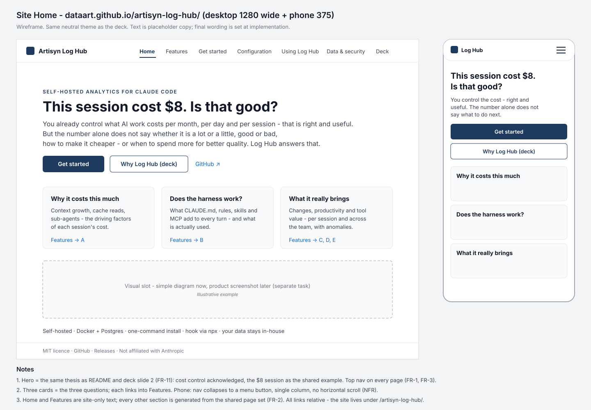
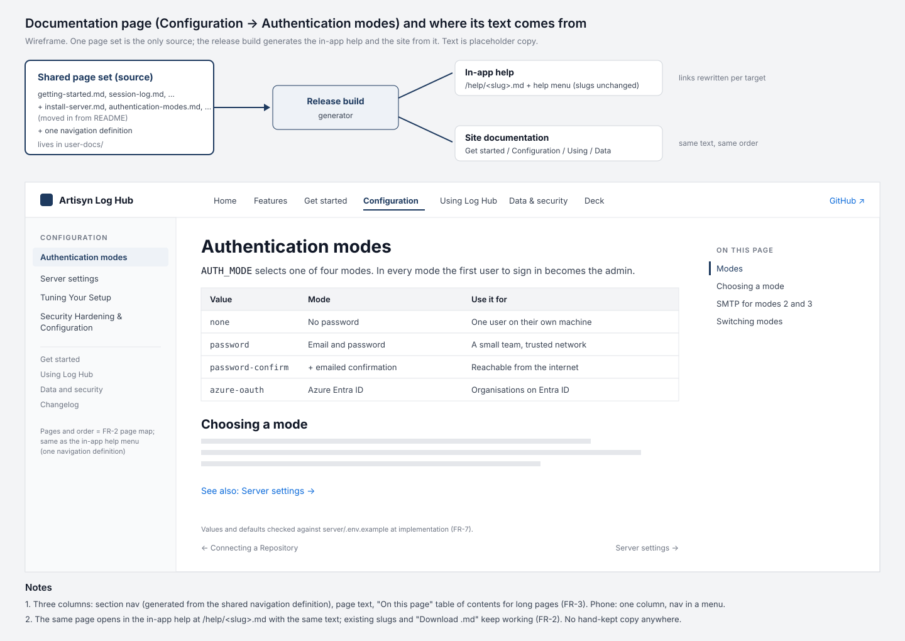
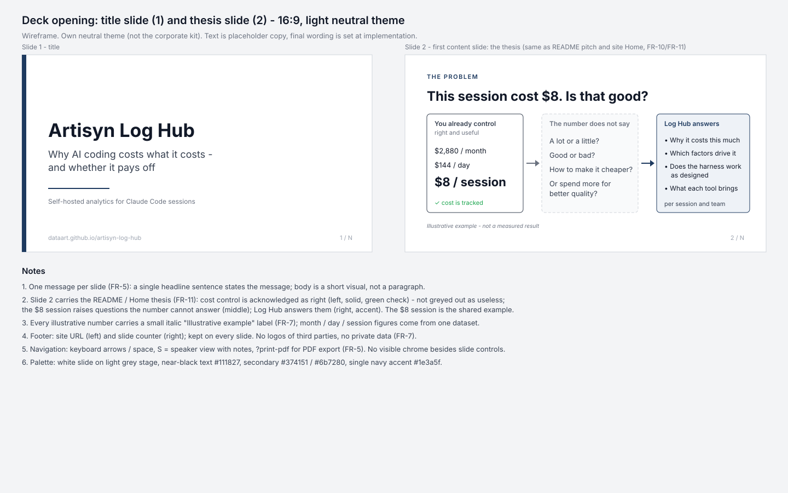
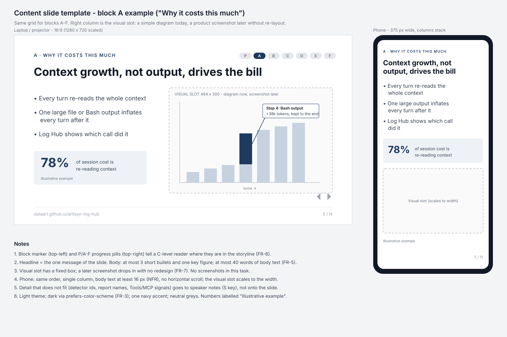
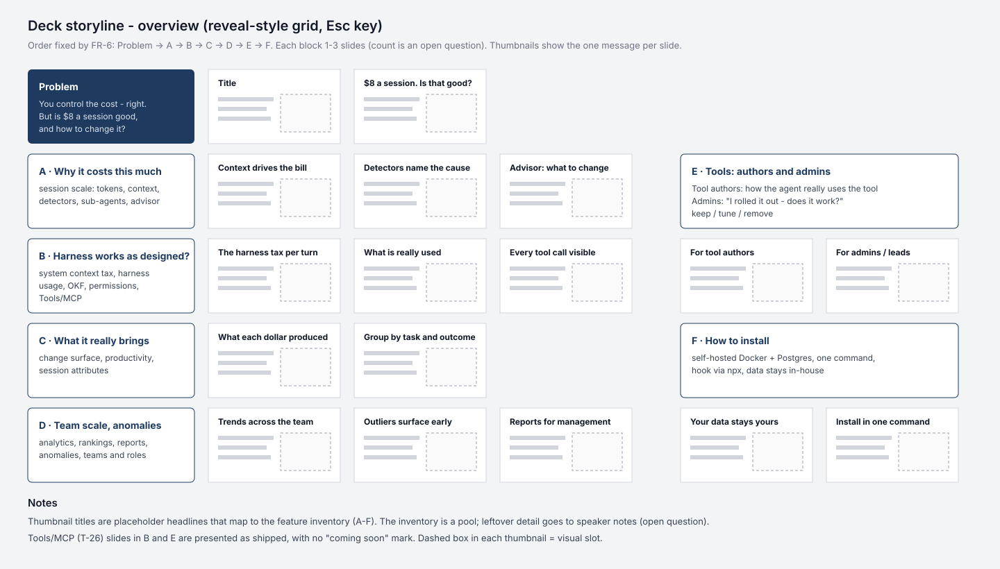
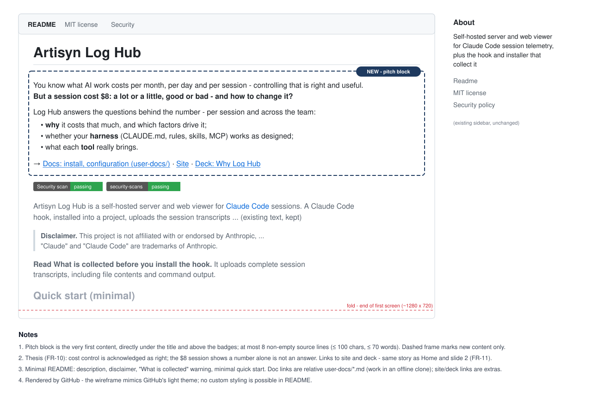

# 2026-10-28: Log Hub Site on GitHub Pages (what, why, features, usage, configuration + "Why Log Hub" deck)

**Status:** todo **Priority:** medium
**Type:** feature **Module (s):** site (new static folder) | user-docs (new shared page set) | client/public/help | client/src/viewer/help (HelpModal,
articles/index.ts) | scripts (site build) | .github/workflows | README.md **Owner:** denis.tsyplakov **Created:**
2026-10-28 **Tracker:** GH-47 https://github.com/DataArt/artisyn-log-hub/issues/47

## Description

Raw idea (verbatim, from the session):

> я хочу сделать презентацию - зачем нужен log hub
> основной упор не на то чтобы знать стоимость для этого много тулов а про "почему именно столько",
> "какие основние driving factors", работает ли мой харнес как я это задумал, а что реально приносит
> этот тул и т.д. как в масштабе сесии так и по команде - по команде искать аномалии и т.д.
> ... я бы это опубликовал как gh pages - в идеале чтобы была страница где прям как слайды идут

Agreed in the session: publish on GitHub Pages of the public repo `DataArt/artisyn-log-hub`.

Scope extension (owner, verbatim, same day):

> расширь задача там нормальный сай - что это, зачем, как использовать какие фичи, как настраивать

So the deliverable is a **product site**, not only a deck: what Log Hub is, why it is needed, which
features it has, how to use them and how to install and configure it. The "Why Log Hub" deck is one
section of that site.

Thesis clarified by the owner (verbatim):

> и еще про дневную стоимость - там надо "вот вы знаете стоимость в месяц - это то что надо
> контроливать, в день, стоимость сессии." вы котролируете стоимость что уже правильно и полезно.
> но вот сессия стоила 8 долларов - это много, мало, хорошо, плохо, как сделать меньше или как
> больше но зато улучшить качество

The thesis: **knowing and controlling the cost — per month, per day, per session — is right and
useful, and many tools already give it. But a number alone is not an answer.** A session cost $8:
is that a lot or a little, good or bad? How do you make it cheaper — or spend more and get better
quality? The pitch does not belittle cost control; it builds on it. Log Hub answers the next
questions:

- **why it costs this much** — the driving factors of a session's cost;
- **does my harness work the way I designed it**;
- **what the tool (and each MCP / CLI tool) really brings**;
- both at **session** scale and at **team** scale (trends, anomalies).

### Feature inventory to draw the slides from

Features marked ⚑ are in requirements only (`docs/tasks/todo/2026-06-19-mcp-invocation-log-tab`,
T-26 Tools/MCP tab) and are presented as shipped, with no "coming soon" mark — by the owner's
decision: T-26 will be released before the deck goes live. Items marked *(spec.)* are
mild speculation about how existing data can be used — no dedicated UI exists.

**A. Why it costs this much (session scale)**

- Per-turn token breakdown (input / output / cache read / cache write 5m·1h / vision), cost from
  Log Hub's own price table (OTEL only cross-checks).
- Context Growth chart with per-step drill-down: which tool call / file / Bash output inflated the
  context.
- Summary detectors: `low-cache-read-ratio`, `context-ceiling-pressure`, `context-compression`,
  `change-surface-spread` / `-modules` / `-shared` / `-single-file-folders` (spread of changes), `claude-version`
  (outdated Claude Code).
- Tree-scoped cost: root session + sub-agents + workflow agents, Agents table with drill-down.
- Turn-End Cost Advisor: an LLM review after each turn — where the overspend is and what to change.
- Statistics / Bash / tool-call views: tool success, error and denial rates, heavy Bash commands,
  files read / changed / run.

**B. Does my harness work as designed**

- System context: what really got into the context (CLAUDE.md, rules, skills, agents, MCP servers)
  and its size in tokens — the harness "tax" on every turn.
- Harness usage: which skills / rules / workflows / MCP / tools were actually used, and how often.
- Harness snapshot per session *(spec.: before/after comparison of a harness change)*.
- OKF usage (knowledge base): entry via index vs search, never-read articles, `always_read`,
  `kb_flood`, `coarse_article` rules, session and repository verdicts.
- Permission attribution: where the agent stumbles on permissions.
- ⚑ **Tools/MCP tab**: every MCP call (automatic) and every call of monitored CLI tools (wrapper in
  the hook: full output, exit code, binary path; Windows / Linux / macOS); tool → operation tree with
  calls and error %; call details (parameters, stdin, Terminal / as-the-agent-saw-it / Raw output,
  JSON tree, `cut` when the agent saw less); usefulness signals `empty`, `retried`, `fell back`,
  `opened file`.

**C. What it really brings**

- Change Surface: files / folders / modules touched and the concentration metric.
- Productivity counters: diff lines, commits, PRs; cost/line, lines/hour.
- Session Attributes: LLM-labelled sessions (task type, outcome, …) as a group-by dimension for
  every chart and report.

**D. Team scale — trends and anomalies**

- Repository Analytics (work time, cost, files, vision, MCP, cache ratio by hour/day, grouped by
  user / branch / attribute) and Top-N rankings.
- A library of reports (17 at 2026-10-28, most PDF-exportable): Executive Summary, Cost by Branch / User, Token Usage,
  Tool Analytics,
  Harness Usage, Claude Version Usage, Cache Read Ratio, Change Surface, Attribute Breakdown, …
- Anomalies: outliers in rankings, low cache ratio, `kb_flood`, lagging Claude Code versions,
  unusual cost/line; ⚑ per-tool error spikes, unused monitored tools, high `retried` / `fell back`.
- Teams: transparent / restricted access modes, manager and ADLC-trainer roles.

**E. Tools: authors and admins (two audiences)** — ⚑ Tools/MCP answers two questions:

- **Tool authors** (MCP servers, CLI tools): how the agent really uses their tool — arguments,
  errors, empty answers, truncated output — with no integration on the tool's side.
- **Admins / team leads who rolled a tool out to a team**: "I connected this tool for the team —
  does it work, and how?" Is it called at all (`never called`), by whom and how often, error %,
  does the agent trust its output (`opened file`) or abandon it (`retried`, `fell back` to grep).
  The basis for keeping, tuning or removing the tool.

**F. Foundation** — self-hosted (Docker + Postgres, one-command install), hook via `npx`, full
transcript capture by design, backward compatibility with old hooks, session export / import.

## Functional Requirements

### Site

- **FR-1 Site structure.** A static site in its own top-level folder `site/` (not under `docs/` —
  tasks and KB are never published), served at `https://dataart.github.io/artisyn-log-hub/`.
  Sections, each reachable from a persistent top navigation:
    1. **Home** — what Log Hub is and why (the FR-10 thesis), the three questions it answers, links to
       the deck, Features and Get started.
    2. **Features** — one entry per feature group A–F of the inventory: what it shows, which question
       it answers, where it is in the app.
    3. **Get started** — install the server (release install, Docker image, source build) and the
       hook into a project; first session.
    4. **Configuration** — authentication modes, server environment variables, hook settings, teams
       and roles, tuning the setup.
    5. **Using Log Hub** — session list, session log, cost and context, analytics and reports,
       connecting a repository.
    6. **Data and security** — what is collected, trust model, security hardening.
    7. **Why Log Hub (deck)** — FR-5.
- **FR-2 One page set for in-app help and site.** The in-app help and the site's documentation are
  generated from **one source set of pages** (owner's decision). The release build generates both
  outputs from it: the in-app help (the `/help/<slug>.md` files and the help navigation the client
  reads today) and the site's documentation pages. No hand-kept copy exists anywhere.
    - **Location:** the page set lives in a new top-level folder `user-docs/` (owner's decision): the
      pages and the one navigation definition. `client/public/help/*.md` stops being a source: those
      files are generated from `user-docs/` by `npm run build` and by the client dev start, and are
      gitignored (no second copy in the repo).
    - The set starts from today's help pages (moved from `client/public/help/*.md` to `user-docs/`)
      and gains the install and configuration pages that now live only in `README.md` and
      `hook/INSTALL_HOOK.md`, so they appear in the in-app help as well.
    - One navigation definition in the set drives both the in-app help menu (today
      `client/src/viewer/help/articles/index.ts`) and the site's Get started / Configuration / Using /
      Data and security sections.
    - **Page map.** Both the in-app menu and the site use the same four sections plus Changelog, in
      this order. Every page is published in both places — none is app-only (the technical pages
      are what security reviewers ask for before installing). Existing slugs and `downloadable`
      flags are kept; new pages get new slugs:

      | Section | Slug (title) | Source | `downloadable` |
      |---|---|---|---|
      | Get started | `install-server` (Install the server) — new | README Quick start + Other ways to run (release install, source build, Docker image, check you are the admin) | no |
      | Get started | `install-hook` (Install the hook) — new | `hook/INSTALL_HOOK.md`, read in place | yes |
      | Get started | `getting-started` (Your first session) | existing page; title changes, slug stays | no |
      | Get started | `connect-repository` (Connecting a Repository) | existing | yes |
      | Configuration | `authentication-modes` (Authentication modes) — new | README Authentication modes | no |
      | Configuration | `server-configuration` (Server settings) — new | README Configuration | no |
      | Configuration | `tuning-your-setup` (Tuning Your Setup) | existing | no |
      | Configuration | `security-hardening` (Security Hardening & Configuration) | existing + README Security notes merged in | yes |
      | Using Log Hub | `session-list`, `session-log`, `cost-and-context`, `analytics-reports` | existing | no |
      | Data and security | `data-collection-notice` (Data Collection Notice) | existing, text unchanged | no |
      | Data and security | `data-collection` (Data Collection & Upload) | existing + README What is collected merged in | no |
      | Data and security | `trust-model` (Trust model) — new | README Trust model | no |
      | Data and security | `component-reference`, `responsibility-matrix`, `third-party-components` | existing | yes |
      | Changelog | `changelog` (Changelog) | existing | no |

      The in-app "Getting Started" page (the first session after sign-in) and the site's "Get
      started" section no longer clash: "Get started" is the section, the page is titled "Your first
      session". The in-app help still opens on `getting-started` by default (not on the first page
      of the menu), because a user of the app has already installed the server. On the site,
      Changelog is reached from the docs sidebar and the footer, not from the top navigation.
    - Pages are written to read well in both places.
    - Backward compatible: existing help slugs and `/help/<slug>.md` URLs (incl. "Download .md")
      keep working.
    - Only Home, Features and the deck are site-only.
    - The client imports the shared navigation definition directly at compile time (no generated
      navigation file); it keeps today's `HelpArticle` / `HelpSection` shape, the `downloadable`
      flag and the download file name.
    - Links between pages are written once, as `slug.md` (optionally `#anchor`). HelpModal gets a
      ReactMarkdown link handler: an internal link switches the article, an external link opens in a
      new tab. The site build rewrites the same links to the site page paths.
    - `hook/INSTALL_HOOK.md` stays where it is as the single source of hook install text; the page
      set reads it as a page. Its consumers (`scripts/build-hooks-installer.js` event-name check, its
      test, the `s-inst-01` scenario, the `update-install-instructions` skill) are unchanged.
    - `data-collection-notice.md` keeps its current text, so its consent hash (`client/src/viewer/lib/notice-hash.ts`)
      is unchanged and no user is asked to consent again.
      On the site, `{{RETENTION_DAYS}}` reads "the retention period configured on your server (default 30 days)".
    - Site documentation pages are pre-rendered to static HTML by a Node script under `scripts/`
      (tested by `npm run test:scripts`) with the remark / remark-gfm stack the client already uses;
      the table of contents comes from h2/h3. `pages.yml` runs it after `actions/setup-node`, pinned
      to the same SHA as `checks.yml`, and uploads only its output folder.
- **FR-3 Navigation and look.** Own neutral theme shared by site and deck (not the DataArt corporate
  kit); top navigation, a per-page table of contents for long pages, working relative links between
  pages, a link to the GitHub repo and releases on every page. Light theme; dark via
  `prefers-color-scheme`. The deck page has no site top navigation: its title and closing slides
  link to Home and the GitHub repo, and a small exit link to the site shows outside print mode.
- **FR-4 Audience and language.** Home and the deck address decision makers (business language
  first); Get started / Configuration / Using address users and admins installing and running Log
  Hub. Everything is in **English**.

### Deck

- **FR-5 Slide deck.** A page `site/deck/` with slide navigation (keyboard arrows, speaker view,
  print-to-PDF). Engine: reveal.js 5.x pinned to an exact version on jsDelivr (with SRI hashes) or
  vendored under `site/`; only the `notes` plugin. Audience **C-level**: one headline sentence
  stating the message, at most 3 bullets, at most 40 words of body text per content slide. Title,
  section-divider and closing slides are exempt; speaker notes, the "illustrative example" label
  and text inside a chart or visual do not count toward the 40 words.
- **FR-6 Storyline.** Order: problem (you already know and control the cost — right and useful —
  but "this session cost $8" does not say whether that is good, bad, too much, or how to change it) →
  A why it costs this much → B harness works as designed (incl. Tools/MCP) → C what it brings →
  D team scale and anomalies → E tools for their authors and for the admins who rolled them out to
  a team → F how to install (links to Get started). **Size: 10–15 slides in total** (owner's
  decision), title and closing included — so problem and each of A–F get 1–2 slides. The feature
  inventory is a **pool**, not a checklist: each block picks its strongest items, and leftover
  detail goes into speaker notes. Each block uses the feature inventory above. *(spec.)* items appear
  only phrased as a use of existing data (e.g. "compare snapshots
  before/after a harness change"), never as a dedicated feature or screen.

### Shared rules

- **FR-7 Facts and visuals.** Product facts (report count, which reports export to PDF, detector
  ids, env-var names and defaults) are checked against the code at implementation time
  (`client/src/viewer/pages/repository/reports/report-catalog.ts`, `client/.../summary/detectors/`,
  `server/.env.example`), not copied from the inventory. No product screenshots in this task —
  reference screenshots from a reference project are a separate task; pages and slides are laid out
  so a screenshot can be added later without redesign. No private data: no real e-mails, user
  names, private repo names or local paths. Usage and metric figures (costs, token counts,
  durations, cache ratios, line counts, the $8 session) come from one fictional example dataset in
  `site/data/example-dataset.json`, read by both site and deck, and carry a visible "illustrative
  example" label; product facts stay real and unlabelled. The dataset holds at least: the $8
  session split into input / output / cache read / cache write / sub-agent costs summing to $8.00,
  team size and period, daily and monthly totals consistent with the sessions, and the per-tool
  figures used in blocks D and E.
- **FR-8 GitHub Pages deploy.** A workflow `.github/workflows/pages.yml` deploys the assembled
  site, triggered by push to `main` with `paths:` covering `site/**`, every content source of FR-2
  and `.github/workflows/pages.yml`, plus `workflow_dispatch`. All actions are pinned by commit SHA
  like the other workflows. Shape: one `deploy` job on `ubuntu-latest` with
  `environment: { name: github-pages, url: ${{ steps.deployment.outputs.page_url }} }`; steps
  `actions/checkout` (`persist-credentials: false`) → assemble the site (if FR-2 needs it) →
  `actions/configure-pages` → `actions/upload-pages-artifact` → `actions/deploy-pages`
  (`id: deployment`); `concurrency: { group: pages, cancel-in-progress: false }`; minimal
  permissions — top-level `contents: read`, with `pages: write` and `id-token: write` on the job
  only. The artifact contains only the site — no other repo file.
- **FR-9 Owner setup.** The repository admin sets Settings → Pages → Source: **GitHub Actions**.
- **FR-10 README pitch and a minimal README.** A reader who opens the README reads its top two
  inches and is then lost (owner) — so the pitch is the **very first content of `README.md`**,
  directly under the `# Artisyn Log Hub` title, above the badges and everything else, and short
  (at most 8 rendered lines: thesis, what Log Hub answers, links). It states the "why" plainly: you already know what AI work
  costs per month, per day and per session, and controlling that is right and useful; **but a
  number alone is not an answer** — a session cost $8: a lot or a little, good or bad, how to make
  it cheaper, or when to spend more for better quality? Log Hub answers why it costs that much,
  which factors drive it, whether the harness works as designed, and what the tools really bring —
  per session and across the team. The tone acknowledges cost control, never dismisses it.
  The same block links to the site and to the deck. The existing factual description of what Log
  Hub is stays, below or merged into this pitch.
  The rest of the README becomes **minimal** (owner's decision): the badges, the short description,
  the trademark disclaimer, a one-line "read What is collected before you install the hook" warning
  linking to the site page, a minimal quick start (the few commands of the release install plus
  installing the hook) and links to the site's Get started / Configuration / Data and security
  sections. The sections Quick start (details), Other ways to run, Authentication modes,
  Configuration, What is collected, Trust model and Security notes move to `user-docs/` (FR-2 page
  map) and are no longer in the README. Repository layout, For developers and Licence stay — they
  are for contributors and are not part of the page set.
- **FR-11 One story.** The site's Home and the deck's first content slide carry the same thesis as
  FR-10 (cost control is right, but "$8 per session" alone does not say what to do), with the $8
  session as the shared example.

## Non-Functional Requirements

- External scripts only from a pinned CDN version (or vendored into the folder); no tracking.
- Readable on a laptop projector and on a phone.
- No private machine data in the site or its assets (same rule as the `poc` skill).
- Works under the `/artisyn-log-hub/` sub-path: no root-absolute links.

## Acceptance Criteria

- [ ] FR-1: served from a local static server, every section of FR-1 is reachable from the top
  navigation on every page except the deck; no link inside the site returns 404. Home states
  the thesis and the three questions and links to the deck, Features and Get started; Features
  has six entries A–F, each with what it shows, which question it answers and where it is in
  the app.
- [ ] FR-2: no help or install/configuration text exists twice in the repo; changing one source
  page changes both the in-app help and the site page after the next build; the in-app help menu
  and the site's doc navigation come from one definition; every existing help slug and
  `/help/<slug>.md` URL still opens; internal links work in both the app and the site;
  "Download .md" behaves as today; the notice hash of `data-collection-notice.md` equals
  today's; `npm run build:hooks-installer` and its event-name check pass. The page set lives in `user-docs/`;
  `client/public/help/*.md` is generated and gitignored; the in-app menu and the site show the sections and pages of
  the FR-2 page map; the in-app help opens on `getting-started` by default.
- [ ] FR-3: site and deck share one theme; long pages have a table of contents; every page except
  the deck links to the GitHub repo and releases (the deck's title and closing slides do); with
  `prefers-color-scheme: dark` site and deck switch to the dark palette.
- [ ] FR-4: all site and deck text is in English.
- [ ] FR-5: `site/deck/` shows the deck; arrows move between slides, `S` opens the speaker view,
  `?print-pdf` produces a PDF; every content slide has one headline sentence, at most 3 bullets
  and at most 40 words of body text.
- [ ] FR-6: the deck has 10–15 slides in total and covers blocks problem, A–F in the stated order; every slide's claims
  map to an item in the feature inventory (⚑ items allowed).
- [ ] FR-7: report counts, detector ids and env-var names/defaults match the code; `site/` contains
  no product screenshots; a grep of the published artifact finds no real e-mail, user name or
  absolute local path; every usage/metric figure shown traces to
  `site/data/example-dataset.json`, its totals add up, and each place with such figures shows
  the "illustrative example" label.
- [ ] FR-8: the PR's security-scans results show no actionlint / zizmor findings for
  `.github/workflows/pages.yml`; the artifact contains only the site; a change outside the
  watched paths does not trigger the workflow.
- [ ] FR-9: after the owner enables Pages, the URL serves the site and `/deck/` serves the deck.
- [ ] NFR: at a 375 px-wide viewport no page or slide scrolls horizontally and body text is at least
  16 px; at 1280×720 nothing overflows; every external `<script>`/`<link>` URL carries an exact
  version (or files are vendored); the site references no analytics host and makes no network
  requests other than the pinned CDN.
- [ ] FR-10: the first content after the `# Artisyn Log Hub` title in `README.md` is the pitch block (before the
  badges), at most 8 rendered lines, containing the thesis (cost control is right and useful, but a number like "$8 per
  session" alone does not say whether it is good or how to change it), what Log Hub answers next, and links to the site
  and the deck; no sentence calls cost tracking useless. The README no longer contains the sections Other ways to run,
  Authentication modes, Configuration, What is collected, Trust model or Security notes; it keeps a minimal quick start
  and links to the site sections.
- [ ] FR-11: Home and the deck's first content slide carry the same thesis as the README block.

## Common sense considerations

- Slide engine: reveal.js 5.x at an exact pinned version (or vendored), `notes` plugin only; deck and site checked from
  a local static server, not `file://`.
- Site folder is `site/` with the deck at `site/deck/`; the earlier `presentation/` name is replaced.
- In-app help and site docs come from one page set, generated for both at release build (owner's decision, FR-2);
  install/configuration text joins that set.
- `pages.yml` follows the standard GitHub Pages job shape fixed in FR-8.
- FR-8 AC checks actionlint/zizmor findings, not a green scan (the scans are report-only); config guard dropped — it
  does not read workflows.
- Per-slide limits: one headline sentence, ≤ 3 bullets, ≤ 40 words of body text.
- NFRs get measurable ACs (375 px / 1280×720 layout, exact-version URLs, no analytics hosts).
- Usage/metric figures come from one fictional dataset file (`site/data/example-dataset.json`) and carry the
  "illustrative example" label; product facts are real and unlabelled.
- `data-collection-notice.md` text stays unchanged (consent hash preserved); the site shows "default 30 days" in place
  of `{{RETENTION_DAYS}}`.
- `hook/INSTALL_HOOK.md` stays the source of hook install text; its build check, test, scenario and skill are untouched.
- In-app help navigation imports the shared definition at compile time, keeping today's shape and the download flag.
- Inter-page links are `slug.md`; HelpModal gains an internal-link handler; the site build rewrites them.
- Site doc pages are pre-rendered by a Node script (remark/remark-gfm), run in `pages.yml` after pinned
  `actions/setup-node`.
- The deck has no site top navigation; its title/closing slides link to Home and the repo.
- Slide limits apply to content slides only; speaker notes, labels and chart text are not counted.
- ACs cover Home/Features content, releases link, dark mode and English-only text.
- Report counts, detector ids and env-var names/defaults are checked against the code at implementation time.
- *(spec.)* items appear only as a use of existing data, never as a feature or screen.
- Priority is medium.
- Go-live timing (when to merge, when to enable Pages, relative to the T-26 release) is handled manually by the owner;
  the implementation adds no hold-back mechanism and runs only the git/release commands the owner asks for.
- The shared page set lives in top-level `user-docs/`; `client/public/help/*.md` becomes generated, gitignored output.
- README is minimal: pitch first (above badges, ≤ 8 lines), minimal quick start, links to the site; install,
  configuration and data/security sections move to `user-docs/`.
- Deck size is 10–15 slides; the feature inventory is a pool, leftovers go to speaker notes.
- One page map (FR-2) for in-app help and site: four sections + Changelog, every page in both places, existing slugs
  kept, `getting-started` retitled "Your first session" and still the in-app default.

## Open Questions

## Notes

- 2026-10-28: Release dependency — the Pages deploy (FR-8/FR-9) and the README link (FR-10) go live
  only after T-26 Tools/MCP (`2026-06-19-mcp-invocation-log-tab`) is released. 2026-10-29: the owner times
  the merge and Pages enablement by hand; nothing in the implementation enforces it.

- 2026-10-28: Pinned SHAs resolved in the session (latest releases at that date):
  `actions/configure-pages` v6.0.0 `45bfe0192ca1faeb007ade9deae92b16b8254a0d`,
  `actions/upload-pages-artifact` v5.0.0 `fc324d3547104276b827a68afc52ff2a11cc49c9`,
  `actions/deploy-pages` v5.0.1 `368f82528645a54fb793d4d04e342629a3f51346`.
- `main` is protected by a ruleset — the site and workflow land via a normal PR.
- The wireframes do not draw the Features page.
- Scope and thesis evolution history: see `notes.md`.
