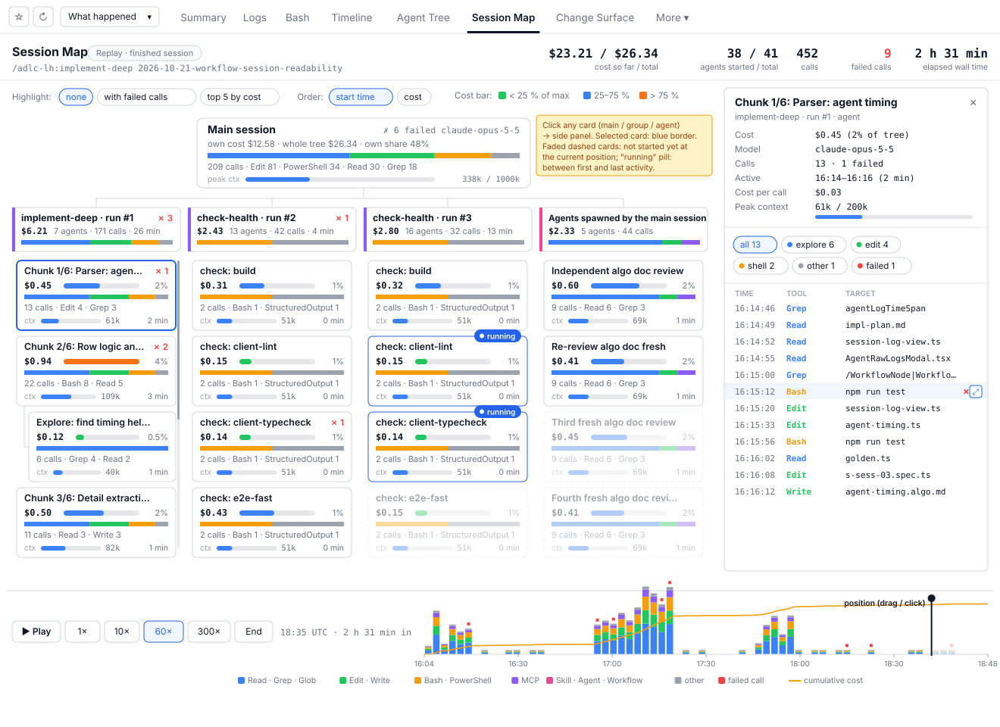
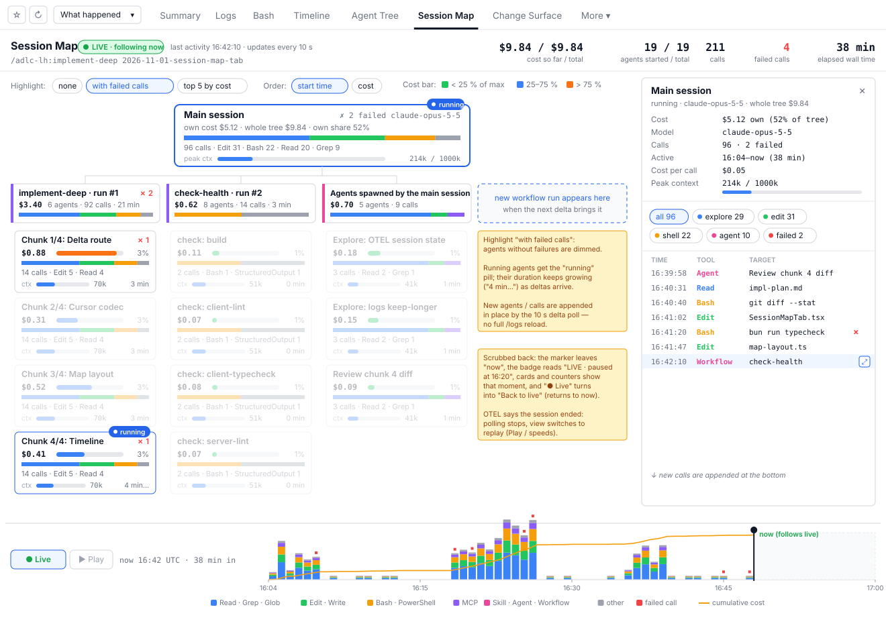
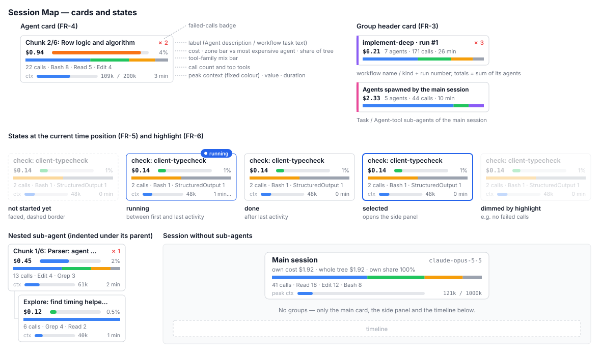

# 2026-11-01: Session Map Tab (Realtime and Replay)

**Status:** todo
**Priority:** medium
**Type:** feature
**Module(s):** client, server
**Owner:** denis.tsyplakov
**Created:** 2026-11-01
**Tracker:** GH-73 https://github.com/DataArt/artisyn-log-hub/issues/73

## Description

Raw idea (owner, 2026-11-01):

> Session Map tab in the session view: a practical 2D map of one session's agent tree, built from the
> PoC docs/pocs/2026-11-01-2253-session-map-2d/. Main session card on top, one column per workflow run
> plus a column for agents spawned directly by the main session; agent cards with cost and share of the
> tree (zone-coloured bar), tool-family mix, calls and top tools, failed calls badge, peak context
> against the model window, duration; side panel with the selected agent's metrics, filter chips by
> tool family / failed, and the call log (click a call → jump the timeline / open the call). Timeline
> at the bottom: stacked calls per time bin by tool family, failures marks, cumulative cost line,
> scrubbable. Default mode: for a running session it is REALTIME — the map grows as the session runs
> (new agents and calls appear, running agents marked). For a finished (historical) session it opens
> at the end state and can be REPLAYED (play / speeds / scrub).

Why: a multi-agent session (e.g. an `implement-deep` run with 40+ agents in several workflow runs) is
today read agent by agent — Logs tab, workflow "Agents (N)" table, one modal per agent. The map answers
on one screen *where the money and time went, what failed and what each agent did*. It closes the
"live view" and "by-agent table" gaps of the competitive study
(`docs/competitive-research/gap-closing-plan.md`, P4 and P6); the PoC proved it on a real
41-agent / 517-call / $26 session (see its `README.md` and screenshots).

Context from the KB (what exists today):

- The session view loads everything client-side from `GET /api/v1/repositories/:repoId/sessions/:sessionId/logs`
  (root transcript, sub-agent transcripts `subagentLogsMap`, `agentParentMap`, `subagentStats`,
  `WorkflowRun.agentSessionIds`) and parses it with `parseSessionLogs()` — `session-log-view.md`. The
  data the PoC used (tool name, target, timestamp, outcome, per-agent cost, peak context) is all
  in that payload or derivable with the existing helpers (`buildAgentNodesForIds`, `agentLogTimeSpan`,
  `classifyToolOutcome`, `extractSubagentStats`).
- That payload is fetched once; the only refresh is the header's refresh button
  (`invalidateQueries(['session-logs', …])`) — `session-log-view.md` § "Session refresh". The only
  live view today is the OTEL session tab, which polls a `since=` delta every 5 s while the session is
  live (`otel-tabs.md` § "Client polling", realtime states via `rt_last_at` / `chunk_last_at`).
- The hook uploads the session's own transcripts on each prompt (at most once a minute) and in full at
  the end of every assistant turn (`user-docs/data-collection.md` § "When uploads happen") — so
  transcript-based data lags the live session by up to one turn.
- Workflow agent labels today come from the shared harness prompt; their real labels are the subject of
  task `2026-10-21-workflow-agent-meta-labels` (hook sends `.meta.json` `description` / `workflowPhase`).
- UI rules: light theme only; open-ended metrics (cost) use the zone colours relative to the max with a
  `ZoneLegend`; bounded ratios (context fill) use a fixed colour, not zones — `ui-principles.md`.
- Additive metrics are summed over the root and all recursive descendants — `session-metrics-scope.md`.

## Functional Requirements

- FR-1 **New tab.** The session view gets a "Session Map" tab.
- FR-2 **Main session card** at the top: own cost, whole-tree cost and own share; tool-family mix;
  call count and top tools; failed-calls count; peak context against the model's context window.
- FR-3 **Groups.** One column per workflow run (in start order, labelled by the workflow's name / kind
  and run number) plus one column "Agents spawned by the main session" for Task/Agent-tool sub-agents.
  Each group has a header card: total cost, agent count, call count, duration, failed calls, tool mix.
- FR-4 **Agent cards** inside each group: label, cost with share of the tree and a zone-coloured bar
  relative to the most expensive agent (with a zone legend), tool-family mix bar, call count and top
  tools, failed-calls badge, peak context bar (fixed colour) with value, duration. Nested sub-agents of
  an agent are shown under it (indented).
- FR-5 **Card states** derived from the current time position: not started yet (faded), running
  (marked "running"), done. In realtime at "now" an agent is running when the session is live
  (FR-13), its first activity has passed and it has no final result yet (no `tool_result` for its
  Task/Agent call in the parent; for a workflow agent, its run is not finished).
- FR-6 **Highlight and order controls:** highlight agents with failed calls / top 5 by cost; order
  agents by start time or by cost.
- FR-7 **Side panel** for the selected card (main session, group or agent): cost and share, model,
  calls and failures, peak context, active window, cost per call, filter chips by tool family and
  "failed", and the chronological call log (time, tool, short target, failure mark). Clicking a call
  moves the time position to it; opening the call shows the existing tool-call detail
  (`ToolCallDetailModal` / `ToolCallView`).
- FR-8 **Timeline** at the bottom: calls per time bin stacked by tool family, failure marks, cumulative
  cost line, time ticks, a position marker; click / drag to move the time position.
- FR-9 **Realtime mode (default for a running session).** While the session is live, the map updates
  by itself: new agents, workflow runs and calls appear as they are uploaded, running agents are
  marked, counters and the timeline grow; the time position follows "now" (the server clock returned
  with each delta, so the timeline also grows while nothing is uploaded). The user can scrub back;
  a "Live" control returns to following "now".
- FR-10 **Replay mode (finished session).** A finished session opens at its end state (everything
  shown). Play / pause and speed controls replay it from any position; scrubbing works at any time.
- FR-11 **Header counters** for the current time position: cost so far / total, agents started / total,
  calls, failed calls, elapsed wall time.
- FR-12 **Realtime delta endpoint (server).** A new read route returns everything that is new in a
  session tree since a client-held cursor, so the realtime map never re-downloads the whole `/logs`
  payload:
  - the cursor records, per `(session, log_type)` row of the tree (root `artisyn` and `claude` rows
    separately, every sub-agent at any depth), the row's `logs.updated_at`, how many lines the client
    already has, and a fingerprint of its last line (the line's `uuid`, or a hash for lines without
    one). The hook upload (`ingest` in `logs.service.ts`) replaces `logs.body` without a length check,
    so a row is trusted to have only grown when its line `n-1` still carries that fingerprint;
  - the response holds: the new lines of every known log (`body[n:]`), the full lines of logs and
    sub-agent sessions that appeared since the cursor (with their parent / workflow-run linkage), the
    full `subagentStats` row (same fields and transcript-existence guard as `/logs`) of every new
    session and every session whose log row changed, the full recomputed `workflows` list (same shape
    and `agentSessionIds` resolution as `/logs`) when the root `claude` row changed or new descendant
    sessions appeared (otherwise `null` = unchanged), the liveness state of FR-13, the server time,
    and the next cursor;
  - an empty or absent cursor means "from the start", so the first call also serves the Map tab's
    initial load;
  - the same access rules as `GET /api/v1/repositories/:repoId/sessions/:sessionId/logs` (owner / team
    visibility, raw-log restrictions) and the same team-scope parameter;
  - a cursor that no longer matches (a log became shorter, its last-line fingerprint changed, a session
    was deleted / purged) is answered with a signal to reload in full, never with a wrong slice.
- FR-13 **Liveness from OTEL.** Whether the session is running (realtime mode by default, the "running"
  marks, when to stop polling) is decided by the OTEL session state — `otel_session_state.rt_last_at` /
  `chunk_last_at` and the existing "session ended" rule (`OTEL_SESSION_ENDED_MS`, `otel-tabs.md`
  § "Realtime states"), the same signal the OTEL tab uses. The delta response (FR-12) carries it. A
  session without OTEL data (old hook, OTEL disabled, or no state row yet) is treated as finished: it
  opens in replay mode. After the session reads as ended, polling stops; a manual refresh, input after
  the idle stop or a return to the hidden tab sends one catch-up delta call, and the map switches back
  to realtime if that call reports the session live again.

## Non-Functional Requirements

- Works offline: no runtime fetches from the internet, no new third-party visual library needed (the
  PoC is plain HTML/SVG/canvas).
- Light theme and colour rules of `ui-principles.md`.
- Usable for at least ~50 agents and ~1,000 calls in one session (the PoC session: 41 agents, 517
  calls): a scrub step or a realtime update re-renders the map in ≤ 100 ms.
- Realtime updates must not re-download the whole session payload on every poll (FR-12); a poll with
  nothing new must be cheap (no transcript bodies read — `jsonb_array_length` counts as a read — only
  row timestamps and state).
- No change to the hook upload contract or to ingest behaviour (backward compatibility with hooks that
  will not be updated), so realtime granularity is bounded by the hook's upload cadence (see Description).

## Acceptance Criteria

- [ ] FR-1: every session shows a "Session Map" tab (promoted in the "What happened" lens); opening it
      renders the map without errors; a session without sub-agents shows the main card and the timeline.
- [ ] FR-2: the main session card shows own cost, tree cost and own share that match the Info tab /
      session cost; peak context is shown against the model window.
- [ ] FR-3: a session with N workflow runs and directly spawned agents shows N + 1 columns in start
      order; group header totals equal the sum of their agents.
- [ ] FR-4: every agent of the session appears exactly once with its label, cost, share, tool mix,
      calls, failures, peak context and duration; the cost bar colours follow the zone legend;
      a nested sub-agent appears under its parent agent.
- [ ] FR-5: with the time position before an agent's first activity the card is faded; between its
      first and last activity it is marked running; after that it is shown as done; in realtime an
      agent without a final result in a live session is marked running at "now".
- [ ] FR-6: "with failed calls" dims every agent without failures; "top 5 by cost" dims all but the
      five most expensive; ordering by cost reorders cards inside each column.
- [ ] FR-7: clicking a card opens the side panel with its call log; the family / failed chips filter
      the log; clicking a call moves the time position; opening a call shows the same tool-call detail
      as the Logs tab.
- [ ] FR-8: the timeline shows bins stacked by tool family, red failure marks where calls failed, and a
      cumulative cost line that ends at the session total; dragging moves the position and updates the map.
- [ ] FR-9: for a session that is still running, new calls, agents and workflow-run columns uploaded by
      the hook appear on the map without a manual refresh, within the poll interval after the upload;
      scrubbing back and pressing "Live" returns to following "now".
- [ ] FR-10: a finished session opens with everything shown; Play replays it from the start (or from
      the chosen position) at the selected speed; Pause stops it.
- [ ] FR-11: header counters change with the time position and equal the session totals at the end.
- [ ] FR-12: a call with an empty cursor returns the whole tree and a cursor; after the hook uploads
      more lines, a call with that cursor returns only the new lines (no line twice, none missing),
      any new sub-agent sessions with their linkage and stats, and the `workflows` list when a run was
      added; a call with an unchanged tree returns no lines and reads no `logs.body`; a stale cursor
      (shorter log, replaced last line, deleted session) returns the "reload" signal; a user without
      access gets the same error as on `/logs`. The route has its contract registry row.
- [ ] FR-13: a session with live OTEL data opens in realtime mode and polls; once the OTEL state says
      the session ended, polling stops and the map switches to replay mode; a catch-up call that sees
      the session live again switches back to realtime; a session with no OTEL data opens in replay mode.
- [ ] NFR scale: on the PoC session (41 agents / 517 calls) scrubbing and realtime updates re-render
      the map in ≤ 100 ms (checked in the visual check with performance marks).

## Common sense considerations

- Tab row in `client/src/viewer/tab-ids.ts`: id `session-map`, label "Session Map" (plain "Map" collides
  with the `#/map` All views page), group `overview`, no `visible` predicate (always shown).
- The tab is promoted in the "What happened" lens (`session-lenses.ts`), after `agent-tree`.
- Delta route: `GET /api/v1/repositories/:repoId/sessions/:sessionId/logs/delta?cursor=&teamId=`; the
  cursor is opaque base64url, encoded and decoded by the server; a stale cursor gets `200` with
  `reload: true`, not an error status.
- Rows whose `updated_at` is unchanged are skipped without reading `body`; only changed rows are read
  and their fingerprint checked, so an empty poll needs no schema change.
- New descendant sessions are found from session / log row metadata (`getDescendantSessionIds`,
  `logs.updated_at`), without reading bodies.
- The root's `artisyn` and `claude` new lines come back as two lists; the client keeps the stream as
  `artisyn ++ claude` and re-parses it with the same `parseSessionLogs()` the other tabs use.
- Cost source: client-side pricing of `subagentStats` / root tokens with `@loghub/pricing`, exactly as
  the other session tabs do; no `session_costs` read.
- Per-call cost: each assistant message's weight is its own `usage` priced over all token categories;
  the agent's priced total is split by message weight and placed at the message's timestamp; a message
  with N `tool_use` blocks splits its share evenly over them, a text-only message keeps its share at its
  own timestamp; an agent without a stats row uses its transcript-derived cost. The cumulative cost line
  therefore ends exactly at the session total. Documented as an algorithm doc in
  `docs/knowledgebase/algorithms/` with example rows.
- Liveness in the delta response is a boolean plus the last activity time, returned to every viewer
  who may open the session, regardless of OTEL tab permission; no OTEL figures are included.
- Only the Map tab consumes the delta; it does its own empty-cursor initial load. The other tabs keep
  the `/logs` query and the header refresh; `/logs` is unchanged.
- On a "reload" signal the map discards its state and repeats the empty-cursor call, stays live if it
  was following "now" (otherwise clamps the position to the new end), and invalidates
  `['session-logs', …]` so the other tabs do not keep a stale tree.
- Poll interval while live: 10 s (one client constant); polling also stops after `OTEL_IDLE_STOP_MS`
  without user input and resumes on input, as on the OTEL tab.
- Agent labels: today's labels (Agent description / workflow task text); the map picks up better labels
  automatically once `2026-10-21-workflow-agent-meta-labels` lands.
- Long columns (16+ agents) scroll; no collapse / compact mode in the first version.
- Rendering is hand-written SVG / HTML in React, ported from the PoC; no new chart library.

## Open Questions

None.

## Notes

<!-- Append timestamped notes here as work progresses -->
- **2026-11-01:** Prototype: `docs/pocs/2026-11-01-2253-session-map-2d/` (README, screenshots,
  `index.html` on real data). Competitive context: `docs/competitive-research/gap-closing-plan.md`
  (P4 running markers / swimlanes, P6 by-agent tables).
