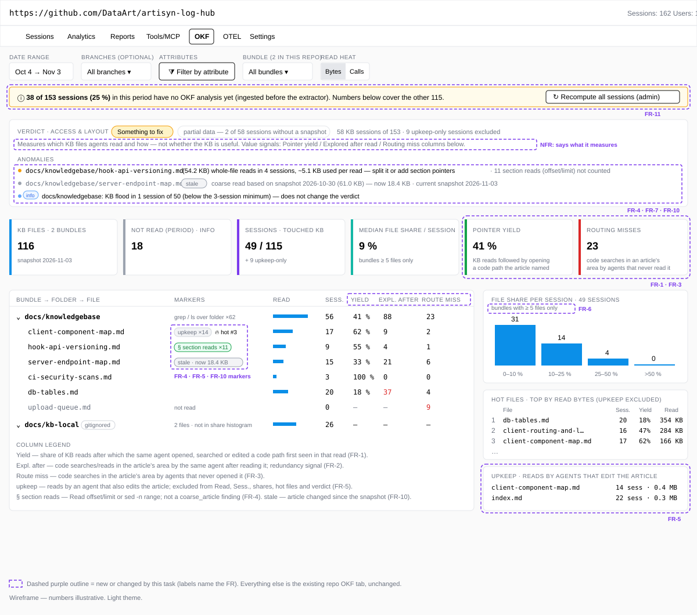
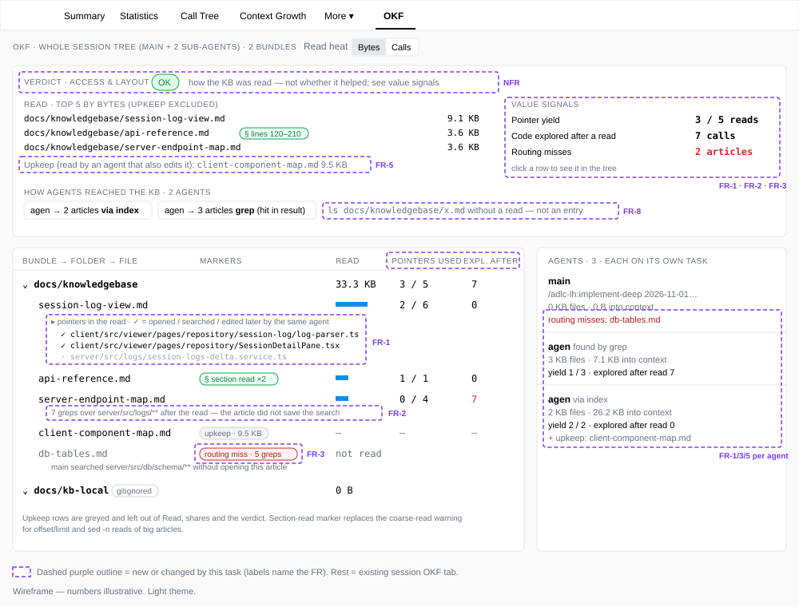

# 2026-11-03: OKF View — Measure KB Value, Not Only Access

**Status:** todo
**Priority:** medium
**Type:** feature
**Module(s):** server (`server/src/logs/okf/`) | client (session and repo OKF tabs)
**Owner:** denis.tsyplakov
**Created:** 2026-11-03
**Tracker:** GH-88 https://github.com/DataArt/artisyn-log-hub/issues/88

## Description

Raw idea (owner, verbatim, 2026-11-03):

> в loghub локальном проде есть анализ OKF я хочу понять насколько моя knowledge base вообще полезна
> и насколько тут для анализа полезен log hub
> …
> две задачи
> 1. тюним эту локальную KB
> 2. оцениваем насколько OKF view вообще полезна для такого тюнинга
> …
> задачу 2 сделай отдельно scratch

A five-method evaluation of this repo's KB against the local-prod OKF data (147 sessions, repo 1,
2026-10-21 … 11-02) checked how useful the OKF view is for tuning a KB. The owner's definition of a
good KB is C1–C4 in `docs/tasks/todo/2026-10-27-kb-completeness-deep/requirements.md` (saves code
exploration; carries implicit knowledge; holds nothing easily derived and found from code; fills
unknown unknowns).

Finding: the OKF view is a correct **access** sensor (which files, bytes, entry door, bundle share)
and its `coarse_article` findings on the big catalogs were right (acted on in commit 349cf35). But
it measures **none of C1–C4**: the extractor keeps only `.md` keys, so the view never sees the code
an agent explored after (or instead of) a KB read. Several of its signals also mislead, and the
verdict badge sounds more certain than the data allows. This task makes the deterministic OKF
analysis (no LLM in the server, `2026-10-27-okf-usage-tab` FR-19) measure value proxies and fixes
the misleading signals. LLM-based judgements (derivability, correlation with user corrections)
belong to the `kb-analysis` skill, `2026-10-27-kb-completeness-deep`.

Problems observed (evidence: the critique and usage-stats reports, see Notes):

- `coarse_article` cannot tell a badly cut article from an agent correctly reading one section
  (`grep -n "^#"` → `Read offset/limit` / `sed -n`): the extractor drops `offset/limit`.
- Reads of an article by an agent that also edits it (KB upkeep) count as use: 35 % of article
  accesses (40–57 % for the catalogs) are upkeep, so upkeep-heavy sessions look like model KB users.
  `afterOwnEdit` only covers reads *after* the edit.
- The repo share histogram takes the best share over all bundles without the
  `SHARE_MIN_BUNDLE_FILES` guard: a 2-article bundle (`docs/kb-local`) put 22 sessions into "50+".
- `kb_flood` turns the repo verdict to `fix` from a single session (1 of 50).
- `entry: search` fires on `ls <kb>/x.md` existence checks with zero reads.
- The even byte split of a multi-file `cat` credits a 20 KB article with ~1.3 KB, and
  `coarse_article` is computed from those bytes.
- Article sizes come from the bound snapshot with no marker when the KB has since changed.
- Sessions ingested before the feature have no rows until `recompute-all-sessions` is run; the tab
  does not say how much history it is missing.

## Functional Requirements

### Value proxies (C1, C4)

- **FR-1 Pointer yield.** Per article: how often a code path first seen in the result of a KB read
  was later opened, searched or edited by the same tree. Read-without-use is its inverse. Shown per
  article (repo tab hot files / tree) and per session.
- **FR-2 Exploration after a KB read.** Per article: code searches / reads in the area the article
  points to (its back-ticked paths) that follow a read of it in the same agent — a redundancy signal
  (C1/C3). Requires the extractor to keep non-KB accesses with their order: a new additive per-call
  table `session_okf_event` (session, node, order, op, path, offset/limit), rebuilt
  delete-then-insert per node like `session_okf_access`.
- **FR-3 Routing miss.** Code searches in an article's area by agents that never opened that
  article — a signal that the index line did not route them (C4). Same data as FR-2.

### Fix misleading signals

- **FR-4** Replace or qualify `coarse_article` with a section-read signal: keep `offset/limit` and
  `sed -n` ranges (additive column) and treat a section-addressed read of a big article as healthy;
  only whole-file reads used for a small part stay a finding.
- **FR-5** Count reads by an agent that also writes the same article (before or after) as
  maintenance: excluded from hot files, shares and verdict rules, shown separately ("upkeep").
- **FR-6** Apply the minimum-bundle-size guard to the repo share histogram.
- **FR-7** `kb_flood` (and other repo-level rules) need a minimum number of affected sessions
  before they change the repo verdict level.
- **FR-8** `entry: search` only when the search result actually contained the article; existence
  checks without a read do not count as an entry.
- **FR-9** Split the bytes of a multi-file read proportionally to the snapshot sizes of the files,
  not evenly.
- **FR-10** Mark a finding as stale when the article changed after the snapshot it is based on
  (latest snapshot differs), and show the article's current size.
- **FR-11** The repo tab states the share of sessions in the period without OKF rows and links to
  the recompute action.

### Facts route for the skill

- **FR-12** `GET /api/v2/okf-usage/facts` returns, per agent, the ordered sequence of KB and code
  accesses (op, path, offset/limit when present) as an optional additive field, so the
  `kb-analysis` skill can do its redundancy and routing passes (`2026-10-27-kb-completeness-deep`
  FR-7 passes 5/6).

## Non-Functional Requirements

- No LLM in the server (FR-19 of `2026-10-27-okf-usage-tab`).
- Backward compatibility: new columns and response fields are additive; an older skill or client
  ignores them; hooks need no change (the data comes from transcripts already uploaded). Existing
  rows gain the new data only through `recompute-all-sessions`.
- The verdict UI says what it measures (access and layout), not that the KB is useful.

## Acceptance Criteria

- [ ] FR-1: on a session where an agent read `ci-security-scans.md` and then opened
      `scripts/ci/scan-rows.js` named in it, the article gets a pointer-yield hit.
- [ ] FR-2/3: an article read followed by greps over the code it names shows as exploration after
      read; greps over that code by an agent that never opened it show as a routing miss.
- [ ] FR-4: a `Read` of a big article with `offset/limit` after a heading grep is not a
      `coarse_article` finding; a whole-file read used for a small part still is.
- [ ] FR-5: in an implementation session that edits `client-component-map.md`, its reads by the
      editing agent appear as upkeep, not in hot files or shares.
- [ ] FR-6: a 2-article bundle does not put sessions into the "50+" share bin.
- [ ] FR-7: one flooded session out of 50 does not turn the repo verdict to `fix`.
- [ ] FR-8: `ls <kb>/x.md` without a read is not counted as `entry: search`.
- [ ] FR-9: a `cat` of a 20 KB and a 1 KB article credits them ~20:1.
- [ ] FR-10: after the KB slim commit, `coarse_article` on a slimmed file shows as stale with the
      current size.
- [ ] FR-11: the repo tab shows the share of sessions without OKF rows.
- [ ] FR-12: the facts response carries the ordered access sequence; an older skill parsing the
      old fields still works.

## Common sense considerations

- FR-1–3 area source: back-ticked paths parsed from the tool_result text of KB reads at extraction
  (no hook change, per the NFR); an article's area is the union over the period's sessions, so an
  article nobody read in the period has no area and cannot produce a routing miss.
- FR-1–3 pointer: a back-ticked repo-relative file or folder token; `:line` suffixes stripped, a glob
  reduced to its fixed directory prefix.
- FR-1–3 "in the area": exact match with a pointer, or a path under a folder pointer; for
  Grep/Glob the path argument is compared.
- FR-1–3 unit: FR-1 per tree, FR-2/FR-3 per agent node, as worded; a sub-agent's read does not clear
  the main agent's routing miss.
- FR-1–3 partial reads: only pointers in the returned text count (automatic, the range is the
  tool_result).
- FR-12: the ordered per-agent sequence is built on demand from the transcript in the facts route,
  like `otherReadsTop`; no schema change.
- FR-11: additive per-session OKF extraction marker, set even when zero rows are written; share =
  root sessions in the period without the marker ÷ all root sessions in the period.
- FR-11 link: shown only to users the existing `recompute-all-sessions` route authorises, called
  with the tab's current `teamId`; others see the share only.
- FR-4 storage: additive ranged-call and ranged-byte counters per (session, path, op); ranged reads
  are left out of the `coarse_article` ratio, which is computed over whole-file reads only with the
  existing `COARSE_*` thresholds.
- FR-4 scope: `Read` offset/limit plus Bash `sed -n a,b`, `head -n`, `tail -n`; the range comes from
  an additive field in `@loghub/bash-view`.
- FR-4: no preceding heading grep is required; "big article" = `COARSE_MIN_SIZE_BYTES`.
- FR-10: "latest" = the snapshot bound to the most recent root session (by start) in the tab's
  scope; an article missing from it shows "removed" and is dropped from the verdict.
- FR-9: the split happens at extraction using the session's bound snapshot sizes; even split when
  there is no snapshot or a target has no size; `recompute-all-sessions` re-applies it.
- FR-8: a `list`/`grep` row counts toward `entry: search` only when its key is not a single named
  file and the same node later reads the bundle; the extractor stops producing a folder row for
  `ls <file>`.
- FR-7: named constants for a minimum count and share of flooded sessions, pinned in the verdict
  algorithm doc; applies to `kb_flood` (`always_read` and `coarse_article` already have guards); a
  finding below the threshold is still listed as `info`.
- FR-5: upkeep = reads of an article by the same agent node that writes it anywhere in its sequence.
- FR-5: a session whose only KB accesses are upkeep is not a KB session for the verdict; it counts in
  the upkeep tally.

- FR-2/FR-3 events: only repo-relative paths under the repo root, excluding `node_modules`, `.git`
  and build output; a per-node cap as a named constant; a Grep/Glob/Bash call yields one event per
  path argument, not per result line.

## Open Questions

_None._

## Notes

- Evidence (scratch copies, not in git): `okf-instrument-critique.md`, `kb-usage-stats.md`,
  `kb-session-cases.md` in the 2026-11-03 session scratchpad. Key numbers: KB used by 101 of 137
  real sessions per raw logs vs 54 of 147 per the OKF tab (no recompute before 2026-10-28); KB is
  7.4 % of tool-result characters; agents search code 23 % less after their first article read;
  main agents start from `index.md` 37 % of the time, sub-agents 17 %.
- Code pointers from the critique: share histogram in `okf-usage.service.ts` (best share over all
  bundles, no `SHARE_MIN_BUNDLE_FILES` guard); `afterOwnEdit` declared but not used in
  `okf-verdict.ts`; byte split DD-2 in `okf/okf-access-extractor.ts`. Verify before planning.
- Related: `2026-10-27-okf-usage-tab` (done — the feature), `2026-10-27-kb-completeness-deep`
  (LLM skill; C1–C4), `2026-10-28-kb-tag-search`.
