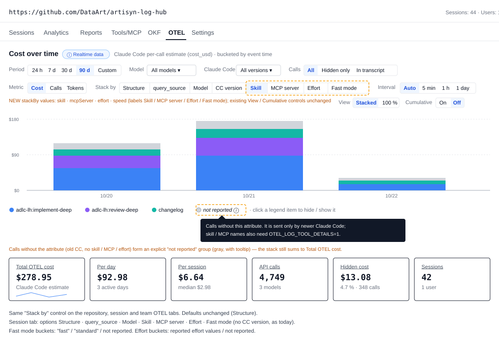
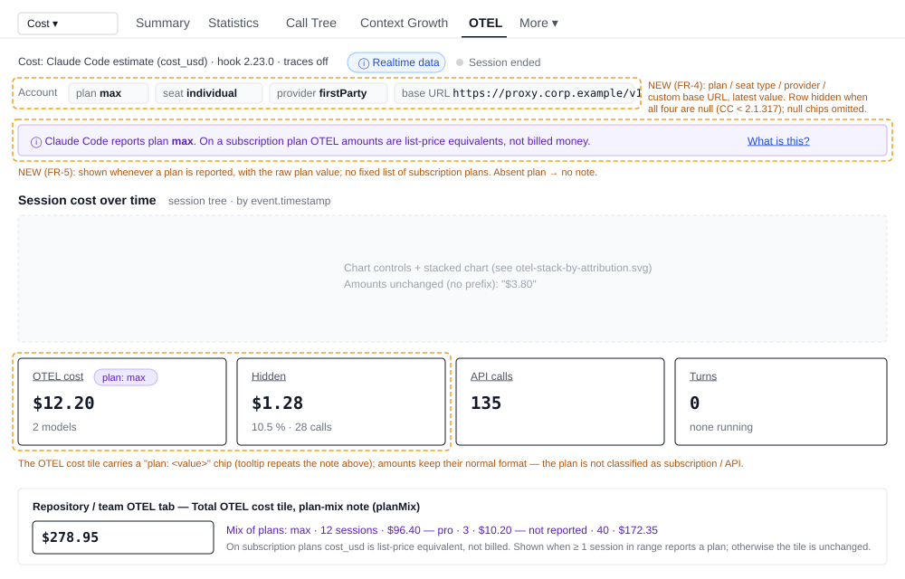

# 2026-11-03: OTEL Cost Attribution from New Claude Code Telemetry

**Status:** todo
**Priority:** medium
**Type:** feature
**Module(s):** server | client
**Owner:** denis.tsyplakov
**Created:** 2026-11-03
**Tracker:** GH-89 https://github.com/DataArt/artisyn-log-hub/issues/89

## Description

OTEL cost attribution from new Claude Code releases (2.1.300–2.1.317). Four changes:

1. `api_request` `cache_creation_5m_tokens` / `cache_creation_1h_tokens` (CC 2.1.300) —
   `extractOtelCalls` in `server/src/logs/otel/otel-records.ts` reads only
   `cache_creation_tokens`; add nullable 5m/1h columns to `otel_calls`, use them to cross-check
   against the transcript `ephemeral_1h` pricing.
2. `api_request` / `cost.usage` attribution attributes `effort`, `speed` (fast mode),
   `skill.name`, `plugin.name`, `agent.name`, `mcp_server.name`, `mcp_tool.name` (names need
   `OTEL_LOG_TOOL_DETAILS=1`, already written by the installer) — not extracted; store them in
   `otel_calls` and add cost grouping by skill / MCP / effort / fast mode on the OTEL tabs (cost
   control).
3. `anthropic.plan`, `anthropic.seat_type`, `anthropic.provider`, `anthropic.custom_base_url`
   (CC 2.1.317) on metrics / events / spans — store per session, show in the UI; for subscription
   plans `cost_usd` is notional, so explain the cost basis in text (no fixed list of plan values).
4. CC 2.1.307 fixed sub-agent transcripts recording placeholder token usage for streamed
   responses — sessions on CC < 2.1.307 may undercount sub-agent cost from the transcript; use OTEL
   `cost_usd` for the sub-agent part when it exists.

Constraints: backward compatible with old hooks and old Claude Code versions (attributes absent →
NULL), offline-first, test policy (algorithm doc rows in `algorithms/otel-facts.md` and
`algorithms/otel-cost-selection.md` for FR-6, contract rows
`f25-otel.ts`, steps in `s-otel-01`).

Source: `review-claude-code-news` run 2026-11-03 (changelog 2.1.292–2.1.317 and
`code.claude.com/docs/en/monitoring-usage`).

## Functional Requirements

- **FR-1 Cache-write split.** `extractOtelCalls` reads `cache_creation_5m_tokens` and
  `cache_creation_1h_tokens` from `claude_code.api_request` and `otel_calls` stores them in two
  new nullable columns next to the existing `cache_write_tokens` total. Records without them
  (CC < 2.1.300) store NULL; the existing total is unchanged.
- **FR-2 Attribution attributes.** `extractOtelCalls` reads `effort`, `speed`, `skill.name`,
  `plugin.name`, `agent.name`, `mcp_server.name`, `mcp_tool.name` from `api_request` and stores
  them on `otel_calls` (nullable; absent → NULL; values capped like other text fields).
- **FR-3 Cost grouping.** The repository, session and team OTEL tabs can group / stack cost by
  skill, MCP server, effort and fast mode (`speed`). Calls without the attribute fall into an
  explicit "not reported" group, so totals still add up.
- **FR-4 Plan / provider per session.** The `anthropic.plan`, `anthropic.seat_type`,
  `anthropic.provider`, `anthropic.custom_base_url` attributes (CC 2.1.317) are stored once per
  root session (latest value wins) and exposed on the session OTEL route.
- **FR-5 Plan / notional-cost explanation.** The set of `anthropic.plan` values is not documented
  and may change, so Log Hub keeps **no fixed list** of subscription plans and does not classify a
  plan as subscription / API-billed. Instead it explains the cost basis in text:
  - Session OTEL tab: when the session reports a plan, a note shows the raw plan value and explains
    that on a subscription plan OTEL `cost_usd` is a list-price equivalent, not billed money; the
    OTEL cost tile carries a `plan: <value>` chip. Amounts keep their normal format (no "≈" prefix).
    No plan reported → no note, no chip.
  - Repository and team OTEL tabs: when at least one session in the selected range reports a plan,
    the Total OTEL cost tile shows a "mix of plans" text — per plan value (including "not
    reported"): session count and cost — plus the same one-line explanation. No session reports a
    plan → the tile is unchanged.
- **FR-6 Sub-agent cost on old Claude Code.** For sessions whose sub-agent transcripts come from
  CC < 2.1.307, the sub-agent cost is taken from OTEL `cost_usd` instead of the transcript-derived
  cost whenever OTEL data for that sub-agent exists; without OTEL data the transcript-derived cost
  stays as today.
- **FR-7 Backfill.** Existing `logs_otel` chunks that already contain the new attributes are
  re-projected so history gets the new fields (projection version bump), without blocking the
  drain.

## Non-Functional Requirements

- Backward compatible: old hooks, old servers and old Claude Code versions keep working; every new
  field is additive and nullable; no existing route shape changes incompatibly. Behaviour when the
  data is not sent:

  | Source | What is missing | Result |
  |---|---|---|
  | Claude Code < 2.1.300 | `cache_creation_5m/1h_tokens` | 5m/1h columns NULL; `cache_creation_tokens` total and cost unchanged |
  | Claude Code without the attribution attributes | `effort`, `speed`, `skill.name`, … | columns NULL; with a new `stackBy` the whole cost is one "not reported" group equal to the total |
  | `OTEL_LOG_TOOL_DETAILS` unset (user removed it) | `skill.name`, `plugin.name`, `mcp_*` names | same as above for those groupings; `effort` / `speed` still group |
  | Claude Code < 2.1.317 | `anthropic.*` | `plan: null`; no Account row, no plan note / chip, amounts shown as today; counted as "not reported" in the repository / team plan mix |
  | Claude Code < 2.1.307 sub-agent without OTEL data | OTEL `cost_usd` for the sub-agent | transcript-derived sub-agent cost as today |
  | Any old hook (incl. 2.28.0, logs-only, no realtime) | nothing new is required from the hook | same projection path; no hook update needed |
  | History ingested before the upgrade | new fields | requeued under v2 (FR-7); chunks without the attributes re-project to identical rows and stay "not reported" |
  | Existing `otel_cost_buckets` rows | new grain columns | migration fills `''` = "not reported"; existing totals unchanged |

- A "not reported" group explains itself in the UI (tooltip: the attribute is sent only by newer
  Claude Code; `speed` / `effort` may also be omitted at their default value; skill / MCP names
  also need `OTEL_LOG_TOOL_DETAILS=1`), so an all-"not reported"
  chart on old data is not read as a bug.
- Offline-first: no runtime fetch; user help (`user-docs/otel-tab.md`) documents the new groupings
  and the plan / notional-cost explanation.
- No new hook change is expected (the receiver forwards records as is); if one turns out to be
  needed, it follows the hook versioning rules.
- Query cost of the OTEL facts routes must not degrade more than 20 % (`npm run perf`).

## Acceptance Criteria

- [ ] AC-1 (FR-1): an `api_request` line with `cache_creation_5m_tokens` / `cache_creation_1h_tokens`
  yields both values in `otel_calls`; a line without them yields NULL — rows in
  `algorithms/otel-facts.md`.
- [ ] AC-2 (FR-2): each of the seven attributes is extracted when present and NULL when absent —
  rows in `algorithms/otel-facts.md`.
- [ ] AC-3 (FR-3): `GET /api/v1/repositories/:repoId/otel/facts`,
  `GET /api/v1/repositories/:repoId/sessions/:sessionId/otel` and
  `GET /api/v1/teams/:teamId/otel/facts` with each new `stackBy` value return buckets whose sum
  equals the ungrouped total, including a "not reported" group — contract rows in
  `server/test/contract/registry/f25-otel.ts`; a step in `s-otel-01` shows the grouping in the UI.
- [ ] AC-4 (FR-4): the session OTEL route returns plan / seat type / provider / custom base URL
  for a CC 2.1.317+ session and nulls for an older one, and `customBaseUrl: null` when
  `attributesMasked` — contract rows in `f25-otel.ts`; a step in `s-otel-01` shows the Account row.
  Base-URL sanitising has rows in `algorithms/otel-facts.md`.
- [ ] AC-5 (FR-5): a session reporting a plan shows the plan note and the `plan: <value>` chip with
  the raw value (any value, no allowlist); the repository OTEL tab over that session shows the
  "mix of plans" text with per-plan session count and cost, and `planMix` is returned by the
  repository and team facts routes — step in `s-otel-01`, contract rows in `f25-otel.ts`.
- [ ] AC-6 (FR-6): the real-data check result is recorded in this task's Notes; a CC < 2.1.307
  session with OTEL data for a sub-agent shows the OTEL `cost_usd` as that sub-agent's cost, one
  without OTEL data keeps the transcript-derived cost — the replacement rule has rows in
  `docs/algorithm-examples/otel-cost-selection.json` and `algorithms/otel-cost-selection.md` is
  updated.
- [ ] AC-7 (FR-7): a session projected under v1 shows non-empty `stackBy=skill` buckets after
  re-projection under v2 with no manual step — step in `s-otel-01` (the plan picks how: stand
  restart or resetting `otel_projection_version` for the session's chunks).
- [ ] AC-8: `s-compat-01` (old hook / old CC sessions) still passes unchanged, and its OTEL steps
  (2.28.0 hook, records without the new attributes) gain a step: each new `stackBy` returns one
  "not reported" bucket equal to the ungrouped total, the session route returns `plan: null`, and
  the session OTEL tab shows no Account row and no plan note / chip, and the repository tab shows
  no plan-mix text.
- [ ] AC-9: algorithm rows in `algorithms/otel-facts.md` for an `api_request` line in the pre-2.1.300
  shape (no new attributes) → every new field NULL, existing fields identical to today.

## Common sense considerations

- FR-1 only stores the 5m/1h split; cost math keeps using OTEL `cost_usd`, and the cross-check
  against transcript `ephemeral_1h` pricing is a manual check recorded in Notes, not a feature.
- FR-1/FR-2 apply to both channels (chunk drain and `POST /api/v2/otel-realtime`), since both go
  through `extractOtelCalls` in `otel-facts-writer.ts`.
- FR-3 adds `skill`, `mcpServer`, `effort`, `speed` to the existing `stackBy` enums of the
  repository, session and team routes (`otel-facts.controller.ts`, `otel-team-facts.controller.ts`);
  defaults stay unchanged.
- FR-3 grouping is served from `otel_cost_buckets` by extending its grain with the new dimensions
  (`''` = not reported, like the existing columns); the plan confirms bucket-row growth stays
  within the perf NFR.
- FR-4 reads each `anthropic.*` key from the record attributes first, then the resource
  attributes, and stores it on `otel_session_state` (nullable columns, latest non-null wins).
- FR-4/FR-5 expose the plan fields as new optional fields on the existing session OTEL response;
  an absent plan shows no note; any reported value (known or not) is shown verbatim.
- FR-5 repository / team plan mix: a new optional field on the repository and team OTEL facts
  responses, `planMix?: OtelPlanMixRow[]` with
  `OtelPlanMixRow = { plan: string | null; sessions: number; costUsdMicros: string }` in
  `otel-facts.types.ts` (`plan: null` = not reported; micro-USD as a decimal string like every
  other micro-USD field there), computed over the same filters as the total so the per-plan costs
  sum to it; old clients ignore it.
- `plugin.name`, `agent.name`, `mcp_tool.name` are stored (FR-2) but not offered as `stackBy`
  values in this task.
- `user-docs/otel-tab.md` and `docs/knowledgebase/otel-tabs.md` (grain, tables, compatibility
  matrix) are updated with the change.
- `OTEL_PROJECTION_VERSION` (`otel-facts.constants.ts`) goes from 1 to 2 for FR-7; the existing
  startup requeue in `database-init.ts` does the backfill.
- New `stackBy` literals are exactly `skill`, `mcpServer`, `effort`, `speed`, added to
  `RepoOtelStackBy`, `SessionOtelStackBy` and `TeamOtelStackBy`.
- Migration: `otel_cost_buckets` gets `skill`, `mcp_server`, `effort`, `speed` as
  `NOT NULL DEFAULT ''`; `otel_cost_buckets_pk` is recreated under the same name with them
  appended, so existing `ON CONFLICT ON CONSTRAINT` writes keep working.
- Migration, `otel_calls` (all nullable): `cache_write_5m_tokens bigint`, `cache_write_1h_tokens
  bigint`, `effort varchar(64)`, `speed varchar(64)`, `skill_name`, `plugin_name`, `agent_name`,
  `mcp_server_name`, `mcp_tool_name` (`varchar(255)`); values capped to the column width.
- Migration, `otel_session_state` (all nullable): `plan varchar(64)`, `seat_type varchar(64)`,
  `provider varchar(64)`, `custom_base_url varchar(1024)`, plus the event-time/seq column the
  "greatest event timestamp wins" rule needs.
- A re-projected `otel_calls` row that differs only in the new fields counts as changed:
  `callDataChanged`, the upsert SET list, `CallContribution`/`bucketKey`, both contribution
  builders and `rebuildOtelBuckets` include the new fields, so cost moves from `''` to the
  attributed bucket.
- FR-7 requeues all `logs_otel` chunks below v2 via the existing mechanism (chunks without the new
  attributes re-project to identical rows); it uses the existing drain batch, no extra startup
  wait, and the realtime channel is unaffected.
- The FR-1/FR-2 call-level fields are stored only and not added to `OtelCallRow`; the 5m/1h manual
  cross-check reads the DB.
- FR-4 reads `anthropic.*` from `claude_code.api_request` log records and spans (record attributes,
  then resource), not from metrics.
- FR-4 per field: the non-null value from the record with the greatest event timestamp wins (tie:
  greater seq); null/absent never overwrites; only the latest plan is shown.
- FR-4 response: `SessionOtelResponse.plan?: { plan, seatType, provider, customBaseUrl:
  string | null } | null`; a plan change bumps `otel_session_state.seq` and is included in `since=`
  deltas.
- `anthropic.custom_base_url` is stored as `scheme://host[:port]/path` only (userinfo, query and
  fragment stripped), capped like other text fields.
- `customBaseUrl` is null when `attributesMasked` is true (DD-22); otherwise visible to whoever can
  open the session OTEL route.
- Plan / seat type / provider / custom base URL render as an "Account" row under the session OTEL
  tab status line (see wireframe), hidden when all four are null, single nulls omitted.
- FR-6 version: the sessions-level `claude_version` of the sub-agent session, falling back to
  `claude_version_otel`; version unknown → transcript cost kept.
- FR-6 matching: the sub-agent's OTEL cost = `SUM(otel_calls.cost_usd_micros)` over the root
  session's calls whose `agent_id` equals the sub-agent's id; substitution only when the sum is
  non-null.
- FR-6 partial OTEL coverage: the sub-agent cost is `max(transcript cost, OTEL cost)`, so a
  partial OTEL sum never lowers it.
- FR-6: a substituted sub-agent does not set `subagentPricingMissing` (its cost is known).
- FR-6: the OTEL-vs-computed discrepancy / cost-mismatch checks keep comparing the full totals.
- FR-6: an amount taken from OTEL is marked with a "from OTEL" source hint in
  `CostBreakdownTooltip`.
- `effort`, `speed`, skill and MCP server values are shown verbatim; no fixed list of values.
- Team OTEL tab: `stackBy=skill|mcpServer` bucket labels and `planMix` plan values are aggregates
  and are shown unmasked to `team-no-prompts` managers; a contract row in `f25-otel.ts` covers it.
- FR-6 applies everywhere: the substitution is done server-side in `session-tree-cost.sql.ts`
  (`readTreeCost` / `SessionCostParts.subagentCost`), so every cost surface (session list and
  header, cost breakdown, Session Map, SubAgentDetail, reports, analytics, advisor, audit) gets it;
  rule 1 of `otel-cost-selection.md` gets this documented exception.
- FR-6 raises historical totals of old-CC sessions; the changelog entry and user help say so.
- `speed` / `effort` absent is always "not reported" (no "default" inference); the tooltip reads:
  not sent by this Claude Code version or left at the default value.

## Open Questions

None.

## Notes

<!-- Append timestamped notes here as work progresses -->
