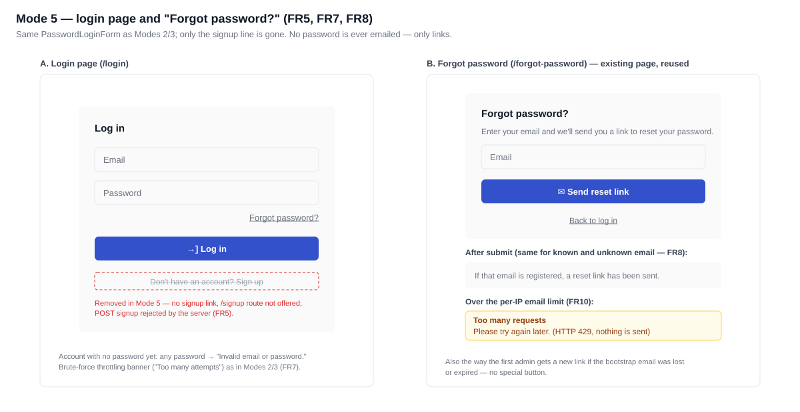
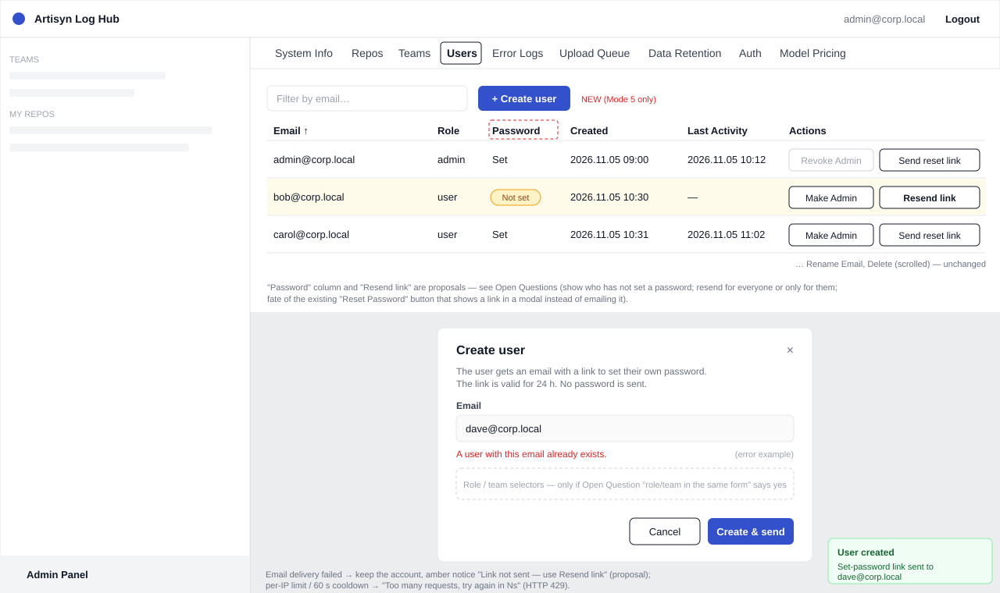
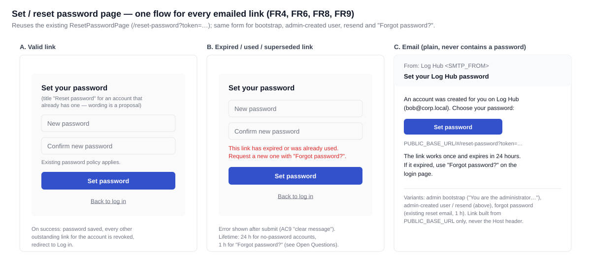

# 2026-11-05: Auth Mode 5 — Admin-Provisioned Users, Set-Password Links by Email

**Status:** todo
**Priority:** medium
**Type:** feature
**Module(s):** server | client
**Owner:** denis.tsyplakov
**Created:** 2026-11-05
**Tracker:** GH-101 https://github.com/DataArt/artisyn-log-hub/issues/101

## Description

A new, fifth `AUTH_MODE` next to the existing four (see
`docs/knowledgebase/authorization-and-authentificaiton.md`): a strictly manual access-management mode.
Nobody gets in on their own — there is no self-service signup and every account exists only because an
admin created it (or, for the first admin, because the config names it).

**No password ever travels by email.** Every way of getting a password — the first admin's bootstrap,
a new user created by the admin, "forgot password" — is the same thing: an emailed one-time link to the
set/reset-password form, where the user chooses their own password. A new account simply has no
password yet (`users.password_hash` is `NULL`, already supported), so "set the first password" and
"reset a forgotten password" are one flow. This reuses the existing Mode 2/3 machinery
(`password_reset_tokens`, `forgot-password` / `reset-password`, `MailService`, links built only from
`PUBLIC_BASE_URL`).

## Functional Requirements

- FR1 — A new `AUTH_MODE` value (Mode 5) is accepted by startup validation; Modes 1–4 and the
  "unset = Mode 2" default are unchanged. Mode 5 allows login, forgot-password, reset-password and
  change-password, and refuses signup, confirm-email and resend-confirmation. `GET /api/v1/auth/config`
  returns `passwordResetAvailable: true` and the configured admin email as `adminContactEmail`.
- FR2 — In Mode 5 the SMTP block (`SMTP_HOST`/`SMTP_PORT`/`SMTP_FROM`) is required and the relay must
  be reachable at startup, as in Mode 3; the server refuses to start otherwise. `PUBLIC_BASE_URL` is
  required too, since every way in is an emailed link.
- FR3 — In Mode 5 the initial admin's email is required in the config (env var); the server refuses to
  start without it.
- FR4 — Admin bootstrap: on start, if no account with the configured admin email exists, the server
  creates it with the admin role and no password, and emails it a set-password link. The account and
  its link are created during database initialisation under the migration lock. Only the process
  whose insert created the account sends the email, so a cluster sends exactly one.
- FR5 — Self-service signup is disabled in Mode 5: no signup form in the UI, and the signup endpoint
  rejects requests.
- FR6 — The admin panel has a way to create a user by email. The account is created with no password
  and the user is emailed a set-password link. The admin users list marks users who have not set a
  password yet; for those users only, the admin can resend the link.
  - `POST /api/v1/admin/users` `{ email }` → 201 `{ id, email, role, email_delivery: 'sent' | 'failed' }`;
    400 for a malformed email; 409 if the email already exists (case-insensitive), nothing sent.
  - `POST /api/v1/admin/users/:id/password-link` → 200 `{ email_delivery }`; 404 for an unknown id;
    409 if the user already has a password; 429 with `Retry-After` on the existing 60 s per-account
    cooldown or the per-IP limit (FR10).
  - Both are admin-only and exist only in Mode 5 (404 in other modes). If sending fails, the account
    is kept and the response reports `email_delivery: 'failed'`.
  - The existing `POST /api/v1/users/:userId/reset-password-link` (returns the link in the response)
    is refused in Mode 5 (404) and its UI action hidden; other modes keep it unchanged.
- FR7 — Users log in with email + password (the Mode 2/3 login form and brute-force protection apply).
  An account with no password cannot log in.
- FR8 — "Forgot password?" on the login page: the user types their email and, if an account with that
  email exists, gets a reset link. This is also how a first admin whose bootstrap email got lost (or
  whose link expired) gets a new one — no special button. The response never reveals whether the email
  exists.
- FR9 — The link opens a form where the user sets their own password (existing password policy). The
  link is single-use and time-limited; using it sets the password, and every other outstanding link for
  that account stops working. Lifetime depends on how the link was issued: **24 h** for admin
  bootstrap, admin-created user and admin "resend link"; **1 h** (existing) for "Forgot password?",
  whatever the account state.
- FR11 — No API key without a password: an account that has not set a password yet cannot get an API
  key by any path (it cannot log in to create one, and no admin path issues one for it), so its hook
  cannot send sessions until the user has set a password.
- FR10 — Rate limits on sending email: besides the existing per-account cooldown, a per-IP limit on
  every endpoint that triggers an email (forgot-password, admin "create user" / "resend link"). Over the
  limit the request is refused with HTTP 429 and nothing is sent. The limit is a relaxed safety net
  against an outright flood, not a tight control — a normal user or an admin onboarding a team never hits
  it: **20 emails per IP per hour**, a fixed constant in code (no env var).
  - One counter per IP, shared by forgot-password, admin "create user" and admin "resend link".
  - It applies on top of the existing `AuthRateLimitService` limits, which stay unchanged.
  - Every accepted request to these endpoints counts, before the account lookup (unknown emails,
    cooldown hits and send failures included), so a 429 never reveals whether an account exists.
  - Counted in memory per worker, like the existing auth limiter.

### Wireframes

## Non-Functional Requirements

- A password never appears in an email, a log line, an API response or the UI; only its hash is stored.
  Reset tokens are not logged either.
- Links are built from `PUBLIC_BASE_URL` only, never from the request's `Host` header.
- Backward compatibility: existing installs in Modes 1–4 keep working with no config change; an older
  hook works against a Mode 5 server unchanged.
- Offline first: works with a local SMTP relay, no internet dependency.

## Acceptance Criteria

- [ ] AC1 (FR1) — The server starts with `AUTH_MODE=<mode-5 value>` and a valid config;
      `GET /api/v1/auth/config` reports Mode 5. Existing modes behave as before.
- [ ] AC2 (FR2) — With Mode 5 and missing `SMTP_*` values, an unreachable relay or no
      `PUBLIC_BASE_URL`, the server refuses to start with an explicit error message.
- [ ] AC3 (FR3) — With Mode 5 and no admin email configured, the server refuses to start with an
      explicit error message.
- [ ] AC4 (FR4) — First start against an empty DB: an admin account with the configured email exists,
      and exactly one email with a set-password link (and no password) lands in the mailbox (Mailpit in
      tests). Following the link and setting a password lets the admin log in. A second start sends no
      email.
- [ ] AC5 (FR5) — In Mode 5 the login page shows no signup link/form and the signup endpoint rejects
      requests.
- [ ] AC6 (FR6) — An admin creates a user from the admin panel; the user gets an email with a
      set-password link, sets a password and logs in. "Resend link" sends a new link and the old one stops
      working. A non-admin cannot call these endpoints. The users list marks the new user as "password
      not set" until they set one, then the mark and "Resend link" disappear. Creating an existing
      email returns 409 and sends nothing; a failed send keeps the account and reports
      `email_delivery: 'failed'`. `POST /api/v1/users/:userId/reset-password-link` returns 404.
- [ ] AC7 (FR7) — Wrong-password attempts are throttled exactly as in Modes 2/3; an account that has not
      set a password yet cannot log in with any password.
- [ ] AC8 (FR8) — "Forgot password?" with an existing email delivers a reset link; with an unknown email
      it answers the same way and sends nothing. The first admin, after deleting the bootstrap email,
      gets a working link this way.
- [ ] AC9 (FR9) — A used link does not work a second time; an expired link is refused with a clear
      message; after a password is set through one link, older links for that account are refused. A
      bootstrap / new-user link still works after 23 h and is refused after 24 h; a "Forgot password?"
      link is refused after 1 h, also for an account that has no password yet.
- [ ] AC11 (FR11) — For an admin-created user who has not set a password yet, every API-key-issuing
      endpoint refuses to create a key for that account; once the user has set a password and logged
      in, they can create a key as usual.
- [ ] AC10 (FR10) — Against a single worker, from one IP, the first 20 admin "create user" requests
      within an hour (each a different email) are served; the 21st email-triggering request (create
      user, resend link or forgot-password, including forgot-password for an unknown email) gets HTTP
      429 and no email is sent. Another IP is not affected.

## Common sense considerations

- Mode 5 route gating and `/auth/config` fields follow the Mode 2/3 pattern (FR1).
- The 20/h email limit is one per-IP counter shared by all email-sending endpoints, on top of the
  existing `AuthRateLimitService` limits (FR10).
- The email limit is counted per worker in memory, like the existing auth limiter (FR10).
- Every accepted email-sending request counts toward the limit, before the account lookup (FR10).
- Link lifetime depends on the issuing path, not on the account state (FR9).
- The admin users list shows "password not set"; "Resend link" exists only for such users (FR6).
- The link-in-response admin endpoint is refused in Mode 5: every way in is an emailed link (FR6).
- Admin create/resend endpoints follow existing conventions: 409 on duplicate, `email_delivery` in the
  response, 429 + `Retry-After` on cooldown (FR6).
- Bootstrap runs in database initialisation under the migration lock; only the inserting process
  sends the email (FR4).

## Open Questions

- Name of the `AUTH_MODE` value (e.g. `admin-invite`) and of the admin-email env var — reuse
  `ADMIN_CONTACT_EMAIL` (Mode 3) or a new variable?
- Bootstrap when the configured admin email already exists as an account (e.g. switching an existing
  Mode 2 install to Mode 5): leave it as is, or make sure it has the admin role? What if the bootstrap
  email cannot be delivered — fail startup, or log it and rely on "Forgot password?"?
- What happens to existing self-registered accounts when an install switches to Mode 5 — they keep
  working, or does the admin have to approve them?
- Does creating a user also allow choosing role/team in the same form?
- Is `ALLOWED_EMAIL_DOMAINS` applied to admin-created users?
- Accounts auto-created in Mode 1 (none) or Mode 4 (azure-oauth) have no password but often already
  hold API keys their hooks use. After an install switches to Mode 5, should those existing keys keep
  working, or be refused until the user sets a password? And do such users get in through
  "Forgot password?"?

## Notes

<!-- Append timestamped notes here as work progresses -->

- The verbatim raw idea (English translation and Russian original) is in `notes.md`.
