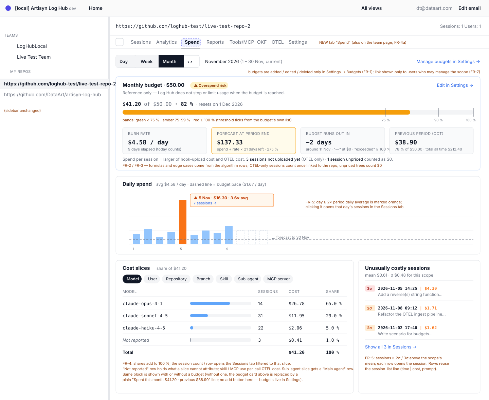
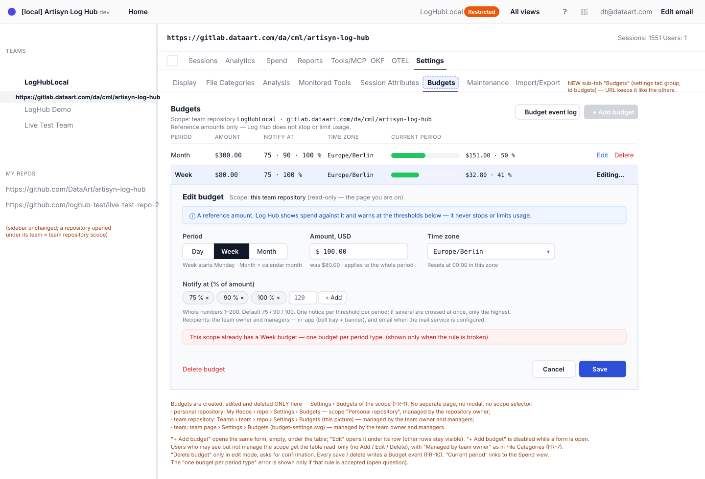
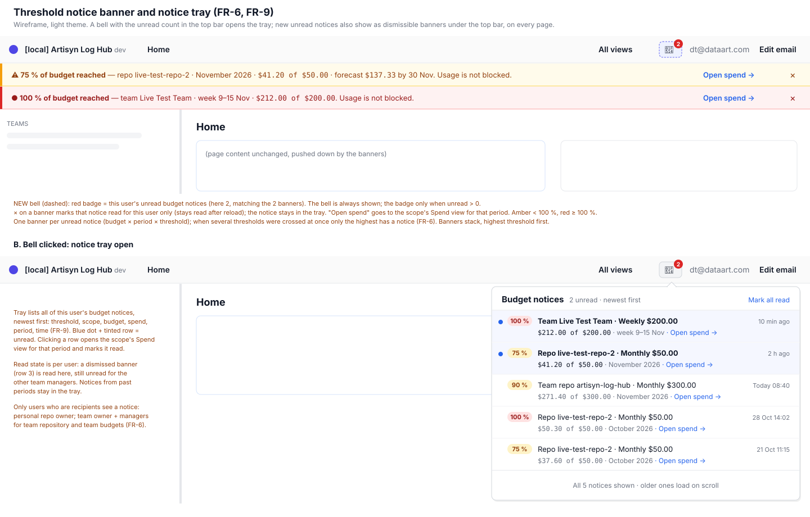
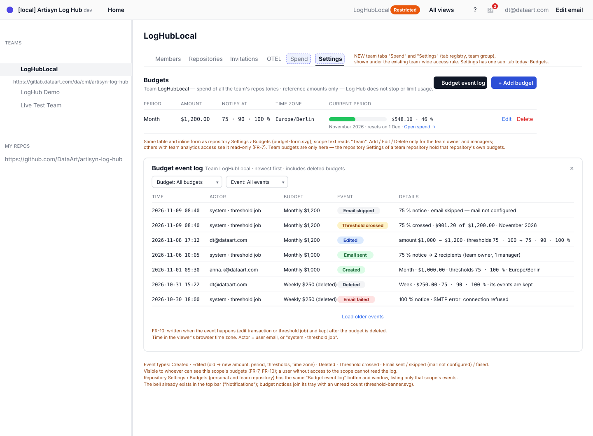

# 2026-11-05: Budgets, Spend Forecasts and Cost Slices (Display-Only)

**Status:** todo
**Priority:** high
**Type:** feature
**Module(s):** server, client
**Owner:** denis.tsyplakov
**Created:** 2026-11-05
**Tracker:** GH-102 https://github.com/DataArt/artisyn-log-hub/issues/102

## Description

Log Hub **cannot limit or block** Claude Code spend — it only sees what the hook uploads. So a
"budget" here is a reference number the app measures spend against: it shows where spend stands, where
it is heading, what drives it, and warns people before the number is reached. Nothing is stopped.

Budgets, alerts and burn rate are the top gap in the competitor parity study (10 of 14 tools ahead).
Competitor research: `docs/product-kb/competitive-research/budgets-forecasts-waiting.md` (what 18 tools
show, display vs enforcement) and `docs/product-kb/competitive-research/beezi.md`.

What competitors show that fits a display-only, offline product:

- Budget bar "$X of $Y · N % · resets <date>" with colour bands (ccboard 60 / 80, ccusage 70 / 90).
- Month-end forecast from the run rate with an early "overspend risk" flag (Beezi, New Relic,
  Jellyfish); nobody shows "days until the budget runs out" explicitly.
- Threshold notices at 75 / 90 % for the budget owner and 75 / 95 % for the user (Anthropic, GitHub),
  once per threshold per period (LiteLLM dedup).
- Cost slices: model, user, repo, branch, skill, sub-agent, MCP server, effort (Beezi, Claude Code
  `/usage`, Grafana dashboard 25255).
- Anomalies: a day ≥ 2× the average, sessions at 2σ / 3σ (ccboard), "high spend, low output" (Datadog).
- Current period next to the previous period and the total (LiteLLM, Anthropic MTD / QTD / YTD).

Context in the code base:

- Spend must come from the same cost math the rest of the app uses (`docs/knowledgebase/llm-call-math.md`,
  `docs/knowledgebase/algorithms/cost-formula.md`, `@loghub/pricing`). OTEL cost
  (`docs/knowledgebase/otel-tabs.md`) is the near-realtime source; it is Claude Code's own estimate
  (`cost_usd`), not the Log Hub price, and arrives before the hook upload.
- Metric scope: root + sub-agents, never double counted (`docs/knowledgebase/session-metrics-scope.md`).
- Data visibility: repositories are private to their owner, the admin role grants no session-data
  access, teams have their own access modes (`docs/knowledgebase/authorization-and-authentificaiton.md`).
- Analytics never reads transcripts per request (`docs/knowledgebase/server-conventions.md`).
- Branch-group cost already exists in the session list; a branch view is `2026-10-28-branch-summary-view`.

## Functional Requirements

- FR-1 A budget is a USD amount for a scope (personal repository, team repository or team) and a period
  (day, week or calendar month; week starts Monday). It is a reference only — the UI says that Log Hub
  does not stop usage when it is reached. Budgets are created, edited and deleted in a "Budgets" section
  of the scope's Settings: the personal repository's Settings tab, the repository's Settings tab in team
  context (team repository) or the team's settings. There is no per-user budget and no single org-wide
  budget for admins: different teams (or whole organisations, modelled as teams) get their own budgets.
  Each budget stores an IANA time zone
  (default: the creator's browser time zone at creation); its period boundaries, "resets on <date>"
  and daily buckets use it. A Spend view without a budget uses the viewer's browser time zone. A
  repository scope is stored by repository URL, like team repositories.
- FR-2 Spend for a budget is the total cost of the scope's sessions in the current period. Per root
  session tree (root plus all sub-agents) it takes the larger of the hook-upload cost (the app's
  existing tree cost) and the near-realtime OTEL cost (`otel_session_totals`, `cost_usd`), so a budget
  warns as early as possible. A missing side is ignored; a tree with neither counts $0 and the view
  shows "N sessions unpriced". The whole tree cost lands on the day the root session started (its
  first OTEL call for an OTEL-only session). A session with only OTEL data counts once its first upload
  links it to a repository (within seconds of the first prompt). Using the
  higher OTEL cost is a budget-only exception to "Log Hub's price is the source of truth", documented
  with rows in `docs/knowledgebase/algorithms/otel-cost-selection.md`.
- FR-3 Budget view per budget: a bar "spent of amount · % · resets on <date>" with colour bands, burn
  rate, linear forecast of spend at period end, "days until the budget runs out" at the current rate,
  and an "overspend risk" flag when the forecast exceeds the amount. The previous period's spend is
  shown next to the current one, with its % against the current amount. Formulas (new algorithm doc
  in `docs/knowledgebase/algorithms/` with a rows file): elapsed days = whole days so far including
  today; burn rate = spend / elapsed days; forecast = spend + burn rate × remaining days; days left =
  (amount − spend) / burn rate, "—" when burn rate is 0, "exceeded" when spend ≥ amount. The current
  amount applies to the whole current period, also after a mid-period edit.
- FR-4 Cost slices for a scope and period: by model, user, repository, branch, skill, sub-agent and MCP
  server, each with its share of spend; clicking a slice opens the matching sessions. Slices are
  available for any scope the user can see, with or without a budget (a "Spend" view); a budget only
  adds the bar, forecast and notices on top. Every slice sums to the budget spend (FR-2). Model, user,
  repository, branch and sub-agent use the tree cost; the sub-agent slice shows the root's own cost as
  a "Main agent" row; for an OTEL-only session the model slice uses OTEL's per-call model. Skill and MCP
  server attribute the OTEL cost of the calls made inside that skill / after that MCP call. Whatever a
  slice cannot attribute goes to a "Not reported" row, so shares always add up to 100 %.
- FR-5 Anomaly markers: a day whose spend is ≥ 2× the period's daily average, and the sessions whose cost
  is ≥ 2σ / 3σ above the scope's mean; each links to the sessions. Like slices, they are shown with or
  without a budget.
- FR-6 Threshold notices: each budget has its own editable list of percentage thresholds (whole
  numbers 1–200, default 75 / 90 / 100), saved with the budget. A periodic server job (every 5 min,
  never inside ingest) checks budgets. Crossing thresholds creates one shared notice record per budget,
  period start and threshold (unique key, so cluster workers cannot duplicate it; only the worker whose
  insert succeeds sends the email); when several are crossed at once only the highest gets a notice.
  Recipients: the owner for personal repository budgets; the team owner and managers for team
  repository and team budgets. Email is sent only when the mail service is configured. Notices already
  sent stay after an edit or if spend later drops; a threshold newly crossed after an edit fires once.
- FR-7 Who can create, see and edit a budget and who gets its notices follows the existing access rules.
  Personal repository budgets: the repository owner; spend counts only the owner's sessions. Team
  repository and team budgets: created and edited by the team owner and managers; the bar and slices are
  visible to whoever has team analytics access; spend counts sessions in that repository (team
  repository) or in all the team's linked repositories (team), limited to acknowledged members visible
  under the team's access mode.
- FR-8 Everything works offline: no external alerting service, no webhooks required.
- FR-9 Notice tray: a bell in the top bar with an unread count opens a tray listing all of the user's
  budget notices, newest first (scope, budget, threshold, spend, period, time), each linking to the
  scope's Spend view for that period. A new unread notice is also shown as a dismissible banner at the
  top of the app; dismissing the banner or opening the notice in the tray marks it read for that user
  only, and the notice stays in the tray. Read state is stored per user.
- FR-10 Budget event log: the personal repository, team repository and team Settings each have a
  "Budget event log" window listing that scope's budget events, newest first, with time and actor:
  budget created, edited (old → new amount, period, thresholds, time zone), deleted, threshold crossed,
  notice email sent / skipped (mail not configured) / failed. Events are written when they happen (the
  edit's transaction, or the threshold job) and are kept after the budget is deleted. The log is
  visible to whoever can see the scope's budgets.

## Non-Functional Requirements

- Offline first: in-app notices work when SMTP is not configured.
- Backward compatibility: older hooks need no update; budgets use data the server already has.
- Checking thresholds and computing forecasts must not slow down ingest or the session list.

## Acceptance Criteria

- [ ] FR-1 From the Settings of a personal repository, a team repository and a team, a user who may
  manage that scope can create, edit and delete a budget; amount, period, scope, thresholds and time
  zone persist; the budget view states that usage is not blocked.
- [ ] FR-2 A budget's spend equals the sum, over its scope's root session trees in the period, of the
  larger of each tree's hook-upload cost (as shown elsewhere in the app) and its OTEL cost; a session
  linked to the repository whose OTEL cost exceeds its upload cost counts at its OTEL cost; an unpriced
  session with OTEL cost counts at its OTEL cost.
- [ ] FR-3 For a budget with known spend on known days, burn rate, forecast and days-left match the linear
  formula (algorithm rows); the risk flag shows exactly when the forecast exceeds the amount; the
  previous period is shown.
- [ ] FR-4 Slice shares add up to 100 % of the period's spend; a slice links to its sessions.
- [ ] FR-5 A seeded day at 2× the average and a session above 2σ are marked; normal ones are not.
- [ ] FR-6 Crossing each of 75, 90 and 100 % creates exactly one in-app notice for that period (and one
  email when mail is configured); a dismissed banner stays dismissed after reload; the next period
  starts clean.
- [ ] FR-7 A user cannot see or edit a budget for a scope they have no access to (API contract row).
- [ ] FR-8 With SMTP unset, in-app notices still appear and nothing errors.
- [ ] FR-9 A crossed threshold shows in the tray with the unread count increased and as a banner;
  dismissing the banner clears the unread mark for that user only and the notice stays in the tray
  after reload.
- [ ] FR-10 Creating, editing and deleting a budget and a crossed threshold each add one event to the
  scope's Budget event log with time and actor; an edit shows old and new values; events of a deleted
  budget remain; a user without access to the scope cannot read its log (API contract row).

## Open Questions

- What does a plain member of a restricted team see of a team budget: nothing (they have no team
  analytics access), or only the bar with their own share — never the user slice or other members'
  sessions?
- Email is only set up in the password and password-confirm auth modes, so in auth mode `none` no
  notice email would ever be sent, even with an SMTP host set. Is that acceptable (in-app banners only),
  or should notice emails get their own SMTP setup independent of the auth mode?
- Out of scope for now (possible later increment): a 5-hour window view built from session costs.
- Rejected (user decision 2026-11-09): capturing the real subscription quota (5-hour / 7-day window %
  used) — it is only available through a status-line wrapper in the hook, which is complex and fragile
  (see the PoC in `notes.md`); actual plan billing vs API-equivalent cost — plan prices change
  too often, people see it in their vendor dashboard; what-if model pricing — different models solve the
  same task with very different numbers of calls, so re-pricing the same tokens is misleading.

## Common sense considerations

- Period boundaries use a time zone stored per budget, defaulting to the creator's browser time zone.
- A session tree's whole cost lands on the day its root started; it is not split per call.
- Burn rate counts today as an elapsed day; days left shows "—" at zero rate and "exceeded" at or over the amount.
- The current amount applies to the whole period; no amount history is kept, the previous period's % uses the current amount.
- A missing cost side is ignored; a tree with neither counts $0 and is reported as unpriced.
- Hook vs OTEL comparison is made once per root session tree.
- The budget uses the near-realtime OTEL totals, not the later durable `telemetry_cost`.
- The higher-OTEL rule is a budget-only exception, documented in the OTEL cost-selection algorithm doc.
- OTEL-only sessions count once their first upload links them to a repository.
- Every slice sums to the budget spend with a "Not reported" remainder row; skill / MCP use per-call OTEL cost.
- The sub-agent slice has a "Main agent" row; the model slice uses OTEL's model for OTEL-only sessions.
- Team spend = team repositories' sessions of acknowledged members visible under the team's access mode.
- Team budgets are managed by the team owner and managers; visible to whoever has team analytics access.
- A personal repository budget counts only its owner's sessions.
- Thresholds are an editable per-budget list of whole percentages 1–200.
- Team notices go to the team owner and managers, not plain members.
- Thresholds are checked by a periodic 5-minute job, never inside ingest.
- When several thresholds are crossed at once, only the highest gets a notice.
- A notice is one shared record per (budget, period start, threshold) with a unique key; read state is per user.
- Sent notices stay after edits or spend drops; a threshold newly crossed after an edit fires once.
- Email is sent only when the mail service is configured.
- A repository budget scope is stored by repository URL.
- Budget event log and tray times are shown in the viewer's browser time zone.
- Notice acceptance covers all default thresholds and dismissal persistence.

## Notes

<!-- Append timestamped notes here as work progresses -->

Scope history and the subscription-quota PoC findings: see `notes.md`.
