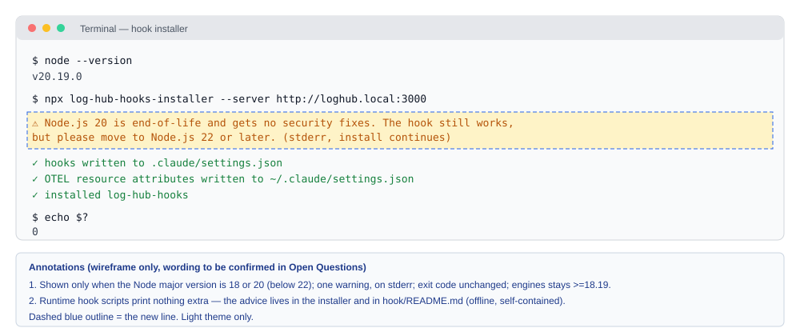

# 2026-11-09: Morning Check Follow-Ups — Fix and Verify

**Status:** todo
**Priority:** medium
**Type:** feature
**Module(s):** server | hook | ci | docs
**Owner:** denis.tsyplakov
**Created:** 2026-11-09
**Tracker:** GH-114 https://github.com/DataArt/artisyn-log-hub/issues/114

## Description

Umbrella task for the follow-ups from the morning check of 2026-11-09
(`docs/morning-check/daily/2026-11-09-1202.md`, local and gitignored). Each item says whether it is a fix, a
verification or a doc change, and gives a size estimate.

1. **FIX:** the nightly security-scans run
   [42470567545](https://github.com/DataArt/artisyn-log-hub/actions/runs/42470567545) failed.
   The actionlint row errored with "actionlint install failed" and the hadolint row errored with
   "no output". Fix the install steps in the security-scans workflow and re-run it. (S)

   Root cause: a transient HTTP 504 from github.com release downloads, which also failed the
   `snyk-oss` job; the hadolint "no output" row is a consequence of the failed install, not a
   separate bug. Fix: add
   `--retry 4 --retry-all-errors --retry-delay 5` to every release download — `security-scans.yml:191,
   727, 932, 1187` and `gitleaks.yml:38`. Versions and SHA-256 pins stay as they are.
2. **FIX:** Node.js has a security release due 2026-11-11 for 26.x, 24.x and 22.x, at up to
   HIGH severity
   ([announcement](https://nodejs.org/en/blog/vulnerability/november-2026-security-releases)).
   Once it lands, bump `node:26.13.0-alpine` / `-slim` in the Dockerfiles. Also check which
   Alpine version the image is on:
   - the musl `regcomp` heap overflow CVE-2026-107891;
   - a zlib heap overflow;
   - the OpenSSL issue CVE-2026-84782;
   - Alpine 3.21 went EOL on 2026-11-01.

   Current state (checked 2026-11-09): `node:26.13.0-alpine` is already on Alpine **3.24.4**
   (musl 1.2.6-r3, zlib 1.3.2-r1, libssl3/libcrypto3 3.5.9-r0), so the Alpine 3.21 EOL point
   does not apply to the runtime image.

   Places to bump (all of them, in one change):
   - `Dockerfile:5,18,29` (`-slim` build stages — Node version only, no OS-level CVE requirement)
     and `Dockerfile:52` (runtime) — pin the runtime to an explicit Alpine minor,
     `node:<new>-alpine3.24` (or the newest supported Alpine the release publishes);
   - `docker-dev/Dockerfile:48-49` — `NODE_VERSION` and a new `NODE_SHA256` from the release's
     `SHASUMS256.txt`;
   - `user-docs/component-reference.md:48`, `user-docs/third-party-components.md:16-17`,
     `docs/third-party-components.md:35`, `docs/knowledgebase/release-pipeline.md:31-32`, then
     `npm run build:help` to regenerate `client/public/help/`.

   CI `setup-node` uses `node-version: 26` (floating major) and needs no change.

   GH-107 (`2026-11-06-alpine-musl-crypt-upgrade`) tracks a different musl bug (`crypt()` on long
   passwords) that is still unfixed upstream. It stays open. This task bumps Node and pins the
   Alpine minor, and adds a dated line to GH-107's Notes with the new image tag and musl version.
   (S)
3. **FIX (verified):** since Claude Code 2.1.319, MCP tool calls can move to the background:
   in the terminal after 120 s (`CLAUDE_CODE_MCP_AUTO_BACKGROUND_MS`), at once for servers that
   support MCP tasks, and in `-p` only with `CLAUDE_AUTO_BACKGROUND_TASKS`. Log Hub currently shows
   such a call as an instant success.

   PoC [`docs/pocs/2026-11-09-1236-cc-bg-mcp-deny-policy/`](../../../pocs/2026-11-09-1236-cc-bg-mcp-deny-policy/)
   captured a real CC 2.1.319 session (`fixtures/bg-mcp.transcript.jsonl`, sanitized; timeline and
   pairing-demo output in `notes.md`). The transcript shape:
   - The `tool_result` arrives at hand-off without `is_error`; it is an acknowledgement
     "…moved to the background as task `<task-id>`…", and `toolUseResult` has no task id,
     duration or status field.
   - The late user entry `<task-notification><task-id>…</task-id><status>…</status>…<result>…</result>`
     (`origin.kind: "task-notification"`) has **no `<tool-use-id>`**; the task id in the
     acknowledgement is the only link back to the call.
   - `PostToolUse` fires at the acknowledgement; no hook fires for the late result.

   Fix:
   - For an `mcp__*` result, read the task id with `moved to the background as task (\S+)`.
   - Join it to the `<task-id>` of a later `<task-notification>` in the same session.
   - Take the result from `<result>`, the status from `<status>`, and the duration as
     notification time minus `tool_use` time. Add the duration as a new source ahead of the
     existing chain in `resolveToolDuration()`.
   - When no notification arrives, show the call as "background, no result" instead of `ok`.

   Where:
   - `server/src/logs/claude-extractor.ts:660-684` (`tool_use_id` → `tool_result` index);
   - `server/src/logs/tool-stats.ts:162-190` (`resolveToolDuration()`);
   - the client twin `client/src/viewer/pages/repository/session-log/log-parser.ts`;
   - `server/src/logs/claude-extractor.ts:151` and `server/src/logs/turn-walk.ts:117` (where the
     late notification arrives — it stays out of the prompt list);
   - the `<task-notification>` tag parsing in `server/src/logs/workflow-extractor.ts:181`. It is
     keyed on `<tool-use-id>`, so it is shared by making that tag optional, not reused as is.

   Old transcripts (no background acknowledgement) keep today's behaviour.

   Tests:
   - Algorithm: rows for "background MCP call: completed / failed / no notification" in
     `docs/algorithm-examples/tool-call-outcome.json` (doc `tool-call-outcome.md`).
   - Scenario: a new step in `tests/scenarios/view/s-sess-03.spec.ts`, next to 6a/8c, which
     already upload small `<task-notification>` sessions. It uploads a session built from the PoC
     fixture shape and checks the tool modal's status, duration and result. (M)
4. **VERIFY/DOC (verified):** Claude Code 2.1.319 adds `permissions.denyInsteadOfPrompting`. The
   same PoC (`fixtures/deny-policy.*`) found the following for one denied Bash call:
   - Hooks that fire: `PreToolUse`, `PermissionRequest` (no `tool_use_id`, as
     `hook/.claude/telemetry_tool/lifecycle-hook.js:146-149` notes) and `PostToolBatch` (its
     `tool_calls[]` carries the id and the denial text).
   - Hooks that do not fire: `PermissionDenied`, `PostToolUse` and `PostToolUseFailure`.
   - OTEL `claude_code.tool_decision`: `decision: "reject"`, `source: "config"`. This is the same
     source as a deny rule or an auto-allow, so OTEL cannot single out these denials. No schema
     change and no OTEL projection is useful here.
   - Transcript: the `tool_result` has `is_error: true`, `toolDenialKind: "permission-rule"` and
     `permissionDecision: {decision: "reject", source: "config", reasonType: "asyncAgent", reasonCode: "bashMiss:no-rule-match"}`.
     The server already reads `toolDenialKind` and counts the call as a denial, not a failure.

   This task writes these facts into `docs/knowledgebase/hook-system-overview.md`. No UI change:
   these denials keep today's "denied" rendering. (S)
5. **DOC:** PostToolUse now also runs after an interrupt, with a 10 s cap, and a hook still
   running at the cap is killed. Add a line about this to the hook-system-overview KB
   article. (S)
6. **DOC/UX:** hook users on Node 18 or 20 are on EOL lines that get no security fixes. Advise
   them to move to Node 22+ in the README and/or as an installer warning. Keep backward
   compatibility: `engines >=18.19` stays. (S)

   PoC [`docs/pocs/2026-11-09-1236-hook-node18-compat/`](../../../pocs/2026-11-09-1236-hook-node18-compat/)
   confirmed the current installer and hook work on Node 18.19, 20 and 22 (results in `notes.md`).

   Scope:
   - Docs: `user-docs/getting-started.md:8`, `user-docs/connect-repository.md:9` and
     `hook/INSTALL_HOOK.md:9-16` already say 18/20 are EOL. Add the same one-line "Node.js 22+
     recommended, 18.19 minimum" requirement to `hook/README.md`, `release-template/INSTALL.md` and
     `release-template/LOCAL-BUNDLE.md`.
   - Installer: a `warnIfNodeEol()` helper next to `warnIfClaudeCodeLikelyRunning()` in
     `artisyn-hooks-installer/src/install.ts` (called at :958, :1186, :1266). When the Node major is
     below 22, it prints one non-blocking line to stderr:
     `Warning: Node.js <version> is end-of-life and gets no security fixes. Log Hub hooks still work, but please upgrade to Node.js 22 or newer.`
     The exit code is unchanged, and the runtime hook scripts print nothing.
   - Verify with `node run.mjs 18.19 20 22` from the PoC folder after `npm run build:hooks-installer`,
     and record the summary lines in Notes.

   
7. **VERIFY/DOC:** sessions signed in through the Claude apps gateway send OTLP to the gateway
   instead of the local `OTEL_EXPORTER_OTLP_ENDPOINT`, unless a policy names the collector
   ([docs](https://code.claude.com/docs/en/claude-apps-gateway)). Check how Log Hub's OTEL ingest
   behaves for gateway sessions and document it. (S)

   From the docs: for `/login` gateway sessions the CLI sends OTLP/HTTP to the gateway, and the
   gateway relays it to the destinations in its `telemetry.forward_to` config. By default that is
   metrics only; logs and traces are opt-in per destination, and with no destination the data is
   discarded. Desktop sessions keep using the local `OTEL_EXPORTER_OTLP_ENDPOINT`. Log Hub's OTEL
   data for gateway sessions therefore arrives only when its receiver is a `forward_to`
   destination with logs enabled, or when a policy names it as the endpoint. Hook data and local
   transcripts are not routed through the gateway. The note goes into
   `docs/knowledgebase/otel-receiver.md`. The exact `telemetry` keys come from
   https://code.claude.com/docs/en/claude-apps-gateway-config. Nothing to verify live: a
   doc-based note is enough.
8. **Watch only:** HIGH SNYK-JS-URIJS-19963963 in `uri-js@4.4.1`, a dev dependency of the client,
   has no fix yet. No action until a fix ships.

## Functional Requirements

- FR1: The nightly security-scans workflow installs actionlint and hadolint reliably, and both rows produce real results.
- FR2: The Docker images use a Node.js version that includes the 2026-11-11 security fixes and a supported Alpine base.
- FR3: Log Hub records MCP tool calls that moved to the background (CC ≥ 2.1.319) with the result, status and duration of their `<task-notification>`, joined through the task id in the hand-off acknowledgement; a call whose notification never arrives is not shown as `ok`.
- FR4: How `denyInsteadOfPrompting` denials appear in hook, OTEL and transcript data is documented in the KB.
- FR5: The KB documents the PostToolUse-after-interrupt behaviour and its 10 s cap.
- FR6: Hook users on Node 18 or 20 are told to move to Node 22+, and the hook still runs on Node ≥ 18.19.
- FR7: The KB documents how OTEL ingest behaves for gateway sessions.

## Acceptance Criteria

- [ ] AC1 (FR1): Every github.com release download in `security-scans.yml` and `gitleaks.yml` retries on transient HTTP errors (`--retry 4 --retry-all-errors`). A re-run of security-scans completes, and the actionlint and hadolint rows in `REPORT.md` show pass or a non-empty finding list, never `error`. Real findings are triaged in Notes; they do not have to be zero.
- [ ] AC2 (FR2): Every place listed in item 2 references a Node release from 2026-11-11 or later; the runtime stage pins an explicit, supported Alpine minor (`-alpine3.2x`); the image builds; `docker run --rm <image> apk info -v` shows musl/zlib/OpenSSL versions no older than today's (3.24.4 baseline) and the nightly container scan has no open HIGH for them; GH-107 Notes has a dated line with the new tag.
- [ ] AC3 (FR3): For the PoC fixture shape, server and client show the notification's result, status (`completed`/failed) and duration (~10.1 s, not ~2.2 s); a background call without a notification is not `ok`; old transcripts are unchanged. Covered by `tool-call-outcome.json` rows and an S-SESS-03 step.
- [ ] AC4 (FR4): `hook-system-overview.md` lists the hooks that fire and do not fire for these denials, the `tool_decision` values (`reject` / `config`) and the transcript fields (`toolDenialKind`, `permissionDecision.reasonType`).
- [ ] AC5 (FR5): The hook-system-overview KB article mentions the 10 s PostToolUse cap after an interrupt.
- [ ] AC6 (FR6): `hook/README.md`, `release-template/INSTALL.md` and `release-template/LOCAL-BUNDLE.md` state "Node.js 22+ recommended, 18.19 minimum"; on Node < 22 the installer prints the item 6 warning to stderr and still exits 0; the PoC runner `node run.mjs 18.19 20 22` passes on every version.
- [ ] AC7 (FR7): A KB note describes where OTLP goes for gateway sessions and what Log Hub sees.

## Open Questions

None.

## Decisions

- No separate "denied (policy)" badge for `denyInsteadOfPrompting` denials: `permissionDecision.reasonType: "asyncAgent"` likely also marks headless runs without the setting, so the badge could mislabel them. Item 4 is KB documentation only.

## Common sense considerations

- Items 3 and 4 were verified on CC 2.1.319 installed locally in the PoC folder; the user's global CLI was not changed.
- Item 3 is fixed in this task, since FR3 already requires the real result; the scenario step uploads a fixture-shaped session, not a live CC run.
- A background MCP call's real result, status and duration come from its `<task-notification>`, not from the hand-off acknowledgement.
- Item 4 needs no OTEL projection or schema change: `tool_decision` cannot tell these denials apart.

- Item 1 root cause is a transient GitHub 504; the fix is curl retries on every release download, not new version/SHA pins.
- Real actionlint/hadolint findings do not fail AC1; they are triaged in Notes.
- Item 2 pins the runtime to an explicit Alpine minor so "supported Alpine" is readable from the Dockerfile.
- Item 2 checks the runtime image packages with `apk info -v`; the `-slim` build stages get the Node bump only.
- Item 2 bumps every Node version reference listed in the item, including shipped docs and `docker-dev/Dockerfile` with its SHA.
- If no Node image with the 2026-11-11 fixes is published, item 2 stays open and the other items may close.
- GH-107 (musl `crypt()`) stays open and separate; this task only adds a dated Notes line there.
- Item 6 warns only from the installer (stderr, exit code unchanged); runtime hook scripts never print it.
- Item 6's Node 18.19 check is the PoC runner recorded in Notes, not a new test (test policy).
- Item 7 is a doc-based KB note in `otel-receiver.md`; no live gateway test.

## Notes

<!-- Append timestamped notes here as work progresses -->

- PoC evidence for items 1, 3 and 6 (run log, transcript timeline, Node version results): see `notes.md`.
