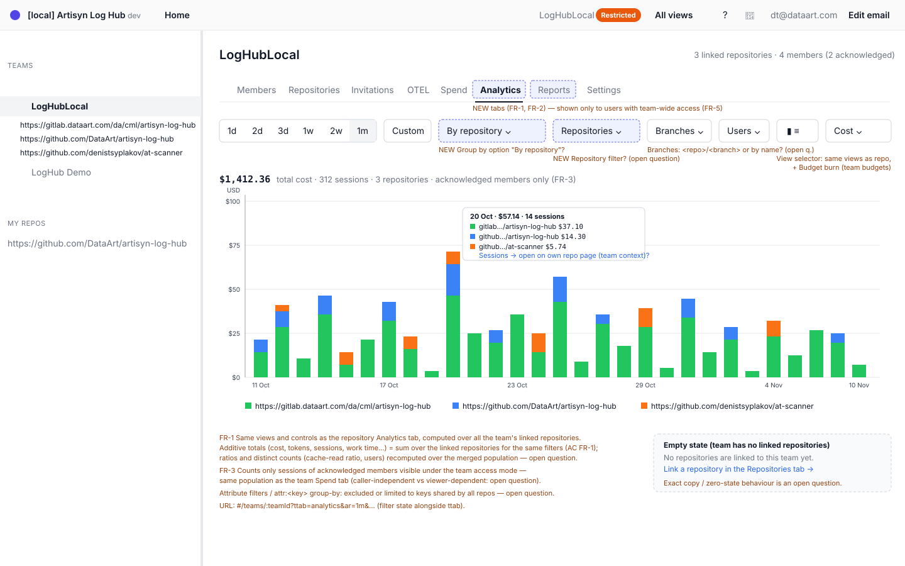
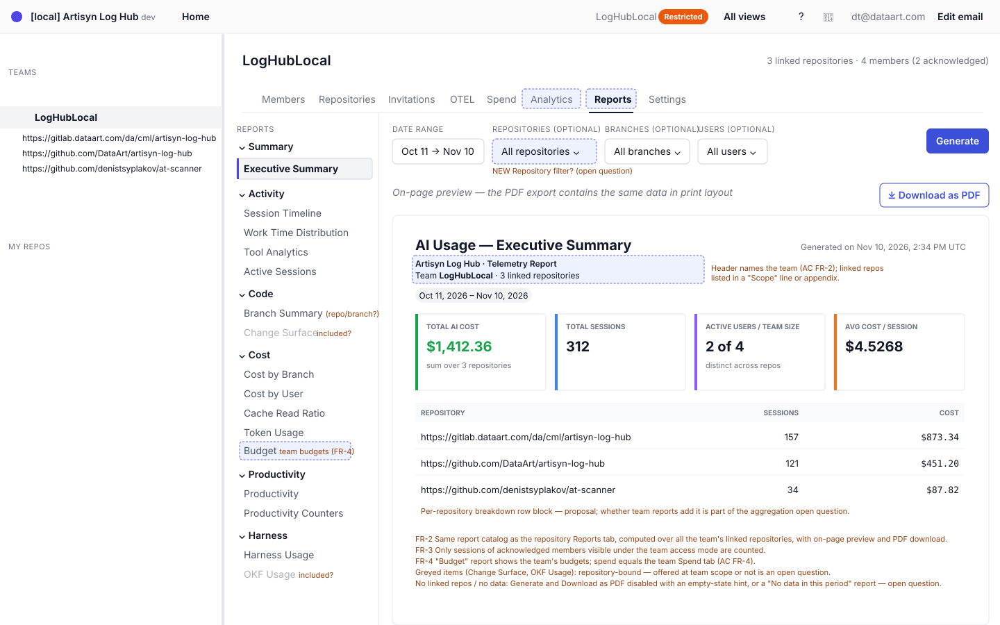
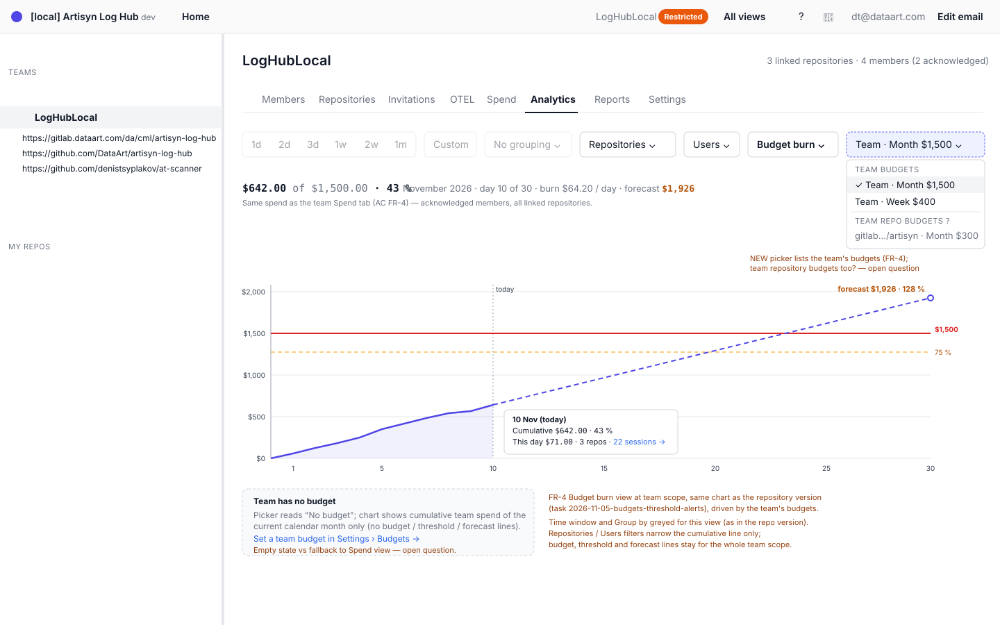

# 2026-11-10: Team Analytics and Reports Tabs

**Status:** todo
**Priority:** medium
**Type:** feature
**Module(s):** client, server
**Owner:** denis.tsyplakov
**Created:** 2026-11-10
**Tracker:** GH-119 https://github.com/DataArt/artisyn-log-hub/issues/119

## Description

Follow-up to 2026-11-05-budgets-threshold-alerts.

Team analytics and reports: the team page (`TeamDetailPage.tsx`, today only Members / Repositories /
Invitations / OTEL tabs) gets its own Analytics and Reports tabs that aggregate over all the team's
linked repositories (acknowledged members visible under the team access mode), including the Budget
burn view and Budget report for team budgets from 2026-11-05-budgets-threshold-alerts (which ships
them repository-only).

## Functional Requirements

- FR-1 The team page gets an "Analytics" tab with the repository Analytics views, computed over all
  the team's linked repositories.
- FR-2 The team page gets a "Reports" tab with the repository report catalog, computed over all the
  team's linked repositories, with on-page preview and PDF download.
- FR-3 Team-scope data counts the same caller-independent population as the team budget spend in
  2026-11-05-budgets-threshold-alerts (`resolveScopeRows({kind:'team'})`): in a transparent team every
  member's sessions, with no acknowledgement filter; in a restricted team the owner plus acknowledged
  members. The numbers are the same for every viewer.
- FR-4 The Analytics tab includes the Budget burn view and the Reports tab includes the Budget report,
  both for team-scope budgets only (team repository budgets stay on their repository page). The
  budget picker and the no-budget fallback follow budgets FR-4a.
- FR-5 The tabs are visible under the existing team-wide access rule.
- FR-6 Team data comes from new server-side whole-team routes, `GET /api/v1/teams/:teamId/analytics/<view>`
  and `GET /api/v1/teams/:teamId/reports/<id>`, one per included repository route, plus team variants
  of the filter value-list endpoints. Each takes the repository route's query params (minus
  `repoId`/`teamId`) and returns its response type. The client does not fan out per repository.
- FR-7 Aggregation: additive measures (cost, tokens, session count, work time, tool calls, files, log
  lines) are summed; ratios (e.g. cache-read ratio) are recomputed from the summed numerator and
  denominator; distinct counts (users, active sessions, Claude version shares, cost by user) count
  each user or session once across repositories.
- FR-8 Every session-level row, tooltip or bar in a team view shows the session's repository name and
  links to that session on its own repository page in this team's context (`teamId` kept); team
  routes return `repoId` and `repoName` with each session.
- FR-9 Team filter and Group by state lives in the team page URL next to `ttab`, with the same params
  as `analytics-url.ts`.
- FR-10 Empty states: with no linked repositories, the Analytics and Reports tabs show an empty state
  pointing to the Repositories tab and PDF download is disabled; with linked repositories but no
  counted sessions, views show their normal zero/empty state and a report still downloads with a
  "No data in this period" body.

## Acceptance Criteria

- [ ] FR-1 For additive measures, a team Analytics view's totals equal the sum over its linked
  repositories computed with the FR-3 population and the same filters.
- [ ] FR-2 A team report previews and downloads as a PDF, with the team named in its header.
- [ ] FR-3 In a restricted team, sessions of non-acknowledged members (other than the owner) are not
  counted, and the totals are identical for the owner, a manager and any other viewer with access.
- [ ] FR-4 The team Budget burn view and Budget report show the same spend as the team Spend tab.
- [ ] FR-5 A user without team-wide access does not see the tabs and gets an access denial from their
  endpoints (API contract row).
- [ ] FR-6 Every new team route has an API contract row in `server/test/contract/registry/`.
- [ ] FR-7 A team cache-read ratio equals the ratio over the union of the team's sessions, and a user
  active in two linked repositories is counted once in distinct-user counts.
- [ ] FR-8 Clicking a session in a team view opens it on its own repository page.
- [ ] FR-10 A team with no linked repositories shows the empty state on both tabs, with PDF download
  disabled.

## Open Questions

- Which Analytics views and which reports from the report catalog are included on the team page and which are left out, and for each included one how is it aggregated (plain sum, recomputed over the merged team population, or keyed per repository such as `<repo>/<branch>` for Branch summary and Cost by branch and `<repo>:<path>` for Change surface)? In particular, are repository-bound reports such as Change surface and OKF usage (with its per-repository recompute) offered on the team page at all?
- Which filters and Group by options do the team Analytics and Reports tabs offer: is there a new Repository filter and a "Group by repository" option; is the Branch filter qualified by repository (`<repo>/<branch>`) or merged by branch name across repositories; and are attribute filters and `attr:<key>` group-by excluded, or limited to attribute keys defined identically in every linked repository?

## Common sense considerations

- Team data comes from new server-side team routes, not a client fan-out: only the server can read team-scope budgets and deduplicate users and sessions across repositories.
- The population is the caller-independent team budget spend population, as FR-3 and AC FR-4 already require.
- Ratios are recomputed and distinct counts are deduplicated across repositories; only additive measures are summed.
- The team budget views cover team-scope budgets only, and a team with no budget falls back as in budgets FR-4a.
- A session in a team view shows its repository and opens on that repository's page in team context.
- Team filter state uses the existing `analytics-url.ts` params next to `ttab`.
- Empty states: no linked repositories → empty state pointing to the Repositories tab; no sessions → the normal zero state.

## Notes

<!-- Append timestamped notes here as work progresses -->
