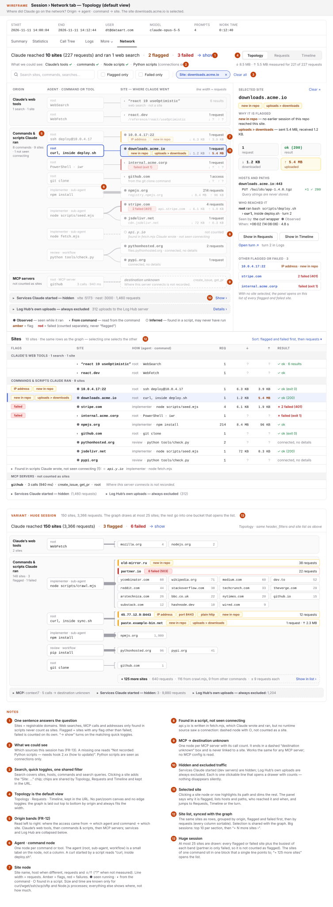
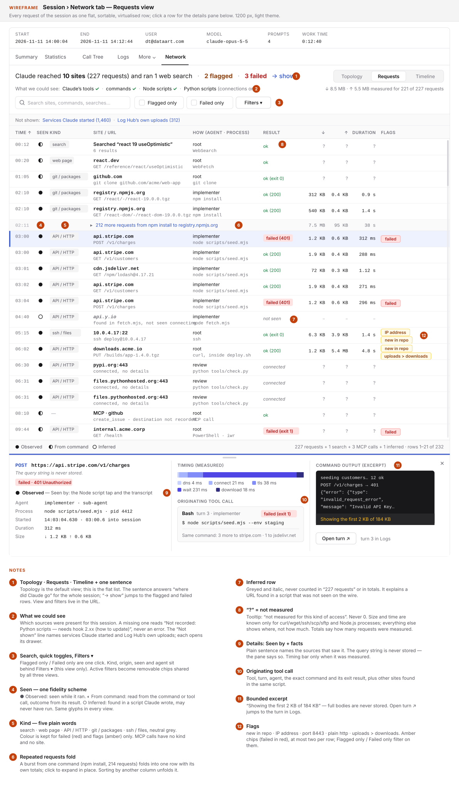
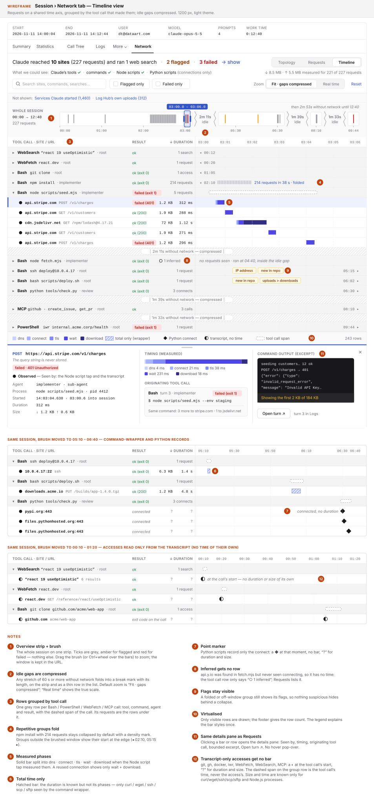
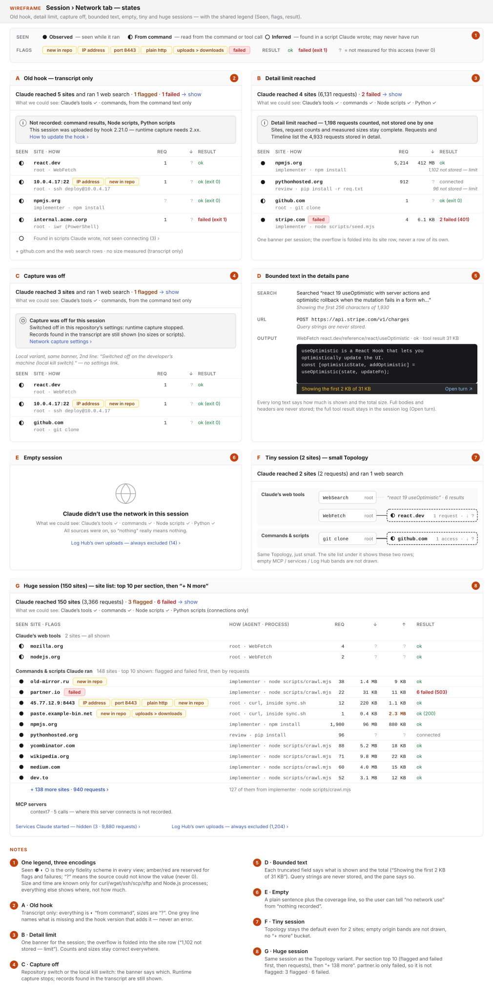
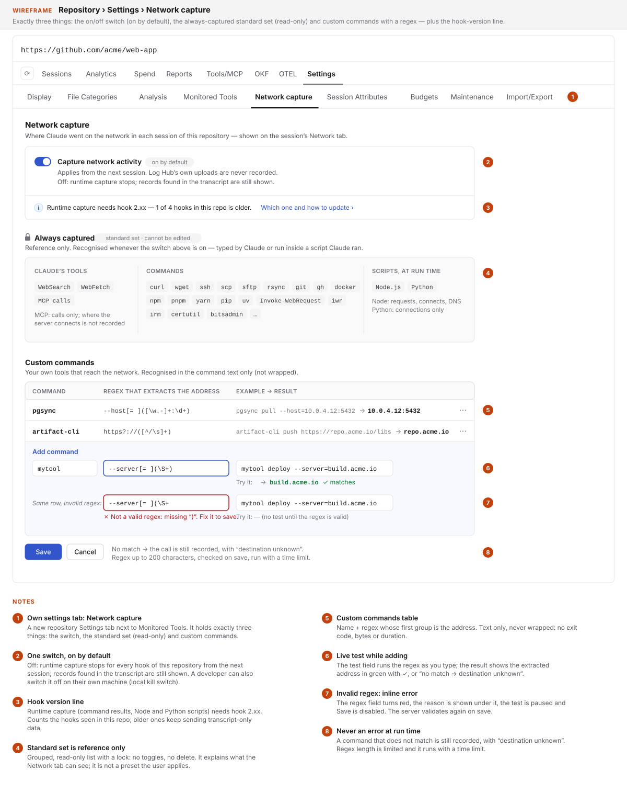

# 2026-11-11: Session Network Tab — Where the Agent Went on the Network

**Status:** todo
**Priority:** medium
**Type:** feature
**Module(s):** hook | server | client
**Owner:** denis.tsyplakov
**Created:** 2026-11-11
**Tracker:** GH-133 https://github.com/DataArt/artisyn-log-hub/issues/133

## Description

Show where Claude went on the network in a session and what it searched for — including accesses
made by Bash / PowerShell commands (`curl`, `ssh` and the like, on Windows and Linux) and by Node.js
and Python scripts — as a session "Network" tab (FR-6–FR-8) with destination, access kind, traffic
and duration per access. Data comes from four layers merged into one record per access (FR-1):

- **Layer 1 — transcript classifier** (server only, no hook change; FR-2). WebSearch / WebFetch / MCP
  calls and Bash / PowerShell command texts are already in the transcript. Recognised network
  commands: `curl`, `wget`, `ssh`, `scp`, `sftp`, `rsync`, `nc`, `telnet`, `ftp`,
  `Invoke-WebRequest`/`iwr`, `Invoke-RestMethod`/`irm`, `Start-BitsTransfer`, `certutil -urlcache`,
  `bitsadmin`, `git clone/fetch/pull/push`, `gh api`, `docker pull/push`, `npm`/`pip`/`uv` install.
  The static scan of agent-written scripts looks for URLs and network APIs (`fetch`, `http.request`,
  `requests`, `urllib`, `httpx`, `socket`).
- **Layer 2 — standard network tool set on the existing CLI tool wrapper** (hook ≥ 2.27.0, see
  `docs/knowledgebase/tool-monitoring.md`; FR-3). Bash shims are on the PATH via `$CLAUDE_ENV_FILE`,
  so calls made from scripts are captured too. Known limits: PowerShell wraps only command words of
  the command text; `Invoke-WebRequest` is a cmdlet and cannot be shimmed (layer 1 only); `ssh` shows
  the host and a remote command passed as an argument, not an interactive session.
- **Layer 3 — Node.js runtime tap** (FR-4). Subscribes to `diagnostics_channel`
  (`http.client.request.start` / finish, `undici:request:create` etc. for global `fetch`, `net` /
  `tls` connects, `dns` lookups) — no monkeypatching.
- **Layer 4 — Python runtime tap** (FR-5). Users' repositories use Python heavily, so it is in scope;
  it is product code (see Non-Functional Requirements).

Out of scope: a logging `HTTPS_PROXY` (not fail-open — a dead proxy kills the agent's network — and
it needs chaining to corporate proxies) and OS-level capture (ETW / eBPF / strace).

## Functional Requirements

- **FR-1 Network access record.** One unified record per network access in a session tree:
  destination (host, port, URL / path when known), access kind (`search`, `fetch`, `http`, `ssh`,
  `scp/sftp/rsync`, `git`, `package-registry`, `mcp`, `dns`, `socket`, …), source (`transcript`,
  `wrapper`, `node-tap`, `python-tap`), originating agent (root / sub-agent / workflow) and process
  (command / script), start time, duration, bytes in / out when known, status (ok / error / unknown).
  Unknown fields are explicitly "unknown", never 0. `sources` is a set (a merged record lists every
  source that saw it); its fidelity is the best of them: **observed** (wrapper / tap, measured at run
  time) › **from command** (transcript tool input / command text) › **inferred** (static scan).
- **FR-2 Layer 1 — transcript classifier.** Server-side extraction from transcripts: WebSearch
  (query; result domains when present), WebFetch (URL), MCP calls, Bash and PowerShell network
  commands from the list above with host / URL extraction, inline `node -e` / `python -c` scripts,
  and static scan of agent-written scripts that are later executed. Works for sessions uploaded by
  any hook version, including old ones.
- **FR-3 Layer 2 — standard network tool set.** `curl`, `wget`, `ssh`, `scp`, `sftp` (and the
  command list of FR-2) are a built-in standard set that is **always** captured while network
  capture is on — not a preset the user applies and not editable. Wrapper records of these tools
  join the layer-1 records of the same call (one record listing both sources) and add exit code,
  bytes and duration; unmatched wrapper records appear as indirect accesses.
- **FR-4 Layer 3 — Node.js tap.** On by default (FR-9): a preload injected via `NODE_OPTIONS` for
  Bash-tool child processes that records outbound HTTP(S) requests (method, host, path, status,
  bytes, duration, phases dns / connect / tls / ttfb / transfer), `fetch` requests and TCP/TLS
  connects, skipping loopback; per-process files under the hook work dir, uploaded with the existing
  upload mechanism. Never changes program behaviour or output; any failure inside the tap is
  swallowed. Load-safety rules proven by the PoC: the tap is loaded through
  `--import "data:…await import(<tap URL>).catch(()=>{})"` (a missing or half-written tap file must
  not kill `node`), the export in `$CLAUDE_ENV_FILE` is guarded by `[ -f <tap> ]`, the path uses
  forward slashes, an existing `NODE_OPTIONS` is appended to, and every channel subscriber / socket
  listener is wrapped in try/catch with no `'error'` listener added. Byte counts are per-request
  deltas of the socket counters. Minimum Node 22.
- **FR-5 Layer 4 — Python tap.** On by default (FR-9): a `sitecustomize` audit hook (Python ≥ 3.8)
  that records `socket.getaddrinfo` / `socket.connect` / `urllib.Request` / `http.client.send` /
  `socket.bind` events with host, port, URL and method when known, skipping loopback; same storage
  and upload path as FR-4; fail-open (every hook callback guarded, imports lazy). It chain-loads the
  next `sitecustomize` on `sys.path` so the user's / venv's own one still runs. Python has no response
  events: status, bytes in and duration are "unknown" and Python records are point markers.
  `python -I` / `-S` / `-E` bypass the tap (accepted).
- **FR-6 Session "Network" tab — Requests view.** A new session detail tab with three views:
  **Topology (default)** · Requests · Timeline. The Requests view lists FR-1 records with filters by
  kind, origin, fidelity, host, status and search; record details show the originating tool call
  and an "Open in session ↗" link to its turn.
- **FR-7 Topology view — the default.** Answers "where did Claude go" at a glance: origin groups
  (FR-12) → agent · process / tool → sites (registrable domain, expandable to hosts and paths),
  edges weighted by requests, flagged / failed sites highlighted, MCP servers ending in "destination
  unknown", hidden services and excluded Log Hub traffic as collapsed, inspectable groups; a synced
  site list under the graph; clicking a site filters the Requests and Timeline views.
- **FR-8 Timeline (waterfall) view.** A HAR-like waterfall as in Chrome DevTools Network: one row
  per access on a shared time axis, bar = duration (phases such as DNS / connect / TLS / wait /
  transfer where the tap knows them), columns destination, kind, status, size, time; zoom / brush on
  the axis. Records without a duration are shown as point markers; inferred records get no row.
  Rows are grouped by originating tool call (repetitive groups collapsed), idle gaps ≥ 60 s are
  compressed, and the list is virtualised.
- **FR-9 Configuration and kill switches.** Network data is collected **always** — taps (FR-4,
  FR-5) and the standard network tool set (FR-3) are on by default, not opt-in. Only a local kill
  switch (like `LOGHUB_TOOL_WRAP=0` / `toolWrap: false`) and the per-repository switch below disable
  them. The repository settings have a "Network capture" section with exactly three things:
  1. **On / off switch** — on by default.
  2. **Standard set — read-only reference.** The list of commands and tools that are always
     captured (FR-2 / FR-3), shown for information only; it cannot be edited or switched off
     separately.
  3. **Custom commands.** The user adds their own command name plus a regular expression that
     extracts the URL / address (host, optionally port and path) from the command text. Custom
     commands are recognised by the transcript classifier in the command text only — never wrapped
     (no exit code / bytes / duration; fidelity "from command"). The regex is
     validated on save (must compile, length-limited) and run with a safe engine / time limit so a
     bad pattern cannot hang the server; a non-matching command yields a record with "destination
     unknown", never an error.
- **FR-10 Backward compatibility.** Old hooks → transcript-only data (layer 1) with a hint that
  runtime capture needs a newer hook; new hook → old server: new upload kinds are stored inert and
  ignored, no failure; new fields are additive.
- **FR-11 Bounded text capture.** Network-related text (search results, fetched page bodies, command
  output, URLs with long query strings, request/response payloads) can be very large. The stored
  record keeps only metadata plus bounded excerpts: per-field truncation with an explicit
  "truncated, N bytes total" marker, per-session record and byte caps, and no full bodies in the DB.
  The DB must not grow unboundedly because of this feature. Caps (sized by the PoC, record ≈ 300 B):

  | What | Cap |
  |---|---|
  | URL excerpt (transcript) | 512 chars; taps never store the query string, only its length |
  | path (taps) | 256 chars + original length |
  | WebSearch query | 256 chars |
  | search results | result domains only, max 20, no snippet text |
  | WebFetch | URL only, no body |
  | command excerpt | 300 chars + "truncated, N bytes total"; the full text stays in the transcript |
  | wrapper network tools | capture mode `meta` (no stdout/stderr text); a merged record references the wrapper call, never copies its output |
  | headers / bodies | never |
  | per process (tap file, hook side) | 500 records / 256 KB, then a truncation marker + dropped count |
  | per session tap upload (hook side) | 2 MB, oldest processes dropped first |
  | per session tree stored records (server) | 2,000; ≈ 4 MB worst case |

  Caps are enforced on the hook before upload and again in the server extractor. Over the cap the
  first records are kept, the rest are folded into per-site counters (requests, bytes) and the tab
  shows one "N requests not stored in detail (limit)" banner.
- **FR-12 Separate the agent's own network access from the noise.** The goal is "where did Claude
  go", so the captured mix is sorted by origin:
  - **Agent tools** (WebSearch, WebFetch) — fully visible from the transcript, always shown.
  - **Agent-run commands and small scripts** (Bash / PowerShell commands, scripts the agent wrote
    and ran) — shown as the agent's access.
  - **Long-running services the agent started** (a dev server, a backend, a watcher — a process
    that listens on a port or outlives its Bash call) — their traffic is not the agent going
    somewhere; grouped as "service" and hidden by default, one toggle to show.
  - **Log Hub's own traffic** (the hook uploading to the Log Hub server, any request to the
    configured Log Hub URL, OTEL export) — always excluded: the taps skip the hook's own processes
    and the server drops records whose destination is the Log Hub URL of that hook.
  - **MCP servers** — shown from the MCP calls Log Hub already records: one entry per MCP server
    with its call count, tools used and timing (e.g. "Context7 — 5 calls"), and an explicit
    "destination unknown" — where the server itself goes on the network is not captured. No MCP
    config files are read and no per-server knowledge is built in: the same generic handling works
    for any MCP server on any user's machine.
- **FR-13 Best effort, never break.** The tab shows whatever is available for the session — any
  subset of sources, down to the transcript alone — and says which sources were present and which
  were missing (coverage line), instead of failing or showing an empty page when a source is absent.
- **FR-14 Traffic is known only where it is measured.** For most accesses only the destination is
  known; size and duration are never estimated. What each access can have:

  | Access | Destination | Result | Duration | Bytes ↓ / ↑ |
  |---|---|---|---|---|
  | WebSearch / WebFetch (transcript) | query / URL | from the tool result | from tool_use → tool_result | unknown |
  | MCP call (transcript) | unknown | from the tool result | from tool_use → tool_result | unknown |
  | `curl` / `wget` / `ssh` / `scp` / `sftp` (wrapper) | from the command | exit code | measured | measured (process I/O) |
  | Node.js process, incl. Node CLIs such as `npm` / `npx` (Node tap) | measured | HTTP status | measured, with phases | measured |
  | Python process, incl. `pip` (Python tap) | measured | unknown ("connected") | unknown | unknown (↑ per process only) |
  | `git`, `gh`, `docker`, `uv`, PowerShell `iwr` / `irm`, custom commands, other commands (transcript only) | from the command | exit code of the whole tool call | of the whole tool call, not of the access | unknown |
  | Inferred from a script | from the script text | — | — | — |

  The Bash call's duration and exit code belong to the tool call, not to the access, and are shown
  on the tool call, never as the access's own values. Byte totals in the tab header and on sites say
  how much of it was measured ("↓ 9.7 MB · ↑ 5.5 MB measured for 224 of 229 requests"); a site with
  no measured request shows `?`, never 0; edges in Topology are weighted by requests, not bytes. The
  `uploads > downloads` flag is set only from measured bytes. Whether `npm` traffic reaches the Node
  tap (npm runs on Node and inherits `NODE_OPTIONS`) is verified during implementation; if not, npm
  falls into the transcript-only row.

## Non-Functional Requirements

- Fail-open everywhere on the hook side: taps and wrappers must never change exit codes, output,
  timing noticeably, or break a program; a tap that cannot write simply records nothing.
- Privacy: query strings, headers and bodies are not captured by default (only host / path / method
  / status / sizes); search queries and URLs from the transcript are shown as the transcript already
  shows them. Visibility follows the Sessions tab rules.
- Offline first: no external lookups (no GeoIP / WHOIS / online DNS) on the server or client.
- Cross-platform: Windows (Git Bash + PowerShell) and Linux / macOS / WSL.
- The Python tap is product code: a `.py` file inside `hook/`, checked by Node-driven tests that
  spawn the user's `python` when present and skip otherwise; no Python tooling in the dev loop.
- Volume bounds per session: see the FR-11 caps table.
- Overhead budget (always on): ≤ 3 ms added per `node` start and ≤ 2 ms per `python` start; no
  measurable per-request cost for filtered (loopback) traffic. PoC measured +2.5–2.9 ms (Node) and
  +0.6–1.4 ms (Python).

## Acceptance Criteria

- [ ] AC-1 (FR-1, FR-2): A session with a WebSearch, a WebFetch, `curl https://example.com/x`, an
  `iwr https://…` in PowerShell, `ssh user@host ls` and `git clone https://github.com/…` shows six
  records with the right kinds and hosts, uploaded by an old hook (no wrapper, no taps).
- [ ] AC-2 (FR-2): `node -e "fetch('https://api.x.io/v1')"` and an agent-written `fetch.mjs`
  containing `https://api.y.io` that is then run with `node fetch.mjs` produce records for
  `api.x.io` and `api.y.io` marked as statically inferred.
- [ ] AC-3 (FR-3): With no configuration, a `curl` called from a bash script appears as an indirect
  record with exit code, bytes and duration; a direct `curl` is one merged record, not two. The
  settings show the standard set as a read-only list.
- [ ] AC-3a (FR-9): A custom command `mytool` with regex `--server[= ](\S+)` turns
  `mytool deploy --server=build.acme.io` into a record for `build.acme.io`; an invalid regex is
  rejected on save; turning the repository switch off stops network capture from the next session.
- [ ] AC-4 (FR-4): With the Node tap on, a script doing `fetch` and `https.get` to two hosts yields
  two records with status, bytes and duration; loopback requests are absent; the script's stdout and
  exit code are byte-identical to a run with the tap off.
- [ ] AC-5 (FR-5): With the Python tap on, a script using `urllib.request` and a raw socket yields
  records for both destinations; an existing user `sitecustomize` still runs; output and exit code
  are unchanged.
- [ ] AC-4a (FR-4): With the tap file deleted or replaced by a file with a syntax error, every
  `node` command in the Bash tool still runs with unchanged output and exit code.
- [ ] AC-6 (FR-6–FR-8): The session Network tab opens on Topology and shows Topology, Requests and
  Timeline for the same records; clicking a site in Topology filters the other views; a record links
  back to its turn in the Logs tab.
- [ ] AC-9 (FR-11): A session with a 10 MB WebFetch, a Node script making 50,000 requests and a URL
  with a 20 KB query string stores no body, no query string, at most the capped records, and shows the
  "not stored in detail (limit)" banner with per-site counters.
- [ ] AC-10 (FR-12): Requests from the hook to the Log Hub server and from a dev server the agent
  started (listening on a port) do not appear among Claude's accesses; the collapsed "Log Hub" and
  "Services" groups show their counts.
- [ ] AC-7 (FR-9): Taps are on by default; turning the local kill switch on disables them in the
  next Bash command without errors.
- [ ] AC-8 (FR-10): Old hook → new server shows layer-1 data plus a "newer hook needed for runtime
  capture" hint; new hook → old server uploads succeed and nothing breaks.

## Open Questions

_None._

## Common sense considerations

- Session tab only — no repository- or team-level Network report (user decision: it makes no sense there).
- Custom commands are recognised in the command text only, never wrapped (user decision: a wrapper is fragile).
- The repository switch off stops runtime capture (taps, network wrapping) on the hook; transcript-derived records are still shown, since the transcript is uploaded anyway.

- Taps and the standard tool set are on by default everywhere (FR-4, FR-5, AC-7 aligned with FR-9).
- Local kill switch for the taps: env `LOGHUB_NET_TAP=0` / hook config `netTap: false`, separate from `toolWrap`.
- The repository "Network capture" switch and custom commands are additive fields of the repository / team tool-monitoring config, editable by the roles that edit Monitored Tools, delivered to the hook as optional fields of `GET /api/v2/tool-monitoring/config`; an old hook ignores them.
- "Pause all wrapping" does not pause the taps; network capture has its own switch.
- The standard network set is implicit in the hook and server, never written into repositories' monitored-tools lists.
- Existing `NODE_OPTIONS` / `PYTHONPATH` are appended to, never replaced or skipped.
- The PowerShell tool's existing pre-command prefix also sets the tap environment, so PowerShell-started `node` / `python` are captured.
- The tool-wrapper's own `node tool-wrap-tee.js` runs with `LOGHUB_NET_TAP_SKIP=1`; the hook passes the Log Hub server and OTEL receiver addresses as `LOGHUB_NET_TAP_EXCLUDE`; the server drops Log Hub-bound records again.
- A process that listens on a port or lives longer than 30 s is tagged `service`; its traffic to loopback is hidden, to other hosts it is shown with a `service` badge.
- Storage: a separate derived table (`session_network_access`, one row per access) filled by the existing tool-usage rebuild drain, not `session_tool_usage`.
- Existing sessions get layer-1 records through a new extractor version that queues them for the existing rebuild; purge cascades; export / import skips the derived table and rebuilds it; recompute marks trees stale.
- Tap data travels as new NDJSON line types `net_access` and `net_tap_status` (`schemaVersion: 1`) in the existing per-session tool-calls upload; old servers store them inert, old parsers skip unknown line types.
- "Newer hook needed for runtime capture" is shown when a session has no `net_tap_status` line.
- Tap record fields: pid, ppid, process kind (`script` / `service`), argv0 + script path (≤ 300 chars), cwd, start / end, host, port, method, path, status, bytes in / out, phases.
- A tap record is attributed to the Bash / PowerShell tool call whose time window and process ancestry contain it; otherwise it is an "inside a script" record of the root agent.
- Merging: a wrapper call joins its transcript record by tool-use id; a runtime record replaces an inferred one for the same host in the same tool call.
- API: `GET /api/v1/sessions/:sessionId/network` (records + site aggregates + coverage + hook capability) with Sessions-tab visibility and a contract-registry row; Topology, Requests and Timeline are computed on the client from that response.
- Sites are registrable domains from a bundled offline public-suffix list; IPs and single-label hosts are shown as is.
- Flags (new in repo, IP address, unusual port, plain http, uploads > downloads, failed) are computed on the server from the session and earlier sessions of the same repository.
- PoC: [docs/pocs/2026-11-11-1833-network-capture/](../../../pocs/2026-11-11-1833-network-capture/README.md) — both taps work fail-open with ~1–3 ms startup cost; the one always-on hazard (a missing `--require` file kills `node`) is solved by the `--import data:` loader; 30 % of transcript-visible accesses on real data are loopback, so noise separation is essential.

## Notes

<!-- Append timestamped notes here as work progresses -->
Review history and the original raw idea: [notes.md](notes.md).
