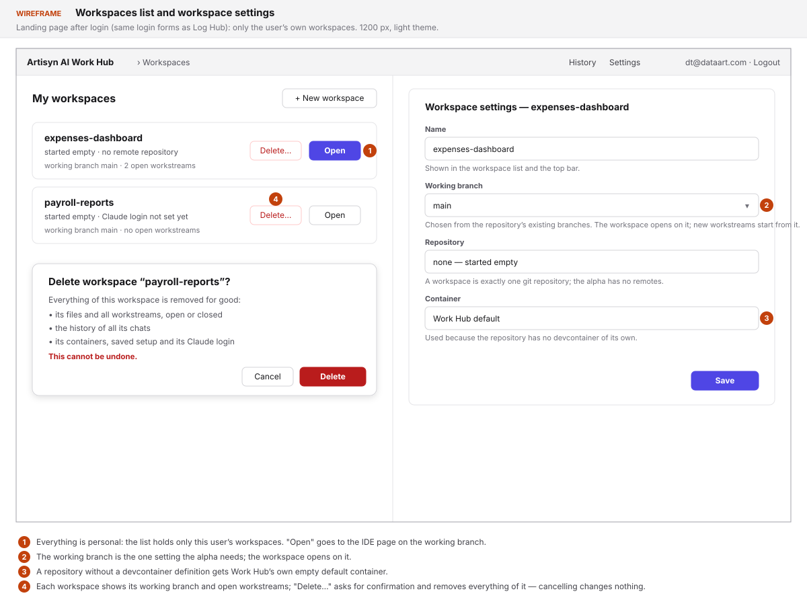
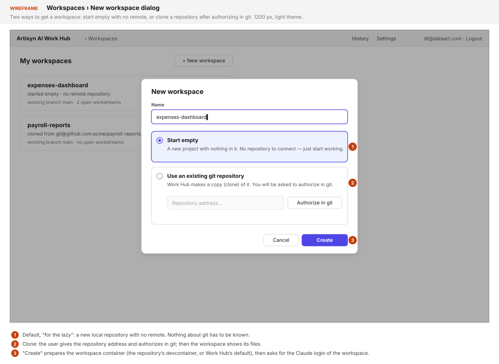
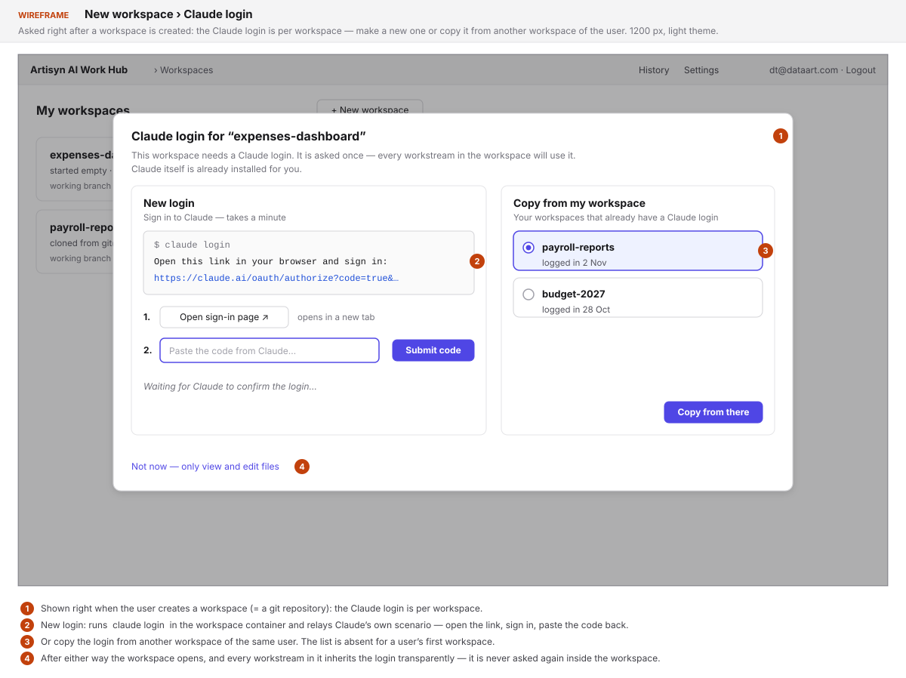
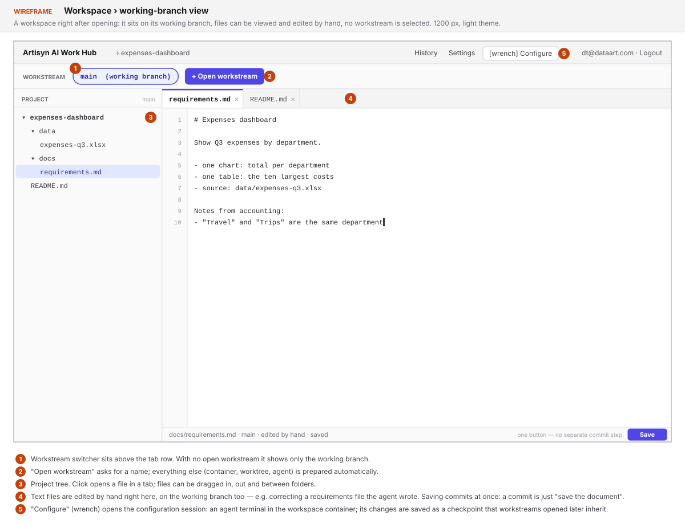
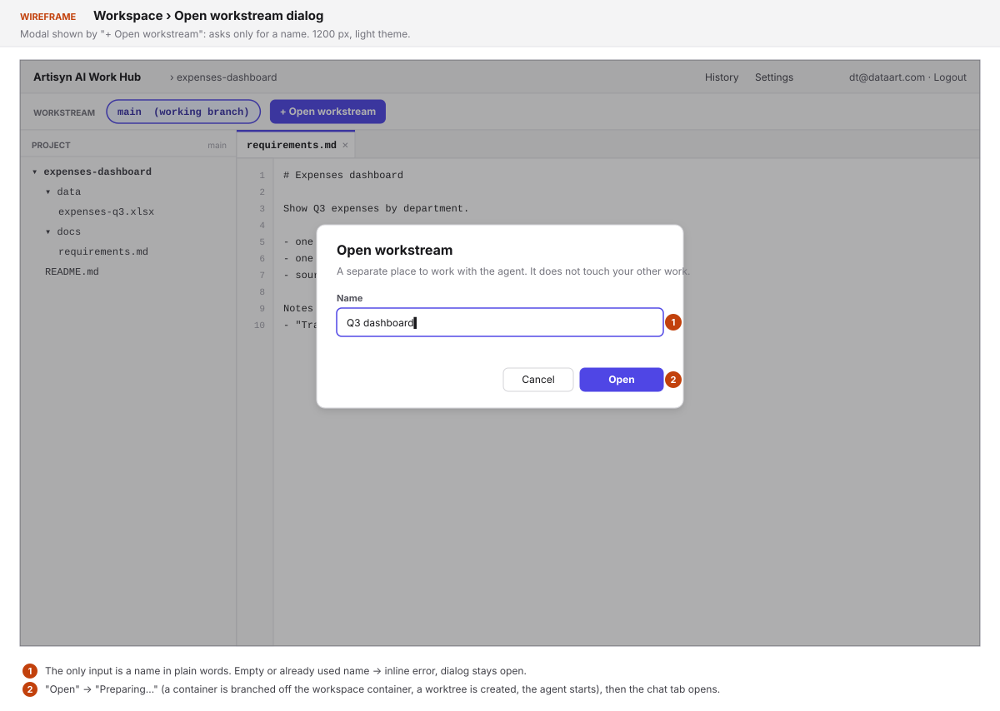
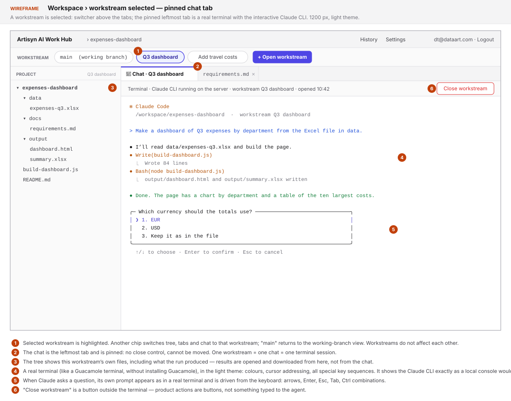
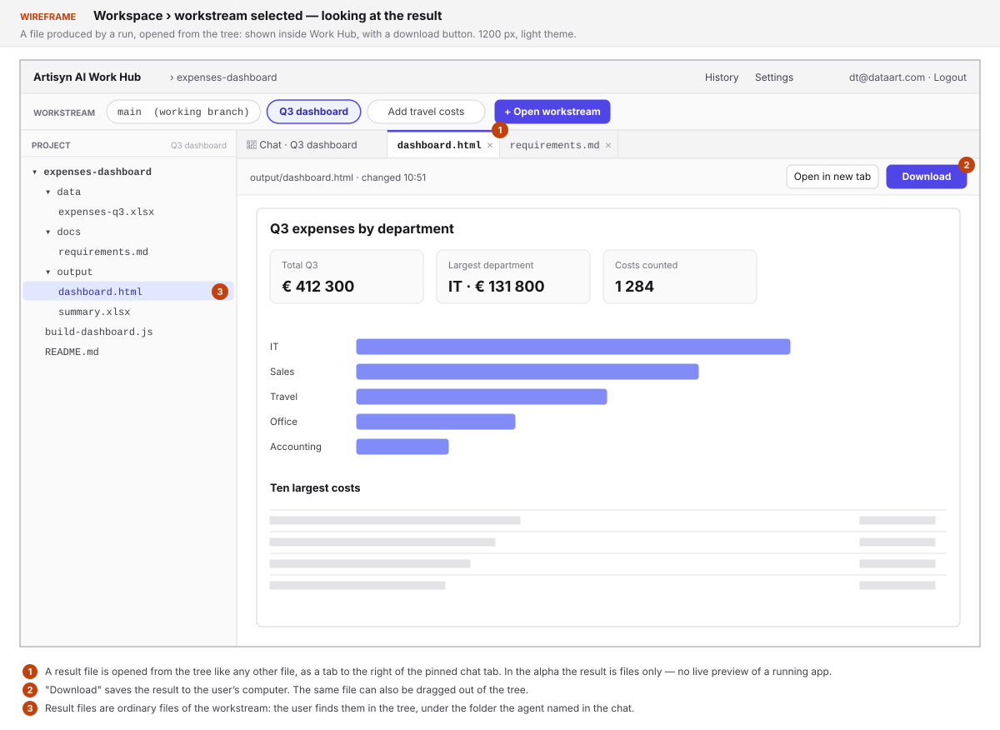
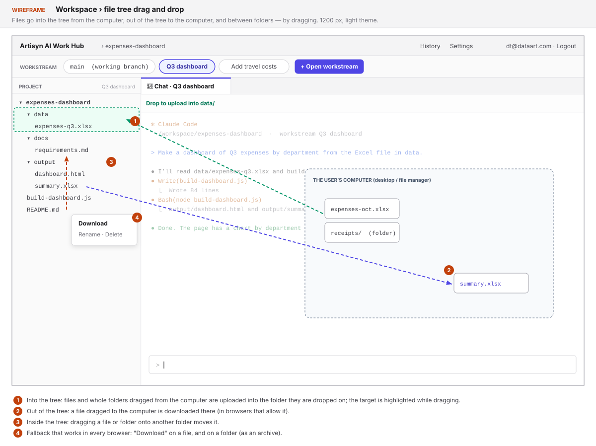
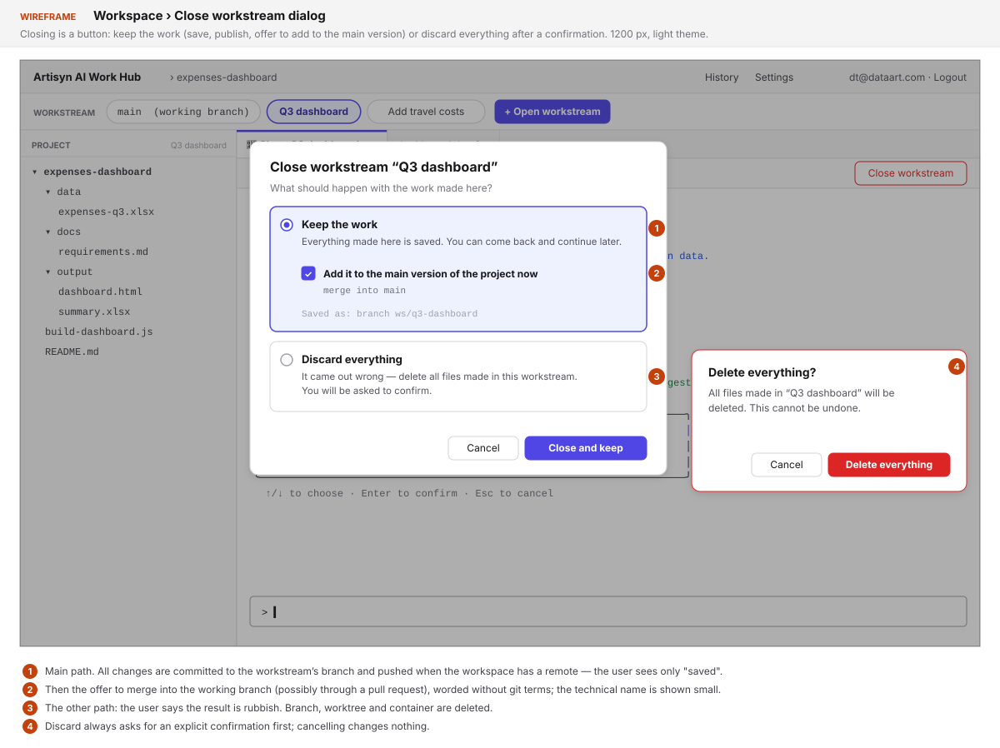
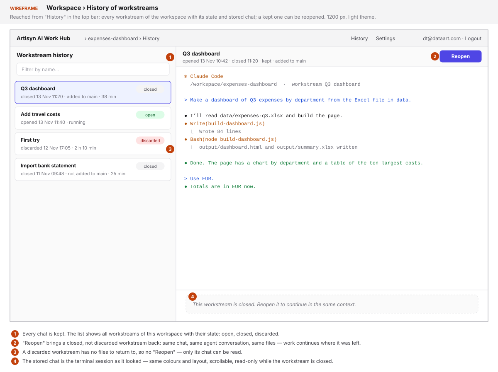

# 2026-11-13: Artisyn AI Work Hub — Alpha

**Status:** todo
**Priority:** medium
**Type:** feature
**Module(s):** work-hub (new sub-product in `work-hub/`: Rust backend, React frontend, Postgres)
**Owner:** denis.tsyplakov
**Created:** 2026-11-13
**Tracker:** GH-142 https://github.com/DataArt/artisyn-log-hub/issues/142

## Description

Add one more service to this repository: **Artisyn AI Work Hub**. Raw idea, as given:

> I start the service and log in (the same login modes as Log Hub). A workspace there == a git
> repository. It is a kind of web IDE with an IDEA-like layout: I can open files, view them, and
> edit the ones that are text. I can create a workstream — it is ONE chat with an agent that works
> in a worktree and runs on the server.
>
> The server must be agnostic and use devcontainers. For now this is strictly alpha functionality —
> more features come later.
>
> Workstreams: a switcher at the top, above the tabs; the workstream's chat window is the leftmost
> tab in the tab row, pinned.
>
> Flow: I open a workspace, it sits on the working branch (say `main`, set in the settings). I can
> look at files. I press "Open workstream" — it asks for a name, a worktree is created
> automatically in the container and the chat looks at it; I chat, and I can tell it to close.
> BUT all chats are remembered and I can look at the history later.
>
> Authorization is inherited.
>
> Tech stack: Postgres, Rust BE, React FE.

### Reference scenario

Keep this simple scenario in mind for every decision:

> A woman from accounting opens a workspace, and in it we build a dashboard application. She knows
> nothing about code and nothing about git. The basic flow is very simple: she made an area
> (workspace), opened a stream of work there, said what she needs — and the code was made for her.
> IMPORTANT: if asked, the agent runs the code, and she can look at the result and download it.

Expected outcome of the alpha: a user who knows neither code nor git logs in, creates a workspace,
opens a named workstream, tells the agent what they need, has the agent run the result, looks at it
and downloads it, then closes the workstream keeping (or discarding) the work — and can come back
to the same workstream later. Files can be dragged into and out of the file tree. Everything
git-related happens behind plain buttons.

## Terms

- **Workspace** — one git repository registered in Work Hub, personal to the user who created it.
  Has a *working branch* (e.g. `main`) set in its settings.
- **Workstream** — a named unit of work inside a workspace: exactly one chat with one agent, bound
  to its own git worktree and its own container. States: open, closed (can be reopened),
  discarded (deleted, only its chat remains).
- **Workspace container** — the devcontainer of a workspace. Holds the repository on the working
  branch and the workspace's Claude login.
- **Workstream container** — a container branched off the workspace container when a workstream is
  opened; the workstream's worktree and agent live in it.
- **Working-branch view** — the workspace with no workstream selected: the files of the working
  branch.

## Functional Requirements

### Sub-product and stack

- FR-1. Work Hub is in fact a separate sub-product. It lives in `work-hub/` in this repository,
  with its own backend (Rust), its own frontend (React), its own Postgres storage, its own tests
  inside that folder and, later, its own release. It starts and runs independently of Log Hub.
- FR-2. The server is agent-agnostic: in principle the agent can be any — the agent that a
  workstream chat talks to is behind an adapter, and nothing outside the adapter depends on a
  concrete agent. The alpha ships and is tested with one agent: Claude Code.
- FR-3. The server uses devcontainers as the execution environment. There is one workspace
  container per workspace. Every workstream gets its own workstream container, branched off the
  workspace container at the moment the workstream is opened: it starts from the workspace
  container's state at that moment, and the two diverge from then on (later changes on the working
  branch do not appear in already open workstreams).
- FR-4. Workstreams are isolated from each other: files, processes and the agent of one workstream
  are not visible to and cannot be disturbed by another workstream or by the working-branch view.
- FR-5. Everything is personal: a user sees only their own workspaces, workstreams, chats and
  containers; nobody sees anybody else's. Users never share a container.

### Login

- FR-6. Work Hub organises authentication the same way Log Hub does — the same login modes (the
  four `AUTH_MODE`s, see `docs/knowledgebase/authorization-and-authentificaiton.md`) and the same
  overall design. The inheritance is logical, not by code: Work Hub re-implements that design in
  its own backend and shares no auth code, session or database with Log Hub. It has its own users
  table, and its users are separate from Log Hub's users.

### No code or git knowledge needed

- FR-7. The basic flow — create a workspace, open a workstream, say what is needed, look at the
  result, download it, close the workstream — can be completed by a user who knows neither code
  nor git: nothing in it requires typing a command or understanding a git term.
- FR-8. Actions are buttons wherever possible (open, close, reopen, keep, discard, run-result
  view/download, authorize) — the user is not expected to type an instruction to the agent to
  trigger a product action.

### Workspace

- FR-9. A workspace corresponds to exactly one git repository. Any logged-in user can create their
  own workspace in one of two ways:
  - **clone** an existing remote repository — the user is asked to authorize in git for it;
  - **start empty** ("inline", for the lazy) — a new local repository with no remote.
- FR-10. If the repository has no devcontainer definition, Work Hub adds its own empty default
  one, so a workspace always gets a container.
- FR-11. A workspace has settings; the alpha needs at least the **working branch** (e.g. `main`).
- FR-12. Opening a workspace shows it on its working branch, with no workstream selected.

### IDE page

- FR-13. The workspace page has an IDEA-like layout: a project file tree on the left, an editor
  area with a row of tabs on the right.
- FR-14. The user can open any file from the tree in a tab and view it.
- FR-15. Text files can be edited and saved by hand — both in a workstream and directly in the
  working-branch view. (The point: the agent writes a document such as a requirements file, and
  the user goes in and corrects it by hand.) Non-text files are view-only.
- FR-15a. Saving a hand edit commits it right away, on whatever branch the user is on — a commit
  is simply the equivalent of "save the document"; there is no separate "save without commit"
  and no staging in the alpha. (A finer mode for advanced users may come later.)
- FR-16. A workstream switcher sits at the top, above the tab row. It lists the workspace's open
  workstreams, shows which one is selected, and has the "Open workstream" action. It also lets the
  user go back to the working-branch view.
- FR-17. When a workstream is selected, its chat is the leftmost tab of the tab row and is pinned:
  it cannot be closed or moved, and file tabs open to the right of it.
- FR-18. When a workstream is selected, the file tree and file tabs show that workstream's
  worktree, not the working branch.

### Drag and drop in the file tree

Wanted very much; support it as far as browsers allow.

- FR-19. **Into the tree:** files and folders dragged from the user's computer onto the tree (onto
  a folder or the root) are uploaded to that place. The drop target is highlighted while dragging.
- FR-20. **Out of the tree:** a file dragged from the tree to the user's computer is downloaded
  there. Where the browser cannot do that, the same result is always available by a "Download"
  action on the file (and on a folder, as an archive).
- FR-21. **Inside the tree:** a file or folder dragged onto another folder is moved there.

### Agent authorization (Claude Code)

- FR-22. Claude Code is already installed for the user in their containers; the user installs
  nothing.
- FR-23. The Claude login is per workspace, i.e. per git repository. Everything inside the
  workspace inherits it transparently: every workstream opened in the workspace — its container
  and its agent — is already authorized, and the user is never asked again inside a workspace.
- FR-24. The question comes right when the user creates a workspace: "this workspace needs a
  Claude login" with two ways to get one —
  - **a new login**: `claude login` is started in the workspace container, and the user is led
    through Claude's own authorization scenario inside Work Hub (open the link, sign in, hand the
    code back) until Claude reports it is logged in;
  - **copy from one of my workspaces**: the user's other workspaces that already have a Claude
    login are listed, and the login is copied from the one they pick, with no new sign-in.
- FR-25. A user with no other authorized workspace is offered only the new login. If the step is
  skipped or fails, the workspace still opens for viewing and editing files, the same question
  stays available in it, and opening a workstream leads back to it.

### Workstream lifecycle

- FR-26. "Open workstream" asks for a name. On confirm, the server automatically branches a
  workstream container off the workspace container, creates a git worktree for the workstream in
  it, starts the agent there with that worktree as its working directory, and the UI switches to
  the new workstream with its chat tab in front.
- FR-27. A workstream has exactly one chat. The agent runs on the server, in the workstream
  container, not in the browser.
- FR-27a. The chat is a real terminal: the chat tab shows the interactive Claude CLI running in
  the workstream container, the way a Guacamole terminal shows a remote console — only the logic
  is like that, Guacamole itself is not installed or required. Work Hub adds no structure of its
  own on top of what the CLI draws (no result cards, no extracted file names, no per-message
  buttons).
- FR-27b. The terminal is complete enough for the CLI to behave as in a local console: colours
  and text attributes, cursor positioning and screen redraws, resizing with the tab, scrollback,
  copy and paste, and every special key and control sequence the CLI uses — arrows, Enter, Esc,
  Tab, Ctrl combinations. In particular, when Claude asks the user a question, its prompt is shown
  and answered exactly as in a real terminal (choose with the arrows, confirm with Enter).
- FR-27c. The terminal session lives on the server: reloading the page or closing the browser
  does not stop the agent, and coming back shows the session where it is now.
- FR-28. **Running the code.** When asked, the agent runs the code it made, inside the workstream
  container and says in the chat, in its own words, how it ended and where the results are.
  The user finds the result files in the file tree, opens them there to look at them, and
  downloads them from there (the "Download" action or dragging out). In the alpha the result is
  only the files of the workstream — the code and whatever files the run produced; showing a running application (a live preview of a web app
  from the container) is for later versions.
- FR-29. **Closing** is a button. The main path is *keep*: everything in the workstream is
  committed to its branch, pushed if the workspace has a remote, and the user is then offered to
  merge it into the working branch (possibly through a pull request).
- FR-30. The other path is *discard* ("it came out rubbish, delete everything"): after an explicit
  confirmation the workstream's branch, worktree and container are deleted.
- FR-31. **Reopening.** A closed workstream that was not discarded can be reopened and continued
  in the same context — the same chat, the same agent conversation, the same files. This is an
  important feature: coming back to the work where it was left.
- FR-32. Every chat is remembered: the terminal session of every workstream is stored on the
  server (indexed in Postgres) and survives closing the workstream and a server restart.
- FR-33. The user can view the history: a list of the workspace's past workstreams with their
  state, and the stored terminal session of any of them — shown as it looked, scrollable,
  read-only while the workstream is closed.

## Non-Functional Requirements

- NFR-1. Alpha scope: only what is listed above. Anything else (several chats per workstream,
  terminals, diff UI, search, sharing and collaboration, sending agent sessions to Log Hub, live
  preview of a running application, save-without-commit for advanced users, …) is
  out of scope and comes as later tasks; the design must not block adding features.
- NFR-1a. The alpha has one theme — light — for the whole UI, the terminal included (light
  background, dark text, the CLI's colours mapped to a light palette). A dark theme comes later.
- NFR-2. Offline first, like the rest of the product: no runtime fetches from the internet by the
  Work Hub app itself (the agent's own network use and git remotes are the user's business).
- NFR-3. Not tuned to the developer's machine/OS: paths shown and processed are repository-relative
  or container paths, never host-specific.
- NFR-4. Existing Log Hub behaviour and its backward compatibility are untouched — Work Hub is an
  addition.
- NFR-5. Work Hub's build, lint and test commands are its own and live in `work-hub/`. The
  repository's current test policy and health checks describe Log Hub; the task defines Work
  Hub's counterparts and documents them (`CLAUDE.md`, the development KB) rather than bending Log
  Hub's.

## Acceptance Criteria

- [ ] AC-1 (FR-1). `work-hub/` builds, tests and starts with its own commands; the service works
      with the Log Hub server stopped.
- [ ] AC-2 (FR-2). The workstream/chat code has no reference to a concrete agent outside its
      adapter; the Claude Code adapter is the one implemented and tested.
- [ ] AC-3 (FR-3). After opening a workstream there is a separate workstream container for it,
      created from the workspace container; something installed in the workspace container before
      opening is present in the workstream container, and a file saved on the working branch after
      opening is not.
- [ ] AC-4 (FR-4). With two workstreams open, a file written and a process started in one are
      absent in the other and in the working-branch view; closing one leaves the other's agent
      and chat working.
- [ ] AC-5 (FR-5). User B sees none of user A's workspaces, workstreams or chats, in the UI and
      through the API, including by guessing an id.
- [ ] AC-6 (FR-6). Under each auth mode, the Work Hub login page shows the same login form as
      Log Hub does under that mode, and an unauthenticated request to a Work Hub API is rejected.
      A user registered in Log Hub does not exist in Work Hub until they log in to Work Hub.
- [ ] AC-7 (FR-7, FR-8). The reference scenario is walked end to end using only buttons and chat
      messages in plain language — no command typed, no git term to be understood.
- [ ] AC-8 (FR-9). A workspace created by clone asks for git authorization and then shows the
      repository's files; a workspace created empty shows an empty project and works with no
      remote.
- [ ] AC-9 (FR-10). A repository without a devcontainer definition still gets a working workspace
      container, from Work Hub's default.
- [ ] AC-10 (FR-11, FR-12). A workspace with working branch `main` opens showing the files of
      `main` and no selected workstream; changing the working branch in the settings changes what
      the working-branch view shows.
- [ ] AC-11 (FR-13, FR-14). Clicking a file in the tree opens it in a new tab with its content;
      clicking an already open file focuses its tab.
- [ ] AC-12 (FR-15). Editing a text file and saving changes the file on the server, in a
      workstream and in the working-branch view alike; reopening shows the saved content. A binary
      file offers no editing.
- [ ] AC-12a (FR-15a). After a save there is a new commit with that change on the current branch
      and nothing uncommitted is left; the UI offers one "Save" and no separate commit step.
- [ ] AC-13 (FR-16). The switcher above the tabs lists the open workstreams and the working-branch
      entry, and switching between them changes the selected one.
- [ ] AC-14 (FR-17). With a workstream selected, the chat tab is the first tab, has no close
      control, and stays first after opening and closing file tabs.
- [ ] AC-15 (FR-18). A file changed by the agent in the worktree shows the changed content in the
      workstream view and the unchanged content in the working-branch view.
- [ ] AC-16 (FR-19). Dropping a file and a folder from the computer onto a tree folder puts them
      into that folder, and they appear in the tree without a page reload.
- [ ] AC-17 (FR-20). Dragging a file from the tree to the desktop saves it there in a browser that
      supports it; in every browser the "Download" action saves the same file, and a folder as an
      archive.
- [ ] AC-18 (FR-21). Dragging a file onto another folder in the tree moves it, and an open tab of
      that file follows the new path.
- [ ] AC-19 (FR-22, FR-24). Creating a workspace asks for the Claude login; "new login" runs
      `claude login` in the workspace container, and after the user completes Claude's scenario
      the workspace is authorized and stays so after reload and server restart.
- [ ] AC-20 (FR-24, FR-25). With one authorized workspace, creating a second one offers to copy
      the login from it, and after copying the agent answers there without a sign-in. A user's
      first workspace offers only the new login. Another user's workspaces are never listed.
- [ ] AC-20a (FR-23). Every workstream opened in an authorized workspace answers its first chat
      message without any authorization step, including workstreams opened later and reopened ones.
- [ ] AC-20b (FR-25). In a workspace whose login was skipped, files open and save normally, and
      "Open workstream" shows the login question instead of creating a workstream.
- [ ] AC-21 (FR-26). "Open workstream" with a name creates the container and worktree, and the
      chat tab of the new workstream is shown and accepts a message. An empty or duplicate name is
      rejected with a message.
- [ ] AC-22 (FR-27, FR-27a). The chat tab of an open workstream shows the interactive Claude CLI
      of that workstream's container; typing a request and pressing Enter gets Claude's answer,
      drawn as the CLI draws it. The workstream has no way to start a second chat.
- [ ] AC-22a (FR-27b). Colours, cursor movement and redraws of the CLI are rendered correctly;
      a question Claude asks with options is answered by moving with the arrow keys and pressing
      Enter, and Esc cancels it; resizing the browser re-flows the CLI; text can be copied out
      and pasted in.
- [ ] AC-22b (FR-27c). After a page reload during a long agent action the terminal shows the same
      session still running, with the output produced meanwhile.
- [ ] AC-23 (FR-28). After "run it", the agent's reply in the chat tells that the code ran and
      how it ended; the produced files appear in the tree without a page reload, open for viewing
      in a tab and download to the computer from the tree.
- [ ] AC-23a (FR-27a). No Work Hub element depends on parsing file names or run results out of the
      terminal output. No running application is proxied or embedded.
- [ ] AC-24 (FR-29). Closing with *keep* leaves no uncommitted change: all of it is on the
      workstream's branch, the branch is on the remote when there is one, and the merge offer is
      shown; after accepting it the working-branch view shows the workstream's files.
- [ ] AC-25 (FR-30). *Discard* asks for confirmation; after confirming, the branch, worktree and
      container are gone, and cancelling the confirmation changes nothing.
- [ ] AC-26 (FR-31). A closed, not discarded workstream reopens with its earlier terminal
      session visible and its files in place, and the agent answers a follow-up knowing the earlier
      conversation. A discarded one
      offers no reopen.
- [ ] AC-27 (FR-32). After a server restart, the stored terminal sessions of open, closed and
      discarded workstreams are still shown in full.
- [ ] AC-28 (FR-33). The history lists past workstreams with name, state and dates; opening one
      shows its whole terminal session with the original colours and layout.

## Wireframes

A first sketch of the alpha, drawn before any review; light theme. They follow the reference
scenario: an accountant building an expenses dashboard.

Workspace list and workspace settings (working branch):

New workspace — clone a repository or start empty:

Claude login for a new workspace — a new login, or copy it from another workspace:

Workspace on its working branch, no workstream selected:

"Open workstream" dialog:

A selected workstream: switcher above the tabs, pinned chat tab leftmost — a real terminal with
the Claude CLI, here asking a question:

Looking at a result file opened from the tree, and downloading it:

Drag and drop into, out of and inside the file tree:

Closing a workstream — keep or discard:

History of workstreams, with reopen:

## Open Questions

Kept in `open_questions_ru.md` next to this file.

## Notes

<!-- Append timestamped notes here as work progresses -->

- 2026-11-13 — owner's answers, round 1: auth is inherited from Log Hub logically, not by code
  (own users table, different users); "agnostic" = any agent, alpha tested with Claude; Claude is
  preinstalled and authorized through an in-app hint running `claude login`; one container per
  workspace, a container branched off it per workstream, workstreams do not interfere.
- 2026-11-13 — owner's answers, round 2 (from `open_questions_ru.md`): workspace by clone (ask for
  git authorization) or empty without a remote; default empty devcontainer when the repo has none;
  everything is personal; Claude authorization once per workstream plus "copy it from there";
  a workstream container takes the workspace container's state at opening; close = commit, push if
  there is a remote, offer merge (maybe via PR), or discard after confirmation; closing and similar
  actions are buttons; a closed, not discarded workstream can be reopened in the same context;
  files can be edited by hand on the working branch; folder `work-hub/`; a separate sub-product
  with its own tests and, later, its own release. Added: the accounting reference scenario, running
  the code with viewable and downloadable results, drag and drop for the file tree.
- 2026-11-13 — owner's answers, round 3: the result of a run is only files (code and produced
  files), anything more — in later versions; a hand edit is committed at once — a commit is the
  equivalent of saving a document, on a branch there is little difference between "save" and
  "save and commit"; a finer mode for advanced users may come later.
- 2026-11-13 — owner's note, round 7: the theme is LIGHT, the terminal too; dark comes later.
- 2026-11-13 — owner's answer, round 6: the chat is a real terminal with the interactive Claude
  CLI and full support of special key sequences, so that a question Claude asks looks and works
  as in a real terminal — conceptually like a Guacamole terminal (colours, arrow keys and so on),
  but without installing Guacamole.
- 2026-11-13 — owner's note, round 5: inside the chat there is simply the Claude CLI and it is not
  improved for now, so result names cannot be reliably taken from it — no result card in the
  chat; results are reached through the file tree.
- 2026-11-13 — owner's correction, round 4 (replaces "once per workstream" of round 2): the
  Claude login is per workspace = per git repository, and inside the workspace everything inherits
  it transparently; the question is asked right at workspace creation — a new login, or copy from
  one of the user's existing workspaces.
