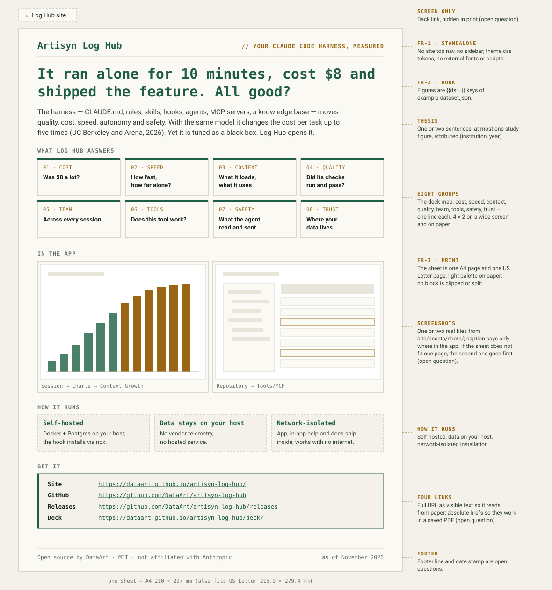
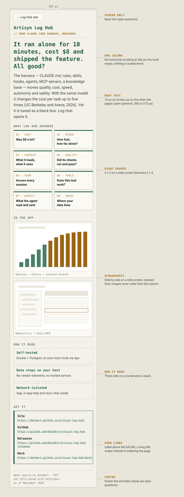
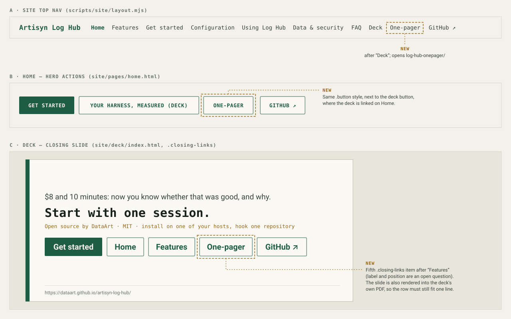

# 2026-11-13: Site One-Pager (log-hub-onepager)

**Status:** todo
**Priority:** medium
**Type:** feature
**Module(s):** site (`site/`, `scripts/site/`)
**Owner:** denis.tsyplakov
**Created:** 2026-11-13
**Tracker:** GH-143 https://github.com/DataArt/artisyn-log-hub/issues/143

## Description

A colleague asked for a one-pager on the GitHub Pages site, in addition to the reveal.js deck
(https://dataart.github.io/artisyn-log-hub/deck/). The owner sees it as a separate, standalone
page named `log-hub-onepager`.

The one-pager is the deck v2 storyline ("Your harness, measured") compressed to a single screen.
Its first use is to be shown to a client from a laptop screen: everything is visible at once, with
no scrolling. The audience is a client-side manager or buyer, not an engineer. It can also be
opened by a link, printed, or saved as a PDF and sent by e-mail: what Log Hub is, which questions
it answers, how it is deployed, where to get it.

Raw idea, as given: "тут коллега просит на сайте сделать в дополнение к
https://dataart.github.io/artisyn-log-hub/deck/ прям one pager" / "я это вижу как отдельную
log-hub-onepager страницу" / "сделай пока как-то - вот для показа клиенту с экрана ноута на один
экран".

## Functional Requirements

- **FR-1 Page.** A new standalone page `log-hub-onepager` on the site, built by
  `scripts/site/build-site.mjs` from a hand-written source under `site/` the same way the deck is
  (standalone: no site top nav or sidebar; `{{ds:…}}` and `{{site:…}}` placeholders filled).
  Source `site/log-hub-onepager/index.html` → URL `…/artisyn-log-hub/log-hub-onepager/`. English
  only.
- **FR-2 Content.** Wording for a manager or buyer (outcomes and money, not internals):
  - the product name and the tag "Your Claude Code harness, measured";
  - the hook from the dataset ("It ran alone for N minutes, cost $8 and shipped the feature. All
    good?");
  - the harness thesis in one sentence, with at most one attributed study figure;
  - what Log Hub answers — the eight deck groups (cost, speed, context, quality, team, tools,
    safety, trust), one line each;
  - one real screenshot from `site/assets/shots/`, a cost or overview view a manager reads at a
    glance;
  - how it runs: self-hosted, data stays on your host, works in a network-isolated installation;
  - four links, each showing its full URL as visible text (on screen and in print) with an
    absolute href: site Home `{{site:url}}`, GitHub repository `{{site:repo}}`, releases
    `{{site:releases}}`, deck `{{site:url}}deck/`;
  - a footer line: "Open source by DataArt · MIT · not affiliated with Anthropic";
  - no date or version stamp.
- **FR-3 One screen.** On a laptop screen the whole page is visible at once: at a 1280 × 720
  viewport there is no vertical and no horizontal page scroll, and no block is clipped. The layout
  is landscape. If the content does not fit, it gives way in this order: drop the study figure,
  then shorten the group lines; the hook, the eight groups, the screenshot and the links are never
  dropped.
- **FR-4 Print.** The same landscape layout prints to exactly one A4 page and exactly one US
  Letter page from the browser print dialog, so "Save as PDF" gives a one-page PDF; no PDF file is
  committed to the site:
  - measured at scale 100 %, with Chromium defaults (background graphics off, headers/footers
    off);
  - the page's own `@page` rule sets `size: landscape` and margins, no fixed paper size;
  - the page's own CSS re-declares the light theme tokens under `@media print`, so paper is light
    even when the reader's system is in dark mode;
  - the sheet reads well without backgrounds — it does not rely on `print-color-adjust`;
  - no clipped or orphaned block (`break-inside: avoid` on blocks).
- **FR-5 Head and SEO.** Hand-written `<head>` with the same tag set as the deck: `<title>`,
  `meta description` (50–160 characters, unique across the site, validated by the build),
  canonical, Open Graph, `twitter:card`, favicon and apple-touch-icon. The page is listed in
  `sitemap.xml`.
- **FR-6 Links to it and back.**
  - A "One-pager" item in the site top nav right after "Deck" (`scripts/site/layout.mjs`).
  - A link on Home where the deck is linked (hero actions).
  - A fifth `closing-links` item "One-pager" after "Features" on the deck's closing slide.
  - The one-pager has a screen-only link back to the site Home ("← Log Hub site", like the
    deck's), hidden in print.
- **FR-7 Site rules.** Uses `../assets/theme.css` (light/dark from `prefers-color-scheme` on
  screen); no external fonts, no external scripts; American spelling; every Log Hub figure is a key
  of `site/data/example-dataset.json`; a study figure is attributed in its own sentence
  (institution, year) and its source is recorded only in the KB table; the screenshot carries only
  a "where in the app" caption.
- **FR-8 Docs.** `docs/knowledgebase/user-docs-and-site.md` describes the new page (input/output
  row, head rules, nav entry, one-screen and print rules), and
  `docs/qaa-overview/scenarios/04-ingest-hook-installer-platform.md` mirrors the changed
  `S-SITE-01` steps.

## Wireframes

The wireframes show the set of blocks and the entry links. They were drawn before the one-screen
decision: the sheet is drawn in portrait with two screenshots, while the page is landscape with
one (FR-2, FR-3).

## Non-Functional Requirements

- Readable at 360 px width without horizontal scrolling (vertical scrolling is fine there); body
  font ≥ 16 px on screen.
- The page is an extra of the site only: nothing in the product or the in-app help depends on it
  (offline-first rule).

## Acceptance Criteria

- [ ] `npm run build:site` writes `log-hub-onepager/index.html` with no unfilled `{{…}}`
      placeholder; a missing, out-of-range or duplicate description fails the build. (FR-1, FR-5)
- [ ] The built page contains the hook, the eight group lines, the screenshot, the four links
      with their URLs visible as text and the footer line, and every figure on it comes from the
      dataset or is an attributed study figure. (FR-2, FR-7)
- [ ] At a 1280 × 720 viewport the page has no vertical and no horizontal page scroll, and the
      footer line is inside the viewport. (FR-3)
- [ ] With the dark color scheme emulated, `page.pdf()` in landscape at A4 and at Letter each
      gives a PDF of exactly one page with no cut-off content. (FR-4)
- [ ] The page's canonical URL is in `sitemap.xml`; the head has the description, canonical,
      `og:*`, `twitter:card` and both icon links. (FR-5)
- [ ] The site top nav, Home and the deck's closing slide link to the page, the page links back to
      Home, and the links resolve in the built site. (FR-6)
- [ ] The built page requests no external font or script. (FR-7)
- [ ] At a 360 px viewport the page has no horizontal page scroll and body font ≥ 16 px. (NFR)
- [ ] `prefers-color-scheme: dark` changes the page background on screen. (FR-7)
- [ ] Scenario `@S-SITE-01` covers the page — scenario kind, extending the existing scenario; no
      new test file:
  - `TOP_NAV` gains "One-pager" after "Deck";
  - step 1's expected page list gains `log-hub-onepager/index.html`;
  - step 2 excludes the standalone page from the "same top nav" and `aria-current` checks, like
    the deck;
  - step 3 and the deck step assert the new Home and closing-slide links;
  - step 6 adds the page to its dark-mode list;
  - steps 7/8 keep the page in the width checks, and the page is also checked at 360 px;
  - steps 16–17 cover its head tags and icons, and its sitemap entry is asserted;
  - a new step asserts no vertical scroll at 1280 × 720 and the one-page landscape PDF at A4 and
    at Letter (criteria above).
- [ ] `docs/knowledgebase/user-docs-and-site.md` and
      `docs/qaa-overview/scenarios/04-ingest-hook-installer-platform.md` are updated. (FR-8)

## Common sense considerations

- "One page" in print is measured at scale 100 %, Chromium default print settings.
- `@page` fixes the orientation and margins only, so one layout serves both A4 and Letter.
- Print forces the light tokens and must read well with background graphics off.
- The one-screen and one-page rules are checked by a step in `@S-SITE-01`, not by hand.
- "One laptop screen" is measured at 1280 × 720, the desktop viewport `@S-SITE-01` already uses.
- The narrow-screen target stays 360 px; the site's body ≥ 16 px rule applies to the page.
- On-screen dark mode gets its own acceptance criterion and a place in step 6.
- Links show full URLs and use absolute hrefs, so they work on paper and in a saved PDF; "site"
  is the site Home.
- The sheet carries the site's footer line, including "not affiliated with Anthropic".
- The page has a screen-only back link, following the deck.
- The deck's closing slide gets "One-pager" as a fifth link after "Features".
- Existing `@S-SITE-01` steps are changed where the new page and nav item break them.
- The QAA scenario overview is updated together with the KB article.
- First-version defaults, chosen because the owner left them open ("make it somehow for now"):
  buyer audience, English only, no committed PDF, no reference one-pager, folder URL like
  `deck/`, no date stamp.

## Open Questions

None.

## Notes

<!-- Append timestamped notes here as work progresses -->
2026-11-13 — implemented via adlc-lh:implement; checks green. Print uses a 14 px sheet font (the plan said 12 px): the sheet fills about 80 % of the page instead of two thirds and is still one page at A4 and Letter.
