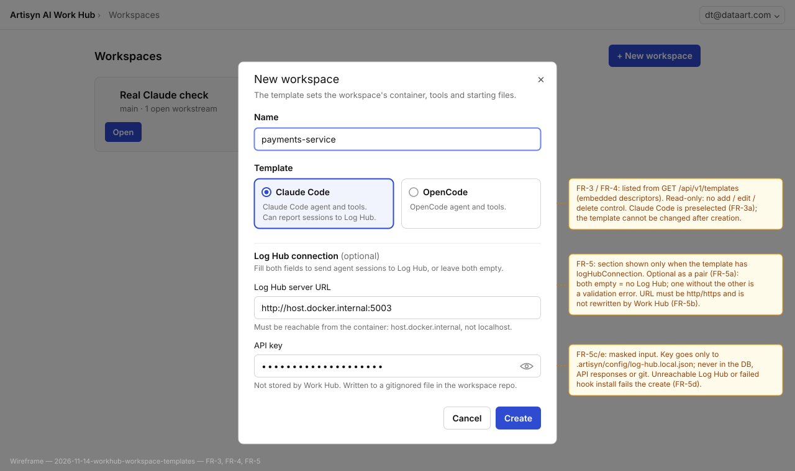
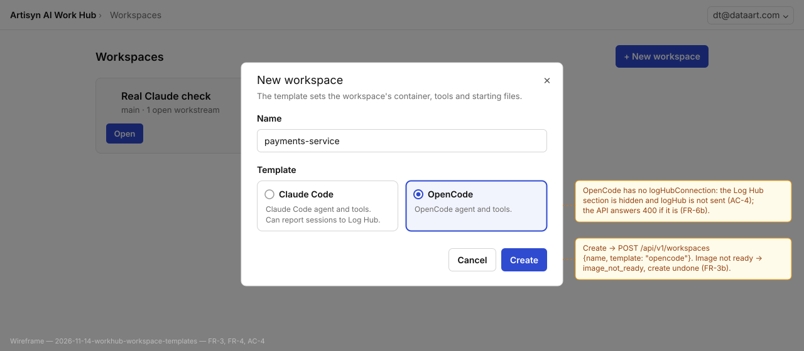
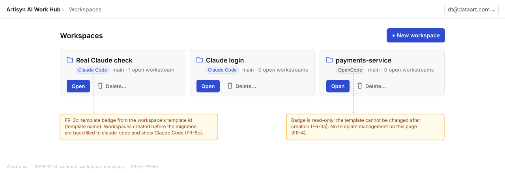

# 2026-11-14: Work Hub Workspace Templates

**Status:** todo
**Priority:** medium
**Type:** feature
**Module(s):** work-hub
**Owner:** denis.tsyplakov
**Created:** 2026-11-14
**Tracker:** GH-147 https://github.com/DataArt/artisyn-log-hub/issues/147

## Description

Builds on `2026-11-13-ai-work-hub-alpha` (Work Hub alpha: workspaces, devcontainers, workspace
creation flow).

Raw idea (verbatim, from the owner):

> для 2026-11-13-ai-work-hub-alpha
> я хочу чтобы при создании workspace можно было выбрать шаблон.
> шаблоны это по факту набор тулов и файлов - каталог с дескриптором и devcontainers
> и пока два шаблона - claude code и open code
> из UI пока шаблоны делать нельзя
> Для claude code добавить при создании в модалке с паратемтрами если я выбираю claude code - параметры подключения к log hub сразу

In short: when creating a workspace the user picks a template. A template is a set of tools and
files — a directory with a descriptor and a devcontainer definition. Two templates ship for now:
Claude Code and OpenCode. Templates cannot be created or edited from the UI yet. When the Claude
Code template is chosen, the create-workspace dialog also asks for the Log Hub connection
parameters right away.

## Functional Requirements

- FR-1. A workspace template is a directory containing a descriptor file and a devcontainer
  definition, plus any other tools/files the template brings into the workspace.
  - FR-1a. Templates live in `work-hub/templates/<id>/` and are embedded in the server binary at
    build time, like `work-hub/image/`. There is no runtime template folder. The dialog lists
    every embedded template.
  - FR-1b. The descriptor holds at least `id`, `name`, `description`, `agent` (agent adapter id),
    `order` and `logHubConnection` (bool: the dialog shows the Log Hub fields).
  - FR-1c. The template's `.devcontainer/devcontainer.json` replaces the default devcontainer in
    the initial "Start workspace" commit and is applied with the existing D6 subset (image,
    containerEnv, postCreateCommand). The template's other files are committed into the repo in
    the same commit; a template file at a path Work Hub also writes (e.g. `.gitignore`) replaces
    Work Hub's default. Anything that must stay out of git belongs in the template's image.
  - FR-1d. Images. Templates never use a devcontainer `build`, so workspace creation needs no
    network.
    - The Claude Code template keeps `"image": "artisyn-work-hub-default"` (the existing default
      image), so its workspaces match those created before the migration.
    - Any other template that needs its own image ships its build context in
      `work-hub/templates/<id>/image/` and names it in `devcontainer.json` with an unversioned
      sentinel `artisyn-work-hub-<id>`, which the server resolves to `<name>:<VERSION>` the same
      way `artisyn-work-hub-default` resolves today (change to the `workhub-devcontainer-subset`
      algorithm doc and its rows).
    - At server start the default image is built first, then each template image in turn.
      Readiness is kept per image (`ok` / `building` / `failed`); a create from a template needs
      both the default image (still used to boot the container and for helpers) and the
      template's image.
    - Template images are shared: they are never in a workspace's undo list and are never removed
      with a workspace.
  - FR-1e. An embedded template with a missing or invalid descriptor, or with files under `.git/`,
    stops the server at startup with a log line naming the template.
  - FR-1f. After creation the workspace no longer depends on its template: later edits to the
    repo's devcontainer win, and changes to a shipped template never affect existing workspaces.
- FR-2. Work Hub ships two templates: **Claude Code** and **OpenCode**.
  - FR-2a. The OpenCode template is just an agent for now: it makes OpenCode the workspace's agent
    and brings no extra tools or files. This task adds an `opencode` agent adapter (login files,
    login/status/logout, start/resume with a fixed session id, Configure, profile patch, container
    env, disposable home paths) and the template's image with a pinned, sha256-verified OpenCode
    binary.
- FR-3. The create-workspace dialog lets the user choose one of the available templates; the new
  workspace is created from the chosen template (its devcontainer definition and files).
  - FR-3a. Claude Code is preselected. The template cannot be changed after creation.
  - FR-3b. While a needed image is building, creation answers `image_not_ready` (retryable); after
    a failed build it answers `create_failed` and the build error is logged — same as the default
    image today. One template's failed image never blocks other templates. The dialog shows a
    not-ready template as disabled with a hint.
  - FR-3c. The workspace list shows which template each workspace was created from.
- FR-4. Templates are not created, edited or deleted from the UI; the UI only lists and selects
  them.
- FR-5. When the Claude Code template is selected, the create-workspace dialog shows extra fields
  for the Log Hub connection parameters, and the workspace is created with that connection
  configured.
  - FR-5a. Fields: Log Hub server URL (http/https) and API key (masked input). They are optional
    as a pair: both empty means no Log Hub; one without the other is a validation error. The API
    trims both values; a `logHub` object with both values empty means the same as no `logHub`.
  - FR-5b. The dialog hints that the URL must be reachable from inside the workspace container
    (e.g. `host.docker.internal`, not `localhost`). Work Hub does not rewrite the URL beyond
    trimming (the installer itself strips a trailing `/`).
  - FR-5c. "Configured" means: after the template files are written and before the initial "Start
    workspace" commit, Work Hub runs the hook installer served by that Log Hub as a black box, as
    the container user in `/workspace/repo`:
    `npx <serverUrl>/static/artisyn-hooks-installer.tgz install --server-url <serverUrl> --api-key <apiKey>`.
    - Work Hub relies only on the installer's documented command line and exit code, not on which
      files it writes or how it may change in future versions.
    - Every installer question (OTEL, destination change, etc.) gets its default answer: no other
      flags are passed and the run is non-interactive. Users who want other answers re-run the
      installer by hand in the workspace.
    - Validating the server and the key is the installer's job; Work Hub does no checks of its own.
    - Whatever the installer leaves in the repo that git does not ignore goes into the "Start
      workspace" commit, so `git status` is clean right after creation.
  - FR-5d. If the installer cannot be downloaded or exits non-zero, creation fails with
    `create_failed` and a message naming the cause ("Log Hub at <url> couldn't be reached" / "The
    Log Hub hook install failed: <redacted tail>"), and undoes its steps.
  - FR-5e. The API key is never stored in the Work Hub database, returned by any API, written to
    Work Hub logs, error messages or files-area metadata; any installer command line or output
    Work Hub shows or logs is redacted for the key value. Workstreams get the hook through the
    committed files in their worktree and the copied repo volume.
  - FR-5f. Editing the Log Hub values after creation is out of scope.
- FR-6. API and data.
  - FR-6a. New `GET /api/v1/templates` → `[{id, name, description, agentName, logHubConnection,
    imageStatus}]`, sorted by the descriptor's `order`; `imageStatus` is `ok|building|failed`.
    `GET /api/v1/system/status` keeps `defaultImage` unchanged for older clients and adds
    `templateImages: {<id>: "ok"|"building"|"failed"}`; its contract row is updated.
  - FR-6b. `POST /api/v1/workspaces` accepts `{name, template?, logHub?: {serverUrl, apiKey}}`.
    A missing `template` means `claude-code` (older clients and scripts keep working). Errors:
    400 `unknown_template` for an unknown id; 400 `invalid_log_hub` for `logHub` sent for a
    template without `logHubConnection`, only one of the two values set, or a non-http(s) URL.
    The dialog blocks the half-filled pair and the bad URL client-side and highlights the
    offending Log Hub field for `invalid_log_hub`.
  - FR-6c. A migration adds `workspaces.template` (`NOT NULL DEFAULT 'claude-code'`), so existing
    workspaces become Claude Code workspaces with unchanged containers and repos. The template id
    is returned in the workspace API responses.
  - FR-6d. The template's `agent` is stored in the existing `workspaces.agent` column and drives
    `agentName`. Copying a login stays limited to workspaces with the same agent.

## Acceptance Criteria

- [ ] AC-1 (FR-1). Each shipped template exists as a directory with a descriptor and a
  devcontainer definition; the descriptor is what Work Hub reads to list the template.
- [ ] AC-2 (FR-2, FR-3). The create-workspace dialog offers exactly the Claude Code and OpenCode
  templates, with Claude Code preselected; creating a workspace with each one produces a workspace
  whose container runs on that template's image, whose initial commit holds that template's
  devcontainer definition and files, and whose list entry shows the template. An OpenCode
  workspace can log in, open a workstream and run its chat with OpenCode.
- [ ] AC-3 (FR-4). The UI has no control to add, edit or delete a template.
- [ ] AC-4 (FR-5). Selecting Claude Code in the dialog shows the Log Hub connection fields;
  selecting OpenCode hides them. A workspace created from Claude Code with those fields filled ran
  the installer successfully, has its output committed and a clean `git status`; the API key does
  not appear in `git log -p`, in any Work Hub API response or in the Work Hub server log; a
  workstream opened from it has the hook's committed files in its worktree.
- [ ] AC-5 (FR-6). `GET /api/v1/templates` and the extended `POST /api/v1/workspaces` have contract
  rows; a create request without `template` creates a Claude Code workspace; workspaces created
  before the migration show as Claude Code.
- [ ] AC-6 (FR-5a, FR-6b). A create with an unknown `template` answers 400 `unknown_template`;
  with `logHub` for OpenCode, only one Log Hub value, or a non-http(s) URL answers 400
  `invalid_log_hub`; nothing is created in either case.
- [ ] AC-7 (FR-5d, FR-5e). A create with an unreachable Log Hub URL fails with `create_failed` and
  the "couldn't be reached" message, leaves no container, volume, folder or DB row, and neither
  the message nor the server log contains the API key.
- [ ] AC-8 (FR-1d, FR-3b). While a template's image is building, a create from it answers
  `image_not_ready`, the dialog shows that template disabled, and the other template still
  creates.

## Common sense considerations

- Log Hub fields are server URL + API key, the two values the hook reads.
- Sending agent sessions to Log Hub (out of scope in the alpha) is in scope here, via the Claude Code template.
- The hook is installed from the Log Hub server itself, so its version matches that server.
- A failed hook install fails the create, consistent with "a failed create undoes its steps".
- The API key never goes into git, the Work Hub DB or API responses.
- Templates are embedded, not loaded from disk: offline-first and self-contained.
- No devcontainer `build` in templates: it would need the network on every workspace build.
- A broken embedded template is a build bug, so the server refuses to start.
- Missing `template` defaults to `claude-code` for backward compatibility; existing rows are backfilled the same way.
- Claude Code is preselected; the template is fixed at creation.
- Login copy stays limited to workspaces with the same agent (existing alpha rule).
- The hook is installed before the initial commit and its tracked files are committed, since a workstream worktree only has committed files.
- The hook installer is a black box: documented flags in, exit code out; all its questions take their defaults.
- The installer validates the server and the key; Work Hub adds no checks of its own.
- OpenCode is just an agent for now: the template makes it the workspace's agent, with no extra tools.
- Template images use unversioned sentinels resolved to the current version, so recreates survive server upgrades.
- Claude Code keeps the default image; template image build contexts live in `work-hub/templates/<id>/image/`.
- Images build sequentially at startup, default first; readiness is tracked per image.
- Failed-build vs still-building errors follow the existing default-image behaviour (`create_failed` vs `image_not_ready`).
- `system/status` stays backward compatible: `defaultImage` unchanged, `templateImages` added.
- New create errors get explicit codes: `unknown_template`, `invalid_log_hub`; Log Hub/install failures use `create_failed`.
- A template file replaces Work Hub's default at the same path; templates may not ship `.git/`.
- AC-4 checks the workstream's hook files and config, not a live session (scenarios run no real agent).

## Open Questions

_None._

## Notes

<!-- Append timestamped notes here as work progresses -->
