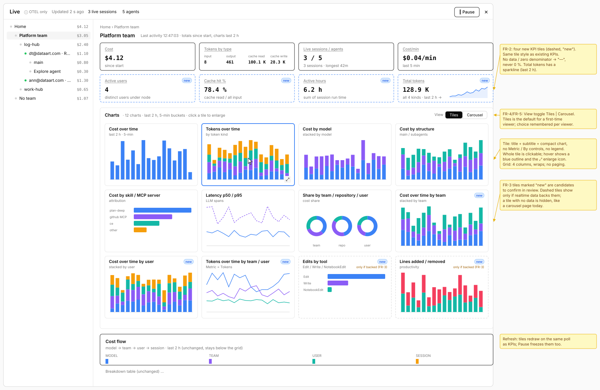
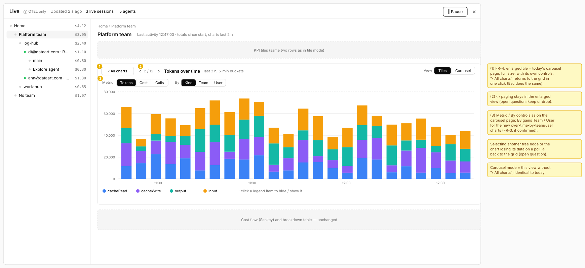

# 2026-11-21: Live View: CloudWatch-Style Metrics and a Tile Mode

**Status:** todo
**Priority:** medium
**Type:** feature
**Module(s):** server | client
**Owner:** denis.tsyplakov
**Created:** 2026-11-21
**Tracker:** GH-160 https://github.com/DataArt/artisyn-log-hub/issues/160

## Description

Raw idea (from the 2026-11-21 morning check, competitors section):

> Parity with Amazon CloudWatch Coding Agent Insights
> (https://docs.aws.amazon.com/AmazonCloudWatch/latest/monitoring/coding-agents-insights.html):
> realtime dashboards of Claude Code cost and adoption, split by org / department / team / cost
> center / user (user-defined cost dimensions beyond team), CSV export, query + alarms. Gap
> analysis vs Log Hub analytics first; MCP endpoint out of scope (a separate m2m API comes later).

User's words (verbatim): "сделай scratch задача чтобы было partiy с амазоном типа в диаложке realtimr".

CloudWatch Coding Agent Insights (launched 2026-07-20) offers ready-made dashboards for Claude Code,
Codex and Copilot built from their native OTEL metrics: cost and adoption broken down by
organization, department, team, cost center and user, CSV export, PromQL queries and alarms,
rollout via the Claude apps gateway, billed at CloudWatch OTLP ingestion rates. It is the
AWS-native zero-install alternative to Log Hub, so Log Hub should reach feature parity where it
makes sense for a self-hosted, offline-first product.

**Scope decision (user, 2026-11-21, after looking at the screenshots):** "выглядит убого —
половина есть — надо чуть расширить то что показывается в realtime и сделай режим плитки когда
графики не листаются, а показывается просто много маленьких графиков и можно кликнуть в тот,
который нравится". In short: Log Hub already covers about half of it. The target surface is the
existing **Live view** modal ("диаложка realtime", see `docs/knowledgebase/otel-tabs.md` §
"Live view"). Two things to do: (1) extend what the Live view shows with the missing realtime
metrics; (2) add a **tile mode**.

What the Live view has today (2026-11-21):

- KPI tiles: Cost, Running, Calls, Model, Agents live, Live sessions / agents, Cost/min, Tokens by
  type (`OtelTokensTile`, non-agent nodes). The repository OTEL tab also has a ready
  `OtelCacheRatioTile` ("Cache read ratio").
- Below the carousel: the cost-flow Sankey (`LiveFlowSankey`) and the breakdown table.
- A chart carousel, one chart at a time, paged with ‹ ›: Cost over time, Tokens over time (by
  token kind), Cost by model, Cost by structure, Cost by skill / MCP server, Latency p50 / p95,
  Share by team / repository / user. Files: `client/src/viewer/live/LiveChartCarousel.tsx`,
  `live-chart-data.ts`, `LiveKpiTiles.tsx`.

## Functional Requirements

- FR-1 **Short gap table.** List every CloudWatch Coding Agent Insights card and chart (see the
  screenshots below) against the Live view: has / partial / missing. Write it into this file
  before planning.
- FR-2 **More realtime KPIs**: all four cards CloudWatch shows and the Live view lacks (user,
  2026-11-21: "карточки все берем"). They are Active users, Cache hit %, Active hours, and Total
  tokens with a sparkline.
  - Cache hit % reuses `OtelCacheRatioTile` with its existing formula, over the node's lifetime
    totals ("since start").
  - Total tokens extends the existing "Tokens by type" tile with a total (sum of the four token
    kinds, lifetime) and a sparkline from the node's 5-minute `view.buckets` (2 h).
  - Active users = distinct owners of the roots the node's totals cover (same team-scope row
    filter as every Live figure); hidden on session and agent nodes.
  - Active hours — definition open (see Open Questions).
  - No data or a zero denominator shows "—", never 0 % / 0 h. Agent nodes keep today's tiles.
- FR-3 **More realtime charts.** Candidates to confirm in review:
  - Cost / tokens over time by team and by user.
  - Developer productivity: lines added / removed, commits, PRs.
  - Code editing: edit decisions accept vs reject, edits by tool, code by language.

  Productivity and code-editing figures come only from what Log Hub **already computes from its
  realtime data** (user, 2026-11-21: "продуктивность из того что уже считаем из realtime"). No
  new signal and no new OTEL metric ingest for them. A CloudWatch chart that the existing realtime
  data cannot back is marked "missing — not backed" in the gap table and left out.
  "Realtime data" means only the OTEL data the Live view reads (`otel_calls`, `otel_spans`,
  `otel_cost_buckets`, OTEL totals); transcript-derived stats (`session_stats` lines, commits,
  PRs) do not count. So lines added / removed, commits, PRs, edit decisions and code by language
  are "missing — not backed"; edits by tool comes from OTEL tool spans and shows "not reported"
  without them (hook < 2.29.0 or traces off).
  - Cost / tokens by team and by user need a server change: new response fields are additive and
    optional, keep the 2 h / 5-minute grain and the team-scope row filter, and the changed
    `GET /api/v1/otel/live` gets its contract registry row. "By user" is hidden on session nodes.
- FR-4 **Tile mode.** A toggle in the Live view pane switches between carousel mode (today's
  behaviour) and tile mode. In tile mode:
  - every chart page shows at once as a small tile in a grid, with no paging;
  - each tile shows the chart's title and a compact chart with no controls;
  - clicking a tile opens that chart full size, as in the carousel today, with its Metric / By
    controls;
  - from there one click goes back to the grid;
  - the tiles are the carousel pages available on the selected node (same hide rules); Share is
    one tile; the Sankey and the breakdown table stay below the grid;
  - the grid is responsive (4 columns at the default modal width, fewer when the pane narrows);
  - the enlarged view keeps ‹ › paging; selecting another node keeps the enlarged chart if the
    node has it, else returns to the grid; a chart that loses its data on a poll returns to the
    grid; an empty grid shows the carousel's existing empty-state message.
- FR-5 **Tile mode is the default** (user, 2026-11-21). The chosen mode (carousel / tiles) is
  remembered per viewer in localStorage (`artisyn:liveChartMode`, like the splitter widths;
  default tiles when missing or unreadable). The enlarged tile is not remembered: the view opens
  on the grid. Tiles refresh on the same poll as the rest of the view.
- Out of scope for this task: user-defined cost dimensions (department, cost center), CSV export,
  alarms — see "Deferred". The MCP endpoint is rejected; machine access will be a separate m2m API
  task later.

## Acceptance Criteria

- [ ] The gap table (CloudWatch card or chart → Live view has / partial / missing → decision) is
      in this file before planning.
- [ ] The four new KPIs (FR-2: Active users, Cache hit %, Active hours, Total tokens with a
      sparkline) show in the Live view for home, team, No team, repo and session nodes (Active
      users not on session nodes), and update on the poll while a session runs.
- [ ] The charts chosen in review show as carousel pages and as tiles, and hide when they have
      no data, like the current pages.
- [ ] Tile mode: all available charts are visible at once without paging. Clicking a tile opens
      it full size with its controls, and one click returns to the grid.
- [ ] A first-time viewer sees tile mode. The chosen mode survives closing and reopening the
      Live view.
- [ ] Charts keep the existing masking rules (`team-no-prompts`).
- [ ] Older hooks and Claude Code versions without a signal show "not reported" or hide the
      chart, never zero.
- [ ] Works offline.

## Deferred (not in this task)

- User-defined cost dimensions beyond team (department, cost center, location, role), used for
  grouping and filtering. CloudWatch takes them from OTEL resource attributes.
- CSV export of every breakdown.
- Alarms, e.g. "a user's hourly spend exceeds twice their daily average". Log Hub budgets are
  deliberately non-blocking.

## Open Questions

- How is the "Active hours" KPI computed, given that Log Hub does not ingest Claude Code's
  `claude_code.active_time` metric? Options: the sum of each session's running time (first to last
  call) over the distinct sessions under the node, or the sum of LLM and tool span time from
  `otel_spans`. Lifetime or the last 2 h? How should it differ from the existing "Running" tile
  (or should it be marked "partial" in the gap table and dropped)?

## Common sense considerations

- Cache hit % reuses `OtelCacheRatioTile` and its formula, over lifetime node totals.
- Total tokens extends "Tokens by type" with a total and a sparkline from the per-node 5-minute buckets.
- Active users = distinct owners of the node's roots, team-scope filtered; hidden on session and agent nodes.
- No data or a zero denominator shows "—"; agent nodes keep today's tiles.
- "Realtime data" in FR-3 = OTEL data only; transcript-derived productivity is "missing — not backed".
- Edits by tool comes from OTEL tool spans, "not reported" without them.
- Team / user time series: additive optional response fields, shape chosen in the plan; "by user" hidden on session nodes.
- Tiles = the node's available carousel pages; Share is one tile; Sankey and breakdown table stay below the grid.
- Grid is responsive, 4 columns at the default modal width.
- Enlarged view keeps ‹ › paging; node change keeps the chart if available, else grid; lost data → grid.
- Mode stored in localStorage `artisyn:liveChartMode`; the enlarged tile is not remembered.
- Where cost dimensions come from belongs to the future cost-dimensions task.

## Notes

<!-- Append timestamped notes here as work progresses -->

**2026-11-21 — reference screenshots.** The AWS docs pages have no screenshots. These come from the
AWS Cloud Operations blog post "Analyzing Claude Code usage with CloudWatch and OpenTelemetry"
(https://aws.amazon.com/blogs/mt/analyzing-claude-code-usage-with-cloudwatch-and-opentelemetry/).
Local copies are in `screenshots/` in this folder. They are AWS content, so the folder is
gitignored and never committed, and the inline images below show only on the machine that has
them. The links in the table point to the originals and work for everyone.

| Screen | What it shows | Image |
|---|---|---|
| Executive Summary | Tabs for Claude Code / Codex / Copilot; cards for Total Tokens, Total Cost, Active Users, Sessions, Cache Hit %, Active Hours, each with a sparkline | [executive-summary.png](https://d2908q01vomqb2.cloudfront.net/972a67c48192728a34979d9a35164c1295401b71/2026/07/20/executive-summary.png) |
| Filtering and grouping | Left panel: Group by (multi-dimension, e.g. Department + Team); filters for Model, Organization, Department, Cost Center, Location, Team, User, Role | [filtering-and-grouping.png](https://d2908q01vomqb2.cloudfront.net/972a67c48192728a34979d9a35164c1295401b71/2026/07/20/filtering-and-grouping.png) |
| Usage & Cost | Token Usage Over Time, Token Usage by Department, Cost by Department (USD), Token Usage by Type (input / output / cache read / cache creation) | [usage-and-cost.png](https://d2908q01vomqb2.cloudfront.net/972a67c48192728a34979d9a35164c1295401b71/2026/07/20/usage-and-cost.png) |
| Developer Productivity | Lines of code added/removed, Commits / Active Hours / Pull Requests by Department | [dev-productivity.png](https://d2908q01vomqb2.cloudfront.net/972a67c48192728a34979d9a35164c1295401b71/2026/07/20/dev-productivity.png) |
| Code Editing | Code generation by language (pie), edit decisions accept vs reject, edits by tool (Edit / NotebookEdit / Write) | [code-editing.png](https://d2908q01vomqb2.cloudfront.net/972a67c48192728a34979d9a35164c1295401b71/2026/07/20/code-editing.png) |
| Alarm | PromQL alarm: a user's hourly spend exceeds twice their daily average | [claude-alarm.png](https://d2908q01vomqb2.cloudfront.net/972a67c48192728a34979d9a35164c1295401b71/2026/06/15/claude-alarm.png) |
| Token strategy | Per-developer vs per-team vs org-wide tokens with client-side attribution | [claude-strategy.png](https://d2908q01vomqb2.cloudfront.net/972a67c48192728a34979d9a35164c1295401b71/2026/06/15/claude-strategy.png) |

The dimensions come from OTEL **resource attributes** (`user.email`, `team.id`, `department`,
`cost_center`, `organization`), set on the client. In Log Hub the matching place would be the hook
config, the server's user and team records, or both — out of scope here (see Deferred).

