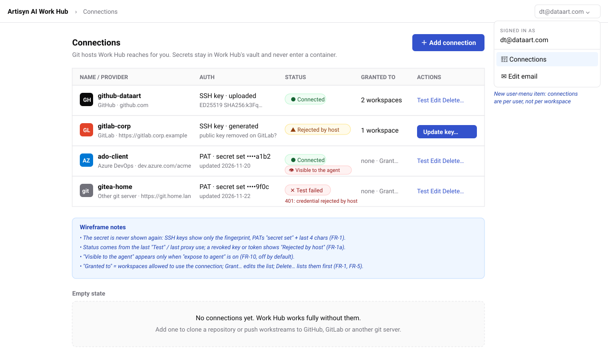
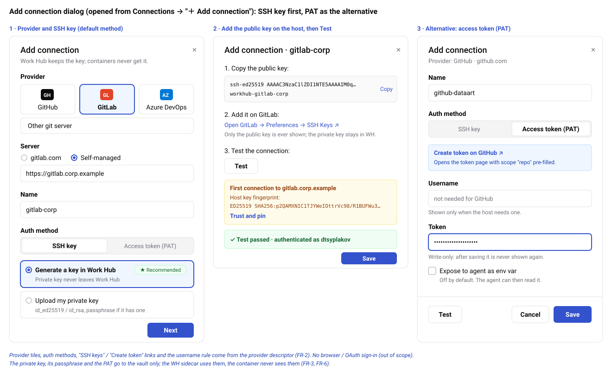
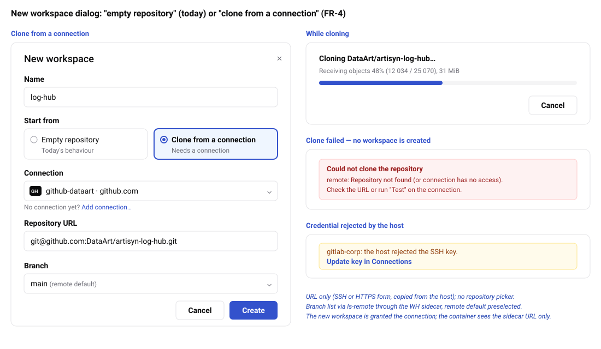
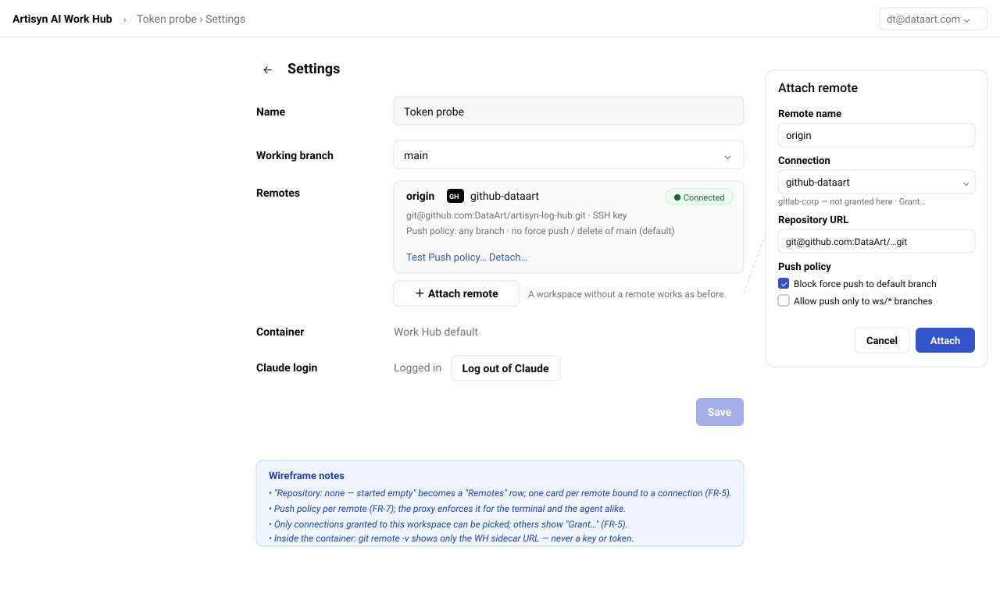
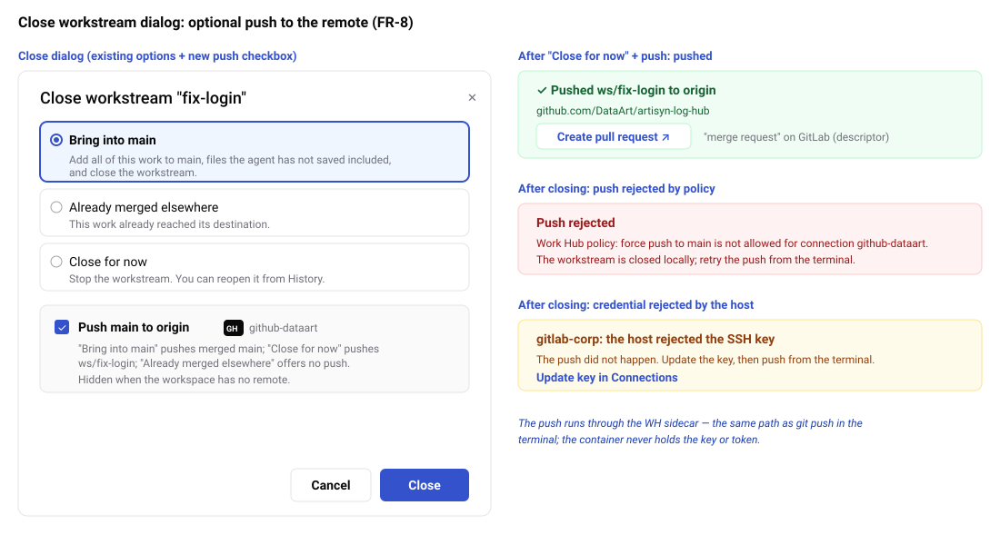

# 2026-11-22: Work Hub Remote Git Repositories and Credential Vault

**Status:** todo
**Priority:** medium
**Type:** feature
**Module(s):** work-hub
**Owner:** denis.tsyplakov
**Created:** 2026-11-22
**Tracker:** GH-165 https://github.com/DataArt/artisyn-log-hub/issues/165

## Description

Raw idea (verbatim, from the owner):

> посмотри через что у меня сейчас этот репозиторий авторизован и сделай мне задачу на подключение
> ремот репы к WH - я хочу
> 1. максимально гибко
> 2. чтобы клод по возможности напряму креды не видел
> НО я хочу чтобы был вариант подключать потом gitlab и azure devops т.е. не супер заточено под
> github
> и потом я хоч удобавлять pat токены к JIRA и ключи к gh

### Where Work Hub is today

- A workspace starts as an empty repository: `git init -b main /workspace/repo`
  (`work-hub/server/src/workspaces/mod.rs`). There is no remote, no clone, no fetch, no push.
- Workstreams are worktrees on `ws/<slug>` branches; "bring into main" merges them into the working
  branch locally (git bundle between containers). Nothing leaves the workspace.
- There is already a per-user **secret store** (`work-hub/server/src/secrets.rs`: AES-256-GCM files
  `<data dir>/secrets/<user id>/<name>.enc`, key in table `secret_key`) holding the agent's token,
  documented as the place for every future secret. The agent token reaches the agent only as an
  env var through `tmux::SessionOpts.secret`.
- The agent runs **inside** the workstream container, so anything placed in that container (env var,
  file, credential helper answer) is readable by the agent. "The agent does not see credentials"
  therefore means: **the secret never enters the container at all**.

### Chosen direction

Generic, provider-agnostic per-user **connections** (FR-1, FR-2) hold their secret only in the vault
(FR-3); containers reach the git host only through a **WH git proxy** that adds the credential itself
(FR-6, FR-7); `kind = api` connections behind a WH API proxy follow the same pattern later (FR-9);
"expose to agent" is the explicit fallback (FR-10).

## Functional Requirements

- **FR-1 Connections CRUD.** A user can create, list, edit, test and delete their own connections
  in Settings. A connection has a name, kind (`git` / `api`), provider, base URL, auth method, a
  secret (by reference into the vault) and a scope / policy (FR-5, FR-7). The secret is write-only: after saving, the UI and the API never return it (only "set",
  last 4 characters at most, and when it was updated). Provider and base URL are read-only after
  creation; name, secret and policy are editable, and replacing the secret keeps every workspace
  remote bound to the connection. Deleting a connection that workspaces use lists
  those workspaces and asks for confirmation; their remotes stay in git config and the proxy answers
  them with a readable "connection deleted" error until the remote is rebound.
- **FR-1a Connect dialog.** "Add connection" for a git host opens a dialog where the user picks the
  provider (GitHub, GitLab — gitlab.com or self-managed at a user-given base URL —, Azure DevOps,
  other git server) and an auth method the provider's descriptor supports:
  - **SSH key generated by WH (recommended, preselected):** WH generates the key pair and shows only
    the public key with a link to the host's "SSH keys" page to paste it. The private key never
    leaves WH: no UI, API route, export, download or log returns it — not even to its owner or an
    admin; it is never placed in a container, and "expose to agent" (FR-10) is not available for it.
    Only the WH sidecar uses it. Losing it means generating a new one ("Regenerate key").
  - **Uploaded SSH key:** the user uploads their own private key (with passphrase if it has one);
    after upload it is write-only like any secret.
  - For both SSH options, on first "Test" WH shows the host key fingerprint and pins it (known hosts
    per connection); a changed host key fails git with a readable error.
  - **Access token (PAT)** over HTTPS (GitHub classic / fine-grained, GitLab, Azure DevOps, generic —
    each with its own username / header convention from the descriptor): the dialog shows a "Create token" link to the host's token page with the
    needed scopes pre-filled where the host supports it (GitHub `repo`; GitLab `read_repository
    write_repository read_user`) and which username the host expects.

  The credential goes straight into the vault and never enters a container. When a
  credential stops working (revoked / expired), "Test" and the connection card show it, and the proxy
  answers git with HTTP 401 and "Work Hub connection <name> was rejected by the host — update its
  credential in Settings".

  

  
- **FR-2 Provider-agnostic model.** Providers are described by a descriptor table (auth header /
  Basic username convention, URL patterns, test endpoint, supported auth methods, "create token"
  page URL with scopes, PR / MR URL pattern). The first release ships descriptors for
  GitHub, GitLab, Azure DevOps and generic HTTPS git (all `kind = git`). The model (kind, provider,
  auth method, secret ref) must already accept `kind = api` without a schema change, but no `api`
  descriptor or UI ships in this task. No provider-specific code path outside the descriptor layer.
- **FR-3 Secrets in the vault only.** Every connection secret is stored through
  `work-hub/server/src/secrets.rs`; never in the DB in clear text, never in workspace / workstream
  folders, volumes, images, checkpoints, recordings or logs.
- **FR-4 Create a workspace from a remote.** Creating a workspace offers "empty repository"
  (today's behaviour) or "clone from a connection": the user picks one of their connections (it is
  then granted to the new workspace, FR-5), pastes the clone URL copied from the host (SSH or HTTPS
  form), and picks a branch (list from `ls-remote` through the proxy). No repository picker in this
  task. The clone runs
  through the proxy (or server-side), so the container never receives the secret. With no branch
  chosen, the remote default branch is used and becomes the working branch. The dialog shows clone
  progress with Cancel. If the clone fails or is cancelled, no workspace is created and the git /
  provider error is shown; an empty remote repository gives a workspace like "empty repository" with
  `origin` set.

  
- **FR-5 Attach a remote to an existing workspace.** A workspace can get an `origin` (or named
  remote) bound to a connection after creation; existing workspaces without a remote keep working
  unchanged. A connection is usable only in workspaces it is explicitly granted to: the connection
  card lists and edits its granted workspaces, and "Attach remote" offers only granted connections
  (others shown as "not granted — Grant…"). The proxy rejects a container whose workspace has no
  grant for the connection.

  
- **FR-6 Fetch / push without credentials in the container.** Inside workspace and workstream
  containers, `git fetch`, `git pull` and `git push` to a connected remote work for both the user
  (terminal) and the agent, through the WH git proxy: the remote URL in the container points to the
  proxy (e.g. `http://<wh>/git/<connection>/<owner>/<repo>.git`) and the proxy forwards git to the
  real host, adding the credential itself, so the secret is revocable centrally. The proxy runs as a **sidecar** next to the
  workspace / workstream containers (the containers reach it; the WH server needs no published port
  and no outside reachability). The sidecar talks to the real host over SSH (with the connection's
  key) or HTTPS (with its PAT), whatever the remote URL the user pasted; the transport between
  container and sidecar is a plan decision. The container holds only a scoped capability,
  revocable by deleting the connection or the workspace. The capability is readable by the agent (it
  is scoped and revocable; the SSH key / PAT is not). `.git/config` holds only the proxy URL; a
  credential helper reads the capability from a file in the container's tmpfs `/tmp`, which the
  server rewrites on every container start / restore, so the capability is never on a volume or in a
  checkpoint.
- **FR-7 Push policy.** Per connection (or per workspace remote) the user can restrict which refs
  can be pushed and which repositories the connection may reach. The proxy enforces it and returns a
  readable git error. The policy applies per container, not per actor — the proxy cannot tell the
  user's terminal from the agent. Default policy: push to any branch is allowed; only a force push
  to the remote default branch and deleting it are rejected.
- **FR-8 Workstream close + push.** Closing a workstream can optionally push to the remote, and show
  a link to create a PR / MR where the provider descriptor knows the URL pattern. Per close mode:
  `for_now` → push `ws/<slug>`; `bring_into_main` → push the merged working branch;
  `merged_elsewhere` → no push. A failed push does not undo the close: the local close completes and
  the push error is shown, so the user can retry from the terminal.

  
- **FR-9 Ready for API tokens (design only).** The connection model, vault naming and proxy
  capability are designed so that a later task can add `kind = api` connections (Jira PAT, GitHub
  API key, generic bearer / basic) behind a WH HTTP proxy without changing the existing tables,
  routes or git proxy. The same principle as for git applies there: the token lives only in the
  vault, never enters a container, and the service is reachable from the container only through the
  WH HTTP proxy (e.g. `http://<wh>/proxy/<connection>/…`), which injects the token. Nothing user-visible for `api` ships here.
- **FR-10 Explicit expose-to-agent fallback.** For tools that insist on a raw token and cannot use
  the proxy, a connection can be marked "expose to agent": its
  secret is then injected as a named env var into agent sessions (same mechanism as the agent
  token, extended from one env var pair to several). Off by default, clearly labelled in the UI.
  The env var name is validated on save (`^[A-Z_][A-Z0-9_]*$`, no clash with the agent token or
  `containerEnv`), never silently dropped.
- **FR-11 Test connection.** "Test" checks the credential against the provider (descriptor's test
  endpoint or `git ls-remote` through the proxy) and shows success / a readable error.

## Non-Functional Requirements

- **Security.** The PAT never enters a container, a checkpoint image or a recording unless FR-10 is
  explicitly on. The proxy capability is per container + workspace, unguessable, scoped to that
  workspace's connections and invalidated when the workspace / workstream / connection is deleted.
  The proxy never logs `Authorization` headers or request bodies. Connections are private to their
  owner (no admin read).
- **Backward compatibility.** Existing workspaces (no remote) and old clients keep working; DB
  changes are additive migrations.
- **Offline first.** Work Hub still works fully with no remote; remotes are an option, never a
  requirement. The in-app / README docs for connections ship with the product.
- **Agent-neutral.** Only `server/src/agent/` may name the agent (AC-2 check); the vault and proxy
  are agent-independent.
- **Extensibility.** Adding a provider = adding a descriptor row (+ its algorithm-table rows), no
  change to proxy or vault code.

## Acceptance Criteria

- [ ] FR-1: a user creates a GitHub PAT connection, reloads Settings, sees it as "secret set" with no
      way to read the value back through UI or API; edit replaces the secret; delete removes the
      secret file.
- [ ] FR-1a: a user adds a GitHub connection with an uploaded SSH key and a self-managed GitLab
      connection with a WH-generated key pair (public key pasted on GitLab); both pass "Test", which
      shows and pins the host key fingerprint. A PAT connection created through the "Create token"
      link also passes "Test". After the key / token is revoked on the host, "Test" fails readably
      and a `git fetch` through the proxy fails with the "rejected by the host" message.
- [ ] FR-1a (generated key): "Generate a key in Work Hub" is preselected; afterwards no UI screen,
      no API response (including the connection JSON and any export) and no file inside any
      container contains the private key; "expose to agent" cannot be enabled for that connection;
      "Regenerate key" replaces it and shows the new public key.
- [ ] FR-1 (in use): deleting a connection bound to a workspace lists that workspace and asks for
      confirmation; afterwards `git fetch` there fails with "connection deleted".
- [ ] FR-2: adding a GitLab or Azure DevOps connection uses the same UI and API with a different
      `provider`; grep shows no provider name outside the descriptor table and its tests.
- [ ] FR-3: after creating a connection and using it in a workspace, no file under the workspace /
      workstream folders, no checkpoint image and no recording contains the secret value, and the
      proxy capability is found only in the container's `/tmp`, never on a volume.
- [ ] FR-4: a workspace created "from a connection" has the remote repository's history on the
      chosen branch, and `env`, `git config -l` and the file system inside the container contain no
      secret. A clone of a wrong URL creates no workspace and shows the git error.
- [ ] FR-5: an existing empty workspace gets a remote attached and can fetch from it; a workspace
      without a remote behaves exactly as before; a connection not granted to a workspace is not
      offered there, and a fetch through it from that workspace's container is rejected.
- [ ] FR-6: in a workstream terminal, `git push origin ws/<slug>` succeeds against the remote via
      the proxy; the same command from a container of another user's workspace is rejected.
- [ ] FR-7: with the default policy, a push to `main` and to `ws/<slug>` succeeds, while a force
      push to the remote default branch is rejected with a readable message.
- [ ] FR-8: closing a workstream with "push" leaves the branch on the remote and, for GitHub /
      GitLab / Azure DevOps, shows a working "create PR/MR" link; a push rejected by policy still
      closes the workstream and shows the rejection.
- [ ] FR-9: the plan shows (in the data model and route layout) how a `kind = api` connection and an
      API proxy route would be added without a migration that changes existing columns or a change
      to the git proxy; no `api` UI or route exists after this task.
- [ ] FR-10: with "expose to agent" on, the env var is present in the agent session and the UI marks
      the connection as visible to the agent; with it off (default), it is absent.
- [ ] FR-11: "Test" on a valid and an invalid credential shows success and a readable error.

## Out of Scope

- Jira PATs, GitHub API keys and any other `kind = api` connection, and the API proxy itself —
  follow-up task; this one only keeps the architecture ready for them (FR-9).
- Browser / OAuth / device-flow sign-in, GitHub App installation tokens and a repository picker; the
  open-ended `auth method` keeps OAuth / device flow and GitHub App tokens addable later.

## Open Questions

_None — all review questions are answered (2026-11-22)._

## Common sense considerations

- Proxy reachability: a sidecar next to the containers; the WH server needs no published port (FR-6).
- Connections are granted to workspaces explicitly (FR-5).
- Default push policy: any branch; force push / delete of the remote default branch rejected (FR-7).
- No OAuth sign-in: corporate GitLab forbids OAuth apps and WH is not reachable from outside (FR-1a).
- Clone by pasted URL only, no repository picker (FR-4).
- "Upload my own certificate" means an SSH private key; SSH is the preferred auth method (FR-1a).
- A WH-generated SSH key is the recommended method; its private key never leaves WH (FR-1a).
- SSH host keys are pinned on first Test, per connection (FR-1a).
- The agent may read the per-container capability; it never reads the key / PAT (FR-6).
- The capability lives in the container's tmpfs `/tmp`, never on a volume or in a checkpoint (FR-6).
- The push policy applies per container, not per actor (FR-7).
- PAT scopes: GitHub `repo`; GitLab `read_repository write_repository read_user` (FR-1a).
- Rejected / revoked credential → "Test" fails readably, proxy returns 401 with a readable message (FR-1a).
- Provider and base URL are read-only after creation; replacing the secret keeps remote bindings (FR-1).
- Deleting an in-use connection lists the workspaces and asks to confirm; remotes stay, the proxy
  returns "connection deleted" (FR-1).
- Clone failure creates no workspace; no branch chosen → remote default branch; progress + Cancel;
  empty remote → empty workspace with `origin` (FR-4).
- Close push per mode: `for_now` → `ws/<slug>`, `bring_into_main` → merged working branch,
  `merged_elsewhere` → none; a failed push does not undo the close (FR-8).
- Expose-to-agent: several env var pairs, names validated on save (FR-10).
- Data model, migration number, vault secret names, route layout and container↔sidecar transport
  are fixed in the plan, not here (FR-9 AC already requires the plan to show the model and routes).

## Notes

<!-- Append timestamped notes here as work progresses -->

- Auth-method survey behind the FR-1a choice: see `notes.md`.
- 2026-11-22 plan PoC [`docs/pocs/2026-11-22-1828-wh-git-proxy-sidecar/`](../../../pocs/2026-11-22-1828-wh-git-proxy-sidecar/README.md):
  a lighttpd + `git http-backend` sidecar with per-remote mirrors and a push-through pre-receive hook
  gives credential-free clone / fetch / push, policy and readable errors (24/24 checks); summary in
  `research/git-proxy-sidecar.md`.
