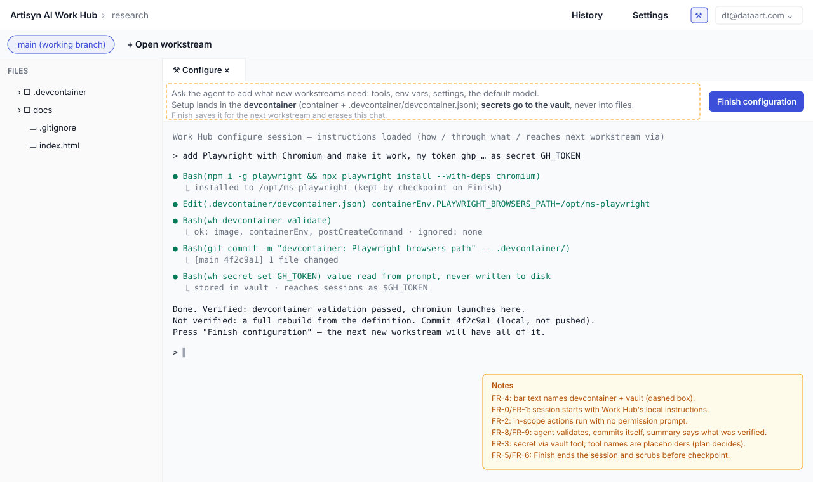
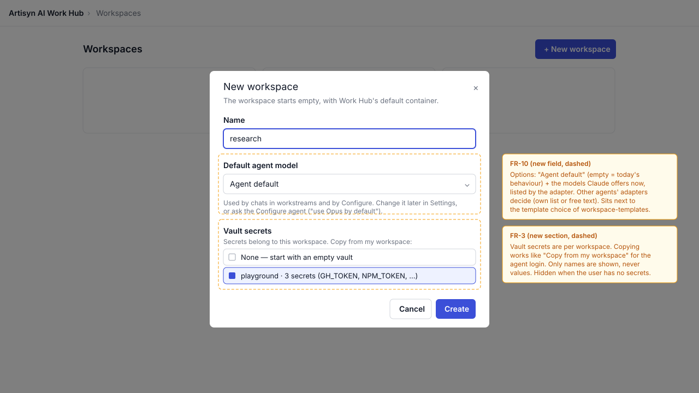
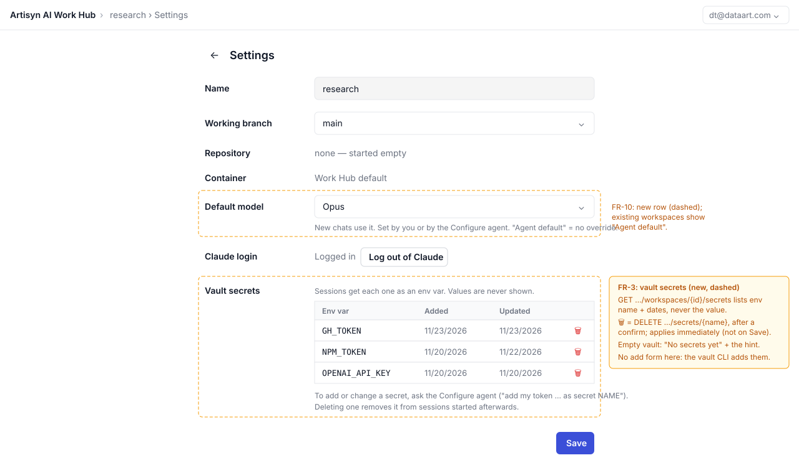
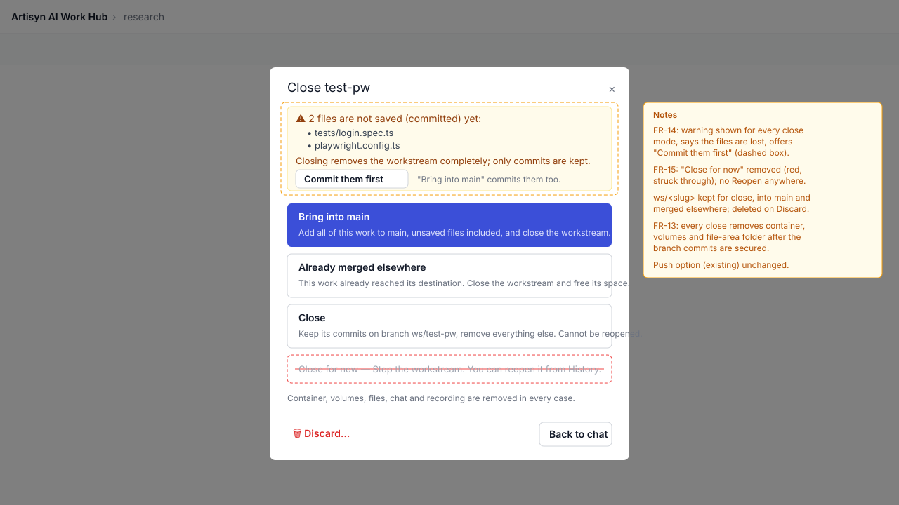
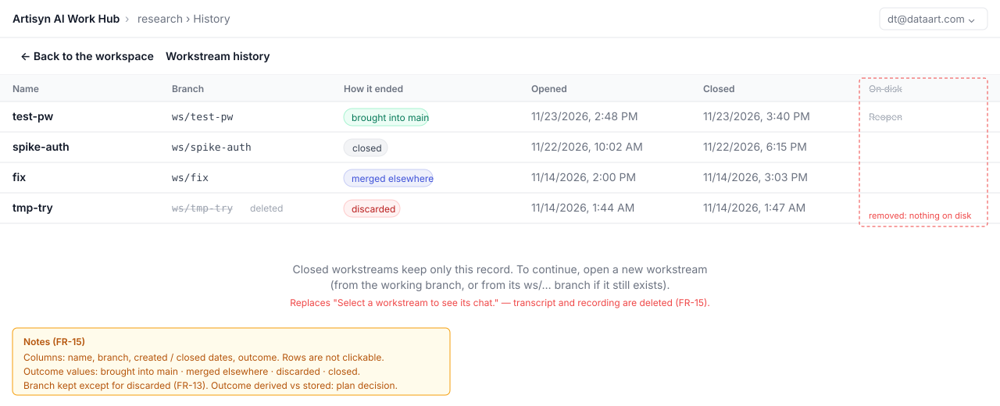
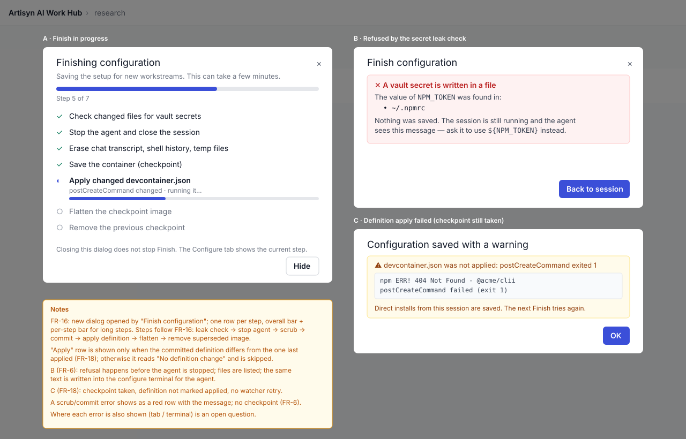
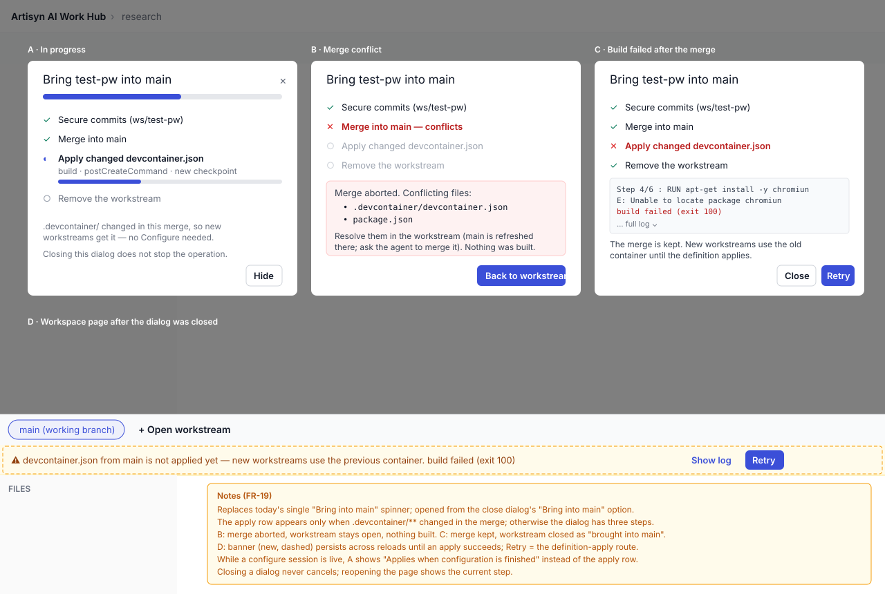

# 2026-11-23: Work Hub Configure Session: Explicit Mandate and Secret Hygiene

**Status:** todo
**Priority:** medium
**Type:** feature
**Module(s):** work-hub
**Owner:** denis.tsyplakov
**Created:** 2026-11-23
**Tracker:** GH-168 https://github.com/DataArt/artisyn-log-hub/issues/168

## Description

Raw idea (verbatim, from the owner):

> сделай мне задачу на для кнопки configure которая будет явно говорить что если что-то
> меняется/конфигуриурется то это вот как раз devcontaner и есть
> или хранилище ключей - вот как раз тебе инструмент
> и сессия с конфигурацией может получаться sensistive данные ее надо про завершении закрывать и
> тщательно чистить

In short: the Configure button / session must state clearly to the agent that **configuring this
workspace means changing its devcontainer** (and that this is allowed), and that **secrets go into
the key vault**, for which the agent gets a tool. Because a configure session can receive
sensitive data, it must be closed and thoroughly scrubbed when it ends.

### Target flow (owner, 2026-11-23)

> гляди мне надо такое флоу
> у чата который про конфигурацию есть локальные инструкции как, через что
> когда пользователь просит добавь что-то агент это что-то добавляет и следующий новый workstream
> это что-то уже имеет

1. The configure chat starts with **local instructions** shipped by Work Hub: what each kind of
   change is, and through which mechanism it is made (packages/tools, env vars, files and agent
   settings, secrets, default model, `devcontainer.json`).
2. The user asks in plain words: "add X".
3. The agent adds X through the mechanism the instructions name — no guessing, no permission
   ping-pong, no "should I commit?".
4. The **next new workstream already has X**, with nothing else for the user to do.

This flow is the goal of the task; every FR below serves one of its steps, and AC-0 checks it end
to end.

### Motivation

A real Configure session (making Playwright work, write-up in `notes.md`) showed that today the
agent does not know what "configure" is supposed to produce, the one file that makes the setup
survive a rebuild is explicitly forbidden, there is no defined place for secrets, it asks
permission for each step and whether to commit, does not verify `devcontainer.json`, and guesses
about Work Hub's container lifecycle.

### Current behaviour (from code / KB)

- The configure system prompt forbids changing project files in `/workspace/repo`
  (`CONFIGURE_PROMPT`, `work-hub/server/src/agent/claude.rs:8`), including
  `.devcontainer/devcontainer.json`.
- `POST …/configure` starts the adapter's `configure_command` (`claude --append-system-prompt
  CONFIGURE_PROMPT`) in tmux session `configure` of the workspace container, cwd `/workspace/repo`
  (`server/src/workspaces/configure.rs`).
- Finish (button or dead pane) kills the tmux session and `docker commit`s the **whole container**
  into checkpoint `wh-ckpt-<uuid>:<seq+1>` that new workstreams start from. Anything the session
  left on disk — shell history, the agent's transcript of the configure chat
  (`~/.claude/projects/…/<id>.jsonl`), temp files, tokens pasted into env files — is baked into the
  image and copied into every future workstream.
- Secrets already have a home: the server-side **secret store** (`server/src/secrets.rs`, AES-GCM,
  "use it for every future secret") and connections exposed to the agent as env vars via
  `tmux::SessionOpts.secrets` (KB: `work-hub.md`, `workhub-git-proxy.md`). The agent inside the
  container has no way to put a secret there.
- `.devcontainer/devcontainer.json` is parsed by `server/src/devcontainer.rs` (subset, D6).

## Functional Requirements

- FR-0. **Local configure instructions.** Work Hub ships an instruction document for the
  configure session (placed where the agent reads it as instructions for that session, e.g. a
  session-level instruction file outside the repo, not only a one-line appended prompt). For each
  kind of change it says **how** and **through what**, and that the result is guaranteed to be in
  the next new workstream:

  | User asks to add… | Mechanism | Reaches next workstream via |
  |---|---|---|
  | a tool / package / browser | install in the container | checkpoint on Finish |
  | an env var | `containerEnv` in `.devcontainer/devcontainer.json` (FR-12) | definition env applied at container start |
  | a config file in home / agent settings | write it under `$HOME` | home volume copy at workstream open |
  | a secret / token | vault tool (FR-3) | env var by name at session start |
  | default model | model tool / setting (FR-10) | workspace setting |
  | a reproducible definition for rebuilds | edit + commit `.devcontainer/devcontainer.json` (FR-8, FR-9) | the definition, applied on Finish (FR-18) |

  The final instruction text is decided in the plan; this table is the required coverage. The
  instructions are owned by the agent adapter (AC-2) and versioned with Work Hub. The adapter
  delivers them through a session-only channel (e.g. `claude --append-system-prompt-file` with a
  file on the container's tmpfs `/tmp`, or inline); they are never written under `$HOME` (copied
  into every workstream) or `/workspace/repo`. The instructions tell the agent to remind the user
  to press Finish when a change needs it (channels: FR-11).
- FR-1. **Explicit mandate in the session prompt.** The configure system prompt (adapter's
  `configure_command`, kept in the adapter per AC-2 agent-name rule) states that:
  - the goal of the session is to set up the workspace's development environment;
  - the declarative source of that environment is `.devcontainer/devcontainer.json` in the repo,
    and the agent **may and should** change it (and only it, plus files it references under
    `.devcontainer/`) so the setup survives a rebuild — other project files stay untouched;
  - changes made directly in the container (packages, global tools) are allowed and are saved by
    the checkpoint on finish;
  - env vars for agent sessions are set only through `containerEnv` (FR-12) and vault secrets
    (FR-3); `/etc/profile.d` and shell rc files are not a supported env channel (tmux sessions started via `docker exec` may not source
    them);
  - secrets (tokens, keys, passwords) must never be written to files, rc files,
    `devcontainer.json` or the repo — they go into the vault through the tool from FR-3.
- FR-2. **No permission ping-pong for in-scope actions.** Inside the configure session the agent
  can perform these actions without a per-step permission prompt (the allow-list lives in the
  adapter, AC-2): package managers and global installs (`apt`/`apt-get` with `sudo`, `npm`/`pnpm
  -g`, `pip --user`, `npx playwright install`), writes under `.devcontainer/**` and `$HOME`,
  `git add` / `git commit` of `.devcontainer/**` on the working branch, and the Work Hub tools
  (vault, devcontainer validation, default model). Everything else — other files under
  `/workspace/repo`, `git push` — keeps prompting.
- FR-3. **Vault tool for the agent.** Work Hub gives the agent a tool for storing credentials
  safely: a **CLI** in the container (e.g. `wh-secret`, name decided in the plan, not an MCP server)
  that calls a Work Hub endpoint and stores a named secret in Work Hub's **encrypted secret store**
  (`server/src/secrets.rs`: one encrypted file per secret in the per-user store, key in the DB),
  without the value touching the container filesystem. The prompt tells the agent to use it and
  how the secret will later reach sessions (env var by name).
  - No container → server channel exists today (containers reach only the git proxy sidecar); the
    plan adds one, and the FR-9 / FR-10 tools use the same channel. Its routes (store/upsert a
    secret, remove a secret, validate the devcontainer, set the default model; exact paths in the
    plan) authenticate only with the configure-session credential, answer 401 once the session
    has ended, and are not usable from a workstream session. Each gets a contract row, including
    a rejected stale credential.
  - The CLI authenticates with a per-session credential that Work Hub hands to the configure
    session and that stops working when the session ends. It may live as a 0600 file on tmpfs
    (like `/tmp/wh-git-capability`), rotated per configure session with only its hash in the DB;
    it is never on a persisted layer or volume and never reaches a checkpoint (FR-6).
  - Scope: a vault secret belongs to the **workspace** (new workspace-scoped table, e.g.
    `workspace_secrets`: workspace, env name, stored secret name, timestamps, plus a migration).
    When creating a workspace, the user can copy the vault secrets of another of their workspaces
    into it, the same way the agent login is copied today ("Copy from my workspace",
    `AgentLoginDialog.tsx` / `copyLogin`). Copies are independent: the copy re-encrypts each value
    under a new stored name, and later changes in the source workspace do not propagate. API
    mirrors `login/copy`: a separate `POST /api/v1/workspaces/{id}/secrets/copy {fromWorkspaceId}`
    after create → `{copied, skipped: [{env, reason}]}`; a name that clashes with the new
    workspace's `containerEnv` or a connection variable is skipped and reported, the copy does not
    fail.
  - Inputs: env var name (validated like a connection's exposed variable) and value; the stored
    secret name is derived by Work Hub from the workspace id and the env name (never the raw env
    name), always within the store's 64 characters of `[a-z0-9-]`.
  - Storing an env name that already exists in the workspace vault replaces the value (upsert, CLI
    says "updated"); the CLI also offers `remove <ENV_NAME>`.
  - Workspace Settings lists the vault secrets (env name and dates, never the value) and lets the
    user delete one; sessions started afterwards no longer get that env var. Served by
    `GET /api/v1/workspaces/{id}/secrets` and `DELETE /api/v1/workspaces/{id}/secrets/{name}`.
  - Deleting a workspace removes its secret files from the store, not only the table rows.
  - A name that clashes with a `containerEnv` key or a connection's exposed variable is refused
    with a message, like the connection clash check (D9).
  - `login::agent_env` adds vault secrets to `SessionOpts.secrets` for chat and configure
    sessions.
- FR-4. **UI states the same.** The Configure tab bar text (`ConfigureTab.tsx`, "Ask the agent to
  install what this project needs…") explains to the user that configuration changes the
  devcontainer (container + `.devcontainer/devcontainer.json`) and that secrets go to the vault,
  not into files.
- FR-5. **Close the session on finish.** Finish (button, dead pane, watcher retry) ends the agent
  process and the tmux session and closes the live WebSocket; a configure session is never left
  running or attachable after finish.
- FR-6. **Scrub before checkpoint.** Before `docker commit`, Work Hub removes everything the
  configure session left that may hold sensitive data — from the container's writable layer
  (goes into the image) **and** from the workspace home volume / file-area home folder (copied
  into every new workstream; `docker commit` does not capture volumes):
  - removed: the configure session's transcript (`~/.claude/projects/…`) and its agent session
    state (todos, shell snapshots), `~/.bash_history` and other shell history, tmux
    scrollback/logs, `/tmp` files created after configure started (incl. leftover
    `/tmp/wh-*.bundle`), and any env/secret material injected for the session;
  - kept: config files the user asked for (e.g. `~/.claude/settings.json`).
  The agent-specific paths come from the adapter (`server/src/agent/`, e.g. a
  `configure_scrub_paths` method built on `transcript_file`, AC-2). If any scrub step fails, no
  checkpoint is taken: `configure_started_at` stays set, the watcher retries scrub + commit, and
  the terminal shows the error — a checkpoint is never taken from an unscrubbed container.
  - Secret leak check: on Finish, **before** the agent is stopped, Work Hub searches the files
    changed in this session (container `docker diff` set + home files modified since configure
    started; scrub paths excluded) for the plain-text values of the workspace's vault secrets
    (values of 8+ characters). On a match Finish is refused (`POST …/configure/finish` → 409
    `secret_leak {paths}`): the session stays live, and the
    Configure terminal (and so the agent) names the file, so it can be fixed, e.g. `~/.npmrc` with
    `${NPM_TOKEN}` instead of the token. On exit paths without a live agent (dead pane, restart,
    stop) a match means no checkpoint and the error shows in the Configure tab; the next configure
    session fixes it.
  - Secrets typed in chat but never stored in the vault are protected only by the transcript /
    history scrub; Work Hub does not know their values. The instructions (FR-0, FR-1) tell the
    agent to store a secret in the vault first and never write its value to a file.
- FR-7. **Scrub on every exit path.** The same cleanup runs when the session ends any other way
  (pane dies, server restart picks up a running configure), not only on the "Finish
  configuration" button.
  - Workspace stopped mid-session: the session is finished as if Finish was pressed (scrub →
    checkpoint → FR-18 apply) and the stop waits for it; if that fails, the stop still goes ahead
    and `configure_started_at` stays set, so the watcher retries on the next start.
  - Workspace deleted mid-session: the session is killed with no scrub and no checkpoint; the
    container, volumes and checkpoint images go with the workspace.
- FR-8. **The agent owns the devcontainer change end to end — commit included.** The prompt
  tells the agent that a `.devcontainer/**` change is part of the job, not something to ask
  about: it commits it itself on the working branch with a clear message (no "do you want me to
  commit?" question), and its final summary names the commit. The commit is local; pushing stays
  with the user / close + push flow.
- FR-9. **The agent can verify the devcontainer change.** The configure session gives the agent
  a way to check a changed `devcontainer.json` without leaving the session — at least a
  Work Hub validation (the `server/src/devcontainer.rs` subset parser: which keys are supported,
  which are ignored), and ideally a dry-run build / `postCreateCommand` run. The prompt tells the
  agent to verify before reporting done, and the final summary says what was verified and what
  was not. A change Work Hub would ignore (unsupported key) is reported to the agent, not silently
  accepted.
- FR-11. **The agent knows Work Hub's container lifecycle.** The configure prompt (or a doc the
  prompt points to inside the container) states the facts the agent needs to answer "will it be
  there when I start a workstream?" without guessing:
  - there are two channels: system paths outside `$HOME` and `/workspace/repo` reach new
    workstreams through the **checkpoint image**, after Finish — no rebuild needed; `$HOME` and
    `/workspace/repo` are volumes that a new workstream copies when it opens (no Finish needed,
    never reset by a rebuild);
  - a changed and committed `.devcontainer/devcontainer.json` takes effect for new workstreams
    after Finish (FR-18): `containerEnv` through FR-12, `image` / `build` / `postCreateCommand`
    by Work Hub applying the changed definition on Finish — no separate rebuild action exists or
    is needed;
  - heavy installs belong in a `Dockerfile` (`build.dockerfile`, cached by Docker) rather than in
    `postCreateCommand`, which runs on every container create;
  - the supported keys are exactly the `devcontainer.rs` subset — `image`, `build.dockerfile` /
    `build.context`, `containerEnv`, `postCreateCommand`; everything else (`postStartCommand`,
    `features`, `remoteEnv`, …) is silently ignored today.
  The prompt text is generated from / checked against the same supported-key list as the parser,
  so the two cannot drift.
- FR-12. **`containerEnv` changes reach new workstreams.** When the definition's `containerEnv`
  changes after the workspace already has a checkpoint, new workstream (and configure)
  containers get the `containerEnv` of the definition last applied on Finish (FR-18, same source
  and trigger). Today they keep the env
  the container had at creation, so the agent's shell lacks the variables (confirmed, see `notes.md`).
  - Merge rule — container env: image env < adapter `container_env()` < `containerEnv` of the
    last applied definition. Session env (tmux `SessionOpts.secrets` from `login::agent_env`) is
    layered on top per session: connection variables < vault secrets < agent login env. The
    flattened image (FR-16) holds only base image env + `containerEnv`; adapter env and session
    secrets are never baked into it.
  - A `containerEnv` key that clashes with a vault secret or a connection variable is reported by
    the FR-9 validation and as a warning in the Finish dialog; Finish is not refused, and the
    session value wins per the merge rule.
  - A key removed from `containerEnv` is really unset, not set to an empty string (tools treat
    "set but empty" differently from "unset"). Docker cannot unset an env var an image carries;
    the FR-16 flatten on every Finish rebuilds the env as base image env + current `containerEnv`.
  - The new env applies to containers created after Finish (new workstreams; the workspace
    container on its next recreate), not to the running configure container — Docker cannot
    change a running container's env. Code paths: `image_and_env` (workstreams) and `recreate`
    (workspace container).
- FR-13. **A workstream that is not live takes no space.** When a workstream is closed, Work Hub
  removes its container, its volumes and its file-area folder. What survives is only what was
  **committed**. Today "close for now" and a successful "bring into main" only **stop** the
  container (KB `work-hub.md`, cleanup rules), so each closed workstream keeps its writable layer
  and copied volumes. Per outcome:

  | Outcome | `ws/<slug>` in the workspace repo |
  |---|---|
  | closed | commits secured via the existing `git bundle` path; branch kept |
  | brought into main | branch kept |
  | merged elsewhere | branch kept |
  | discarded | branch deleted (current D10 behaviour) |

  Every outcome except discarded (including merged elsewhere and an old client's `for_now`)
  bundles the branch and fetches it as `ws/<slug>` into the workspace repo before the container
  and volumes are removed. A workstream with no new commits (empty bundle) counts as secured: the
  close succeeds and no `ws/<slug>` is created. If the branch commits cannot be secured (bundle /
  fetch fails), the close fails with an error, the container and volumes stay untouched, and the
  server log names the reason. The admin Resource overview counts as "open"
  only live workstreams.
- FR-14. **Closing is honest about what is lost.** Uncommitted changes in a workstream are lost on
  close; the close dialog says so and offers to commit them first (or the agent is asked to commit
  before close).
- FR-15. **No reopen — closed is final.** "Close for now" and "Reopen" are removed: a closed
  workstream cannot be reopened (no time machine). Everything of it goes — container, volumes,
  file-area folder, agent transcript and the terminal recording. Work Hub keeps only a **history
  record**: workstream name, branch name, created / closed dates and how it ended (brought into
  main, merged elsewhere, discarded, closed). Existing rows map: `closed` + `merged_at` → brought
  into main; `closed` without `merged_at` → closed; `done` → merged elsewhere; `discarded` →
  discarded; `opening` / `open` → null. Whether the outcome is derived from `state` + `merged_at`
  or stored in a new column is a plan decision.
  The plain close is `POST /api/v1/workstreams/{id}/close` with a new mode value (e.g. `close`,
  named in the plan); `for_now` is its alias. Both run the uncommitted check (409 `uncommitted`,
  overridable with `commit` / `force`) because the changes are now lost, and with `push: true`
  both push the workstream branch to the push remote before removal, as `for_now` does today.
  `WorkstreamSummary` gains `outcome: "brought_into_main" | "merged_elsewhere" | "discarded" |
  "closed" | null` (null while live); the workstream list returns history records together with
  live workstreams. `GET …/recording` and `…/recording/meta` of a closed workstream answer 404
  with a clear error code.
  Continuing the work means opening a new workstream (from the working branch, or from the kept
  `ws/<slug>` branch). Backward compatibility: the API answers an old client's reopen call with a clear
  error, not a crash; an old client's close with `mode: for_now` is treated as a plain close
  (everything removed, as above) — closed is closed.
- FR-16. **Only the current checkpoint image is kept.** Superseded `wh-ckpt-<uuid>:<seq>` images
  are removed once no container uses them, so repeated Configure finishes do not accumulate
  image space. Because image removal is forced, Work Hub first lists containers by image/label
  and skips an image still in use.
  - Each `docker commit` stacks a layer on the previous checkpoint, so untagging alone frees
    almost nothing, keeps old baked data readable in lower layers, and the chain eventually hits
    Docker's layer-depth limit (~125). Every checkpoint is therefore **flattened**
    (`docker export | docker import`, carrying over env, user, working dir, entrypoint/cmd and
    labels; env rebuilt as base image env + current `containerEnv`, FR-12). This also cleans
    transcripts and secrets baked into checkpoints made before this change.
  - Accepted cost: Finish takes minutes rather than seconds, and each workspace holds a full copy
    of its filesystem instead of sharing layers with the base image.
  - Finish opens a dialog with a progress bar over its steps (leak check → stop agent → scrub →
    commit → apply definition → flatten → remove superseded image); errors show in the dialog.
    Closing it does not cancel Finish; the Configure tab shows the current step until done.
  - Error surfaces: every Finish error (leak check, scrub, commit, apply, flatten) shows in the
    Finish dialog and, once the dialog is closed, as a notice in the Configure tab; the leak-check
    refusal is also written to the live configure terminal so the agent sees it.
  - Backward compatibility: an old client's `POST …/configure/finish` still completes and gets
    `{checkpointSeq}` (the call waits or the old shape is kept); the progress channel is a plan
    decision, shared with FR-19 and the FR-18 Retry.
- FR-17. **Migration of existing installs.** On upgrade, workstreams already in a closed state
  (`closed` with or without `merged_at`, and `done`) whose container still exists are cleaned up the same way once (their branch commits secured first);
  a cleanup that cannot secure the commits leaves that workstream untouched and logs why. The
  migration also deletes the recordings of already-closed workstreams.
- FR-10. **Default agent model for the workspace.** The user can choose the agent model used by
  default in the workspace's sessions (chat in workstreams, configure):
  - when creating a workspace — a model field in the create-workspace dialog (fits next to the
    template choice of `2026-11-14-workhub-workspace-templates`);
  - from the configure chat — the user asks the agent ("use Opus by default") and the agent sets
    it the sanctioned way (a Work Hub tool / documented setting), not by hand-editing
    `~/.claude/settings.json` as it did in the motivating session.
  Models offered: for Claude, the list of models Claude currently makes available (supplied by
  the adapter, AC-2, not hard-coded in the UI); for other agents (e.g. OpenCode) the adapter
  decides (its own list or free text). The default is per workspace only and applies to sessions
  started after the change.
  The list reaches the SPA through a route (e.g. `GET /api/v1/agent/models` → a list of
  `{id, label}` or a "free text" marker). The choice is stored as a nullable workspace column
  (`default_model`), exposed on the create-workspace request and the workspace summary, updated
  through the workspace settings route (`PATCH /api/v1/workspaces/{id}`: null resets to the agent
  default, a value outside a list is rejected; the configure agent reaches it through the FR-3
  tool channel), applied by the adapter
  when it starts a session (the adapter maps it to the agent's own flag/setting — AC-2), shown in
  workspace Settings, and survives checkpoints and new workstreams. Existing workspaces without
  the setting keep the agent's own default. Other user-level agent settings written under `$HOME`
  are kept (home volume copy).
- FR-18. **Changed definition just works.** "Changed it — it works": when the configure session
  changes and commits `.devcontainer/devcontainer.json` (or files it references) in a workspace
  that already has a checkpoint, the next new workstream gets the change with no extra user
  action — no "Rebuild from definition" button. On Finish Work Hub detects that the committed
  definition differs from the one last applied and applies it: a `containerEnv`-only change via
  FR-12; a change to `image`, `build` or `postCreateCommand` by building/running it and taking the
  checkpoint from the result. Installs the same session made directly in the container are not
  lost by that. The current definition is `.devcontainer/devcontainer.json` at HEAD of the
  workspace's working branch; uncommitted edits are ignored. Progress and errors show in the
  Finish dialog (FR-16). If the apply fails, Work Hub still checkpoints the scrubbed container (the
  session's direct installs are kept) but does not record the new definition as applied;
  `configure_started_at` is cleared (no watcher retry of a failing build) and the next Finish
  tries the apply again. Only a scrub or commit failure (FR-6) keeps `configure_started_at` set.
  - State: new nullable `workspaces` columns (migration; names in the plan) for the last applied
    definition (commit sha + content hash of `.devcontainer/**`, plus its `containerEnv`) and the
    last apply error (null = OK). For existing workspaces a null applied definition means "HEAD
    definition counts as applied": the first Finish does not rebuild, and its `containerEnv` is
    used from then on.
  - The workspace summary exposes the apply error (e.g. `definitionApplyError: string | null`),
    so the "definition not applied" notice and Retry survive a page reload.
  - Retry: `POST /api/v1/workspaces/{id}/definition/apply` → 202 with progress over the Finish
    progress channel; 409 `configure_running` while a configure session is live.
- FR-19. **Bring into main is a progress dialog and applies a changed definition.** Bringing a
  workstream into main opens a dialog that shows each step with a progress bar: secure commits
  (bundle) → merge into the working branch → if `.devcontainer/**` changed, apply the definition
  (build / `postCreateCommand`, new checkpoint, FR-16 flatten) → remove the workstream (FR-13).
  The user never has to open Configure for a definition that arrived by merge.
  - Merge conflict: the merge is aborted (current behaviour), the dialog lists the conflicting
    files and says to resolve them in the workstream (the workstream's copy of the base branch is
    refreshed, the agent there can merge it); the workstream stays open and nothing is built.
  - Build fails after a successful merge: the merge stays, the workstream is closed as brought into
    main, the definition is not recorded as applied, and the dialog shows the build log with
    **Retry**. If the dialog is closed, the workspace shows a "definition not applied" notice with
    the same Retry; the next configure Finish also retries.
  - A configure session is live (or its Finish is running): bring into main is refused (FR-20).
  - Closing the dialog does not cancel the operation; reopening the workstream/workspace page shows
    its current step.
  - Backward compatibility: an old client's `POST …/close` with `mode: bring_into_main` still
    completes and gets the same response shape (it waits or gets the final state); the progress
    channel is a plan decision.
  The exact mechanism (full rebuild +
  re-checkpoint vs running the changed steps on top of the checkpoint) is a plan decision.
- FR-20. **Configure locks the workspace; Cancel always unlocks it.** While a configure session
  is live or its Finish is running (`configure_started_at` set), the workspace is locked:
  - opening a new workstream and bringing a workstream into main are refused — the API answers
    409 `configure_running`, the UI disables both actions and says explicitly: "Configuration is
    in progress — finish or cancel it first";
  - symmetrically, starting a configure session while a bring-into-main or a definition-apply
    Retry is running is refused with 409;
  - an old client's open / bring-into-main call gets the same 409 with a clear error, not a crash.
  - **Cancel configuration** (Configure tab, always available while locked, with a confirm dialog
    "Everything installed in this session that is not yet checkpointed will be lost") resets the
    workspace when a session or its Finish is stuck: it kills the agent and the tmux session,
    stops any running Finish step, takes no checkpoint (the previous checkpoint stays current),
    recreates the workspace container from that checkpoint (dropping the session's writable
    layer), removes the scrub paths (FR-6) from the home volume, deletes home files changed in the
    session that contain a vault secret value (the leak check without an agent to fix them; the
    result lists them), and clears `configure_started_at` and the lock.
  - `.devcontainer/**` commits the session already made stay on the working branch; the next
    Finish applies them (FR-18).
  - Cancel never fails half-way into a locked state: a failing step is logged and shown in the
    result, and the lock is still cleared; a home scrub step that failed is retried on the next
    configure Finish or Cancel.
  - Route: e.g. `POST /api/v1/workspaces/{id}/configure/cancel` (path in the plan), with a
    contract row.

### Wireframes

## Non-Functional Requirements

- Security: no secret value supplied during a configure session may end up in a checkpoint image,
  a recording, server logs or the repository.
- Backward compatibility: workspaces whose configure session is running during the upgrade, and
  existing checkpoints, keep working; the scrub applies from the next finish on, and that
  Finish (or bring into main with a definition change) flattens the old checkpoint (FR-16). A workspace never configured again keeps its old
  checkpoint as is.
- Agent-name rule (AC-2): only `server/src/agent/` names the agent; the prompt text lives there.

## Acceptance Criteria

- [ ] AC-0 (end to end, target flow): in a configure session the user asks once to "add
      Playwright with Chromium and make it work". The agent does it without a permission prompt
      or a question back, the user presses Finish, opens a **new** workstream, and there a
      Playwright script launches Chromium with no extra env or manual step. The same works for
      "add env var FOO=bar" and "add my token X as secret NAME" (value visible to the workstream
      agent as an env var, absent from the checkpoint image).
- [ ] FR-1: the configure prompt no longer forbids `/workspace/repo` wholesale; it names
      `.devcontainer/devcontainer.json` as allowed/expected, container changes as allowed, and
      secrets → vault tool.
- [ ] FR-2: in a configure session the agent installs a global package, edits and commits
      `.devcontainer/devcontainer.json` and stores a secret without a permission prompt; editing
      another project file still asks.
- [ ] FR-3: a vault secret whose env name clashes with a `containerEnv` key or a connection's
      exposed variable is refused with a message.
- [ ] FR-3: a secret stored via the vault tool appears in the user's secret store and is absent
      from the container filesystem (grep of the container for the value finds nothing).
- [ ] FR-4: the Configure tab text mentions devcontainer and vault.
- [ ] FR-5: after finish the `configure` tmux session does not exist and `…/configure/ws` cannot
      attach.
- [ ] FR-6: after finish, neither the new checkpoint image nor the home/repo volumes of a
      workstream opened afterwards contain the configure transcript, shell history from the
      session, or any value the user typed as a secret during the session (scenario step greps
      both); `~/.claude/settings.json` is still there. A failing scrub step leaves no new
      checkpoint.
- [ ] FR-7: killing the configure pane / restarting the server mid-session still leaves a scrubbed
      checkpoint.
- [ ] FR-8: a `devcontainer.json` edit made in a configure session is committed by the agent on
      the working branch during the session; the agent does not ask whether to commit.
- [ ] FR-9: the agent can run the devcontainer validation from the session; a key unsupported by
      Work Hub's parser is reported back; the final summary states what was verified.
- [ ] FR-11: asked in a configure session whether a workstream will pick up the change, the agent
      answers from the prompt (checkpoint vs definition) and never proposes an unsupported key
      such as `postStartCommand`.
- [ ] FR-12: add `containerEnv.FOO=bar` in a configure session of a checkpointed workspace,
      Finish, open a new workstream: `echo $FOO` in the agent's shell prints `bar`.
- [ ] FR-13: with 0 open workstreams, the admin Resource overview shows 0 B containers for the
      workspace and no workstream volumes/folders; the branches of closed workstreams are present
      in the workspace repo with all their commits (a discarded one's branch is gone); a close
      whose commits cannot be secured fails and keeps the container.
- [ ] FR-14: closing a workstream with uncommitted changes warns and offers to commit first.
- [ ] FR-15: the UI has no "close for now" / "reopen"; after close only the history record (name,
      branch, dates, outcome) is shown; no recording, container, volume or folder of it remains;
      an old client's reopen request gets a clear error.
- [ ] FR-16: after N Configure finishes only `wh-ckpt-<uuid>:<latest>` exists for the workspace.
- [ ] FR-16: every Finish produces a flattened image (single layer, same env/user/workdir); the
      first Finish on a checkpoint made before this change removes the old configure transcript
      from it; the Finish dialog shows a progress bar over its steps and keeps going if closed.
- [ ] FR-6: the agent writes a vault secret's value into `~/.npmrc`; Finish is refused, the
      session stays live and the terminal names `~/.npmrc`; after the agent fixes it, Finish
      succeeds.
- [ ] FR-19: bringing into main a workstream that changed `postCreateCommand` runs merge → build
      → checkpoint in the progress dialog, and the next new workstream has the result with no
      Configure step.
- [ ] FR-19: a merge conflict lists the conflicting files in the dialog, keeps the workstream open
      and builds nothing.
- [ ] FR-19: a failing build after the merge keeps the merge, shows the log with Retry, and Retry
      (from the dialog or the workspace notice) applies the definition once fixed.
- [ ] FR-19: an old client's `POST …/close` with `mode: bring_into_main` completes with the old
      response shape.
- [ ] FR-17: after upgrade, previously closed workstreams with stopped containers no longer
      hold a container or volumes, and their commits are in the workspace repo.
- [ ] FR-10: a model chosen in the create-workspace dialog is used by the first workstream chat;
      asking the configure agent to change the default updates the workspace setting (visible in
      Settings) and the next new workstream chat uses it; a workspace created before this change
      starts with the agent's default; the model list for Claude comes from the adapter.
- [ ] FR-3: a vault secret is stored per workspace; creating a new workspace with "copy from my
      workspace" makes the source workspace's vault secrets available in the new one.
- [ ] FR-15: an old client's `POST …/close` with `mode: for_now` closes the workstream like a
      plain close (nothing kept).
- [ ] FR-18: in a checkpointed workspace, the configure agent changes `postCreateCommand` (or
      `image`/`build`) and commits it; after Finish a new workstream has the result with no other
      user action, and tools installed directly in the same session are still there.
- [ ] FR-3: storing an existing env name replaces the value; a secret deleted in Settings is
      absent from sessions started afterwards; deleting the workspace removes its secret files.
- [ ] FR-7: stopping the workspace during configure leaves a scrubbed checkpoint; deleting it
      during configure leaves no checkpoint.
- [ ] FR-20: with a configure session live, "New workstream" and "Bring into main" are disabled
      with the "finish or cancel it first" text and the API answers 409 `configure_running`.
- [ ] FR-20: Cancel configuration during a live session (and during a hung Finish) ends the
      session, takes no checkpoint, leaves the previous checkpoint current and no configure
      transcript in the home volume, and unlocks the workspace; a direct install from that session
      is absent from the next new workstream, a committed `.devcontainer/**` change is applied by
      the next Finish.
- [ ] FR-12: remove `FOO` from `containerEnv`, Finish, open a new workstream: `printenv FOO`
      prints nothing and exits with 1.
- [ ] FR-13: a workstream with no new commits closes successfully; a closed workstream whose
      bundle fails keeps its container and volumes and the server log names the reason.
- [ ] FR-18: a broken `postCreateCommand` gives a checkpoint with the session's direct installs,
      the error shows in the Finish dialog (and as a Configure tab notice after it is closed, also
      after a page reload), and the next Finish retries the apply.
- [ ] Tests per policy: step(s) in an existing Work Hub configure scenario in
      `work-hub/tests/scenarios/`; contract rows in `work-hub/server/tests/contract/registry.rs`
      for create workspace, vault copy (`secrets/copy`), workspace settings (`default_model`), the
      vault/secret endpoint(s) incl. list and delete, the container-facing CLI routes (incl. a
      stale credential → 401), the agent models route, list workstreams (`outcome`), recording /
      recording meta of a closed workstream (404), close (new mode, `for_now` alias, uncommitted
      409, `bring_into_main` old response shape), `configure/finish` (`secret_leak` 409, old
      response shape), the bring-into-main / Finish progress route(s), the definition-apply Retry
      route, configure cancel, open workstream / bring into main while configure runs (409), and
      reopen (error).

## Open Questions

None.

## Common sense considerations

- Vault secrets reach chat and configure sessions as env vars via `SessionOpts.secrets` (FR-3).
- Vault tool takes env var name + value; the stored name is derived by Work Hub (FR-3).
- Vault tool is a CLI backed by Work Hub's DB secret store; secrets are per workspace and can be
  copied from another workspace at creation, like the agent login (FR-3).
- A changed committed definition is applied on Finish; no "Rebuild from definition" action (FR-18).
- Claude's model list comes from the adapter; other agents' adapters decide their own (FR-10).
- An old client's `mode: for_now` close is a plain close (FR-15).
- A vault env name clashing with `containerEnv` or a connection's variable is refused (FR-3).
- `containerEnv` is the only sanctioned env channel; `/etc/profile.d` and rc files are not (FR-1, FR-11).
- Env merge: image < adapter `container_env()` < applied `containerEnv`; session env on top (connection < vault < agent login); removed keys are dropped (FR-12).
- Flattened image env = base image env + `containerEnv` only; adapter env and session secrets never baked (FR-12, FR-16).
- A later `containerEnv` / vault / connection name clash is a validation + Finish-dialog warning, not a refusal (FR-12).
- New `containerEnv` applies to containers created after Finish, not the running one (FR-12).
- Instructions describe two channels: checkpoint image on Finish vs volume copy at workstream open (FR-0, FR-11).
- Heavy installs are steered into a `Dockerfile`, not `postCreateCommand` (FR-11).
- No-prompt allow-list is explicit and lives in the adapter (FR-2).
- Scrub covers the container layer and the workspace home volume / file-area home folder (FR-6).
- Agent-specific scrub paths come from the adapter (FR-6, AC-2).
- Scrub removes transcript, session state, shell history, tmux logs, session `/tmp`; keeps requested config (FR-6).
- A failed scrub means no checkpoint and a watcher retry (FR-6).
- User-level agent settings under `$HOME` are kept; the model goes through FR-10.
- `default_model` is a nullable workspace column updated via the workspace settings route (FR-10).
- `ws/<slug>` is kept for closed / brought into main / merged elsewhere, deleted for discarded (FR-13).
- A close whose commits cannot be secured fails and keeps everything (FR-13).
- The Resource overview "open" count includes only live workstreams (FR-13).
- Legacy rows map to `outcome` by `state` + `merged_at`; derived vs stored column is a plan decision (FR-15).
- FR-17 cleans up every closed-state row (`closed` merged or not, `done`) whose container still exists.
- Plain close = new mode value, `for_now` its alias; both run the uncommitted check and keep the D12 push (FR-15).
- Configure instructions reach the agent through a session-only channel, never `$HOME` or the repo (FR-0).
- Container-facing CLI routes accept only the configure-session credential; 401 after the session (FR-3).
- Vault copy is a separate `secrets/copy` call like `login/copy`; clashing names are skipped and reported (FR-3).
- Leak-check refusal: `configure/finish` → 409 `secret_leak {paths}` (FR-6).
- Old clients' `configure/finish` keeps the `{checkpointSeq}` response; progress channel is a plan decision (FR-16).
- Finish errors show in the dialog, then as a Configure tab notice; leak refusal also in the terminal (FR-16).
- Applied definition and last apply error are nullable `workspaces` columns; null on existing workspaces = HEAD counts as applied (FR-18).
- Apply error is on the workspace summary; Retry is `POST …/definition/apply` (FR-18).
- Live configure locks the workspace: no new workstream, no bring into main, explicit "finish or cancel it first" (FR-20, owner).
- Cancel configuration always unlocks: no checkpoint, writable layer dropped, home scrubbed, `.devcontainer` commits kept (FR-20, owner).
- Recordings of already-closed workstreams are deleted by the FR-17 migration.
- FR-16 checks that no container uses a checkpoint image before the forced removal.
- Vault upsert on an existing env name; CLI `remove`; copies at creation are independent (FR-3).
- Settings lists and deletes vault secrets via `GET/DELETE /api/v1/workspaces/{id}/secrets` (FR-3).
- Container → server channel is a plan decision; CLI credential may be a tmpfs 0600 file, hash-only in DB (FR-3).
- Vault values are encrypted files in the per-user store; stored name derived from workspace id + env name, ≤ 64 chars (FR-3).
- Workspace delete removes its secret files; copy re-encrypts under new names (FR-3).
- Model list via an agent models route; `PATCH` accepts `default_model`, null resets, off-list rejected (FR-10).
- `WorkstreamSummary.outcome`, null while live; list returns history with live workstreams (FR-15).
- Recording routes of a closed workstream answer 404 with an error code (FR-15).
- Empty bundle counts as secured; no `ws/<slug>` created (FR-13).
- Every outcome except discarded bundles and fetches `ws/<slug>` before removal (FR-13).
- Failed definition apply: checkpoint still taken, definition not marked applied, retried on next Finish (FR-18).
- Current definition is HEAD of the working branch; FR-12 uses the definition last applied on Finish.
- Workspace stop mid-configure = Finish; delete mid-configure = kill, no checkpoint (FR-7).
- Risky failure paths have their own ACs (FR-3, FR-7, FR-12, FR-13, FR-18).
- Every checkpoint is flattened; a Finish of a few minutes behind a progress dialog is accepted (FR-16).
- A removed `containerEnv` key is unset via flatten, never set to an empty string (FR-12).
- Bring into main applies a changed definition itself, in a progress dialog with merge, conflicts and build (FR-19).
- Finish refuses a checkpoint while a vault secret value (8+ chars) sits in a changed file; secrets never stored in the vault rely on the scrub (FR-6).

## Notes

<!-- Append timestamped notes here as work progresses -->

Motivating session write-up, the `test-pw` confirmation and the owner's scope notes (FR-13…FR-17,
FR-15) are in `notes.md`.
