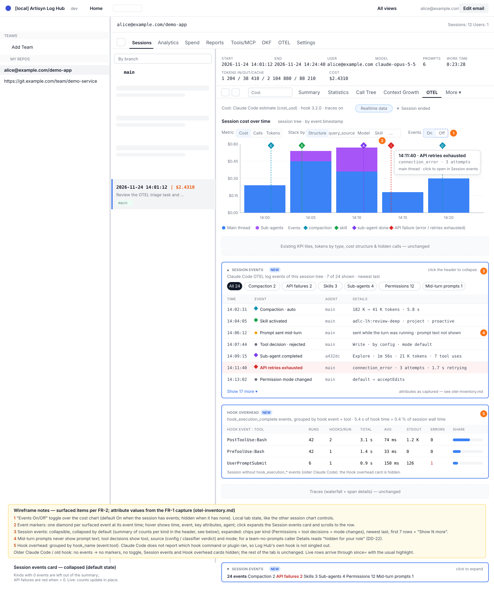

# 2026-11-24: Claude Code OTEL Events Triage

**Status:** todo
**Priority:** medium
**Type:** feature
**Module(s):** server | client | hook
**Owner:** denis.tsyplakov
**Created:** 2026-11-24
**Tracker:** GH-170 https://github.com/DataArt/artisyn-log-hub/issues/170

## Description

Raw idea (from the morning check 2026-11-24, `docs/morning-check/daily/2026-11-24-1438.md`):

Triage Claude Code OTEL events and attributes that Log Hub does not track yet. Log Hub's OTEL tabs
read only `claude_code.api_request` logs (cost, `otel_calls`) and spans (`claude_code.interaction`
/ `llm_request` / `tool`); every other log event arrives in the raw claude-otel chunks but is not
projected or shown ([otel-tabs.md](../../../knowledgebase/otel-tabs.md): `api_error` /
`user_prompt` are not stored in any table; Code Mode note in the compatibility matrix).

Untracked documented events (grep of `server/src`, `client/src`, `hook` found no reference):
`compaction`, `api_retries_exhausted`, `api_refusal`, `skill_activated`, `subagent_completed`,
`hook_registered`, `hook_execution_start`, `hook_execution_complete` (now with output size
counts), `hook_plugin_metrics`, `permission_mode_changed`, `plugin_installed`, `internal_error`,
`at_mention`, `feedback_survey`, `managed_settings_resolved`, `retention_sweep`.

Carrier events of the untracked attributes below, also not projected: `tool_decision`,
`user_prompt`, `api_error`, and `tool_result` if Log Hub does not read it either.

Untracked attributes:

| Claude Code | Item |
|---|---|
| 2.1.301 | `tool_decision`: `classifier_verdict`, `classifier_category`, `permission_mode` |
| 2.1.325 | `user_prompt`: `delivery.mode: "mid_turn"` for messages sent mid-turn |
| 2.1.331 | `claude_code.llm_request` span: `gen_ai.response.model`, `gen_ai.operation.name`, `gen_ai.usage.*` |

Already handled, out of scope: `anthropic.plan` / `seat_type` / `provider` / `custom_base_url`
(2.1.317), the 5-minute / 1-hour cache-write split.

Important semantic trap: `gen_ai.usage.input_tokens` (semconv) **includes** prompt-cache tokens,
while the native `input_tokens` excludes them. Today Log Hub stores these attributes in
`otel_spans.attributes` and never reads them, so nothing is double-counted.

Sources: https://code.claude.com/docs/en/monitoring-usage, the Claude Code CHANGELOG.

## Functional Requirements

- **FR-1 Inventory.** Capture the OTEL output of real sessions on the current Claude Code with the
  installer's OTEL env and tracing on (the hook forwards these lines unchanged, so a receiver with
  the same env sees the same data) and list which of the events / attributes above arrive, with
  their attribute keys and sample values. Per item: the trigger used, the result — *arrived* /
  *triggered, not emitted* / *not triggered* (docs-only decision) — and any env flag beyond the
  installer's set. Done: [otel-inventory.md](otel-inventory.md).
- **FR-2 Decision per item.** Approved by the owner on 2026-11-24. *Surface* enriches what
  already exists — the current OTEL fact tables, the session OTEL facts response and the session
  OTEL tab; there is no "store only" outcome and no new generic events table. *Ignore* leaves the
  item in the raw chunks / `otel_spans.attributes`.

  | Item | Decision | Where / what | Existing Log Hub source |
  |---|---|---|---|
  | `compaction` | surface | event marker + Session events row: trigger (manual / auto), `pre_tokens` → `post_tokens`, `duration_ms` | complements `CacheRatioCauses.compaction` / `session_cause_stats` (same session, by time) |
  | `api_error`, `api_retries_exhausted` | surface | event marker + Session events row: error, attempts, retry time, model | none |
  | `skill_activated` | surface | Session events row: `skill.name`, `skill.source`, `invocation_trigger` | complements `otel_calls.skill_name` (cost by skill) |
  | `subagent_completed` | surface | event marker + Session events row: `agent_type`, duration, `total_tokens`, `total_tool_uses`, model swap | complements `agent_id` on calls / spans (join key `agent_id`) |
  | `hook_execution_complete` | surface | Hook overhead card, grouped by `hook_name` (event:tool): runs, hooks per run, total / avg duration, stdout chars, errors | none |
  | `permission_mode_changed` | surface | Session events row: `from_mode` → `to_mode` | none |
  | `tool_decision` (`decision`, `source`, `permission_mode`, `classifier_verdict`, `classifier_category` when present) | surface | Session events row | none |
  | `user_prompt` `delivery.mode` | surface | Session events row "prompt sent mid-turn", never the prompt text | none |
  | `at_mention`, `managed_settings_resolved`, `hook_registered`, `hook_execution_start`, `tool_result`, `assistant_response`, `mcp_server_connection`, `plugin_loaded` | ignore | no user value beyond what the session already shows | — |
  | `api_refusal`, `hook_plugin_metrics`, `plugin_installed`, `internal_error`, `feedback_survey`, `retention_sweep` | ignore | not seen in the capture; `api_refusal` can later follow the `api_error` path | — |
  | `llm_request` span `gen_ai.*` | ignore | `gen_ai.response.model` always equals `model`; `gen_ai.usage.*` repeat the native token fields | native span attributes |

  Log Hub's own hook is not singled out: Claude Code does not report which hook command or plugin
  ran.
- **FR-3 Token rule in the KB.** `docs/knowledgebase/otel-tabs.md` (span attributes) and
  `docs/knowledgebase/llm-call-math.md` say that `gen_ai.usage.input_tokens` already includes
  cache tokens and must never be added to `cache_read_tokens` / `cache_creation_tokens` again.
- **FR-4 Implement the "surface" decisions** of FR-2 — all of them in this task, no follow-up
  tasks: event markers on the session cost chart (with an Events On/Off toggle), a Session events
  card with filter chips, and a Hook overhead card on the session OTEL tab. The Session events
  card is collapsible and collapsed by default; collapsed, its header shows the event count per
  kind (e.g. "24 events · Compaction 2 · API failures 2 · …"). Surfaced events reach
  the client as a new optional field on the existing session OTEL facts response, included in the
  `since` / `seq` deltas, with its row in `server/test/contract/registry/`; event attributes are
  dropped for `team-no-prompts` callers under the DD-22 masking rule.
- **FR-5 Compatibility.** Old Claude Code versions (which don't send these events) and old hooks
  keep working: no events → no markers, no toggle, the new cards are hidden. The compatibility
  matrix in `otel-tabs.md` gets a row per new item.

## Acceptance Criteria

- [x] FR-1: the task folder holds an inventory table built from a real capture
      ([otel-inventory.md](otel-inventory.md)).
- [x] FR-2: every item has a decision; "surface" items name the place; the owner approved the list.
- [ ] FR-3: both KB articles state the `gen_ai.usage.input_tokens` rule.
- [ ] FR-4: each surfaced item is visible in the named place and covered by a step in an existing
      scenario (`tests/scenarios/`, e.g. `s-otel-01`); an item added to an existing OTEL fact
      table is filled after re-projection for sessions uploaded before the change.
- [ ] FR-5: the compatibility matrix lists the new items; a session without the events shows the
      OTEL tab as before; `s-compat-01` (frozen old hook) still passes.

## Common sense considerations

- Event results are three-valued (arrived / triggered, not emitted / not triggered), so an untriggered event is never read as "not emitted".
- Each FR-2 row names the existing source of the same fact, to avoid two conflicting numbers in the UI.
- Surfaced events extend the existing session OTEL facts response with an optional field (old clients ignore it); new routes only if a plan proves the field unworkable.
- DD-22 masking applies to event attributes as it does to span attributes.
- Any item added to an existing table is backfilled through the `OTEL_PROJECTION_VERSION` bump and checked for pre-change sessions.

## Open Questions

## Notes

<!-- Append timestamped notes here as work progresses -->

- 2026-11-24 — FR-1 capture done: PoC [docs/pocs/2026-11-24-1526-otel-events-capture](../../../pocs/2026-11-24-1526-otel-events-capture/README.md),
  inventory in [otel-inventory.md](otel-inventory.md). Most listed events arrive on 2.1.325 and
  2.1.331 with the installer's env; `gen_ai.*` on `llm_request` spans only on 2.1.331, where
  `gen_ai.usage.input_tokens` = native input + cache read + cache write and
  `gen_ai.response.model` always equals the native `model` attribute; `hook_execution_*` carry no
  hook command or plugin name.
